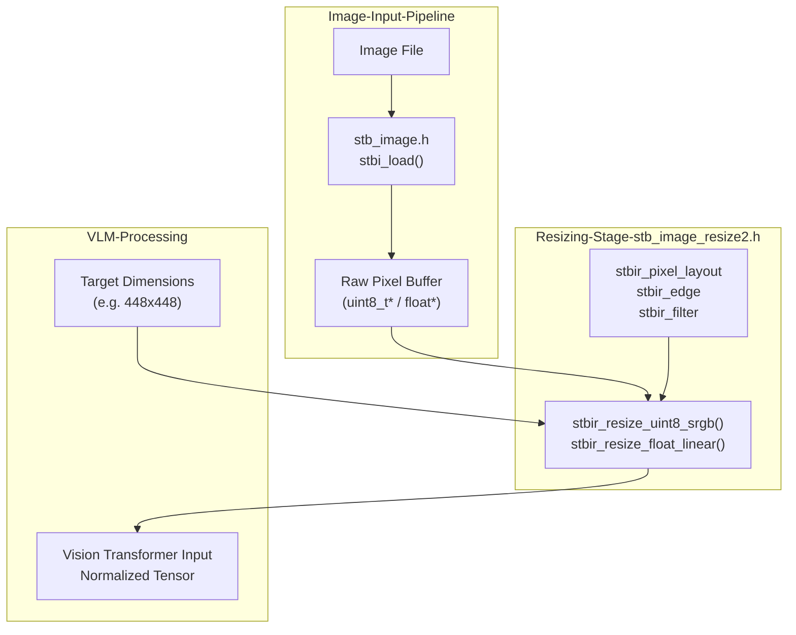
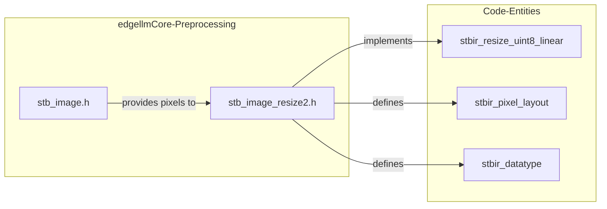

<!-- source: DeepWiki mcp.deepwiki.com · repo NVIDIA/TensorRT-Edge-LLM · extra page stb_image_resize2 Library · fetched 2026-10-26 -->

# stb_image_resize2 Library

Relevant source files

The following files were used as context for generating this wiki page:

- [3rdParty/stb/stb_image_resize2.h](3rdParty/stb/stb_image_resize2.h)

## Purpose and Scope

This document provides reference documentation for the `stb_image_resize2.h` library, a high-performance, single-header image resizing library used in TensorRT-Edge-LLM for preprocessing vision inputs in multimodal models. This library handles the resizing of input images to match the expected dimensions of Vision Transformers (VIT) in supported Vision-Language Models (VLMs).

For information about image loading and format support, see [stb_image Library](8.1.1). For details on multimodal model support and VIT integration, see [Multimodal Support](7.2).

**Sources:** [3rdParty/stb/stb_image_resize2.h:20-27](), [3rdParty/stb/stb_image_resize2.h:33-47]()

## Library Overview

`stb_image_resize2` is a header-only C library from the STB collection that provides fast, high-quality image resizing with support for multiple edge handling modes, pixel layouts, and color spaces. It is the successor to the original `stb_image_resize.h`, offering improved performance and additional features like SIMD support for SSE2, AVX, Neon, and WASM.

### Key Characteristics

| Characteristic | Description |
|----------------|-------------|
| **Type** | Single-header library (`stb_image_resize2.h`) |
| **Language** | C (C++ compatible) |
| **License** | Public Domain / MIT |
| **Dependencies** | None (standalone) |
| **Memory Model** | User-provided buffers or internal allocation [3rdParty/stb/stb_image_resize2.h:48-49]() |
| **SIMD Support** | SSE2, AVX, AVX2, NEON, WASM [3rdParty/stb/stb_image_resize2.h:82-84]() |

The library is designed for integration into systems requiring deterministic, high-performance image preprocessing without external dependencies.

**Sources:** [3rdParty/stb/stb_image_resize2.h:1-27](), [3rdParty/stb/stb_image_resize2.h:82-84]()

## Library Architecture

The following diagram shows how `stb_image_resize2` fits into the image processing pipeline and associates system names with code entities:

Title: "Image Preprocessing Data Flow"

**Sources:** [3rdParty/stb/stb_image_resize2.h:36-46](), [3rdParty/stb/stb_image_resize2.h:52-55]()

## Core Features

### Resizing API Levels

`stb_image_resize2` provides three levels of API complexity [3rdParty/stb/stb_image_resize2.h:52-55]():

1.  **Easy API**: Downsamples with Mitchell filter and upsamples with cubic interpolation. Clamps to edges by default.
    *   `stbir_resize_uint8_srgb()` [3rdParty/stb/stb_image_resize2.h:36-38]()
    *   `stbir_resize_uint8_linear()` [3rdParty/stb/stb_image_resize2.h:40-42]()
    *   `stbir_resize_float_linear()` [3rdParty/stb/stb_image_resize2.h:44-46]()
2.  **Medium API**: Provides more control over filters and edge modes.
3.  **Extended API**: Supports threading and complex configurations.

### SIMD and Performance

The library is highly optimized for performance:
*   **Auto-selection**: Automatically detects SIMD support based on compiler switches (e.g., `/arch:AVX`, `-msse2`, `-mfpu=neon`) [3rdParty/stb/stb_image_resize2.h:85-95]().
*   **FMA Support**: Can be enabled via `STBIR_USE_FMA` for a ~15% speedup on supported CPUs [3rdParty/stb/stb_image_resize2.h:102-106]().
*   **Profiling**: Built-in profiling available via `STBIR_PROFILE` and `stbir_resize_extended_profile_info()` [3rdParty/stb/stb_image_resize2.h:77-80]().

**Sources:** [3rdParty/stb/stb_image_resize2.h:70-80](), [3rdParty/stb/stb_image_resize2.h:82-110]()

## Integration in TensorRT-Edge-LLM

`stb_image_resize2` is critical for preparing visual data for the `edgellmCore` multimodal pipeline.

Title: "Component Association for Multimodal Processing"

### Alpha Channel Handling

The library supports weighted averages based on alpha values to prevent "color bleeding" from transparent pixels [3rdParty/stb/stb_image_resize2.h:112-130](). This is particularly important for models processing images with transparency.

**Sources:** [3rdParty/stb/stb_image_resize2.h:112-134]()

## Memory Management

By default, the library uses `malloc` and `free`, but these can be overridden using macros:
*   `STBIR_MALLOC(size, user_data)` [3rdParty/stb/stb_image_resize2.h:63]()
*   `STBIR_FREE(ptr, user_data)` [3rdParty/stb/stb_image_resize2.h:64]()

Each resize operation typically makes exactly one call to `malloc` and `free` unless the extended API is used to manage allocations for multiple resizes [3rdParty/stb/stb_image_resize2.h:66-67]().

**Sources:** [3rdParty/stb/stb_image_resize2.h:59-69]()

## Implementation Details

To use the library, the implementation must be created in exactly one C/C++ file by defining `STB_IMAGE_RESIZE_IMPLEMENTATION` before including the header [3rdParty/stb/stb_image_resize2.h:29-31]().

### Pixel Layouts
The library supports various pixel layouts defined in the `stbir_pixel_layout` enum, allowing for 1 to 4 channels and different interleaving strategies [3rdParty/stb/stb_image_resize2.h:36-46]().

### Edge Modes
Edge handling is critical for avoiding artifacts at the boundaries of resized images. Supported modes include:
*   `STBIR_EDGE_CLAMP`: (Default for Easy API) Clamps to the edge pixel [3rdParty/stb/stb_image_resize2.h:34]().
*   `STBIR_EDGE_REFLECT`
*   `STBIR_EDGE_WRAP`
*   `STBIR_EDGE_ZERO`

**Sources:** [3rdParty/stb/stb_image_resize2.h:29-31](), [3rdParty/stb/stb_image_resize2.h:34-46](), [3rdParty/stb/stb_image_resize2.h:72-75]()

---

