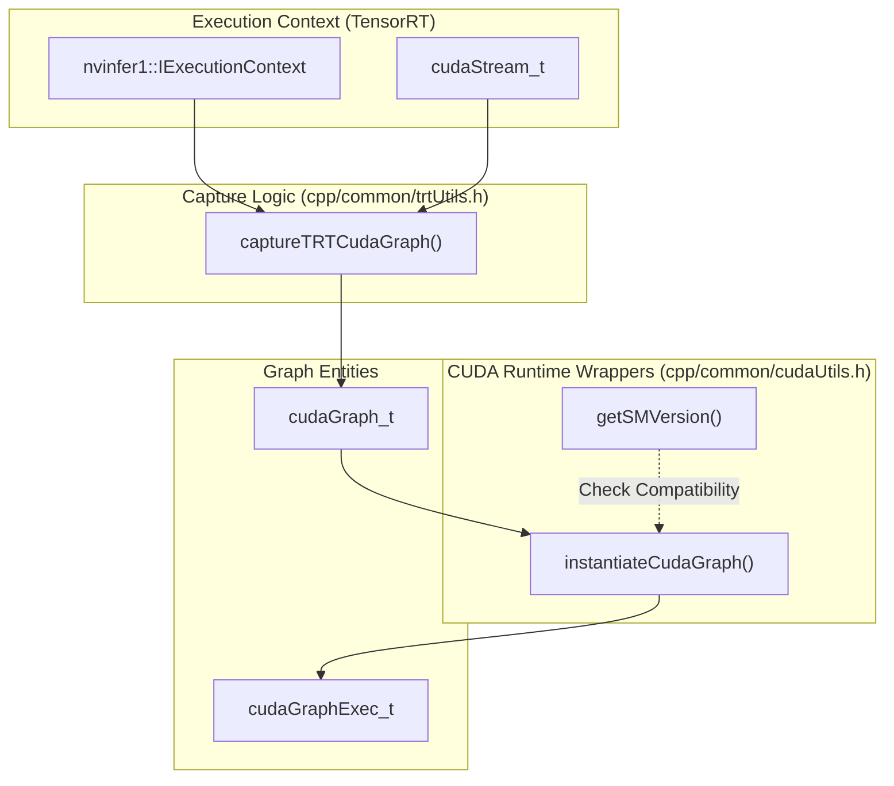
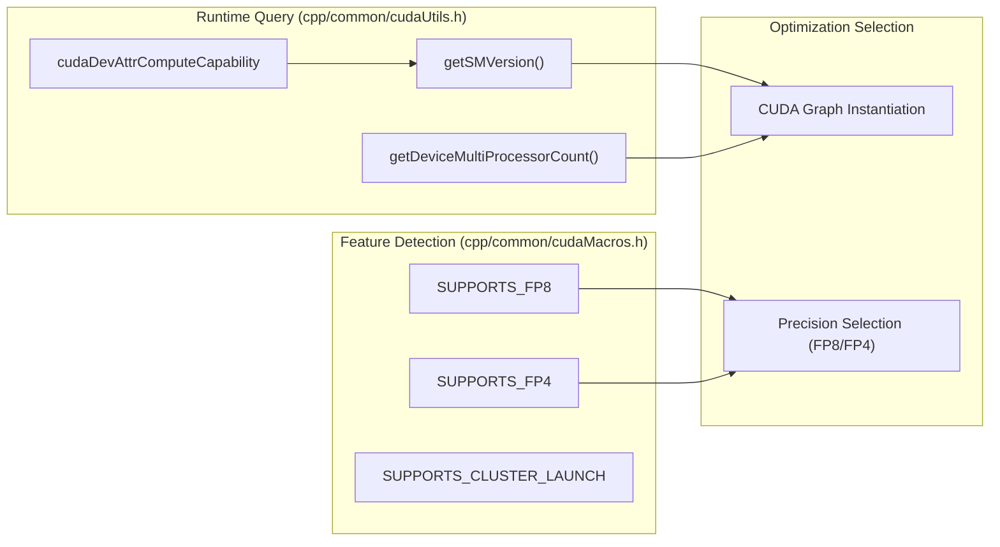

<!-- source: DeepWiki mcp.deepwiki.com · repo NVIDIA/TensorRT-Edge-LLM · extra page CUDA Graph Optimization · fetched 2026-10-26 -->

# CUDA Graph Optimization

Relevant source files

The following files were used as context for generating this wiki page:

- [cpp/common/cudaMacros.h](cpp/common/cudaMacros.h)
- [cpp/common/cudaUtils.h](cpp/common/cudaUtils.h)

## Purpose and Scope

This document explains CUDA Graph optimization in TensorRT-Edge-LLM, a runtime feature that reduces inference latency by capturing and replaying sequences of CUDA operations. CUDA Graph optimization eliminates per-kernel launch overhead during the decoding phase of LLM inference, improving throughput and reducing latency on edge devices.

For information about the runtime architecture that executes CUDA Graphs, see [Runtime Components](4.3). For information about the decoding strategies that benefit from CUDA Graph optimization, see [Decoding Strategies](7.1).

---

## Overview of CUDA Graph

CUDA Graphs are a CUDA programming model feature that allows applications to define workflows as graphs where nodes represent CUDA operations (kernels, memory copies) and edges represent dependencies. Instead of launching each kernel individually during inference, the runtime can capture a sequence of CUDA operations into a graph during an initial pass and replay the entire captured graph with a single launch operation on subsequent iterations.

This optimization is particularly effective for LLM inference because the decode phase executes the same computational pattern repeatedly (autoregressive token generation), making it an ideal candidate for graph capture and replay.

### Version-Specific Implementation

The codebase provides a compatibility layer to handle API differences between CUDA versions:
*   **CUDA < 12.0**: Uses the legacy `cudaGraphInstantiate` signature with extra arguments [cpp/common/cudaUtils.h:108-109]().
*   **CUDA >= 12.0**: Uses the simplified `cudaGraphInstantiate` signature [cpp/common/cudaUtils.h:111]().

The utility function `instantiateCudaGraph` in `cpp/common/cudaUtils.h` abstracts these differences [cpp/common/cudaUtils.h:106-113]().

**Sources:** [cpp/common/cudaUtils.h:106-113](), [cpp/common/cudaMacros.h:22-31]()

---

## CUDA Graph in the Inference Pipeline

The following diagram bridges the natural language concept of "Inference Execution" to the specific code entities used to manage CUDA Graphs.

### Diagram: Code-to-Logic Mapping for CUDA Graphs

**Sources:** [cpp/common/cudaUtils.h:96-113](), [cpp/common/cudaUtils.h:55-64]()

---

## Implementation Details

### Capture Strategy

The capture process involves recording operations into a `cudaGraph_t`. The codebase provides helper utilities to manage this transition, particularly ensuring that the graph is instantiated correctly for the target CUDA environment.

| Operation | Code Entity | File |
|-----------|-------------|------|
| **Instantiate Graph** | `instantiateCudaGraph` | [cpp/common/cudaUtils.h:106-113]() |
| **Compute Capability Check** | `getSMVersion` | [cpp/common/cudaUtils.h:55-64]() |
| **Multiprocessor Query** | `getDeviceMultiProcessorCount` | [cpp/common/cudaUtils.h:78-93]() |

### Device Management

During graph capture and execution, it is critical to ensure the correct CUDA device is active. The `CudaDeviceGuard` class provides RAII-based device switching to prevent thread-local device state leakage [cpp/common/cudaUtils.h:163-195]().

*   **RAII Safety**: `CudaDeviceGuard` stores the previous device and restores it upon destruction [cpp/common/cudaUtils.h:169-187]().
*   **Error Handling**: It uses `CUDA_CHECK` during construction to ensure the target device is valid, while the destructor handles restoration gracefully [cpp/common/cudaUtils.h:169-181]().

**Sources:** [cpp/common/cudaUtils.h:106-113](), [cpp/common/cudaUtils.h:163-195](), [cpp/common/cudaUtils.h:55-64]()

---

## Hardware and Feature Detection

CUDA Graph behavior and performance can vary based on the hardware and CUDA version. The runtime includes macros and utilities to detect these features.

### Diagram: Hardware and Version Detection Flow

*   **SM Version**: `getSMVersion()` queries `cudaDevAttrComputeCapabilityMajor` and `Minor` to determine the GPU architecture (e.g., SM 8.9 or 9.0) [cpp/common/cudaUtils.h:55-64]().
*   **Precision Support**: Macros like `SUPPORTS_FP8` (CUDA >= 11.8) [cpp/common/cudaMacros.h:52-57]() and `SUPPORTS_FP4` (CUDA >= 12.8) [cpp/common/cudaMacros.h:65-70]() ensure that the kernels captured within the graph are compatible with the installed CUDA toolkit.
*   **Cluster Launch**: The `SUPPORTS_CLUSTER_LAUNCH` macro (CUDA >= 11.8) identifies support for Thread Block Clusters, which can be captured within graphs for Hopper-class hardware [cpp/common/cudaMacros.h:59-63]().
*   **SM Count**: `getDeviceMultiProcessorCount()` caches the SM count of the device, which is used to size persistent grids for CuTe DSL kernels captured in graphs [cpp/common/cudaUtils.h:78-93]().

**Sources:** [cpp/common/cudaMacros.h:52-70](), [cpp/common/cudaUtils.h:55-64](), [cpp/common/cudaUtils.h:78-93]()

---

## Usage Guidelines

### Capture and Instantiation Flow

1.  **Warmup**: Execute the model normally to initialize all internal TensorRT state.
2.  **Capture**: Record the sequence of operations into a `cudaGraph_t` using the CUDA Stream Capture API.
3.  **Instantiation**: Convert the `cudaGraph_t` to a `cudaGraphExec_t` using `instantiateCudaGraph` to handle version-specific API requirements [cpp/common/cudaUtils.h:106-113]().
4.  **Replay**: Launch the `cudaGraphExec_t` during the decode loop instead of calling standard kernel or TensorRT enqueue methods.

### Performance Impact

CUDA Graph optimization provides the most benefit in these scenarios:
*   **Single-batch inference**: Typical for edge deployment where CPU overhead is a significant portion of the total latency.
*   **High-frequency kernels**: When the model consists of many small kernels (common in specialized LLM layers), the launch overhead reduction is most noticeable.
*   **Static Shapes**: The decode phase, where sequence length increments by 1 and input shapes are often fixed to 1 token, is the primary target for this optimization.

**Sources:** [cpp/common/cudaUtils.h:106-113](), [cpp/common/cudaMacros.h:52-70](), [cpp/common/cudaUtils.h:163-195]()

---

