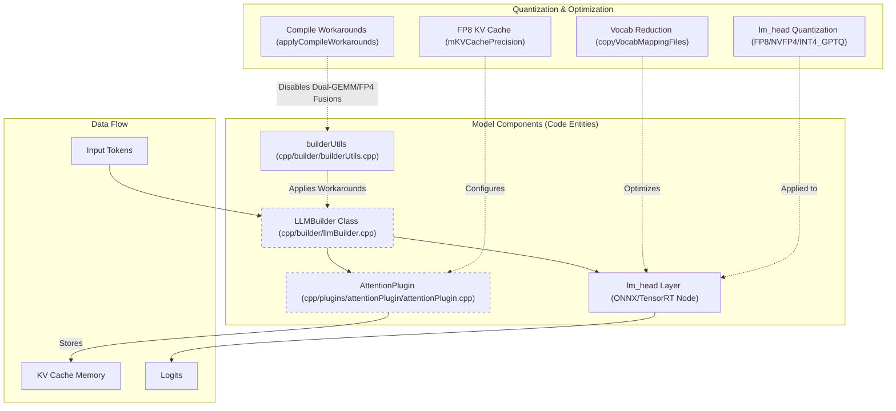
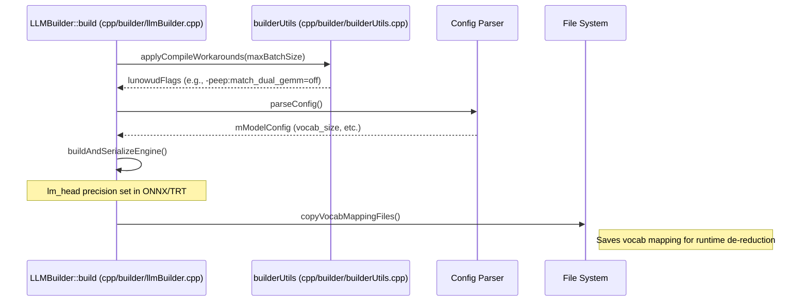
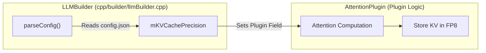

<!-- source: DeepWiki mcp.deepwiki.com · repo NVIDIA/TensorRT-Edge-LLM · extra page Component-Specific Quantization · fetched 2026-10-26 -->

# Component-Specific Quantization

Relevant source files

The following files were used as context for generating this wiki page:

- [cpp/builder/builderUtils.cpp](cpp/builder/builderUtils.cpp)
- [cpp/common/inputLimits.h](cpp/common/inputLimits.h)

## Purpose and Scope

This page documents component-level quantization strategies that allow different parts of an LLM to use different precision formats. Specifically, it covers **lm_head quantization**, **vocab reduction** optimizations, **FP8 KV cache** integration, and the application of **named per-modality calibration datasets**. These features allow fine-grained control over the precision of specific model components to optimize memory bandwidth and compute throughput on edge devices while maintaining accuracy across multimodal inputs.

---

## Overview

Component-specific quantization enables control over precision at the layer level. The most significant targets are the `lm_head` layer, which performs vocabulary-sized matrix multiplication, and the KV cache, which dominates memory usage during long-context inference. Additionally, the system uses compile-time workarounds and input limits to ensure stability when deploying these quantized graphs.

### Component to Code Mapping

The following diagram maps high-level model components to the specific code entities and configuration parameters that manage their quantization and optimization.

**Sources**: [cpp/builder/llmBuilder.cpp:179-182](), [cpp/builder/llmBuilder.cpp:253-261](), [cpp/builder/builderUtils.cpp:52-86]()

---

## lm_head Quantization and Vocab Reduction

### lm_head Optimization
The `lm_head` (language modeling head) maps hidden states to logits over the vocabulary. In `LLMBuilder`, the system handles optimized `lm_head` configurations by managing vocabulary mapping files and specific quantization formats like `NVFP4` and `INT4_GPTQ`.

| Feature | Implementation Detail | Code Reference |
| :--- | :--- | :--- |
| **Vocab Reduction** | Filters `lm_head` weights to a subset of tokens; managed via `copyVocabMappingFiles`. | [cpp/builder/llmBuilder.cpp:179-182]() |
| **Quantization Formats** | Supports `FP8`, `NVFP4`, and `INT4_GPTQ` for the final projection. | [cpp/common/tensorUtils.cpp:89-95]() |
| **Compile Stability** | Disables `match_dual_gemm` for NVFP4 graphs on specific SM versions. | [cpp/builder/builderUtils.cpp:63-69]() |

### Implementation in LLMBuilder
The `LLMBuilder::build()` function orchestrates the inclusion of these optimizations by copying necessary mapping artifacts to the engine directory.

**Sources**: [cpp/builder/llmBuilder.cpp:45-189](), [cpp/builder/llmBuilder.cpp:179-182](), [cpp/builder/builderUtils.cpp:52-86]()

---

## FP8 KV Cache

### Mechanism
The KV cache stores Key and Value tensors for all previous tokens to avoid redundant computation. In memory-constrained edge environments, the `AttentionPlugin` supports quantizing these tensors to **FP8** (8-bit floating point). This halves the memory footprint compared to FP16 while maintaining higher dynamic range than INT8.

The `formatElement` utility in the codebase specifically handles `__nv_fp8_e4m3` types for debugging and logging, ensuring that even quantized components can be inspected during development.

**Sources**: [cpp/common/tensorUtils.cpp:89-95]()

### Configuration and Data Flow
The `LLMBuilder` detects the desired KV cache precision from the model configuration and passes it to the `AttentionPlugin` during engine construction.

**Sources**: [cpp/builder/llmBuilder.cpp:253-261](), [cpp/common/trtUtils.h:49-56]()

---

## Precision and Utility Support

To support component-specific quantization, the codebase provides robust utilities for safe integer arithmetic and tensor inspection.

### Safe Integer Comparisons
When dealing with quantized indices or large vocabulary sizes, the `math::less` utility provides safe comparison between signed and unsigned integers, preventing common overflow/underflow issues in quantization logic.

**Sources**: [cpp/common/mathUtils.h:132-137]()

### Guardrails and Limits
To prevent DoS attacks or memory exhaustion when handling quantized inputs (which may involve large logit biases), the system enforces strict security limits.

*   **Max Logit Bias Tokens**: 1024 tokens [cpp/common/inputLimits.h:47]().
*   **Logit Bias Range**: -100.0F to 100.0F [cpp/common/inputLimits.h:48-49]().

### Tensor Inspection
The `formatString` and `formatElement` functions allow developers to print and inspect tensors of various precisions, including `half`, `__nv_bfloat16`, and `__nv_fp8_e4m3`. This is critical for validating that quantization hasn't introduced excessive noise into specific components like the `lm_head`.

**Sources**: [cpp/common/tensorUtils.cpp:57-110]()

---

## Performance and Accuracy Trade-offs

The use of component-specific quantization allows for a "mixed-precision" approach where sensitive layers remain in high precision while bottlenecks are aggressively quantized.

| Component | Optimization | Performance Gain | Accuracy Impact |
| :--- | :--- | :--- | :--- |
| **KV Cache** | FP8 Quantization | 2x Memory reduction for context | Negligible |
| **lm_head** | NVFP4/INT4 | Faster final GEMM | Low to Moderate |
| **lm_head** | Vocab Reduction | Proportional to reduction ratio | Zero (if tokens used are in set) |
| **Engine Build** | Workarounds | Stability for NVFP4/FP4 | None (prevents miscompilation) |

---

## Summary of Key Functions

| Function | File | Description |
| :--- | :--- | :--- |
| `LLMBuilder::parseConfig` | [cpp/builder/llmBuilder.cpp:192]() | Parses `kv_cache_precision` and model dimensions. |
| `LLMBuilder::copyVocabMappingFiles` | [cpp/builder/llmBuilder.cpp:179]() | Handles artifacts for reduced vocabulary models. |
| `applyCompileWorkarounds` | [cpp/builder/builderUtils.cpp:52]() | Sets `__LUNOWUD` flags to disable problematic fusions in TRT 10.x/11.x. |
| `math::less` | [cpp/common/mathUtils.h:132]() | Safe integer comparison for quantization indices. |
| `formatElement` | [cpp/common/tensorUtils.cpp:57]() | Formats FP8 and other types for tensor logging. |

**Sources**: [cpp/builder/llmBuilder.cpp:45-190](), [cpp/builder/builderUtils.cpp:52-86](), [cpp/common/mathUtils.h:132-137](), [cpp/common/tensorUtils.cpp:57-110]()

---

