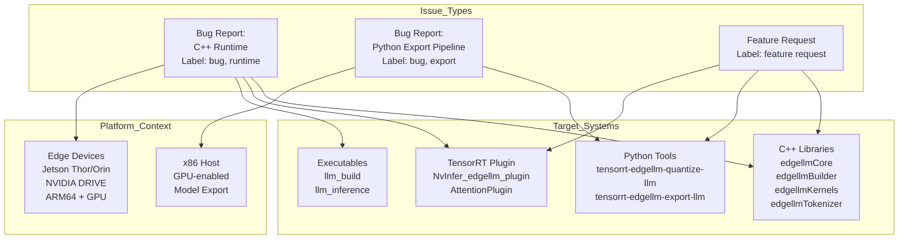
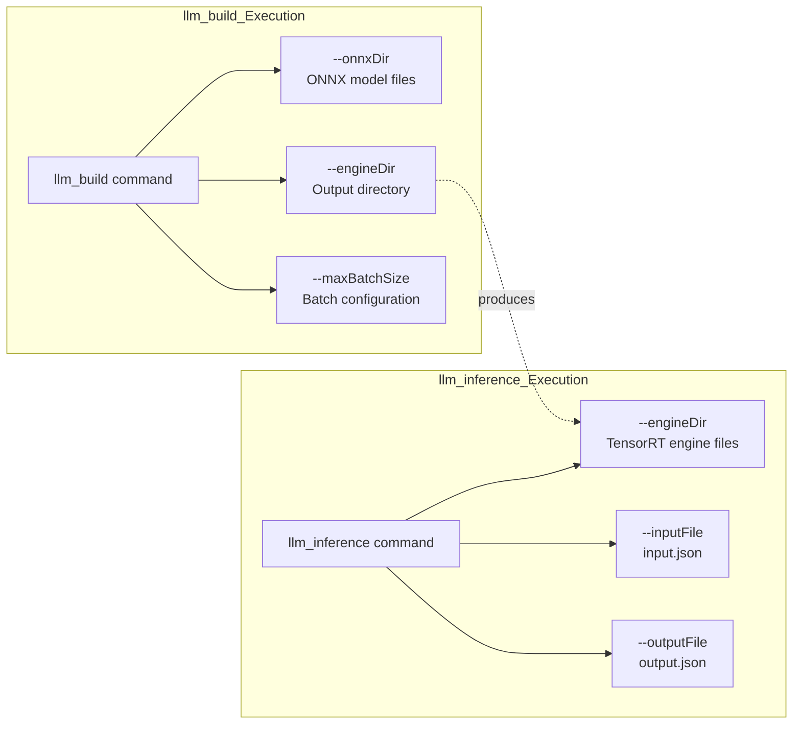
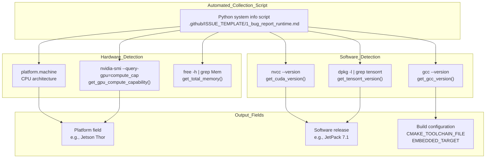
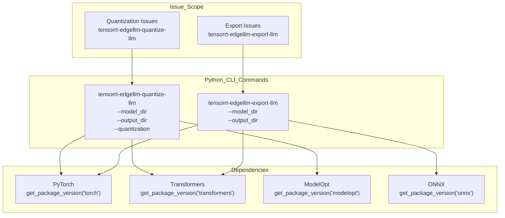
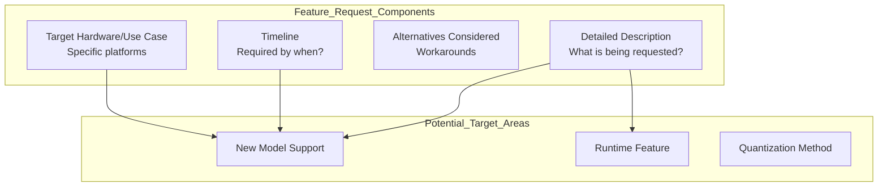

<!-- source: DeepWiki mcp.deepwiki.com · repo NVIDIA/TensorRT-Edge-LLM · extra page Creating Issues and Feature Requests · fetched 2026-10-26 -->

# Creating Issues and Feature Requests

<details>
<summary>Relevant source files</summary>

The following files were used as context for generating this wiki page:

- [.github/ISSUE_TEMPLATE/1_bug_report_runtime.md](.github/ISSUE_TEMPLATE/1_bug_report_runtime.md)
- [.github/ISSUE_TEMPLATE/2_bug_report_export.md](.github/ISSUE_TEMPLATE/2_bug_report_export.md)
- [.github/ISSUE_TEMPLATE/3_feature_request.md](.github/ISSUE_TEMPLATE/3_feature_request.md)

</details>


## Purpose and Scope

This page documents the process of creating issues and feature requests in the TensorRT-Edge-LLM project. The project uses structured GitHub issue templates to ensure bug reports and feature requests contain the necessary information for maintainers to reproduce, diagnose, and prioritize issues effectively.

TensorRT-Edge-LLM provides three distinct issue templates, each designed for specific problem domains within the codebase. For information about the Pull Request process that follows issue creation, see [Pull Request Process]().

**Sources**: [.github/ISSUE_TEMPLATE/1_bug_report_runtime.md:1-147](), [.github/ISSUE_TEMPLATE/2_bug_report_export.md:1-139](), [.github/ISSUE_TEMPLATE/3_feature_request.md:1-18]()

---

## Issue Template Overview

The repository provides three specialized issue templates, each mapped to a specific architectural layer of the system:

### Template Mapping to System Components



This diagram shows how each issue template corresponds to specific parts of the codebase and execution environments. Runtime bugs target the C++ inference stack running on ARM64 edge platforms, while export bugs target the Python model preparation pipeline running on x86 hosts with GPUs.

**Sources**: [.github/ISSUE_TEMPLATE/1_bug_report_runtime.md:2-7](), [.github/ISSUE_TEMPLATE/2_bug_report_export.md:2-7](), [.github/ISSUE_TEMPLATE/3_feature_request.md:2-7]()

---

## Bug Report: C++ Runtime

The C++ Runtime bug template is used for issues in the engine building and inference execution phases. This template targets the `llm_build` and `llm_inference` executables, along with the underlying C++ libraries.

### Required Information

The template requires the following structured information:

| Section | Content | Purpose |
|---------|---------|---------|
| **Bug Description** | Impact level (blocker/should have/nice to have), error messages, stack traces | Initial triage and priority assessment |
| **Steps to Reproduce** | Minimal reproduction code/commands | Enable maintainers to reproduce the issue |
| **Build Configuration** | CMake command with all flags | Identify build-time configuration issues |
| **Runtime Command** | Exact command(s) that triggered the bug | Reproduce runtime behavior |
| **Expected Behavior** | What should have happened | Clarify the regression or defect |
| **System Information** | Platform, software versions, hardware specs | Environment-specific debugging |

**Sources**: [.github/ISSUE_TEMPLATE/1_bug_report_runtime.md:9-48]()

### Build Configuration Context

When reporting runtime bugs, the build configuration must be specified:

```bash
# Example build configuration to include in bug report
cmake .. -DCMAKE_BUILD_TYPE=Release \
         -DTRT_PACKAGE_DIR=/path/to/TensorRT \
         -DCMAKE_TOOLCHAIN_FILE=cmake/aarch64_linux_toolchain.cmake \
         -DEMBEDDED_TARGET=jetson-thor
```

**Sources**: [.github/ISSUE_TEMPLATE/1_bug_report_runtime.md:16-20]()

### Runtime Command Structure



**Sources**: [.github/ISSUE_TEMPLATE/1_bug_report_runtime.md:22-27]()

### System Information Collection

The template includes an automated Python script for collecting system information. This script queries the edge device to populate the following fields:

### Collection Script Architecture



The script uses `subprocess.check_output()` to invoke system utilities and regex patterns to extract version information. Key functions include:

- `get_cuda_version()`: Extracts CUDA version from `nvcc --version` output [[.github/ISSUE_TEMPLATE/1_bug_report_runtime.md:59-66]()]
- `get_tensorrt_version()`: Parses TensorRT version from `dpkg -l` output [[.github/ISSUE_TEMPLATE/1_bug_report_runtime.md:69-76]()]
- `get_gcc_version()`: Extracts GCC version string [[.github/ISSUE_TEMPLATE/1_bug_report_runtime.md:79-86]()]
- `get_gpu_compute_capability()`: Queries `nvidia-smi` for compute capability, formats as "SM87", "SM110", etc. [[.github/ISSUE_TEMPLATE/1_bug_report_runtime.md:89-101]()]

**Sources**: [.github/ISSUE_TEMPLATE/1_bug_report_runtime.md:50-147]()

---

## Bug Report: Python Export Pipeline

The Python Export Pipeline bug template is used for issues in model quantization and ONNX export, which occur on x86 development hosts.

### Export Pipeline Bug Report Scope



**Sources**: [.github/ISSUE_TEMPLATE/2_bug_report_export.md:19-24](), [.github/ISSUE_TEMPLATE/2_bug_report_export.md:85-89]()

### Export System Information

The export pipeline template includes a script optimized for x86 hosts:
- Uses `nvidia-smi` to query multiple GPUs via `get_nvidia_gpu_info()` [[.github/ISSUE_TEMPLATE/2_bug_report_export.md:55-72]()]
- Collects Python package versions via `get_package_version(package)` [[.github/ISSUE_TEMPLATE/2_bug_report_export.md:85-89]()]
- Specifically captures the `tensorrt_edgellm` version or commit hash [[.github/ISSUE_TEMPLATE/2_bug_report_export.md:92-97]()]
- Captures OS release information from `/etc/os-release` [[.github/ISSUE_TEMPLATE/2_bug_report_export.md:102-111]()]

**Sources**: [.github/ISSUE_TEMPLATE/2_bug_report_export.md:46-139]()

---

## Feature Requests

The feature request template is designed for proposing new capabilities, model support, or architectural improvements.

### Feature Request Evaluation Flow



**Sources**: [.github/ISSUE_TEMPLATE/3_feature_request.md:1-18]()

---

## Best Practices for Issue Creation

### Minimal Reproduction

When creating bug reports, provide minimal steps:
1. Use a publicly available model or provide a reproducible model.
2. Include exact command-line arguments (e.g., `tensorrt-edgellm-quantize-llm --model_dir Qwen/Qwen3-0.6B --quantization fp8`) [[.github/ISSUE_TEMPLATE/2_bug_report_export.md:22-23]()].
3. Specify input file formats and sizes.

**Sources**: [.github/ISSUE_TEMPLATE/1_bug_report_runtime.md:12-14](), [.github/ISSUE_TEMPLATE/2_bug_report_export.md:12-14]()

### Error Message Inclusion

Always include complete error messages and stack traces. The templates specifically prompt for these to aid in triage [[.github/ISSUE_TEMPLATE/1_bug_report_runtime.md:10]()], [[.github/ISSUE_TEMPLATE/2_bug_report_export.md:10]()].

### Label Assignment

The issue templates automatically assign labels to facilitate triage:

| Template | Automatic Labels |
|----------|-----------------|
| Bug report - C++ Runtime | `bug`, `runtime` |
| Bug report - Python Export Pipeline | `bug`, `export` |
| Feature request | `feature request` |

**Sources**: [.github/ISSUE_TEMPLATE/1_bug_report_runtime.md:5](), [.github/ISSUE_TEMPLATE/2_bug_report_export.md:5](), [.github/ISSUE_TEMPLATE/3_feature_request.md:5]()

### Expected Behavior Specification

Clearly state the expected outcome to distinguish between bugs and feature gaps [[.github/ISSUE_TEMPLATE/1_bug_report_runtime.md:29]()], [[.github/ISSUE_TEMPLATE/2_bug_report_export.md:26]()].

---

