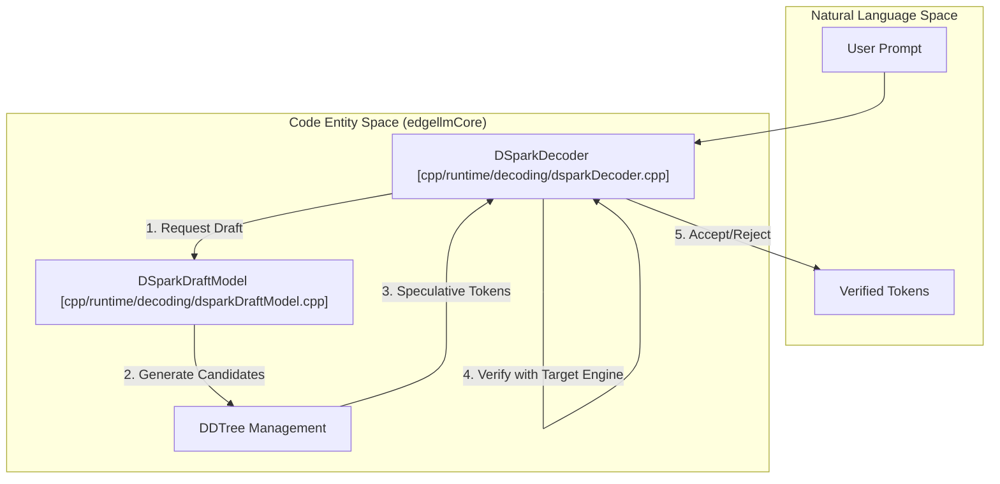
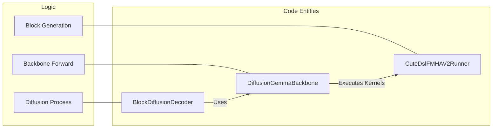

<!-- source: DeepWiki mcp.deepwiki.com · repo NVIDIA/TensorRT-Edge-LLM · extra page DSpark and BlockDiffusion Decoding · fetched 2026-10-26 -->

# DSpark and BlockDiffusion Decoding

Relevant source files

The following files were used as context for generating this wiki page:

- [cpp/kernels/contextAttentionKernels/cuteDslFMHARunner.cpp](cpp/kernels/contextAttentionKernels/cuteDslFMHARunner.cpp)
- [cpp/kernels/contextAttentionKernels/cuteDslFMHAV2Runner.cpp](cpp/kernels/contextAttentionKernels/cuteDslFMHAV2Runner.cpp)
- [cpp/kernels/contextAttentionKernels/cuteDslFMHAV2Runner.h](cpp/kernels/contextAttentionKernels/cuteDslFMHAV2Runner.h)

This page documents the high-performance decoding strategies introduced in version 0.10.0: **DSpark speculative decoding** and **BlockDiffusion non-autoregressive decoding**. These strategies are designed to accelerate inference for advanced model architectures like Qwen3 and DiffusionGemma by leveraging parallel token generation and tree-based verification.

## DSpark Speculative Decoding

DSpark is a speculative decoding strategy that utilizes a dedicated draft model to generate multiple candidate tokens, which are then verified in parallel by the target LLM. It specifically integrates the **DDTree** (Dynamic Decoding Tree) structure for efficient multi-candidate management.

### Architecture and Data Flow

The DSpark system consists of two primary C++ entities: `DSparkDraftModel` for candidate generation and `DSparkDecoder` for managing the speculation-verification loop.

**DSpark Decoding Pipeline**

### Key Components

| Class | Role | Source |
| :--- | :--- | :--- |
| `DSparkDecoder` | Implements `DecodingStrategy`. Orchestrates the draft model and handles the verification of tree-structured tokens. | [cpp/runtime/decoding/dsparkDecoder.h]() |
| `DSparkDraftModel` | Manages the lightweight draft engine. Responsible for generating speculative token sequences. | [cpp/runtime/decoding/dsparkDraftModel.h]() |
| `CuteDslFMHARunner` | Provides the underlying CUDA kernels for tree attention during the verification phase. | [cpp/kernels/contextAttentionKernels/cuteDslFMHARunner.cpp:57-98]() |

**Sources:** [cpp/runtime/decoding/dsparkDecoder.cpp](), [cpp/runtime/decoding/dsparkDraftModel.cpp](), [cpp/kernels/contextAttentionKernels/cuteDslFMHARunner.cpp:57-98]()

---

## BlockDiffusion Decoding

BlockDiffusion is a non-autoregressive decoding strategy implemented for models like **DiffusionGemma**. Unlike standard LLMs that predict one token at a time, BlockDiffusion generates a "block" of tokens simultaneously through a diffusion process in the token embedding space.

### System Mapping

The following diagram maps the logical diffusion decoding process to the C++ classes and kernel runners implemented in the SDK.

**BlockDiffusion Code Entity Map**

### Implementation Details

*   **BlockDiffusionDecoder**: This class manages the iterative refinement process. It handles the transition from noise to discrete tokens across multiple diffusion steps. [cpp/runtime/decoding/blockDiffusionDecoder.cpp]()
*   **DiffusionGemmaBackbone**: A specialized backbone implementation that supports the unique requirements of diffusion models, including temporal embeddings and block-parallel processing.
*   **Attention Kernels**: BlockDiffusion utilizes the `CuteDslFMHAV2Runner` for context attention. Specifically, it supports sliding-causal and vision-block masks required for complex multimodal diffusion tasks. [cpp/kernels/contextAttentionKernels/cuteDslFMHAV2Runner.h:45-51]()

### Kernel Support for BlockDiffusion
The `CuteDslFMHAV2Runner` provides specialized mask types to support the non-standard attention patterns found in BlockDiffusion:
*   `kCAUSAL`: Standard autoregressive masking.
*   `kSLIDING_CAUSAL`: For long-context diffusion.
*   `kVISION_BLOCK`: Specifically for Gemma4 vision-block attention (same-image-block logic). [cpp/kernels/contextAttentionKernels/cuteDslFMHAV2Runner.h:109-112]()

**Sources:** [cpp/runtime/decoding/blockDiffusionDecoder.cpp](), [cpp/kernels/contextAttentionKernels/cuteDslFMHAV2Runner.h:45-51](), [cpp/kernels/contextAttentionKernels/cuteDslFMHAV2Runner.cpp:88-106]()

---

## Comparison of Advanced Decoding Strategies

| Feature | DSpark | BlockDiffusion |
| :--- | :--- | :--- |
| **Strategy Type** | Speculative (Autoregressive Verification) | Non-Autoregressive (Diffusion) |
| **Model Compatibility** | Qwen3, DSpark-compatible hybrids | DiffusionGemma |
| **Parallelism** | Tree-based candidate verification | Block-wide token generation |
| **Key Kernel** | `CuteDslFMHARunner` (Tree Attention) | `CuteDslFMHAV2Runner` (Vision Block) |
| **Introduced In** | v0.10.0 | v0.10.0 |

**Sources:** [cpp/kernels/contextAttentionKernels/cuteDslFMHARunner.cpp:106-110](), [cpp/kernels/contextAttentionKernels/cuteDslFMHAV2Runner.cpp:127-131]()

---

