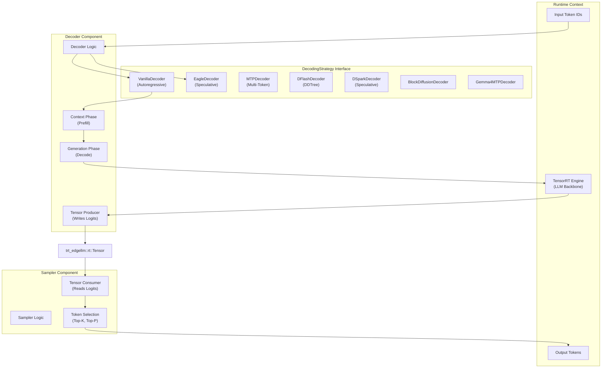
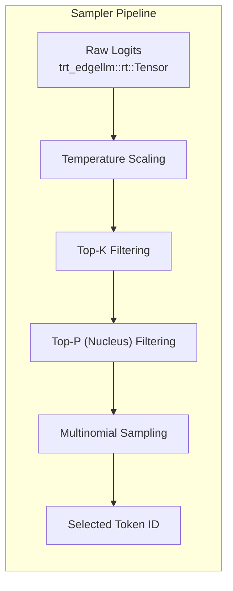
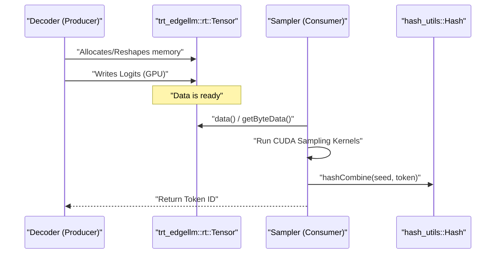

<!-- source: DeepWiki mcp.deepwiki.com · repo NVIDIA/TensorRT-Edge-LLM · extra page Decoder and Sampler · fetched 2026-10-26 -->

# Decoder and Sampler

Relevant source files

The following files were used as context for generating this wiki page:

- [cpp/common/hashUtils.h](cpp/common/hashUtils.h)
- [cpp/common/mmapReader.cpp](cpp/common/mmapReader.cpp)
- [cpp/common/pagedKvTypes.h](cpp/common/pagedKvTypes.h)
- [cpp/common/ropeUtils.h](cpp/common/ropeUtils.h)

## Purpose and Scope

This document explains the **Decoder** and **Sampler** components, which form the core of the autoregressive token generation pipeline in the TensorRT-Edge-LLM runtime. The decoder manages the inference loop that produces logits from the language model, while the sampler implements token selection strategies to convert logits into output tokens.

These components implement a consumer-producer design pattern using the `Tensor` class for memory management. The system supports advanced features such as KV cache management, streaming output, and a pluggable `DecodingStrategy` interface to support speculative decoding (EAGLE, DFlash, DSpark) and multi-token prediction (MTP).

**Sources:** [cpp/common/tensor.h:221-222](), [cpp/common/ropeUtils.h:50-63]()

---

## Architecture Overview

The interaction between the Decoder and Sampler is mediated by the `Tensor` class, which handles memory ownership and layout. The `DecodingStrategy` interface allows for different execution flows depending on the model architecture.

**Diagram: Decoder and Sampler Data Flow**

This diagram illustrates how the decoder produces logits by invoking the TensorRT engine and manages them through the `Tensor` class, while the sampler consumes those logits to select the next token.

**Sources:** [cpp/common/tensor.h:221-233](), [cpp/common/tensor.h:85-87]()

---

## Decoder Component and Strategies

### Role and Responsibilities

The decoder manages the autoregressive inference loop. It orchestrates the transition between processing the initial prompt (Context Phase) and generating new tokens (Generation Phase). The specific behavior is defined by the `DecodingStrategy`.

| Strategy | Implementation Class | Use Case |
| :--- | :--- | :--- |
| **Standard** | `VanillaDecoder` | Standard autoregressive generation. |
| **Speculative** | `EagleDecoder` | Uses a draft model to predict multiple tokens, validated by the target model. |
| **Multi-Token** | `MTPDecoder` | Parallel prediction of multiple future tokens. |
| **DFlash** | `DFlashDecoder` | Specialized speculative decoding with DDTree for Qwen3/3.5 hybrid models. |
| **DSpark** | `DSparkDecoder` | Speculative decoding with DDTree drafting for DSpark models. |
| **Diffusion** | `BlockDiffusionDecoder` | Non-autoregressive decoding for BlockDiffusion models. |
| **Gemma4** | `Gemma4MTPDecoder` | Unified MTP strategy for Gemma4 multimodal architectures. |

### KV Cache Management

The decoder maintains the state of the model across steps using a Key-Value (KV) cache. The runtime utilizes a paged-KV layout with a default page size `kTOKENS_PER_PAGE` of 128 tokens [cpp/common/pagedKvTypes.h:27-27](). 

For RoPE-based models, the `getRotaryDim` utility determines the cache width per head, supporting variants like partial RoPE, LongRoPE, and Proportional RoPE [cpp/common/ropeUtils.h:50-63]().

- **Partial RoPE**: Only a fraction of the head dimension is rotated; the rest bypasses rotation [cpp/common/ropeUtils.h:31-34]().
- **Proportional RoPE**: Keeps a full-head cache (`rotaryDim == headDim`) and uses `partial_rotary_factor` to apply non-identity cos/sin values to specific slots [cpp/common/ropeUtils.h:42-49]().

The maximum KV cache capacity is constrained by `kMAX_KV_CACHE_CAPACITY`, ensuring page-aligned values fit within an `int32` [cpp/common/pagedKvTypes.h:37-37]().

### Streaming Output

To minimize perceived latency, the decoder supports streaming. As soon as the Sampler selects a token, it is pushed to a callback or queue before the next iteration of the decoder begins.

**Sources:** [cpp/common/ropeUtils.h:27-49](), [cpp/common/ropeUtils.h:50-63](), [cpp/common/pagedKvTypes.h:27-61]()

---

## Sampler Component

### Token Selection Logic

The sampler converts raw logits into discrete token IDs. It uses the `Tensor` class to access GPU memory safely [cpp/common/tensor.h:221-233]().

**Diagram: Sampler Token Selection Pipeline**

### Hashing for Cache Lookup

The sampler and decoder utilize a specialized `HashMap` for efficient bucket lookups, employing a `hashCombine` algorithm to create composite hash values for complex keys like tuples [cpp/common/hashUtils.h:30-45](). This is critical for managing session states and `ContextCacheManager` lookups where keys consist of multiple sequence identifiers.

**Sources:** [cpp/common/hashUtils.h:41-45](), [cpp/common/hashUtils.h:75-76]()

---

## Tensor Class Integration

The `Tensor` class is the primary data structure passed between the Decoder and Sampler.

### Consumer-Producer Design Pattern

The decoder acts as the **Producer**, filling the `Tensor` with logits from the TensorRT engine. The sampler acts as the **Consumer**, reading the `Tensor` to perform selection.

**Diagram: Component Interaction via Tensor Entity**

### Data Types and Memory
The `Tensor` class supports high-precision and quantized types including `half`, `__nv_bfloat16`, and `__nv_fp8_e4m3` [cpp/common/tensor.h:57-80](). It tracks memory location via `DeviceType::kCPU` or `DeviceType::kGPU` [cpp/common/tensor.h:41-45](). For large-scale data loading (e.g., weights or large context windows), the `MmapReader` provides efficient memory-mapped file access [cpp/common/mmapReader.cpp:67-111]().

**Sources:** [cpp/common/tensor.h:221-233](), [cpp/common/hashUtils.h:41-45](), [cpp/common/mmapReader.cpp:99-108]()

---

