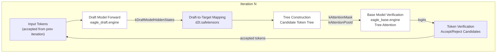

<!-- source: DeepWiki mcp.deepwiki.com · repo NVIDIA/TensorRT-Edge-LLM · extra page EAGLE3 and DFlash Speculative Decoding · fetched 2026-10-26 -->

# EAGLE3 and DFlash Speculative Decoding

<details>
<summary>Relevant source files</summary>

The following files were used as context for generating this wiki page:

- [cpp/kernels/contextAttentionKernels/cuteDslFMHARunner.cpp](cpp/kernels/contextAttentionKernels/cuteDslFMHARunner.cpp)
- [cpp/kernels/contextAttentionKernels/cuteDslFMHARunner.h](cpp/kernels/contextAttentionKernels/cuteDslFMHARunner.h)
- [cpp/kernels/contextAttentionKernels/cuteDslFmhaParams.h](cpp/kernels/contextAttentionKernels/cuteDslFmhaParams.h)

</details>


## Purpose and Scope

This document provides a technical deep dive into the speculative decoding implementations within the TensorRT-Edge-LLM codebase, specifically focusing on **EAGLE3** (Extrapolation Algorithm for Greater Language-model Efficiency 3) and **DFlash** with **DDTree**. These strategies accelerate inference by using draft models to generate candidate tokens that are verified in parallel by a base model using specialized tree attention mechanisms.

The implementation leverages high-performance C++ execution, specialized TensorRT optimization profiles, and custom CUDA kernels for tree-based KV cache management and attention. A key component of the 0.10.0 release is the integration of **CuTe DSL** for generating highly optimized Flash Attention (FMHA) kernels, including specialized variants for speculative decoding.

**Sources:** [cpp/builder/llmBuilder.cpp:123-134](), [cpp/builder/llmBuilder.cpp:206-208](), [cpp/common/ropeUtils.h:27-49](), [cpp/kernels/contextAttentionKernels/cuteDslFMHARunner.h:38-50]()

---

## EAGLE3 Speculative Decoding

EAGLE3 accelerates inference by executing two models in tandem:
1.  **Draft Model**: A smaller model that generates multiple speculative token candidates organized in a tree structure.
2.  **Base Model**: The primary model that verifies candidates from the draft model in parallel using tree attention.

### EAGLE3 Workflow Logic



**Sources:** [cpp/builder/llmBuilder.cpp:123-134](), [cpp/builder/llmBuilder.cpp:206-208]()

### Engine Building for EAGLE3
The `LLMBuilder` class handles the creation of these specialized engines. For EAGLE3, the draft model often outputs an expanded hidden state dimension to provide richer information for base model verification.

*   **Draft Model**: `mTargetModelOutputHiddenDim` is set to `mHiddenSize * 3`. [cpp/builder/llmBuilder.cpp:206-208]()
*   **Base Model**: `mTargetModelOutputHiddenDim` is set to standard `mHiddenSize`. [cpp/builder/llmBuilder.cpp:129-131]()
*   **Artifacts**: The `copyEagleFiles()` method ensures the `d2t.safetensors` (Draft-to-Target mapping) is bundled with the engine. [cpp/builder/llmBuilder.cpp:174-177]()

---

## DFlash and DDTree Decoding

DFlash is a speculative decoding strategy optimized for hybrid models like **Qwen3/Qwen3.5**. It utilizes a **DDTree** (Dynamic Decoding Tree) structure to manage speculative candidates.

### DFlash Specific Components
DFlash introduces specific architectural requirements, particularly regarding Rotary Positional Embeddings (RoPE) and KV cache management.

#### Rotary Dimension and Scaling
DFlash and Qwen3 models often utilize complex RoPE configurations, such as "proportional" RoPE. The `getRotaryDim` function determines the width of the `rope_rotary_cos_sin` cache.
*   For `proportional` RoPE, `rotaryDim` equals the full `headDim`. [cpp/common/ropeUtils.h:56-59]()
*   Other variants use a `partial_rotary_factor` to shrink the rotated prefix. [cpp/common/ropeUtils.h:61-62]()

#### Optimized FMHA Kernels (CuTe DSL)
DFlash and speculative decoding paths benefit from the `CuteDslFMHARunner`, which provides Blackwell-optimized kernels for LLM prefill and paged KV cache attention.

*   **Skip-Softmax (BLASST)**: The runner supports a `skipSoftmaxThresholdLog2` parameter. This dispatches a kernel variant that skips the $P \times V$ GEMM for KV tiles whose contribution is negligible, significantly accelerating speculative verification on long sequences. [cpp/kernels/contextAttentionKernels/cuteDslFMHARunner.h:94-98]()
*   **Paged KV Cache**: The `runPaged` method handles logical descriptors of `[numPages, H_kv, tokensPerPage, D]` mapping to physical `NHD` layouts, optimized for 128-token tile widths. [cpp/kernels/contextAttentionKernels/cuteDslFMHARunner.h:104-115]()

---

## C++ Implementation and Data Flow

The `EagleDecoder` and `DFlashDecoder` (implementations of the `DecodingStrategy` interface) manage the runtime execution loop.

### Code Entity Association

```mermaid
graph LR
    subgraph "C++ Core Space"
        E_EXEC["EngineExecutor"]
        DEC_STRAT["DecodingStrategy<br/>(Interface)"]
        EAGLE_DEC["EagleDecoder"]
        DFLASH_DEC["DFlashDecoder"]
        CUTE_RUNNER["CuteDslFMHARunner"]
    end

    subgraph "Builder Space"
        LLM_BUILD["LLMBuilder"]
        OPT_PROF["OptimizationProfile"]
    end

    LLM_BUILD -->|builds| E_EXEC
    E_EXEC -->|uses| DEC_STRAT
    DEC_STRAT <|-- EAGLE_DEC
    DEC_STRAT <|-- DFLASH_DEC
    
    DFLASH_DEC -->|invokes| CUTE_RUNNER
    
    LLM_BUILD -->|configures| OPT_PROF
    OPT_PROF -->|defines| TREE_SHAPES["Tree Attention Shapes<br/>(max_batch, max_tree_size)"]
```

**Sources:** [cpp/builder/llmBuilder.cpp:45-135](), [cpp/builder/llmBuilder.cpp:105-108](), [cpp/kernels/contextAttentionKernels/cuteDslFMHARunner.h:51-55]()

### Hidden State Mapping
Speculative decoding involves a "Draft-to-Target" transformation. This is managed via `hash_utils::HashMap` in some internal implementations to track and cache mapping weights or state transitions.

```cpp
// Example of hash utility usage for composite keys in speculative decoding
template <typename K, typename V>
using HashMap = std::unordered_map<K, V, Hash<K>>;
```
**Sources:** [cpp/common/hashUtils.h:75-76]()

---

## Key Functions and Classes

### LLMBuilder
*   `build()`: Orchestrates engine serialization for draft and base models. [cpp/builder/llmBuilder.cpp:45-190]()
*   `parseConfig()`: Extracts model metadata and determines if the engine is an EAGLE draft/base or MTP model. [cpp/builder/llmBuilder.cpp:192-235]()
*   `setupLLMOptimizationProfiles()`: Configures TensorRT profiles to handle variable tree sizes in the generation phase. [cpp/builder/llmBuilder.cpp:105-108]()

### CuteDslFMHARunner
*   `preflightPaged()`: Ensures the exact paged LLM variant (causal vs. bidirectional) is loaded for the current hardware. [cpp/kernels/contextAttentionKernels/cuteDslFMHARunner.h:68-70]()
*   `run()`: LLM FMHA for batched Q + combined KV cache, supporting FP8-input/FP16-output variants. [cpp/kernels/contextAttentionKernels/cuteDslFMHARunner.h:100-102]()
*   `LlmFmhaPagedParams`: Argument bundle for paged attention, including `bidirectionalBlockBegin/End` for hybrid vision/text sequences. [cpp/kernels/contextAttentionKernels/cuteDslFmhaParams.h:62-90]()

### RoPE Utilities
*   `getRotaryDim()`: Calculates the RoPE cache width, handling `proportional` scaling used in advanced speculative models. [cpp/common/ropeUtils.h:50-63]()

### Hash Utilities
*   `hashCombine()`: A boost-style algorithm used to create composite hashes for mapping tables in the speculative decoding runtime. [cpp/common/hashUtils.h:40-45]()

**Sources:** [cpp/builder/llmBuilder.cpp:1-235](), [cpp/common/ropeUtils.h:1-65](), [cpp/common/hashUtils.h:1-79](), [cpp/kernels/contextAttentionKernels/cuteDslFMHARunner.cpp:57-98](), [cpp/kernels/contextAttentionKernels/cuteDslFmhaParams.h:37-59]()

---

