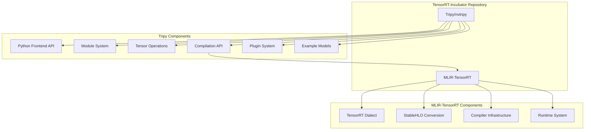
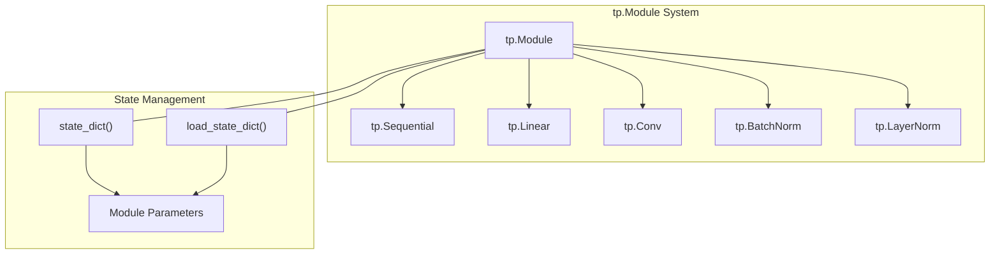
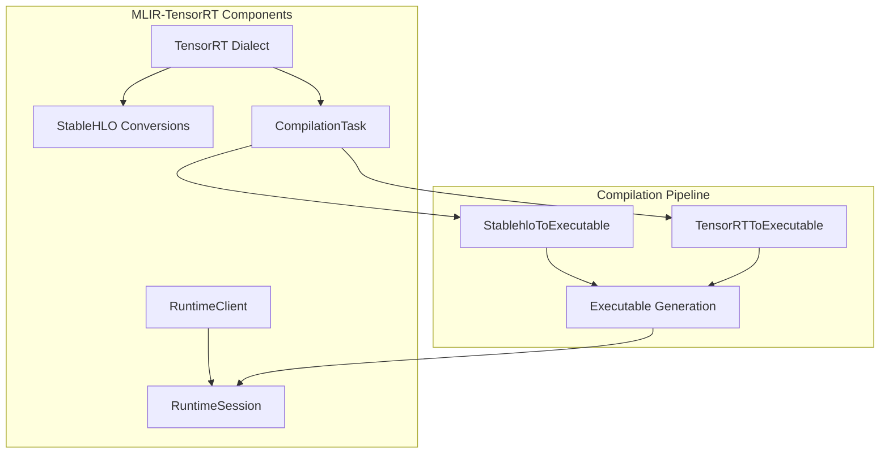
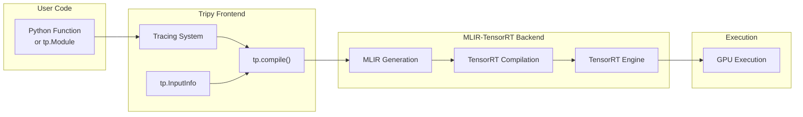
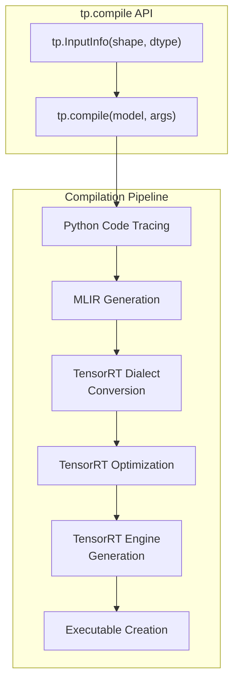

<!-- source: DeepWiki mcp.deepwiki.com · repo NVIDIA/TensorRT-Incubator · page 1 Overview · fetched 2026-10-26 -->

# Overview

<details>
<summary>Relevant source files</summary>

The following files were used as context for generating this wiki page:

- [.github/workflows/mlir-tensorrt-ci.yml](.github/workflows/mlir-tensorrt-ci.yml)
- [.github/workflows/post-merge-package-index-update.yml](.github/workflows/post-merge-package-index-update.yml)
- [mlir-tensorrt/.devcontainer/cuda12.5-rockylinux8-gcc11/devcontainer.json](mlir-tensorrt/.devcontainer/cuda12.5-rockylinux8-gcc11/devcontainer.json)
- [mlir-tensorrt/CMakePresets.json](mlir-tensorrt/CMakePresets.json)
- [mlir-tensorrt/README.md](mlir-tensorrt/README.md)
- [mlir-tensorrt/Version.cmake](mlir-tensorrt/Version.cmake)
- [mlir-tensorrt/build_tools/docker/Dockerfile](mlir-tensorrt/build_tools/docker/Dockerfile)
- [mlir-tensorrt/build_tools/scripts/build_wheels.sh](mlir-tensorrt/build_tools/scripts/build_wheels.sh)
- [mlir-tensorrt/executor/lib/Runtime/Backend/Lua/Modules/CMakeLists.txt](mlir-tensorrt/executor/lib/Runtime/Backend/Lua/Modules/CMakeLists.txt)
- [mlir-tensorrt/python/requirements-dev.txt](mlir-tensorrt/python/requirements-dev.txt)
- [tripy/README.md](tripy/README.md)
- [tripy/docs/packages.html](tripy/docs/packages.html)
- [tripy/docs/pre0_user_guides/00-introduction-to-tripy.md](tripy/docs/pre0_user_guides/00-introduction-to-tripy.md)
- [tripy/examples/nanogpt/example.py](tripy/examples/nanogpt/example.py)
- [tripy/nvtripy/__init__.py](tripy/nvtripy/__init__.py)
- [tripy/pyproject.toml](tripy/pyproject.toml)
- [tripy/tests/backend/api/test_stream.py](tripy/tests/backend/api/test_stream.py)
- [tripy/tests/integration/test_plugin.py](tripy/tests/integration/test_plugin.py)

</details>


This wiki page provides a comprehensive introduction to the TensorRT-Incubator repository, which contains tools and libraries that enhance NVIDIA's TensorRT deep learning inference engine. The repository consists of two major projects - Tripy/nvtripy and MLIR-TensorRT - that work together to provide a Pythonic programming model for TensorRT with advanced compilation capabilities.

## Repository Structure

The TensorRT-Incubator repository is organized around two primary components that serve different but complementary purposes in the TensorRT ecosystem.



Sources: [tripy/README.md:15-25](), [mlir-tensorrt/README.md:1-14](), [tripy/pyproject.toml:1-20]()

## Tripy/nvtripy Package

Tripy (package name `nvtripy`) is a Pythonic frontend for TensorRT that provides a high-level, user-friendly interface for deep learning inference. It offers several key features:

- A **module system** similar to PyTorch for defining neural network architectures
- **Tensor operations** with a functional API style
- **Eager execution** mode for interactive debugging
- **Compilation** capability for high-performance inference
- A **plugin system** for extending TensorRT functionality

Tripy is designed to be intuitive, debuggable, and to deliver the high performance that TensorRT is known for.

Current version: 0.1.1 (as of this documentation)

### Module System

Tripy provides a module system that allows users to define reusable neural network components:



Sources: [tripy/README.md:41-52](), [tripy/docs/pre0_user_guides/00-introduction-to-tripy.md:19-35]()

## MLIR-TensorRT Project

MLIR-TensorRT is a compiler and runtime infrastructure that integrates the MLIR (Multi-Level Intermediate Representation) framework with TensorRT. It serves as the underlying compilation engine for Tripy while also being usable independently. Key components include:

- A **TensorRT dialect** for MLIR that models TensorRT operations
- **Conversions** from StableHLO to TensorRT dialect
- **Compiler infrastructure** for building optimized TensorRT engines
- **Runtime system** for executing compiled models

Current version: 0.1.40 (as of this documentation)



Sources: [mlir-tensorrt/README.md:1-18](), [mlir-tensorrt/Version.cmake:1-5]()

## Architecture and Data Flow

The TensorRT-Incubator provides a complete pipeline from high-level Python code to optimized GPU execution. The following diagram illustrates the data flow through the system:



Sources: [tripy/docs/pre0_user_guides/00-introduction-to-tripy.md:56-81](), [tripy/examples/nanogpt/example.py:98-109]()

### Compilation Process

When a Tripy model is compiled using `tp.compile()`, the following steps occur:

1. The Python function or `tp.Module` is traced to capture its computational graph
2. The traced graph is converted to MLIR representation
3. The MLIR is translated to the TensorRT dialect
4. TensorRT optimizations are applied
5. A TensorRT engine is generated
6. The engine is wrapped in an executable form that can be called from Python

This process optimizes the model for inference performance while maintaining a user-friendly Python interface.



Sources: [tripy/docs/pre0_user_guides/00-introduction-to-tripy.md:56-68](), [tripy/examples/nanogpt/example.py:98-109]()

## Key Features and Capabilities

### Pythonic API

Tripy provides a Python API that follows conventions familiar to data scientists and deep learning practitioners:

- Tensor creation and manipulation functions
- Module system similar to PyTorch
- Functional operations (like `tp.relu`, `tp.gelu`)
- State management via `state_dict()` and `load_state_dict()`

### Eager Mode Execution

For debugging and development, Tripy supports eager mode execution, allowing operations to be performed immediately without compilation:

```
model = Model()
eager_output = model(input_tensor)  # Executes immediately
```

### Compiled Mode Execution

For optimized performance, models can be compiled:

```
compiled_model = tp.compile(model, args=[tp.InputInfo(shape=(1, 3, 224, 224), dtype=tp.float32)])
optimized_output = compiled_model(input_tensor)  # Uses optimized TensorRT engine
```

### Plugin System

Tripy includes a plugin system for extending TensorRT functionality with custom operations:

```
output = tp.plugin(
    name="CustomPluginName",
    inputs=[input_tensor],
    output_info=[(rank, dtype)],
    # Plugin-specific parameters
)
```

Sources: [tripy/tests/integration/test_plugin.py:26-32](), [tripy/tests/backend/api/test_stream.py:33-51]()

## Relationship to Other Pages

For more detailed information about specific components, refer to these wiki pages:

- For details about Tripy/nvtripy: [Tripy/nvtripy Package](#1.1)
- For more on MLIR-TensorRT: [MLIR-TensorRT Project](#1.2)
- For user guidance on using Tripy: [Tripy User Guide](#2)
- For examples of models implemented with Tripy: [Tripy Examples](#3)
- For technical details about MLIR-TensorRT: [MLIR-TensorRT Technical Documentation](#4)
- For development guidelines: [Development Guide](#5)

## Installation

To install Tripy from the published packages:

```
python3 -m pip install nvtripy -f https://nvidia.github.io/TensorRT-Incubator/packages.html
```

Sources: [tripy/README.md:29-31](), [tripy/docs/packages.html:1-184]()

## Version Compatibility

The TensorRT-Incubator components have the following dependencies:

| Component | Version | Key Dependencies |
|-----------|---------|------------------|
| nvtripy | 0.1.1 | TensorRT ≥ 10.9, mlir-tensorrt-compiler 0.1.40, mlir-tensorrt-runtime 0.1.40 |
| MLIR-TensorRT | 0.1.40 | LLVM/MLIR (version specified in build_tools/cmake/LLVMCommit.txt) |

Sources: [tripy/pyproject.toml:1-17](), [mlir-tensorrt/Version.cmake:1-5]()

## Summary

The TensorRT-Incubator repository provides a comprehensive set of tools for deep learning inference with TensorRT. Through Tripy's Pythonic frontend and MLIR-TensorRT's compilation infrastructure, users can easily define, debug, and deploy high-performance models that leverage NVIDIA GPU acceleration.

---

