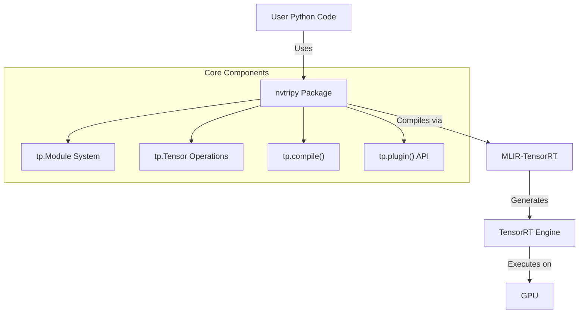
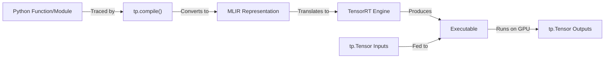
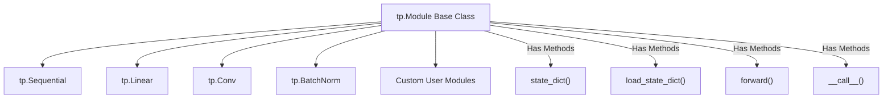
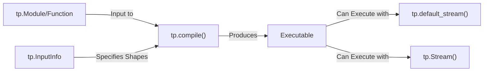
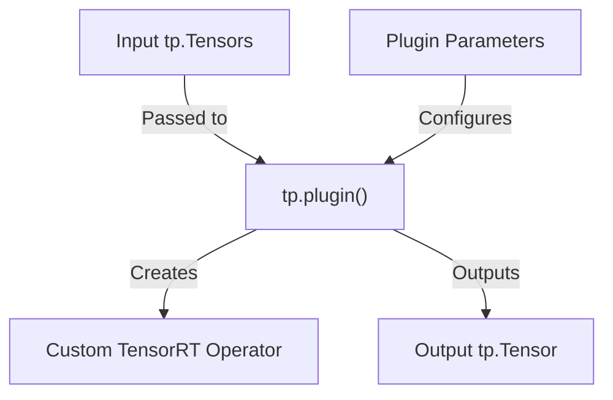

<!-- source: DeepWiki mcp.deepwiki.com · repo NVIDIA/TensorRT-Incubator · page 1.1 Tripy/nvtripy Package · fetched 2026-10-26 -->

# Tripy/nvtripy Package

<details>
<summary>Relevant source files</summary>

The following files were used as context for generating this wiki page:

- [.github/workflows/post-merge-package-index-update.yml](.github/workflows/post-merge-package-index-update.yml)
- [tripy/README.md](tripy/README.md)
- [tripy/docs/packages.html](tripy/docs/packages.html)
- [tripy/docs/pre0_user_guides/00-introduction-to-tripy.md](tripy/docs/pre0_user_guides/00-introduction-to-tripy.md)
- [tripy/examples/nanogpt/example.py](tripy/examples/nanogpt/example.py)
- [tripy/nvtripy/__init__.py](tripy/nvtripy/__init__.py)
- [tripy/pyproject.toml](tripy/pyproject.toml)
- [tripy/tests/backend/api/test_stream.py](tripy/tests/backend/api/test_stream.py)
- [tripy/tests/integration/test_plugin.py](tripy/tests/integration/test_plugin.py)

</details>


This document describes the Tripy package (published as "nvtripy"), a Pythonic frontend for TensorRT that provides a high-level Python interface for deep learning inference. For information about the underlying compiler infrastructure that powers Tripy, see [MLIR-TensorRT Project](#1.2).

## Overview

Tripy is a debuggable, Pythonic frontend for [TensorRT](https://developer.nvidia.com/tensorrt), NVIDIA's deep learning inference compiler. It provides a high-level API that follows familiar conventions from the Python deep learning ecosystem while leveraging TensorRT's performance optimizations.



Sources: [tripy/README.md:14-25](), [tripy/pyproject.toml:1-19]()

### Key Features

- **High performance**: Leverages TensorRT's optimization capabilities
- **Intuitive API**: Follows familiar conventions from frameworks like PyTorch
- **Debuggability**: Includes eager mode for interactive debugging
- **Informative error messages**: Provides actionable feedback
- **Documentation**: Comprehensive yet concise with examples

## Package Details

The nvtripy package is currently at version 0.1.1 and has the following key dependencies:

| Dependency | Version Requirement |
|------------|---------------------|
| TensorRT   | >=10.9              |
| MLIR-TensorRT Compiler | 0.1.40+cuda12.trt109 |
| MLIR-TensorRT Runtime  | 0.1.40+cuda12.trt109 |

Sources: [tripy/pyproject.toml:1-14](), [tripy/nvtripy/__init__.py:18]()

## Architecture

### Data Flow: From Python to GPU



Sources: [tripy/docs/pre0_user_guides/00-introduction-to-tripy.md:55-82](), [tripy/examples/nanogpt/example.py:98-109]()

### Execution Modes

Tripy supports two primary execution modes:

1. **Eager Mode**: For debugging and development
   - Operations are evaluated immediately when needed
   - Each operation compiles a separate TensorRT engine (slower)
   - Allows step-by-step debugging

2. **Compiled Mode**: For production and performance
   - Entire model is compiled once
   - Optimized TensorRT engine covers the whole model
   - Significantly better performance

Sources: [tripy/docs/pre0_user_guides/00-introduction-to-tripy.md:84-114]()

## Core Components

### Module System

Tripy provides a module system similar to PyTorch for organizing neural network components:



Sources: [tripy/docs/pre0_user_guides/00-introduction-to-tripy.md:19-35]()

### Tensor Operations

Tripy includes a comprehensive set of tensor operations:

| Category | Examples | Description |
|----------|----------|-------------|
| Creation | `ones`, `zeros`, `iota` | Create tensors with specific values |
| Math | `add`, `mul`, `matmul` | Mathematical operations |
| NN | `relu`, `gelu`, `softmax` | Neural network activations |
| Manipulation | `reshape`, `transpose` | Change tensor dimensions |

Sources: [tripy/docs/pre0_user_guides/00-introduction-to-tripy.md:7-17](), [tripy/tests/integration/test_plugin.py:23-37]()

### Compilation System

The compilation system is a key component that transforms Python code into optimized TensorRT engines:



Sources: [tripy/docs/pre0_user_guides/00-introduction-to-tripy.md:55-82](), [tripy/tests/backend/api/test_stream.py:20-51]()

### Plugin System

Tripy supports TensorRT plugins, allowing users to extend functionality with custom operations:



Sources: [tripy/tests/integration/test_plugin.py:23-53]()

## Usage Examples

### Basic Usage

1. **Define a model**:
   ```python
   class Model(tp.Module):
       def __init__(self):
           self.conv = tp.Conv(in_channels=1, out_channels=1, kernel_dims=[3, 3])

       def forward(self, x):
           x = self.conv(x)
           x = tp.relu(x)
           return x
   ```

2. **Initialize parameters**:
   ```python
   model = Model()
   model.load_state_dict({
       "conv.weight": tp.ones((1, 1, 3, 3)),
       "conv.bias": tp.ones((1,)),
   })
   ```

3. **Execute in eager mode**:
   ```python
   dummy_input = tp.ones((1, 1, 4, 4)).eval()
   eager_out = model(dummy_input)
   ```

4. **Compile and execute**:
   ```python
   compiled_model = tp.compile(
       model,
       args=[tp.InputInfo(shape=(1, 1, 4, 4), dtype=tp.float32)],
   )
   compiled_out = compiled_model(dummy_input)
   ```

Sources: [tripy/README.md:40-83]()

### Dynamic Shapes

Tripy supports dynamic shapes for flexible input dimensions:

```python
# Specify dynamic dimensions with (min, optimal, max) values
input_shape = (
    1,  # Batch size
    (1, current_length, max_length),  # Sequence length dimension is dynamic
)
model = tp.compile(model, args=[tp.InputInfo(input_shape, dtype=tp.int32)])
```

Sources: [tripy/examples/nanogpt/example.py:101-107]()

### Plugin Usage

Example of using a TensorRT plugin with Tripy:

```python
# Create input tensor
inp = tp.iota((2, 2))

# Apply plugin
out = tp.plugin(
    name="CustomGeluPluginDynamic",
    inputs=[inp],
    output_info=[(inp.rank, inp.dtype)],
    # Plugin parameters
    type_id=0,
)
```

Sources: [tripy/tests/integration/test_plugin.py:24-37]()

## Installation

Install the nvtripy package using pip:

```bash
python3 -m pip install nvtripy -f https://nvidia.github.io/TensorRT-Incubator/packages.html
```

Sources: [tripy/README.md:29-31](), [tripy/docs/packages.html:10-183]()

## Common Pitfalls and Best Practices

| Pitfall | Best Practice |
|---------|---------------|
| Slow execution in eager mode | Use eager mode only for debugging; compile for deployment |
| Inaccurate timing in eager mode | Be aware that tensors are evaluated only when used, affecting timing measurements |
| Missing parameters in module | Check `state_dict()` to ensure all parameters are initialized |
| Shape mismatches | Use dynamic shapes when input dimensions may vary |

Sources: [tripy/docs/pre0_user_guides/00-introduction-to-tripy.md:84-114]()

---

