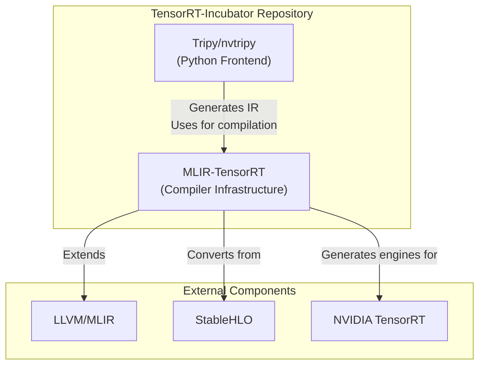
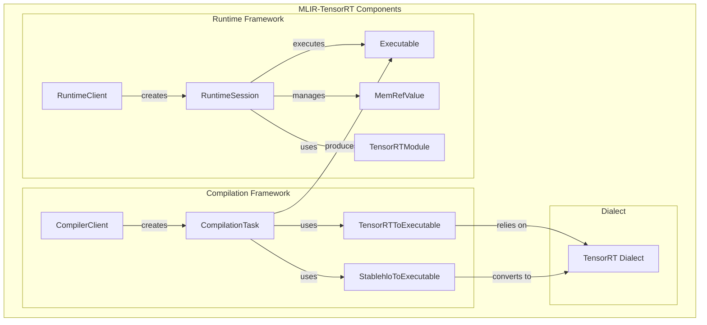
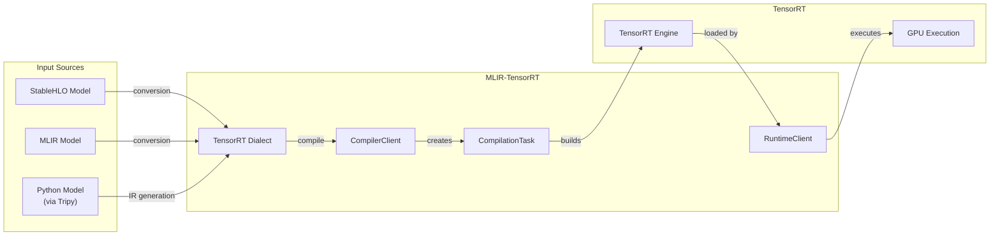
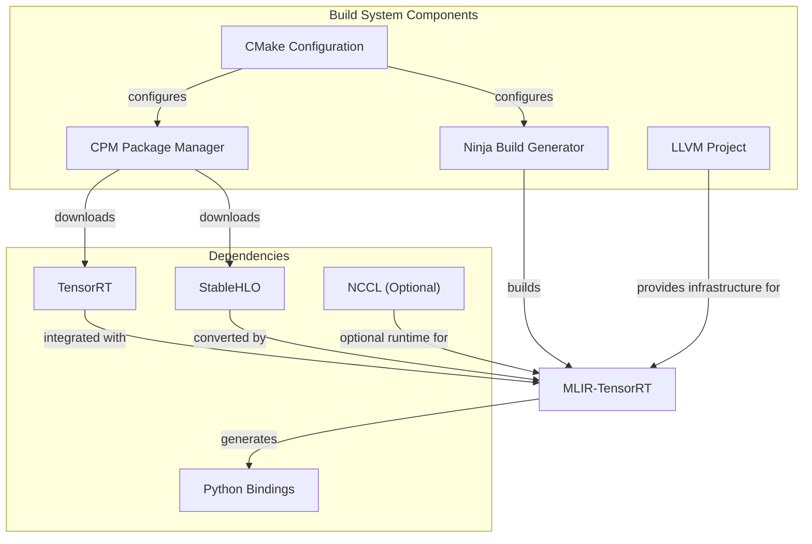

<!-- source: DeepWiki mcp.deepwiki.com · repo NVIDIA/TensorRT-Incubator · page 1.2 MLIR-TensorRT Project · fetched 2026-10-26 -->

# MLIR-TensorRT Project

Relevant source files

The following files were used as context for generating this wiki page:

- [.github/workflows/mlir-tensorrt-ci.yml](.github/workflows/mlir-tensorrt-ci.yml)
- [mlir-tensorrt/.devcontainer/cuda12.5-rockylinux8-gcc11/devcontainer.json](mlir-tensorrt/.devcontainer/cuda12.5-rockylinux8-gcc11/devcontainer.json)
- [mlir-tensorrt/CMakeLists.txt](mlir-tensorrt/CMakeLists.txt)
- [mlir-tensorrt/CMakePresets.json](mlir-tensorrt/CMakePresets.json)
- [mlir-tensorrt/README.md](mlir-tensorrt/README.md)
- [mlir-tensorrt/Version.cmake](mlir-tensorrt/Version.cmake)
- [mlir-tensorrt/build_tools/cmake/Dependencies.cmake](mlir-tensorrt/build_tools/cmake/Dependencies.cmake)
- [mlir-tensorrt/build_tools/cmake/TensorRTDownloadURL.cmake](mlir-tensorrt/build_tools/cmake/TensorRTDownloadURL.cmake)
- [mlir-tensorrt/build_tools/docker/Dockerfile](mlir-tensorrt/build_tools/docker/Dockerfile)
- [mlir-tensorrt/build_tools/scripts/build_wheels.sh](mlir-tensorrt/build_tools/scripts/build_wheels.sh)
- [mlir-tensorrt/build_tools/scripts/cicd_build.sh](mlir-tensorrt/build_tools/scripts/cicd_build.sh)
- [mlir-tensorrt/executor/lib/Runtime/Backend/Lua/Modules/CMakeLists.txt](mlir-tensorrt/executor/lib/Runtime/Backend/Lua/Modules/CMakeLists.txt)
- [mlir-tensorrt/python/requirements-dev.txt](mlir-tensorrt/python/requirements-dev.txt)

## Purpose and Scope

This document provides an overview of the MLIR-TensorRT project, which serves as the compiler infrastructure within the TensorRT-Incubator repository. MLIR-TensorRT enables the integration of NVIDIA's TensorRT with the MLIR (Multi-Level Intermediate Representation) compiler infrastructure, providing a pathway for optimizing and deploying machine learning models to NVIDIA GPUs. For more detailed technical documentation on MLIR-TensorRT, see [MLIR-TensorRT Technical Documentation](#4).

Sources: [mlir-tensorrt/README.md:1-17]()

## Overview

MLIR-TensorRT is a core component of the TensorRT-Incubator repository that provides:

1. A custom MLIR dialect that precisely models the TensorRT operator set
2. Conversions from StableHLO to the TensorRT dialect
3. A compiler infrastructure for generating optimized TensorRT engines
4. Runtime components for model execution
5. Python bindings for seamless integration

The project serves as the underlying compiler technology that powers higher-level interfaces like Tripy/nvtripy, enabling Python-based neural network models to be efficiently executed on NVIDIA GPUs.

Sources: [mlir-tensorrt/README.md:1-17](), [mlir-tensorrt/CMakeLists.txt:30-46]()

## Key Components

MLIR-TensorRT consists of several key components that work together to provide the full functionality of the project:

### TensorRT Dialect

The TensorRT dialect is an MLIR dialect that models the TensorRT operator set with static verification, type inference, and optimizations. This dialect provides:

- A precise representation of TensorRT operations in MLIR IR
- Static verification to ensure correctness before runtime
- Type inference for operations
- Optimization passes specific to TensorRT operations

### Compilation System

The compilation system handles the conversion from higher-level representations to TensorRT engines:

- Provides conversions from StableHLO to the TensorRT dialect
- Supports compilation of models with dynamic shapes
- Includes multiple compilation pipelines:
  - TensorRTToExecutable: Converts TensorRT dialect to executable format
  - StablehloToExecutable: Directly converts StableHLO to executable format

### Runtime System

The runtime system manages the execution of compiled models:

- RuntimeClient interfaces for executing compiled models
- RuntimeSession for managing runtime state
- Support for various execution models including synchronous and asynchronous execution
- Integration with TensorRT's runtime system

Sources: [mlir-tensorrt/README.md:5-13](), [mlir-tensorrt/CMakeLists.txt:30-46]()

## Integration with StableHLO

One of the key features of MLIR-TensorRT is its integration with StableHLO, which is a portable MLIR dialect for high-level operations designed for machine learning. MLIR-TensorRT provides:

- Conversion patterns from StableHLO operations to TensorRT dialect operations
- Support for complex StableHLO models and features
- Optimizations specific to StableHLO conversion

This integration allows models defined in frameworks like JAX, TensorFlow, and PyTorch (via conversion to StableHLO) to be compiled to TensorRT for efficient execution on NVIDIA GPUs.

Sources: [mlir-tensorrt/README.md:10-11](), [mlir-tensorrt/CMakeLists.txt:147-150]()

## Compilation and Execution Flow

The following diagram illustrates the overall flow from higher-level representations to GPU execution using MLIR-TensorRT:

Sources: [mlir-tensorrt/README.md:7-13]()

## Python Integration

MLIR-TensorRT includes Python bindings for seamless integration with Python-based ML frameworks and applications:

- Python bindings for the TensorRT dialect
- Python interface for the compiler framework
- Integration with DLPack for tensor interoperability
- Support for Python-based testing and benchmarking

This enables developers to use MLIR-TensorRT directly from Python code, making it easier to integrate with existing Python-based ML workflows.

Sources: [mlir-tensorrt/CMakeLists.txt:40](), [mlir-tensorrt/python/requirements-dev.txt:1-18]()

## Build and Dependency Management

MLIR-TensorRT provides a flexible build system that supports various ways of integration:

1. **Standalone build with LLVM downloaded by CMake**:
   - Simplest approach for getting started
   - Automatically downloads LLVM and TensorRT dependencies

2. **Standalone build with user-provided LLVM**:
   - Allows using a custom LLVM build
   - Supports integration with existing LLVM-based projects

3. **Sub-project of a larger build**:
   - Can be included in larger projects via `add_subdirectory()`
   - Shares CMake configuration with parent project

4. **LLVM-External-Projects mechanism**:
   - Builds as an external project within LLVM's build system

The project also manages TensorRT dependencies, supporting multiple versions (8.6 through 10.9) with automatic download capabilities.

Sources: [mlir-tensorrt/README.md:19-135](), [mlir-tensorrt/CMakeLists.txt:4-223](), [mlir-tensorrt/build_tools/cmake/Dependencies.cmake:1-222]()

## Continuous Integration and Development

MLIR-TensorRT maintains a robust continuous integration (CI) system to ensure code quality:

- Automated tests via GitHub Actions
- Support for multiple TensorRT versions (8.6 through 10.9)
- Comprehensive test suites including unit and integration tests
- Format checking for C++ and Python code

The development workflow supports:
- Automated wheel building for Python packages
- Containerized development environments
- Various build configurations (Debug, Release, RelWithDebInfo)

Sources: [.github/workflows/mlir-tensorrt-ci.yml:1-168](), [mlir-tensorrt/build_tools/scripts/cicd_build.sh:1-21]()

## Version and Compatibility

MLIR-TensorRT is versioned independently from TensorRT, with its own versioning scheme. The current version as of this documentation is 0.1.40, as defined in the Version.cmake file.

The project is designed to be compatible with various TensorRT versions, with support for versions ranging from TensorRT 8.6 to 10.9. The build system can automatically download and configure the appropriate TensorRT version based on user preferences.

Sources: [mlir-tensorrt/Version.cmake:1-5](), [mlir-tensorrt/build_tools/cmake/TensorRTDownloadURL.cmake:1-215]()

---

