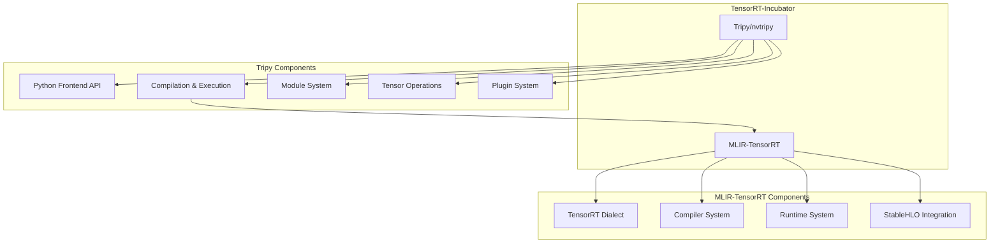
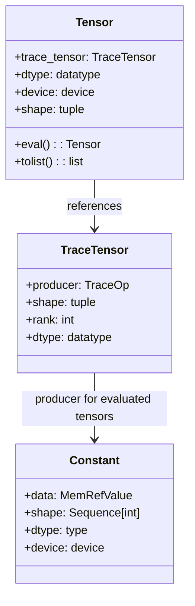
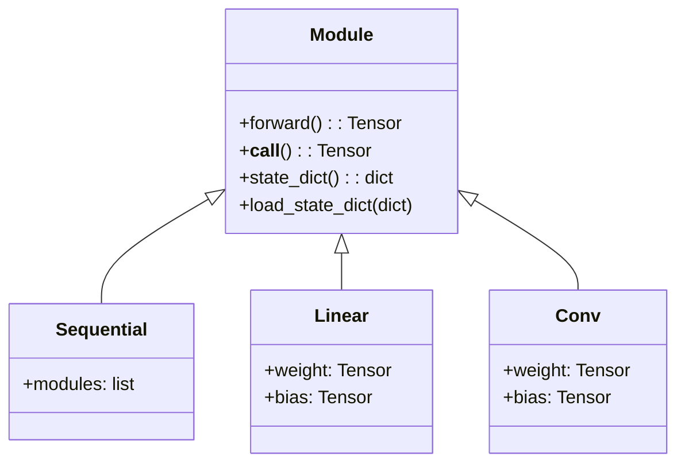
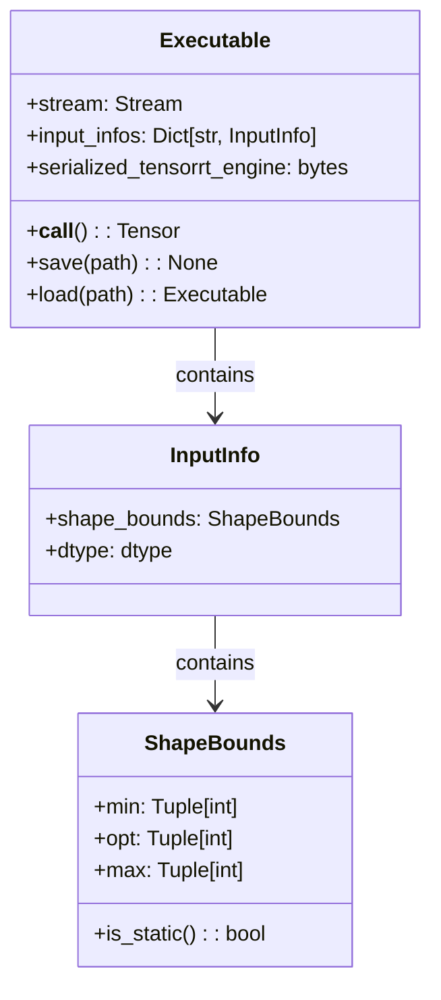
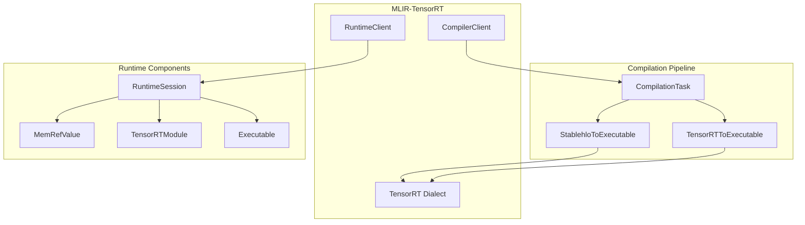
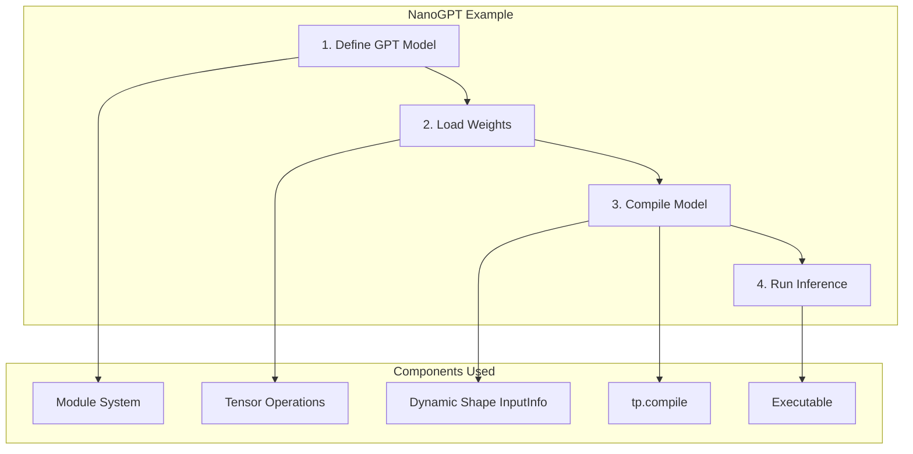

<!-- source: DeepWiki mcp.deepwiki.com · repo NVIDIA/TensorRT-Incubator · page 1.3 Architecture and Components · fetched 2026-10-26 -->

# Architecture and Components

<details>
<summary>Relevant source files</summary>

The following files were used as context for generating this wiki page:

- [tripy/README.md](tripy/README.md)
- [tripy/docs/README.md](tripy/docs/README.md)
- [tripy/docs/pre0_user_guides/00-introduction-to-tripy.md](tripy/docs/pre0_user_guides/00-introduction-to-tripy.md)
- [tripy/docs/pre0_user_guides/03-custom-operations.md](tripy/docs/pre0_user_guides/03-custom-operations.md)
- [tripy/examples/nanogpt/example.py](tripy/examples/nanogpt/example.py)
- [tripy/nvtripy/backend/api/compile.py](tripy/nvtripy/backend/api/compile.py)
- [tripy/nvtripy/backend/api/executable.py](tripy/nvtripy/backend/api/executable.py)
- [tripy/nvtripy/backend/api/input_info.py](tripy/nvtripy/backend/api/input_info.py)
- [tripy/nvtripy/common/shape_bounds.py](tripy/nvtripy/common/shape_bounds.py)
- [tripy/nvtripy/export.py](tripy/nvtripy/export.py)
- [tripy/nvtripy/frontend/ops/plugin.py](tripy/nvtripy/frontend/ops/plugin.py)
- [tripy/nvtripy/frontend/ops/plugin_qdp.py](tripy/nvtripy/frontend/ops/plugin_qdp.py)
- [tripy/nvtripy/frontend/tensor.py](tripy/nvtripy/frontend/tensor.py)
- [tripy/nvtripy/trace/ops/constant.py](tripy/nvtripy/trace/ops/constant.py)
- [tripy/nvtripy/trace/ops/plugin.py](tripy/nvtripy/trace/ops/plugin.py)
- [tripy/tests/backend/api/test_compile.py](tripy/tests/backend/api/test_compile.py)
- [tripy/tests/backend/api/test_executable.py](tripy/tests/backend/api/test_executable.py)
- [tripy/tests/backend/api/test_input_info.py](tripy/tests/backend/api/test_input_info.py)
- [tripy/tests/backend/api/test_stream.py](tripy/tests/backend/api/test_stream.py)
- [tripy/tests/conftest.py](tripy/tests/conftest.py)
- [tripy/tests/frontend/ops/test_plugin_qdp.py](tripy/tests/frontend/ops/test_plugin_qdp.py)
- [tripy/tests/integration/test_plugin.py](tripy/tests/integration/test_plugin.py)
- [tripy/tests/integration/test_plugin_qdp.py](tripy/tests/integration/test_plugin_qdp.py)

</details>


This document provides a technical overview of the TensorRT-Incubator architecture and how its components interact to enable efficient deep learning inference. It covers the flow from Python code to GPU execution, the core components of the system, and how they work together.

For a general introduction to the project, see [Overview](#1). For more specific information about the Python package, see [Tripy/nvtripy Package](#1.1), and for details on the MLIR integration, see [MLIR-TensorRT Project](#1.2).

## High-Level Architecture Overview

The TensorRT-Incubator consists of two main subprojects that work together to provide a complete solution for deep learning inference:



Sources: [tripy/README.md:15-24](), [tripy/docs/pre0_user_guides/00-introduction-to-tripy.md:1-4]()

## Data Flow Pipeline

When a user executes code in TensorRT-Incubator, the following sequence of operations occurs:


1. User writes Python code using the Tripy API
2. Function/module is traced to capture tensor operations
3. The trace is converted to MLIR representation
4. MLIR is compiled to a TensorRT engine
5. The compiled executable is run on the GPU

Sources: [tripy/nvtripy/backend/api/compile.py:33-75](), [tripy/examples/nanogpt/example.py:97-107]()

## Core Components

### Tensor System

The `tp.Tensor` class represents multi-dimensional arrays with uniform data types and is the foundational building block of the system:



Key features:
- **Lazy evaluation**: Operations are only executed when needed
- **Device management**: Tensors can reside in CPU or GPU memory
- **DLPack support**: Interoperability with other frameworks
- **Automatic differentiation**: Built-in gradient calculation

Sources: [tripy/nvtripy/frontend/tensor.py:56-70](), [tripy/nvtripy/frontend/tensor.py:210-297](), [tripy/nvtripy/trace/ops/constant.py:138-152]()

### Module System

The module system provides a way to organize neural network components:



Key features:
- **PyTorch-like API**: Familiar interface for deep learning practitioners 
- **State management**: Methods for saving and loading parameters
- **Hierarchical composition**: Modules can contain other modules
- **Built-in layers**: Common layers like Linear, Conv, BatchNorm, etc.

Sources: [tripy/docs/pre0_user_guides/00-introduction-to-tripy.md:19-54]()

### Compilation System

The compilation system converts Python functions and modules into optimized executables:

```mermaid
graph TD
    subgraph "Compilation System"
        Compile["tp.compile function"]
        InputInfo["tp.InputInfo"]
        TraceFunc["TraceFunctionPass"]
        CreateMLIR["MLIRGenerator"]
        CompileMLIR["MLIRCompiler"]
        CreateExe["ExecutableCreator"]
    end
    
    Compile --> InputInfo: "uses for shape specs"
    Compile --> TraceFunc: "captures operations"
    TraceFunc --> CreateMLIR: "generates IR"
    CreateMLIR --> CompileMLIR: "optimizes"
    CompileMLIR --> CreateExe: "builds executable"
```

Key components:
- **tp.compile**: Main entry point for compilation
- **tp.InputInfo**: Specifies input shapes and types
- **Trace function**: Captures tensor operations
- **MLIR generation**: Converts trace to MLIR
- **TensorRT compilation**: Optimizes MLIR for GPU execution

Sources: [tripy/nvtripy/backend/api/compile.py:32-248](), [tripy/tests/backend/api/test_compile.py:27-48]()

### Executable System

The `tp.Executable` class represents a compiled function that can be executed on the GPU:



Key features:
- **Function-like interface**: Simple execution via function call
- **Persistence**: Save and load compiled models
- **Stream management**: Control execution timing
- **TensorRT engine access**: Direct access to the underlying engine

Sources: [tripy/nvtripy/backend/api/executable.py:32-327](), [tripy/tests/backend/api/test_executable.py:39-135](), [tripy/nvtripy/backend/api/input_info.py:24-102](), [tripy/nvtripy/common/shape_bounds.py:26-61]()

### Plugin System

The plugin system allows extending TensorRT with custom operations:

```mermaid
graph TD
    subgraph "Plugin System"
        Plugin["tp.plugin function"]
        PluginRegistry["PluginRegistry"]
        
        subgraph "Plugin Types"
            TRTPlugin["TensorRT Plugin"]
            QDPPlugin["QDP Plugin"]
        end
        
        subgraph "Implementation"
            CUDA["CUDA Kernel"]
            Triton["Triton Kernel"]
            CustomOp["Custom Operations"]
        end
    end
    
    Plugin --> PluginRegistry: "registers"
    PluginRegistry --> TRTPlugin: "manages"
    PluginRegistry --> QDPPlugin: "manages"
    TRTPlugin --> CUDA: "implemented with"
    TRTPlugin --> Triton: "implemented with"
    QDPPlugin --> CustomOp: "implements"
```

Key features:
- **Traditional TensorRT plugins**: Support for IPluginV2DynamicExt interface
- **Quickly Deployable Plugins (QDPs)**: Simplified plugin API
- **Custom kernels**: Support for various kernel implementations (CUDA, Triton, etc.)
- **Dynamic shape support**: Plugins can handle tensors with varying dimensions

Sources: [tripy/nvtripy/frontend/ops/plugin.py:26-69](), [tripy/nvtripy/frontend/ops/plugin_qdp.py:41-128](), [tripy/tests/integration/test_plugin.py:23-53](), [tripy/docs/pre0_user_guides/03-custom-operations.md:1-137]()

## MLIR-TensorRT Integration

MLIR-TensorRT provides the compiler infrastructure that powers Tripy:



Key components:
- **TensorRT Dialect**: MLIR dialect that models TensorRT operations
- **CompilerClient**: Interface for compiling MLIR to TensorRT
- **RuntimeClient**: Interface for executing compiled models
- **RuntimeSession**: Manages execution state and resources

The integration enables:
- Converting MLIR representations to optimized TensorRT engines
- Executing engines with efficient memory management
- Integrating with StableHLO for better interoperability

Sources: [tripy/nvtripy/backend/api/executable.py:43-63](), [tripy/nvtripy/frontend/tensor.py:240-273]()

## Dynamic Shapes Support

One of the key features of TensorRT-Incubator is its support for dynamic shapes:

```mermaid
graph LR
    subgraph "Dynamic Shapes System"
        InputInfo["tp.InputInfo"]
        ShapeBounds["ShapeBounds"]
        
        subgraph "Shape Definition"
            MinShape["Minimum Dimensions"]
            OptShape["Optimal Dimensions"]
            MaxShape["Maximum Dimensions"]
        end
        
        subgraph "TensorRT Optimization"
            TRTProfiles["TensorRT Optimization Profiles"]
            DynamicExecution["Dynamic Execution"]
        end
    end
    
    InputInfo --> ShapeBounds: "contains"
    ShapeBounds --> MinShape: "defines"
    ShapeBounds --> OptShape: "defines"
    ShapeBounds --> MaxShape: "defines"
    ShapeBounds --> TRTProfiles: "creates"
    TRTProfiles --> DynamicExecution: "enables"
```

The dynamic shapes system allows:
- Specifying minimum, optimal, and maximum dimensions for each input
- Creating optimization profiles for TensorRT
- Supporting a range of input shapes with a single compiled model
- Efficient handling of varying batch sizes and feature dimensions

Example usage:
```python
# Support batch sizes from 1 to 64, optimizing for batch size 16
input_info = tp.InputInfo(shape=((1, 16, 64), 784), dtype=tp.float32)

# Compile once, use with various shapes
compiled_model = tp.compile(model, args=[input_info])

# Use with different batch sizes
small_batch = tp.ones((1, 784), dtype=tp.float32).eval()
large_batch = tp.ones((64, 784), dtype=tp.float32).eval()

small_output = compiled_model(small_batch)
large_output = compiled_model(large_batch)
```

Sources: [tripy/nvtripy/backend/api/input_info.py:24-102](), [tripy/nvtripy/common/shape_bounds.py:26-61](), [tripy/tests/backend/api/test_input_info.py:20-62]()

## End-to-End Example: NanoGPT

The following example demonstrates how all components work together in a real-world scenario, using the NanoGPT example from the codebase:



Key steps:
1. **Model definition**: Define the GPT model using the module system
2. **Weight loading**: Load pre-trained weights into the model
3. **Compilation**: Compile the model with dynamic shape support
4. **Inference**: Run the model on input data

Code example (simplified from the actual implementation):
```python
# Initialize model
model = initialize_gpt_model(model_type, padded_seq_len, tp.float16, quant_mode)
load_weights_from_hf(model, model_type, tp.float16)

# Prepare input
idx = tp.unsqueeze(tp.Tensor(input_ids), 0).eval()

# Compile with dynamic sequence length
input_shape = (
    1,
    (1, len(input_ids), padded_seq_len),
)
model = tp.compile(model, args=[tp.InputInfo(input_shape, dtype=tp.int32)])

# Run inference
logits = model(idx)
```

Sources: [tripy/examples/nanogpt/example.py:29-107]()

## Summary

The TensorRT-Incubator architecture provides a complete solution for deep learning inference:

1. **Frontend (Tripy/nvtripy)**: Pythonic API for defining and compiling models
2. **Backend (MLIR-TensorRT)**: Compiler infrastructure for optimizing models
3. **Core Components**:
   - Tensor System: Fundamental data structure
   - Module System: Neural network component organization
   - Compilation System: Python-to-GPU optimization
   - Executable System: Runtime execution
   - Plugin System: Custom operation support

The architecture enables efficient deep learning inference on NVIDIA GPUs with a developer-friendly API, dynamic shape support, and extensive customization options.

For information on using Tripy, see [Tripy User Guide](#2).

Sources: [tripy/README.md:15-24](), [tripy/docs/pre0_user_guides/00-introduction-to-tripy.md:1-16]()

---

