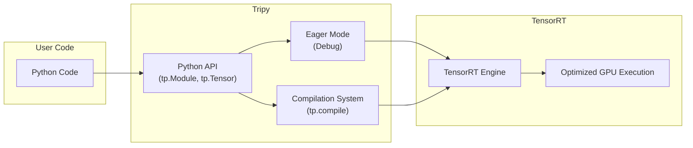
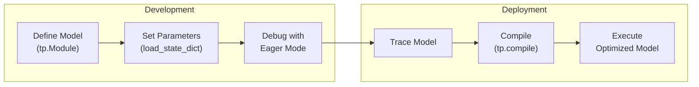
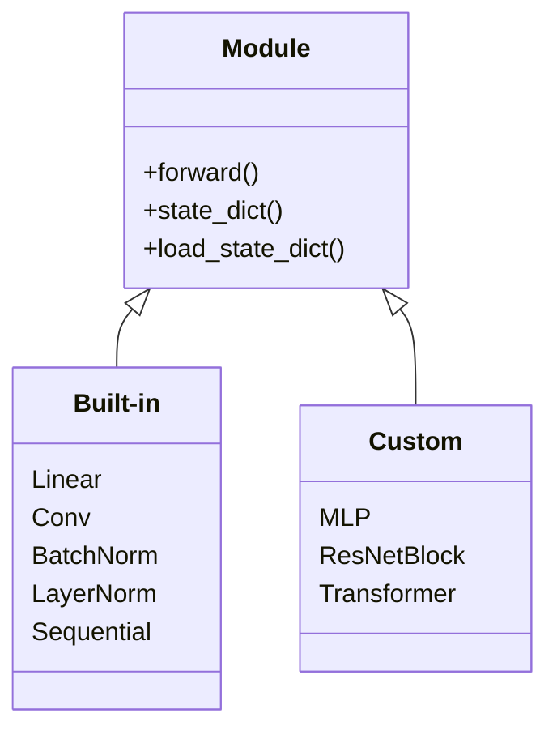
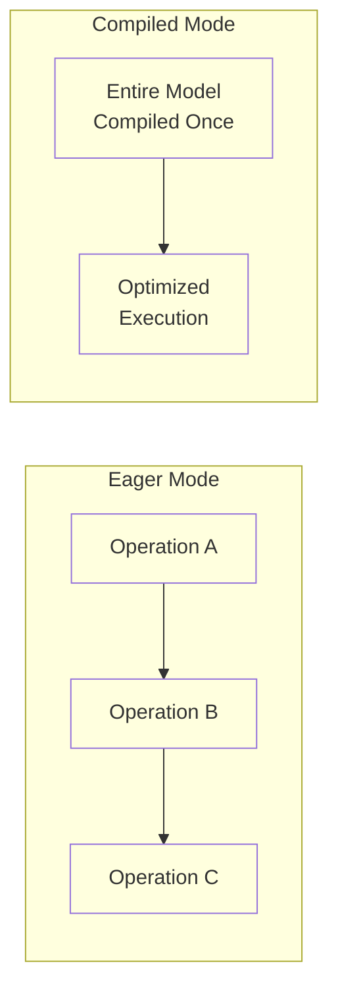
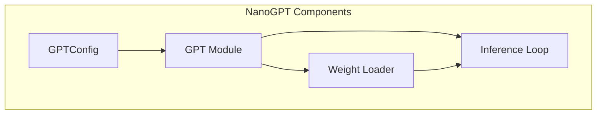
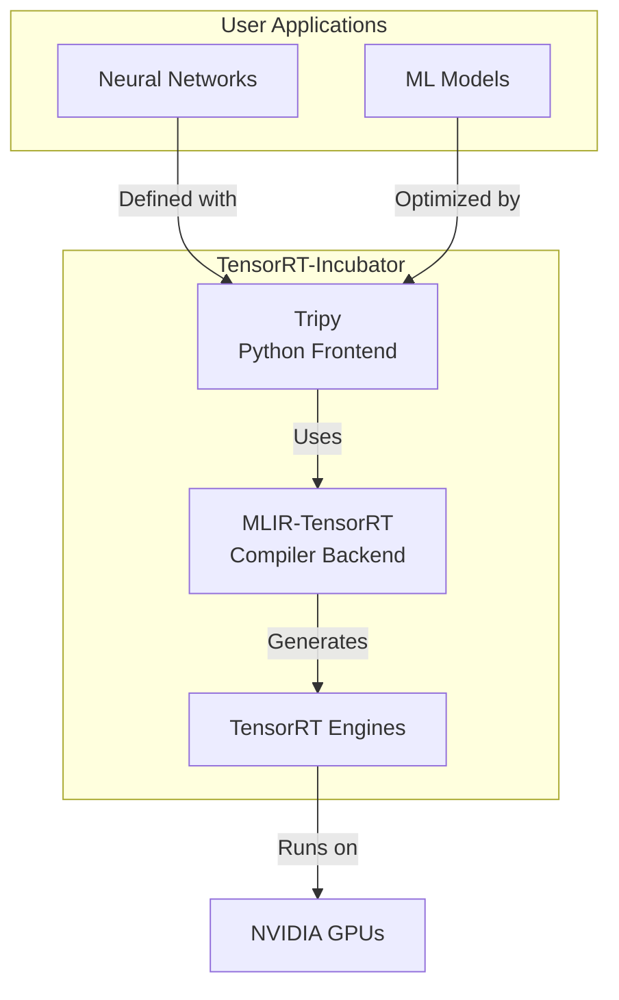

<!-- source: DeepWiki mcp.deepwiki.com · repo NVIDIA/TensorRT-Incubator · page 2 Tripy User Guide · fetched 2026-10-26 -->

# Tripy User Guide

<details>
<summary>Relevant source files</summary>

The following files were used as context for generating this wiki page:

- [tripy/CONTRIBUTING.md](tripy/CONTRIBUTING.md)
- [tripy/README.md](tripy/README.md)
- [tripy/docs/pre0_user_guides/00-introduction-to-tripy.md](tripy/docs/pre0_user_guides/00-introduction-to-tripy.md)
- [tripy/examples/nanogpt/README.md](tripy/examples/nanogpt/README.md)
- [tripy/examples/nanogpt/example.py](tripy/examples/nanogpt/example.py)
- [tripy/examples/segment-anything-model-v2/README.md](tripy/examples/segment-anything-model-v2/README.md)
- [tripy/examples/segment-anything-model-v2/checkpoints/download_ckpt.sh](tripy/examples/segment-anything-model-v2/checkpoints/download_ckpt.sh)
- [tripy/examples/segment-anything-model-v2/download_test_data.py](tripy/examples/segment-anything-model-v2/download_test_data.py)
- [tripy/examples/segment-anything-model-v2/video_demo.py](tripy/examples/segment-anything-model-v2/video_demo.py)
- [tripy/notebooks/resnet50.ipynb](tripy/notebooks/resnet50.ipynb)
- [tripy/tests/backend/api/test_stream.py](tripy/tests/backend/api/test_stream.py)
- [tripy/tests/integration/test_plugin.py](tripy/tests/integration/test_plugin.py)
- [tripy/tests/test_examples.py](tripy/tests/test_examples.py)

</details>


This guide serves as a comprehensive reference for using Tripy, a debuggable, Pythonic frontend for TensorRT. It covers core concepts, workflow patterns, and best practices to help you build and optimize deep learning inference applications. For more specialized topics, refer to the linked sub-pages.

For installation instructions, see [Getting Started](#2.1).
For information about how the compiler works, see [Compilation and Execution](#2.4).

## What is Tripy?

Tripy provides a high-level Python interface to NVIDIA's TensorRT deep learning inference accelerator. It offers:

- **Intuitive API** that follows Python ecosystem conventions
- **Debuggability** with eager execution mode
- **High performance** through TensorRT's optimization capabilities
- **Developer-friendly experience** with informative error messages



Sources: [tripy/README.md:15-25](), [tripy/docs/pre0_user_guides/00-introduction-to-tripy.md:1-17]()

## Workflow Overview

The typical Tripy workflow consists of two main phases:

1. **Development & Debugging**: Use eager mode for interactive development
2. **Deployment**: Compile your model for optimized execution



Sources: [tripy/README.md:40-84](), [tripy/docs/pre0_user_guides/00-introduction-to-tripy.md:56-77]()

## Core Concepts

### Module System

Tripy's module system resembles PyTorch, allowing you to create neural network architectures through composition:



Example of defining a model:

```python
class Model(tp.Module):
    def __init__(self):
        self.conv = tp.Conv(in_channels=1, out_channels=1, kernel_dims=[3, 3])

    def forward(self, x):
        x = self.conv(x)
        x = tp.relu(x)
        return x
```

Sources: [tripy/README.md:41-52](), [tripy/notebooks/resnet50.ipynb:63-118]()

### Tensor Operations

Tripy provides a comprehensive set of tensor operations:

- **Creation**: `ones`, `zeros`, `full`, `iota`
- **Math**: `add`, `mul`, `matmul`, etc.
- **Neural network**: `relu`, `gelu`, `softmax`
- **Manipulation**: `reshape`, `transpose`, `flatten`

Tensor operations work in both eager and compiled mode.

Sources: [tripy/docs/pre0_user_guides/00-introduction-to-tripy.md:7-17](), [tripy/tests/backend/api/test_stream.py:33-51]()

### Eager vs. Compiled Execution

Tripy offers two execution models:

| Feature | Eager Mode | Compiled Mode |
|---------|------------|---------------|
| Purpose | Development & debugging | Deployment & inference |
| Performance | Slower (per-op compilation) | Faster (optimized) |
| Flexibility | Interactive, step-by-step | Fixed graph |
| Debugging | Easy to inspect values | Limited visibility |
| Memory usage | Higher | Lower |



Sources: [tripy/docs/pre0_user_guides/00-introduction-to-tripy.md:84-114]()

## Using Tripy

### Model Definition

Define models by subclassing `tp.Module` and implementing a `forward` method:

```python
class MLP(tp.Module):
    def __init__(self, embd_size, dtype=tp.float32):
        super().__init__()
        self.c_fc = tp.Linear(embd_size, 4 * embd_size, bias=True, dtype=dtype)
        self.c_proj = tp.Linear(4 * embd_size, embd_size, bias=True, dtype=dtype)

    def forward(self, x):
        x = self.c_fc(x)
        x = tp.gelu(x)
        x = self.c_proj(x)
        return x
```

Sources: [tripy/docs/pre0_user_guides/00-introduction-to-tripy.md:24-35]()

### Parameter Management

Set and retrieve model parameters using the state dictionary interface:

```python
# Set parameters
model.load_state_dict({
    "conv.weight": tp.ones((1, 1, 3, 3)),
    "conv.bias": tp.ones((1,)),
})

# Get parameters
params = model.state_dict()
```

Sources: [tripy/README.md:57-64](), [tripy/docs/pre0_user_guides/00-introduction-to-tripy.md:43-50]()

### Eager Mode Execution

Run your model directly for debugging:

```python
# Create input tensor and evaluate it (forces execution)
input_data = tp.ones((1, 1, 4, 4)).eval()

# Run in eager mode
output = model(input_data)
```

Sources: [tripy/README.md:68-72](), [tripy/docs/pre0_user_guides/00-introduction-to-tripy.md:97-113]()

### Compilation

Compile your model for optimized execution:

```python
compiled_model = tp.compile(
    model,
    args=[tp.InputInfo(shape=(1, 1, 4, 4), dtype=tp.float32)],
)

# Run the compiled model
result = compiled_model(input_data)
```

`tp.InputInfo` defines the expected input shape and data type. For models with multiple inputs, provide multiple `InputInfo` objects.

Sources: [tripy/README.md:76-83](), [tripy/docs/pre0_user_guides/00-introduction-to-tripy.md:60-68]()

### Dynamic Shapes

Tripy supports dynamic tensor dimensions for flexible models:

```python
# Support variable sequence length (from 1 to 256)
dynamic_model = tp.compile(
    model,
    args=[tp.InputInfo(shape=(1, (1, 128, 256)), dtype=tp.float32)],
)
```

A tuple of three values `(min, opt, max)` indicates a dynamic dimension that can vary between the minimum and maximum values, with an optimization target.

Sources: [tripy/examples/nanogpt/example.py:101-106]()

### Plugin System

Extend Tripy with custom TensorRT plugins:

```python
output = tp.plugin(
    name="CustomGeluPluginDynamic", 
    inputs=[input_tensor],
    output_info=[(input_tensor.rank, input_tensor.dtype)],
    # Plugin parameters:
    type_id=0,
)
```

The `output_info` parameter specifies the rank and data type of each output tensor.

Sources: [tripy/tests/integration/test_plugin.py:26-37](), [tripy/tests/integration/test_plugin.py:39-53]()

## Real-World Examples

Tripy includes several example implementations that demonstrate its capabilities:

### NanoGPT

A lightweight GPT model implementation that shows:
- Transformer architecture in Tripy
- Weight loading from HuggingFace checkpoints
- Quantization support (INT8, INT4, FP8)
- Dynamic sequence length handling



Sources: [tripy/examples/nanogpt/README.md:1-39](), [tripy/examples/nanogpt/example.py:29-52]()

### ResNet50

An image classification model that demonstrates:
- Complex CNN architecture
- Weight transfer from PyTorch/HuggingFace
- Optimized inference pipeline

Sources: [tripy/notebooks/resnet50.ipynb:7-9](), [tripy/notebooks/resnet50.ipynb:127-267](), [tripy/notebooks/resnet50.ipynb:394-406]()

### SAM2 (Segment Anything Model v2)

A state-of-the-art computer vision model for image and video segmentation that shows:
- Advanced use cases
- Integration with external model architectures
- Image and video processing pipelines

Sources: [tripy/examples/segment-anything-model-v2/README.md:1-6](), [tripy/examples/segment-anything-model-v2/README.md:22-37](), [tripy/examples/segment-anything-model-v2/README.md:38-53]()

## Best Practices

### Performance Optimization

1. **Use compiled mode** for deployment: Eager mode internally compiles repeatedly for each operation
2. **Batch processing** when possible to maximize throughput
3. **Consider quantization** for memory-constrained environments
4. **Use streams** for concurrent execution of multiple models

Sources: [tripy/docs/pre0_user_guides/00-introduction-to-tripy.md:84-91](), [tripy/tests/backend/api/test_stream.py:20-51]()

### Common Pitfalls

1. **Timing in eager mode**:
   ```python
   # Wrong - 'a' hasn't been evaluated yet
   start = time.time()
   a = tp.gelu(tp.ones((2, 8)))
   end = time.time()
   print(f"Time: {(end - start) * 1000:.3f} ms.")  # Misleading!
   
   # Force evaluation to get accurate timing
   a.eval()  # or use the tensor in an operation
   ```

2. **Using dynamic shapes incorrectly**:
   - Ensure that input tensors during inference fall within the min/max ranges specified during compilation

3. **Not using appropriate data types**:
   - Match input data types with those specified in `InputInfo`

Sources: [tripy/docs/pre0_user_guides/00-introduction-to-tripy.md:97-114](), [tripy/examples/nanogpt/example.py:96-109]()

## Advanced Topics

For more advanced topics, refer to these additional guides:

- [Tensor Operations](#2.3) - Detailed reference of supported operations
- [Compilation and Execution](#2.4) - In-depth guide to the compilation process
- [Plugins and Custom Operations](#2.5) - Creating and using TensorRT plugins
- [Quantization](#2.6) - Techniques for model optimization

## Related Systems



See the [MLIR-TensorRT Technical Documentation](#4) for details on the compiler infrastructure that powers Tripy.

Sources: [tripy/CONTRIBUTING.md:153-183]()

---

