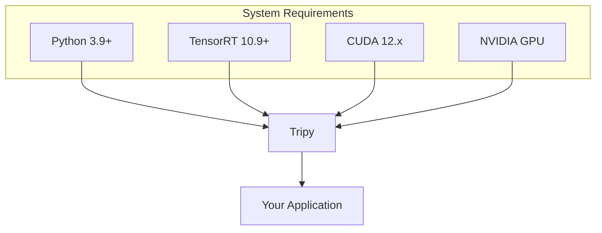
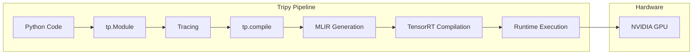
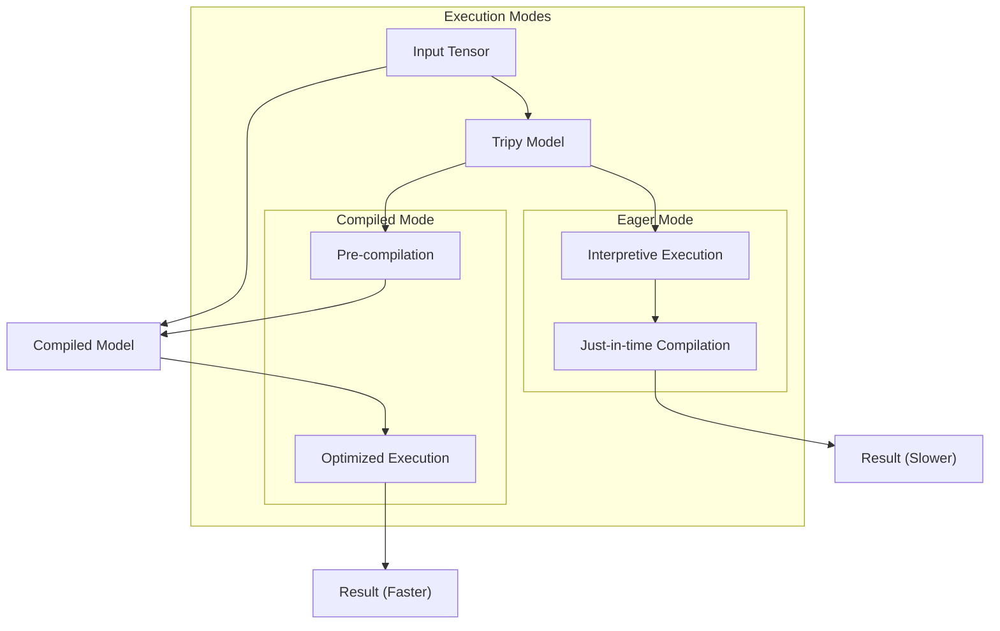
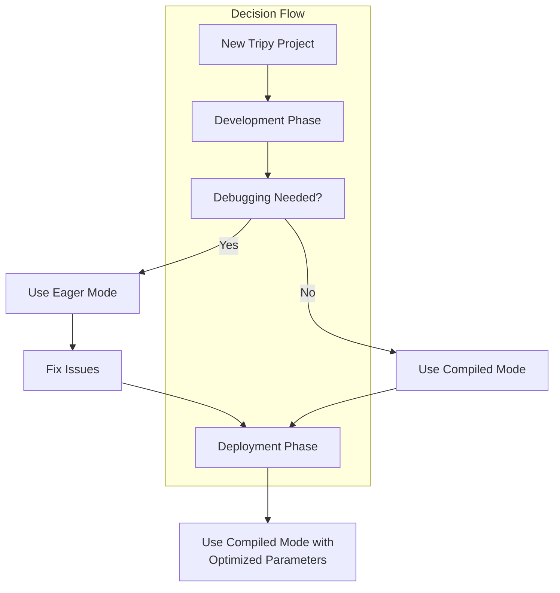

<!-- source: DeepWiki mcp.deepwiki.com · repo NVIDIA/TensorRT-Incubator · page 2.1 Getting Started · fetched 2026-10-26 -->

# Getting Started

<details>
<summary>Relevant source files</summary>

The following files were used as context for generating this wiki page:

- [.github/workflows/post-merge-package-index-update.yml](.github/workflows/post-merge-package-index-update.yml)
- [tripy/README.md](tripy/README.md)
- [tripy/docs/packages.html](tripy/docs/packages.html)
- [tripy/docs/pre0_user_guides/00-introduction-to-tripy.md](tripy/docs/pre0_user_guides/00-introduction-to-tripy.md)
- [tripy/examples/nanogpt/example.py](tripy/examples/nanogpt/example.py)
- [tripy/nvtripy/__init__.py](tripy/nvtripy/__init__.py)
- [tripy/pyproject.toml](tripy/pyproject.toml)
- [tripy/tests/backend/api/test_stream.py](tripy/tests/backend/api/test_stream.py)
- [tripy/tests/integration/test_plugin.py](tripy/tests/integration/test_plugin.py)

</details>


This guide provides step-by-step instructions for installing and running your first Tripy program. Tripy is a debuggable, Pythonic frontend for TensorRT that enables high-performance deep learning inference. For more detailed information about Tripy's module system, see [Module System](#2.2), and for compilation details, see [Compilation and Execution](#2.4).

## System Requirements

Before installing Tripy, ensure your system meets the following requirements:

- Python 3.9 or higher
- NVIDIA GPU with CUDA support
- TensorRT 10.9 or higher
- CUDA 12.x



Sources: [tripy/pyproject.toml:9-14]()

## Installation

Tripy can be installed via pip using the NVIDIA package repository:

```bash
python3 -m pip install nvtripy -f https://nvidia.github.io/TensorRT-Incubator/packages.html
```

This command installs the `nvtripy` package and its dependencies, including the required MLIR-TensorRT components.

Sources: [tripy/README.md:27-31]()

## Tripy Architecture

Tripy sits between your Python code and TensorRT, providing a familiar, Pythonic interface while leveraging TensorRT's optimization capabilities.



Sources: [tripy/README.md:15-25](), [tripy/docs/pre0_user_guides/00-introduction-to-tripy.md:1-16]()

## Basic Usage

### Importing Tripy

Import the library using the standard convention:

```python
import nvtripy as tp
```

### Creating and Manipulating Tensors

Tripy provides a functional API for creating and manipulating tensors:

```python
# Create tensors
a = tp.ones((2, 3))
b = tp.ones((2, 3))

# Perform operations
c = a + b
```

Sources: [tripy/docs/pre0_user_guides/00-introduction-to-tripy.md:7-17]()

### Defining Models

Models in Tripy are organized using the `tp.Module` class, similar to PyTorch:

```python
class Model(tp.Module):
    def __init__(self):
        self.conv = tp.Conv(in_channels=1, out_channels=1, kernel_dims=[3, 3])

    def forward(self, x):
        x = self.conv(x)
        x = tp.relu(x)
        return x
```

### Initializing Model Parameters

```python
model = Model()
model.load_state_dict({
    "conv.weight": tp.ones((1, 1, 3, 3)),
    "conv.bias": tp.ones((1,)),
})

dummy_input = tp.ones((1, 1, 4, 4)).eval()
```

Sources: [tripy/README.md:40-66]()

## Execution Modes

Tripy supports two execution modes: eager mode for debugging and compiled mode for deployment.



### Eager Mode

Eager mode executes operations immediately and is useful for debugging:

```python
# Eager mode execution
eager_out = model(dummy_input)
```

In eager mode, tensors are evaluated only when needed, which makes timing measurements tricky.

### Compiled Mode

For better performance, compile your model before running inference:

```python
# Compile the model
compiled_model = tp.compile(
    model,
    args=[tp.InputInfo(shape=(1, 1, 4, 4), dtype=tp.float32)],
)

# Run the compiled model
compiled_out = compiled_model(dummy_input)
```

Sources: [tripy/README.md:68-84](), [tripy/docs/pre0_user_guides/00-introduction-to-tripy.md:55-77]()

## Dynamic Shapes

Tripy supports dynamic input shapes by specifying minimum, optimal, and maximum dimensions:

```python
# Specify dynamic dimensions with (min, opt, max) tuple
input_shape = (
    1,  # Batch size
    (1, current_length, max_length),  # Sequence length dimension can vary
)

model = tp.compile(model, args=[tp.InputInfo(input_shape, dtype=tp.int32)])
```

Sources: [tripy/examples/nanogpt/example.py:95-109]()

## Using Streams

Tripy supports CUDA streams for parallel execution:

```python
# Create a new stream
stream = tp.Stream()

# Set the stream for a compiled model
compiled_model.stream = stream

# Run computation on the stream
output = compiled_model(input_tensor)

# Synchronize when needed
stream.synchronize()
```

Sources: [tripy/tests/backend/api/test_stream.py:19-51]()

## Custom Operations with Plugins

You can extend Tripy with custom TensorRT plugins:

```python
# Use a plugin for custom operations
output = tp.plugin(
    name="CustomPluginName",
    inputs=[input_tensor],
    output_info=[(input_tensor.rank, input_tensor.dtype)],
    # Plugin-specific parameters
    param1=value1,
    param2=value2,
)
```

Sources: [tripy/tests/integration/test_plugin.py:22-53]()

## Best Practices and Pitfalls

### Best Practices

1. Use eager mode only for debugging; compile for deployment
2. Properly synchronize streams when using multiple streams
3. Specify dynamic shapes appropriately to balance flexibility and performance

### Common Pitfalls

1. Be careful timing code in eager mode as tensors are evaluated only when used
2. Remember that eager mode internally compiles each operation, which is slow



Sources: [tripy/docs/pre0_user_guides/00-introduction-to-tripy.md:84-114]()

## Next Steps

After getting familiar with the basics of Tripy, you can explore more advanced topics:

- Learn more about the [Module System](#2.2) for building complex models
- Explore [Tensor Operations](#2.3) for manipulating data
- Understand advanced [Compilation and Execution](#2.4) techniques
- Add custom operations with [Plugins and Custom Operations](#2.5)
- Optimize your models with [Quantization](#2.6)

For complete examples, check out the [example models](https://github.com/NVIDIA/TensorRT-Incubator/tree/main/tripy/examples) including NanoGPT, ResNet50, and SAM2.

Sources: [tripy/README.md:4-9]()

---

