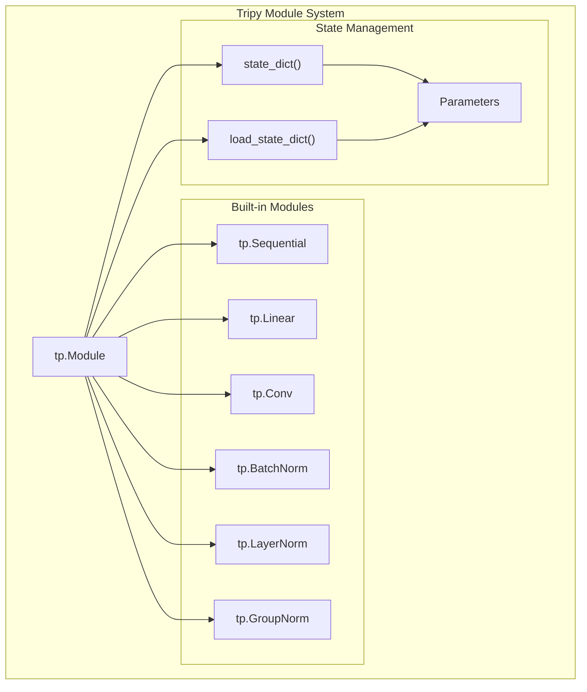
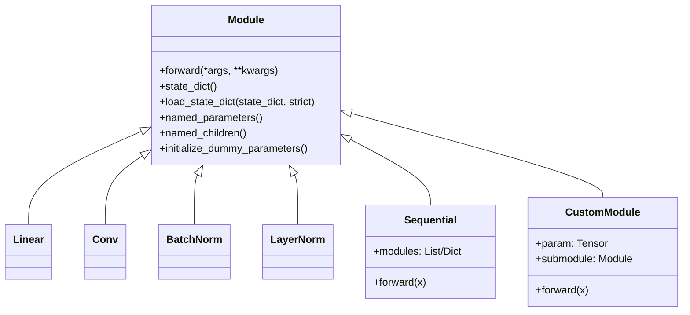
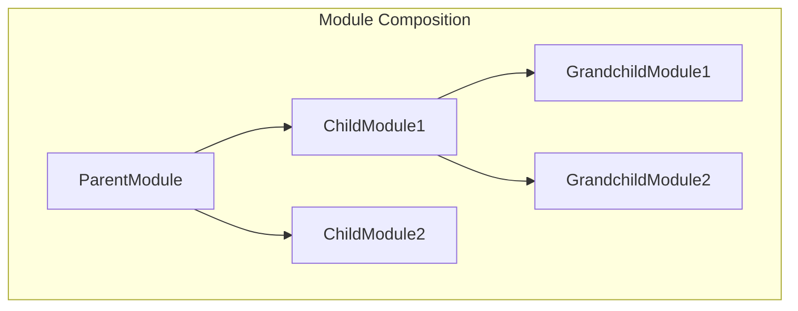
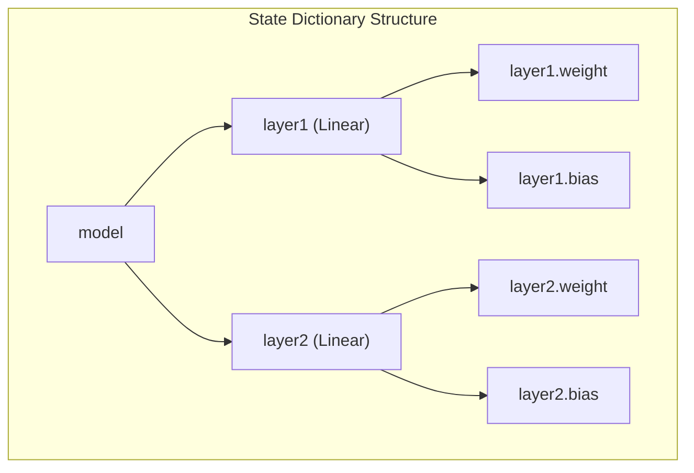

<!-- source: DeepWiki mcp.deepwiki.com · repo NVIDIA/TensorRT-Incubator · page 2.2 Module System · fetched 2026-10-26 -->

# Module System

<details>
<summary>Relevant source files</summary>

The following files were used as context for generating this wiki page:

- [tripy/README.md](tripy/README.md)
- [tripy/docs/pre0_user_guides/00-introduction-to-tripy.md](tripy/docs/pre0_user_guides/00-introduction-to-tripy.md)
- [tripy/examples/nanogpt/example.py](tripy/examples/nanogpt/example.py)
- [tripy/nvtripy/frontend/module/module.py](tripy/nvtripy/frontend/module/module.py)
- [tripy/tests/backend/api/test_stream.py](tripy/tests/backend/api/test_stream.py)
- [tripy/tests/frontend/module/conftest.py](tripy/tests/frontend/module/conftest.py)
- [tripy/tests/frontend/module/test_linear.py](tripy/tests/frontend/module/test_linear.py)
- [tripy/tests/frontend/module/test_module.py](tripy/tests/frontend/module/test_module.py)
- [tripy/tests/frontend/module/test_sequential.py](tripy/tests/frontend/module/test_sequential.py)
- [tripy/tests/integration/test_batchnorm.py](tripy/tests/integration/test_batchnorm.py)
- [tripy/tests/integration/test_groupnorm.py](tripy/tests/integration/test_groupnorm.py)
- [tripy/tests/integration/test_layernorm.py](tripy/tests/integration/test_layernorm.py)
- [tripy/tests/integration/test_linear.py](tripy/tests/integration/test_linear.py)
- [tripy/tests/integration/test_plugin.py](tripy/tests/integration/test_plugin.py)

</details>


The Module System in Tripy provides a foundation for organizing neural network code into reusable components. It follows similar patterns found in other deep learning frameworks like PyTorch, allowing users to define custom neural network architectures by composing smaller building blocks.

For information about tensor operations within modules, see [Tensor Operations](#2.3).
For details on compiling modules for optimized execution, see [Compilation and Execution](#2.4).

## Overview

The Module System is built around the `Module` base class, which serves as the foundation for all neural network components. This system enables users to:

1. Create reusable neural network building blocks
2. Compose modules hierarchically to create complex architectures 
3. Manage module parameters and state
4. Execute modules in eager mode for debugging
5. Compile modules into optimized TensorRT engines



Sources: [tripy/nvtripy/frontend/module/module.py:76-459](), [tripy/docs/pre0_user_guides/00-introduction-to-tripy.md:19-54]()

## Core Concepts

A module in Tripy encapsulates both:
1. **Parameters**: Learnable tensors like weights and biases
2. **Computation**: Logic that transforms inputs into outputs

The central concept is the `tp.Module` class, which provides methods for:
- Defining forward computation via the `forward` method
- Managing parameters (accessing, saving, and loading)
- Creating hierarchical module structures



Sources: [tripy/nvtripy/frontend/module/module.py:76-459](), [tripy/tests/frontend/module/test_module.py:27-196]()

## Module Base Class

The `tp.Module` class is the foundation of the module system. All neural network layers and models should inherit from this class.

### Creating a Custom Module

To create a custom module:
1. Inherit from `tp.Module`
2. Initialize parameters and submodules in `__init__`
3. Implement the `forward` method

Here's a simple example of a custom module:

```python
class MLP(tp.Module):
    def __init__(self, embd_size, dtype=tp.float32):
        super().__init__()
        self.c_fc = tp.Linear(embd_size, 4 * embd_size, bias=True, dtype=dtype)
        self.c_proj = tp.Linear(4 * embd_size, embd_size, bias=True, dtype=dtype)

    def forward(self, x):
        x = self.c_fc(x)
        x = tp.gelu(x)
        x = self.c_proj(x)
        return x
```

Sources: [tripy/docs/pre0_user_guides/00-introduction-to-tripy.md:19-54](), [tripy/nvtripy/frontend/module/module.py:76-97]()

### Key Methods of Module Class

The `Module` class provides several important methods:

| Method | Purpose | Description |
|--------|---------|-------------|
| `forward` | Define computation | Must be implemented by all subclasses |
| `__call__` | Execute module | Calls `forward` after validating parameters |
| `state_dict` | Get parameters | Returns a dictionary mapping parameter names to tensors |
| `load_state_dict` | Set parameters | Loads parameters from a dictionary |
| `named_parameters` | List parameters | Returns an iterator over parameter name/tensor pairs |
| `named_children` | List submodules | Returns an iterator over immediate child modules |
| `initialize_dummy_parameters` | Initialize params | Sets dummy values for uninitialized parameters |

Sources: [tripy/nvtripy/frontend/module/module.py:146-458](), [tripy/tests/frontend/module/test_module.py:27-196]()

## Module Parameters

Modules automatically track tensor-valued attributes as parameters. These parameters can be accessed through methods like `named_parameters()` and are included in the module's state.

### Parameter Management

Parameters in modules are automatically tracked if they are instances of `tp.Tensor`:

```python
class AddBias(tp.Module):
    def __init__(self):
        super().__init__()
        self.bias = tp.Tensor([1.0, 1.0], dtype=tp.float32)

    def forward(self, x):
        return x + self.bias
```

### Parameter Initialization

The `initialize_dummy_parameters()` method can initialize uninitialized parameters with dummy values, which is useful for debugging:

```python
linear = tp.Linear(2, 2)  # Parameters are initially placeholders
linear.initialize_dummy_parameters()  # Now parameters are actual tensors
```

Sources: [tripy/nvtripy/frontend/module/module.py:432-458](), [tripy/tests/frontend/module/test_module.py:184-195]()

## Module Composition

Tripy supports multiple ways to compose modules into more complex architectures.

### Nesting Modules

Modules can be nested by setting them as attributes of other modules:



### Using Container Types

Modules can also be organized in Python container types like lists and dictionaries:

```python
# List of modules
self.layers = [tp.Linear(10, 10) for _ in range(5)]

# Dictionary of modules
self.networks = {
    "encoder": tp.Linear(10, 5),
    "decoder": tp.Linear(5, 10)
}
```

Sources: [tripy/nvtripy/frontend/module/module.py:76-97](), [tripy/tests/frontend/module/test_module.py:198-295](), [tripy/tests/frontend/module/conftest.py:82-110]()

### Sequential Module

The `tp.Sequential` module provides a simplified way to create a linear sequence of operations:

```python
model = tp.Sequential(
    tp.Linear(10, 20),
    tp.relu,
    tp.Linear(20, 10)
)
```

Sequential can also use a dictionary to name the layers:

```python
model = tp.Sequential({
    "layer1": tp.Linear(10, 20),
    "activation": lambda x: tp.relu(x),
    "layer2": tp.Linear(20, 10)
})
```

Sources: [tripy/tests/frontend/module/test_sequential.py:40-295]()

## State Management

Modules provide methods for saving and loading the state (parameters) of a model.

### State Dictionary

The `state_dict()` method returns a dictionary mapping parameter names to their values:

```python
# Get the state of a model
state_dict = model.state_dict()
# Example output: {"layer1.weight": tensor1, "layer1.bias": tensor2, ...}
```

For nested modules, parameter names include the hierarchy:



Sources: [tripy/nvtripy/frontend/module/module.py:146-181](), [tripy/tests/frontend/module/test_module.py:208-215]()

### Loading State

The `load_state_dict()` method loads parameters from a state dictionary:

```python
# Load parameters into a model
model.load_state_dict(state_dict)
```

This method can be used with the `strict` parameter set to `False` to allow partial loading:

```python
# Load only some parameters
missing_keys, unexpected_keys = model.load_state_dict(partial_state_dict, strict=False)
```

Sources: [tripy/nvtripy/frontend/module/module.py:183-275](), [tripy/tests/frontend/module/test_module.py:87-151]()

## Built-in Modules

Tripy includes several built-in modules that implement common neural network layers.

### Linear Layer

The `tp.Linear` module implements a fully connected layer:

```python
# Create a linear layer with 10 inputs and 20 outputs
linear = tp.Linear(10, 20)
```

Sources: [tripy/tests/frontend/module/test_linear.py:25-63](), [tripy/tests/integration/test_linear.py:27-51]()

### Convolutional Layer

The `tp.Conv` module implements convolutional layers:

```python
# Create a 2D convolution with 3 input channels, 16 output channels, 
# and 3x3 kernel
conv = tp.Conv(in_channels=3, out_channels=16, kernel_dims=[3, 3])
```

### Normalization Layers

Tripy provides several normalization layers:

- `tp.BatchNorm`: Batch normalization
- `tp.LayerNorm`: Layer normalization
- `tp.GroupNorm`: Group normalization

```python
# Create a batch normalization layer for 16 features
bn = tp.BatchNorm(num_features=16)

# Create a layer normalization for tensors with shape (..., 32)
ln = tp.LayerNorm(normalized_shape=32)

# Create a group normalization with 4 groups for 16 channels
gn = tp.GroupNorm(num_groups=4, num_channels=16)
```

Sources: [tripy/tests/integration/test_batchnorm.py:26-72](), [tripy/tests/integration/test_layernorm.py:26-55](), [tripy/tests/integration/test_groupnorm.py:26-59]()

## Working with Quantized Modules

Tripy supports quantized modules for improved performance and reduced memory usage:

```python
# Create a quantized linear layer (int8 weights)
qlinear = tp.Linear(
    20, 
    30, 
    quant_dtype=tp.int8,
    weight_quant_dim=0  # Per-output channel quantization
)

# Set quantization scales
qlinear.weight_scale = tp.ones((30,))  # One scale per output channel
```

Sources: [tripy/tests/frontend/module/test_linear.py:45-63](), [tripy/tests/integration/test_linear.py:53-141]()

## Best Practices

Here are some recommendations for effectively using the Module System:

### Module Initialization

- Always call `super().__init__()` at the beginning of your module's `__init__` method
- Initialize parameters with the correct shapes and dtypes
- Use `initialize_dummy_parameters()` for debugging

### Streamlining Execution

- Create module hierarchies that match your model's logical structure
- Use eager mode (direct execution) for debugging
- Once debugged, compile your model with `tp.compile` for optimal performance
- Beware of timing in eager mode as tensors are evaluated lazily

### Parameter and State Management

- Use `state_dict()` and `load_state_dict()` for saving and loading models
- Check for missing or unexpected keys when loading partial state dictionaries
- When loading weights from other frameworks, ensure tensor shapes and dtypes match

Sources: [tripy/docs/pre0_user_guides/00-introduction-to-tripy.md:84-114]()

## Example: Building a Complete Model

Here's an example showing how to build, initialize, and execute a model using Tripy's module system:

```python
# Define a model
class Model(tp.Module):
    def __init__(self):
        super().__init__()
        self.conv = tp.Conv(in_channels=1, out_channels=1, kernel_dims=[3, 3])
        
    def forward(self, x):
        x = self.conv(x)
        x = tp.relu(x)
        return x

# Instantiate the model
model = Model()

# Initialize parameters
model.load_state_dict({
    "conv.weight": tp.ones((1, 1, 3, 3)),
    "conv.bias": tp.ones((1,)),
})

# Execute in eager mode (for debugging)
input_tensor = tp.ones((1, 1, 4, 4)).eval()
output = model(input_tensor)

# Compile for better performance
compiled_model = tp.compile(
    model,
    args=[tp.InputInfo(shape=(1, 1, 4, 4), dtype=tp.float32)],
)

# Execute the compiled model
compiled_output = compiled_model(input_tensor)
```

Sources: [tripy/README.md:40-83](), [tripy/examples/nanogpt/example.py:29-107]()

---

