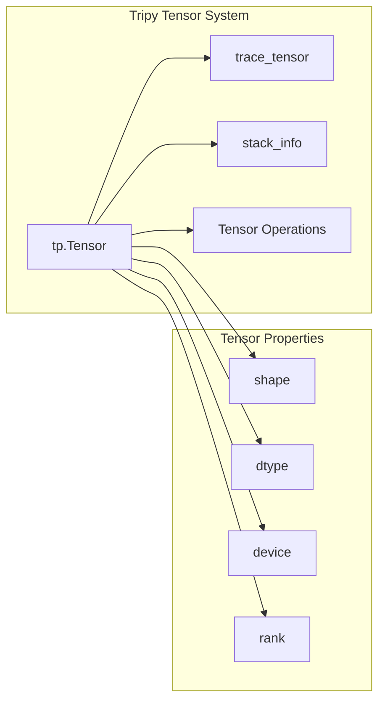
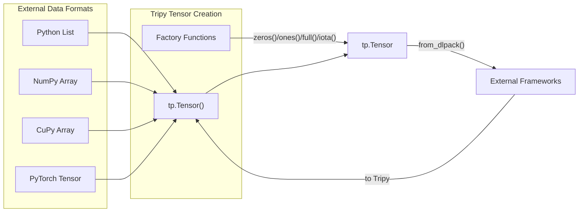
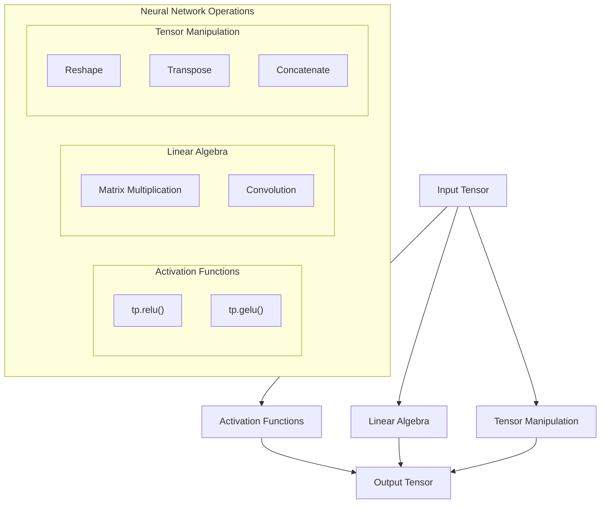
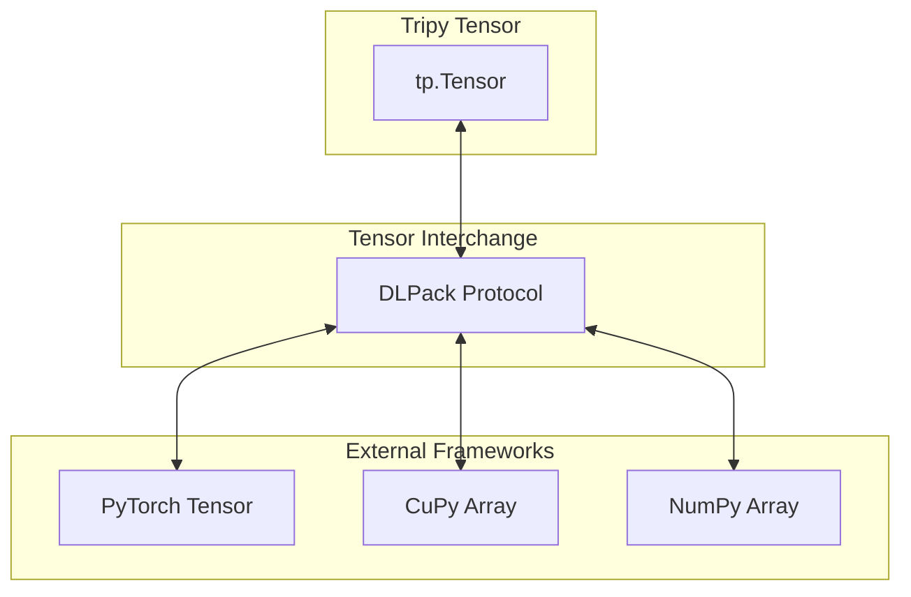

<!-- source: DeepWiki mcp.deepwiki.com · repo NVIDIA/TensorRT-Incubator · page 2.3 Tensor Operations · fetched 2026-10-26 -->

# Tensor Operations

<details>
<summary>Relevant source files</summary>

The following files were used as context for generating this wiki page:

- [tripy/README.md](tripy/README.md)
- [tripy/docs/pre0_user_guides/00-introduction-to-tripy.md](tripy/docs/pre0_user_guides/00-introduction-to-tripy.md)
- [tripy/examples/nanogpt/example.py](tripy/examples/nanogpt/example.py)
- [tripy/tests/backend/api/test_stream.py](tripy/tests/backend/api/test_stream.py)
- [tripy/tests/frontend/test_tensor.py](tripy/tests/frontend/test_tensor.py)
- [tripy/tests/frontend/test_utils.py](tripy/tests/frontend/test_utils.py)
- [tripy/tests/integration/test_plugin.py](tripy/tests/integration/test_plugin.py)

</details>


This page documents the tensor operations available in the Tripy framework of TensorRT-Incubator, including creation, manipulation, and mathematical operations. For information about the Module system, see [Module System](#2.2), and for compilation details, see [Compilation and Execution](#2.4).

## Overview of Tensor Objects

Tensors are the fundamental data structure in Tripy, representing multi-dimensional arrays. They serve as the primary means of data exchange and computation in neural network operations.



Sources: [tripy/tests/frontend/test_tensor.py:33-307]()

## Tensor Creation

Tripy provides multiple ways to create tensors, supporting creation from Python lists, NumPy arrays, CuPy arrays, and PyTorch tensors.

### Constructor

The primary way to create a tensor is through the constructor:

```python
# Create from list
tensor = tp.Tensor([1, 2, 3])

# Create with specific dtype
tensor = tp.Tensor([1, 2, 3], dtype=tp.float32)

# Create on specific device
tensor = tp.Tensor([1, 2, 3], device=tp.device("gpu"))
```

Sources: [tripy/tests/frontend/test_tensor.py:34-42](), [tripy/tests/frontend/test_tensor.py:73-78]()

### Factory Functions

Tripy provides several factory functions for creating tensors with specific values:

| Function | Description | Example |
|----------|-------------|---------|
| `tp.zeros` | Creates a tensor filled with zeros | `tp.zeros((2, 3))` |
| `tp.ones` | Creates a tensor filled with ones | `tp.ones((2, 3))` |
| `tp.full` | Creates a tensor filled with a specified value | `tp.full((2, 3), 5.0)` |
| `tp.iota` | Creates a tensor with sequential values | `tp.iota(shape=(3, 3), dim=1)` |

Sources: [tripy/docs/pre0_user_guides/00-introduction-to-tripy.md:52-53](), [tripy/tests/frontend/test_tensor.py:177-186]()

### Creation from Other Frameworks



Sources: [tripy/tests/frontend/test_tensor.py:154-159](), [tripy/tests/frontend/test_tensor.py:206-217]()

## Tensor Properties and Methods

Tensors have several properties and methods that provide information about their structure and content.

### Properties

| Property | Description |
|----------|-------------|
| `shape` | The dimensions of the tensor |
| `dtype` | The data type of the tensor elements |
| `device` | The device where the tensor is stored (CPU/GPU) |
| `rank` | The number of dimensions of the tensor |

Sources: [tripy/tests/frontend/test_tensor.py:65-71](), [tripy/tests/frontend/test_tensor.py:226-247]()

### Methods

| Method | Description |
|--------|-------------|
| `eval()` | Evaluates the tensor, executing pending operations |
| `tolist()` | Converts the tensor to a Python list |

Sources: [tripy/tests/frontend/test_tensor.py:140-152](), [tripy/tests/frontend/test_tensor.py:257-268]()

## Basic Operations

Tripy supports a variety of tensor operations that enable both simple and complex computations.

### Arithmetic Operations

Tensors support standard arithmetic operations:

```python
a = tp.ones((2, 3))
b = tp.ones((2, 3))

# Addition
c = a + b

# Subtraction
d = a - b

# Multiplication
e = a * b

# Division
f = a / b
```

Sources: [tripy/docs/pre0_user_guides/00-introduction-to-tripy.md:11-15](), [tripy/tests/frontend/test_tensor.py:144-144]()

### Indexing and Slicing

```python
# Get a single element
element = tensor[0]

# Slice a tensor
slice = tensor[0:3]

# Advanced slicing
slice = tensor[0:3:2]
```

Sources: [tripy/tests/frontend/test_tensor.py:276-282]()

## Advanced Operations

Tripy supports a range of advanced operations for neural network computations.

### Activation Functions

| Function | Description |
|----------|-------------|
| `tp.relu` | Rectified Linear Unit |
| `tp.gelu` | Gaussian Error Linear Unit |



Sources: [tripy/docs/pre0_user_guides/00-introduction-to-tripy.md:32-32](), [tripy/tests/integration/test_plugin.py:35-35]()

## Execution Modes

Tripy tensors can operate in two modes: eager mode and compiled mode.

### Eager Mode

Eager mode is used primarily for debugging and allows immediate evaluation of tensor operations:

```python
# Eager mode execution
a = tp.ones((2, 3))
b = tp.ones((2, 3))
c = a + b  # Operation defined but not executed yet
result = c.eval()  # Explicitly evaluate the operation
```

Sources: [tripy/README.md:68-72](), [tripy/docs/pre0_user_guides/00-introduction-to-tripy.md:85-91]()

### Compiled Mode

Compiled mode provides significantly better performance by optimizing operations through TensorRT:

```python
model = tp.compile(
    function_or_module,
    args=[tp.InputInfo(shape=(1, 28, 28), dtype=tp.float32)],
)
output = model(input_tensor)
```

Sources: [tripy/README.md:74-83](), [tripy/docs/pre0_user_guides/00-introduction-to-tripy.md:60-67]()

## Tensor Interoperability

Tripy tensors can be converted to and from other frameworks using DLPack protocol:



Sources: [tripy/tests/frontend/test_tensor.py:154-159](), [tripy/examples/nanogpt/example.py:121-122]()

## Advanced Features

### Custom Operations with Plugins

Tripy allows extending functionality through plugins:

```python
output = tp.plugin(
    name="CustomGeluPluginDynamic",
    inputs=[input_tensor],
    output_info=[(input_tensor.rank, input_tensor.dtype)],
    type_id=0,
)
```

Sources: [tripy/tests/integration/test_plugin.py:26-32](), [tripy/tests/integration/test_plugin.py:40-41]()

### Stream Execution Control

Tensor operations can be executed on specific CUDA streams:

```python
stream = tp.Stream()
model.stream = stream
output = model(input_tensor)
stream.synchronize()
```

Sources: [tripy/tests/backend/api/test_stream.py:33-51]()

## Best Practices for Tensor Operations

1. **Use eager mode for debugging only**
   - Eager mode involves compilation overhead for each operation
   - Compiled mode provides much better performance for deployment

2. **Be careful with timing in eager mode**
   - Tensors are evaluated only when used
   - Naive timing will be inaccurate without explicitly calling `.eval()`

3. **Explicitly specify data types when needed**
   - Some operations and conversions require explicit data types
   - Empty tensors always require an explicit data type

4. **Use device placement appropriately**
   - Place tensors on GPU for computation
   - Consider CPU for data loading and preprocessing

Sources: [tripy/docs/pre0_user_guides/00-introduction-to-tripy.md:85-113]()

## Common Performance Considerations

- Converting between tensor formats (e.g., Tripy to PyTorch) incurs overhead
- Explicit `.eval()` calls trigger immediate execution but may introduce unnecessary synchronization
- Keeping tensors on the same device minimizes data transfer overhead
- Pre-allocating tensor memory can improve performance in iterative algorithms

Sources: [tripy/tests/frontend/test_tensor.py:140-152](), [tripy/examples/nanogpt/example.py:133-135]()

---

