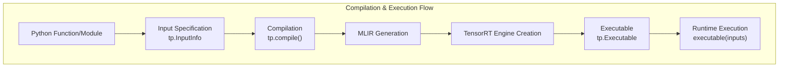
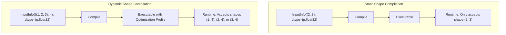
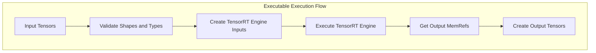

<!-- source: DeepWiki mcp.deepwiki.com · repo NVIDIA/TensorRT-Incubator · page 2.4 Compilation and Execution · fetched 2026-10-26 -->

# Compilation and Execution

<details>
<summary>Relevant source files</summary>

The following files were used as context for generating this wiki page:

- [tripy/README.md](tripy/README.md)
- [tripy/docs/pre0_user_guides/00-introduction-to-tripy.md](tripy/docs/pre0_user_guides/00-introduction-to-tripy.md)
- [tripy/examples/nanogpt/example.py](tripy/examples/nanogpt/example.py)
- [tripy/nvtripy/backend/api/compile.py](tripy/nvtripy/backend/api/compile.py)
- [tripy/nvtripy/backend/api/executable.py](tripy/nvtripy/backend/api/executable.py)
- [tripy/nvtripy/backend/api/input_info.py](tripy/nvtripy/backend/api/input_info.py)
- [tripy/nvtripy/backend/mlir/utils.py](tripy/nvtripy/backend/mlir/utils.py)
- [tripy/nvtripy/common/exception.py](tripy/nvtripy/common/exception.py)
- [tripy/nvtripy/common/shape_bounds.py](tripy/nvtripy/common/shape_bounds.py)
- [tripy/nvtripy/export.py](tripy/nvtripy/export.py)
- [tripy/nvtripy/frontend/tensor.py](tripy/nvtripy/frontend/tensor.py)
- [tripy/nvtripy/trace/ops/constant.py](tripy/nvtripy/trace/ops/constant.py)
- [tripy/nvtripy/utils/function_registry.py](tripy/nvtripy/utils/function_registry.py)
- [tripy/nvtripy/utils/stack_info.py](tripy/nvtripy/utils/stack_info.py)
- [tripy/nvtripy/utils/utils.py](tripy/nvtripy/utils/utils.py)
- [tripy/nvtripy/utils/wrappers.py](tripy/nvtripy/utils/wrappers.py)
- [tripy/tests/backend/api/test_compile.py](tripy/tests/backend/api/test_compile.py)
- [tripy/tests/backend/api/test_executable.py](tripy/tests/backend/api/test_executable.py)
- [tripy/tests/backend/api/test_input_info.py](tripy/tests/backend/api/test_input_info.py)
- [tripy/tests/backend/api/test_stream.py](tripy/tests/backend/api/test_stream.py)
- [tripy/tests/common/test_exception.py](tripy/tests/common/test_exception.py)
- [tripy/tests/integration/test_plugin.py](tripy/tests/integration/test_plugin.py)
- [tripy/tests/utils/test_function_registry.py](tripy/tests/utils/test_function_registry.py)
- [tripy/tests/utils/test_stack_info.py](tripy/tests/utils/test_stack_info.py)

</details>


This page explains how to compile Tripy models and functions for optimized GPU execution. It covers the compilation process, how to specify input requirements, manage dynamic shapes, and execute the compiled code efficiently.

For information about tensor operations that can be compiled, see [Tensor Operations](#2.3).

## Introduction

Tripy provides a powerful compilation pipeline that transforms Python functions and modules into optimized TensorRT engines. This process significantly improves performance while maintaining a Pythonic interface.

The key components involved in compilation and execution are:

- `tp.compile`: Function that converts Python code to optimized GPU code
- `tp.InputInfo`: Class specifying input requirements (shapes and types)
- `tp.Executable`: Class representing the compiled, executable code
- `tp.Stream`: Class managing GPU execution streams



Sources:
- [tripy/nvtripy/backend/api/compile.py:31-248]()
- [tripy/nvtripy/backend/api/executable.py:32-348]()
- [tripy/README.md:73-83]()

## The Compilation Process

### Using tp.compile

The `tp.compile` function is the main entry point for compilation:

```python
def add(a, b):
    return a + b

compiled_add = tp.compile(
    add,
    args=[
        tp.InputInfo(shape=(2, 2), dtype=tp.float32),
        tp.InputInfo(shape=(2, 2), dtype=tp.float32)
    ],
    optimization_level=3  # Optional, default is 3
)
```

Key parameters:

- `func`: The function or module to compile
- `args`: List of positional arguments (use `InputInfo` for runtime inputs)
- `kwargs`: Dictionary of keyword arguments (use `InputInfo` for runtime inputs)
- `optimization_level`: Integer controlling optimization level (higher = more optimization)

Any non-`InputInfo` arguments are treated as compile-time constants and "baked" into the compiled function.

Sources:
- [tripy/nvtripy/backend/api/compile.py:31-248]()
- [tripy/tests/backend/api/test_compile.py:27-196]()
- [tripy/docs/pre0_user_guides/00-introduction-to-tripy.md:56-82]()

### Input Specification with InputInfo

The `InputInfo` class defines the shape and data type requirements for inputs:

```python
# Static shape (fixed dimensions)
input_info = tp.InputInfo(shape=(2, 3), dtype=tp.float32)

# Dynamic shape (first dimension can vary from 1 to 3, optimized for 2)
dynamic_input = tp.InputInfo(shape=((1, 2, 3), 4), dtype=tp.float32)
```

For `shape`, you can provide:
- A tuple of integers for static shapes
- A tuple containing triples of (min, optimal, max) values for dynamic dimensions

The `dtype` parameter specifies the required data type for the input.

Sources:
- [tripy/nvtripy/backend/api/input_info.py:24-102]()
- [tripy/tests/backend/api/test_input_info.py:21-62]()
- [tripy/nvtripy/common/shape_bounds.py:26-61]()

### Static vs. Dynamic Shapes

Tripy supports both static and dynamic input shapes:



When using dynamic shapes, TensorRT creates optimization profiles that allow the engine to handle inputs of varying dimensions. This is particularly useful for models that need to process inputs with different batch sizes or sequence lengths.

Sources:
- [tripy/nvtripy/backend/api/input_info.py:24-102]()
- [tripy/tests/backend/api/test_compile.py:144-168]()
- [tripy/examples/nanogpt/example.py:98-107]()

## The Executable

The result of compilation is an `Executable` object that wraps the compiled TensorRT engine and provides methods for execution.

### Running a Compiled Function

You call the executable just like the original function:

```python
result = compiled_function(input_tensor)
```

Important requirements:
1. Inputs must be evaluated tensors in GPU memory (use `.eval()`)
2. Input shapes and types must match the `InputInfo` specifications
3. For dynamic shapes, dimensions must be within specified min/max bounds



Sources:
- [tripy/nvtripy/backend/api/executable.py:124-257]()
- [tripy/tests/backend/api/test_executable.py:39-152]()

### Saving and Loading

Executables can be saved to disk and loaded later:

```python
# Save to disk
compiled_function.save("path/to/executable.json")

# Load from disk
loaded_executable = tp.Executable.load("path/to/executable.json")
```

This is useful for:
- Avoiding recompilation (which can be time-consuming)
- Deploying models in production
- Sharing compiled models between systems

Sources:
- [tripy/nvtripy/backend/api/executable.py:259-290]()
- [tripy/nvtripy/backend/api/executable.py:84-120]()
- [tripy/tests/backend/api/test_executable.py:96-107]()

### Accessing the TensorRT Engine

You can access the underlying TensorRT engine for advanced use cases:

```python
trt_engine_bytes = compiled_function.serialized_tensorrt_engine
```

This returns the serialized TensorRT engine as bytes, which can be used with other TensorRT tools or APIs.

Sources:
- [tripy/nvtripy/backend/api/executable.py:293-327]()
- [tripy/tests/backend/api/test_executable.py:111-121]()

## Execution Management

### Streams

Streams provide control over execution ordering on the GPU:

```python
# Create a custom stream
stream = tp.Stream()

# Assign stream to executable
compiled_function.stream = stream

# Execute on this stream
result = compiled_function(input_tensor)

# Wait for execution to complete
stream.synchronize()
```

By default, executables use the default stream (`tp.default_stream()`). Custom streams enable more fine-grained control over execution ordering and asynchronous operations.

Sources:
- [tripy/tests/backend/api/test_stream.py:20-52]()
- [tripy/nvtripy/backend/api/executable.py:51-51]()

## Error Handling

Tripy provides detailed error messages for common issues:

### Shape Mismatches

```python
compiled_add = tp.compile(add, args=[tp.InputInfo((2, 2), dtype=tp.float32)])
a = tp.ones((1, 2)).eval()  # Wrong shape
# Error: "Unexpected tensor shape."
```

### Data Type Mismatches

```python
compiled_add = tp.compile(add, args=[tp.InputInfo((2, 2), dtype=tp.float32)])
a = tp.ones((2, 2), dtype=tp.int32).eval()  # Wrong type
# Error: "Unexpected tensor data type."
```

### Evaluation During Compilation

```python
def func(a):
    print(a)  # Attempts to evaluate tensor during compilation
    return a + 1

# Error: "Cannot evaluate a tensor while compiling."
```

Sources:
- [tripy/nvtripy/backend/api/executable.py:184-251]()
- [tripy/tests/backend/api/test_executable.py:136-152]()
- [tripy/tests/backend/api/test_compile.py:169-196]()

## Examples and Best Practices

### Dynamic Shape Example

```python
# Compile a model with variable batch size
input_shape = (
    1,  # Batch dimension
    (1, len(input_ids), padded_seq_len),  # Variable sequence length
)
model = tp.compile(model, args=[tp.InputInfo(input_shape, dtype=tp.int32)])

# Can now handle different sequence lengths
output = model(short_input)
output = model(long_input)
```

### Baking Constants

Constants are "baked" into the compiled function:

```python
def add_constant(x, constant):
    return x + constant

# The value 5 is baked into the compiled function
compiled_fn = tp.compile(
    add_constant, 
    args=[tp.InputInfo((2, 2), dtype=tp.float32), 5]
)

# Now the function only takes one argument
result = compiled_fn(tp.ones((2, 2)).eval())
```

### Plugin Example

```python
def gelu(X):
    return tp.plugin(
        name="CustomGeluPluginDynamic", 
        inputs=[X], 
        output_info=[(X.rank, X.dtype)], 
        type_id=0
    )

compiled_gelu = tp.compile(
    gelu, 
    args=[tp.InputInfo((2, (1, 2, 3), 4), dtype=tp.float32)]
)
```

Sources:
- [tripy/examples/nanogpt/example.py:98-107]()
- [tripy/tests/backend/api/test_compile.py:88-97]()
- [tripy/tests/integration/test_plugin.py:23-53]()

### Best Practices

1. **Always evaluate inputs**: Input tensors must be in GPU memory
   ```python
   input_tensor = tp.ones((2, 2)).eval()
   ```

2. **Set optimal shapes correctly**: When using dynamic shapes, set the "optimal" value to the most common case for best performance
   ```python
   # If batch size 8 is most common
   tp.InputInfo(shape=((1, 8, 16), 3, 224, 224), dtype=tp.float32)
   ```

3. **Save compiled models**: Avoid recompilation by saving executables
   ```python
   compiled_model.save("model.json")
   ```

4. **Use appropriate data types**: Lower precision (like fp16) can improve performance
   ```python
   tp.InputInfo(shape=(2, 2), dtype=tp.float16)
   ```

5. **Avoid tensor evaluation during compilation**: Do not print or evaluate tensors during function tracing

Sources:
- [tripy/nvtripy/frontend/tensor.py:209-297]()
- [tripy/docs/pre0_user_guides/00-introduction-to-tripy.md:84-114]()
- [tripy/examples/nanogpt/example.py:98-109]()

## Summary

Tripy's compilation and execution system transforms Python code into optimized TensorRT engines for efficient GPU execution. By specifying input requirements with `InputInfo`, you can compile functions with both static and dynamic shapes. The resulting `Executable` objects can be called like regular functions, saved for later use, and managed with streams for fine-grained execution control.

This approach gives you the best of both worlds: the ease-of-use of Python programming with the performance of native GPU execution.

Sources:
- [tripy/nvtripy/backend/api/compile.py:31-248]()
- [tripy/nvtripy/backend/api/executable.py:32-348]()
- [tripy/docs/pre0_user_guides/00-introduction-to-tripy.md:56-82]()

---

