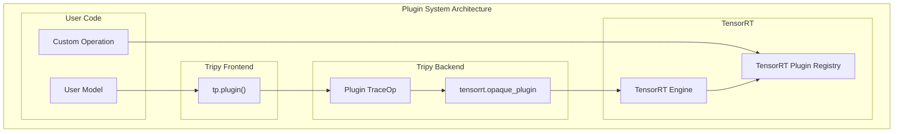
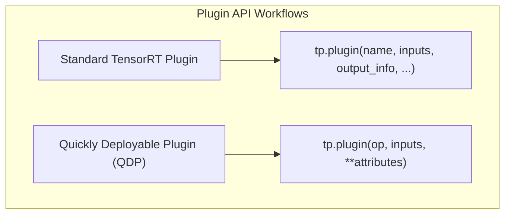
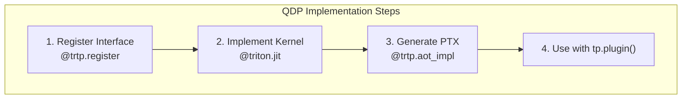

<!-- source: DeepWiki mcp.deepwiki.com · repo NVIDIA/TensorRT-Incubator · page 2.5 Plugins and Custom Operations · fetched 2026-10-26 -->

# Plugins and Custom Operations

<details>
<summary>Relevant source files</summary>

The following files were used as context for generating this wiki page:

- [tripy/docs/README.md](tripy/docs/README.md)
- [tripy/docs/pre0_user_guides/03-custom-operations.md](tripy/docs/pre0_user_guides/03-custom-operations.md)
- [tripy/nvtripy/frontend/ops/plugin.py](tripy/nvtripy/frontend/ops/plugin.py)
- [tripy/nvtripy/frontend/ops/plugin_qdp.py](tripy/nvtripy/frontend/ops/plugin_qdp.py)
- [tripy/nvtripy/trace/ops/plugin.py](tripy/nvtripy/trace/ops/plugin.py)
- [tripy/tests/conftest.py](tripy/tests/conftest.py)
- [tripy/tests/frontend/ops/test_plugin_qdp.py](tripy/tests/frontend/ops/test_plugin_qdp.py)
- [tripy/tests/integration/test_conv.py](tripy/tests/integration/test_conv.py)
- [tripy/tests/integration/test_plugin_qdp.py](tripy/tests/integration/test_plugin_qdp.py)

</details>


## Introduction

This document provides a technical guide for extending TensorRT functionality through plugins and custom operations in the TensorRT-Incubator project. Plugins allow you to incorporate operations that aren't natively supported by TensorRT, enabling implementation of custom algorithms and optimizations.

For information about using these plugins within the compilation and execution workflow, see [Compilation and Execution](#2.4).

Sources:
- [nvtripy/frontend/ops/plugin.py:26-69]()
- [nvtripy/trace/ops/plugin.py:106-160]()

## Plugin Types

Tripy supports two approaches for extending functionality with plugins:

1. **Standard TensorRT Plugins**: Pre-built or custom plugins that implement the `IPluginV2DynamicExt` or `IPluginV3` interfaces
2. **Quickly Deployable Plugins (QDPs)**: A simplified framework for creating custom plugins directly in Python



Sources:
- [nvtripy/frontend/ops/plugin.py:26-69]()
- [nvtripy/frontend/ops/plugin_qdp.py:42-58]()
- [nvtripy/trace/ops/plugin.py:106-160]()

## Using Existing Plugins

### Standard TensorRT Plugins

Use the `tp.plugin()` function to call standard TensorRT plugins:

```python
output = tp.plugin(
    name="PluginName",            # Plugin name
    inputs=[input1, input2],      # Input tensors
    output_info=[(rank, dtype)],  # List of (rank, dtype) for each output
    version="1",                  # Plugin version (optional)
    namespace="",                 # Plugin namespace (optional)
    **kwargs                      # Plugin fields/parameters
)
```

Example:
```python
inp = tp.iota((2, 1, 4))
out = tp.plugin(
    name="CustomGeluPluginDynamic",
    inputs=[inp],
    # GELU has one output with same rank and dtype as input
    output_info=[(inp.rank, inp.dtype)],
    # The GELU plugin expects a type_id parameter
    type_id=0,
)
```

### Quickly Deployable Plugins (QDPs)

For QDPs, use a different signature of `tp.plugin()`:

```python
output = tp.plugin(
    "namespace::name",       # Plugin ID in format "namespace::name"
    [input1, input2],        # Input tensors
    **attributes             # Plugin attributes
)
```

Example:
```python
inp = tp.iota((2, 2))
out = tp.plugin(
    "example::elemwise_add_plugin", 
    [inp], 
    block_size=256
)
```

Sources:
- [nvtripy/frontend/ops/plugin.py:26-69]()
- [nvtripy/frontend/ops/plugin_qdp.py:42-58]()
- [tests/integration/test_plugin_qdp.py:22-27]()

## Creating Custom Plugins with QDP



Sources:
- [nvtripy/frontend/ops/plugin.py:26-69]()
- [nvtripy/frontend/ops/plugin_qdp.py:42-58]()

### QDP Development Process

The Quickly Deployable Plugin (QDP) framework simplifies creating custom TensorRT plugins. Creating a QDP involves three steps:



Sources:
- [docs/pre0_user_guides/03-custom-operations.md:8-123]()
- [tests/conftest.py:57-98]()

### Step 1: Register the Plugin Interface

Use the `@trtp.register` decorator to define the plugin interface:

```python
import tensorrt.plugin as trtp

@trtp.register("example::elemwise_add_plugin")
def add_plugin_desc(inp0: trtp.TensorDesc, block_size: int) -> trtp.TensorDesc:
    # QDPs should receive and return TRT data types
    assert inp0.dtype == trt.float32
    return inp0.like()  # Output has same shape/dtype as input
```

This registration function:
- Defines the plugin ID as `"example::elemwise_add_plugin"`
- Specifies inputs (`inp0`), attributes (`block_size`), and return type
- Returns an output tensor description with same shape and dtype as input

### Step 2: Implement the Kernel

Implement the computation kernel. This example uses OpenAI's Triton language:

```python
import triton
import triton.language as tl

@triton.jit
def add_kernel(x_ptr, n_elements, y_ptr, BLOCK_SIZE: tl.constexpr):
    pid = tl.program_id(0)
    offsets = pid * BLOCK_SIZE + tl.arange(0, BLOCK_SIZE)
    mask = offsets < n_elements
    x = tl.load(x_ptr + offsets, mask=mask)
    tl.store(y_ptr + offsets, x + 1, mask=mask)  # Add 1 to each element
```

This Triton kernel:
- Takes pointers to input/output memory and parameters
- Uses a grid-stride loop pattern common in GPU programming
- Loads values from input, adds 1, and stores to output

### Step 3: Generate PTX Code

Use the `@trtp.aot_impl` decorator to generate PTX code and launch parameters:

```python
@trtp.aot_impl("example::elemwise_add_plugin")
def add_plugin_aot_impl(
    inp0: trtp.TensorDesc, block_size: int, outputs: Tuple[trtp.TensorDesc], tactic: int
) -> Tuple[Union[str, bytes], Union[str, bytes], trtp.KernelLaunchParams, trtp.SymExprs]:

    src = triton.compiler.ASTSource(
        fn=add_kernel,
        signature="*fp32,i32,*fp32",
        constants={"BLOCK_SIZE": block_size},
    )

    compiled_kernel = triton.compile(src)

    N = inp0.shape_expr.numel()
    launch_params = trtp.KernelLaunchParams()

    launch_params.grid_x = trtp.cdiv(N, block_size)
    launch_params.block_x = compiled_kernel.metadata.num_warps * 32
    launch_params.shared_mem = compiled_kernel.metadata.shared

    extra_args = trtp.SymIntExprs(1)
    extra_args[0] = trtp.SymInt32(N)

    return compiled_kernel.metadata.name, compiled_kernel.asm["ptx"], launch_params, extra_args
```

This function:
- Compiles the kernel to PTX (NVIDIA's parallel thread execution bytecode)
- Sets up the kernel launch configuration (grid/block dimensions)
- Creates symbolic expressions for dynamic shape handling
- Returns everything needed to execute the kernel

### Step 4: Using Your Custom Plugin

Once registered, use your custom plugin like any other QDP:

```python
inp = tp.iota((2, 2))
out = tp.plugin(
    "example::elemwise_add_plugin", 
    [inp], 
    block_size=256
)
```

Sources:
- [docs/pre0_user_guides/03-custom-operations.md:24-123]()
- [tests/conftest.py:57-98]()

## Data Type Conversion

When using plugins, Tripy automatically handles data type conversion between Tripy and TensorRT:

| Tripy Data Type | TensorRT Data Type |
|----------------|-------------------|
| tp.float32     | trt.float32       |
| tp.float16     | trt.float16       |
| tp.float8      | trt.fp8           |
| tp.bfloat16    | trt.bfloat16      |
| tp.int4        | trt.int4          |
| tp.int8        | trt.int8          |
| tp.int32       | trt.int32         |
| tp.int64       | trt.int64         |
| tp.bool        | trt.bool          |

Sources:
- [nvtripy/frontend/ops/plugin_qdp.py:25-37]()
- [tests/frontend/ops/test_plugin_qdp.py:23-27]()

## Internal Implementation

Internally, the plugin system operates through these key components:

1. `plugin()` in the frontend API creates a `Plugin` trace operation
2. The `Plugin` class captures plugin name, namespace, version, parameters, and output information
3. During MLIR generation, the `to_mlir()` method converts the plugin to `tensorrt.opaque_plugin` operations
4. TensorRT loads and executes the plugin at runtime

The plugin initialization process:
```python
# Initialize the TensorRT plugin registry
initialize_plugin_registry()

# Get field schema for the plugin
field_schema = compiler.get_tensorrt_plugin_field_schema(name, version, namespace, "")

# Convert parameters to MLIR attributes
for name, values in self.creator_params.items():
    result = plugin_field_to_attr(field_schema[name], values)
    
# Generate tensorrt.opaque_plugin operation
tensorrt.opaque_plugin(outputs, self.name, self.version, self.namespace, ir.DictAttr.get(params), inputs)
```

Sources:
- [nvtripy/trace/ops/plugin.py:32-40]()
- [nvtripy/trace/ops/plugin.py:106-160]()

## Error Handling

Tripy provides clear error messages for common plugin issues:

| Error Scenario | Error Message |
|----------------|---------------|
| Invalid plugin ID | "Invalid plugin ID: 'fake_id'." |
| Plugin not found | "Plugin 'test::fake_id' not found." |
| Invalid attribute | "Unexpected attribute: 'fake'." |
| Invalid attribute type | "Unexpected attribute type: 'float'." |

Sources:
- [tests/frontend/ops/test_plugin_qdp.py:31-51]()
- [nvtripy/frontend/ops/plugin_qdp.py:60-105]()

---

