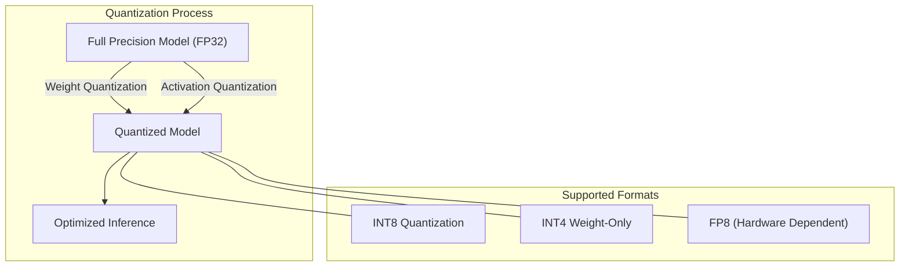
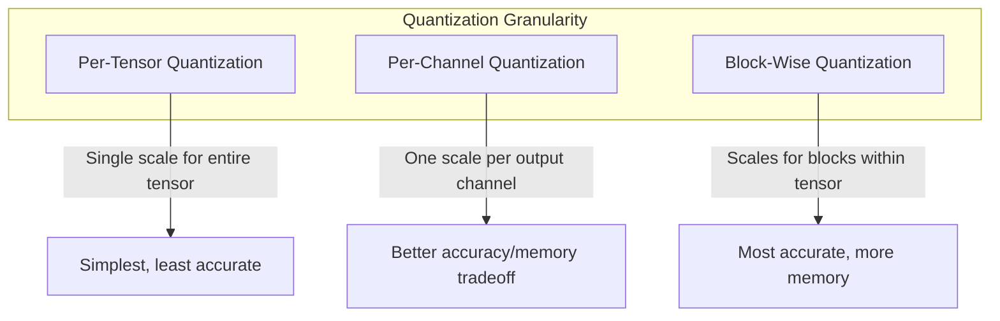
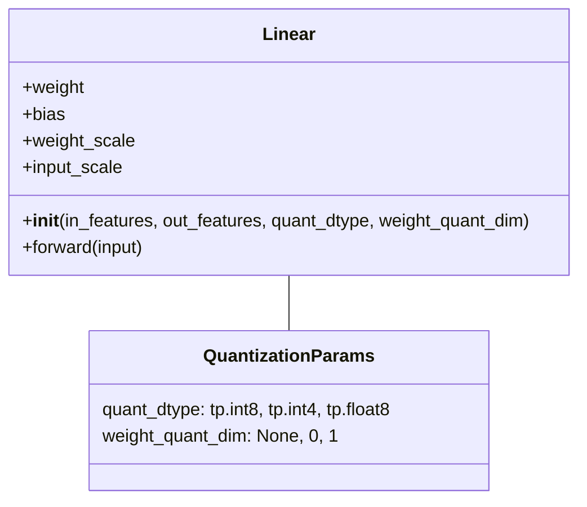
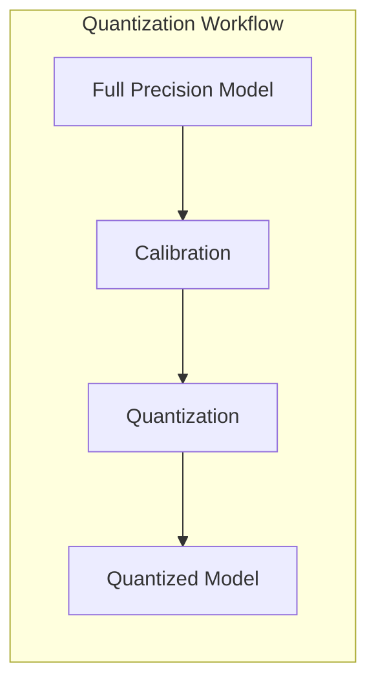
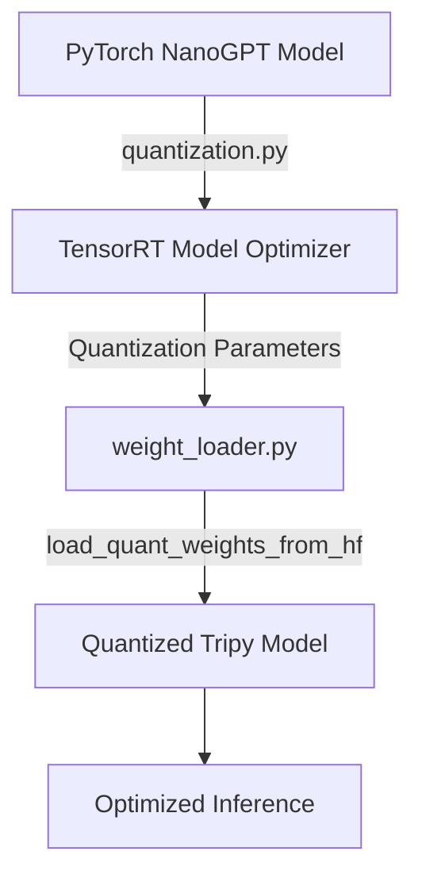
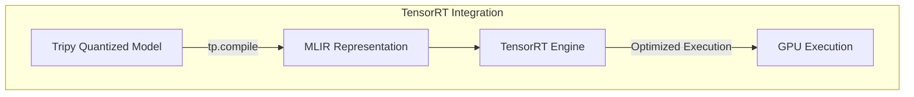

<!-- source: DeepWiki mcp.deepwiki.com · repo NVIDIA/TensorRT-Incubator · page 2.6 Quantization · fetched 2026-10-26 -->

# Quantization

<details>
<summary>Relevant source files</summary>

The following files were used as context for generating this wiki page:

- [tripy/CONTRIBUTING.md](tripy/CONTRIBUTING.md)
- [tripy/examples/nanogpt/README.md](tripy/examples/nanogpt/README.md)
- [tripy/examples/segment-anything-model-v2/README.md](tripy/examples/segment-anything-model-v2/README.md)
- [tripy/examples/segment-anything-model-v2/checkpoints/download_ckpt.sh](tripy/examples/segment-anything-model-v2/checkpoints/download_ckpt.sh)
- [tripy/examples/segment-anything-model-v2/download_test_data.py](tripy/examples/segment-anything-model-v2/download_test_data.py)
- [tripy/examples/segment-anything-model-v2/video_demo.py](tripy/examples/segment-anything-model-v2/video_demo.py)
- [tripy/notebooks/resnet50.ipynb](tripy/notebooks/resnet50.ipynb)
- [tripy/tests/integration/test_batchnorm.py](tripy/tests/integration/test_batchnorm.py)
- [tripy/tests/integration/test_groupnorm.py](tripy/tests/integration/test_groupnorm.py)
- [tripy/tests/integration/test_layernorm.py](tripy/tests/integration/test_layernorm.py)
- [tripy/tests/integration/test_linear.py](tripy/tests/integration/test_linear.py)
- [tripy/tests/test_examples.py](tripy/tests/test_examples.py)

</details>


This page covers the quantization capabilities in Tripy, explaining how to use various quantization techniques to optimize model performance and memory usage. Quantization allows for reducing the precision of model weights and activations from 32-bit floating-point to lower bit-width representations, helping to reduce model size and improve inference speed with minimal accuracy impact.

## Overview of Quantization in Tripy

Tripy supports several quantization methods that can be used to optimize neural network models. Quantization reduces the memory footprint and computational requirements of models by representing weights and activations with lower bit-width formats than the standard 32-bit floating point.



Sources:
- [tripy/examples/nanogpt/README.md:42-57]()
- [tripy/tests/integration/test_linear.py:53-111]()

## Supported Quantization Types

Tripy currently supports the following quantization types:

| Quantization Type | Description | Hardware Requirements | Use Cases |
|-------------------|-------------|------------------------|-----------|
| INT8 weight-only | 8-bit integer quantization applied only to weights | Widely supported | General model optimization |
| INT4 weight-only | 4-bit integer quantization applied only to weights | Widely supported | Extreme memory optimization (with accuracy tradeoffs) |
| FP8 | 8-bit floating point format | Requires hardware with FP8 support (Hopper GPUs or newer) | Balance of precision and memory efficiency |

The appropriate quantization type depends on your model architecture, hardware capabilities, and accuracy requirements.

Sources:
- [tripy/examples/nanogpt/README.md:49-86]()
- [tripy/tests/integration/test_linear.py:90-91]()

## Quantization Granularity

Tripy supports different levels of granularity for quantization:



Each granularity level represents a different tradeoff between accuracy and memory:

1. **Per-tensor quantization**: Uses a single scaling factor for the entire weight tensor. Simplest approach but may result in lower accuracy.
2. **Per-channel quantization**: Uses different scaling factors for each output channel (dim=0) or input channel (dim=1).
3. **Block-wise quantization**: Uses scaling factors for blocks of the weight tensor, offering higher accuracy at the expense of more memory for storing scales.

Sources:
- [tripy/tests/integration/test_linear.py:55-66]()
- [tripy/tests/integration/test_linear.py:113-123]()

## Implementation in Tripy

### Quantized Linear Layers

The primary implementation of quantization in Tripy is through the `tp.Linear` module with quantization parameters:



To create a quantized linear layer, you need to specify:
- `quant_dtype`: The target data type for quantization (e.g., `tp.int8`, `tp.int4`, `tp.float8`)
- `weight_quant_dim`: The dimension along which to apply quantization scales (None for per-tensor, 0 for per-output-channel, 1 for per-input-channel)

Additionally, you need to provide the appropriate scales:
- `weight_scale`: Scaling factors for the weights
- `input_scale`: Optional scaling factor for inputs (used in certain quantization schemes)

Sources:
- [tripy/tests/integration/test_linear.py:54-111]()
- [tripy/tests/integration/test_linear.py:123-141]()

## Using Quantization in Tripy Models

### Basic Workflow



1. **Start with a trained full-precision model**: Begin with a model trained in FP32.
2. **Calibration**: Determine appropriate scaling factors for quantization.
3. **Apply quantization**: Replace standard layers with quantized versions, providing the appropriate scales.
4. **Inference with the quantized model**: Use the quantized model for inference, benefiting from reduced memory and computational requirements.

### Example: Quantized NanoGPT

The NanoGPT example in Tripy demonstrates how to apply quantization to a transformer model:



In the NanoGPT example, quantization is applied as follows:

1. The PyTorch model is quantized using NVIDIA TensorRT Model Optimizer.
2. Quantization parameters are extracted and converted to scales.
3. The quantized weights and scales are loaded into the Tripy model.
4. The model is executed with the specified quantization mode.

Sources:
- [tripy/examples/nanogpt/README.md:40-86]()

## Quantization Modes and Usage Examples

When using the NanoGPT example, you can choose between different quantization modes:

### Weight-Only INT8 Quantization

```bash
python3 example.py --input-text "What is the answer to life, the universe, and everything?" --seed=0 --quant-mode int8-weight-only
```

This is recommended for most use cases as it provides a good balance of accuracy and memory efficiency.

### Weight-Only INT4 Quantization

```bash
python3 example.py --input-text "What is the answer to life, the universe, and everything?" --seed=0 --quant-mode int4-weight-only
```

Note that INT4 quantization may result in poor accuracy for complex models like NanoGPT. It's included primarily to demonstrate the workflow.

### FP8 Quantization (Hardware-Dependent)

On supported hardware (like NVIDIA Hopper GPUs):

```bash
python3 example.py --input-text "What is the answer to life, the universe, and everything?" --seed=0 --quant-mode float8
```

Sources:
- [tripy/examples/nanogpt/README.md:49-86]()

## Best Practices and Considerations

When applying quantization in Tripy, consider the following best practices:

1. **Evaluate accuracy impact**: Always validate the quantized model's accuracy against the full-precision model.
2. **Choose appropriate granularity**: Per-channel quantization often provides a good balance between accuracy and memory overhead.
3. **Model-specific considerations**: Some models (like NanoGPT) may be more sensitive to quantization than others. 
4. **Hardware capabilities**: Consider your target hardware when choosing quantization types. FP8 requires specific hardware support.
5. **Normalization layers**: Models with BatchNorm, LayerNorm, or GroupNorm may better preserve accuracy during quantization.

Sources:
- [tripy/examples/nanogpt/README.md:65-67]()
- [tripy/tests/integration/test_layernorm.py:1-55]()
- [tripy/tests/integration/test_groupnorm.py:1-59]()
- [tripy/tests/integration/test_batchnorm.py:1-72]()

## Integration with TensorRT

Tripy's quantization capabilities leverage TensorRT's underlying optimizations for quantized operations. When you compile a quantized Tripy model, TensorRT applies additional optimizations specific to the quantization scheme used.



The `tp.compile` function processes the quantized model, generating an optimized TensorRT engine that efficiently implements the quantized operations on the target hardware.

Sources:
- [tripy/examples/nanogpt/README.md:42-47]()

## Related Topics

For more information about model compilation and optimization, see [Compilation and Execution](#2.4).

For details on extending Tripy with custom operations, including custom quantization techniques, see [Plugins and Custom Operations](#2.5).

---

