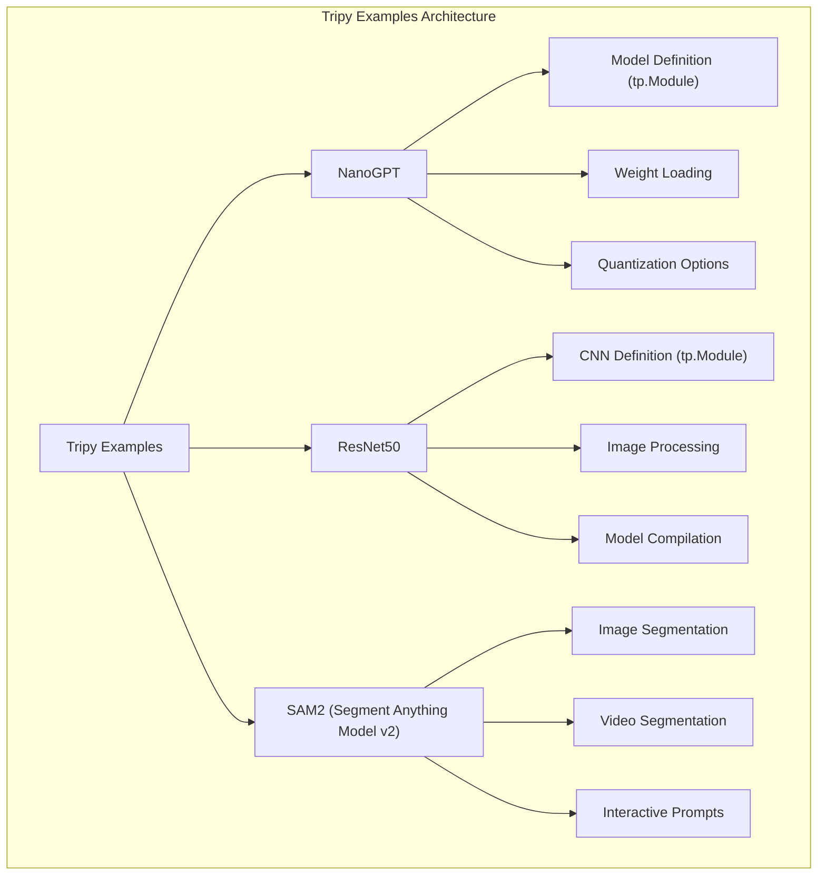
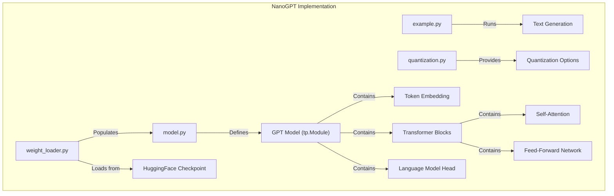
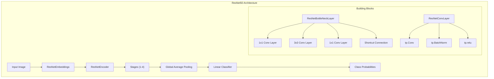
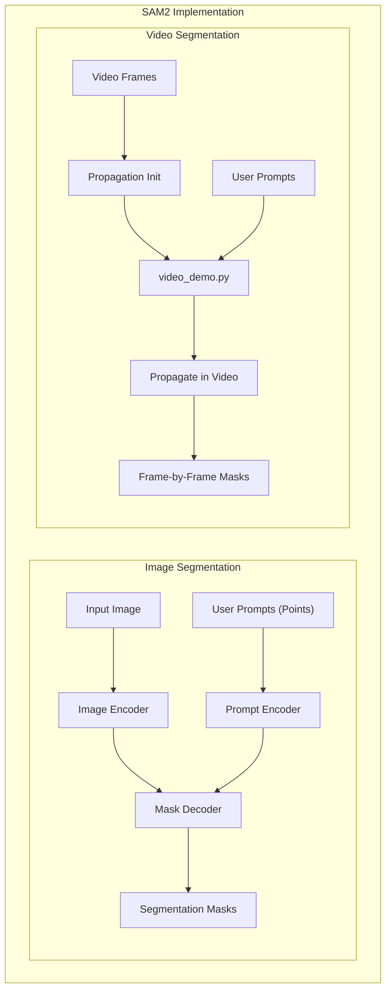
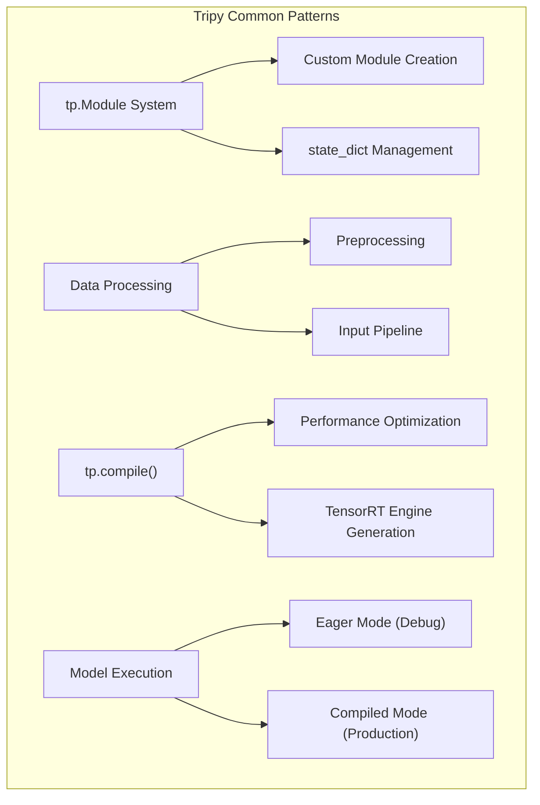

<!-- source: DeepWiki mcp.deepwiki.com · repo NVIDIA/TensorRT-Incubator · page 3 Tripy Examples · fetched 2026-10-26 -->

# Tripy Examples

<details>
<summary>Relevant source files</summary>

The following files were used as context for generating this wiki page:

- [tripy/CONTRIBUTING.md](tripy/CONTRIBUTING.md)
- [tripy/examples/nanogpt/README.md](tripy/examples/nanogpt/README.md)
- [tripy/examples/segment-anything-model-v2/README.md](tripy/examples/segment-anything-model-v2/README.md)
- [tripy/examples/segment-anything-model-v2/checkpoints/download_ckpt.sh](tripy/examples/segment-anything-model-v2/checkpoints/download_ckpt.sh)
- [tripy/examples/segment-anything-model-v2/download_test_data.py](tripy/examples/segment-anything-model-v2/download_test_data.py)
- [tripy/examples/segment-anything-model-v2/video_demo.py](tripy/examples/segment-anything-model-v2/video_demo.py)
- [tripy/notebooks/resnet50.ipynb](tripy/notebooks/resnet50.ipynb)
- [tripy/tests/test_examples.py](tripy/tests/test_examples.py)

</details>


This page provides an overview of the example models included in the TensorRT-Incubator repository, demonstrating how to implement and run various deep learning models using the Tripy/nvtripy framework. These examples serve as practical reference implementations to help users understand Tripy's capabilities across different machine learning domains.

For information about using specific Tripy features like tensor operations or the module system, see the [Tripy User Guide](#2).

## Overview of Examples

Tripy includes several comprehensive examples that demonstrate its capabilities:

1. **NanoGPT** - An implementation of a GPT language model
2. **ResNet50** - A convolutional neural network for image classification 
3. **SAM2** (Segment Anything Model v2) - A model for image and video segmentation

These examples showcase Tripy's ability to handle different types of models and tasks, from natural language processing to computer vision.

**Example Capabilities Comparison**

| Example | Domain | Key Features Demonstrated | Model Structure | Input/Output |
|---------|--------|---------------------------|-----------------|--------------|
| NanoGPT | NLP | Transformer architecture, Quantization (INT8, INT4, FP8) | GPT architecture | Text → Text |
| ResNet50 | Computer Vision | CNN architecture, Model compilation | 50-layer ResNet | Image → Classification |
| SAM2 | Computer Vision | Image/video segmentation, Interactive prompts | Vision Transformer | Image/Video → Segmentation masks |

### Example Structure and Components



Sources: [tripy/examples/nanogpt/README.md], [tripy/notebooks/resnet50.ipynb], [tripy/examples/segment-anything-model-v2/README.md]

## NanoGPT Example

The NanoGPT example implements a GPT language model based on Andrej Karpathy's nanoGPT using Tripy. This example demonstrates model definition with Tripy's module system, weight loading from pre-trained checkpoints, and various quantization techniques.

### Key Components



Sources: [tripy/examples/nanogpt/README.md], [tripy/examples/nanogpt/model.py], [tripy/examples/nanogpt/weight_loader.py], [tripy/examples/nanogpt/example.py], [tripy/examples/nanogpt/quantization.py]

### Running the NanoGPT Example

The example can be run with different quantization modes to demonstrate the trade-offs between model size, speed, and accuracy:

1. **Standard FP16 inference**:
   ```bash
   python3 example.py --input-text "What is the answer to life, the universe, and everything?" --seed=0
   ```

2. **Weight-only INT8 quantization**:
   ```bash
   python3 example.py --input-text "What is the answer to life, the universe, and everything?" --seed=0 --quant-mode int8-weight-only
   ```

3. **Weight-only INT4 quantization** (may result in reduced accuracy):
   ```bash
   python3 example.py --input-text "What is the answer to life, the universe, and everything?" --seed=0 --quant-mode int4-weight-only
   ```

4. **FP8 quantization** (if supported by hardware):
   ```bash
   python3 example.py --input-text "What is the answer to life, the universe, and everything?" --seed=0 --quant-mode float8
   ```

Sources: [tripy/examples/nanogpt/README.md:14-86]()

## ResNet50 Example

The ResNet50 example implements the popular 50-layer Residual Network architecture for image classification. This example is provided as a Jupyter notebook and demonstrates building complex neural network architectures with Tripy's module system.

### Model Architecture



Sources: [tripy/notebooks/resnet50.ipynb:59-316]()

### Key Components

The ResNet50 example defines several modules that work together to form the complete architecture:

1. **ResNetConvLayer**: Convolutional layer with batch normalization and optional ReLU activation
2. **ResNetShortCut**: 1x1 convolution for input and output channel dimension matching
3. **ResNetBottleNeckLayer**: Core building block with three convolutional layers and a residual connection
4. **ResNetStage**: Multiple bottleneck layers with increasing channels and reducing spatial dimensions
5. **ResNetEncoder**: Implements the main feature extraction network with multiple stages
6. **ResNetClassifier**: Combines the backbone with a classification head

### Model Compilation and Inference

The example demonstrates how to compile the model for optimized inference using `tp.compile`:

```python
compiled_resnet_classifier = tp.compile(
    resnet_classifier,
    args=[tp.InputInfo([1, 3, 224, 224], dtype=tp.float32)],
)
```

Sources: [tripy/notebooks/resnet50.ipynb:394-406]()

## SAM2 (Segment Anything Model v2) Example

The SAM2 example implements Meta's Segment Anything Model v2 for image and video segmentation. This example demonstrates Tripy's ability to handle complex vision models and process both static images and temporal data.

### Segmentation Pipelines



Sources: [tripy/examples/segment-anything-model-v2/README.md], [tripy/examples/segment-anything-model-v2/image_demo.py], [tripy/examples/segment-anything-model-v2/video_demo.py]

### Running the SAM2 Example

Before running the example, users need to download the test data and model checkpoints:

```bash
python3 download_test_data.py
sh checkpoints/download_ckpt.sh
```

The example provides two main scripts:

1. **Image segmentation pipeline**:
   ```bash
   python3 image_demo.py
   ```

2. **Video segmentation pipeline**:
   ```bash
   python3 video_demo.py
   ```

The image demo performs segmentation on a single image with user-provided points, while the video demo demonstrates propagating segmentation masks through video frames.

Sources: [tripy/examples/segment-anything-model-v2/README.md:8-53](), [tripy/examples/segment-anything-model-v2/download_test_data.py], [tripy/examples/segment-anything-model-v2/checkpoints/download_ckpt.sh]

## Common Features Across Examples

While each example focuses on different domains, they demonstrate common patterns and capabilities of the Tripy framework:



### Key Takeaways

1. **Module System**: All examples use Tripy's `tp.Module` system to create complex model architectures
2. **Pre-trained Weights**: The examples demonstrate loading weights from external sources (e.g., HuggingFace)
3. **Model Compilation**: Using `tp.compile()` for optimized inference with TensorRT
4. **Quantization**: NanoGPT showcases various quantization techniques (INT8, INT4, FP8)
5. **Domain Diversity**: The examples cover NLP, image classification, and segmentation tasks

Sources: [tripy/tests/test_examples.py:17-183]()

## Testing and Verification

The examples include tests to ensure they run correctly and follow a standardized format. These tests verify:

1. Proper setup of dependencies
2. Correct functionality of the examples
3. Expected outputs within tolerance ranges
4. Cleanup of temporary artifacts

The testing system consolidates code blocks from README files and executes them to verify the examples work as expected.

Sources: [tripy/tests/test_examples.py:17-183]()

## Running the Examples

To run any of the examples, follow these general steps:

1. Install the Tripy package following the [installation instructions](#5.1)
2. Navigate to the example directory
3. Install the example-specific requirements:
   ```bash
   python -m pip install -r requirements.txt
   ```
4. Download any required assets (checkpoints, test data)
5. Run the example scripts as described in each example's README

For detailed instructions, refer to the README file in each example directory.

Sources: [tripy/CONTRIBUTING.md:6-53](), [tripy/examples/nanogpt/README.md:14-86](), [tripy/examples/segment-anything-model-v2/README.md:8-53]()

---

