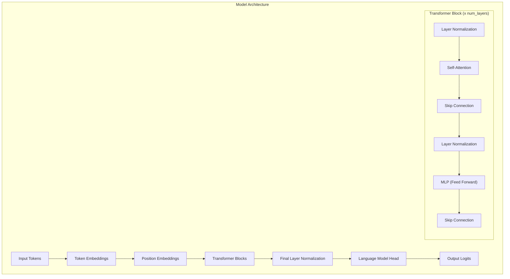
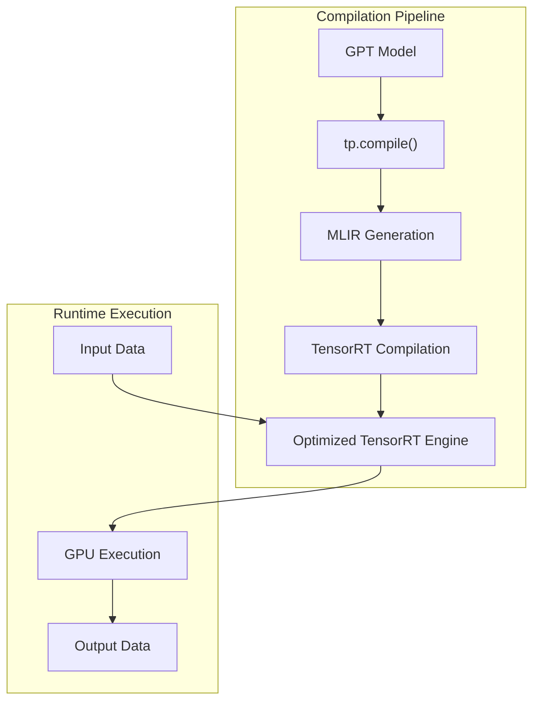
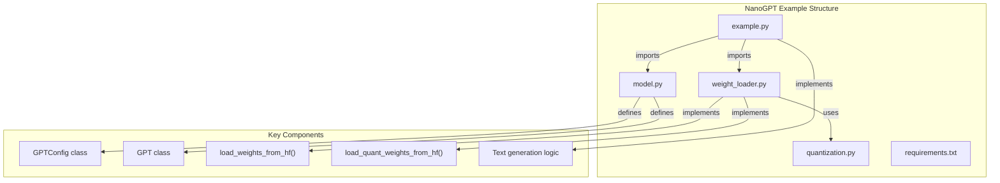
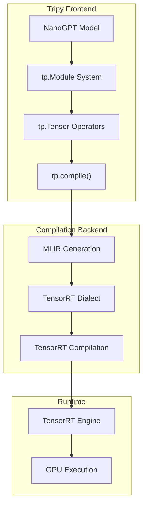

<!-- source: DeepWiki mcp.deepwiki.com · repo NVIDIA/TensorRT-Incubator · page 3.1 NanoGPT · fetched 2026-10-26 -->

# NanoGPT

<details>
<summary>Relevant source files</summary>

The following files were used as context for generating this wiki page:

- [tripy/CONTRIBUTING.md](tripy/CONTRIBUTING.md)
- [tripy/README.md](tripy/README.md)
- [tripy/docs/pre0_user_guides/00-introduction-to-tripy.md](tripy/docs/pre0_user_guides/00-introduction-to-tripy.md)
- [tripy/examples/nanogpt/README.md](tripy/examples/nanogpt/README.md)
- [tripy/examples/nanogpt/example.py](tripy/examples/nanogpt/example.py)
- [tripy/examples/segment-anything-model-v2/README.md](tripy/examples/segment-anything-model-v2/README.md)
- [tripy/examples/segment-anything-model-v2/checkpoints/download_ckpt.sh](tripy/examples/segment-anything-model-v2/checkpoints/download_ckpt.sh)
- [tripy/examples/segment-anything-model-v2/download_test_data.py](tripy/examples/segment-anything-model-v2/download_test_data.py)
- [tripy/examples/segment-anything-model-v2/video_demo.py](tripy/examples/segment-anything-model-v2/video_demo.py)
- [tripy/notebooks/resnet50.ipynb](tripy/notebooks/resnet50.ipynb)
- [tripy/tests/backend/api/test_stream.py](tripy/tests/backend/api/test_stream.py)
- [tripy/tests/integration/test_plugin.py](tripy/tests/integration/test_plugin.py)
- [tripy/tests/test_examples.py](tripy/tests/test_examples.py)

</details>


This page documents the NanoGPT example in the TensorRT-Incubator repository, which demonstrates how to implement, optimize, and deploy GPT-style language models using Tripy. This implementation is based on [Andrej Karpathy's nanoGPT](https://github.com/karpathy/nanoGPT) architecture but adapted to leverage TensorRT's acceleration capabilities through the Tripy frontend.

For information about other examples in the TensorRT-Incubator, see [Tripy Examples](#3).

## Overview

The NanoGPT example showcases how to:

1. Define a GPT architecture as a Tripy module
2. Load pre-trained weights from Hugging Face
3. Compile the model for optimized inference 
4. Perform text generation with adjustable parameters
5. Apply different quantization techniques to optimize performance and memory usage

Sources: [tripy/examples/nanogpt/README.md:1-10](), [tripy/examples/nanogpt/example.py:18-27]()

## Architecture

NanoGPT follows the standard transformer-based architecture of GPT models, consisting of multiple decoder blocks with attention mechanisms. The implementation supports different model sizes, from the base GPT-2 to larger variants.

### NanoGPT Model Architecture



The model is configured with several key parameters:
- `num_layers`: Number of transformer blocks
- `num_heads`: Number of attention heads 
- `embedding_size`: Dimensionality of embeddings
- `vocab_size`: Size of the token vocabulary (50,257 for GPT-2)
- `block_size`: Maximum sequence length (1,024 for GPT-2)

Sources: [tripy/examples/nanogpt/example.py:29-52]()

## Model Configurations

The example supports multiple GPT-2 variants with different parameter counts:

| Model Type | Layers | Heads | Embedding Size | Parameters |
|------------|--------|-------|---------------|------------|
| gpt2       | 12     | 12    | 768           | 124M       |
| gpt2-medium| 24     | 16    | 1,024         | 350M       |
| gpt2-large | 36     | 20    | 1,280         | 774M       |
| gpt2-xl    | 48     | 25    | 1,600         | 1,558M     |

These configurations are defined in the model initialization function:

Sources: [tripy/examples/nanogpt/example.py:29-52]()

## Implementation Flow

### NanoGPT Inference Pipeline

```mermaid
graph LR
    subgraph "Input Processing"
        InputText["Input Text"] --> Tokenizer["tiktoken Encoder"]
        Tokenizer --> InputIDs["Input IDs"]
    end
    
    subgraph "Model Compilation & Execution"
        InputIDs --> ModelInit["Model Initialization"]
        ModelInit --> WeightLoad["Load Weights from HF"]
        WeightLoad --> ModelCompile["tp.compile()"]
        ModelCompile --> CompiledModel["Compiled Model"]
        
        InputTensor["Input Tensor"] --> CompiledModel
        CompiledModel --> Logits["Output Logits"]
    end
    
    subgraph "Text Generation"
        Logits --> TopK["Top-K Filtering"]
        TopK --> SoftMax["Softmax + Temperature"]
        SoftMax --> Sample["Multinomial Sampling"]
        Sample --> NextToken["Next Token"]
        NextToken --> AppendToken["Append to Sequence"]
        AppendToken --> |"Repeat for max_new_tokens"| InputTensor
    end
    
    AppendToken --> FinalOutput["Generated Text"]
    FinalOutput --> Decoder["tiktoken Decoder"]
    Decoder --> Response["Final Response"]
```



Sources: [tripy/examples/nanogpt/example.py:81-139]()

## Weight Loading

The example loads pre-trained weights from Hugging Face's model repository. Two approaches are supported:

1. Standard floating-point weights (`load_weights_from_hf`)
2. Quantized weights (`load_quant_weights_from_hf`) for reduced memory footprint

The weight loader handles the conversion from PyTorch weights to Tripy tensors and ensures proper initialization of all model components.

Sources: [tripy/examples/nanogpt/example.py:91-94](), [tripy/examples/nanogpt/README.md:40-86]()

## Compilation and Optimization

One of the key features demonstrated in this example is model compilation with TensorRT:



The compilation process in the example:

1. First creates the NanoGPT model as a Tripy module
2. Specifies input shapes, including support for dynamic sequence lengths
3. Compiles the model using `tp.compile()`, which converts it to an optimized TensorRT engine

The example demonstrates dynamic shape support, allowing for sequence lengths that can vary up to a maximum length:

Sources: [tripy/examples/nanogpt/example.py:98-107]()

## Quantization Support

The NanoGPT example demonstrates various quantization techniques to reduce memory footprint and improve inference speed:

| Quantization Mode | Description | Memory Savings | Accuracy Impact |
|-------------------|-------------|---------------|-----------------|
| int8-weight-only  | Weights quantized to INT8 | ~4x vs FP32 | Minimal |
| int4-weight-only  | Weights quantized to INT4 | ~8x vs FP32 | Moderate to significant |
| float8            | FP8 quantization (where supported) | ~2x vs FP16 | Minimal |

The example uses NVIDIA TensorRT Model Optimizer to apply quantization to the PyTorch model, then loads the quantized weights into the Tripy model.

Sources: [tripy/examples/nanogpt/README.md:40-86]()

## Text Generation

The text generation process in NanoGPT follows a standard autoregressive approach:

1. Process input prompt into token IDs
2. Run the model on the input to get logits for the next token
3. Apply temperature scaling and top-K filtering to the logits
4. Sample the next token from the resulting probability distribution
5. Append the token to the input sequence
6. Repeat steps 2-5 until reaching the maximum token count

The example provides control over generation parameters:
- `max_new_tokens`: Maximum number of tokens to generate
- `TEMPERATURE`: Controls randomness (higher = more random)
- `TOP_K`: Number of highest probability tokens to consider for sampling

Sources: [tripy/examples/nanogpt/example.py:116-140]()

## Code Organization



Sources: [tripy/examples/nanogpt/README.md:7-9](), [tripy/examples/nanogpt/example.py:23-25]()

## Running the Example

The example supports various command-line arguments for customization:

| Argument | Description | Default |
|----------|-------------|---------|
| `--input-text` | The prompt text to start generation from | (Required) |
| `--model-type` | Model variant to use (gpt2, gpt2-medium, etc.) | gpt2 |
| `--max-new-tokens` | Maximum number of tokens to generate | 10 |
| `--seed` | Random seed for reproducible generation | None |
| `--quant-mode` | Quantization mode to use | None |

Example commands:

```bash
# Basic usage
python3 example.py --input-text "What is the answer to life, the universe, and everything?"

# With fixed seed for reproducibility
python3 example.py --input-text "What is the answer to life, the universe, and everything?" --seed=0

# With INT8 quantization
python3 example.py --input-text "What is the answer to life, the universe, and everything?" --seed=0 --quant-mode int8-weight-only
```

Sources: [tripy/examples/nanogpt/README.md:13-78]()

## Integration with Tripy and TensorRT

The NanoGPT example demonstrates the integration between different components of the TensorRT-Incubator ecosystem:



The example leverages key Tripy features:
1. Module system for model structure
2. Tensor operations for computations
3. Compilation pipeline for optimization
4. TensorRT backend for accelerated inference

Sources: [tripy/README.md:14-26](), [tripy/docs/pre0_user_guides/00-introduction-to-tripy.md:18-36]()

## Conclusion

The NanoGPT example demonstrates how to leverage TensorRT through the Tripy frontend to deploy and optimize a GPT-style language model. It showcases:

1. Creating and configuring a transformer-based model architecture
2. Loading pre-trained weights from common model repositories
3. Applying optimizations through compilation and quantization
4. Implementing efficient text generation

This example serves as a reference for implementing other language models using Tripy and TensorRT, providing a pattern for high-performance deep learning inference.

---

