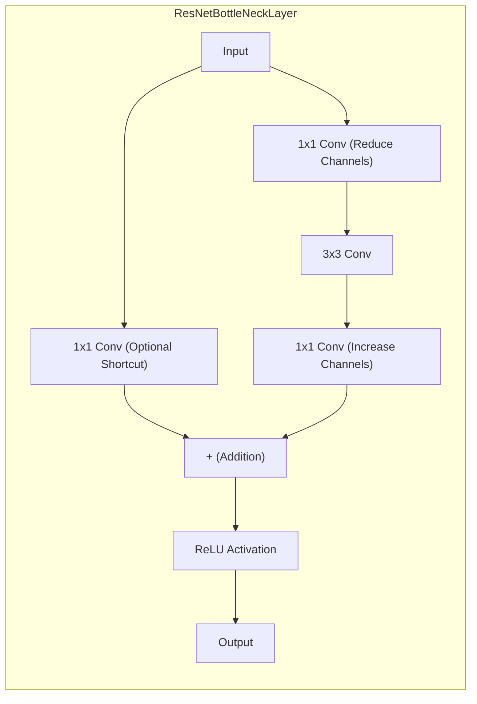
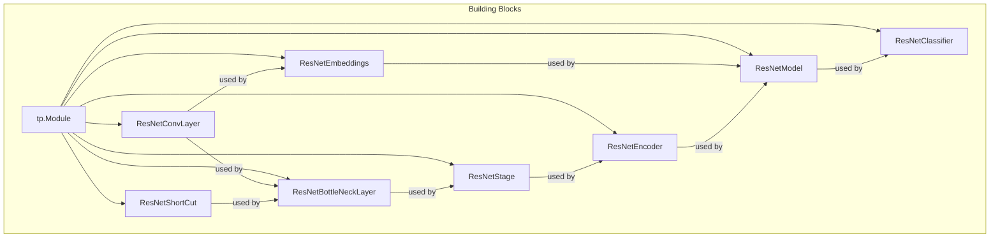
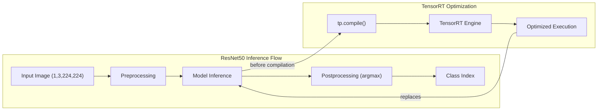
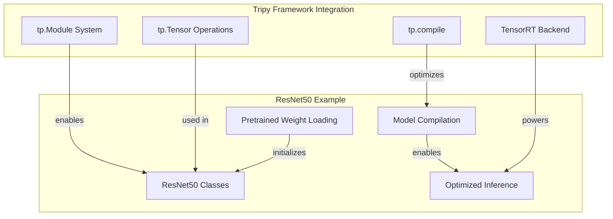

<!-- source: DeepWiki mcp.deepwiki.com · repo NVIDIA/TensorRT-Incubator · page 3.2 ResNet50 · fetched 2026-10-26 -->

# ResNet50

<details>
<summary>Relevant source files</summary>

The following files were used as context for generating this wiki page:

- [tripy/CONTRIBUTING.md](tripy/CONTRIBUTING.md)
- [tripy/README.md](tripy/README.md)
- [tripy/docs/pre0_user_guides/00-introduction-to-tripy.md](tripy/docs/pre0_user_guides/00-introduction-to-tripy.md)
- [tripy/examples/nanogpt/README.md](tripy/examples/nanogpt/README.md)
- [tripy/examples/nanogpt/example.py](tripy/examples/nanogpt/example.py)
- [tripy/examples/segment-anything-model-v2/README.md](tripy/examples/segment-anything-model-v2/README.md)
- [tripy/examples/segment-anything-model-v2/checkpoints/download_ckpt.sh](tripy/examples/segment-anything-model-v2/checkpoints/download_ckpt.sh)
- [tripy/examples/segment-anything-model-v2/download_test_data.py](tripy/examples/segment-anything-model-v2/download_test_data.py)
- [tripy/examples/segment-anything-model-v2/video_demo.py](tripy/examples/segment-anything-model-v2/video_demo.py)
- [tripy/notebooks/resnet50.ipynb](tripy/notebooks/resnet50.ipynb)
- [tripy/tests/backend/api/test_stream.py](tripy/tests/backend/api/test_stream.py)
- [tripy/tests/integration/test_plugin.py](tripy/tests/integration/test_plugin.py)
- [tripy/tests/test_examples.py](tripy/tests/test_examples.py)

</details>


This page details the ResNet50 example implementation in the Tripy package, which demonstrates how to build, initialize, and run a ResNet50 model for image classification using TensorRT. The example showcases Tripy's module system for defining complex neural network architectures and demonstrates optimization through compilation.

## Overview

ResNet50 is a deep convolutional neural network with 50 layers, introduced in the paper [Deep Residual Learning for Image Recognition](https://arxiv.org/abs/1512.03385). It features a distinctive residual learning framework that addresses the degradation problem in deep networks through the use of skip connections.

This implementation demonstrates:
- Building a complete ResNet50 architecture using Tripy modules
- Loading pretrained weights from Hugging Face
- Compiling for optimized inference
- Running image classification

Sources: [tripy/notebooks/resnet50.ipynb:1-25]()

## Architecture

The ResNet50 architecture consists of a series of residual blocks organized into stages, with each stage containing multiple bottleneck layers. The key innovation of ResNet is the residual connection (skip connection) that allows gradients to flow more easily through deep networks.

### ResNet50 Architecture Diagram

```mermaid
graph TD
    subgraph "ResNet50 Architecture"
        Input["Input Image"]
        Embeddings["ResNetEmbeddings (7x7 Conv + Max Pool)"]
        Stage1["Stage 1: 3 Bottleneck Layers (64→256)"]
        Stage2["Stage 2: 4 Bottleneck Layers (256→512)"]
        Stage3["Stage 3: 6 Bottleneck Layers (512→1024)"]
        Stage4["Stage 4: 3 Bottleneck Layers (1024→2048)"]
        AvgPool["Global Average Pooling"]
        Classifier["Linear Classifier (2048→1000)"]
        Output["Classification Output"]
    end
    
    Input --> Embeddings
    Embeddings --> Stage1
    Stage1 --> Stage2
    Stage2 --> Stage3
    Stage3 --> Stage4
    Stage4 --> AvgPool
    AvgPool --> Classifier
    Classifier --> Output
```



Sources: [tripy/notebooks/resnet50.ipynb:269-316]()

### Residual Block

The core component of ResNet50 is the bottleneck block with residual connections:



The residual connection allows the network to learn identity mappings, making it easier to train deeper networks.

Sources: [tripy/notebooks/resnet50.ipynb:152-201]()

## Implementation Components

The ResNet50 implementation in Tripy follows a modular structure, with each component inheriting from `tp.Module`:

### Component Hierarchy



### Key Components

1. **ResNetConvLayer**: Basic building block with convolution, batch normalization, and optional ReLU activation.
2. **ResNetShortCut**: Handles dimension matching for residual connections.
3. **ResNetBottleNeckLayer**: Implements the residual block with both main path and shortcut.
4. **ResNetStage**: Groups multiple bottleneck layers with the same output dimensions.
5. **ResNetEncoder**: Combines multiple stages to extract features with increasing channel dimensions.
6. **ResNetClassifier**: Final model that combines the backbone with a classification head.

Sources: [tripy/notebooks/resnet50.ipynb:59-118](), [tripy/notebooks/resnet50.ipynb:127-266](), [tripy/notebooks/resnet50.ipynb:274-315]()

## Implementation Details

### Convolutional Layers

The `ResNetConvLayer` implements a standard convolutional block with batch normalization and optional ReLU activation:

```
ResNetConvLayer:
  - Convolution (with specified kernel size, stride, padding)
  - Batch Normalization
  - ReLU Activation (optional)
```

Sources: [tripy/notebooks/resnet50.ipynb:63-94]()

### Residual Connections

The `ResNetBottleNeckLayer` implements the bottleneck architecture with residual connections:

```
ResNetBottleNeckLayer:
  - Shortcut path: 
    - 1x1 convolution (if dimensions change)
    - Identity (if dimensions match)
  - Main path:
    - 1x1 convolution (reduce channels)
    - 3x3 convolution 
    - 1x1 convolution (restore channels)
  - Addition of shortcut and main path
  - ReLU activation
```

The shortcut path ensures the dimensions match for the residual connection.

Sources: [tripy/notebooks/resnet50.ipynb:152-201]()

### Stage Configuration

The `ResNetModel` configures the stages of the ResNet50 architecture:

| Stage  | Layers | Output Channels | Bottleneck Channels | Stride |
|--------|--------|----------------|---------------------|--------|
| Stage 1 | 3      | 256            | 64                  | (1,1)  |
| Stage 2 | 4      | 512            | 128                 | (2,2)  |
| Stage 3 | 6      | 1024           | 256                 | (2,2)  |
| Stage 4 | 3      | 2048           | 512                 | (2,2)  |

Sources: [tripy/notebooks/resnet50.ipynb:283-288]()

## Model Initialization and Loading Weights

### Initializing the Model

The ResNet50 model is initialized with the following code:

```python
tripy_model = ResNetClassifier()
```

This creates an instance of the classifier with 1000 output classes by default.

Sources: [tripy/notebooks/resnet50.ipynb:328-331]()

### Loading Pretrained Weights

The example loads pretrained weights from the Hugging Face Transformers library:

```python
from transformers import ResNetForImageClassification
resnet_pretrained = ResNetForImageClassification.from_pretrained("microsoft/resnet-50")
```

A helper function converts these weights to Tripy tensors:

```python
def load_pretrained_weights(model, pretrained_state_dict):
    model_state_dict_keys = set(model.state_dict().keys())
    model_dict = {}

    # Convert each weight to a tp.Tensor and update the model's state dict
    for k, v in pretrained_state_dict.items():
        if "num_batches_tracked" in k:
            # Skip num_batches_tracked since it is not needed for inference.
            continue

        assert k in model_state_dict_keys
        model_dict[k] = tp.Tensor(v.contiguous())

    model.load_state_dict(model_dict)
```

Sources: [tripy/notebooks/resnet50.ipynb:347-378]()

## Compilation and Optimization

The model is compiled using `tp.compile()` to optimize performance with TensorRT:

```python
def resnet_classifier(input):
    """
    Inference function to compile. Runs forward path and postprocessing.
    """
    logits = tripy_model(input)
    return tp.argmax(logits)

compiled_resnet_classifier = tp.compile(
    resnet_classifier,
    # The function expects one input, for which we specify shape/dtype:
    args=[tp.InputInfo([1, 3, 224, 224], dtype=tp.float32)],
)
```

Compilation converts the Python model into an optimized TensorRT engine, providing significant performance improvements for inference.

Sources: [tripy/notebooks/resnet50.ipynb:395-406]()

## Data Flow and Execution

The following diagram illustrates the data flow during inference:



This approach combines the ease of use of Python with the performance benefits of TensorRT.

Sources: [tripy/notebooks/resnet50.ipynb:395-406](), [tripy/docs/pre0_user_guides/00-introduction-to-tripy.md:56-82]()

## Integration with Tripy Framework

The ResNet50 example demonstrates several core Tripy concepts:

1. **Module System**: Building complex models through composition of `tp.Module` classes
2. **Tensor Operations**: Using operations like `tp.relu`, `tp.maxpool`, and `tp.avgpool`
3. **State Management**: Loading and managing model weights
4. **Compilation**: Converting Python code to optimized TensorRT engines



Sources: [tripy/README.md:15-26](), [tripy/docs/pre0_user_guides/00-introduction-to-tripy.md:19-54]()

## Usage Examples

To use the compiled ResNet50 model for inference:

1. Load an image and preprocess it to the expected input shape (1, 3, 224, 224)
2. Convert it to a Tripy tensor
3. Pass it to the compiled model
4. Interpret the output class index

The notebook demonstrates loading pretrained weights from Hugging Face's Transformers library and using them with the Tripy implementation, showcasing interoperability with the PyTorch ecosystem.

Sources: [tripy/notebooks/resnet50.ipynb:407-412]()

## Relation to Other Examples

The ResNet50 example is one of several model implementations in the TensorRT-Incubator repository:

| Example | Description | Key Features |
|---------|-------------|-------------|
| ResNet50 | Image classification | CNN architecture with residual connections |
| NanoGPT | Text generation | Transformer-based language model |
| SAM2 | Image and video segmentation | Vision model for segmentation tasks |

Each example demonstrates different aspects of the Tripy programming model and TensorRT optimization capabilities.

Sources: [tripy/tests/test_examples.py:86-92](), [tripy/examples/nanogpt/README.md:1-10](), [tripy/examples/segment-anything-model-v2/README.md:1-6]()

## Conclusion

The ResNet50 example demonstrates how Tripy provides a Pythonic interface to TensorRT for implementing and optimizing deep learning models. By combining the ease of use of Python with the performance benefits of TensorRT, Tripy enables efficient deployment of computer vision models like ResNet50.

---

