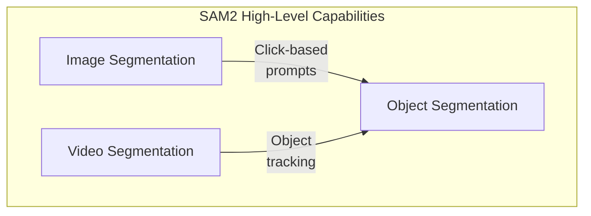
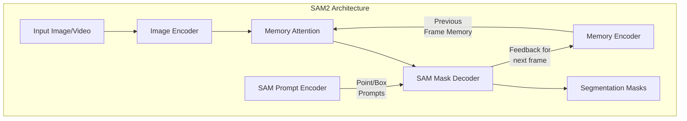
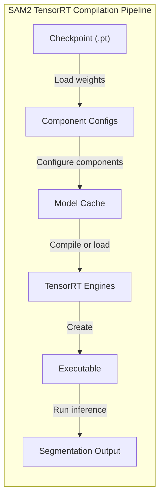
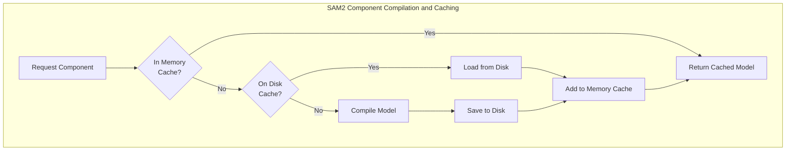
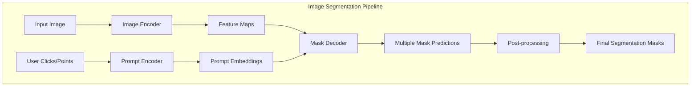
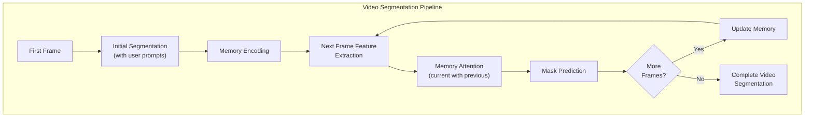
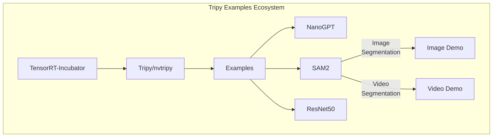

<!-- source: DeepWiki mcp.deepwiki.com · repo NVIDIA/TensorRT-Incubator · page 3.3 SAM2 (Segment Anything Model v2) · fetched 2026-10-26 -->

# SAM2 (Segment Anything Model v2)

<details>
<summary>Relevant source files</summary>

The following files were used as context for generating this wiki page:

- [tripy/CONTRIBUTING.md](tripy/CONTRIBUTING.md)
- [tripy/docs/post0_developer_guides/00-architecture.md](tripy/docs/post0_developer_guides/00-architecture.md)
- [tripy/docs/pre0_user_guides/01-compiler.md](tripy/docs/pre0_user_guides/01-compiler.md)
- [tripy/docs/pre0_user_guides/02-quantization.md](tripy/docs/pre0_user_guides/02-quantization.md)
- [tripy/examples/nanogpt/README.md](tripy/examples/nanogpt/README.md)
- [tripy/examples/segment-anything-model-v2/README.md](tripy/examples/segment-anything-model-v2/README.md)
- [tripy/examples/segment-anything-model-v2/checkpoints/download_ckpt.sh](tripy/examples/segment-anything-model-v2/checkpoints/download_ckpt.sh)
- [tripy/examples/segment-anything-model-v2/download_test_data.py](tripy/examples/segment-anything-model-v2/download_test_data.py)
- [tripy/examples/segment-anything-model-v2/sam2/build_sam.py](tripy/examples/segment-anything-model-v2/sam2/build_sam.py)
- [tripy/examples/segment-anything-model-v2/sam2/modeling/memory_attention.py](tripy/examples/segment-anything-model-v2/sam2/modeling/memory_attention.py)
- [tripy/examples/segment-anything-model-v2/sam2/modeling/sam2_base.py](tripy/examples/segment-anything-model-v2/sam2/modeling/sam2_base.py)
- [tripy/examples/segment-anything-model-v2/video_demo.py](tripy/examples/segment-anything-model-v2/video_demo.py)
- [tripy/notebooks/resnet50.ipynb](tripy/notebooks/resnet50.ipynb)
- [tripy/tests/test_examples.py](tripy/tests/test_examples.py)

</details>


This page documents the implementation of Meta's Segment Anything Model v2 (SAM2) in the TensorRT-Incubator repository. SAM2 is a foundation model for image and video segmentation that can perform zero-shot segmentation of objects in images and videos based on user prompts.

## Overview

SAM2 extends the capabilities of the original SAM model by adding support for video segmentation through a memory-based architecture. The implementation in this repository demonstrates how to optimize and accelerate SAM2 using Tripy and TensorRT for both image and video segmentation tasks.



Sources: [examples/segment-anything-model-v2/README.md:1-57](). [examples/segment-anything-model-v2/sam2/build_sam.py:351-370]()

## Model Architecture

SAM2 consists of multiple specialized components that work together to perform segmentation tasks:



Sources: [examples/segment-anything-model-v2/sam2/modeling/sam2_base.py:42-244](). [examples/segment-anything-model-v2/sam2/modeling/memory_attention.py:33-229]()

### Core Components

| Component | Description | Role in SAM2 |
|-----------|-------------|--------------|
| Image Encoder | Backbone network that extracts visual features | Processes input images into feature maps |
| Memory Attention | Transformer-based architecture for temporal context | Conditions current frame features with memories from past frames |
| Memory Encoder | Processes previous frame outputs | Creates memory embeddings for temporal consistency |
| SAM Prompt Encoder | Encodes user inputs (clicks, boxes) | Converts user prompts into embeddings for the mask decoder |
| SAM Mask Decoder | Transformer-based decoder | Generates segmentation masks from image features and prompts |

Sources: [examples/segment-anything-model-v2/sam2/modeling/sam2_base.py:117-150](). [examples/segment-anything-model-v2/sam2/modeling/memory_attention.py:114-151]()

## Integration with Tripy

SAM2 is optimized for performance using Tripy, which provides a Python interface to TensorRT. This integration allows the model to be compiled into highly optimized TensorRT engines.



Sources: [examples/segment-anything-model-v2/sam2/build_sam.py:255-295](). [examples/segment-anything-model-v2/sam2/build_sam.py:296-348]()

### Component Compilation and Caching

SAM2 uses a caching system to avoid recompiling model components unnecessarily:

1. Each model component (Image Encoder, Memory Attention, etc.) is individually compiled
2. Compiled models are cached both in memory and on disk
3. Components are configured with specific input shapes and data types for optimal performance

The `SAM2ModelCache` class manages this caching system:



Sources: [examples/segment-anything-model-v2/sam2/build_sam.py:255-295](). [examples/segment-anything-model-v2/sam2/build_sam.py:296-348]()

### Component Configuration

Each component of SAM2 is configured with specific shapes and data types to ensure compatibility with TensorRT. The configurations include:

- Input shapes for different batch sizes and object counts
- Precision settings (float32, float16)
- Specialized handling for weight loading and conversion

For example, the Memory Attention component is configured for variable batch sizes and object counts:

```python
"memory_attention": {
    "enabled": True,
    "model": model.memory_attention,
    "dtype": model_precision,
    "compile_args": [
        tp.InputInfo(
            (4096, (1, 2, 8), 256),
            getattr(tp, model_precision),
        ),
        tp.InputInfo(
            ((4100, 16400, 28736), (1, 2, 8), 64),
            getattr(tp, model_precision),
        ),
        # Other arguments...
    ],
    "skip_dtype_convert": ["ln", "norm"],
}
```

Sources: [examples/segment-anything-model-v2/sam2/build_sam.py:55-252]()

## Image Segmentation Pipeline

The image segmentation pipeline processes a single image with user prompts to generate object masks:



Sources: [examples/segment-anything-model-v2/sam2/modeling/sam2_base.py:247-293](). [examples/segment-anything-model-v2/sam2/build_sam.py:351-370]()

### Key Features of Image Segmentation

- Supports point-based prompts (positive and negative clicks)
- Generates multiple mask candidates with confidence scores
- Optimized for runtime performance using TensorRT
- Supports different model sizes (tiny, small, large) with varying performance/accuracy tradeoffs

Sources: [examples/segment-anything-model-v2/README.md:22-37]()

## Video Segmentation Pipeline

The video segmentation pipeline extends image segmentation by tracking objects across frames using a memory-based mechanism:



Sources: [examples/segment-anything-model-v2/video_demo.py:60-190](). [examples/segment-anything-model-v2/sam2/build_sam.py:373-407]()

### Memory Attention Mechanism

The Memory Attention module is crucial for video segmentation as it conditions the current frame's features with memories from past frames:

- Implements a transformer-based architecture with self-attention and cross-attention
- Maintains temporal consistency across video frames
- Uses temporal positional encoding to distinguish between frames at different times
- Supports variable numbers of memory frames with a configurable temporal stride

Sources: [examples/segment-anything-model-v2/sam2/modeling/memory_attention.py:33-229]()

## Model Variants and Configuration

SAM2 comes in three variants with different performance characteristics:

| Variant | Description | Use Case |
|---------|-------------|----------|
| tiny | Smallest model with fastest inference | Resource-constrained environments |
| small | Balanced performance and accuracy | General usage |
| large | Most accurate but slowest inference | When accuracy is paramount |

The model checkpoints are automatically downloaded when running the setup script:

```bash
sh checkpoints/download_ckpt.sh
```

Sources: [examples/segment-anything-model-v2/checkpoints/download_ckpt.sh:1-25](). [examples/segment-anything-model-v2/download_test_data.py:1-76]()

## Running the Example

The repository provides examples for both image and video segmentation:

### Prerequisites

Install the required dependencies:

```bash
python3 -m pip install -r requirements.txt
```

Download test data and model checkpoints:

```bash
python3 download_test_data.py
sh checkpoints/download_ckpt.sh
```

Sources: [examples/segment-anything-model-v2/README.md:9-20]()

### Image Segmentation Example

Run the image demo:

```bash
python3 image_demo.py
```

This will:
1. Load the SAM2 model
2. Process the test image (`truck.jpg`)
3. Place a few automatically generated prompts
4. Generate segmentation masks
5. Output scores for each prediction

Sources: [examples/segment-anything-model-v2/README.md:22-37]()

### Video Segmentation Example

Run the video demo:

```bash
python3 video_demo.py
```

This will:
1. Load the SAM2 video predictor model
2. Initialize the video segmentation state
3. Add point prompts to track specific objects
4. Propagate segmentation masks throughout the video
5. Output mask properties for verification

The implementation includes functionality to:
- Add new points or bounding boxes to refine masks
- Track multiple objects simultaneously with unique IDs
- Compute mask properties such as volume and centroids

Sources: [examples/segment-anything-model-v2/README.md:38-54](). [examples/segment-anything-model-v2/video_demo.py:1-190]()

## Integration with the Tripy Ecosystem

SAM2 is part of the examples showcasing Tripy's capabilities for accelerating complex deep learning models:



Sources: [tests/test_examples.py:85-92](). [CONTRIBUTING.md:70-76]()

The SAM2 example demonstrates how complex vision models with multiple components can be effectively accelerated using Tripy's compilation and execution pipeline, leveraging TensorRT's optimization capabilities for both inference speed and memory efficiency.

---

