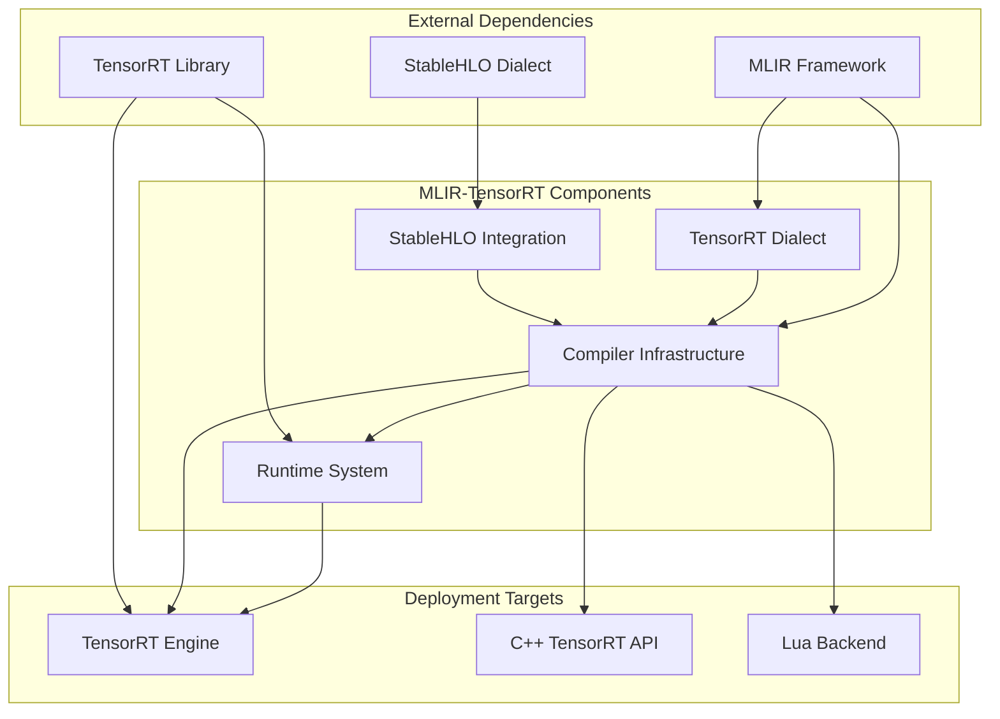
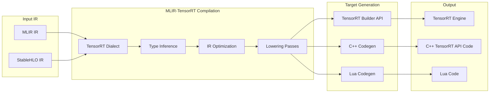
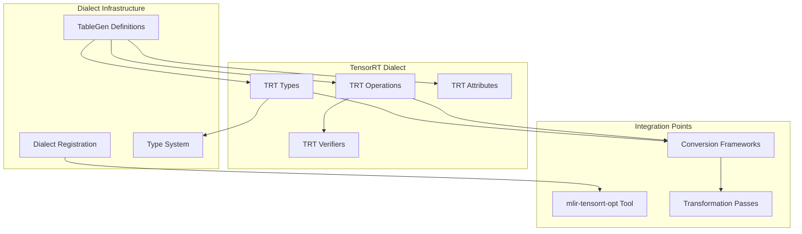
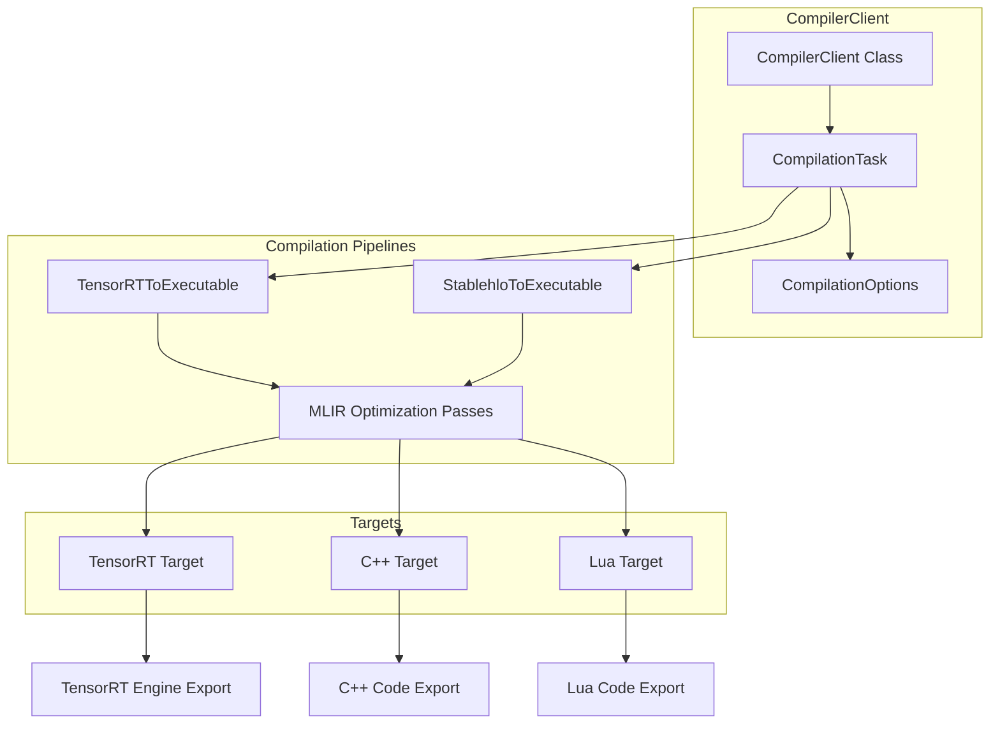
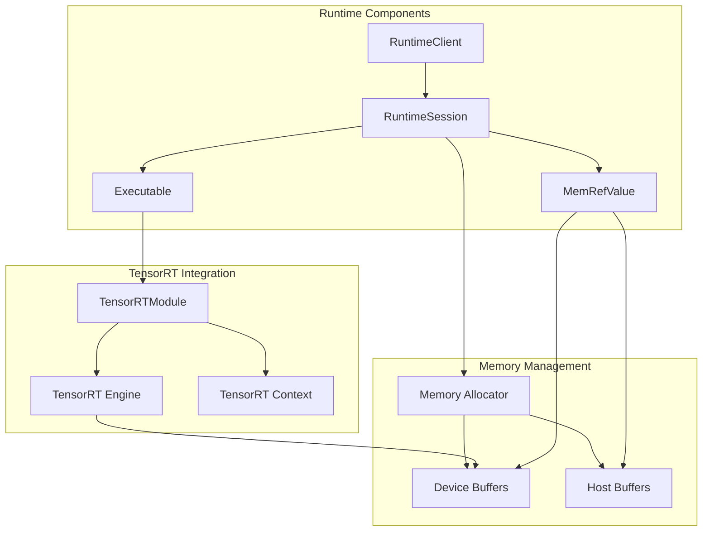
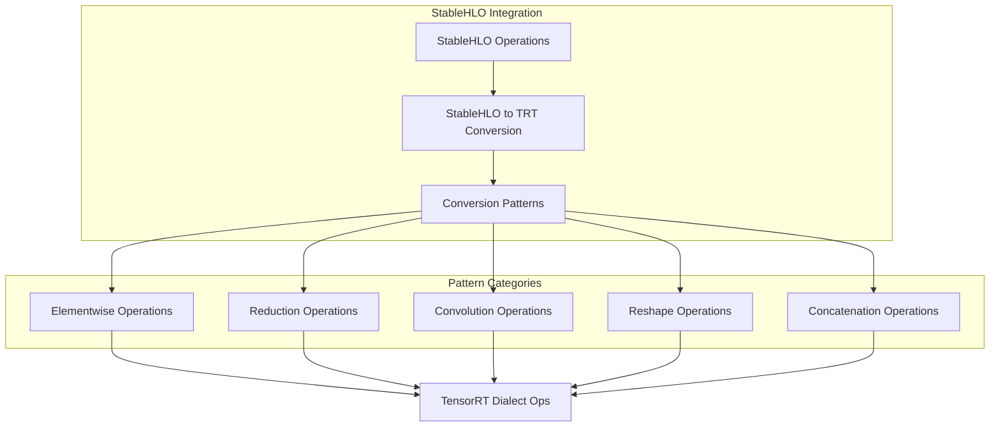
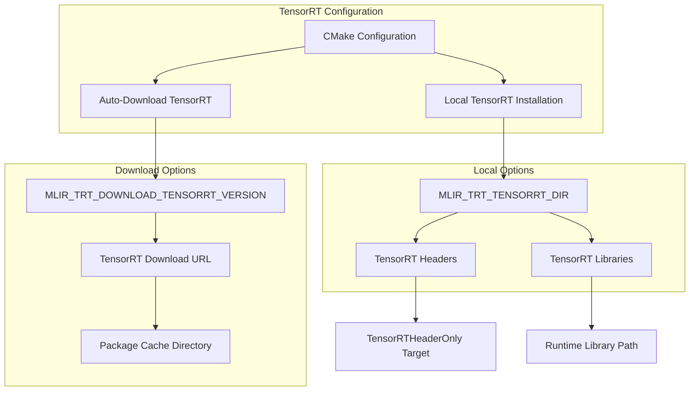
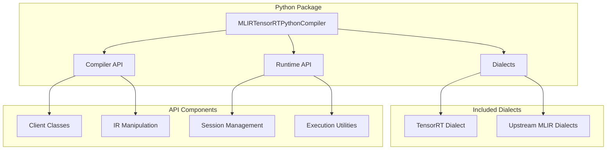
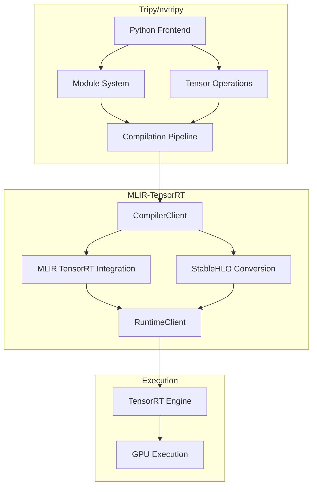

<!-- source: DeepWiki mcp.deepwiki.com · repo NVIDIA/TensorRT-Incubator · page 4 MLIR-TensorRT Technical Documentation · fetched 2026-10-26 -->

# MLIR-TensorRT Technical Documentation

Relevant source files

The following files were used as context for generating this wiki page:

- [.github/workflows/mlir-tensorrt-ci.yml](.github/workflows/mlir-tensorrt-ci.yml)
- [mlir-tensorrt/.devcontainer/cuda12.5-rockylinux8-gcc11/devcontainer.json](mlir-tensorrt/.devcontainer/cuda12.5-rockylinux8-gcc11/devcontainer.json)
- [mlir-tensorrt/CMakeLists.txt](mlir-tensorrt/CMakeLists.txt)
- [mlir-tensorrt/CMakePresets.json](mlir-tensorrt/CMakePresets.json)
- [mlir-tensorrt/README.md](mlir-tensorrt/README.md)
- [mlir-tensorrt/Version.cmake](mlir-tensorrt/Version.cmake)
- [mlir-tensorrt/build_tools/cmake/Dependencies.cmake](mlir-tensorrt/build_tools/cmake/Dependencies.cmake)
- [mlir-tensorrt/build_tools/cmake/TensorRTDownloadURL.cmake](mlir-tensorrt/build_tools/cmake/TensorRTDownloadURL.cmake)
- [mlir-tensorrt/build_tools/docker/Dockerfile](mlir-tensorrt/build_tools/docker/Dockerfile)
- [mlir-tensorrt/build_tools/scripts/build_wheels.sh](mlir-tensorrt/build_tools/scripts/build_wheels.sh)
- [mlir-tensorrt/build_tools/scripts/cicd_build.sh](mlir-tensorrt/build_tools/scripts/cicd_build.sh)
- [mlir-tensorrt/executor/lib/Runtime/Backend/Lua/Modules/CMakeLists.txt](mlir-tensorrt/executor/lib/Runtime/Backend/Lua/Modules/CMakeLists.txt)
- [mlir-tensorrt/python/requirements-dev.txt](mlir-tensorrt/python/requirements-dev.txt)

## Purpose and Scope

This document provides technical documentation for the MLIR-TensorRT project, a compiler infrastructure that enables integrating TensorRT acceleration into MLIR-based systems. MLIR-TensorRT serves as a bridge between the MLIR ecosystem and NVIDIA's TensorRT runtime, allowing for high-performance deployment of deep learning models on NVIDIA GPUs.

For information about using MLIR-TensorRT from Python through Tripy, see the [Tripy User Guide](#2). For information about building MLIR-TensorRT from source, see the [Building and Installation](#5.1) page.

Sources: [mlir-tensorrt/README.md:1-17](), [mlir-tensorrt/CMakeLists.txt:1-45]()

## Architecture Overview

MLIR-TensorRT consists of several interconnected components that together provide a complete compilation and runtime solution for accelerating deep learning workloads on NVIDIA GPUs.

### System Architecture

Sources: [mlir-tensorrt/README.md:1-17](), [mlir-tensorrt/CMakeLists.txt:30-46]()

### Compilation Flow

Sources: [mlir-tensorrt/README.md:6-13](), [mlir-tensorrt/CMakeLists.txt:36-43]()

## Key Components

### 1. TensorRT Dialect

The TensorRT dialect is the core component of MLIR-TensorRT. It provides a precise model of the TensorRT operator set in MLIR, allowing for static verification, type inference, and optimizations.

The TensorRT dialect defines operations that map directly to TensorRT's nvinfer1::INetworkDefinition API. These operations capture both the semantics and constraints of TensorRT operators, enabling validation at compile time rather than runtime.

Sources: [mlir-tensorrt/README.md:5-9](), [mlir-tensorrt/CMakeLists.txt:218-220]()

### 2. Compiler Infrastructure

MLIR-TensorRT provides a comprehensive compiler infrastructure for translating MLIR code to TensorRT engines and other targets.

The compiler infrastructure is responsible for:
- Managing the compilation process from input IR to target outputs
- Applying optimizations and transformations
- Handling different compilation targets (TensorRT, C++, Lua)
- Supporting dynamic shapes through bounded dynamic dimensions

Sources: [mlir-tensorrt/CMakeLists.txt:222](), [mlir-tensorrt/README.md:11-13]()

### 3. Runtime System

The runtime system provides the execution environment for compiled TensorRT models.

The runtime system is responsible for:
- Loading and executing TensorRT engines
- Managing memory allocation and transfer between host and device
- Providing a consistent interface for executing models with different shapes
- Integrating with the NVIDIA CUDA ecosystem

Sources: [mlir-tensorrt/README.md:11-13]()

### 4. StableHLO Integration

MLIR-TensorRT provides integration with StableHLO, allowing models defined in StableHLO dialect to be compiled to TensorRT.

The StableHLO integration allows MLIR-TensorRT to support models from various frameworks that can be exported to StableHLO, including TensorFlow, JAX, and PyTorch (via IREE).

Sources: [mlir-tensorrt/README.md:10](), [mlir-tensorrt/CMakeLists.txt:36](), [mlir-tensorrt/CMakeLists.txt:146-150]()

## Build and Configuration

MLIR-TensorRT provides a flexible build system using CMake with several configuration options.

### Build Options

The following table summarizes the main build options available:

| Option | Default | Description |
|--------|---------|-------------|
| `MLIR_TRT_ENABLE_HLO` | ON | Enable StableHLO integration |
| `MLIR_TRT_ENABLE_ASSERTIONS` | ON | Enable assertions |
| `MLIR_TRT_TARGET_TENSORRT` | ON | Enable TensorRT backend |
| `MLIR_TRT_TARGET_CPP` | ON | Enable C++ code generation backend |
| `MLIR_TRT_ENABLE_PYTHON` | ON | Build Python bindings |
| `MLIR_TRT_ENABLE_NVTX` | ON | Enable NVTX tracing |
| `MLIR_TRT_ENABLE_TESTING` | ON | Enable tests |
| `MLIR_TRT_TARGET_LUA` | ON | Enable Lua backend |
| `MLIR_TRT_ENABLE_EXECUTOR` | ON | Build Executor dialect |
| `MLIR_TRT_ENABLE_NCCL` | ON | Enable NCCL runtime module |
| `MLIR_TRT_ENABLE_TORCH` | OFF | Enable torch-mlir integration |

### TensorRT Configuration

MLIR-TensorRT can use either a downloaded version of TensorRT or a local installation:

By default, the build system will download the TensorRT version specified by `MLIR_TRT_DOWNLOAD_TENSORRT_VERSION`, but this can be overridden by setting `MLIR_TRT_TENSORRT_DIR` to point to a local installation.

Sources: [mlir-tensorrt/CMakeLists.txt:30-46](), [mlir-tensorrt/CMakeLists.txt:48-50](), [mlir-tensorrt/build_tools/cmake/Dependencies.cmake:80-151]()

## Python Bindings

MLIR-TensorRT provides Python bindings through the `mlir_tensorrt_compiler` package, making it accessible from Python applications, including integration with Tripy.

### Python Package Structure

The Python bindings allow users to:
- Create and manipulate MLIR IR including the TensorRT dialect
- Compile MLIR/StableHLO models to TensorRT engines
- Execute compiled models with dynamic shapes
- Integrate with other Python ML frameworks

Sources: [mlir-tensorrt/CMakeLists.txt:40](), [mlir-tensorrt/CMakeLists.txt:200-204](), [mlir-tensorrt/python/requirements-dev.txt:1-17]()

## Versions and Compatibility

MLIR-TensorRT maintains compatibility with multiple versions of TensorRT, ensuring that users can choose the best version for their needs.

### Version Compatibility Matrix

| MLIR-TensorRT Version | Supported TensorRT Versions | Notes |
|-----------------------|----------------------------|-------|
| 0.1.40 (current) | 8.6.x, 9.x, 10.x | Full support for latest TensorRT features |
| Earlier versions | See release notes | Limited feature support |

### CMake Presets

MLIR-TensorRT provides several CMake presets to simplify configuration:

| Preset | Description |
|--------|-------------|
| `ninja-llvm` | Standard build using Ninja, Clang, and LLD |
| `ninja-gcc` | Build using Ninja and GCC |
| `ninja-llvm-release` | Release build with LLVM toolchain |
| `ninja-llvm-debug` | Debug build with LLVM toolchain |
| `ninja-release-wheels` | Configuration for building release wheels |

Sources: [mlir-tensorrt/Version.cmake:1-6](), [mlir-tensorrt/CMakePresets.json:1-104](), [mlir-tensorrt/build_tools/cmake/TensorRTDownloadURL.cmake:79-95]()

## Integration with Tripy/nvtripy

MLIR-TensorRT serves as the underlying compiler infrastructure for the Tripy/nvtripy package, which provides a high-level Python interface for TensorRT.

This integration allows Tripy users to get the benefits of MLIR-TensorRT without needing to directly interact with the MLIR infrastructure.

Sources: [.github/workflows/mlir-tensorrt-ci.yml:1-168]()

## Conclusion

MLIR-TensorRT provides a comprehensive solution for integrating TensorRT with the MLIR ecosystem. It enables high-performance execution of deep learning models on NVIDIA GPUs through a flexible and extensible compiler infrastructure. By bridging the gap between MLIR and TensorRT, it allows users to leverage the strengths of both frameworks.

For more detailed information about specific components, please refer to the following pages:
- [TensorRT Dialect](#4.1)
- [Compilation Pipelines](#4.2)
- [Runtime System](#4.3)
- [StableHLO Integration](#4.4)

---

