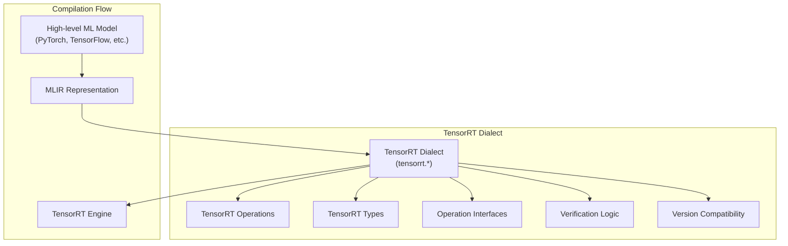
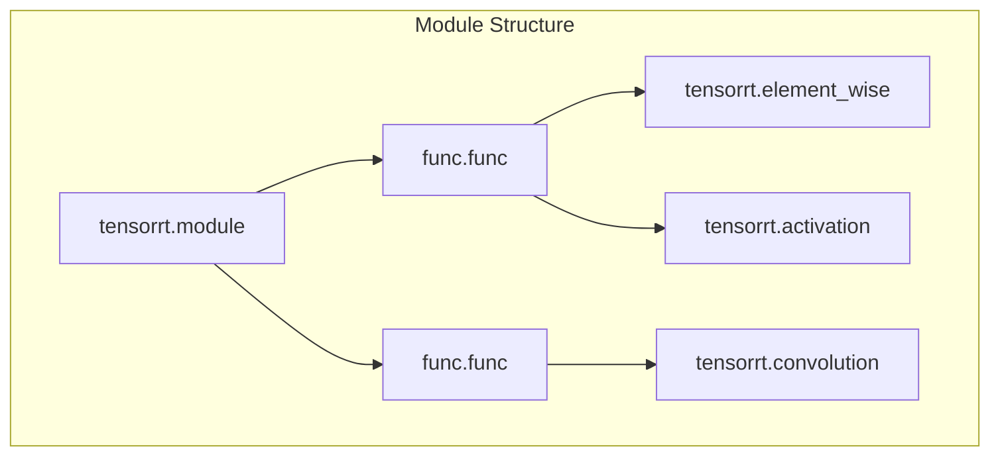
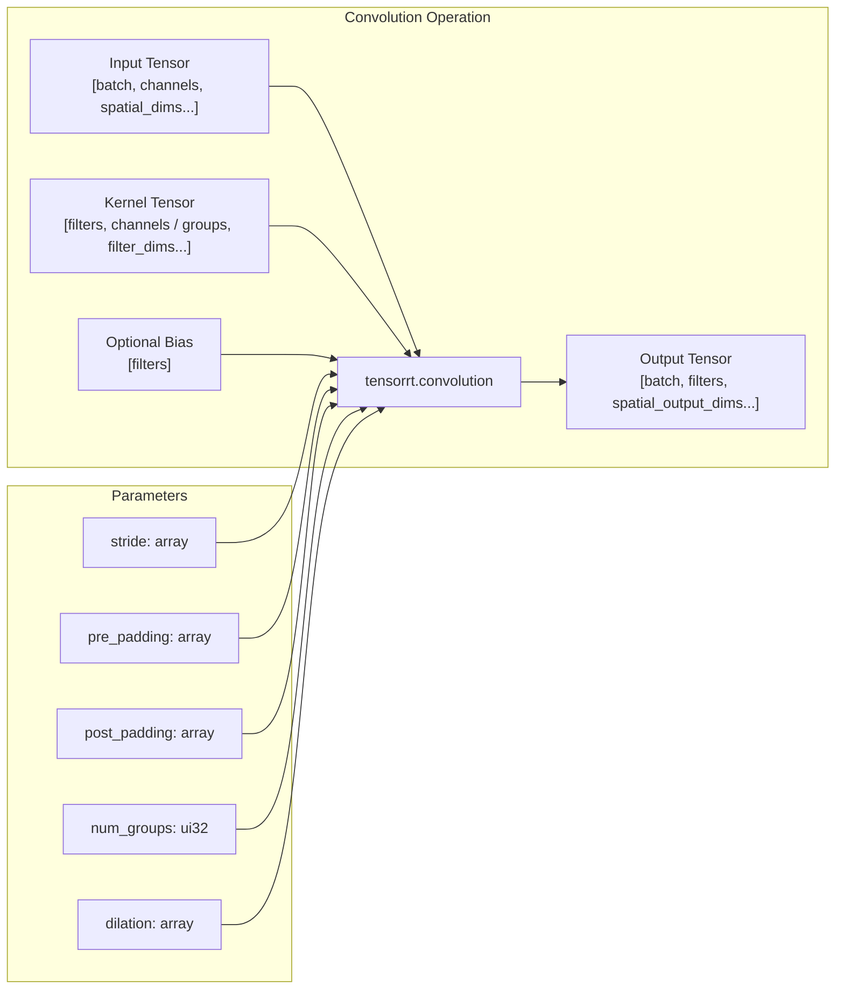
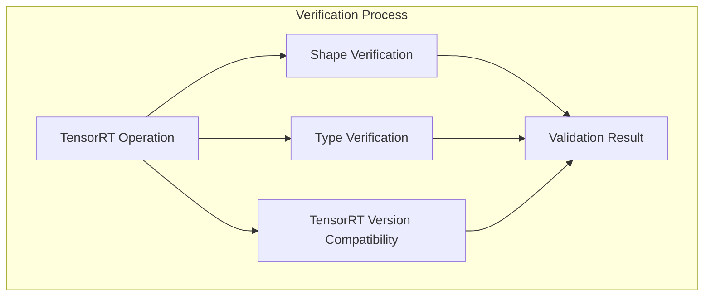
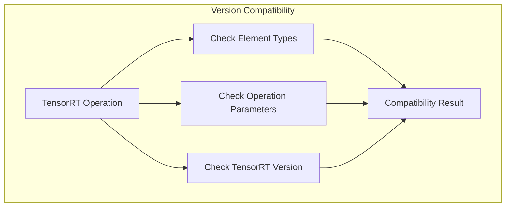

<!-- source: DeepWiki mcp.deepwiki.com · repo NVIDIA/TensorRT-Incubator · page 4.1 TensorRT Dialect · fetched 2026-10-26 -->

# TensorRT Dialect

<details>
<summary>Relevant source files</summary>

The following files were used as context for generating this wiki page:

- [mlir-tensorrt/tensorrt/include/mlir-tensorrt-dialect/TensorRT/IR/TensorRTOps.td](mlir-tensorrt/tensorrt/include/mlir-tensorrt-dialect/TensorRT/IR/TensorRTOps.td)
- [mlir-tensorrt/tensorrt/lib/TensorRT/IR/TensorRTVersionCompatibility.cpp](mlir-tensorrt/tensorrt/lib/TensorRT/IR/TensorRTVersionCompatibility.cpp)
- [mlir-tensorrt/tensorrt/lib/TensorRT/IR/TypeInferenceInterfaceImpls.cpp](mlir-tensorrt/tensorrt/lib/TensorRT/IR/TypeInferenceInterfaceImpls.cpp)
- [mlir-tensorrt/tensorrt/lib/TensorRT/IR/Verification.cpp](mlir-tensorrt/tensorrt/lib/TensorRT/IR/Verification.cpp)
- [mlir-tensorrt/tensorrt/lib/Utils/ShapeUtils.cpp](mlir-tensorrt/tensorrt/lib/Utils/ShapeUtils.cpp)
- [mlir-tensorrt/tensorrt/test/Dialect/TensorRT/invalid.mlir](mlir-tensorrt/tensorrt/test/Dialect/TensorRT/invalid.mlir)
- [mlir-tensorrt/tensorrt/test/Dialect/TensorRT/quantization.mlir](mlir-tensorrt/tensorrt/test/Dialect/TensorRT/quantization.mlir)
- [mlir-tensorrt/tensorrt/test/Dialect/TensorRT/roundtrip.mlir](mlir-tensorrt/tensorrt/test/Dialect/TensorRT/roundtrip.mlir)
- [mlir-tensorrt/tensorrt/test/Target/TensorRT/TRT10/pooling.mlir](mlir-tensorrt/tensorrt/test/Target/TensorRT/TRT10/pooling.mlir)
- [mlir-tensorrt/tensorrt/test/Target/TensorRT/TRT10/unary.mlir](mlir-tensorrt/tensorrt/test/Target/TensorRT/TRT10/unary.mlir)
- [mlir-tensorrt/tensorrt/test/Target/TensorRT/cast.mlir](mlir-tensorrt/tensorrt/test/Target/TensorRT/cast.mlir)
- [mlir-tensorrt/tensorrt/test/Target/TensorRT/resize.mlir](mlir-tensorrt/tensorrt/test/Target/TensorRT/resize.mlir)

</details>


The TensorRT Dialect is a specialized MLIR (Multi-Level Intermediate Representation) dialect that provides a representation of NVIDIA TensorRT operations and serves as a bridge between high-level ML frameworks and the TensorRT runtime. This document describes the structure and functionality of the TensorRT Dialect, including its operations, type system, and interfaces. For information about how it integrates with the broader MLIR-TensorRT project, see [MLIR-TensorRT Project](#1.2).

## Dialect Overview

The TensorRT Dialect defines MLIR operations that correspond to TensorRT's network layer operations. It serves as an intermediate representation that enables effective compilation from higher-level frameworks (like PyTorch through Tripy) to optimized TensorRT engines.



Sources: [mlir-tensorrt/tensorrt/include/mlir-tensorrt-dialect/TensorRT/IR/TensorRTOps.td:1-79](mlir-tensorrt/tensorrt/include/mlir-tensorrt-dialect/TensorRT/IR/TensorRTOps.td:1-79)

## Core Operations

The TensorRT Dialect defines a range of operations that map to TensorRT's layer types. Each operation has a defined interface, verification rules, and version compatibility checks.

### Module Operation

The `tensorrt.module` operation is the top-level container for functions describing TensorRT programs. Each `func.func` within a TensorRT module typically compiles to a single TensorRT engine.



Sources: [mlir-tensorrt/tensorrt/include/mlir-tensorrt-dialect/TensorRT/IR/TensorRTOps.td:40-79](mlir-tensorrt/tensorrt/include/mlir-tensorrt-dialect/TensorRT/IR/TensorRTOps.td:40-79)

### Call Operations

The dialect provides two call operations:
- `tensorrt.call`: Calls a TensorRT engine defined in a `tensorrt.module` with explicit inputs and outputs
- `tensorrt.call_alloc`: Similar to `call` but also handles output tensor allocation

These operations enable invoking TensorRT engines from within the MLIR framework.

Sources: [mlir-tensorrt/tensorrt/include/mlir-tensorrt-dialect/TensorRT/IR/TensorRTOps.td:82-203](mlir-tensorrt/tensorrt/include/mlir-tensorrt-dialect/TensorRT/IR/TensorRTOps.td:82-203)

## Tensor Operations

The TensorRT Dialect defines a comprehensive set of tensor operations that correspond to TensorRT's layers.

### Element-wise Operations

The `tensorrt.element_wise` operation performs binary operations on tensor elements with broadcast semantics. It supports operations like:
- Addition (`kSUM`)
- Multiplication (`kPROD`)
- Division (`kDIV`)
- Comparison (`kGREATER`, `kLESS`, `kEQUAL`)
- Logical operations (`kAND`, `kOR`, `kXOR`)

Each operation has specific type constraints, such as boolean operations requiring boolean inputs and producing boolean outputs.

Sources: [mlir-tensorrt/tensorrt/include/mlir-tensorrt-dialect/TensorRT/IR/TensorRTOps.td:308-382](mlir-tensorrt/tensorrt/include/mlir-tensorrt-dialect/TensorRT/IR/TensorRTOps.td:308-382), [mlir-tensorrt/tensorrt/lib/TensorRT/IR/Verification.cpp:633-705](mlir-tensorrt/tensorrt/lib/TensorRT/IR/Verification.cpp:633-705)

### Unary Operations

The `tensorrt.unary` operation applies a single operation to each element of the input tensor. Supported operations include:
- Mathematical functions (`kEXP`, `kLOG`, `kSQRT`, etc.)
- Sign operations (`kABS`, `kNEG`, `kSIGN`)
- Trigonometric functions (`kSIN`, `kCOS`, etc.)
- Logical operations (`kNOT`)

Sources: [mlir-tensorrt/tensorrt/include/mlir-tensorrt-dialect/TensorRT/IR/TensorRTOps.td:268-308](mlir-tensorrt/tensorrt/include/mlir-tensorrt-dialect/TensorRT/IR/TensorRTOps.td:268-308), [mlir-tensorrt/tensorrt/lib/TensorRT/IR/TensorRTVersionCompatibility.cpp:72-127](mlir-tensorrt/tensorrt/lib/TensorRT/IR/TensorRTVersionCompatibility.cpp:72-127)

### Activation Operations

The `tensorrt.activation` operation models activation functions with parametric control via `alpha` and `beta` parameters. Supported activations include:
- ReLU
- Sigmoid
- Tanh
- ELU
- GELU
- and others

Sources: [mlir-tensorrt/tensorrt/include/mlir-tensorrt-dialect/TensorRT/IR/TensorRTOps.td:208-264](mlir-tensorrt/tensorrt/include/mlir-tensorrt-dialect/TensorRT/IR/TensorRTOps.td:208-264), [mlir-tensorrt/tensorrt/lib/TensorRT/IR/Verification.cpp:474-512](mlir-tensorrt/tensorrt/lib/TensorRT/IR/Verification.cpp:474-512)

### Convolution

The `tensorrt.convolution` operation represents 2D or 3D convolutions with configurable parameters for stride, padding, dilation, and groups.



Sources: [mlir-tensorrt/tensorrt/include/mlir-tensorrt-dialect/TensorRT/IR/TensorRTOps.td:522-624](mlir-tensorrt/tensorrt/include/mlir-tensorrt-dialect/TensorRT/IR/TensorRTOps.td:522-624), [mlir-tensorrt/tensorrt/lib/TensorRT/IR/Verification.cpp:414-473](mlir-tensorrt/tensorrt/lib/TensorRT/IR/Verification.cpp:414-473)

### Other Key Operations

- **Pooling**: Supports various pooling types (max, average, max-average blend)
- **Concatenation**: Combines tensors along a specified axis
- **Reshape**: Restructures the dimensions of a tensor
- **Cast**: Converts between data types
- **Constant**: Represents constant tensor values
- **Gather Operations**: Includes `gather`, `gather_nd`, and `gather_elements` for different tensor index access patterns
- **Einsum**: Implements Einstein summation convention for tensor contractions

Sources: [mlir-tensorrt/tensorrt/include/mlir-tensorrt-dialect/TensorRT/IR/TensorRTOps.td:386-990](mlir-tensorrt/tensorrt/include/mlir-tensorrt-dialect/TensorRT/IR/TensorRTOps.td:386-990)

## Type System and Verification

The TensorRT Dialect enforces a strict type system to ensure compatibility with TensorRT's requirements. This includes:

1. **Data Type Validation**: Each operation has constraints on allowed element types
2. **Shape Validation**: Ensures tensor shapes are compatible for operations
3. **Broadcasting Rules**: Enforces TensorRT's broadcasting semantics
4. **TensorRT Version Compatibility**: Checks if operations are supported in different TensorRT versions

The verification logic ensures that operations have valid parameters and follow TensorRT's constraints.



Sources: [mlir-tensorrt/tensorrt/lib/TensorRT/IR/Verification.cpp:1-100](mlir-tensorrt/tensorrt/lib/TensorRT/IR/Verification.cpp:1-100), [mlir-tensorrt/tensorrt/lib/TensorRT/IR/TensorRTVersionCompatibility.cpp:1-60](mlir-tensorrt/tensorrt/lib/TensorRT/IR/TensorRTVersionCompatibility.cpp:1-60)

## Type Inference

The TensorRT Dialect implements robust type inference to determine output shapes and types based on input types and operation parameters. This is crucial for:

1. Static analysis of network structures
2. Validation of model correctness
3. Optimization opportunities

The inference system handles both static and dynamic shapes, with special handling for operations with broadcasting semantics.

Sources: [mlir-tensorrt/tensorrt/lib/TensorRT/IR/TypeInferenceInterfaceImpls.cpp:1-100](mlir-tensorrt/tensorrt/lib/TensorRT/IR/TypeInferenceInterfaceImpls.cpp:1-100)

## Broadcasting Semantics

Many TensorRT operations support tensor broadcasting, which allows operations between tensors of different shapes. The rules are:

1. Input tensors must have the same rank
2. For each dimension, their lengths must match, or one of them must be 1
3. The output tensor has the same rank, with dimension sizes being the maximum of the input sizes

For example:
```
tensor<10x1xf32> + tensor<1x5xf32> = tensor<10x5xf32>
```

Sources: [mlir-tensorrt/tensorrt/lib/Utils/ShapeUtils.cpp:32-82](mlir-tensorrt/tensorrt/lib/Utils/ShapeUtils.cpp:32-82)

## Version Compatibility

The TensorRT Dialect includes mechanisms to check if operations are compatible with specific TensorRT versions. This ensures that models can be correctly deployed to systems with different TensorRT versions.

Each operation implements a `isValidForTensorRTVersion` method that checks if the operation with its specific parameters is supported in a given TensorRT version.



Sources: [mlir-tensorrt/tensorrt/lib/TensorRT/IR/TensorRTVersionCompatibility.cpp:50-100](mlir-tensorrt/tensorrt/lib/TensorRT/IR/TensorRTVersionCompatibility.cpp:50-100)

## Integration with MLIR

The TensorRT Dialect integrates with the MLIR framework through several interfaces:

1. **OpInterface**: Defines common behavior for TensorRT operations
2. **InferTypeOpInterface**: Enables output type inference
3. **SymbolUserOpInterface**: Handles symbol references for calls
4. **DestinationStyleOpInterface**: Manages in-place tensor operations

This integration allows TensorRT operations to be part of standard MLIR compilation pipelines and interact with other MLIR dialects.

## Example Operation

Below is an example of a `tensorrt.convolution` operation in MLIR syntax:

```
%result = tensorrt.convolution {
  stride = array<i64: 1, 1>,
  pre_padding = array<i64: 1, 1>,
  post_padding = array<i64: 1, 1>,
  num_groups = 1 : ui32
} in(%input : tensor<1x32x28x28xf32>) 
  kernel(%weights : tensor<64x32x3x3xf32>) 
  bias(%bias : tensor<64xf32>) -> tensor<1x64x28x28xf32>
```

This represents a 2D convolution with a 3x3 kernel, 32 input channels, 64 output channels, stride of 1, and padding of 1 on all sides.

## Quantization Support

The TensorRT Dialect includes operations for quantization and dequantization:

- `tensorrt.quantize`: Converts floating-point tensors to quantized formats
- `tensorrt.dequantize`: Converts quantized tensors back to floating-point

These operations support per-tensor and per-axis quantization with configurable scales.

Sources: [mlir-tensorrt/tensorrt/test/Dialect/TensorRT/quantization.mlir:1-96](mlir-tensorrt/tensorrt/test/Dialect/TensorRT/quantization.mlir:1-96)

## Conclusion

The TensorRT Dialect provides a comprehensive representation of TensorRT operations within the MLIR framework. It enables:

1. Representation of TensorRT computation graphs
2. Type and shape checking
3. Transformation and optimization of models
4. Generation of optimized TensorRT engines

By bridging the gap between high-level ML frameworks and TensorRT, the dialect facilitates deployment of optimized deep learning models on NVIDIA hardware.

---

