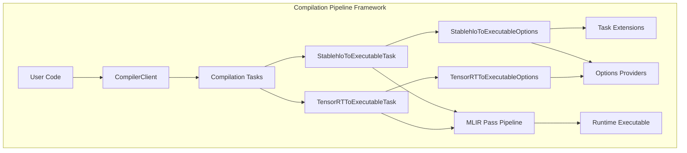
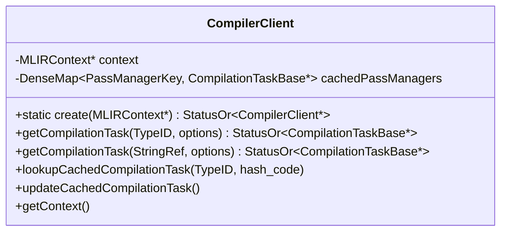
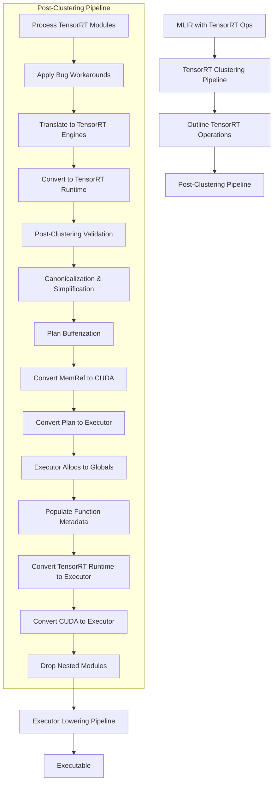
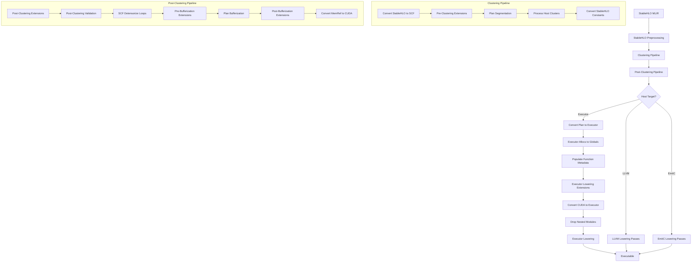
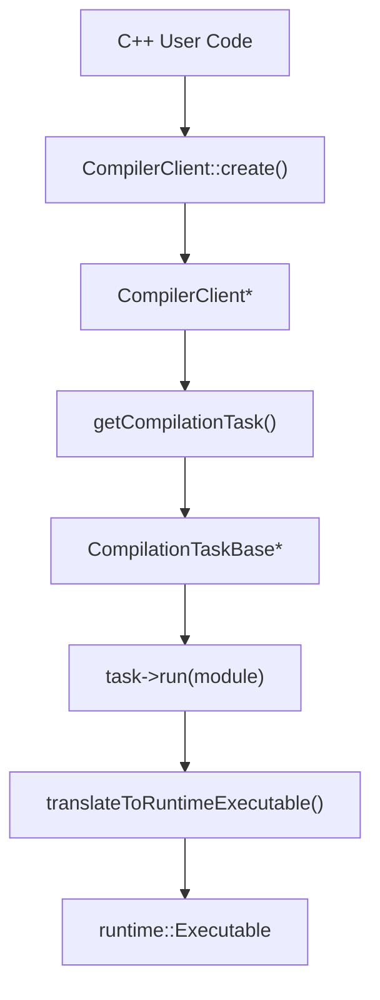
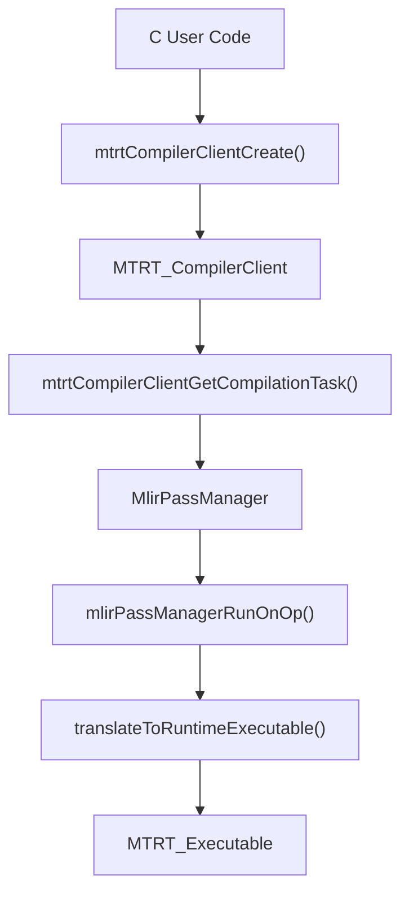
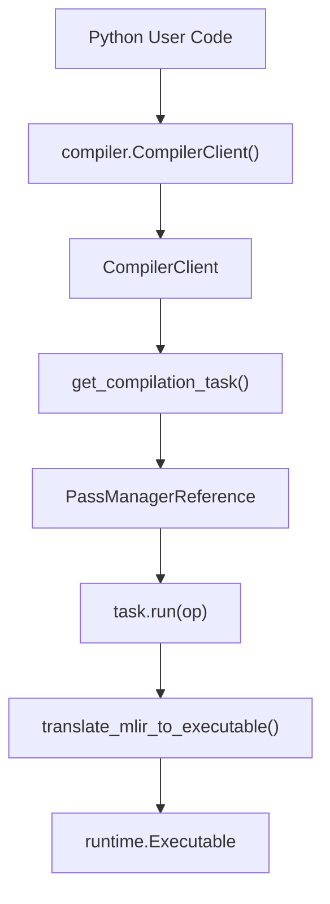

<!-- source: DeepWiki mcp.deepwiki.com · repo NVIDIA/TensorRT-Incubator · page 4.2 Compilation Pipelines · fetched 2026-10-26 -->

# Compilation Pipelines

<details>
<summary>Relevant source files</summary>

The following files were used as context for generating this wiki page:

- [mlir-tensorrt/compiler/include/mlir-tensorrt-c/Compiler/Compiler.h](mlir-tensorrt/compiler/include/mlir-tensorrt-c/Compiler/Compiler.h)
- [mlir-tensorrt/compiler/include/mlir-tensorrt/Compiler/Client.h](mlir-tensorrt/compiler/include/mlir-tensorrt/Compiler/Client.h)
- [mlir-tensorrt/compiler/include/mlir-tensorrt/Compiler/OptionsProviders.h](mlir-tensorrt/compiler/include/mlir-tensorrt/Compiler/OptionsProviders.h)
- [mlir-tensorrt/compiler/include/mlir-tensorrt/Compiler/StablehloToExecutable/StablehloToExecutable.h](mlir-tensorrt/compiler/include/mlir-tensorrt/Compiler/StablehloToExecutable/StablehloToExecutable.h)
- [mlir-tensorrt/compiler/include/mlir-tensorrt/Compiler/TensorRTToExecutable/TensorRTToExecutable.h](mlir-tensorrt/compiler/include/mlir-tensorrt/Compiler/TensorRTToExecutable/TensorRTToExecutable.h)
- [mlir-tensorrt/compiler/lib/CAPI/Compiler/Compiler.cpp](mlir-tensorrt/compiler/lib/CAPI/Compiler/Compiler.cpp)
- [mlir-tensorrt/compiler/lib/Compiler/StablehloToExecutable/StablehloToExecutable.cpp](mlir-tensorrt/compiler/lib/Compiler/StablehloToExecutable/StablehloToExecutable.cpp)
- [mlir-tensorrt/compiler/lib/Compiler/TensorRTToExecutable/TensorRTToExecutable.cpp](mlir-tensorrt/compiler/lib/Compiler/TensorRTToExecutable/TensorRTToExecutable.cpp)
- [mlir-tensorrt/compiler/test/python/IntegrationTests/test_tensorrt_add.py](mlir-tensorrt/compiler/test/python/IntegrationTests/test_tensorrt_add.py)
- [mlir-tensorrt/executor/lib/Support/DeviceInfo.cpp](mlir-tensorrt/executor/lib/Support/DeviceInfo.cpp)
- [mlir-tensorrt/python/bindings/Compiler/CompilerPyBind.cpp](mlir-tensorrt/python/bindings/Compiler/CompilerPyBind.cpp)

</details>


This document explains the compilation pipelines in MLIR-TensorRT, which transform high-level MLIR representations (such as TensorRT dialect operations or StableHLO code) into optimized executable formats for GPU execution. For information about the runtime system that executes these compiled models, see the [Runtime System](#4.3) documentation.

## Architecture Overview

MLIR-TensorRT's compilation system is built around a well-defined architecture that provides flexibility and extensibility for different compilation targets and input formats.



Sources: [mlir-tensorrt/compiler/include/mlir-tensorrt/Compiler/Client.h:40-307](), [mlir-tensorrt/compiler/include/mlir-tensorrt/Compiler/TensorRTToExecutable/TensorRTToExecutable.h:1-131](), [mlir-tensorrt/compiler/include/mlir-tensorrt/Compiler/StablehloToExecutable/StablehloToExecutable.h:1-158]()

### CompilationTask Model

At the core of the architecture is the `CompilationTaskBase` class, which extends MLIR's `PassManager` to encapsulate a specific compilation workflow with its associated configuration.

```mermaid
classDiagram
    PassManager <|-- CompilationTaskBase
    CompilationTaskBase <|-- "CompilationTask~DerivedTaskT, OptionsT~"
    "CompilationTask~DerivedTaskT, OptionsT~" <|-- TensorRTToExecutableTask
    "CompilationTask~DerivedTaskT, OptionsT~" <|-- StablehloToExecutableTask
    
    CompilationTaskBase o-- "CompilationTaskOptionsBase" : configures
    "CompilationTask~DerivedTaskT, OptionsT~" o-- "OptionsT" : uses
    
    class PassManager {
        +addPass()
        +addNestedPass()
        +run()
    }
    
    class CompilationTaskBase {
        -TypeID typeID
        -CompilationTaskOptionsBase* taskOptions
        +getTypeID()
        +getTaskOptions()
        +setupPassManagerInstrumentation()
    }
    
    class "CompilationTask~DerivedTaskT, OptionsT~" {
        +static populatePassManager()
        +getOptions()
    }
    
    class TensorRTToExecutableTask {
        +buildTensorRTClusteringPipeline()
        +buildPostClusteringPipeline()
        +populatePassManager()
    }
    
    class StablehloToExecutableTask {
        +buildClusteringPipeline()
        +buildPostClusteringPipeline()
        +populatePassManager()
        +compileStableHLOToExecutable()
    }
```

Sources: [mlir-tensorrt/compiler/include/mlir-tensorrt/Compiler/Client.h:54-100]()

### CompilerClient

The `CompilerClient` class serves as a factory and cache for compilation tasks. It manages the creation, caching, and execution of compilation tasks, allowing for efficient reuse of compiled pipelines.



Sources: [mlir-tensorrt/compiler/include/mlir-tensorrt/Compiler/Client.h:114-207]()

### Options Providers

The compilation system uses a composable options pattern where task options are built from multiple option providers, each contributing a set of related options.

```mermaid
classDiagram
    direction TB
    CompilationTaskOptionsBase <|-- "CompilationTaskOptions~Providers...~"
    OptionsProvider <|-- DebugOptions
    OptionsProvider <|-- ExecutorOptions
    OptionsProvider <|-- DeviceOptions
    OptionsProvider <|-- PlanAllocOptions
    OptionsProvider <|-- TensorRTOptions
    
    "CompilationTaskOptions~Providers...~" o-- "tuple~unique_ptr~Providers...~~" : contains
    
    class OptionsProvider {
        -PassOptions& ctx
        +virtual finalize() Error
        +Option~T~ variable
    }
    
    class DebugOptions {
        +printBeforeAll: bool
        +printAfterAll: bool
        +enableTiming: bool
        +reproducerFile: string
    }
    
    class ExecutorOptions {
        +indexBitwidth: int64_t
        +usePackedMemRefCConv: bool
    }
    
    class DeviceOptions {
        +computeCapability: int64_t
        +maxSharedMemoryPerBlockKb: int64_t
        +maxRegistersPerBlock: uint64_t
        +shouldInferFromHost: bool
    }
    
    class PlanAllocOptions {
        +forceEntrypointsReturnAllocs: bool
    }
    
    class TensorRTOptions {
        +timingCachePath: string
        +tensorrtBuilderOptLevel: int
        +enableStronglyTyped: bool
        +workspaceMemoryPoolLimit: optional~uint64_t~
        +format: TensorRTTargetFormat
    }
```

Sources: [mlir-tensorrt/compiler/include/mlir-tensorrt/Compiler/OptionsProviders.h:37-371]()

## TensorRTToExecutable Pipeline

The `TensorRTToExecutable` pipeline transforms MLIR code containing TensorRT dialect operations into an executable format suitable for runtime execution.

### Options and Configuration

The `TensorRTToExecutableOptions` class combines several option providers to configure the pipeline:

```mermaid
classDiagram
    "CompilationTaskOptions~DeviceOptions, ExecutorOptions, PlanAllocOptions, TensorRTOptions~" <|-- TensorRTToExecutableOptions
    
    class TensorRTToExecutableOptions {
    }
    
    class TensorRTOptions {
        +timingCachePath: string
        +tensorrtBuilderOptLevel: int
        +enableStronglyTyped: bool
        +saveTensorRTEnginesToDirectory: string
        +format: TensorRTTargetFormat
        +forceDefaultSliceInBounds: bool
    }
```

Sources: [mlir-tensorrt/compiler/include/mlir-tensorrt/Compiler/TensorRTToExecutable/TensorRTToExecutable.h:41-95]()

### Pipeline Phases

The `TensorRTToExecutable` pipeline consists of two main phases:

1. **TensorRT Clustering**: Outlines TensorRT operations into dedicated modules
2. **Post-Clustering Pipeline**: Transforms and lowers the outlined TensorRT operations to executable form



Sources: [mlir-tensorrt/compiler/lib/Compiler/TensorRTToExecutable/TensorRTToExecutable.cpp:45-122]()

## StablehloToExecutable Pipeline

The `StablehloToExecutable` pipeline converts StableHLO operations to an executable format, with the ability to offload operations to TensorRT for GPU acceleration.

### Options and Extensions

The `StablehloToExecutableOptions` class provides the configuration for this pipeline with a unique extension system allowing customization at different phases.

```mermaid
classDiagram
    "CompilationTaskOptions~ExecutorOptions, DeviceOptions, PlanAllocOptions~" <|-- StablehloToExecutableOptions
    StablehloToExecutableOptions *-- "TaskExtensionRegistry" extensions
    StablehloToExecutableOptions::ExtensionBase <|-- StablehloToExecutableTensorRTExtension
    
    class StablehloToExecutableOptions {
        +disallowHostTensorsInTensorRTClusters: bool
        +class ExtensionBase
        +class Extension~DerivedTy~
    }
    
    class StablehloToExecutableOptions::ExtensionBase {
        <<abstract>>
        +enum Phase
        +populatePasses(OpPassManager, Phase, Options)
    }
    
    class Phase {
        <<enumeration>>
        PreClustering
        PostClustering
        PreBufferization
        PostBufferization
        ExecutorLowering
    }
```

Sources: [mlir-tensorrt/compiler/include/mlir-tensorrt/Compiler/StablehloToExecutable/StablehloToExecutable.h:53-98]()

### Pipeline Phases

The main phases of the StablehloToExecutable pipeline are:



Sources: [mlir-tensorrt/compiler/lib/Compiler/StablehloToExecutable/StablehloToExecutable.cpp:104-241]()

## API Interfaces

The compilation pipelines can be accessed through multiple API interfaces, making them accessible from different languages and environments.

### C++ API

The native C++ API provides direct access to the compilation pipeline through the `CompilerClient` class.



Sources: [mlir-tensorrt/compiler/include/mlir-tensorrt/Compiler/Client.h:114-148](), [mlir-tensorrt/compiler/lib/Compiler/StablehloToExecutable/StablehloToExecutable.cpp:243-300]()

### C API

A C API provides language-interoperability through the `MTRT_CompilerClient` interface.



Sources: [mlir-tensorrt/compiler/include/mlir-tensorrt-c/Compiler/Compiler.h:41-57](), [mlir-tensorrt/compiler/lib/CAPI/Compiler/Compiler.cpp:71-119]()

### Python Bindings

Python bindings provide a high-level interface for Python applications.



Sources: [mlir-tensorrt/python/bindings/Compiler/CompilerPyBind.cpp:44-262](), [mlir-tensorrt/compiler/test/python/IntegrationTests/test_tensorrt_add.py:19-30]()

## Usage Example

Here's an example of using the TensorRTToExecutable pipeline through the Python API:

```python
# Parse or create an MLIR module with TensorRT operations
with ir.Context() as context:
    m = ir.Module.parse(ASM)  # ASM contains TensorRT dialect operations
    
    # Create a compiler client
    client = compiler.CompilerClient(context)
    
    # Get a TensorRTToExecutable compilation task with specific options
    task = client.get_compilation_task(
        "tensorrt-to-executable",
        [
            "--tensorrt-builder-opt-level=0",
            "--tensorrt-strongly-typed=true",
            "--tensorrt-workspace-memory-pool-limit=1024kB",
            "--force-entrypoints-return-allocs",
        ],
    )
    
    # Run the compilation task on the module
    task.run(m.operation)
    
    # Translate the compiled module to an executable
    exe = compiler.translate_mlir_to_executable(m.operation)
    
    # The executable can now be executed using the runtime API
```

Sources: [mlir-tensorrt/compiler/test/python/IntegrationTests/test_tensorrt_add.py:19-41]()

## Summary

The compilation pipelines in MLIR-TensorRT provide a robust system for transforming high-level MLIR representations into optimized executables for GPU execution. The architecture allows for flexible configuration through options providers and extension points, while the client abstraction provides efficient caching and management of compilation tasks.

The two main pipelines, `TensorRTToExecutable` and `StablehloToExecutable`, handle different input dialects but share a common infrastructure for configuration, extension, and lowering to executable format. Multiple API interfaces (C++, C, and Python) make these pipelines accessible from different languages and environments.

---

