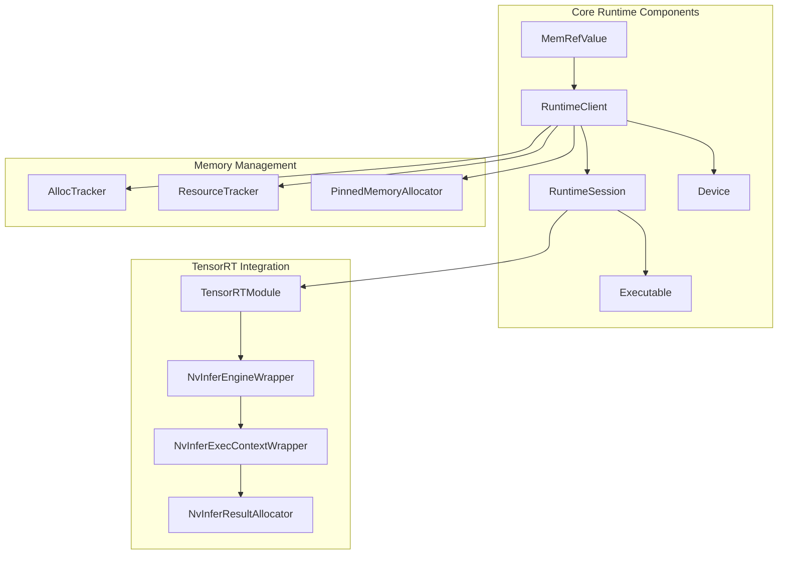
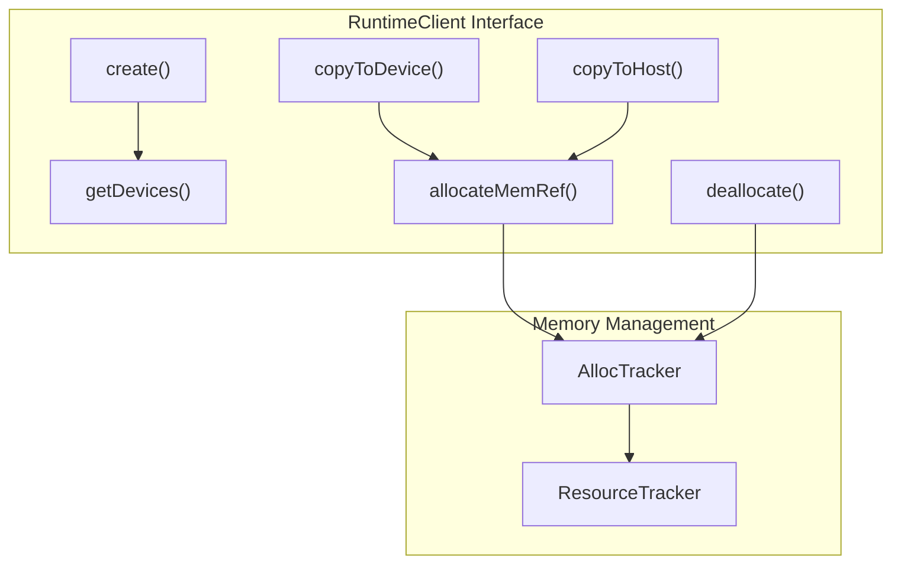
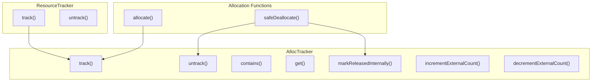
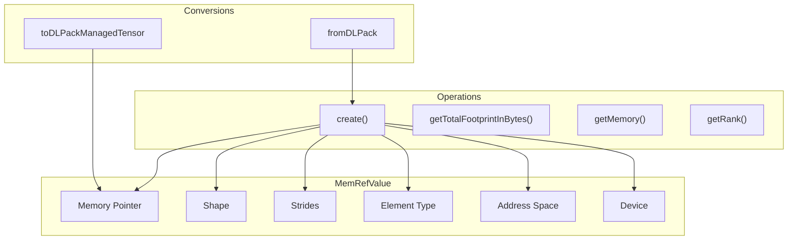
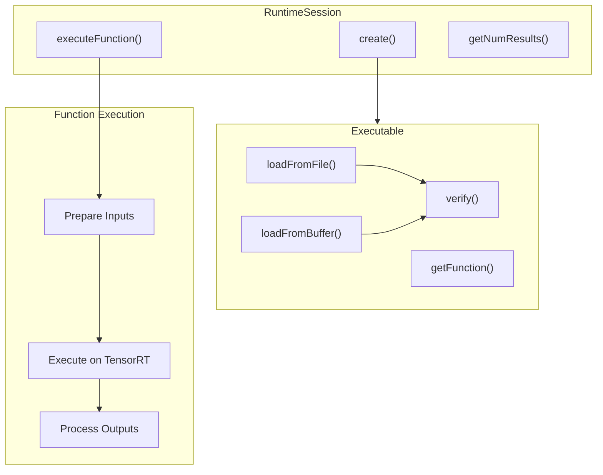
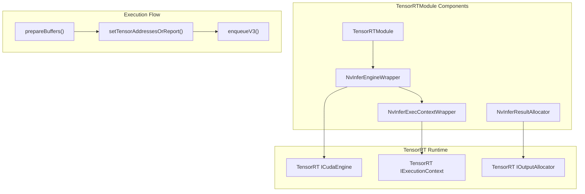
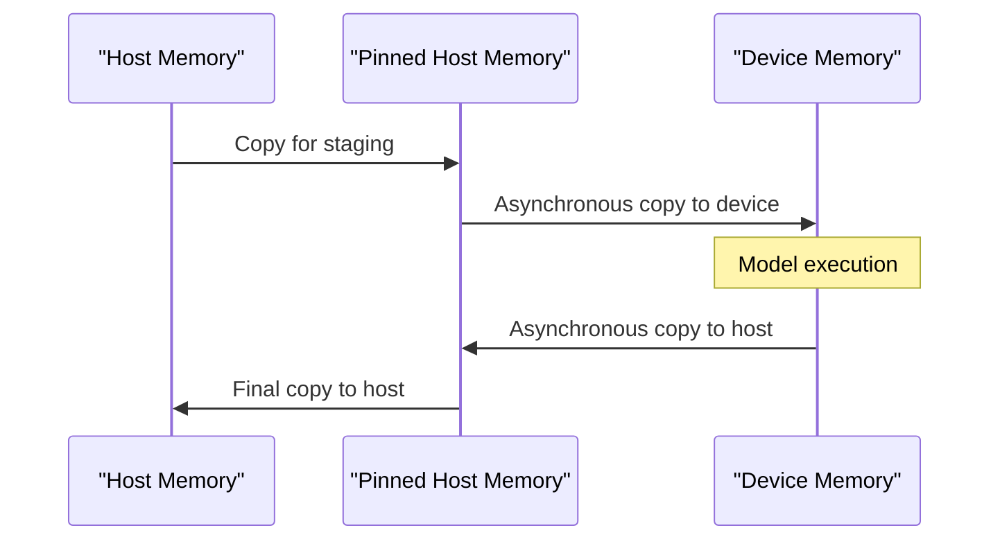
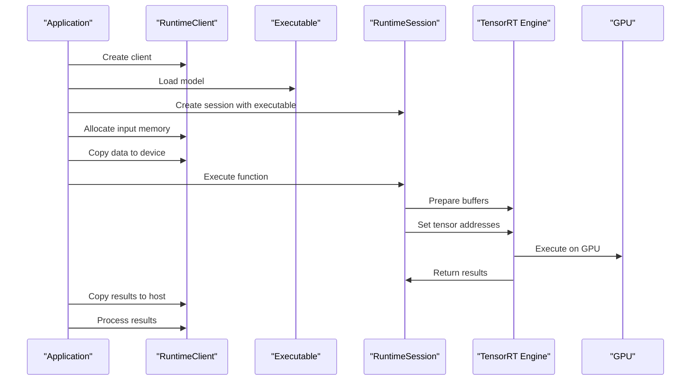

<!-- source: DeepWiki mcp.deepwiki.com · repo NVIDIA/TensorRT-Incubator · page 4.3 Runtime System · fetched 2026-10-26 -->

# Runtime System

Relevant source files

The following files were used as context for generating this wiki page:

- [mlir-tensorrt/compiler/test/python/mlir_tensorrt_runtime/test_runtime_api.py](mlir-tensorrt/compiler/test/python/mlir_tensorrt_runtime/test_runtime_api.py)
- [mlir-tensorrt/executor/include/mlir-executor-c/Runtime/Runtime.h](mlir-tensorrt/executor/include/mlir-executor-c/Runtime/Runtime.h)
- [mlir-tensorrt/executor/include/mlir-executor/Runtime/API/API.h](mlir-tensorrt/executor/include/mlir-executor/Runtime/API/API.h)
- [mlir-tensorrt/executor/lib/CAPI/Runtime/Runtime.cpp](mlir-tensorrt/executor/lib/CAPI/Runtime/Runtime.cpp)
- [mlir-tensorrt/executor/lib/Runtime/API/API.cpp](mlir-tensorrt/executor/lib/Runtime/API/API.cpp)
- [mlir-tensorrt/executor/lib/Runtime/Backend/Lua/Modules/TensorRT/CMakeLists.txt](mlir-tensorrt/executor/lib/Runtime/Backend/Lua/Modules/TensorRT/CMakeLists.txt)
- [mlir-tensorrt/executor/lib/Runtime/Backend/Lua/Modules/TensorRT/TensorRTModule.cpp](mlir-tensorrt/executor/lib/Runtime/Backend/Lua/Modules/TensorRT/TensorRTModule.cpp)
- [mlir-tensorrt/python/bindings/Runtime/RuntimePyBind.cpp](mlir-tensorrt/python/bindings/Runtime/RuntimePyBind.cpp)

The Runtime System in MLIR-TensorRT is responsible for managing the execution of compiled models on GPUs using NVIDIA TensorRT. It handles memory management, device interactions, execution contexts, and integration with the TensorRT backend. This page documents the architecture and key components of the runtime system, focusing on how these components interact to execute compiled models efficiently.

For information about compilation pipelines that generate executables for this runtime system, see [Compilation Pipelines](#4.2).

## Architecture Overview

The runtime system consists of several key components that work together to provide efficient execution of TensorRT models.

Sources: [mlir-tensorrt/executor/lib/Runtime/API/API.cpp:928-946](), [mlir-tensorrt/executor/lib/Runtime/API/API.cpp:360-367](), [mlir-tensorrt/executor/lib/Runtime/Backend/Lua/Modules/TensorRT/TensorRTModule.cpp:94-107]()

## Runtime Client

The `RuntimeClient` serves as the primary entry point to the runtime system. It manages devices, allocates memory, and orchestrates execution between host and device.

Key responsibilities of the `RuntimeClient`:

1. **Device Management**: Discover and interact with available CUDA devices
2. **Memory Allocation**: Create and manage memory for tensors in both host and device memory
3. **Data Transfer**: Copy data between host and device memory spaces
4. **Resource Tracking**: Track allocations to prevent leaks and ensure proper cleanup

Sources: [mlir-tensorrt/executor/lib/Runtime/API/API.cpp:930-945](), [mlir-tensorrt/executor/lib/Runtime/API/API.cpp:947-952](), [mlir-tensorrt/python/bindings/Runtime/RuntimePyBind.cpp:169-176]()

## Memory Management System

Memory management is a critical component of the runtime system, handling various memory types and ensuring proper allocation, tracking, and deallocation.

### Memory Types

The runtime system supports several memory types:

| Memory Type | Description | Usage |
|-------------|-------------|-------|
| `host` | Standard CPU memory | Input/output tensors, host computation |
| `pinned_host` | Page-locked host memory | Efficient host-device transfers |
| `device` | GPU device memory | Model execution, GPU computation |
| `unified` | Unified memory (CUDA) | Automatic memory migration between host and device |

### Memory Tracking Components

The memory management system consists of these key components:

1. **AllocTracker**: Keeps track of all allocations, whether internal or external, allowing for safer deallocation and preventing memory leaks.
2. **ResourceTracker**: Manages non-memory resources like CUDA streams and events, ensuring proper cleanup.
3. **PinnedMemoryAllocator**: Handles page-locked memory for efficient host-device transfers.

Sources: [mlir-tensorrt/executor/lib/Runtime/API/API.cpp:370-484](), [mlir-tensorrt/executor/lib/Runtime/API/API.cpp:588-647](), [mlir-tensorrt/executor/lib/Runtime/API/API.cpp:732-748]()

## MemRefValue

`MemRefValue` is a core abstraction representing memory references for tensors. It encapsulates all the information needed to access tensor data:

Key characteristics:
- Represents tensors with arbitrary shape and data type
- Supports different memory spaces (host, device, unified)
- Can be created from and converted to DLPack tensors for interoperability
- Includes utilities for calculating memory layout and requirements

Sources: [mlir-tensorrt/executor/lib/Runtime/API/API.cpp:825-891](), [mlir-tensorrt/executor/lib/Runtime/API/API.cpp:763-781]()

## Executable and RuntimeSession

The `Executable` represents compiled code that can be loaded and executed, while the `RuntimeSession` provides the execution context.

Key aspects:
- `Executable` contains serialized TensorRT engines and metadata
- `RuntimeSession` binds an executable to execution resources
- Sessions manage the lifecycle of execution contexts
- Supports multiple function entry points within a single executable

Sources: [mlir-tensorrt/executor/lib/Runtime/API/API.cpp:209-281](), [mlir-tensorrt/executor/lib/Runtime/API/API.cpp:361-367]()

## TensorRT Integration

The runtime system integrates with NVIDIA TensorRT through specialized components that manage the TensorRT execution environment.

Key components:
1. **NvInferEngineWrapper**: Manages TensorRT's CUDA engine lifecycle
2. **NvInferExecContextWrapper**: Handles execution contexts for running inference
3. **NvInferResultAllocator**: Custom allocator for TensorRT outputs
4. **Lua Extension**: Integration with the Lua-based runtime framework

Sources: [mlir-tensorrt/executor/lib/Runtime/Backend/Lua/Modules/TensorRT/TensorRTModule.cpp:94-113](), [mlir-tensorrt/executor/lib/Runtime/Backend/Lua/Modules/TensorRT/TensorRTModule.cpp:362-447](), [mlir-tensorrt/executor/lib/Runtime/Backend/Lua/Modules/TensorRT/TensorRTModule.cpp:590-617]()

## Memory Transfer and Data Handling

The runtime system provides efficient data movement between host and device memory spaces, critical for deep learning workflows.

Key operations:
1. **Host to Device Transfer**: Copy input data from host to device memory
2. **Device to Host Transfer**: Copy results from device to host memory
3. **DLPack Conversion**: Convert to/from DLPack format for interoperability with other frameworks

Sources: [mlir-tensorrt/executor/lib/Runtime/API/API.cpp:650-712](), [mlir-tensorrt/executor/lib/Runtime/Backend/Lua/Modules/TensorRT/TensorRTModule.cpp:497-588]()

## Runtime API Layers

The runtime system exposes its functionality through multiple API layers:

1. **C++ API**: Native interface for C++ applications
   - Defined in [mlir-executor/Runtime/API/API.h]()
   - Provides full control over all runtime features

2. **C API**: C-compatible interface for language bindings
   - Defined in [mlir-executor-c/Runtime/Runtime.h]()
   - Enables integration with other languages and frameworks

3. **Python API**: High-level Python interface
   - Implemented in [mlir-tensorrt/python/bindings/Runtime/RuntimePyBind.cpp]()
   - Enables easy use in Python-based ML workflows

Each layer maintains consistent abstractions while adapting to the conventions and capabilities of the target language.

Sources: [mlir-tensorrt/executor/include/mlir-executor/Runtime/API/API.h:51-1225](), [mlir-tensorrt/executor/include/mlir-executor-c/Runtime/Runtime.h:54-467](), [mlir-tensorrt/python/bindings/Runtime/RuntimePyBind.cpp:552-770]()

## Execution Flow

The complete execution flow from loading a model to obtaining results:

Sources: [mlir-tensorrt/executor/lib/Runtime/API/API.cpp:414-457](), [mlir-tensorrt/executor/lib/CAPI/Runtime/Runtime.cpp:438-446](), [mlir-tensorrt/executor/lib/Runtime/Backend/Lua/Modules/TensorRT/TensorRTModule.cpp:590-691]()

## Error Handling and Resource Management

The runtime system uses a consistent error handling approach:

1. **StatusOr Template**: Returns either a result or an error status
2. **Status Objects**: Represent success or various error conditions
3. **RAII Patterns**: Ensure resources are properly cleaned up

Memory and resource management follow these principles:

1. **Reference Counting**: Track external references to ensure safe deallocation
2. **Deferred Cleanup**: Mark resources for cleanup when no longer needed
3. **Automatic Tracking**: Register all allocations with appropriate trackers

Sources: [mlir-tensorrt/executor/lib/Runtime/API/API.cpp:370-475](), [mlir-tensorrt/executor/lib/Runtime/API/API.cpp:732-748]()

## Integration with TensorRT-Incubator

This runtime system serves as the execution backend for the broader TensorRT-Incubator project, specifically supporting the MLIR-TensorRT component. It enables the execution of models compiled through the MLIR-based compilation pipelines, providing an efficient path from high-level models to optimized GPU execution.

Sources: [mlir-tensorrt/executor/lib/Runtime/Backend/Lua/Modules/TensorRT/CMakeLists.txt:1-23]()

---

