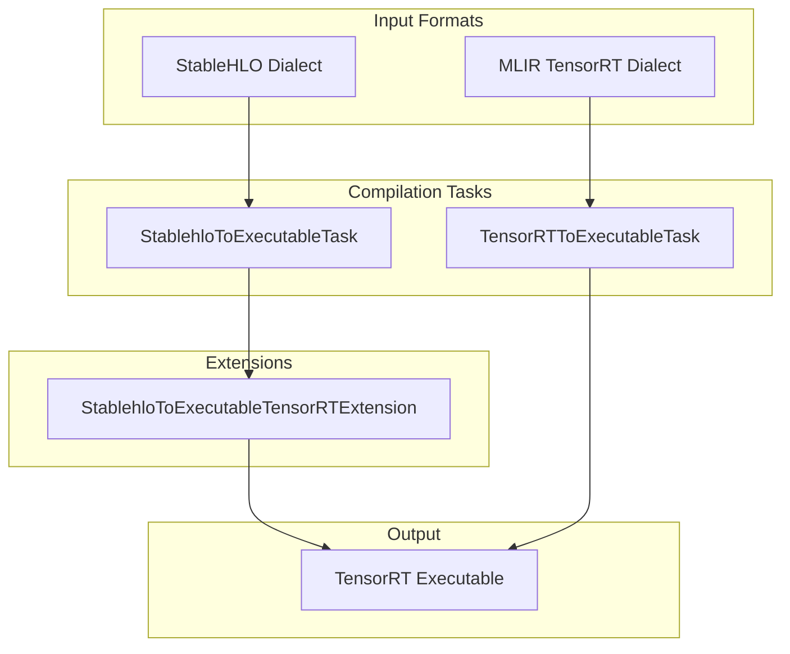
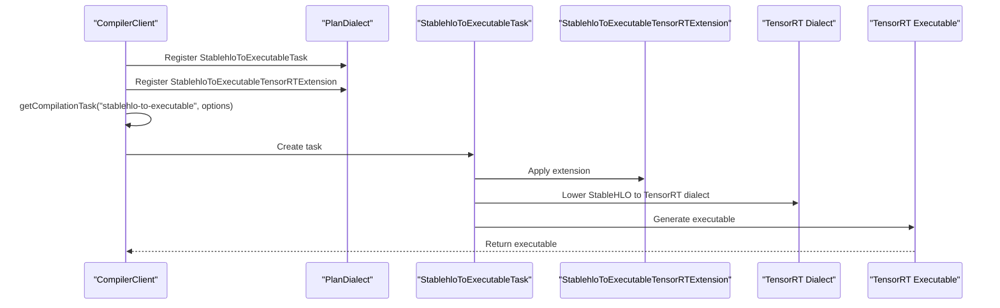
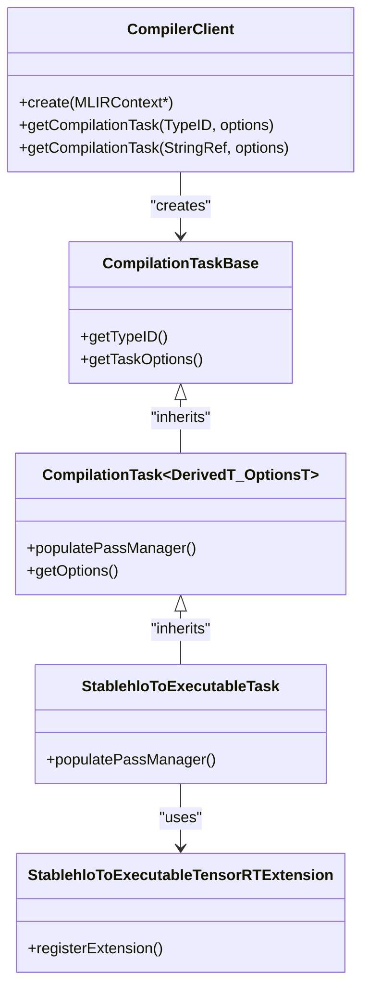
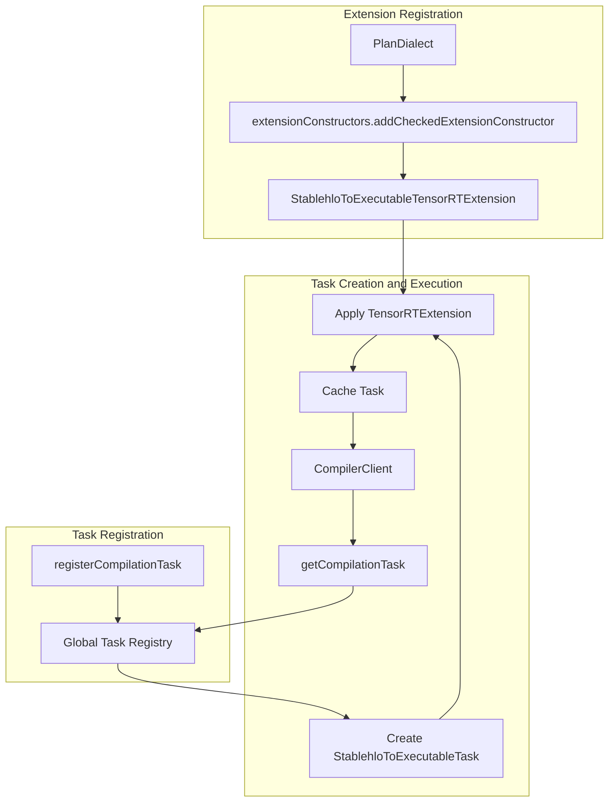
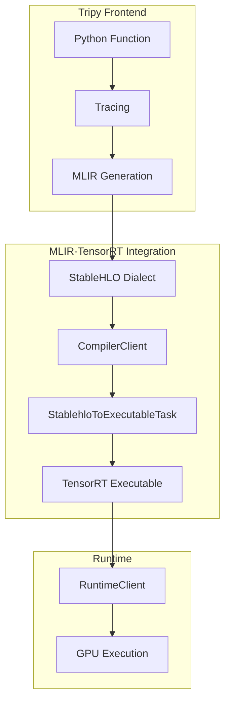
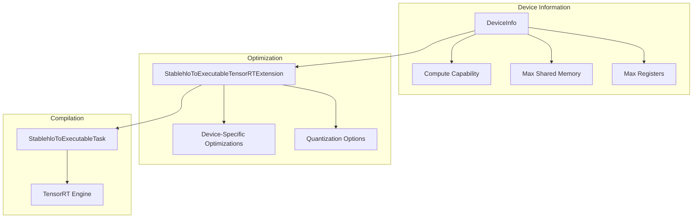

<!-- source: DeepWiki mcp.deepwiki.com · repo NVIDIA/TensorRT-Incubator · page 4.4 StableHLO Integration · fetched 2026-10-26 -->

# StableHLO Integration

<details>
<summary>Relevant source files</summary>

The following files were used as context for generating this wiki page:

- [mlir-tensorrt/compiler/include/mlir-tensorrt-c/Compiler/Compiler.h](mlir-tensorrt/compiler/include/mlir-tensorrt-c/Compiler/Compiler.h)
- [mlir-tensorrt/compiler/include/mlir-tensorrt/Compiler/Client.h](mlir-tensorrt/compiler/include/mlir-tensorrt/Compiler/Client.h)
- [mlir-tensorrt/compiler/lib/CAPI/Compiler/Compiler.cpp](mlir-tensorrt/compiler/lib/CAPI/Compiler/Compiler.cpp)
- [mlir-tensorrt/executor/lib/Support/DeviceInfo.cpp](mlir-tensorrt/executor/lib/Support/DeviceInfo.cpp)
- [mlir-tensorrt/python/bindings/Compiler/CompilerPyBind.cpp](mlir-tensorrt/python/bindings/Compiler/CompilerPyBind.cpp)

</details>


## Purpose and Scope

This document details how StableHLO models are integrated and compiled using MLIR-TensorRT. It covers the architecture, implementation, and usage of the compilation pathway from StableHLO dialect to TensorRT executables. The StableHLO integration is a key component of MLIR-TensorRT that enables efficient deployment of machine learning models on NVIDIA GPUs.

For information about the overall MLIR-TensorRT project, see [MLIR-TensorRT Project](#1.2). For details about general compilation pipelines, see [Compilation Pipelines](#4.2).

Sources:
- [mlir-tensorrt/compiler/lib/CAPI/Compiler/Compiler.cpp:32-33]()
- [mlir-tensorrt/compiler/include/mlir-tensorrt/Compiler/Client.h:20-25]()

## Architecture

### StableHLO in the MLIR-TensorRT Pipeline

The following diagram illustrates how StableHLO fits into the overall MLIR-TensorRT architecture:



The StableHLO integration enables a direct compilation path from StableHLO models to TensorRT executables. This is implemented through the `StablehloToExecutableTask` and its extension `StablehloToExecutableTensorRTExtension`.

Sources:
- [mlir-tensorrt/compiler/lib/CAPI/Compiler/Compiler.cpp:83-88]()
- [mlir-tensorrt/compiler/include/mlir-tensorrt/Compiler/Client.h:27-29]()

### Compilation Pipeline

The StableHLO compilation process follows these steps:



The compilation pipeline leverages MLIR's extensible architecture to transform StableHLO operations into TensorRT operations, and finally into an executable form.

Sources:
- [mlir-tensorrt/compiler/lib/CAPI/Compiler/Compiler.cpp:70-97]()
- [mlir-tensorrt/compiler/include/mlir-tensorrt/Compiler/Client.h:113-146]()

## Implementation

### Core Classes

The StableHLO integration is implemented through several key classes:



The integration centers around these classes:
- `CompilerClient`: Entry point for creating compilation tasks
- `CompilationTaskBase` and `CompilationTask<>`: Base classes for all compilation tasks
- `StablehloToExecutableTask`: Specialized task for StableHLO conversion
- `StablehloToExecutableTensorRTExtension`: Extension that adds TensorRT-specific functionality

Sources:
- [mlir-tensorrt/compiler/include/mlir-tensorrt/Compiler/Client.h:40-100]()
- [mlir-tensorrt/compiler/include/mlir-tensorrt/Compiler/Client.h:114-191]()
- [mlir-tensorrt/compiler/lib/CAPI/Compiler/Compiler.cpp:83-88]()

### Task Registration and Extension Mechanism

The StableHLO task is registered with the MLIR-TensorRT compiler system through a task registration mechanism and leverages extensions for TensorRT-specific functionality:



Key aspects of this mechanism:

1. The `StablehloToExecutableTask` is registered with a mnemonic ("stablehlo-to-executable")
2. The `StablehloToExecutableTensorRTExtension` is registered with the `PlanDialect`
3. When a client requests the task, it's created and cached for reuse
4. The extension is applied during task creation, adding TensorRT-specific optimizations

Sources:
- [mlir-tensorrt/compiler/lib/CAPI/Compiler/Compiler.cpp:83-88]()
- [mlir-tensorrt/compiler/include/mlir-tensorrt/Compiler/Client.h:242-305]()
- [mlir-tensorrt/compiler/lib/CAPI/Compiler/Compiler.cpp:104-119]()

## Usage

### C++ API

To use the StableHLO integration from C++:

```cpp
// Create a compiler client
auto clientOrError = CompilerClient::create(context);
auto client = clientOrError.getValue();

// Get a compilation task for StableHLO
auto taskOrError = client->getCompilationTask("stablehlo-to-executable", options, enableDebugOptions);
auto task = taskOrError.getValue();

// Run the task on a StableHLO module
mlir::LogicalResult result = task->run(moduleOp);

// The result is a module with a TensorRT executable
```

The `CompilerClient` serves as the main entry point for creating compilation tasks. It maintains a cache of tasks to avoid redundant compilation work.

Sources:
- [mlir-tensorrt/compiler/include/mlir-tensorrt/Compiler/Client.h:113-147]()

### Python API

The StableHLO integration is also accessible through Python bindings:

```python
# Create a compiler client
client = mlir_tensorrt.CompilerClient(mlir_context)

# Get a compilation task for StableHLO
task = client.get_compilation_task("stablehlo-to-executable", ["--option1", "--option2"])

# Run the task on a StableHLO module
task.run(stablehlo_module_op)

# The result can be executed with TensorRT
```

The Python API is implemented via PyBind11 wrappers around the C++ API, providing a convenient interface for Python users.

Sources:
- [mlir-tensorrt/python/bindings/Compiler/CompilerPyBind.cpp:240-261]()
- [mlir-tensorrt/python/bindings/Compiler/CompilerPyBind.cpp:263-269]()

## Integration with Tripy

The StableHLO integration is a key component that enables the Tripy/nvtripy package to efficiently convert Python functions to optimized TensorRT engines. The following diagram illustrates how StableHLO fits into the broader Tripy workflow:



The StableHLO integration provides a crucial bridge between Tripy's high-level Python interface and the low-level TensorRT execution environment, allowing for efficient deployment of models on NVIDIA GPUs.

Sources:
- [mlir-tensorrt/compiler/lib/CAPI/Compiler/Compiler.cpp:32-33]()
- [mlir-tensorrt/python/bindings/Compiler/CompilerPyBind.cpp:230-261]()

## Device-Specific Optimizations

The StableHLO to TensorRT compilation process can incorporate device-specific optimizations based on the capabilities of the target NVIDIA GPU:



The system can query device information (compute capability, available memory, etc.) to tune the compilation process for optimal performance on the target hardware.

Sources:
- [mlir-tensorrt/executor/lib/Support/DeviceInfo.cpp:35-66]()

## Summary

The StableHLO Integration in MLIR-TensorRT provides a robust compilation pathway from StableHLO models to optimized TensorRT executables. Key components include:

1. The `StablehloToExecutableTask` for converting StableHLO to executables
2. The `StablehloToExecutableTensorRTExtension` for TensorRT-specific optimizations
3. The task registration and extension mechanisms for flexible configuration
4. C++ and Python APIs for developer access
5. Integration with the broader Tripy workflow
6. Device-specific optimization capabilities

This integration enables efficient deployment of machine learning models on NVIDIA GPUs by leveraging both the high-level abstractions of MLIR and the performance optimizations of TensorRT.

Sources:
- [mlir-tensorrt/compiler/lib/CAPI/Compiler/Compiler.cpp:32-33]()
- [mlir-tensorrt/compiler/include/mlir-tensorrt/Compiler/Client.h:20-25]()
- [mlir-tensorrt/compiler/lib/CAPI/Compiler/Compiler.cpp:83-88]()

---

