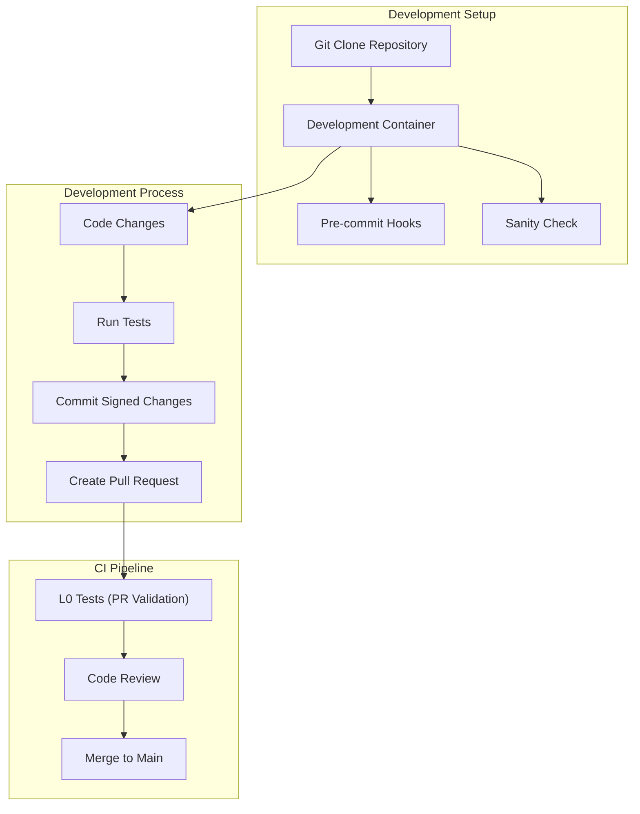
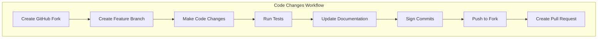
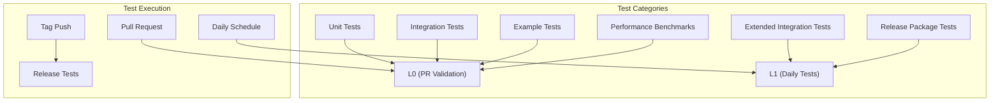
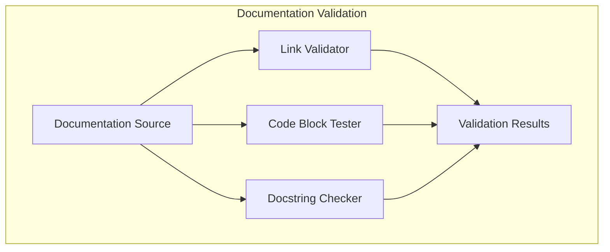
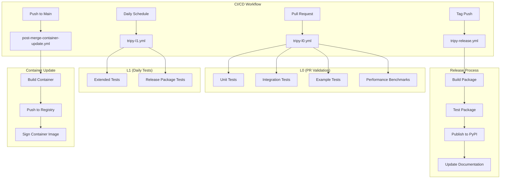
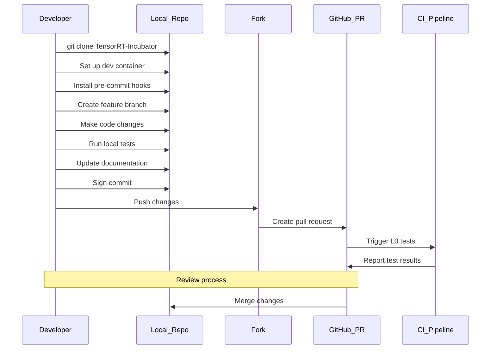

<!-- source: DeepWiki mcp.deepwiki.com · repo NVIDIA/TensorRT-Incubator · page 5 Development Guide · fetched 2026-10-26 -->

# Development Guide

<details>
<summary>Relevant source files</summary>

The following files were used as context for generating this wiki page:

- [.github/workflows/post-merge-container-update.yml](.github/workflows/post-merge-container-update.yml)
- [tripy/CONTRIBUTING.md](tripy/CONTRIBUTING.md)
- [tripy/Dockerfile](tripy/Dockerfile)
- [tripy/examples/nanogpt/README.md](tripy/examples/nanogpt/README.md)
- [tripy/examples/segment-anything-model-v2/README.md](tripy/examples/segment-anything-model-v2/README.md)
- [tripy/examples/segment-anything-model-v2/checkpoints/download_ckpt.sh](tripy/examples/segment-anything-model-v2/checkpoints/download_ckpt.sh)
- [tripy/examples/segment-anything-model-v2/download_test_data.py](tripy/examples/segment-anything-model-v2/download_test_data.py)
- [tripy/examples/segment-anything-model-v2/video_demo.py](tripy/examples/segment-anything-model-v2/video_demo.py)
- [tripy/notebooks/resnet50.ipynb](tripy/notebooks/resnet50.ipynb)
- [tripy/tests/test_examples.py](tripy/tests/test_examples.py)
- [tripy/tests/test_internal_docs.py](tripy/tests/test_internal_docs.py)
- [tripy/tests/test_tests.py](tripy/tests/test_tests.py)
- [tripy/tests/test_ux.py](tripy/tests/test_ux.py)

</details>


This guide provides a comprehensive overview of the development workflow and tools for contributors to the TensorRT-Incubator repository. It covers environment setup, building from source, testing, contributing guidelines, and the CI/CD pipeline. For specific information about building components, see [Building and Installation](#5.1).

## Development Environment Overview



Sources: [tripy/CONTRIBUTING.md:1-54](), [tripy/Dockerfile:1-36]()

## Setting Up Development Environment

### Cloning the Repository

To get started with development:

```bash
git clone https://github.com/NVIDIA/TensorRT-Incubator.git
```

### Using the Development Container

The recommended approach for development is to use the provided Docker container:

1. Log in to the container registry:
   ```bash
   docker login ghcr.io/nvidia/tensorrt-incubator
   ```

2. Pull and launch the container (from the tripy root directory):
   ```bash
   docker run --pull always --gpus all -it -p 8080:8080 -v $(pwd):/tripy/ --rm ghcr.io/nvidia/tensorrt-incubator/tripy
   ```

Alternatively, if you've made changes to the container (such as updating the Dockerfile or dependencies), build it locally:

```bash
docker build -t tripy .
docker run --gpus all -it -p 8080:8080 -v $(pwd):/tripy/ --rm tripy:latest
```

### Verifying the Setup

Run a sanity check to ensure everything is working:

```bash
python3 -c "import nvtripy as tp; print(tp.ones((2, 3)))"
```

You should see output similar to:
```
tensor(
    [[1. 1. 1.]
    [1. 1. 1.]],
    dtype=float32, loc=gpu:0, shape=(2, 3)
)
```

Sources: [tripy/CONTRIBUTING.md:5-54](), [tripy/Dockerfile:1-36]()

## Development Workflow

### Installing Pre-commit Hooks

Before starting development, install pre-commit hooks to ensure code quality:

```bash
python3 -m pip install pre-commit
pre-commit install
```

Note: Install the hooks outside the container so you don't have to repeat this step each time you launch the container.

Sources: [tripy/CONTRIBUTING.md:56-68]()

### Getting Up To Speed

Developer guides are available to help you understand the codebase:

- Architecture guide: https://nvidia.github.io/TensorRT-Incubator/post0_developer_guides/00-architecture.html
- Adding New Operations: https://nvidia.github.io/TensorRT-Incubator/post0_developer_guides/01-how-to-add-new-ops.html

Sources: [tripy/CONTRIBUTING.md:69-77]()

### Making Changes and Commits



1. Set up [commit signing](https://docs.github.com/en/authentication/managing-commit-signature-verification/about-commit-signature-verification#ssh-commit-signature-verification)

2. Tripy follows fork-based development:
   - Create a fork on GitHub
   - Make `git` aware of your fork:
     ```bash
     git remote add fork <FORK_URL>
     ```
   - Create a feature branch:
     ```bash
     git checkout -b my-feature-branch
     ```
   - Push changes to your fork:
     ```bash
     git push fork
     ```
   - Create a pull request with a description of your changes

3. All contributions must comply with the Developer Certificate of Origin (DCO)

Sources: [tripy/CONTRIBUTING.md:78-152]()

## Testing Framework

### Test Organization



### Running Tests

To run tests locally:

```bash
# Run all tests
pytest

# Run specific test files
pytest tests/test_specific.py

# Run tests with L0 marker (PR validation tests)
pytest -m l0

# Run tests with L1 marker (extended tests)
pytest -m l1
```

Sources: [tripy/tests/test_examples.py:1-182](), [tripy/tests/test_ux.py:1-138](), [tripy/tests/test_internal_docs.py:1-69](), [tripy/tests/test_tests.py:1-42]()

### Testing Examples

The repository includes example implementations that are automatically tested to ensure they work correctly:

- Examples require a README.md with "Introduction" and "Running The Example" sections
- Each example has test cases to verify functionality
- Test expectations are included in the README as special comment blocks

For example, in the NanoGPT example:

```
<!--
Tripy: TEST: EXPECTED_STDOUT Start
```
(?s).*?What is the answer to life, the universe, and everything\? (How can we know what's real\? How can|The answer to the questions that are asked of us|The answer to the questions that are the most difficult)
```
Tripy: TEST: EXPECTED_STDOUT End
-->
```

When writing new examples or tests, make sure to include the necessary documentation and test expectations.

Sources: [tripy/tests/test_examples.py:1-182](), [tripy/examples/nanogpt/README.md:1-86](), [tripy/examples/segment-anything-model-v2/README.md:1-58]()

## Documentation and User Experience

The project maintains high quality documentation and user experience standards:

### Documentation Testing

- Documentation code blocks are tested to ensure they work
- Public APIs must have docstrings
- Links in documentation are verified to be valid
- Documentation pages follow a consistent structure



Sources: [tripy/tests/test_ux.py:1-138](), [tripy/tests/test_internal_docs.py:1-69]()

## CI/CD Pipeline

The CI/CD pipeline automates testing, building, and deployment processes:

### Pipeline Components



### CI Jobs

| Workflow File | Trigger | Purpose |
|---------------|---------|---------|
| tripy-l0.yml | Pull requests | Fast tests for PR validation |
| tripy-l1.yml | Daily schedule | Extended tests and package validation |
| tripy-release.yml | Tag push | Build and publish release packages |
| post-merge-container-update.yml | Push to main affecting Dockerfile or pyproject.toml | Update development container |

Sources: [.github/workflows/post-merge-container-update.yml:1-109]()

## Working with Custom MLIR-TensorRT Builds

Tripy depends on MLIR-TensorRT for compilation and execution. The container includes a pre-built version, but you may need to test with a local build:

1. Build MLIR-TensorRT following the instructions in its README

2. Launch the container with MLIR-TensorRT repository mapped:
   ```bash
   docker run --gpus all -it -p 8080:8080 -v $(pwd):/tripy/ -v $(pwd)/../mlir-tensorrt:/mlir-tensorrt --rm tripy:latest
   ```

3. Check the TensorRT version in the container:
   ```bash
   echo "$LD_LIBRARY_PATH" | grep -oP 'TensorRT-\K\d+\.\d+\.\d+\.\d+'
   ```

4. Install MLIR-TensorRT wheels compatible with the container's TensorRT version:
   ```bash
   python3 -m pip install --force-reinstall /mlir-tensorrt/build/wheels/python3.10.12/trt102/**/*.whl
   ```

5. Verify everything works:
   ```bash
   python3 -c "import nvtripy as tp; print(tp.ones((2, 3)))"
   ```

Sources: [tripy/CONTRIBUTING.md:153-188]()

## Example Workflow

The following diagram illustrates a typical development workflow:



Sources: [tripy/CONTRIBUTING.md:1-188]()

---

