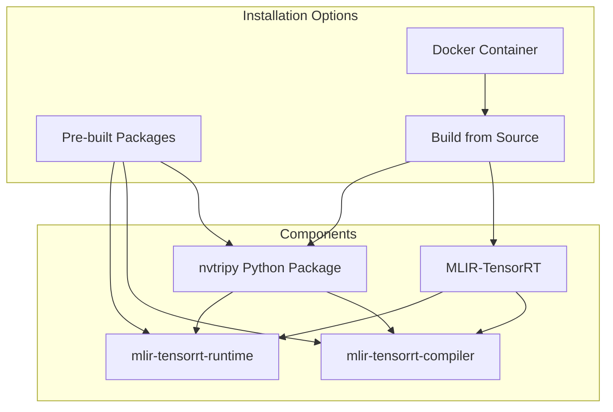
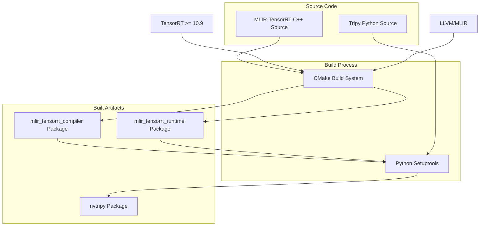
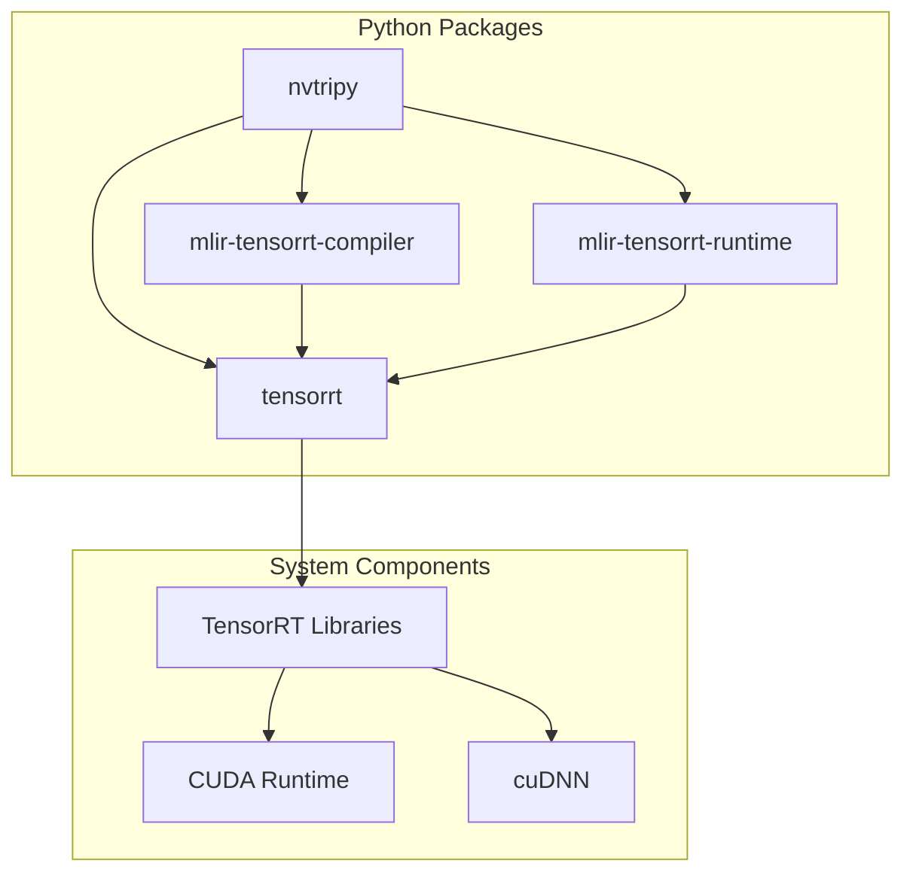

<!-- source: DeepWiki mcp.deepwiki.com · repo NVIDIA/TensorRT-Incubator · page 5.1 Building and Installation · fetched 2026-10-26 -->

# Building and Installation

<details>
<summary>Relevant source files</summary>

The following files were used as context for generating this wiki page:

- [.github/workflows/post-merge-container-update.yml](.github/workflows/post-merge-container-update.yml)
- [.github/workflows/post-merge-package-index-update.yml](.github/workflows/post-merge-package-index-update.yml)
- [mlir-tensorrt/CMakeLists.txt](mlir-tensorrt/CMakeLists.txt)
- [mlir-tensorrt/build_tools/cmake/Dependencies.cmake](mlir-tensorrt/build_tools/cmake/Dependencies.cmake)
- [mlir-tensorrt/build_tools/cmake/TensorRTDownloadURL.cmake](mlir-tensorrt/build_tools/cmake/TensorRTDownloadURL.cmake)
- [mlir-tensorrt/build_tools/scripts/cicd_build.sh](mlir-tensorrt/build_tools/scripts/cicd_build.sh)
- [tripy/Dockerfile](tripy/Dockerfile)
- [tripy/docs/packages.html](tripy/docs/packages.html)
- [tripy/nvtripy/__init__.py](tripy/nvtripy/__init__.py)
- [tripy/pyproject.toml](tripy/pyproject.toml)
- [tripy/tests/test_internal_docs.py](tripy/tests/test_internal_docs.py)
- [tripy/tests/test_tests.py](tripy/tests/test_tests.py)
- [tripy/tests/test_ux.py](tripy/tests/test_ux.py)

</details>


This document provides detailed instructions for building and installing the TensorRT-Incubator components. It covers both the installation of pre-built packages and building from source for the main components: Tripy/nvtripy (Python frontend) and MLIR-TensorRT (compiler infrastructure).

For information about using the installed packages, see [Tripy User Guide](#2) and [MLIR-TensorRT Technical Documentation](#4).

## System Requirements

Before proceeding with installation, ensure your system meets the following requirements:

| Component | Requirement |
| --- | --- |
| Operating System | Linux (Ubuntu recommended) |
| GPU | NVIDIA GPU with compute capability 6.0 or higher |
| CUDA | CUDA 12.x |
| Python | Python 3.9 or later |
| TensorRT | TensorRT 10.9 or later |

Sources: [tripy/pyproject.toml:7-13](), [mlir-tensorrt/build_tools/cmake/TensorRTDownloadURL.cmake:160-161]()

## Installation Overview

There are three primary methods for installing TensorRT-Incubator components:

1. **Installing pre-built packages**: Simplest approach for users
2. **Building from source**: Recommended for developers and contributors
3. **Using Docker**: Easiest way to get a complete development environment

The following diagram outlines the installation options and components:



Sources: [tripy/pyproject.toml:9-14](), [tripy/docs/packages.html]()

## Installing Pre-built Packages

### Tripy/nvtripy Package

The simplest way to install Tripy is using `pip` with the NVIDIA package index:

```bash
pip install nvtripy --extra-index-url https://nvidia.github.io/TensorRT-Incubator/packages.html
```

This will automatically install the required dependencies, including the MLIR-TensorRT compiler and runtime packages.

Sources: [tripy/pyproject.toml:9-14](), [tripy/docs/packages.html]()

### MLIR-TensorRT Packages

The MLIR-TensorRT packages (compiler and runtime) can be installed separately if needed:

```bash
pip install mlir-tensorrt-compiler==0.1.40+cuda12.trt109 mlir-tensorrt-runtime==0.1.40+cuda12.trt109 --extra-index-url https://nvidia.github.io/TensorRT-Incubator/packages.html
```

Note that these packages are compiled for specific combinations of CUDA and TensorRT versions, as indicated by the version suffix.

Sources: [tripy/docs/packages.html:169-183]()

## Building from Source

### Dependencies

Before building from source, you'll need to install several dependencies:

- **Common Dependencies**:
  - Git
  - Python 3.9 or later with pip
  - CUDA Toolkit 12.x
  - TensorRT 10.9 or later

- **MLIR-TensorRT Additional Dependencies**:
  - CMake 3.25 or later
  - Ninja
  - C++ compiler with C++17 support (GCC 9+ or Clang)
  - LLVM and MLIR development packages

Sources: [mlir-tensorrt/CMakeLists.txt:1-2](), [mlir-tensorrt/CMakeLists.txt:129-130]()

### Building MLIR-TensorRT

MLIR-TensorRT uses CMake for its build system. Here's how to build it:

```bash
# Clone the repository
git clone https://github.com/NVIDIA/TensorRT-Incubator.git
cd TensorRT-Incubator/mlir-tensorrt

# Create a build directory
mkdir build && cd build

# Configure with CMake
cmake .. \
  -DCMAKE_BUILD_TYPE=Release \
  -DMLIR_TRT_DOWNLOAD_TENSORRT_VERSION=10.9 \
  -DCPM_SOURCE_CACHE=$HOME/.cache.cpm

# Build
ninja
```

Key CMake Options:

| Option | Description | Default |
| --- | --- | --- |
| MLIR_TRT_DOWNLOAD_TENSORRT_VERSION | Version of TensorRT to download and use | 10.9 |
| MLIR_TRT_TENSORRT_DIR | Path to TensorRT install directory (if already installed) | "" |
| MLIR_TRT_ENABLE_PYTHON | Enable building Python packages | ON |
| MLIR_TRT_ENABLE_HLO | Enable StableHLO support | ON |
| MLIR_TRT_ENABLE_TESTING | Enable building tests | ON |

Sources: [mlir-tensorrt/CMakeLists.txt:36-46](), [mlir-tensorrt/CMakeLists.txt:48-52](), [mlir-tensorrt/build_tools/scripts/cicd_build.sh:18-20]()

### Building Tripy/nvtripy

After building MLIR-TensorRT or installing the pre-built packages, you can build Tripy:

```bash
# Navigate to the Tripy directory
cd TensorRT-Incubator/tripy

# Install build dependencies
pip install .[build]

# Build the package
python -m build
```

This will create distribution files in the `dist` directory that can be installed with pip:

```bash
pip install dist/nvtripy-*.whl
```

Sources: [tripy/pyproject.toml:21-29](), [tripy/pyproject.toml:33-38]()

## Development Environment Setup

### Using Docker Container

The easiest way to set up a development environment is using the provided Docker container:

```bash
# Clone the repository
git clone https://github.com/NVIDIA/TensorRT-Incubator.git
cd TensorRT-Incubator

# Build the Docker image
docker build -t tripy-dev -f tripy/Dockerfile tripy/

# Run the container with GPU support
docker run --gpus all -it --rm -v $(pwd)/tripy:/tripy tripy-dev
```

The container includes all necessary dependencies and development tools for Tripy/nvtripy.

Sources: [tripy/Dockerfile](), [.github/workflows/post-merge-container-update.yml]()

### Manual Development Setup

For manual development setup, install the development dependencies:

```bash
# Clone the repository
git clone https://github.com/NVIDIA/TensorRT-Incubator.git
cd TensorRT-Incubator/tripy

# Install development dependencies
pip install -e .[dev,test,docs]
```

This installs Tripy in development mode and all dependencies needed for development, testing, and documentation.

Sources: [tripy/pyproject.toml:31-80]()

## Component Architecture

The following diagram shows the relationship between the various components and build artifacts:



Sources: [mlir-tensorrt/CMakeLists.txt](), [tripy/pyproject.toml]()

## Package Dependencies 

The dependency relationship between the packages is shown below:



Sources: [tripy/pyproject.toml:9-14](), [tripy/nvtripy/__init__.py:20-21]()

## Troubleshooting

### Common Issues

#### Missing TensorRT
If you see errors about missing TensorRT components:
1. Ensure TensorRT is installed and in your library path
2. For building, specify the TensorRT installation path with `-DMLIR_TRT_TENSORRT_DIR=/path/to/tensorrt`

#### Python Version Compatibility
Ensure you're using Python 3.9 or later as required by the packages.

#### Package Compatibility
The MLIR-TensorRT packages are built for specific CUDA and TensorRT versions. Ensure you install the correct version matching your system.

Sources: [mlir-tensorrt/build_tools/cmake/Dependencies.cmake:143-146](), [tripy/pyproject.toml:7]()

### Verifying Installation

To verify that Tripy is correctly installed and working:

```python
import nvtripy as tp
print(tp.__version__)

# Create a simple tensor
x = tp.Tensor([1, 2, 3])
print(x)
```

If this runs without errors, the installation is working correctly.

Sources: [tripy/nvtripy/__init__.py:18]()

---

