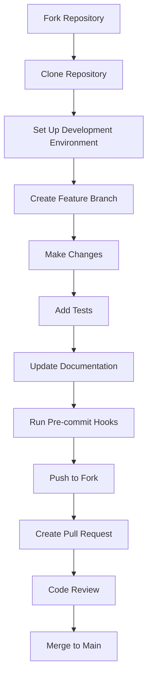
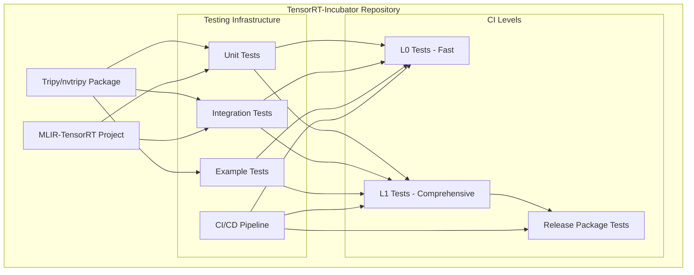
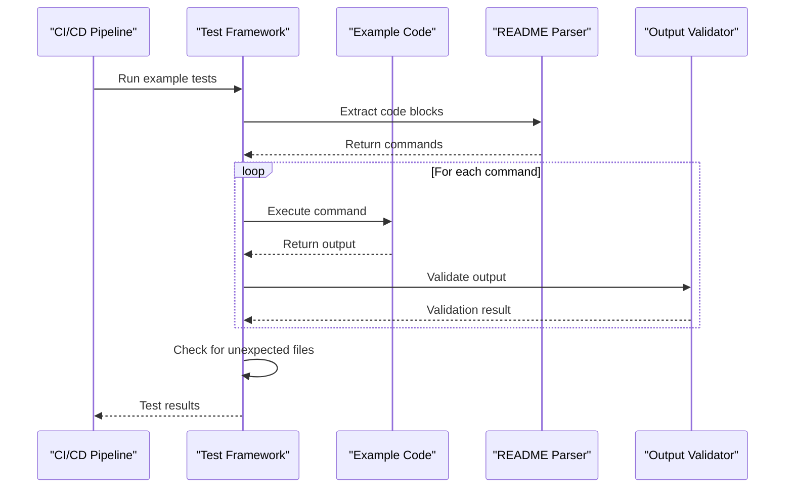
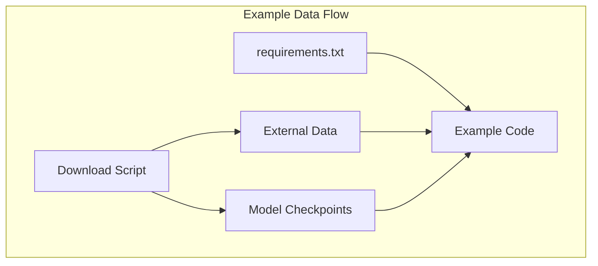

<!-- source: DeepWiki mcp.deepwiki.com · repo NVIDIA/TensorRT-Incubator · page 5.3 Contributing Guidelines · fetched 2026-10-26 -->

# Contributing Guidelines

<details>
<summary>Relevant source files</summary>

The following files were used as context for generating this wiki page:

- [tripy/CONTRIBUTING.md](tripy/CONTRIBUTING.md)
- [tripy/examples/nanogpt/README.md](tripy/examples/nanogpt/README.md)
- [tripy/examples/segment-anything-model-v2/README.md](tripy/examples/segment-anything-model-v2/README.md)
- [tripy/examples/segment-anything-model-v2/checkpoints/download_ckpt.sh](tripy/examples/segment-anything-model-v2/checkpoints/download_ckpt.sh)
- [tripy/examples/segment-anything-model-v2/download_test_data.py](tripy/examples/segment-anything-model-v2/download_test_data.py)
- [tripy/examples/segment-anything-model-v2/video_demo.py](tripy/examples/segment-anything-model-v2/video_demo.py)
- [tripy/notebooks/resnet50.ipynb](tripy/notebooks/resnet50.ipynb)
- [tripy/tests/test_examples.py](tripy/tests/test_examples.py)

</details>


This document outlines the process for contributing to the TensorRT-Incubator repository, covering both the Tripy/nvtripy package and the MLIR-TensorRT project. It provides guidelines for setting up your development environment, making changes, testing your code, and submitting contributions via pull requests.

For specifics on building and installing the projects from source, please see [Building and Installation](#5.1), and for information about the testing infrastructure, refer to [Testing Framework](#5.2).

## Table of Contents

1. [Setting Up the Development Environment](#setting-up-the-development-environment)
2. [Making Changes](#making-changes)
3. [Contribution Workflow](#contribution-workflow)
4. [Testing Guidelines](#testing-guidelines)
5. [Advanced Development](#advanced-development)

## Setting Up the Development Environment

### Clone the Repository

First, clone the TensorRT-Incubator repository:

```bash
git clone https://github.com/NVIDIA/TensorRT-Incubator.git
```

### Launch the Development Container

The recommended approach for development is to use the provided container:

#### Option A: Pull an existing container (recommended)

1. Log in to the registry with your GitHub username and a personal access token:

```bash
docker login ghcr.io/nvidia/tensorrt-incubator
```

2. Pull and launch the container from the Tripy root directory:

```bash
docker run --pull always --gpus all -it -p 8080:8080 -v $(pwd):/tripy/ --rm ghcr.io/nvidia/tensorrt-incubator/tripy
```

#### Option B: Build the container locally

If you've modified the `Dockerfile` or `pyproject.toml`:

```bash
docker build -t tripy .
docker run --gpus all -it -p 8080:8080 -v $(pwd):/tripy/ --rm tripy:latest
```

### Run a Sanity Check

Verify that everything is working correctly:

```bash
python3 -c "import nvtripy as tp; print(tp.ones((2, 3)))"
```

Expected output:
```
tensor(
    [[1. 1. 1.]
    [1. 1. 1.]],
    dtype=float32, loc=gpu:0, shape=(2, 3)
)
```

Sources: [tripy/CONTRIBUTING.md:5-53]()

## Contribution Workflow Overview

The following diagram illustrates the end-to-end contribution workflow:



Sources: [tripy/CONTRIBUTING.md:89-113]()

## Making Changes

### Before You Start: Install Pre-commit Hooks

Set up pre-commit hooks to ensure code quality:

```bash
python3 -m pip install pre-commit
pre-commit install
```

> [!TIP]
> Install the hooks outside the container so you don't have to repeat this step each time you launch the container.

Sources: [tripy/CONTRIBUTING.md:57-67]()

### Getting Up to Speed

We've written developer guides to help you understand the codebase:

- Architecture guide: https://nvidia.github.io/TensorRT-Incubator/post0_developer_guides/00-architecture.html
- Adding New Operations: https://nvidia.github.io/TensorRT-Incubator/post0_developer_guides/01-how-to-add-new-ops.html

Sources: [tripy/CONTRIBUTING.md:69-76]()

### Adding Tests

All new functionality should be covered by tests. See [the tests README](./tests/README.md) for details on adding tests for your changes.

Sources: [tripy/CONTRIBUTING.md:78-80]()

### Documentation

If you add or modify any public-facing interfaces, update the documentation accordingly. See [this README](./docs/README.md) for documentation guidelines.

Sources: [tripy/CONTRIBUTING.md:82-84]()

## Contribution Workflow

### Setting Up for Contributions

1. Set up [commit signing](https://docs.github.com/en/authentication/managing-commit-signature-verification/about-commit-signature-verification#ssh-commit-signature-verification).

2. Tripy follows [fork-based development](https://docs.github.com/en/pull-requests/collaborating-with-pull-requests/working-with-forks/fork-a-repo):
   - Create a fork on GitHub and make Git aware of it:
     ```bash
     git remote add fork <FORK_URL>
     ```
   - Create a feature branch:
     ```bash
     git checkout -b my-feature-branch
     ```
   - After committing changes, push to your fork:
     ```bash
     git push fork
     ```
   - Create a [pull request](https://docs.github.com/en/pull-requests/collaborating-with-pull-requests/proposing-changes-to-your-work-with-pull-requests/creating-a-pull-request) on GitHub with a description explaining the change.

Sources: [tripy/CONTRIBUTING.md:89-113]()

### Developer Certificate of Origin

Contributions you make should satisfy the Developer Certificate of Origin, which ensures you have the right to submit your contributions under the project's license.

By making a contribution, you certify that:
1. The contribution was created by you or you have the right to submit it
2. The contribution is based on previous work that is covered by an appropriate open source license
3. You understand that the contribution is public and will be maintained indefinitely

Sources: [tripy/CONTRIBUTING.md:115-151]()

## Project Structure and Testing Framework

The following diagram shows the main components of TensorRT-Incubator and how they relate to testing:



Sources: [tripy/tests/test_examples.py:17-181]()

## Testing Guidelines

### Example Tests

All examples must follow a standardized format:

1. Each example must have a `README.md` with:
   - An "Introduction" section
   - A "Running The Example" section

2. Examples should specify all dependencies in a `requirements.txt` file.

3. Example code blocks in READMEs are tested to ensure they run correctly.

4. The testing framework validates that:
   - All commands execute successfully
   - Output matches expected results
   - No unexpected files are created

Sources: [tripy/tests/test_examples.py:95-181](), [tripy/examples/nanogpt/README.md:1-86](), [tripy/examples/segment-anything-model-v2/README.md:1-58]()

### Examples of Standardized Example Format

Here's an example of how the NanoGPT example follows the standardized format:

```
# Implementing NanoGPT

## Introduction
This example implements a [NanoGPT model](https://github.com/karpathy/nanoGPT) using Tripy...

## Running The Example
1. Install prerequisites:
   ```bash
   python3 -m pip install -r requirements.txt
   ```
2. Run the example:
   ```bash
   python3 example.py --input-text "What is the answer to life, the universe, and everything?"
   ```
```

Another example is the SAM2 (Segment Anything Model v2) example:

```
# SAM2: Segment Anything in Images and Videos

## Introduction
This is an implementation of SAM2 model...

## Running The Example
1. Install prerequisites:
   ```bash
   python3 -m pip install -r requirements.txt
   ```
2. Retrieve the images and the checkpoint:
   ```bash
   python3 download_test_data.py
   sh checkpoints/download_ckpt.sh
   ```
```

Sources: [tripy/examples/nanogpt/README.md:1-31](), [tripy/examples/segment-anything-model-v2/README.md:1-20]()

## Example Test Execution Flow

This diagram illustrates how example tests are executed:



Sources: [tripy/tests/test_examples.py:37-81]()

## Advanced Development

### Using Custom MLIR-TensorRT Builds With Tripy

Tripy depends on MLIR-TensorRT for compilation and execution. The Tripy container includes a build of MLIR-TensorRT, but you may want to test Tripy with a local MLIR-TensorRT build:

1. Build MLIR-TensorRT as per the instructions in the [README](../mlir-tensorrt/README.md).

2. Launch the container with the MLIR-TensorRT repository mapped:
   ```bash
   docker run --gpus all -it -p 8080:8080 -v $(pwd):/tripy/ -v $(pwd)/../mlir-tensorrt:/mlir-tensorrt --rm tripy:latest
   ```

3. Install MLIR-TensorRT wheels:
   ```bash
   # Check TensorRT version in container
   echo "$LD_LIBRARY_PATH" | grep -oP 'TensorRT-\K\d+\.\d+\.\d+\.\d+'
   
   # Install compatible wheels
   python3 -m pip install --force-reinstall /mlir-tensorrt/build/wheels/python3.10.12/trt102/**/*.whl
   ```

4. Verify everything works:
   ```bash
   python3 -c "import nvtripy as tp; print(tp.ones((2, 3)))"
   ```

Sources: [tripy/CONTRIBUTING.md:153-188]()

## Dependencies and Data Management

The examples in TensorRT-Incubator may require downloading external data and model checkpoints. These dependencies are typically managed through dedicated download scripts:



For example, the SAM2 example includes:
- `download_test_data.py`: Downloads test images for segmentation
- `checkpoints/download_ckpt.sh`: Downloads model checkpoint files

Sources: [tripy/examples/segment-anything-model-v2/download_test_data.py:1-76](), [tripy/examples/segment-anything-model-v2/checkpoints/download_ckpt.sh:1-25]()

## Summary

Following these contribution guidelines will help ensure a smooth development experience and maintain the quality of the TensorRT-Incubator codebase. The key takeaways are:

1. **Use the development container** for a consistent environment
2. **Install pre-commit hooks** to ensure code quality
3. **Add tests and documentation** for all new features
4. **Follow the fork-based development model** for contributions
5. **Ensure examples follow the standardized format**

By adhering to these guidelines, you'll help maintain a high-quality codebase and make the review process more efficient.

---

