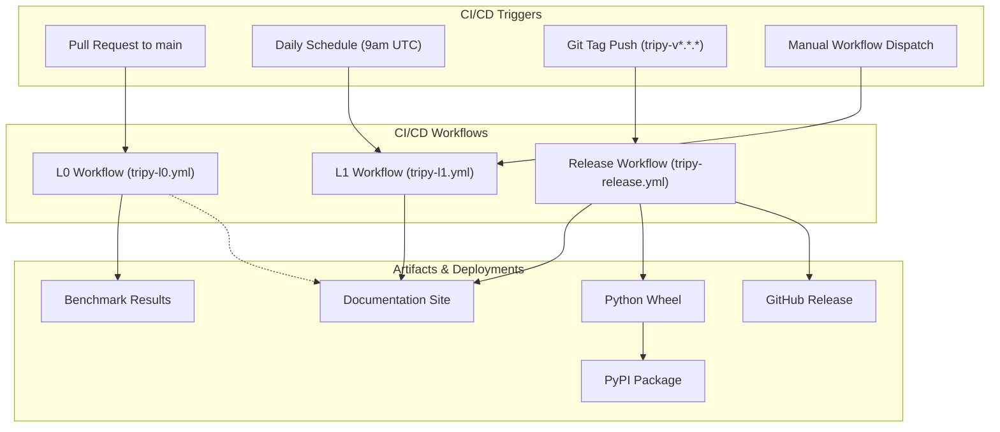
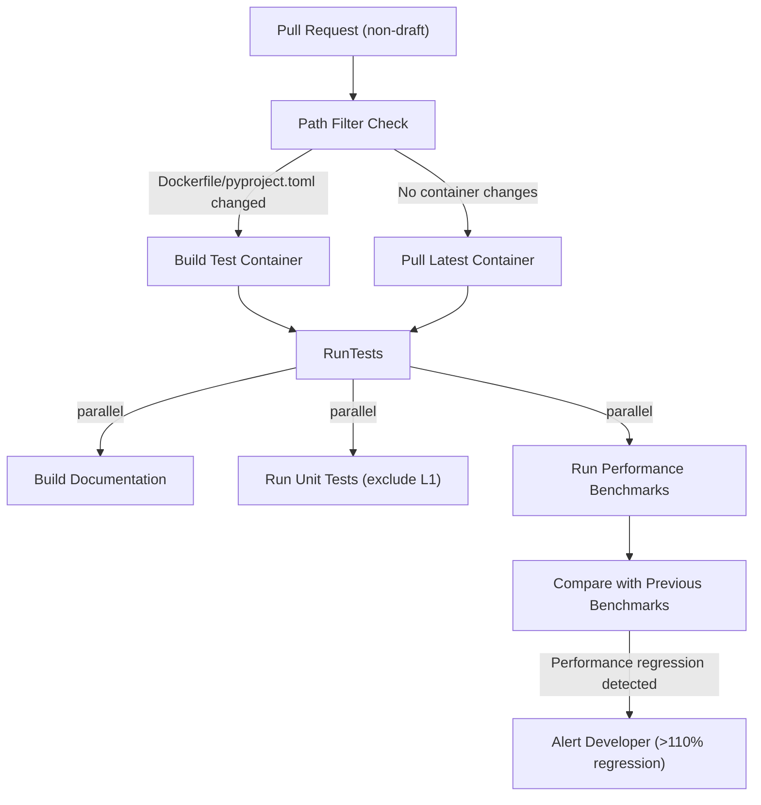
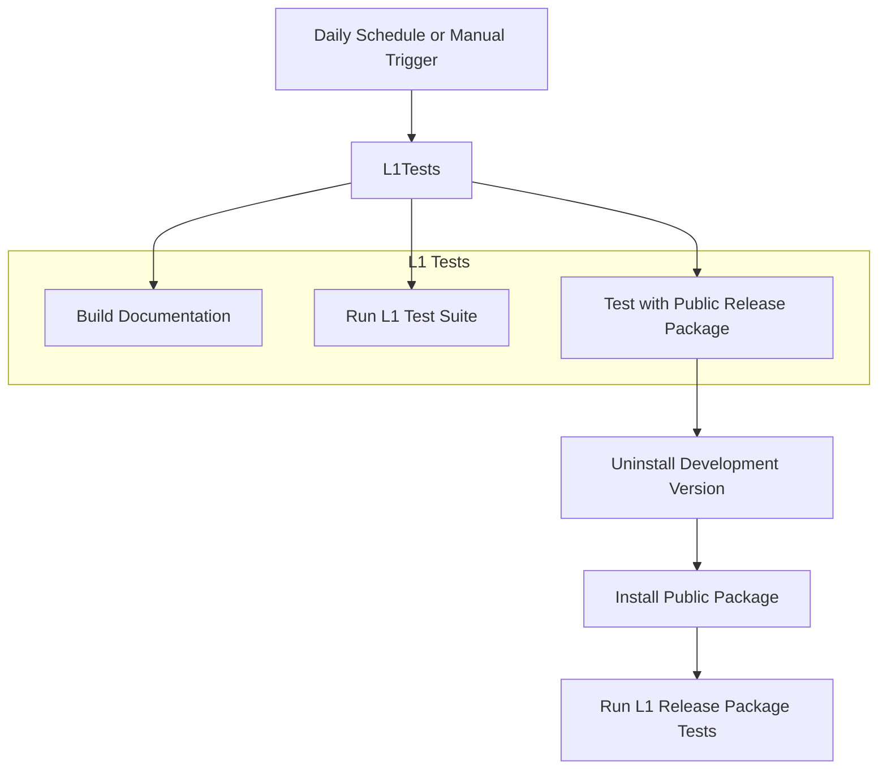
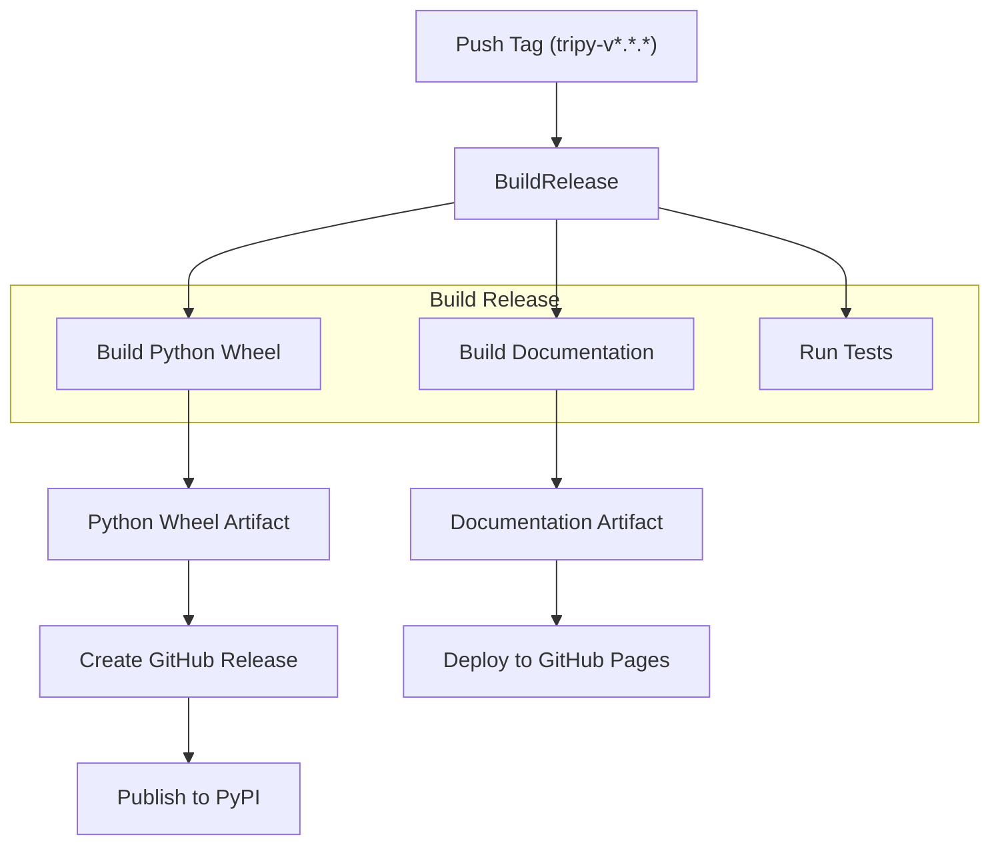
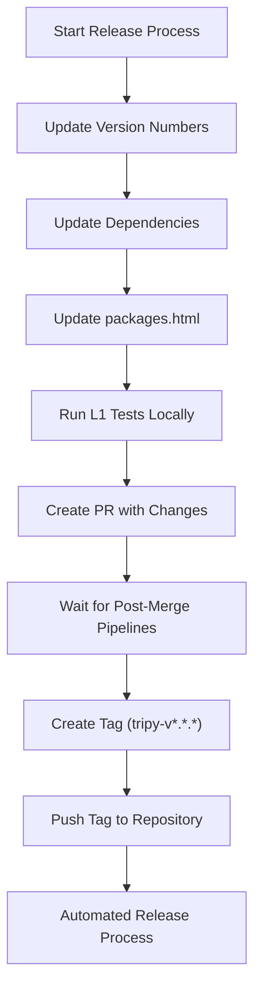
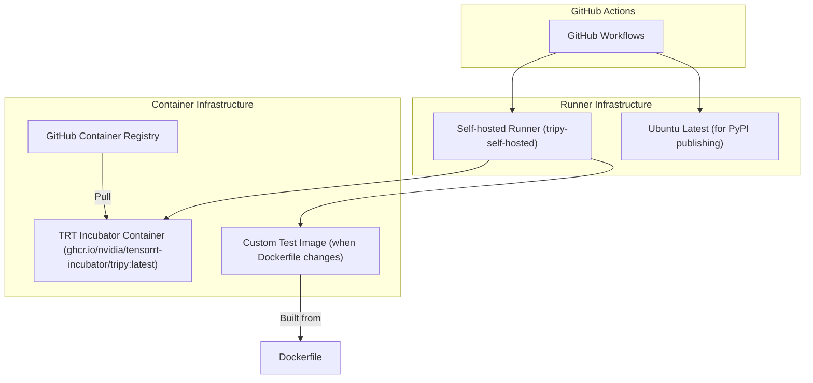

<!-- source: DeepWiki mcp.deepwiki.com · repo NVIDIA/TensorRT-Incubator · page 5.4 CI/CD Pipeline · fetched 2026-10-26 -->

# CI/CD Pipeline

Relevant source files

The following files were used as context for generating this wiki page:

- [.github/workflows/tripy-l0.yml](.github/workflows/tripy-l0.yml)
- [.github/workflows/tripy-l1.yml](.github/workflows/tripy-l1.yml)
- [.github/workflows/tripy-release.yml](.github/workflows/tripy-release.yml)
- [tripy/RELEASE.md](tripy/RELEASE.md)
- [tripy/tests/test_notebooks.py](tripy/tests/test_notebooks.py)
- [tripy/tests/test_packaging.py](tripy/tests/test_packaging.py)

This page documents the continuous integration and deployment pipeline for the TensorRT-Incubator project, focusing primarily on the Tripy/nvtripy package. For information about the overall development workflow, see [Development Guide](#5), and for specific building instructions, see [Building and Installation](#5.1).

## 1. Pipeline Overview

The TensorRT-Incubator project employs a multi-level CI/CD pipeline to ensure code quality, test coverage, and streamlined releases. The pipeline consists of three main workflows:

The workflow is designed to handle both development validation and production releases:

| Workflow | Trigger | Purpose | 
|----------|---------|---------|
| L0 (tripy-l0.yml) | Pull Requests | Basic validation, documentation, tests, and benchmarks for code changes |
| L1 (tripy-l1.yml) | Daily schedule or manual | Extended testing and documentation validation |
| Release (tripy-release.yml) | Version tag push | Building and publishing official releases |

Sources: [.github/workflows/tripy-l0.yml:1-94](), [.github/workflows/tripy-l1.yml:1-48](), [.github/workflows/tripy-release.yml:1-98]()

## 2. L0 Workflow: Pull Request Validation

The L0 workflow runs whenever a pull request targeting the main branch is created or updated, as long as it's not in draft state and contains changes to files in the tripy directory.

Key features of the L0 workflow:

1. **Environment Selection**: Automatically determines whether to use the default container or build a new one based on changes to container-related files
2. **Documentation Validation**: Ensures documentation builds correctly
3. **Test Execution**: Runs unit and integration tests, excluding L1 tests, in parallel
4. **Performance Benchmarking**: Runs performance tests and compares results with previous runs
5. **Regression Detection**: Alerts developers if performance regressions exceed 110% of previous benchmarks

Sources: [.github/workflows/tripy-l0.yml:17-94]()

## 3. L1 Workflow: Extended Testing

The L1 workflow runs on a daily schedule (9am UTC) or can be manually triggered. It performs more comprehensive testing that might be too time-consuming for PR validation.

Key features of the L1 workflow:

1. **Documentation Building**: Ensures documentation is correctly generated
2. **Extended Test Suite**: Runs tests marked with the "l1" marker, which typically include more thorough verification
3. **Release Package Testing**: Tests compatibility with the publicly released package by uninstalling the development version, installing the public package, and running tests marked with "l1_release_package"

Sources: [.github/workflows/tripy-l1.yml:1-48](), [tripy/tests/test_notebooks.py:28-37]()

## 4. Release Workflow: Packaging and Deployment

The release workflow is triggered when a tag matching the pattern "tripy-v*.*.*" is pushed to the repository. It automates the process of building, testing, and publishing a new release.

Key features of the release workflow:

1. **Package Building**: Builds the Python wheel package
2. **Documentation Building**: Generates documentation for deployment
3. **Testing**: Ensures all tests pass before publishing
4. **GitHub Release**: Creates a GitHub release with the wheel as an asset
5. **Documentation Deployment**: Deploys documentation to GitHub Pages
6. **PyPI Publishing**: Publishes the wheel to PyPI for public installation

Sources: [.github/workflows/tripy-release.yml:1-98]()

## 5. Manual Release Procedure

In addition to the automated workflows, there is a manual procedure for creating new releases, documented in the `RELEASE.md` file:

Steps for the manual release procedure:

1. Update version numbers in `pyproject.toml` and `__init__.py`
2. Update dependency version numbers as needed
3. Update `packages.html` if there were MLIR-TRT releases
4. Run L1 tests locally if there were functional changes
5. Create a PR with the version changes
6. Wait for post-merge pipelines to complete
7. Create and push a tag (e.g., `tripy-vX.Y.Z`)
8. The automated release workflow will be triggered by the tag

Sources: [tripy/RELEASE.md:1-45]()

## 6. Testing Infrastructure

The CI/CD pipeline includes several types of tests to ensure code quality:

| Test Type | Description | Workflow |
|-----------|-------------|----------|
| Unit Tests | Basic functionality tests | L0, Release |
| Integration Tests | Tests of component interactions | L0, Release |
| L1 Tests | Extended tests (slower/more comprehensive) | L1 |
| Performance Tests | Benchmarks for performance tracking | L0 |
| Packaging Tests | Verify package building and installation | L1 |
| Notebook Tests | Test example notebooks | L1 |

### 6.1 Packaging Tests

The CI/CD pipeline includes specialized tests to verify that the package builds correctly and can be installed and used:

1. **Wheel Building**: Tests that the wheel can be built successfully
2. **Installation**: Verifies that the wheel can be installed in a clean environment
3. **Content Verification**: Checks that the package contains the expected files (including stubs) and not unwanted files (like tests)
4. **Functionality**: Ensures basic functionality works after installation

Sources: [tripy/tests/test_packaging.py:26-76]()

### 6.2 Notebook Tests

The CI/CD pipeline also tests the example notebooks to ensure they run successfully:

1. **Environment Setup**: Creates a clean virtual environment
2. **Package Installation**: Installs the minimum required packages
3. **Notebook Execution**: Executes the notebooks using pytest-notebook
4. **Validation**: Verifies that the notebooks run without errors

Sources: [tripy/tests/test_notebooks.py:28-37]()

## 7. CI/CD Infrastructure

The TensorRT-Incubator CI/CD pipeline runs on specialized infrastructure to support GPU testing:

Key components of the CI/CD infrastructure:

1. **Self-hosted Runners**: Custom GitHub Actions runners labeled 'tripy-self-hosted' with GPU support
2. **Container-based Execution**: All GPU-dependent workflows run in Docker containers
3. **Dynamic Container Selection**: Automatically selects between using the latest container or building a new one
4. **GPU Passthrough**: Container configuration includes GPU passthrough for testing on physical GPUs

Sources: [.github/workflows/tripy-l0.yml:19-56](), [.github/workflows/tripy-l1.yml:19-25](), [.github/workflows/tripy-release.yml:22-31]()