# Page: Overview

# Overview

<details>
<summary>Relevant source files</summary>

The following files were used as context for generating this wiki page:

- [.github/workflows/mlir-tensorrt-ci.yml](.github/workflows/mlir-tensorrt-ci.yml)
- [.github/workflows/post-merge-package-index-update.yml](.github/workflows/post-merge-package-index-update.yml)
- [mlir-tensorrt/.devcontainer/cuda12.5-rockylinux8-gcc11/devcontainer.json](mlir-tensorrt/.devcontainer/cuda12.5-rockylinux8-gcc11/devcontainer.json)
- [mlir-tensorrt/CMakePresets.json](mlir-tensorrt/CMakePresets.json)
- [mlir-tensorrt/README.md](mlir-tensorrt/README.md)
- [mlir-tensorrt/Version.cmake](mlir-tensorrt/Version.cmake)
- [mlir-tensorrt/build_tools/docker/Dockerfile](mlir-tensorrt/build_tools/docker/Dockerfile)
- [mlir-tensorrt/build_tools/scripts/build_wheels.sh](mlir-tensorrt/build_tools/scripts/build_wheels.sh)
- [mlir-tensorrt/executor/lib/Runtime/Backend/Lua/Modules/CMakeLists.txt](mlir-tensorrt/executor/lib/Runtime/Backend/Lua/Modules/CMakeLists.txt)
- [mlir-tensorrt/python/requirements-dev.txt](mlir-tensorrt/python/requirements-dev.txt)
- [tripy/README.md](tripy/README.md)
- [tripy/docs/packages.html](tripy/docs/packages.html)
- [tripy/docs/pre0_user_guides/00-introduction-to-tripy.md](tripy/docs/pre0_user_guides/00-introduction-to-tripy.md)
- [tripy/examples/nanogpt/example.py](tripy/examples/nanogpt/example.py)
- [tripy/nvtripy/__init__.py](tripy/nvtripy/__init__.py)
- [tripy/pyproject.toml](tripy/pyproject.toml)
- [tripy/tests/backend/api/test_stream.py](tripy/tests/backend/api/test_stream.py)
- [tripy/tests/integration/test_plugin.py](tripy/tests/integration/test_plugin.py)

</details>


This wiki page provides a comprehensive introduction to the TensorRT-Incubator repository, which contains tools and libraries that enhance NVIDIA's TensorRT deep learning inference engine. The repository consists of two major projects - Tripy/nvtripy and MLIR-TensorRT - that work together to provide a Pythonic programming model for TensorRT with advanced compilation capabilities.

## Repository Structure

The TensorRT-Incubator repository is organized around two primary components that serve different but complementary purposes in the TensorRT ecosystem.

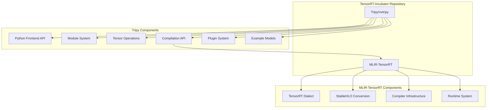

Sources: [tripy/README.md:15-25](), [mlir-tensorrt/README.md:1-14](), [tripy/pyproject.toml:1-20]()

## Tripy/nvtripy Package

Tripy (package name `nvtripy`) is a Pythonic frontend for TensorRT that provides a high-level, user-friendly interface for deep learning inference. It offers several key features:

- A **module system** similar to PyTorch for defining neural network architectures
- **Tensor operations** with a functional API style
- **Eager execution** mode for interactive debugging
- **Compilation** capability for high-performance inference
- A **plugin system** for extending TensorRT functionality

Tripy is designed to be intuitive, debuggable, and to deliver the high performance that TensorRT is known for.

Current version: 0.1.1 (as of this documentation)

### Module System

Tripy provides a module system that allows users to define reusable neural network components:

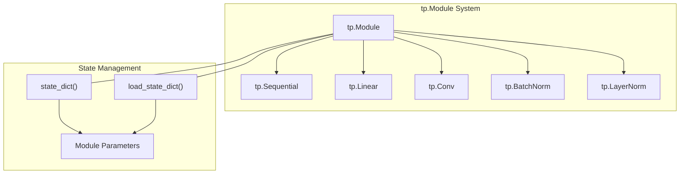

Sources: [tripy/README.md:41-52](), [tripy/docs/pre0_user_guides/00-introduction-to-tripy.md:19-35]()

## MLIR-TensorRT Project

MLIR-TensorRT is a compiler and runtime infrastructure that integrates the MLIR (Multi-Level Intermediate Representation) framework with TensorRT. It serves as the underlying compilation engine for Tripy while also being usable independently. Key components include:

- A **TensorRT dialect** for MLIR that models TensorRT operations
- **Conversions** from StableHLO to TensorRT dialect
- **Compiler infrastructure** for building optimized TensorRT engines
- **Runtime system** for executing compiled models

Current version: 0.1.40 (as of this documentation)

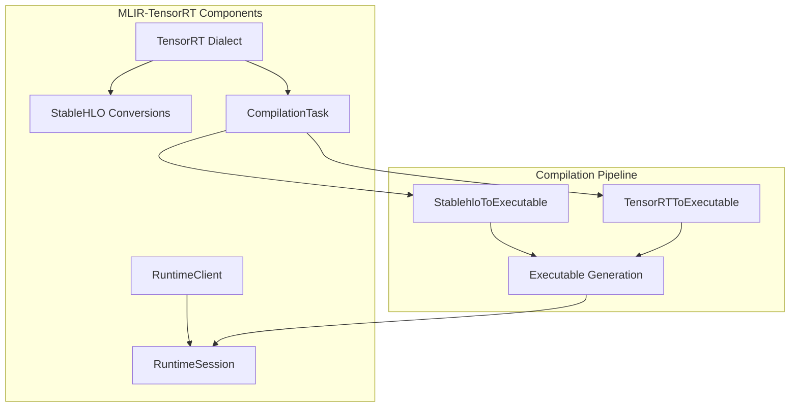

Sources: [mlir-tensorrt/README.md:1-18](), [mlir-tensorrt/Version.cmake:1-5]()

## Architecture and Data Flow

The TensorRT-Incubator provides a complete pipeline from high-level Python code to optimized GPU execution. The following diagram illustrates the data flow through the system:

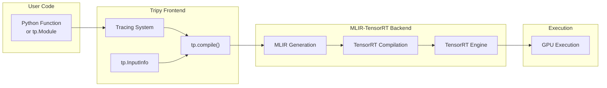

Sources: [tripy/docs/pre0_user_guides/00-introduction-to-tripy.md:56-81](), [tripy/examples/nanogpt/example.py:98-109]()

### Compilation Process

When a Tripy model is compiled using `tp.compile()`, the following steps occur:

1. The Python function or `tp.Module` is traced to capture its computational graph
2. The traced graph is converted to MLIR representation
3. The MLIR is translated to the TensorRT dialect
4. TensorRT optimizations are applied
5. A TensorRT engine is generated
6. The engine is wrapped in an executable form that can be called from Python

This process optimizes the model for inference performance while maintaining a user-friendly Python interface.

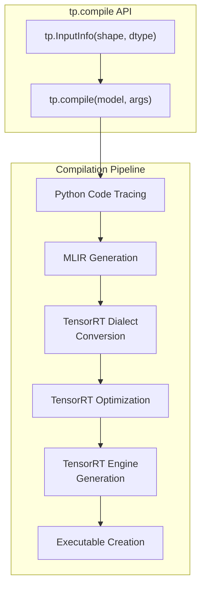

Sources: [tripy/docs/pre0_user_guides/00-introduction-to-tripy.md:56-68](), [tripy/examples/nanogpt/example.py:98-109]()

## Key Features and Capabilities

### Pythonic API

Tripy provides a Python API that follows conventions familiar to data scientists and deep learning practitioners:

- Tensor creation and manipulation functions
- Module system similar to PyTorch
- Functional operations (like `tp.relu`, `tp.gelu`)
- State management via `state_dict()` and `load_state_dict()`

### Eager Mode Execution

For debugging and development, Tripy supports eager mode execution, allowing operations to be performed immediately without compilation:

```
model = Model()
eager_output = model(input_tensor)  # Executes immediately
```

### Compiled Mode Execution

For optimized performance, models can be compiled:

```
compiled_model = tp.compile(model, args=[tp.InputInfo(shape=(1, 3, 224, 224), dtype=tp.float32)])
optimized_output = compiled_model(input_tensor)  # Uses optimized TensorRT engine
```

### Plugin System

Tripy includes a plugin system for extending TensorRT functionality with custom operations:

```
output = tp.plugin(
    name="CustomPluginName",
    inputs=[input_tensor],
    output_info=[(rank, dtype)],
    # Plugin-specific parameters
)
```

Sources: [tripy/tests/integration/test_plugin.py:26-32](), [tripy/tests/backend/api/test_stream.py:33-51]()

## Relationship to Other Pages

For more detailed information about specific components, refer to these wiki pages:

- For details about Tripy/nvtripy: [Tripy/nvtripy Package](#1.1)
- For more on MLIR-TensorRT: [MLIR-TensorRT Project](#1.2)
- For user guidance on using Tripy: [Tripy User Guide](#2)
- For examples of models implemented with Tripy: [Tripy Examples](#3)
- For technical details about MLIR-TensorRT: [MLIR-TensorRT Technical Documentation](#4)
- For development guidelines: [Development Guide](#5)

## Installation

To install Tripy from the published packages:

```
python3 -m pip install nvtripy -f https://nvidia.github.io/TensorRT-Incubator/packages.html
```

Sources: [tripy/README.md:29-31](), [tripy/docs/packages.html:1-184]()

## Version Compatibility

The TensorRT-Incubator components have the following dependencies:

| Component | Version | Key Dependencies |
|-----------|---------|------------------|
| nvtripy | 0.1.1 | TensorRT ≥ 10.9, mlir-tensorrt-compiler 0.1.40, mlir-tensorrt-runtime 0.1.40 |
| MLIR-TensorRT | 0.1.40 | LLVM/MLIR (version specified in build_tools/cmake/LLVMCommit.txt) |

Sources: [tripy/pyproject.toml:1-17](), [mlir-tensorrt/Version.cmake:1-5]()

## Summary

The TensorRT-Incubator repository provides a comprehensive set of tools for deep learning inference with TensorRT. Through Tripy's Pythonic frontend and MLIR-TensorRT's compilation infrastructure, users can easily define, debug, and deploy high-performance models that leverage NVIDIA GPU acceleration.

---

# Page: Tripy/nvtripy Package

# Tripy/nvtripy Package

<details>
<summary>Relevant source files</summary>

The following files were used as context for generating this wiki page:

- [.github/workflows/post-merge-package-index-update.yml](.github/workflows/post-merge-package-index-update.yml)
- [tripy/README.md](tripy/README.md)
- [tripy/docs/packages.html](tripy/docs/packages.html)
- [tripy/docs/pre0_user_guides/00-introduction-to-tripy.md](tripy/docs/pre0_user_guides/00-introduction-to-tripy.md)
- [tripy/examples/nanogpt/example.py](tripy/examples/nanogpt/example.py)
- [tripy/nvtripy/__init__.py](tripy/nvtripy/__init__.py)
- [tripy/pyproject.toml](tripy/pyproject.toml)
- [tripy/tests/backend/api/test_stream.py](tripy/tests/backend/api/test_stream.py)
- [tripy/tests/integration/test_plugin.py](tripy/tests/integration/test_plugin.py)

</details>


This document describes the Tripy package (published as "nvtripy"), a Pythonic frontend for TensorRT that provides a high-level Python interface for deep learning inference. For information about the underlying compiler infrastructure that powers Tripy, see [MLIR-TensorRT Project](#1.2).

## Overview

Tripy is a debuggable, Pythonic frontend for [TensorRT](https://developer.nvidia.com/tensorrt), NVIDIA's deep learning inference compiler. It provides a high-level API that follows familiar conventions from the Python deep learning ecosystem while leveraging TensorRT's performance optimizations.

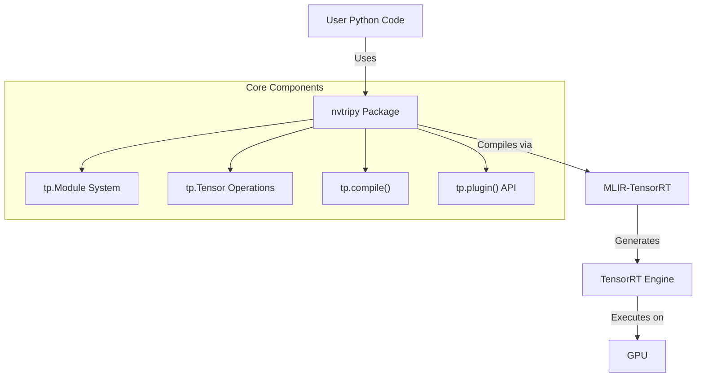

Sources: [tripy/README.md:14-25](), [tripy/pyproject.toml:1-19]()

### Key Features

- **High performance**: Leverages TensorRT's optimization capabilities
- **Intuitive API**: Follows familiar conventions from frameworks like PyTorch
- **Debuggability**: Includes eager mode for interactive debugging
- **Informative error messages**: Provides actionable feedback
- **Documentation**: Comprehensive yet concise with examples

## Package Details

The nvtripy package is currently at version 0.1.1 and has the following key dependencies:

| Dependency | Version Requirement |
|------------|---------------------|
| TensorRT   | >=10.9              |
| MLIR-TensorRT Compiler | 0.1.40+cuda12.trt109 |
| MLIR-TensorRT Runtime  | 0.1.40+cuda12.trt109 |

Sources: [tripy/pyproject.toml:1-14](), [tripy/nvtripy/__init__.py:18]()

## Architecture

### Data Flow: From Python to GPU

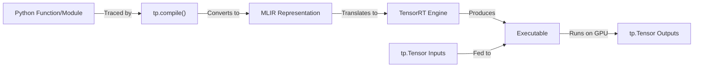

Sources: [tripy/docs/pre0_user_guides/00-introduction-to-tripy.md:55-82](), [tripy/examples/nanogpt/example.py:98-109]()

### Execution Modes

Tripy supports two primary execution modes:

1. **Eager Mode**: For debugging and development
   - Operations are evaluated immediately when needed
   - Each operation compiles a separate TensorRT engine (slower)
   - Allows step-by-step debugging

2. **Compiled Mode**: For production and performance
   - Entire model is compiled once
   - Optimized TensorRT engine covers the whole model
   - Significantly better performance

Sources: [tripy/docs/pre0_user_guides/00-introduction-to-tripy.md:84-114]()

## Core Components

### Module System

Tripy provides a module system similar to PyTorch for organizing neural network components:

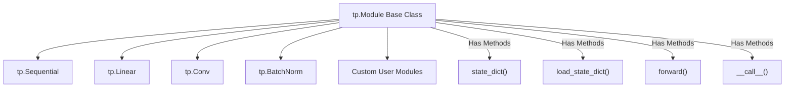

Sources: [tripy/docs/pre0_user_guides/00-introduction-to-tripy.md:19-35]()

### Tensor Operations

Tripy includes a comprehensive set of tensor operations:

| Category | Examples | Description |
|----------|----------|-------------|
| Creation | `ones`, `zeros`, `iota` | Create tensors with specific values |
| Math | `add`, `mul`, `matmul` | Mathematical operations |
| NN | `relu`, `gelu`, `softmax` | Neural network activations |
| Manipulation | `reshape`, `transpose` | Change tensor dimensions |

Sources: [tripy/docs/pre0_user_guides/00-introduction-to-tripy.md:7-17](), [tripy/tests/integration/test_plugin.py:23-37]()

### Compilation System

The compilation system is a key component that transforms Python code into optimized TensorRT engines:

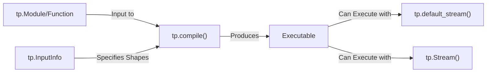

Sources: [tripy/docs/pre0_user_guides/00-introduction-to-tripy.md:55-82](), [tripy/tests/backend/api/test_stream.py:20-51]()

### Plugin System

Tripy supports TensorRT plugins, allowing users to extend functionality with custom operations:

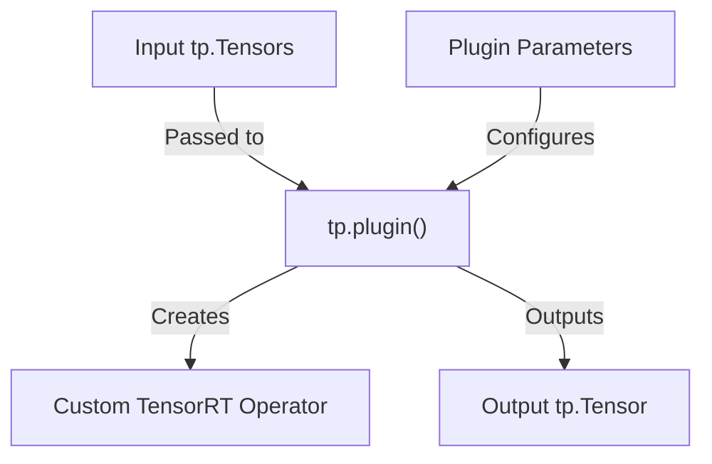

Sources: [tripy/tests/integration/test_plugin.py:23-53]()

## Usage Examples

### Basic Usage

1. **Define a model**:
   ```python
   class Model(tp.Module):
       def __init__(self):
           self.conv = tp.Conv(in_channels=1, out_channels=1, kernel_dims=[3, 3])

       def forward(self, x):
           x = self.conv(x)
           x = tp.relu(x)
           return x
   ```

2. **Initialize parameters**:
   ```python
   model = Model()
   model.load_state_dict({
       "conv.weight": tp.ones((1, 1, 3, 3)),
       "conv.bias": tp.ones((1,)),
   })
   ```

3. **Execute in eager mode**:
   ```python
   dummy_input = tp.ones((1, 1, 4, 4)).eval()
   eager_out = model(dummy_input)
   ```

4. **Compile and execute**:
   ```python
   compiled_model = tp.compile(
       model,
       args=[tp.InputInfo(shape=(1, 1, 4, 4), dtype=tp.float32)],
   )
   compiled_out = compiled_model(dummy_input)
   ```

Sources: [tripy/README.md:40-83]()

### Dynamic Shapes

Tripy supports dynamic shapes for flexible input dimensions:

```python
# Specify dynamic dimensions with (min, optimal, max) values
input_shape = (
    1,  # Batch size
    (1, current_length, max_length),  # Sequence length dimension is dynamic
)
model = tp.compile(model, args=[tp.InputInfo(input_shape, dtype=tp.int32)])
```

Sources: [tripy/examples/nanogpt/example.py:101-107]()

### Plugin Usage

Example of using a TensorRT plugin with Tripy:

```python
# Create input tensor
inp = tp.iota((2, 2))

# Apply plugin
out = tp.plugin(
    name="CustomGeluPluginDynamic",
    inputs=[inp],
    output_info=[(inp.rank, inp.dtype)],
    # Plugin parameters
    type_id=0,
)
```

Sources: [tripy/tests/integration/test_plugin.py:24-37]()

## Installation

Install the nvtripy package using pip:

```bash
python3 -m pip install nvtripy -f https://nvidia.github.io/TensorRT-Incubator/packages.html
```

Sources: [tripy/README.md:29-31](), [tripy/docs/packages.html:10-183]()

## Common Pitfalls and Best Practices

| Pitfall | Best Practice |
|---------|---------------|
| Slow execution in eager mode | Use eager mode only for debugging; compile for deployment |
| Inaccurate timing in eager mode | Be aware that tensors are evaluated only when used, affecting timing measurements |
| Missing parameters in module | Check `state_dict()` to ensure all parameters are initialized |
| Shape mismatches | Use dynamic shapes when input dimensions may vary |

Sources: [tripy/docs/pre0_user_guides/00-introduction-to-tripy.md:84-114]()

---

# Page: MLIR-TensorRT Project

# MLIR-TensorRT Project

<details>
<summary>Relevant source files</summary>

The following files were used as context for generating this wiki page:

- [.github/workflows/mlir-tensorrt-ci.yml](.github/workflows/mlir-tensorrt-ci.yml)
- [mlir-tensorrt/.devcontainer/cuda12.5-rockylinux8-gcc11/devcontainer.json](mlir-tensorrt/.devcontainer/cuda12.5-rockylinux8-gcc11/devcontainer.json)
- [mlir-tensorrt/CMakeLists.txt](mlir-tensorrt/CMakeLists.txt)
- [mlir-tensorrt/CMakePresets.json](mlir-tensorrt/CMakePresets.json)
- [mlir-tensorrt/README.md](mlir-tensorrt/README.md)
- [mlir-tensorrt/Version.cmake](mlir-tensorrt/Version.cmake)
- [mlir-tensorrt/build_tools/cmake/Dependencies.cmake](mlir-tensorrt/build_tools/cmake/Dependencies.cmake)
- [mlir-tensorrt/build_tools/cmake/TensorRTDownloadURL.cmake](mlir-tensorrt/build_tools/cmake/TensorRTDownloadURL.cmake)
- [mlir-tensorrt/build_tools/docker/Dockerfile](mlir-tensorrt/build_tools/docker/Dockerfile)
- [mlir-tensorrt/build_tools/scripts/build_wheels.sh](mlir-tensorrt/build_tools/scripts/build_wheels.sh)
- [mlir-tensorrt/build_tools/scripts/cicd_build.sh](mlir-tensorrt/build_tools/scripts/cicd_build.sh)
- [mlir-tensorrt/executor/lib/Runtime/Backend/Lua/Modules/CMakeLists.txt](mlir-tensorrt/executor/lib/Runtime/Backend/Lua/Modules/CMakeLists.txt)
- [mlir-tensorrt/python/requirements-dev.txt](mlir-tensorrt/python/requirements-dev.txt)

</details>


## Purpose and Scope

This document provides an overview of the MLIR-TensorRT project, which serves as the compiler infrastructure within the TensorRT-Incubator repository. MLIR-TensorRT enables the integration of NVIDIA's TensorRT with the MLIR (Multi-Level Intermediate Representation) compiler infrastructure, providing a pathway for optimizing and deploying machine learning models to NVIDIA GPUs. For more detailed technical documentation on MLIR-TensorRT, see [MLIR-TensorRT Technical Documentation](#4).

Sources: [mlir-tensorrt/README.md:1-17]()

## Overview

MLIR-TensorRT is a core component of the TensorRT-Incubator repository that provides:

1. A custom MLIR dialect that precisely models the TensorRT operator set
2. Conversions from StableHLO to the TensorRT dialect
3. A compiler infrastructure for generating optimized TensorRT engines
4. Runtime components for model execution
5. Python bindings for seamless integration

The project serves as the underlying compiler technology that powers higher-level interfaces like Tripy/nvtripy, enabling Python-based neural network models to be efficiently executed on NVIDIA GPUs.

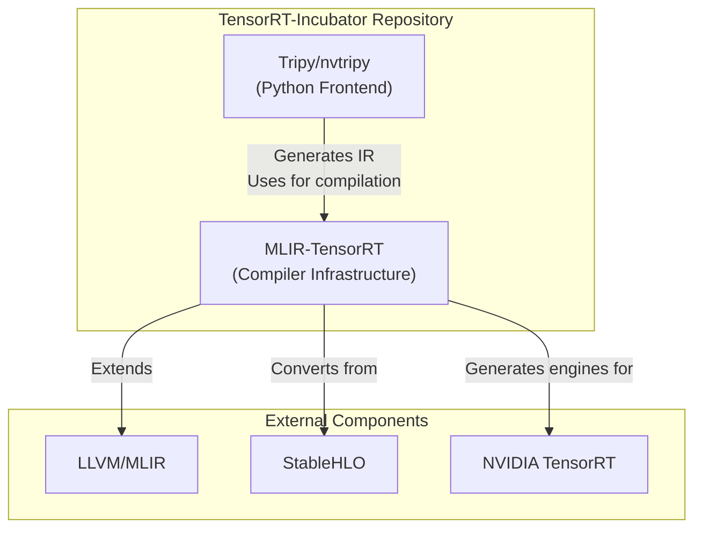

Sources: [mlir-tensorrt/README.md:1-17](), [mlir-tensorrt/CMakeLists.txt:30-46]()

## Key Components

MLIR-TensorRT consists of several key components that work together to provide the full functionality of the project:

### TensorRT Dialect

The TensorRT dialect is an MLIR dialect that models the TensorRT operator set with static verification, type inference, and optimizations. This dialect provides:

- A precise representation of TensorRT operations in MLIR IR
- Static verification to ensure correctness before runtime
- Type inference for operations
- Optimization passes specific to TensorRT operations

### Compilation System

The compilation system handles the conversion from higher-level representations to TensorRT engines:

- Provides conversions from StableHLO to the TensorRT dialect
- Supports compilation of models with dynamic shapes
- Includes multiple compilation pipelines:
  - TensorRTToExecutable: Converts TensorRT dialect to executable format
  - StablehloToExecutable: Directly converts StableHLO to executable format

### Runtime System

The runtime system manages the execution of compiled models:

- RuntimeClient interfaces for executing compiled models
- RuntimeSession for managing runtime state
- Support for various execution models including synchronous and asynchronous execution
- Integration with TensorRT's runtime system

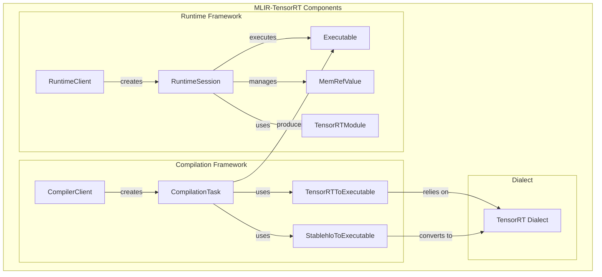

Sources: [mlir-tensorrt/README.md:5-13](), [mlir-tensorrt/CMakeLists.txt:30-46]()

## Integration with StableHLO

One of the key features of MLIR-TensorRT is its integration with StableHLO, which is a portable MLIR dialect for high-level operations designed for machine learning. MLIR-TensorRT provides:

- Conversion patterns from StableHLO operations to TensorRT dialect operations
- Support for complex StableHLO models and features
- Optimizations specific to StableHLO conversion

This integration allows models defined in frameworks like JAX, TensorFlow, and PyTorch (via conversion to StableHLO) to be compiled to TensorRT for efficient execution on NVIDIA GPUs.

Sources: [mlir-tensorrt/README.md:10-11](), [mlir-tensorrt/CMakeLists.txt:147-150]()

## Compilation and Execution Flow

The following diagram illustrates the overall flow from higher-level representations to GPU execution using MLIR-TensorRT:

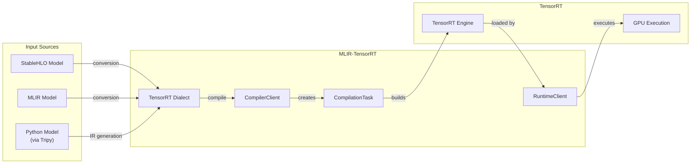

Sources: [mlir-tensorrt/README.md:7-13]()

## Python Integration

MLIR-TensorRT includes Python bindings for seamless integration with Python-based ML frameworks and applications:

- Python bindings for the TensorRT dialect
- Python interface for the compiler framework
- Integration with DLPack for tensor interoperability
- Support for Python-based testing and benchmarking

This enables developers to use MLIR-TensorRT directly from Python code, making it easier to integrate with existing Python-based ML workflows.

Sources: [mlir-tensorrt/CMakeLists.txt:40](), [mlir-tensorrt/python/requirements-dev.txt:1-18]()

## Build and Dependency Management

MLIR-TensorRT provides a flexible build system that supports various ways of integration:

1. **Standalone build with LLVM downloaded by CMake**:
   - Simplest approach for getting started
   - Automatically downloads LLVM and TensorRT dependencies

2. **Standalone build with user-provided LLVM**:
   - Allows using a custom LLVM build
   - Supports integration with existing LLVM-based projects

3. **Sub-project of a larger build**:
   - Can be included in larger projects via `add_subdirectory()`
   - Shares CMake configuration with parent project

4. **LLVM-External-Projects mechanism**:
   - Builds as an external project within LLVM's build system

The project also manages TensorRT dependencies, supporting multiple versions (8.6 through 10.9) with automatic download capabilities.

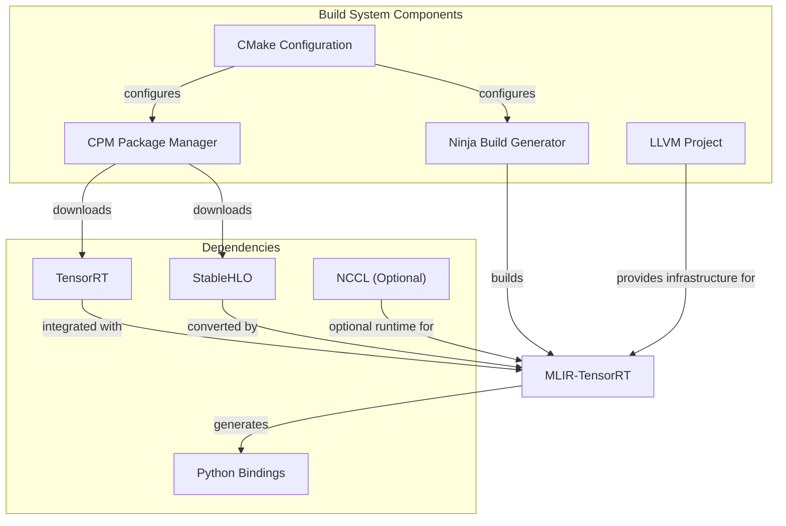

Sources: [mlir-tensorrt/README.md:19-135](), [mlir-tensorrt/CMakeLists.txt:4-223](), [mlir-tensorrt/build_tools/cmake/Dependencies.cmake:1-222]()

## Continuous Integration and Development

MLIR-TensorRT maintains a robust continuous integration (CI) system to ensure code quality:

- Automated tests via GitHub Actions
- Support for multiple TensorRT versions (8.6 through 10.9)
- Comprehensive test suites including unit and integration tests
- Format checking for C++ and Python code

The development workflow supports:
- Automated wheel building for Python packages
- Containerized development environments
- Various build configurations (Debug, Release, RelWithDebInfo)

Sources: [.github/workflows/mlir-tensorrt-ci.yml:1-168](), [mlir-tensorrt/build_tools/scripts/cicd_build.sh:1-21]()

## Version and Compatibility

MLIR-TensorRT is versioned independently from TensorRT, with its own versioning scheme. The current version as of this documentation is 0.1.40, as defined in the Version.cmake file.

The project is designed to be compatible with various TensorRT versions, with support for versions ranging from TensorRT 8.6 to 10.9. The build system can automatically download and configure the appropriate TensorRT version based on user preferences.

Sources: [mlir-tensorrt/Version.cmake:1-5](), [mlir-tensorrt/build_tools/cmake/TensorRTDownloadURL.cmake:1-215]()

---

# Page: Architecture and Components

# Architecture and Components

<details>
<summary>Relevant source files</summary>

The following files were used as context for generating this wiki page:

- [tripy/README.md](tripy/README.md)
- [tripy/docs/README.md](tripy/docs/README.md)
- [tripy/docs/pre0_user_guides/00-introduction-to-tripy.md](tripy/docs/pre0_user_guides/00-introduction-to-tripy.md)
- [tripy/docs/pre0_user_guides/03-custom-operations.md](tripy/docs/pre0_user_guides/03-custom-operations.md)
- [tripy/examples/nanogpt/example.py](tripy/examples/nanogpt/example.py)
- [tripy/nvtripy/backend/api/compile.py](tripy/nvtripy/backend/api/compile.py)
- [tripy/nvtripy/backend/api/executable.py](tripy/nvtripy/backend/api/executable.py)
- [tripy/nvtripy/backend/api/input_info.py](tripy/nvtripy/backend/api/input_info.py)
- [tripy/nvtripy/common/shape_bounds.py](tripy/nvtripy/common/shape_bounds.py)
- [tripy/nvtripy/export.py](tripy/nvtripy/export.py)
- [tripy/nvtripy/frontend/ops/plugin.py](tripy/nvtripy/frontend/ops/plugin.py)
- [tripy/nvtripy/frontend/ops/plugin_qdp.py](tripy/nvtripy/frontend/ops/plugin_qdp.py)
- [tripy/nvtripy/frontend/tensor.py](tripy/nvtripy/frontend/tensor.py)
- [tripy/nvtripy/trace/ops/constant.py](tripy/nvtripy/trace/ops/constant.py)
- [tripy/nvtripy/trace/ops/plugin.py](tripy/nvtripy/trace/ops/plugin.py)
- [tripy/tests/backend/api/test_compile.py](tripy/tests/backend/api/test_compile.py)
- [tripy/tests/backend/api/test_executable.py](tripy/tests/backend/api/test_executable.py)
- [tripy/tests/backend/api/test_input_info.py](tripy/tests/backend/api/test_input_info.py)
- [tripy/tests/backend/api/test_stream.py](tripy/tests/backend/api/test_stream.py)
- [tripy/tests/conftest.py](tripy/tests/conftest.py)
- [tripy/tests/frontend/ops/test_plugin_qdp.py](tripy/tests/frontend/ops/test_plugin_qdp.py)
- [tripy/tests/integration/test_plugin.py](tripy/tests/integration/test_plugin.py)
- [tripy/tests/integration/test_plugin_qdp.py](tripy/tests/integration/test_plugin_qdp.py)

</details>


This document provides a technical overview of the TensorRT-Incubator architecture and how its components interact to enable efficient deep learning inference. It covers the flow from Python code to GPU execution, the core components of the system, and how they work together.

For a general introduction to the project, see [Overview](#1). For more specific information about the Python package, see [Tripy/nvtripy Package](#1.1), and for details on the MLIR integration, see [MLIR-TensorRT Project](#1.2).

## High-Level Architecture Overview

The TensorRT-Incubator consists of two main subprojects that work together to provide a complete solution for deep learning inference:

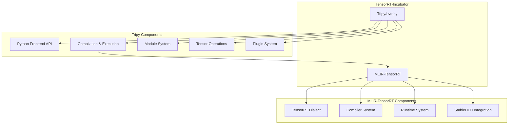

Sources: [tripy/README.md:15-24](), [tripy/docs/pre0_user_guides/00-introduction-to-tripy.md:1-4]()

## Data Flow Pipeline

When a user executes code in TensorRT-Incubator, the following sequence of operations occurs:

```mermaid
graph LR
    subgraph "User Code"
        PyFunc["Python Function/Module"]
        UserAPI["tp.Module, tp.Tensor, etc."]
    end
    
    subgraph "Tripy Pipeline"
        Trace["Tracing"]
        Compile["tp.compile"]
        MLIR["MLIR Generation"]
        TRTCompile["TensorRT Compilation"]
        Executable["Executable"]
        Execution["Runtime Execution"]
    end
    
    subgraph "TensorRT"
        TRTEngine["TensorRT Engine"]
        GPUExecution["GPU Execution"]
    end
    
    PyFunc --> UserAPI
    UserAPI --> Trace
    Trace --> Compile
    Compile --> MLIR
    MLIR --> TRTCompile
    TRTCompile --> Executable
    Executable --> Execution
    Execution --> TRTEngine
    TRTEngine --> GPUExecution
```

1. User writes Python code using the Tripy API
2. Function/module is traced to capture tensor operations
3. The trace is converted to MLIR representation
4. MLIR is compiled to a TensorRT engine
5. The compiled executable is run on the GPU

Sources: [tripy/nvtripy/backend/api/compile.py:33-75](), [tripy/examples/nanogpt/example.py:97-107]()

## Core Components

### Tensor System

The `tp.Tensor` class represents multi-dimensional arrays with uniform data types and is the foundational building block of the system:

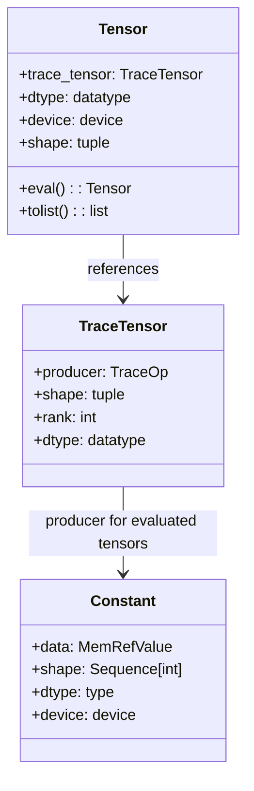

Key features:
- **Lazy evaluation**: Operations are only executed when needed
- **Device management**: Tensors can reside in CPU or GPU memory
- **DLPack support**: Interoperability with other frameworks
- **Automatic differentiation**: Built-in gradient calculation

Sources: [tripy/nvtripy/frontend/tensor.py:56-70](), [tripy/nvtripy/frontend/tensor.py:210-297](), [tripy/nvtripy/trace/ops/constant.py:138-152]()

### Module System

The module system provides a way to organize neural network components:

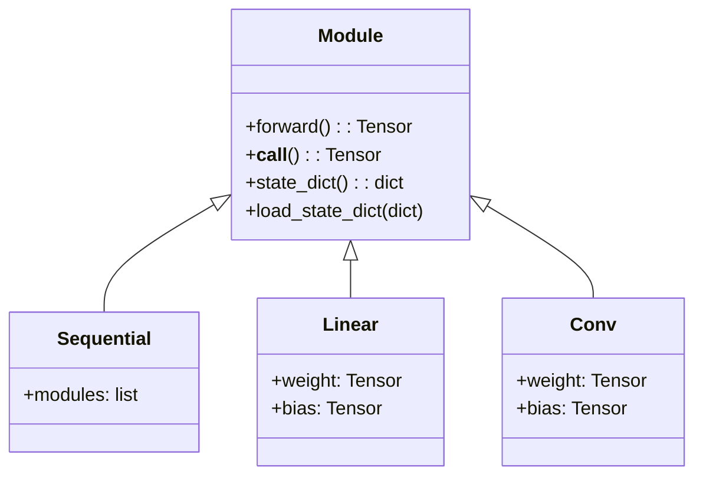

Key features:
- **PyTorch-like API**: Familiar interface for deep learning practitioners 
- **State management**: Methods for saving and loading parameters
- **Hierarchical composition**: Modules can contain other modules
- **Built-in layers**: Common layers like Linear, Conv, BatchNorm, etc.

Sources: [tripy/docs/pre0_user_guides/00-introduction-to-tripy.md:19-54]()

### Compilation System

The compilation system converts Python functions and modules into optimized executables:

```mermaid
graph TD
    subgraph "Compilation System"
        Compile["tp.compile function"]
        InputInfo["tp.InputInfo"]
        TraceFunc["TraceFunctionPass"]
        CreateMLIR["MLIRGenerator"]
        CompileMLIR["MLIRCompiler"]
        CreateExe["ExecutableCreator"]
    end
    
    Compile --> InputInfo: "uses for shape specs"
    Compile --> TraceFunc: "captures operations"
    TraceFunc --> CreateMLIR: "generates IR"
    CreateMLIR --> CompileMLIR: "optimizes"
    CompileMLIR --> CreateExe: "builds executable"
```

Key components:
- **tp.compile**: Main entry point for compilation
- **tp.InputInfo**: Specifies input shapes and types
- **Trace function**: Captures tensor operations
- **MLIR generation**: Converts trace to MLIR
- **TensorRT compilation**: Optimizes MLIR for GPU execution

Sources: [tripy/nvtripy/backend/api/compile.py:32-248](), [tripy/tests/backend/api/test_compile.py:27-48]()

### Executable System

The `tp.Executable` class represents a compiled function that can be executed on the GPU:

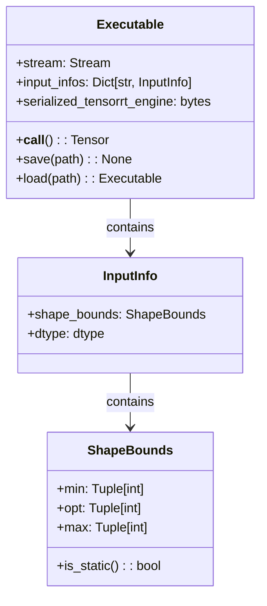

Key features:
- **Function-like interface**: Simple execution via function call
- **Persistence**: Save and load compiled models
- **Stream management**: Control execution timing
- **TensorRT engine access**: Direct access to the underlying engine

Sources: [tripy/nvtripy/backend/api/executable.py:32-327](), [tripy/tests/backend/api/test_executable.py:39-135](), [tripy/nvtripy/backend/api/input_info.py:24-102](), [tripy/nvtripy/common/shape_bounds.py:26-61]()

### Plugin System

The plugin system allows extending TensorRT with custom operations:

```mermaid
graph TD
    subgraph "Plugin System"
        Plugin["tp.plugin function"]
        PluginRegistry["PluginRegistry"]
        
        subgraph "Plugin Types"
            TRTPlugin["TensorRT Plugin"]
            QDPPlugin["QDP Plugin"]
        end
        
        subgraph "Implementation"
            CUDA["CUDA Kernel"]
            Triton["Triton Kernel"]
            CustomOp["Custom Operations"]
        end
    end
    
    Plugin --> PluginRegistry: "registers"
    PluginRegistry --> TRTPlugin: "manages"
    PluginRegistry --> QDPPlugin: "manages"
    TRTPlugin --> CUDA: "implemented with"
    TRTPlugin --> Triton: "implemented with"
    QDPPlugin --> CustomOp: "implements"
```

Key features:
- **Traditional TensorRT plugins**: Support for IPluginV2DynamicExt interface
- **Quickly Deployable Plugins (QDPs)**: Simplified plugin API
- **Custom kernels**: Support for various kernel implementations (CUDA, Triton, etc.)
- **Dynamic shape support**: Plugins can handle tensors with varying dimensions

Sources: [tripy/nvtripy/frontend/ops/plugin.py:26-69](), [tripy/nvtripy/frontend/ops/plugin_qdp.py:41-128](), [tripy/tests/integration/test_plugin.py:23-53](), [tripy/docs/pre0_user_guides/03-custom-operations.md:1-137]()

## MLIR-TensorRT Integration

MLIR-TensorRT provides the compiler infrastructure that powers Tripy:

```mermaid
graph TD
    subgraph "MLIR-TensorRT"
        TRTDialect["TensorRT Dialect"]
        CompilerClient["CompilerClient"]
        RuntimeClient["RuntimeClient"]
    end
    
    subgraph "Compilation Pipeline"
        CompilationTask["CompilationTask"]
        TensorRTToExecutable["TensorRTToExecutable"]
        StablehloToExecutable["StablehloToExecutable"]
    end
    
    subgraph "Runtime Components"
        RuntimeSession["RuntimeSession"]
        MemRefValue["MemRefValue"]
        TensorRTModule["TensorRTModule"]
        Executable["Executable"]
    end
    
    CompilerClient --> CompilationTask
    CompilationTask --> TensorRTToExecutable
    CompilationTask --> StablehloToExecutable
    TensorRTToExecutable --> TRTDialect
    StablehloToExecutable --> TRTDialect
    
    RuntimeClient --> RuntimeSession
    RuntimeSession --> MemRefValue
    RuntimeSession --> TensorRTModule
    RuntimeSession --> Executable
```

Key components:
- **TensorRT Dialect**: MLIR dialect that models TensorRT operations
- **CompilerClient**: Interface for compiling MLIR to TensorRT
- **RuntimeClient**: Interface for executing compiled models
- **RuntimeSession**: Manages execution state and resources

The integration enables:
- Converting MLIR representations to optimized TensorRT engines
- Executing engines with efficient memory management
- Integrating with StableHLO for better interoperability

Sources: [tripy/nvtripy/backend/api/executable.py:43-63](), [tripy/nvtripy/frontend/tensor.py:240-273]()

## Dynamic Shapes Support

One of the key features of TensorRT-Incubator is its support for dynamic shapes:

```mermaid
graph LR
    subgraph "Dynamic Shapes System"
        InputInfo["tp.InputInfo"]
        ShapeBounds["ShapeBounds"]
        
        subgraph "Shape Definition"
            MinShape["Minimum Dimensions"]
            OptShape["Optimal Dimensions"]
            MaxShape["Maximum Dimensions"]
        end
        
        subgraph "TensorRT Optimization"
            TRTProfiles["TensorRT Optimization Profiles"]
            DynamicExecution["Dynamic Execution"]
        end
    end
    
    InputInfo --> ShapeBounds: "contains"
    ShapeBounds --> MinShape: "defines"
    ShapeBounds --> OptShape: "defines"
    ShapeBounds --> MaxShape: "defines"
    ShapeBounds --> TRTProfiles: "creates"
    TRTProfiles --> DynamicExecution: "enables"
```

The dynamic shapes system allows:
- Specifying minimum, optimal, and maximum dimensions for each input
- Creating optimization profiles for TensorRT
- Supporting a range of input shapes with a single compiled model
- Efficient handling of varying batch sizes and feature dimensions

Example usage:
```python
# Support batch sizes from 1 to 64, optimizing for batch size 16
input_info = tp.InputInfo(shape=((1, 16, 64), 784), dtype=tp.float32)

# Compile once, use with various shapes
compiled_model = tp.compile(model, args=[input_info])

# Use with different batch sizes
small_batch = tp.ones((1, 784), dtype=tp.float32).eval()
large_batch = tp.ones((64, 784), dtype=tp.float32).eval()

small_output = compiled_model(small_batch)
large_output = compiled_model(large_batch)
```

Sources: [tripy/nvtripy/backend/api/input_info.py:24-102](), [tripy/nvtripy/common/shape_bounds.py:26-61](), [tripy/tests/backend/api/test_input_info.py:20-62]()

## End-to-End Example: NanoGPT

The following example demonstrates how all components work together in a real-world scenario, using the NanoGPT example from the codebase:

```mermaid
graph TD
    subgraph "NanoGPT Example"
        ModelDef["1. Define GPT Model"]
        LoadWeights["2. Load Weights"]
        CompileModel["3. Compile Model"]
        RunInference["4. Run Inference"]
    end
    
    subgraph "Components Used"
        ModuleSystem["Module System"]
        TensorOps["Tensor Operations"]
        InputInfoDef["Dynamic Shape InputInfo"]
        CompileAPI["tp.compile"]
        ExecutableAPI["Executable"]
    end
    
    ModelDef --> ModuleSystem
    LoadWeights --> TensorOps
    CompileModel --> InputInfoDef
    CompileModel --> CompileAPI
    RunInference --> ExecutableAPI
    
    ModelDef --> LoadWeights --> CompileModel --> RunInference
```

Key steps:
1. **Model definition**: Define the GPT model using the module system
2. **Weight loading**: Load pre-trained weights into the model
3. **Compilation**: Compile the model with dynamic shape support
4. **Inference**: Run the model on input data

Code example (simplified from the actual implementation):
```python
# Initialize model
model = initialize_gpt_model(model_type, padded_seq_len, tp.float16, quant_mode)
load_weights_from_hf(model, model_type, tp.float16)

# Prepare input
idx = tp.unsqueeze(tp.Tensor(input_ids), 0).eval()

# Compile with dynamic sequence length
input_shape = (
    1,
    (1, len(input_ids), padded_seq_len),
)
model = tp.compile(model, args=[tp.InputInfo(input_shape, dtype=tp.int32)])

# Run inference
logits = model(idx)
```

Sources: [tripy/examples/nanogpt/example.py:29-107]()

## Summary

The TensorRT-Incubator architecture provides a complete solution for deep learning inference:

1. **Frontend (Tripy/nvtripy)**: Pythonic API for defining and compiling models
2. **Backend (MLIR-TensorRT)**: Compiler infrastructure for optimizing models
3. **Core Components**:
   - Tensor System: Fundamental data structure
   - Module System: Neural network component organization
   - Compilation System: Python-to-GPU optimization
   - Executable System: Runtime execution
   - Plugin System: Custom operation support

The architecture enables efficient deep learning inference on NVIDIA GPUs with a developer-friendly API, dynamic shape support, and extensive customization options.

For information on using Tripy, see [Tripy User Guide](#2).

Sources: [tripy/README.md:15-24](), [tripy/docs/pre0_user_guides/00-introduction-to-tripy.md:1-16]()

---

# Page: Tripy User Guide

# Tripy User Guide

<details>
<summary>Relevant source files</summary>

The following files were used as context for generating this wiki page:

- [tripy/CONTRIBUTING.md](tripy/CONTRIBUTING.md)
- [tripy/README.md](tripy/README.md)
- [tripy/docs/pre0_user_guides/00-introduction-to-tripy.md](tripy/docs/pre0_user_guides/00-introduction-to-tripy.md)
- [tripy/examples/nanogpt/README.md](tripy/examples/nanogpt/README.md)
- [tripy/examples/nanogpt/example.py](tripy/examples/nanogpt/example.py)
- [tripy/examples/segment-anything-model-v2/README.md](tripy/examples/segment-anything-model-v2/README.md)
- [tripy/examples/segment-anything-model-v2/checkpoints/download_ckpt.sh](tripy/examples/segment-anything-model-v2/checkpoints/download_ckpt.sh)
- [tripy/examples/segment-anything-model-v2/download_test_data.py](tripy/examples/segment-anything-model-v2/download_test_data.py)
- [tripy/examples/segment-anything-model-v2/video_demo.py](tripy/examples/segment-anything-model-v2/video_demo.py)
- [tripy/notebooks/resnet50.ipynb](tripy/notebooks/resnet50.ipynb)
- [tripy/tests/backend/api/test_stream.py](tripy/tests/backend/api/test_stream.py)
- [tripy/tests/integration/test_plugin.py](tripy/tests/integration/test_plugin.py)
- [tripy/tests/test_examples.py](tripy/tests/test_examples.py)

</details>


This guide serves as a comprehensive reference for using Tripy, a debuggable, Pythonic frontend for TensorRT. It covers core concepts, workflow patterns, and best practices to help you build and optimize deep learning inference applications. For more specialized topics, refer to the linked sub-pages.

For installation instructions, see [Getting Started](#2.1).
For information about how the compiler works, see [Compilation and Execution](#2.4).

## What is Tripy?

Tripy provides a high-level Python interface to NVIDIA's TensorRT deep learning inference accelerator. It offers:

- **Intuitive API** that follows Python ecosystem conventions
- **Debuggability** with eager execution mode
- **High performance** through TensorRT's optimization capabilities
- **Developer-friendly experience** with informative error messages

```mermaid
flowchart LR
    subgraph "User Code"
        PyCode["Python Code"]
    end

    subgraph "Tripy"
        PyAPI["Python API\n(tp.Module, tp.Tensor)"]
        Eager["Eager Mode\n(Debug)"]
        Compiler["Compilation System\n(tp.compile)"]
    end

    subgraph "TensorRT"
        Engine["TensorRT Engine"]
        GPUExec["Optimized GPU Execution"]
    end

    PyCode --> PyAPI
    PyAPI --> Eager
    PyAPI --> Compiler
    Eager --> Engine
    Compiler --> Engine
    Engine --> GPUExec
```

Sources: [tripy/README.md:15-25](), [tripy/docs/pre0_user_guides/00-introduction-to-tripy.md:1-17]()

## Workflow Overview

The typical Tripy workflow consists of two main phases:

1. **Development & Debugging**: Use eager mode for interactive development
2. **Deployment**: Compile your model for optimized execution

```mermaid
flowchart LR
    subgraph "Development"
        Define["Define Model\n(tp.Module)"]
        State["Set Parameters\n(load_state_dict)"]
        Eager["Debug with\nEager Mode"]
    end

    subgraph "Deployment"
        Trace["Trace Model"]
        Compile["Compile\n(tp.compile)"]
        Execute["Execute\nOptimized Model"]
    end

    Define --> State
    State --> Eager
    Eager --> Trace
    Trace --> Compile
    Compile --> Execute
```

Sources: [tripy/README.md:40-84](), [tripy/docs/pre0_user_guides/00-introduction-to-tripy.md:56-77]()

## Core Concepts

### Module System

Tripy's module system resembles PyTorch, allowing you to create neural network architectures through composition:

```mermaid
classDiagram
    class Module {
        +forward()
        +state_dict()
        +load_state_dict()
    }
    
    class Built-in {
        Linear
        Conv
        BatchNorm
        LayerNorm
        Sequential
    }
    
    class Custom {
        MLP
        ResNetBlock
        Transformer
    }
    
    Module <|-- Built-in
    Module <|-- Custom
```

Example of defining a model:

```python
class Model(tp.Module):
    def __init__(self):
        self.conv = tp.Conv(in_channels=1, out_channels=1, kernel_dims=[3, 3])

    def forward(self, x):
        x = self.conv(x)
        x = tp.relu(x)
        return x
```

Sources: [tripy/README.md:41-52](), [tripy/notebooks/resnet50.ipynb:63-118]()

### Tensor Operations

Tripy provides a comprehensive set of tensor operations:

- **Creation**: `ones`, `zeros`, `full`, `iota`
- **Math**: `add`, `mul`, `matmul`, etc.
- **Neural network**: `relu`, `gelu`, `softmax`
- **Manipulation**: `reshape`, `transpose`, `flatten`

Tensor operations work in both eager and compiled mode.

Sources: [tripy/docs/pre0_user_guides/00-introduction-to-tripy.md:7-17](), [tripy/tests/backend/api/test_stream.py:33-51]()

### Eager vs. Compiled Execution

Tripy offers two execution models:

| Feature | Eager Mode | Compiled Mode |
|---------|------------|---------------|
| Purpose | Development & debugging | Deployment & inference |
| Performance | Slower (per-op compilation) | Faster (optimized) |
| Flexibility | Interactive, step-by-step | Fixed graph |
| Debugging | Easy to inspect values | Limited visibility |
| Memory usage | Higher | Lower |

```mermaid
flowchart LR
    subgraph "Eager Mode"
        EA[Operation A] --> EB[Operation B] --> EC[Operation C]
    end

    subgraph "Compiled Mode"
        CA["Entire Model\nCompiled Once"] --> CO["Optimized\nExecution"]
    end

    style EA fill:none
    style EB fill:none
    style EC fill:none
    style CA fill:none
    style CO fill:none
```

Sources: [tripy/docs/pre0_user_guides/00-introduction-to-tripy.md:84-114]()

## Using Tripy

### Model Definition

Define models by subclassing `tp.Module` and implementing a `forward` method:

```python
class MLP(tp.Module):
    def __init__(self, embd_size, dtype=tp.float32):
        super().__init__()
        self.c_fc = tp.Linear(embd_size, 4 * embd_size, bias=True, dtype=dtype)
        self.c_proj = tp.Linear(4 * embd_size, embd_size, bias=True, dtype=dtype)

    def forward(self, x):
        x = self.c_fc(x)
        x = tp.gelu(x)
        x = self.c_proj(x)
        return x
```

Sources: [tripy/docs/pre0_user_guides/00-introduction-to-tripy.md:24-35]()

### Parameter Management

Set and retrieve model parameters using the state dictionary interface:

```python
# Set parameters
model.load_state_dict({
    "conv.weight": tp.ones((1, 1, 3, 3)),
    "conv.bias": tp.ones((1,)),
})

# Get parameters
params = model.state_dict()
```

Sources: [tripy/README.md:57-64](), [tripy/docs/pre0_user_guides/00-introduction-to-tripy.md:43-50]()

### Eager Mode Execution

Run your model directly for debugging:

```python
# Create input tensor and evaluate it (forces execution)
input_data = tp.ones((1, 1, 4, 4)).eval()

# Run in eager mode
output = model(input_data)
```

Sources: [tripy/README.md:68-72](), [tripy/docs/pre0_user_guides/00-introduction-to-tripy.md:97-113]()

### Compilation

Compile your model for optimized execution:

```python
compiled_model = tp.compile(
    model,
    args=[tp.InputInfo(shape=(1, 1, 4, 4), dtype=tp.float32)],
)

# Run the compiled model
result = compiled_model(input_data)
```

`tp.InputInfo` defines the expected input shape and data type. For models with multiple inputs, provide multiple `InputInfo` objects.

Sources: [tripy/README.md:76-83](), [tripy/docs/pre0_user_guides/00-introduction-to-tripy.md:60-68]()

### Dynamic Shapes

Tripy supports dynamic tensor dimensions for flexible models:

```python
# Support variable sequence length (from 1 to 256)
dynamic_model = tp.compile(
    model,
    args=[tp.InputInfo(shape=(1, (1, 128, 256)), dtype=tp.float32)],
)
```

A tuple of three values `(min, opt, max)` indicates a dynamic dimension that can vary between the minimum and maximum values, with an optimization target.

Sources: [tripy/examples/nanogpt/example.py:101-106]()

### Plugin System

Extend Tripy with custom TensorRT plugins:

```python
output = tp.plugin(
    name="CustomGeluPluginDynamic", 
    inputs=[input_tensor],
    output_info=[(input_tensor.rank, input_tensor.dtype)],
    # Plugin parameters:
    type_id=0,
)
```

The `output_info` parameter specifies the rank and data type of each output tensor.

Sources: [tripy/tests/integration/test_plugin.py:26-37](), [tripy/tests/integration/test_plugin.py:39-53]()

## Real-World Examples

Tripy includes several example implementations that demonstrate its capabilities:

### NanoGPT

A lightweight GPT model implementation that shows:
- Transformer architecture in Tripy
- Weight loading from HuggingFace checkpoints
- Quantization support (INT8, INT4, FP8)
- Dynamic sequence length handling

```mermaid
flowchart TD
    subgraph "NanoGPT Components"
        GPTConfig["GPTConfig"]
        GPT["GPT Module"]
        WeightLoader["Weight Loader"]
        Inference["Inference Loop"]
    end
    
    GPTConfig --> GPT
    GPT --> WeightLoader
    GPT --> Inference
    WeightLoader --> Inference
```

Sources: [tripy/examples/nanogpt/README.md:1-39](), [tripy/examples/nanogpt/example.py:29-52]()

### ResNet50

An image classification model that demonstrates:
- Complex CNN architecture
- Weight transfer from PyTorch/HuggingFace
- Optimized inference pipeline

Sources: [tripy/notebooks/resnet50.ipynb:7-9](), [tripy/notebooks/resnet50.ipynb:127-267](), [tripy/notebooks/resnet50.ipynb:394-406]()

### SAM2 (Segment Anything Model v2)

A state-of-the-art computer vision model for image and video segmentation that shows:
- Advanced use cases
- Integration with external model architectures
- Image and video processing pipelines

Sources: [tripy/examples/segment-anything-model-v2/README.md:1-6](), [tripy/examples/segment-anything-model-v2/README.md:22-37](), [tripy/examples/segment-anything-model-v2/README.md:38-53]()

## Best Practices

### Performance Optimization

1. **Use compiled mode** for deployment: Eager mode internally compiles repeatedly for each operation
2. **Batch processing** when possible to maximize throughput
3. **Consider quantization** for memory-constrained environments
4. **Use streams** for concurrent execution of multiple models

Sources: [tripy/docs/pre0_user_guides/00-introduction-to-tripy.md:84-91](), [tripy/tests/backend/api/test_stream.py:20-51]()

### Common Pitfalls

1. **Timing in eager mode**:
   ```python
   # Wrong - 'a' hasn't been evaluated yet
   start = time.time()
   a = tp.gelu(tp.ones((2, 8)))
   end = time.time()
   print(f"Time: {(end - start) * 1000:.3f} ms.")  # Misleading!
   
   # Force evaluation to get accurate timing
   a.eval()  # or use the tensor in an operation
   ```

2. **Using dynamic shapes incorrectly**:
   - Ensure that input tensors during inference fall within the min/max ranges specified during compilation

3. **Not using appropriate data types**:
   - Match input data types with those specified in `InputInfo`

Sources: [tripy/docs/pre0_user_guides/00-introduction-to-tripy.md:97-114](), [tripy/examples/nanogpt/example.py:96-109]()

## Advanced Topics

For more advanced topics, refer to these additional guides:

- [Tensor Operations](#2.3) - Detailed reference of supported operations
- [Compilation and Execution](#2.4) - In-depth guide to the compilation process
- [Plugins and Custom Operations](#2.5) - Creating and using TensorRT plugins
- [Quantization](#2.6) - Techniques for model optimization

## Related Systems

```mermaid
graph TD
    subgraph "TensorRT-Incubator"
        Tripy["Tripy\nPython Frontend"] -->|Uses| MLIR["MLIR-TensorRT\nCompiler Backend"]
        MLIR -->|Generates| TRTEngine["TensorRT Engines"]
    end
    
    subgraph "User Applications"
        NN["Neural Networks"] -->|Defined with| Tripy
        Models["ML Models"] -->|Optimized by| Tripy
    end
    
    TRTEngine -->|Runs on| GPU["NVIDIA GPUs"]
```

See the [MLIR-TensorRT Technical Documentation](#4) for details on the compiler infrastructure that powers Tripy.

Sources: [tripy/CONTRIBUTING.md:153-183]()

---

# Page: Getting Started

# Getting Started

<details>
<summary>Relevant source files</summary>

The following files were used as context for generating this wiki page:

- [.github/workflows/post-merge-package-index-update.yml](.github/workflows/post-merge-package-index-update.yml)
- [tripy/README.md](tripy/README.md)
- [tripy/docs/packages.html](tripy/docs/packages.html)
- [tripy/docs/pre0_user_guides/00-introduction-to-tripy.md](tripy/docs/pre0_user_guides/00-introduction-to-tripy.md)
- [tripy/examples/nanogpt/example.py](tripy/examples/nanogpt/example.py)
- [tripy/nvtripy/__init__.py](tripy/nvtripy/__init__.py)
- [tripy/pyproject.toml](tripy/pyproject.toml)
- [tripy/tests/backend/api/test_stream.py](tripy/tests/backend/api/test_stream.py)
- [tripy/tests/integration/test_plugin.py](tripy/tests/integration/test_plugin.py)

</details>


This guide provides step-by-step instructions for installing and running your first Tripy program. Tripy is a debuggable, Pythonic frontend for TensorRT that enables high-performance deep learning inference. For more detailed information about Tripy's module system, see [Module System](#2.2), and for compilation details, see [Compilation and Execution](#2.4).

## System Requirements

Before installing Tripy, ensure your system meets the following requirements:

- Python 3.9 or higher
- NVIDIA GPU with CUDA support
- TensorRT 10.9 or higher
- CUDA 12.x

```mermaid
graph TD
    subgraph "System Requirements"
        Python["Python 3.9+"]
        TRT["TensorRT 10.9+"]
        CUDA["CUDA 12.x"]
        GPU["NVIDIA GPU"]
    end
    
    Python --> Tripy
    TRT --> Tripy
    CUDA --> Tripy
    GPU --> Tripy
    
    Tripy --> Application["Your Application"]
```

Sources: [tripy/pyproject.toml:9-14]()

## Installation

Tripy can be installed via pip using the NVIDIA package repository:

```bash
python3 -m pip install nvtripy -f https://nvidia.github.io/TensorRT-Incubator/packages.html
```

This command installs the `nvtripy` package and its dependencies, including the required MLIR-TensorRT components.

Sources: [tripy/README.md:27-31]()

## Tripy Architecture

Tripy sits between your Python code and TensorRT, providing a familiar, Pythonic interface while leveraging TensorRT's optimization capabilities.

```mermaid
graph LR
    subgraph "Tripy Pipeline"
        UserCode["Python Code"]
        TPModule["tp.Module"]
        Tracing["Tracing"]
        Compilation["tp.compile"]
        MLIRGen["MLIR Generation"]
        TRTCompiler["TensorRT Compilation"]
        Execution["Runtime Execution"]
    end
    
    subgraph "Hardware"
        GPU["NVIDIA GPU"]
    end
    
    UserCode --> TPModule
    TPModule --> Tracing
    Tracing --> Compilation
    Compilation --> MLIRGen
    MLIRGen --> TRTCompiler
    TRTCompiler --> Execution
    Execution --> GPU
```

Sources: [tripy/README.md:15-25](), [tripy/docs/pre0_user_guides/00-introduction-to-tripy.md:1-16]()

## Basic Usage

### Importing Tripy

Import the library using the standard convention:

```python
import nvtripy as tp
```

### Creating and Manipulating Tensors

Tripy provides a functional API for creating and manipulating tensors:

```python
# Create tensors
a = tp.ones((2, 3))
b = tp.ones((2, 3))

# Perform operations
c = a + b
```

Sources: [tripy/docs/pre0_user_guides/00-introduction-to-tripy.md:7-17]()

### Defining Models

Models in Tripy are organized using the `tp.Module` class, similar to PyTorch:

```python
class Model(tp.Module):
    def __init__(self):
        self.conv = tp.Conv(in_channels=1, out_channels=1, kernel_dims=[3, 3])

    def forward(self, x):
        x = self.conv(x)
        x = tp.relu(x)
        return x
```

### Initializing Model Parameters

```python
model = Model()
model.load_state_dict({
    "conv.weight": tp.ones((1, 1, 3, 3)),
    "conv.bias": tp.ones((1,)),
})

dummy_input = tp.ones((1, 1, 4, 4)).eval()
```

Sources: [tripy/README.md:40-66]()

## Execution Modes

Tripy supports two execution modes: eager mode for debugging and compiled mode for deployment.

```mermaid
graph TD
    subgraph "Execution Modes"
        InputTensor["Input Tensor"]
        Model["Tripy Model"]
        
        subgraph "Eager Mode"
            EagerExec["Interpretive Execution"]
            JITComp["Just-in-time Compilation"]
        end
        
        subgraph "Compiled Mode"
            PreComp["Pre-compilation"]
            OptExec["Optimized Execution"]
        end
    end
    
    InputTensor --> Model
    Model --> EagerExec
    EagerExec --> JITComp
    JITComp --> Result1["Result (Slower)"]
    
    Model --> PreComp
    PreComp --> CompiledModel["Compiled Model"]
    InputTensor --> CompiledModel
    CompiledModel --> OptExec
    OptExec --> Result2["Result (Faster)"]
```

### Eager Mode

Eager mode executes operations immediately and is useful for debugging:

```python
# Eager mode execution
eager_out = model(dummy_input)
```

In eager mode, tensors are evaluated only when needed, which makes timing measurements tricky.

### Compiled Mode

For better performance, compile your model before running inference:

```python
# Compile the model
compiled_model = tp.compile(
    model,
    args=[tp.InputInfo(shape=(1, 1, 4, 4), dtype=tp.float32)],
)

# Run the compiled model
compiled_out = compiled_model(dummy_input)
```

Sources: [tripy/README.md:68-84](), [tripy/docs/pre0_user_guides/00-introduction-to-tripy.md:55-77]()

## Dynamic Shapes

Tripy supports dynamic input shapes by specifying minimum, optimal, and maximum dimensions:

```python
# Specify dynamic dimensions with (min, opt, max) tuple
input_shape = (
    1,  # Batch size
    (1, current_length, max_length),  # Sequence length dimension can vary
)

model = tp.compile(model, args=[tp.InputInfo(input_shape, dtype=tp.int32)])
```

Sources: [tripy/examples/nanogpt/example.py:95-109]()

## Using Streams

Tripy supports CUDA streams for parallel execution:

```python
# Create a new stream
stream = tp.Stream()

# Set the stream for a compiled model
compiled_model.stream = stream

# Run computation on the stream
output = compiled_model(input_tensor)

# Synchronize when needed
stream.synchronize()
```

Sources: [tripy/tests/backend/api/test_stream.py:19-51]()

## Custom Operations with Plugins

You can extend Tripy with custom TensorRT plugins:

```python
# Use a plugin for custom operations
output = tp.plugin(
    name="CustomPluginName",
    inputs=[input_tensor],
    output_info=[(input_tensor.rank, input_tensor.dtype)],
    # Plugin-specific parameters
    param1=value1,
    param2=value2,
)
```

Sources: [tripy/tests/integration/test_plugin.py:22-53]()

## Best Practices and Pitfalls

### Best Practices

1. Use eager mode only for debugging; compile for deployment
2. Properly synchronize streams when using multiple streams
3. Specify dynamic shapes appropriately to balance flexibility and performance

### Common Pitfalls

1. Be careful timing code in eager mode as tensors are evaluated only when used
2. Remember that eager mode internally compiles each operation, which is slow

```mermaid
graph TD
    subgraph "Decision Flow"
        Start["New Tripy Project"]
        Develop["Development Phase"]
        Debug["Debugging Needed?"]
        Deploy["Deployment Phase"]
    end
    
    Start --> Develop
    Develop --> Debug
    Debug -->|"Yes"| EagerMode["Use Eager Mode"]
    Debug -->|"No"| CompMode["Use Compiled Mode"]
    EagerMode --> FixIssues["Fix Issues"]
    FixIssues --> Deploy
    CompMode --> Deploy
    Deploy --> Final["Use Compiled Mode with\nOptimized Parameters"]
```

Sources: [tripy/docs/pre0_user_guides/00-introduction-to-tripy.md:84-114]()

## Next Steps

After getting familiar with the basics of Tripy, you can explore more advanced topics:

- Learn more about the [Module System](#2.2) for building complex models
- Explore [Tensor Operations](#2.3) for manipulating data
- Understand advanced [Compilation and Execution](#2.4) techniques
- Add custom operations with [Plugins and Custom Operations](#2.5)
- Optimize your models with [Quantization](#2.6)

For complete examples, check out the [example models](https://github.com/NVIDIA/TensorRT-Incubator/tree/main/tripy/examples) including NanoGPT, ResNet50, and SAM2.

Sources: [tripy/README.md:4-9]()

---

# Page: Module System

# Module System

<details>
<summary>Relevant source files</summary>

The following files were used as context for generating this wiki page:

- [tripy/README.md](tripy/README.md)
- [tripy/docs/pre0_user_guides/00-introduction-to-tripy.md](tripy/docs/pre0_user_guides/00-introduction-to-tripy.md)
- [tripy/examples/nanogpt/example.py](tripy/examples/nanogpt/example.py)
- [tripy/nvtripy/frontend/module/module.py](tripy/nvtripy/frontend/module/module.py)
- [tripy/tests/backend/api/test_stream.py](tripy/tests/backend/api/test_stream.py)
- [tripy/tests/frontend/module/conftest.py](tripy/tests/frontend/module/conftest.py)
- [tripy/tests/frontend/module/test_linear.py](tripy/tests/frontend/module/test_linear.py)
- [tripy/tests/frontend/module/test_module.py](tripy/tests/frontend/module/test_module.py)
- [tripy/tests/frontend/module/test_sequential.py](tripy/tests/frontend/module/test_sequential.py)
- [tripy/tests/integration/test_batchnorm.py](tripy/tests/integration/test_batchnorm.py)
- [tripy/tests/integration/test_groupnorm.py](tripy/tests/integration/test_groupnorm.py)
- [tripy/tests/integration/test_layernorm.py](tripy/tests/integration/test_layernorm.py)
- [tripy/tests/integration/test_linear.py](tripy/tests/integration/test_linear.py)
- [tripy/tests/integration/test_plugin.py](tripy/tests/integration/test_plugin.py)

</details>


The Module System in Tripy provides a foundation for organizing neural network code into reusable components. It follows similar patterns found in other deep learning frameworks like PyTorch, allowing users to define custom neural network architectures by composing smaller building blocks.

For information about tensor operations within modules, see [Tensor Operations](#2.3).
For details on compiling modules for optimized execution, see [Compilation and Execution](#2.4).

## Overview

The Module System is built around the `Module` base class, which serves as the foundation for all neural network components. This system enables users to:

1. Create reusable neural network building blocks
2. Compose modules hierarchically to create complex architectures 
3. Manage module parameters and state
4. Execute modules in eager mode for debugging
5. Compile modules into optimized TensorRT engines

```mermaid
flowchart TB
    subgraph "Tripy Module System"
        ModuleBase["tp.Module"]
        
        subgraph "Built-in Modules"
            Sequential["tp.Sequential"]
            Linear["tp.Linear"]
            Conv["tp.Conv"]
            BatchNorm["tp.BatchNorm"]
            LayerNorm["tp.LayerNorm"]
            GroupNorm["tp.GroupNorm"]
        end
        
        subgraph "State Management"
            StateDict["state_dict()"]
            LoadState["load_state_dict()"]
            Parameters["Parameters"]
        end
        
        ModuleBase --> Sequential
        ModuleBase --> Linear
        ModuleBase --> Conv
        ModuleBase --> BatchNorm
        ModuleBase --> LayerNorm
        ModuleBase --> GroupNorm
        
        ModuleBase --> StateDict
        ModuleBase --> LoadState
        StateDict --> Parameters
        LoadState --> Parameters
    end
```

Sources: [tripy/nvtripy/frontend/module/module.py:76-459](), [tripy/docs/pre0_user_guides/00-introduction-to-tripy.md:19-54]()

## Core Concepts

A module in Tripy encapsulates both:
1. **Parameters**: Learnable tensors like weights and biases
2. **Computation**: Logic that transforms inputs into outputs

The central concept is the `tp.Module` class, which provides methods for:
- Defining forward computation via the `forward` method
- Managing parameters (accessing, saving, and loading)
- Creating hierarchical module structures

```mermaid
classDiagram
    class Module {
        +forward(*args, **kwargs)
        +state_dict()
        +load_state_dict(state_dict, strict)
        +named_parameters()
        +named_children()
        +initialize_dummy_parameters()
    }
    
    Module <|-- Linear
    Module <|-- Conv
    Module <|-- BatchNorm
    Module <|-- LayerNorm
    Module <|-- Sequential
    Module <|-- CustomModule
    
    class CustomModule {
        +param: Tensor
        +submodule: Module
        +forward(x)
    }
    
    class Sequential {
        +modules: List/Dict
        +forward(x)
    }
```

Sources: [tripy/nvtripy/frontend/module/module.py:76-459](), [tripy/tests/frontend/module/test_module.py:27-196]()

## Module Base Class

The `tp.Module` class is the foundation of the module system. All neural network layers and models should inherit from this class.

### Creating a Custom Module

To create a custom module:
1. Inherit from `tp.Module`
2. Initialize parameters and submodules in `__init__`
3. Implement the `forward` method

Here's a simple example of a custom module:

```python
class MLP(tp.Module):
    def __init__(self, embd_size, dtype=tp.float32):
        super().__init__()
        self.c_fc = tp.Linear(embd_size, 4 * embd_size, bias=True, dtype=dtype)
        self.c_proj = tp.Linear(4 * embd_size, embd_size, bias=True, dtype=dtype)

    def forward(self, x):
        x = self.c_fc(x)
        x = tp.gelu(x)
        x = self.c_proj(x)
        return x
```

Sources: [tripy/docs/pre0_user_guides/00-introduction-to-tripy.md:19-54](), [tripy/nvtripy/frontend/module/module.py:76-97]()

### Key Methods of Module Class

The `Module` class provides several important methods:

| Method | Purpose | Description |
|--------|---------|-------------|
| `forward` | Define computation | Must be implemented by all subclasses |
| `__call__` | Execute module | Calls `forward` after validating parameters |
| `state_dict` | Get parameters | Returns a dictionary mapping parameter names to tensors |
| `load_state_dict` | Set parameters | Loads parameters from a dictionary |
| `named_parameters` | List parameters | Returns an iterator over parameter name/tensor pairs |
| `named_children` | List submodules | Returns an iterator over immediate child modules |
| `initialize_dummy_parameters` | Initialize params | Sets dummy values for uninitialized parameters |

Sources: [tripy/nvtripy/frontend/module/module.py:146-458](), [tripy/tests/frontend/module/test_module.py:27-196]()

## Module Parameters

Modules automatically track tensor-valued attributes as parameters. These parameters can be accessed through methods like `named_parameters()` and are included in the module's state.

### Parameter Management

Parameters in modules are automatically tracked if they are instances of `tp.Tensor`:

```python
class AddBias(tp.Module):
    def __init__(self):
        super().__init__()
        self.bias = tp.Tensor([1.0, 1.0], dtype=tp.float32)

    def forward(self, x):
        return x + self.bias
```

### Parameter Initialization

The `initialize_dummy_parameters()` method can initialize uninitialized parameters with dummy values, which is useful for debugging:

```python
linear = tp.Linear(2, 2)  # Parameters are initially placeholders
linear.initialize_dummy_parameters()  # Now parameters are actual tensors
```

Sources: [tripy/nvtripy/frontend/module/module.py:432-458](), [tripy/tests/frontend/module/test_module.py:184-195]()

## Module Composition

Tripy supports multiple ways to compose modules into more complex architectures.

### Nesting Modules

Modules can be nested by setting them as attributes of other modules:

```mermaid
flowchart TD
    subgraph "Module Composition"
        Parent["ParentModule"]
        Child1["ChildModule1"]
        Child2["ChildModule2"]
        GChild1["GrandchildModule1"]
        GChild2["GrandchildModule2"]
        
        Parent --> Child1
        Parent --> Child2
        Child1 --> GChild1
        Child1 --> GChild2
    end
```

### Using Container Types

Modules can also be organized in Python container types like lists and dictionaries:

```python
# List of modules
self.layers = [tp.Linear(10, 10) for _ in range(5)]

# Dictionary of modules
self.networks = {
    "encoder": tp.Linear(10, 5),
    "decoder": tp.Linear(5, 10)
}
```

Sources: [tripy/nvtripy/frontend/module/module.py:76-97](), [tripy/tests/frontend/module/test_module.py:198-295](), [tripy/tests/frontend/module/conftest.py:82-110]()

### Sequential Module

The `tp.Sequential` module provides a simplified way to create a linear sequence of operations:

```python
model = tp.Sequential(
    tp.Linear(10, 20),
    tp.relu,
    tp.Linear(20, 10)
)
```

Sequential can also use a dictionary to name the layers:

```python
model = tp.Sequential({
    "layer1": tp.Linear(10, 20),
    "activation": lambda x: tp.relu(x),
    "layer2": tp.Linear(20, 10)
})
```

Sources: [tripy/tests/frontend/module/test_sequential.py:40-295]()

## State Management

Modules provide methods for saving and loading the state (parameters) of a model.

### State Dictionary

The `state_dict()` method returns a dictionary mapping parameter names to their values:

```python
# Get the state of a model
state_dict = model.state_dict()
# Example output: {"layer1.weight": tensor1, "layer1.bias": tensor2, ...}
```

For nested modules, parameter names include the hierarchy:

```mermaid
flowchart TD
    subgraph "State Dictionary Structure"
        Model["model"]
        Layer1["layer1 (Linear)"]
        Layer2["layer2 (Linear)"]
        
        Model --> Layer1
        Model --> Layer2
        
        Layer1Weight["layer1.weight"]
        Layer1Bias["layer1.bias"]
        Layer2Weight["layer2.weight"]
        Layer2Bias["layer2.bias"]
        
        Layer1 --> Layer1Weight
        Layer1 --> Layer1Bias
        Layer2 --> Layer2Weight
        Layer2 --> Layer2Bias
    end
```

Sources: [tripy/nvtripy/frontend/module/module.py:146-181](), [tripy/tests/frontend/module/test_module.py:208-215]()

### Loading State

The `load_state_dict()` method loads parameters from a state dictionary:

```python
# Load parameters into a model
model.load_state_dict(state_dict)
```

This method can be used with the `strict` parameter set to `False` to allow partial loading:

```python
# Load only some parameters
missing_keys, unexpected_keys = model.load_state_dict(partial_state_dict, strict=False)
```

Sources: [tripy/nvtripy/frontend/module/module.py:183-275](), [tripy/tests/frontend/module/test_module.py:87-151]()

## Built-in Modules

Tripy includes several built-in modules that implement common neural network layers.

### Linear Layer

The `tp.Linear` module implements a fully connected layer:

```python
# Create a linear layer with 10 inputs and 20 outputs
linear = tp.Linear(10, 20)
```

Sources: [tripy/tests/frontend/module/test_linear.py:25-63](), [tripy/tests/integration/test_linear.py:27-51]()

### Convolutional Layer

The `tp.Conv` module implements convolutional layers:

```python
# Create a 2D convolution with 3 input channels, 16 output channels, 
# and 3x3 kernel
conv = tp.Conv(in_channels=3, out_channels=16, kernel_dims=[3, 3])
```

### Normalization Layers

Tripy provides several normalization layers:

- `tp.BatchNorm`: Batch normalization
- `tp.LayerNorm`: Layer normalization
- `tp.GroupNorm`: Group normalization

```python
# Create a batch normalization layer for 16 features
bn = tp.BatchNorm(num_features=16)

# Create a layer normalization for tensors with shape (..., 32)
ln = tp.LayerNorm(normalized_shape=32)

# Create a group normalization with 4 groups for 16 channels
gn = tp.GroupNorm(num_groups=4, num_channels=16)
```

Sources: [tripy/tests/integration/test_batchnorm.py:26-72](), [tripy/tests/integration/test_layernorm.py:26-55](), [tripy/tests/integration/test_groupnorm.py:26-59]()

## Working with Quantized Modules

Tripy supports quantized modules for improved performance and reduced memory usage:

```python
# Create a quantized linear layer (int8 weights)
qlinear = tp.Linear(
    20, 
    30, 
    quant_dtype=tp.int8,
    weight_quant_dim=0  # Per-output channel quantization
)

# Set quantization scales
qlinear.weight_scale = tp.ones((30,))  # One scale per output channel
```

Sources: [tripy/tests/frontend/module/test_linear.py:45-63](), [tripy/tests/integration/test_linear.py:53-141]()

## Best Practices

Here are some recommendations for effectively using the Module System:

### Module Initialization

- Always call `super().__init__()` at the beginning of your module's `__init__` method
- Initialize parameters with the correct shapes and dtypes
- Use `initialize_dummy_parameters()` for debugging

### Streamlining Execution

- Create module hierarchies that match your model's logical structure
- Use eager mode (direct execution) for debugging
- Once debugged, compile your model with `tp.compile` for optimal performance
- Beware of timing in eager mode as tensors are evaluated lazily

### Parameter and State Management

- Use `state_dict()` and `load_state_dict()` for saving and loading models
- Check for missing or unexpected keys when loading partial state dictionaries
- When loading weights from other frameworks, ensure tensor shapes and dtypes match

Sources: [tripy/docs/pre0_user_guides/00-introduction-to-tripy.md:84-114]()

## Example: Building a Complete Model

Here's an example showing how to build, initialize, and execute a model using Tripy's module system:

```python
# Define a model
class Model(tp.Module):
    def __init__(self):
        super().__init__()
        self.conv = tp.Conv(in_channels=1, out_channels=1, kernel_dims=[3, 3])
        
    def forward(self, x):
        x = self.conv(x)
        x = tp.relu(x)
        return x

# Instantiate the model
model = Model()

# Initialize parameters
model.load_state_dict({
    "conv.weight": tp.ones((1, 1, 3, 3)),
    "conv.bias": tp.ones((1,)),
})

# Execute in eager mode (for debugging)
input_tensor = tp.ones((1, 1, 4, 4)).eval()
output = model(input_tensor)

# Compile for better performance
compiled_model = tp.compile(
    model,
    args=[tp.InputInfo(shape=(1, 1, 4, 4), dtype=tp.float32)],
)

# Execute the compiled model
compiled_output = compiled_model(input_tensor)
```

Sources: [tripy/README.md:40-83](), [tripy/examples/nanogpt/example.py:29-107]()

---

# Page: Tensor Operations

# Tensor Operations

<details>
<summary>Relevant source files</summary>

The following files were used as context for generating this wiki page:

- [tripy/README.md](tripy/README.md)
- [tripy/docs/pre0_user_guides/00-introduction-to-tripy.md](tripy/docs/pre0_user_guides/00-introduction-to-tripy.md)
- [tripy/examples/nanogpt/example.py](tripy/examples/nanogpt/example.py)
- [tripy/tests/backend/api/test_stream.py](tripy/tests/backend/api/test_stream.py)
- [tripy/tests/frontend/test_tensor.py](tripy/tests/frontend/test_tensor.py)
- [tripy/tests/frontend/test_utils.py](tripy/tests/frontend/test_utils.py)
- [tripy/tests/integration/test_plugin.py](tripy/tests/integration/test_plugin.py)

</details>


This page documents the tensor operations available in the Tripy framework of TensorRT-Incubator, including creation, manipulation, and mathematical operations. For information about the Module system, see [Module System](#2.2), and for compilation details, see [Compilation and Execution](#2.4).

## Overview of Tensor Objects

Tensors are the fundamental data structure in Tripy, representing multi-dimensional arrays. They serve as the primary means of data exchange and computation in neural network operations.

```mermaid
graph LR
    subgraph "Tripy Tensor System"
        TensorObj["tp.Tensor"]
        TraceTensor["trace_tensor"]
        StackInfo["stack_info"]
        Ops["Tensor Operations"]
    end
    
    TensorObj --> TraceTensor
    TensorObj --> StackInfo
    TensorObj --> Ops
    
    subgraph "Tensor Properties"
        Shape["shape"]
        Dtype["dtype"]
        Device["device"]
        Rank["rank"]
    end
    
    TensorObj --> Shape
    TensorObj --> Dtype
    TensorObj --> Device
    TensorObj --> Rank
```

Sources: [tripy/tests/frontend/test_tensor.py:33-307]()

## Tensor Creation

Tripy provides multiple ways to create tensors, supporting creation from Python lists, NumPy arrays, CuPy arrays, and PyTorch tensors.

### Constructor

The primary way to create a tensor is through the constructor:

```python
# Create from list
tensor = tp.Tensor([1, 2, 3])

# Create with specific dtype
tensor = tp.Tensor([1, 2, 3], dtype=tp.float32)

# Create on specific device
tensor = tp.Tensor([1, 2, 3], device=tp.device("gpu"))
```

Sources: [tripy/tests/frontend/test_tensor.py:34-42](), [tripy/tests/frontend/test_tensor.py:73-78]()

### Factory Functions

Tripy provides several factory functions for creating tensors with specific values:

| Function | Description | Example |
|----------|-------------|---------|
| `tp.zeros` | Creates a tensor filled with zeros | `tp.zeros((2, 3))` |
| `tp.ones` | Creates a tensor filled with ones | `tp.ones((2, 3))` |
| `tp.full` | Creates a tensor filled with a specified value | `tp.full((2, 3), 5.0)` |
| `tp.iota` | Creates a tensor with sequential values | `tp.iota(shape=(3, 3), dim=1)` |

Sources: [tripy/docs/pre0_user_guides/00-introduction-to-tripy.md:52-53](), [tripy/tests/frontend/test_tensor.py:177-186]()

### Creation from Other Frameworks

```mermaid
graph LR
    subgraph "External Data Formats"
        PythonList["Python List"]
        NumpyArray["NumPy Array"]
        CupyArray["CuPy Array"]
        TorchTensor["PyTorch Tensor"]
    end
    
    subgraph "Tripy Tensor Creation"
        TensorConstructor["tp.Tensor()"]
        FactoryFunctions["Factory Functions"]
    end
    
    PythonList --> TensorConstructor
    NumpyArray --> TensorConstructor
    CupyArray --> TensorConstructor
    TorchTensor --> TensorConstructor
    
    FactoryFunctions --> |"zeros()/ones()/full()/iota()"| TpTensor
    TensorConstructor --> TpTensor["tp.Tensor"]
    
    TpTensor --> |"from_dlpack()"| ExternalFrameworks["External Frameworks"]
    ExternalFrameworks --> |"to Tripy"| TensorConstructor
```

Sources: [tripy/tests/frontend/test_tensor.py:154-159](), [tripy/tests/frontend/test_tensor.py:206-217]()

## Tensor Properties and Methods

Tensors have several properties and methods that provide information about their structure and content.

### Properties

| Property | Description |
|----------|-------------|
| `shape` | The dimensions of the tensor |
| `dtype` | The data type of the tensor elements |
| `device` | The device where the tensor is stored (CPU/GPU) |
| `rank` | The number of dimensions of the tensor |

Sources: [tripy/tests/frontend/test_tensor.py:65-71](), [tripy/tests/frontend/test_tensor.py:226-247]()

### Methods

| Method | Description |
|--------|-------------|
| `eval()` | Evaluates the tensor, executing pending operations |
| `tolist()` | Converts the tensor to a Python list |

Sources: [tripy/tests/frontend/test_tensor.py:140-152](), [tripy/tests/frontend/test_tensor.py:257-268]()

## Basic Operations

Tripy supports a variety of tensor operations that enable both simple and complex computations.

### Arithmetic Operations

Tensors support standard arithmetic operations:

```python
a = tp.ones((2, 3))
b = tp.ones((2, 3))

# Addition
c = a + b

# Subtraction
d = a - b

# Multiplication
e = a * b

# Division
f = a / b
```

Sources: [tripy/docs/pre0_user_guides/00-introduction-to-tripy.md:11-15](), [tripy/tests/frontend/test_tensor.py:144-144]()

### Indexing and Slicing

```python
# Get a single element
element = tensor[0]

# Slice a tensor
slice = tensor[0:3]

# Advanced slicing
slice = tensor[0:3:2]
```

Sources: [tripy/tests/frontend/test_tensor.py:276-282]()

## Advanced Operations

Tripy supports a range of advanced operations for neural network computations.

### Activation Functions

| Function | Description |
|----------|-------------|
| `tp.relu` | Rectified Linear Unit |
| `tp.gelu` | Gaussian Error Linear Unit |

```mermaid
graph TD
    subgraph "Neural Network Operations"
        direction LR
        
        subgraph "Activation Functions"
            Relu["tp.relu()"]
            Gelu["tp.gelu()"]
        end
        
        subgraph "Linear Algebra"
            MatMul["Matrix Multiplication"]
            Conv["Convolution"]
        end
        
        subgraph "Tensor Manipulation"
            Reshape["Reshape"]
            Transpose["Transpose"]
            Concat["Concatenate"]
        end
    end
    
    Input["Input Tensor"] --> Activation["Activation Functions"]
    Input --> LinearAlg["Linear Algebra"]
    Input --> Manipulation["Tensor Manipulation"]
    
    Activation --> Output["Output Tensor"]
    LinearAlg --> Output
    Manipulation --> Output
```

Sources: [tripy/docs/pre0_user_guides/00-introduction-to-tripy.md:32-32](), [tripy/tests/integration/test_plugin.py:35-35]()

## Execution Modes

Tripy tensors can operate in two modes: eager mode and compiled mode.

### Eager Mode

Eager mode is used primarily for debugging and allows immediate evaluation of tensor operations:

```python
# Eager mode execution
a = tp.ones((2, 3))
b = tp.ones((2, 3))
c = a + b  # Operation defined but not executed yet
result = c.eval()  # Explicitly evaluate the operation
```

Sources: [tripy/README.md:68-72](), [tripy/docs/pre0_user_guides/00-introduction-to-tripy.md:85-91]()

### Compiled Mode

Compiled mode provides significantly better performance by optimizing operations through TensorRT:

```python
model = tp.compile(
    function_or_module,
    args=[tp.InputInfo(shape=(1, 28, 28), dtype=tp.float32)],
)
output = model(input_tensor)
```

Sources: [tripy/README.md:74-83](), [tripy/docs/pre0_user_guides/00-introduction-to-tripy.md:60-67]()

## Tensor Interoperability

Tripy tensors can be converted to and from other frameworks using DLPack protocol:

```mermaid
graph TD
    subgraph "Tripy Tensor"
        TpTensor["tp.Tensor"]
    end
    
    subgraph "Tensor Interchange"
        DLPack["DLPack Protocol"]
    end
    
    subgraph "External Frameworks"
        PyTorch["PyTorch Tensor"]
        CuPy["CuPy Array"]
        NumPy["NumPy Array"]
    end
    
    TpTensor <--> DLPack
    DLPack <--> PyTorch
    DLPack <--> CuPy
    DLPack <--> NumPy
```

Sources: [tripy/tests/frontend/test_tensor.py:154-159](), [tripy/examples/nanogpt/example.py:121-122]()

## Advanced Features

### Custom Operations with Plugins

Tripy allows extending functionality through plugins:

```python
output = tp.plugin(
    name="CustomGeluPluginDynamic",
    inputs=[input_tensor],
    output_info=[(input_tensor.rank, input_tensor.dtype)],
    type_id=0,
)
```

Sources: [tripy/tests/integration/test_plugin.py:26-32](), [tripy/tests/integration/test_plugin.py:40-41]()

### Stream Execution Control

Tensor operations can be executed on specific CUDA streams:

```python
stream = tp.Stream()
model.stream = stream
output = model(input_tensor)
stream.synchronize()
```

Sources: [tripy/tests/backend/api/test_stream.py:33-51]()

## Best Practices for Tensor Operations

1. **Use eager mode for debugging only**
   - Eager mode involves compilation overhead for each operation
   - Compiled mode provides much better performance for deployment

2. **Be careful with timing in eager mode**
   - Tensors are evaluated only when used
   - Naive timing will be inaccurate without explicitly calling `.eval()`

3. **Explicitly specify data types when needed**
   - Some operations and conversions require explicit data types
   - Empty tensors always require an explicit data type

4. **Use device placement appropriately**
   - Place tensors on GPU for computation
   - Consider CPU for data loading and preprocessing

Sources: [tripy/docs/pre0_user_guides/00-introduction-to-tripy.md:85-113]()

## Common Performance Considerations

- Converting between tensor formats (e.g., Tripy to PyTorch) incurs overhead
- Explicit `.eval()` calls trigger immediate execution but may introduce unnecessary synchronization
- Keeping tensors on the same device minimizes data transfer overhead
- Pre-allocating tensor memory can improve performance in iterative algorithms

Sources: [tripy/tests/frontend/test_tensor.py:140-152](), [tripy/examples/nanogpt/example.py:133-135]()

---

# Page: Compilation and Execution

# Compilation and Execution

<details>
<summary>Relevant source files</summary>

The following files were used as context for generating this wiki page:

- [tripy/README.md](tripy/README.md)
- [tripy/docs/pre0_user_guides/00-introduction-to-tripy.md](tripy/docs/pre0_user_guides/00-introduction-to-tripy.md)
- [tripy/examples/nanogpt/example.py](tripy/examples/nanogpt/example.py)
- [tripy/nvtripy/backend/api/compile.py](tripy/nvtripy/backend/api/compile.py)
- [tripy/nvtripy/backend/api/executable.py](tripy/nvtripy/backend/api/executable.py)
- [tripy/nvtripy/backend/api/input_info.py](tripy/nvtripy/backend/api/input_info.py)
- [tripy/nvtripy/backend/mlir/utils.py](tripy/nvtripy/backend/mlir/utils.py)
- [tripy/nvtripy/common/exception.py](tripy/nvtripy/common/exception.py)
- [tripy/nvtripy/common/shape_bounds.py](tripy/nvtripy/common/shape_bounds.py)
- [tripy/nvtripy/export.py](tripy/nvtripy/export.py)
- [tripy/nvtripy/frontend/tensor.py](tripy/nvtripy/frontend/tensor.py)
- [tripy/nvtripy/trace/ops/constant.py](tripy/nvtripy/trace/ops/constant.py)
- [tripy/nvtripy/utils/function_registry.py](tripy/nvtripy/utils/function_registry.py)
- [tripy/nvtripy/utils/stack_info.py](tripy/nvtripy/utils/stack_info.py)
- [tripy/nvtripy/utils/utils.py](tripy/nvtripy/utils/utils.py)
- [tripy/nvtripy/utils/wrappers.py](tripy/nvtripy/utils/wrappers.py)
- [tripy/tests/backend/api/test_compile.py](tripy/tests/backend/api/test_compile.py)
- [tripy/tests/backend/api/test_executable.py](tripy/tests/backend/api/test_executable.py)
- [tripy/tests/backend/api/test_input_info.py](tripy/tests/backend/api/test_input_info.py)
- [tripy/tests/backend/api/test_stream.py](tripy/tests/backend/api/test_stream.py)
- [tripy/tests/common/test_exception.py](tripy/tests/common/test_exception.py)
- [tripy/tests/integration/test_plugin.py](tripy/tests/integration/test_plugin.py)
- [tripy/tests/utils/test_function_registry.py](tripy/tests/utils/test_function_registry.py)
- [tripy/tests/utils/test_stack_info.py](tripy/tests/utils/test_stack_info.py)

</details>


This page explains how to compile Tripy models and functions for optimized GPU execution. It covers the compilation process, how to specify input requirements, manage dynamic shapes, and execute the compiled code efficiently.

For information about tensor operations that can be compiled, see [Tensor Operations](#2.3).

## Introduction

Tripy provides a powerful compilation pipeline that transforms Python functions and modules into optimized TensorRT engines. This process significantly improves performance while maintaining a Pythonic interface.

The key components involved in compilation and execution are:

- `tp.compile`: Function that converts Python code to optimized GPU code
- `tp.InputInfo`: Class specifying input requirements (shapes and types)
- `tp.Executable`: Class representing the compiled, executable code
- `tp.Stream`: Class managing GPU execution streams

```mermaid
graph TD
    subgraph "Compilation & Execution Flow"
        PyFunc["Python Function/Module"] --> InputSpec["Input Specification\ntp.InputInfo"]
        InputSpec --> Compile["Compilation\ntp.compile()"]
        Compile --> MLIR["MLIR Generation"]
        MLIR --> TRTEngine["TensorRT Engine Creation"]
        TRTEngine --> Executable["Executable\ntp.Executable"]
        Executable --> Run["Runtime Execution\nexecutable(inputs)"]
    end
```

Sources:
- [tripy/nvtripy/backend/api/compile.py:31-248]()
- [tripy/nvtripy/backend/api/executable.py:32-348]()
- [tripy/README.md:73-83]()

## The Compilation Process

### Using tp.compile

The `tp.compile` function is the main entry point for compilation:

```python
def add(a, b):
    return a + b

compiled_add = tp.compile(
    add,
    args=[
        tp.InputInfo(shape=(2, 2), dtype=tp.float32),
        tp.InputInfo(shape=(2, 2), dtype=tp.float32)
    ],
    optimization_level=3  # Optional, default is 3
)
```

Key parameters:

- `func`: The function or module to compile
- `args`: List of positional arguments (use `InputInfo` for runtime inputs)
- `kwargs`: Dictionary of keyword arguments (use `InputInfo` for runtime inputs)
- `optimization_level`: Integer controlling optimization level (higher = more optimization)

Any non-`InputInfo` arguments are treated as compile-time constants and "baked" into the compiled function.

Sources:
- [tripy/nvtripy/backend/api/compile.py:31-248]()
- [tripy/tests/backend/api/test_compile.py:27-196]()
- [tripy/docs/pre0_user_guides/00-introduction-to-tripy.md:56-82]()

### Input Specification with InputInfo

The `InputInfo` class defines the shape and data type requirements for inputs:

```python
# Static shape (fixed dimensions)
input_info = tp.InputInfo(shape=(2, 3), dtype=tp.float32)

# Dynamic shape (first dimension can vary from 1 to 3, optimized for 2)
dynamic_input = tp.InputInfo(shape=((1, 2, 3), 4), dtype=tp.float32)
```

For `shape`, you can provide:
- A tuple of integers for static shapes
- A tuple containing triples of (min, optimal, max) values for dynamic dimensions

The `dtype` parameter specifies the required data type for the input.

Sources:
- [tripy/nvtripy/backend/api/input_info.py:24-102]()
- [tripy/tests/backend/api/test_input_info.py:21-62]()
- [tripy/nvtripy/common/shape_bounds.py:26-61]()

### Static vs. Dynamic Shapes

Tripy supports both static and dynamic input shapes:

```mermaid
graph TD
    subgraph "Static Shape Compilation"
        StaticInput["InputInfo((2, 3), dtype=tp.float32)"] --> StaticCompile["Compile"]
        StaticCompile --> StaticExe["Executable"]
        StaticExe --> StaticRun["Runtime: Only accepts shape (2, 3)"]
    end
    
    subgraph "Dynamic Shape Compilation"
        DynamicInput["InputInfo(((1, 2, 3), 4), dtype=tp.float32)"] --> DynamicCompile["Compile"]
        DynamicCompile --> DynamicExe["Executable with Optimization Profile"]
        DynamicExe --> DynamicRun["Runtime: Accepts shapes (1, 4), (2, 4), or (3, 4)"]
    end
```

When using dynamic shapes, TensorRT creates optimization profiles that allow the engine to handle inputs of varying dimensions. This is particularly useful for models that need to process inputs with different batch sizes or sequence lengths.

Sources:
- [tripy/nvtripy/backend/api/input_info.py:24-102]()
- [tripy/tests/backend/api/test_compile.py:144-168]()
- [tripy/examples/nanogpt/example.py:98-107]()

## The Executable

The result of compilation is an `Executable` object that wraps the compiled TensorRT engine and provides methods for execution.

### Running a Compiled Function

You call the executable just like the original function:

```python
result = compiled_function(input_tensor)
```

Important requirements:
1. Inputs must be evaluated tensors in GPU memory (use `.eval()`)
2. Input shapes and types must match the `InputInfo` specifications
3. For dynamic shapes, dimensions must be within specified min/max bounds

```mermaid
graph TD
    subgraph "Executable Execution Flow"
        Inputs["Input Tensors"] --> Validate["Validate Shapes and Types"]
        Validate --> CreateInputs["Create TensorRT Engine Inputs"]
        CreateInputs --> Execute["Execute TensorRT Engine"]
        Execute --> OutputMemrefs["Get Output MemRefs"]
        OutputMemrefs --> OutputTensors["Create Output Tensors"]
    end
```

Sources:
- [tripy/nvtripy/backend/api/executable.py:124-257]()
- [tripy/tests/backend/api/test_executable.py:39-152]()

### Saving and Loading

Executables can be saved to disk and loaded later:

```python
# Save to disk
compiled_function.save("path/to/executable.json")

# Load from disk
loaded_executable = tp.Executable.load("path/to/executable.json")
```

This is useful for:
- Avoiding recompilation (which can be time-consuming)
- Deploying models in production
- Sharing compiled models between systems

Sources:
- [tripy/nvtripy/backend/api/executable.py:259-290]()
- [tripy/nvtripy/backend/api/executable.py:84-120]()
- [tripy/tests/backend/api/test_executable.py:96-107]()

### Accessing the TensorRT Engine

You can access the underlying TensorRT engine for advanced use cases:

```python
trt_engine_bytes = compiled_function.serialized_tensorrt_engine
```

This returns the serialized TensorRT engine as bytes, which can be used with other TensorRT tools or APIs.

Sources:
- [tripy/nvtripy/backend/api/executable.py:293-327]()
- [tripy/tests/backend/api/test_executable.py:111-121]()

## Execution Management

### Streams

Streams provide control over execution ordering on the GPU:

```python
# Create a custom stream
stream = tp.Stream()

# Assign stream to executable
compiled_function.stream = stream

# Execute on this stream
result = compiled_function(input_tensor)

# Wait for execution to complete
stream.synchronize()
```

By default, executables use the default stream (`tp.default_stream()`). Custom streams enable more fine-grained control over execution ordering and asynchronous operations.

Sources:
- [tripy/tests/backend/api/test_stream.py:20-52]()
- [tripy/nvtripy/backend/api/executable.py:51-51]()

## Error Handling

Tripy provides detailed error messages for common issues:

### Shape Mismatches

```python
compiled_add = tp.compile(add, args=[tp.InputInfo((2, 2), dtype=tp.float32)])
a = tp.ones((1, 2)).eval()  # Wrong shape
# Error: "Unexpected tensor shape."
```

### Data Type Mismatches

```python
compiled_add = tp.compile(add, args=[tp.InputInfo((2, 2), dtype=tp.float32)])
a = tp.ones((2, 2), dtype=tp.int32).eval()  # Wrong type
# Error: "Unexpected tensor data type."
```

### Evaluation During Compilation

```python
def func(a):
    print(a)  # Attempts to evaluate tensor during compilation
    return a + 1

# Error: "Cannot evaluate a tensor while compiling."
```

Sources:
- [tripy/nvtripy/backend/api/executable.py:184-251]()
- [tripy/tests/backend/api/test_executable.py:136-152]()
- [tripy/tests/backend/api/test_compile.py:169-196]()

## Examples and Best Practices

### Dynamic Shape Example

```python
# Compile a model with variable batch size
input_shape = (
    1,  # Batch dimension
    (1, len(input_ids), padded_seq_len),  # Variable sequence length
)
model = tp.compile(model, args=[tp.InputInfo(input_shape, dtype=tp.int32)])

# Can now handle different sequence lengths
output = model(short_input)
output = model(long_input)
```

### Baking Constants

Constants are "baked" into the compiled function:

```python
def add_constant(x, constant):
    return x + constant

# The value 5 is baked into the compiled function
compiled_fn = tp.compile(
    add_constant, 
    args=[tp.InputInfo((2, 2), dtype=tp.float32), 5]
)

# Now the function only takes one argument
result = compiled_fn(tp.ones((2, 2)).eval())
```

### Plugin Example

```python
def gelu(X):
    return tp.plugin(
        name="CustomGeluPluginDynamic", 
        inputs=[X], 
        output_info=[(X.rank, X.dtype)], 
        type_id=0
    )

compiled_gelu = tp.compile(
    gelu, 
    args=[tp.InputInfo((2, (1, 2, 3), 4), dtype=tp.float32)]
)
```

Sources:
- [tripy/examples/nanogpt/example.py:98-107]()
- [tripy/tests/backend/api/test_compile.py:88-97]()
- [tripy/tests/integration/test_plugin.py:23-53]()

### Best Practices

1. **Always evaluate inputs**: Input tensors must be in GPU memory
   ```python
   input_tensor = tp.ones((2, 2)).eval()
   ```

2. **Set optimal shapes correctly**: When using dynamic shapes, set the "optimal" value to the most common case for best performance
   ```python
   # If batch size 8 is most common
   tp.InputInfo(shape=((1, 8, 16), 3, 224, 224), dtype=tp.float32)
   ```

3. **Save compiled models**: Avoid recompilation by saving executables
   ```python
   compiled_model.save("model.json")
   ```

4. **Use appropriate data types**: Lower precision (like fp16) can improve performance
   ```python
   tp.InputInfo(shape=(2, 2), dtype=tp.float16)
   ```

5. **Avoid tensor evaluation during compilation**: Do not print or evaluate tensors during function tracing

Sources:
- [tripy/nvtripy/frontend/tensor.py:209-297]()
- [tripy/docs/pre0_user_guides/00-introduction-to-tripy.md:84-114]()
- [tripy/examples/nanogpt/example.py:98-109]()

## Summary

Tripy's compilation and execution system transforms Python code into optimized TensorRT engines for efficient GPU execution. By specifying input requirements with `InputInfo`, you can compile functions with both static and dynamic shapes. The resulting `Executable` objects can be called like regular functions, saved for later use, and managed with streams for fine-grained execution control.

This approach gives you the best of both worlds: the ease-of-use of Python programming with the performance of native GPU execution.

Sources:
- [tripy/nvtripy/backend/api/compile.py:31-248]()
- [tripy/nvtripy/backend/api/executable.py:32-348]()
- [tripy/docs/pre0_user_guides/00-introduction-to-tripy.md:56-82]()

---

# Page: Plugins and Custom Operations

# Plugins and Custom Operations

<details>
<summary>Relevant source files</summary>

The following files were used as context for generating this wiki page:

- [tripy/docs/README.md](tripy/docs/README.md)
- [tripy/docs/pre0_user_guides/03-custom-operations.md](tripy/docs/pre0_user_guides/03-custom-operations.md)
- [tripy/nvtripy/frontend/ops/plugin.py](tripy/nvtripy/frontend/ops/plugin.py)
- [tripy/nvtripy/frontend/ops/plugin_qdp.py](tripy/nvtripy/frontend/ops/plugin_qdp.py)
- [tripy/nvtripy/trace/ops/plugin.py](tripy/nvtripy/trace/ops/plugin.py)
- [tripy/tests/conftest.py](tripy/tests/conftest.py)
- [tripy/tests/frontend/ops/test_plugin_qdp.py](tripy/tests/frontend/ops/test_plugin_qdp.py)
- [tripy/tests/integration/test_conv.py](tripy/tests/integration/test_conv.py)
- [tripy/tests/integration/test_plugin_qdp.py](tripy/tests/integration/test_plugin_qdp.py)

</details>


## Introduction

This document provides a technical guide for extending TensorRT functionality through plugins and custom operations in the TensorRT-Incubator project. Plugins allow you to incorporate operations that aren't natively supported by TensorRT, enabling implementation of custom algorithms and optimizations.

For information about using these plugins within the compilation and execution workflow, see [Compilation and Execution](#2.4).

Sources:
- [nvtripy/frontend/ops/plugin.py:26-69]()
- [nvtripy/trace/ops/plugin.py:106-160]()

## Plugin Types

Tripy supports two approaches for extending functionality with plugins:

1. **Standard TensorRT Plugins**: Pre-built or custom plugins that implement the `IPluginV2DynamicExt` or `IPluginV3` interfaces
2. **Quickly Deployable Plugins (QDPs)**: A simplified framework for creating custom plugins directly in Python

```mermaid
graph TD
    subgraph "Plugin System Architecture"
        subgraph "User Code"
            UserModel["User Model"]
            CustomOp["Custom Operation"]
        end
        
        subgraph "Tripy Frontend"
            TPPlugin["tp.plugin()"]
        end
        
        subgraph "Tripy Backend"
            PluginTraceOp["Plugin TraceOp"]
            MLIRGen["tensorrt.opaque_plugin"]
        end
        
        subgraph "TensorRT"
            TRTPluginRegistry["TensorRT Plugin Registry"]
            TRTEngine["TensorRT Engine"]
        end
        
        UserModel --> TPPlugin
        CustomOp --> TRTPluginRegistry
        TPPlugin --> PluginTraceOp
        PluginTraceOp --> MLIRGen
        MLIRGen --> TRTEngine
        TRTEngine --> TRTPluginRegistry
    end
```

Sources:
- [nvtripy/frontend/ops/plugin.py:26-69]()
- [nvtripy/frontend/ops/plugin_qdp.py:42-58]()
- [nvtripy/trace/ops/plugin.py:106-160]()

## Using Existing Plugins

### Standard TensorRT Plugins

Use the `tp.plugin()` function to call standard TensorRT plugins:

```python
output = tp.plugin(
    name="PluginName",            # Plugin name
    inputs=[input1, input2],      # Input tensors
    output_info=[(rank, dtype)],  # List of (rank, dtype) for each output
    version="1",                  # Plugin version (optional)
    namespace="",                 # Plugin namespace (optional)
    **kwargs                      # Plugin fields/parameters
)
```

Example:
```python
inp = tp.iota((2, 1, 4))
out = tp.plugin(
    name="CustomGeluPluginDynamic",
    inputs=[inp],
    # GELU has one output with same rank and dtype as input
    output_info=[(inp.rank, inp.dtype)],
    # The GELU plugin expects a type_id parameter
    type_id=0,
)
```

### Quickly Deployable Plugins (QDPs)

For QDPs, use a different signature of `tp.plugin()`:

```python
output = tp.plugin(
    "namespace::name",       # Plugin ID in format "namespace::name"
    [input1, input2],        # Input tensors
    **attributes             # Plugin attributes
)
```

Example:
```python
inp = tp.iota((2, 2))
out = tp.plugin(
    "example::elemwise_add_plugin", 
    [inp], 
    block_size=256
)
```

Sources:
- [nvtripy/frontend/ops/plugin.py:26-69]()
- [nvtripy/frontend/ops/plugin_qdp.py:42-58]()
- [tests/integration/test_plugin_qdp.py:22-27]()

## Creating Custom Plugins with QDP

```mermaid
graph TD
    subgraph "Plugin API Workflows"
        StandardPlugin["Standard TensorRT Plugin"]
        QDPlugin["Quickly Deployable Plugin (QDP)"]
        
        PluginFunc["tp.plugin(name, inputs, output_info, ...)"]
        QDPFunc["tp.plugin(op, inputs, **attributes)"]
        
        StandardPlugin --> PluginFunc
        QDPlugin --> QDPFunc
    end
```

Sources:
- [nvtripy/frontend/ops/plugin.py:26-69]()
- [nvtripy/frontend/ops/plugin_qdp.py:42-58]()

### QDP Development Process

The Quickly Deployable Plugin (QDP) framework simplifies creating custom TensorRT plugins. Creating a QDP involves three steps:

```mermaid
graph TD
    subgraph "QDP Implementation Steps"
        RegisterInterface["1. Register Interface\n@trtp.register"]
        ImplementKernel["2. Implement Kernel\n@triton.jit"]
        GeneratePTX["3. Generate PTX\n@trtp.aot_impl"]
        UsePlugin["4. Use with tp.plugin()"]
    end
    
    RegisterInterface --> ImplementKernel
    ImplementKernel --> GeneratePTX
    GeneratePTX --> UsePlugin
```

Sources:
- [docs/pre0_user_guides/03-custom-operations.md:8-123]()
- [tests/conftest.py:57-98]()

### Step 1: Register the Plugin Interface

Use the `@trtp.register` decorator to define the plugin interface:

```python
import tensorrt.plugin as trtp

@trtp.register("example::elemwise_add_plugin")
def add_plugin_desc(inp0: trtp.TensorDesc, block_size: int) -> trtp.TensorDesc:
    # QDPs should receive and return TRT data types
    assert inp0.dtype == trt.float32
    return inp0.like()  # Output has same shape/dtype as input
```

This registration function:
- Defines the plugin ID as `"example::elemwise_add_plugin"`
- Specifies inputs (`inp0`), attributes (`block_size`), and return type
- Returns an output tensor description with same shape and dtype as input

### Step 2: Implement the Kernel

Implement the computation kernel. This example uses OpenAI's Triton language:

```python
import triton
import triton.language as tl

@triton.jit
def add_kernel(x_ptr, n_elements, y_ptr, BLOCK_SIZE: tl.constexpr):
    pid = tl.program_id(0)
    offsets = pid * BLOCK_SIZE + tl.arange(0, BLOCK_SIZE)
    mask = offsets < n_elements
    x = tl.load(x_ptr + offsets, mask=mask)
    tl.store(y_ptr + offsets, x + 1, mask=mask)  # Add 1 to each element
```

This Triton kernel:
- Takes pointers to input/output memory and parameters
- Uses a grid-stride loop pattern common in GPU programming
- Loads values from input, adds 1, and stores to output

### Step 3: Generate PTX Code

Use the `@trtp.aot_impl` decorator to generate PTX code and launch parameters:

```python
@trtp.aot_impl("example::elemwise_add_plugin")
def add_plugin_aot_impl(
    inp0: trtp.TensorDesc, block_size: int, outputs: Tuple[trtp.TensorDesc], tactic: int
) -> Tuple[Union[str, bytes], Union[str, bytes], trtp.KernelLaunchParams, trtp.SymExprs]:

    src = triton.compiler.ASTSource(
        fn=add_kernel,
        signature="*fp32,i32,*fp32",
        constants={"BLOCK_SIZE": block_size},
    )

    compiled_kernel = triton.compile(src)

    N = inp0.shape_expr.numel()
    launch_params = trtp.KernelLaunchParams()

    launch_params.grid_x = trtp.cdiv(N, block_size)
    launch_params.block_x = compiled_kernel.metadata.num_warps * 32
    launch_params.shared_mem = compiled_kernel.metadata.shared

    extra_args = trtp.SymIntExprs(1)
    extra_args[0] = trtp.SymInt32(N)

    return compiled_kernel.metadata.name, compiled_kernel.asm["ptx"], launch_params, extra_args
```

This function:
- Compiles the kernel to PTX (NVIDIA's parallel thread execution bytecode)
- Sets up the kernel launch configuration (grid/block dimensions)
- Creates symbolic expressions for dynamic shape handling
- Returns everything needed to execute the kernel

### Step 4: Using Your Custom Plugin

Once registered, use your custom plugin like any other QDP:

```python
inp = tp.iota((2, 2))
out = tp.plugin(
    "example::elemwise_add_plugin", 
    [inp], 
    block_size=256
)
```

Sources:
- [docs/pre0_user_guides/03-custom-operations.md:24-123]()
- [tests/conftest.py:57-98]()

## Data Type Conversion

When using plugins, Tripy automatically handles data type conversion between Tripy and TensorRT:

| Tripy Data Type | TensorRT Data Type |
|----------------|-------------------|
| tp.float32     | trt.float32       |
| tp.float16     | trt.float16       |
| tp.float8      | trt.fp8           |
| tp.bfloat16    | trt.bfloat16      |
| tp.int4        | trt.int4          |
| tp.int8        | trt.int8          |
| tp.int32       | trt.int32         |
| tp.int64       | trt.int64         |
| tp.bool        | trt.bool          |

Sources:
- [nvtripy/frontend/ops/plugin_qdp.py:25-37]()
- [tests/frontend/ops/test_plugin_qdp.py:23-27]()

## Internal Implementation

Internally, the plugin system operates through these key components:

1. `plugin()` in the frontend API creates a `Plugin` trace operation
2. The `Plugin` class captures plugin name, namespace, version, parameters, and output information
3. During MLIR generation, the `to_mlir()` method converts the plugin to `tensorrt.opaque_plugin` operations
4. TensorRT loads and executes the plugin at runtime

The plugin initialization process:
```python
# Initialize the TensorRT plugin registry
initialize_plugin_registry()

# Get field schema for the plugin
field_schema = compiler.get_tensorrt_plugin_field_schema(name, version, namespace, "")

# Convert parameters to MLIR attributes
for name, values in self.creator_params.items():
    result = plugin_field_to_attr(field_schema[name], values)
    
# Generate tensorrt.opaque_plugin operation
tensorrt.opaque_plugin(outputs, self.name, self.version, self.namespace, ir.DictAttr.get(params), inputs)
```

Sources:
- [nvtripy/trace/ops/plugin.py:32-40]()
- [nvtripy/trace/ops/plugin.py:106-160]()

## Error Handling

Tripy provides clear error messages for common plugin issues:

| Error Scenario | Error Message |
|----------------|---------------|
| Invalid plugin ID | "Invalid plugin ID: 'fake_id'." |
| Plugin not found | "Plugin 'test::fake_id' not found." |
| Invalid attribute | "Unexpected attribute: 'fake'." |
| Invalid attribute type | "Unexpected attribute type: 'float'." |

Sources:
- [tests/frontend/ops/test_plugin_qdp.py:31-51]()
- [nvtripy/frontend/ops/plugin_qdp.py:60-105]()

---

# Page: Quantization

# Quantization

<details>
<summary>Relevant source files</summary>

The following files were used as context for generating this wiki page:

- [tripy/CONTRIBUTING.md](tripy/CONTRIBUTING.md)
- [tripy/examples/nanogpt/README.md](tripy/examples/nanogpt/README.md)
- [tripy/examples/segment-anything-model-v2/README.md](tripy/examples/segment-anything-model-v2/README.md)
- [tripy/examples/segment-anything-model-v2/checkpoints/download_ckpt.sh](tripy/examples/segment-anything-model-v2/checkpoints/download_ckpt.sh)
- [tripy/examples/segment-anything-model-v2/download_test_data.py](tripy/examples/segment-anything-model-v2/download_test_data.py)
- [tripy/examples/segment-anything-model-v2/video_demo.py](tripy/examples/segment-anything-model-v2/video_demo.py)
- [tripy/notebooks/resnet50.ipynb](tripy/notebooks/resnet50.ipynb)
- [tripy/tests/integration/test_batchnorm.py](tripy/tests/integration/test_batchnorm.py)
- [tripy/tests/integration/test_groupnorm.py](tripy/tests/integration/test_groupnorm.py)
- [tripy/tests/integration/test_layernorm.py](tripy/tests/integration/test_layernorm.py)
- [tripy/tests/integration/test_linear.py](tripy/tests/integration/test_linear.py)
- [tripy/tests/test_examples.py](tripy/tests/test_examples.py)

</details>


This page covers the quantization capabilities in Tripy, explaining how to use various quantization techniques to optimize model performance and memory usage. Quantization allows for reducing the precision of model weights and activations from 32-bit floating-point to lower bit-width representations, helping to reduce model size and improve inference speed with minimal accuracy impact.

## Overview of Quantization in Tripy

Tripy supports several quantization methods that can be used to optimize neural network models. Quantization reduces the memory footprint and computational requirements of models by representing weights and activations with lower bit-width formats than the standard 32-bit floating point.

```mermaid
graph TD
    subgraph "Quantization Process"
        FP32["Full Precision Model (FP32)"]
        QuanModel["Quantized Model"]
        Inference["Optimized Inference"]
        
        FP32 -->|"Weight Quantization"| QuanModel
        FP32 -->|"Activation Quantization"| QuanModel
        QuanModel --> Inference
    end
    
    subgraph "Supported Formats"
        INT8["INT8 Quantization"]
        INT4["INT4 Weight-Only"]
        FP8["FP8 (Hardware Dependent)"]
    end
    
    QuanModel --- INT8
    QuanModel --- INT4
    QuanModel --- FP8
```

Sources:
- [tripy/examples/nanogpt/README.md:42-57]()
- [tripy/tests/integration/test_linear.py:53-111]()

## Supported Quantization Types

Tripy currently supports the following quantization types:

| Quantization Type | Description | Hardware Requirements | Use Cases |
|-------------------|-------------|------------------------|-----------|
| INT8 weight-only | 8-bit integer quantization applied only to weights | Widely supported | General model optimization |
| INT4 weight-only | 4-bit integer quantization applied only to weights | Widely supported | Extreme memory optimization (with accuracy tradeoffs) |
| FP8 | 8-bit floating point format | Requires hardware with FP8 support (Hopper GPUs or newer) | Balance of precision and memory efficiency |

The appropriate quantization type depends on your model architecture, hardware capabilities, and accuracy requirements.

Sources:
- [tripy/examples/nanogpt/README.md:49-86]()
- [tripy/tests/integration/test_linear.py:90-91]()

## Quantization Granularity

Tripy supports different levels of granularity for quantization:

```mermaid
graph TD
    subgraph "Quantization Granularity"
        PerTensor["Per-Tensor Quantization"]
        PerChannel["Per-Channel Quantization"]
        BlockWise["Block-Wise Quantization"]
    end
    
    PerTensor -->|"Single scale for entire tensor"| Scale1["Simplest, least accurate"]
    PerChannel -->|"One scale per output channel"| Scale2["Better accuracy/memory tradeoff"]
    BlockWise -->|"Scales for blocks within tensor"| Scale3["Most accurate, more memory"]
```

Each granularity level represents a different tradeoff between accuracy and memory:

1. **Per-tensor quantization**: Uses a single scaling factor for the entire weight tensor. Simplest approach but may result in lower accuracy.
2. **Per-channel quantization**: Uses different scaling factors for each output channel (dim=0) or input channel (dim=1).
3. **Block-wise quantization**: Uses scaling factors for blocks of the weight tensor, offering higher accuracy at the expense of more memory for storing scales.

Sources:
- [tripy/tests/integration/test_linear.py:55-66]()
- [tripy/tests/integration/test_linear.py:113-123]()

## Implementation in Tripy

### Quantized Linear Layers

The primary implementation of quantization in Tripy is through the `tp.Linear` module with quantization parameters:

```mermaid
classDiagram
    class Linear {
        +__init__(in_features, out_features, quant_dtype, weight_quant_dim)
        +weight
        +bias
        +weight_scale
        +input_scale
        +forward(input)
    }
    
    class QuantizationParams {
        quant_dtype: tp.int8, tp.int4, tp.float8
        weight_quant_dim: None, 0, 1
    }
    
    Linear -- QuantizationParams
```

To create a quantized linear layer, you need to specify:
- `quant_dtype`: The target data type for quantization (e.g., `tp.int8`, `tp.int4`, `tp.float8`)
- `weight_quant_dim`: The dimension along which to apply quantization scales (None for per-tensor, 0 for per-output-channel, 1 for per-input-channel)

Additionally, you need to provide the appropriate scales:
- `weight_scale`: Scaling factors for the weights
- `input_scale`: Optional scaling factor for inputs (used in certain quantization schemes)

Sources:
- [tripy/tests/integration/test_linear.py:54-111]()
- [tripy/tests/integration/test_linear.py:123-141]()

## Using Quantization in Tripy Models

### Basic Workflow

```mermaid
graph LR
    subgraph "Quantization Workflow"
        FpModel["Full Precision Model"]
        Calibration["Calibration"]
        Quantization["Quantization"]
        QuantModel["Quantized Model"]
        
        FpModel --> Calibration
        Calibration --> Quantization
        Quantization --> QuantModel
    end
```

1. **Start with a trained full-precision model**: Begin with a model trained in FP32.
2. **Calibration**: Determine appropriate scaling factors for quantization.
3. **Apply quantization**: Replace standard layers with quantized versions, providing the appropriate scales.
4. **Inference with the quantized model**: Use the quantized model for inference, benefiting from reduced memory and computational requirements.

### Example: Quantized NanoGPT

The NanoGPT example in Tripy demonstrates how to apply quantization to a transformer model:

```mermaid
graph TD
    PyTorch["PyTorch NanoGPT Model"] 
    TRTOptimizer["TensorRT Model Optimizer"]
    WeightLoader["weight_loader.py"]
    QuantModel["Quantized Tripy Model"]
    Inference["Optimized Inference"]
    
    PyTorch -->|"quantization.py"| TRTOptimizer
    TRTOptimizer -->|"Quantization Parameters"| WeightLoader
    WeightLoader -->|"load_quant_weights_from_hf"| QuantModel
    QuantModel --> Inference
```

In the NanoGPT example, quantization is applied as follows:

1. The PyTorch model is quantized using NVIDIA TensorRT Model Optimizer.
2. Quantization parameters are extracted and converted to scales.
3. The quantized weights and scales are loaded into the Tripy model.
4. The model is executed with the specified quantization mode.

Sources:
- [tripy/examples/nanogpt/README.md:40-86]()

## Quantization Modes and Usage Examples

When using the NanoGPT example, you can choose between different quantization modes:

### Weight-Only INT8 Quantization

```bash
python3 example.py --input-text "What is the answer to life, the universe, and everything?" --seed=0 --quant-mode int8-weight-only
```

This is recommended for most use cases as it provides a good balance of accuracy and memory efficiency.

### Weight-Only INT4 Quantization

```bash
python3 example.py --input-text "What is the answer to life, the universe, and everything?" --seed=0 --quant-mode int4-weight-only
```

Note that INT4 quantization may result in poor accuracy for complex models like NanoGPT. It's included primarily to demonstrate the workflow.

### FP8 Quantization (Hardware-Dependent)

On supported hardware (like NVIDIA Hopper GPUs):

```bash
python3 example.py --input-text "What is the answer to life, the universe, and everything?" --seed=0 --quant-mode float8
```

Sources:
- [tripy/examples/nanogpt/README.md:49-86]()

## Best Practices and Considerations

When applying quantization in Tripy, consider the following best practices:

1. **Evaluate accuracy impact**: Always validate the quantized model's accuracy against the full-precision model.
2. **Choose appropriate granularity**: Per-channel quantization often provides a good balance between accuracy and memory overhead.
3. **Model-specific considerations**: Some models (like NanoGPT) may be more sensitive to quantization than others. 
4. **Hardware capabilities**: Consider your target hardware when choosing quantization types. FP8 requires specific hardware support.
5. **Normalization layers**: Models with BatchNorm, LayerNorm, or GroupNorm may better preserve accuracy during quantization.

Sources:
- [tripy/examples/nanogpt/README.md:65-67]()
- [tripy/tests/integration/test_layernorm.py:1-55]()
- [tripy/tests/integration/test_groupnorm.py:1-59]()
- [tripy/tests/integration/test_batchnorm.py:1-72]()

## Integration with TensorRT

Tripy's quantization capabilities leverage TensorRT's underlying optimizations for quantized operations. When you compile a quantized Tripy model, TensorRT applies additional optimizations specific to the quantization scheme used.

```mermaid
graph TD
    subgraph "TensorRT Integration"
        TriModel["Tripy Quantized Model"]
        MLIR["MLIR Representation"]
        TRTEngine["TensorRT Engine"]
        Hardware["GPU Execution"]
    end
    
    TriModel -->|"tp.compile"| MLIR
    MLIR --> TRTEngine
    TRTEngine -->|"Optimized Execution"| Hardware
```

The `tp.compile` function processes the quantized model, generating an optimized TensorRT engine that efficiently implements the quantized operations on the target hardware.

Sources:
- [tripy/examples/nanogpt/README.md:42-47]()

## Related Topics

For more information about model compilation and optimization, see [Compilation and Execution](#2.4).

For details on extending Tripy with custom operations, including custom quantization techniques, see [Plugins and Custom Operations](#2.5).

---

# Page: Tripy Examples

# Tripy Examples

<details>
<summary>Relevant source files</summary>

The following files were used as context for generating this wiki page:

- [tripy/CONTRIBUTING.md](tripy/CONTRIBUTING.md)
- [tripy/examples/nanogpt/README.md](tripy/examples/nanogpt/README.md)
- [tripy/examples/segment-anything-model-v2/README.md](tripy/examples/segment-anything-model-v2/README.md)
- [tripy/examples/segment-anything-model-v2/checkpoints/download_ckpt.sh](tripy/examples/segment-anything-model-v2/checkpoints/download_ckpt.sh)
- [tripy/examples/segment-anything-model-v2/download_test_data.py](tripy/examples/segment-anything-model-v2/download_test_data.py)
- [tripy/examples/segment-anything-model-v2/video_demo.py](tripy/examples/segment-anything-model-v2/video_demo.py)
- [tripy/notebooks/resnet50.ipynb](tripy/notebooks/resnet50.ipynb)
- [tripy/tests/test_examples.py](tripy/tests/test_examples.py)

</details>


This page provides an overview of the example models included in the TensorRT-Incubator repository, demonstrating how to implement and run various deep learning models using the Tripy/nvtripy framework. These examples serve as practical reference implementations to help users understand Tripy's capabilities across different machine learning domains.

For information about using specific Tripy features like tensor operations or the module system, see the [Tripy User Guide](#2).

## Overview of Examples

Tripy includes several comprehensive examples that demonstrate its capabilities:

1. **NanoGPT** - An implementation of a GPT language model
2. **ResNet50** - A convolutional neural network for image classification 
3. **SAM2** (Segment Anything Model v2) - A model for image and video segmentation

These examples showcase Tripy's ability to handle different types of models and tasks, from natural language processing to computer vision.

**Example Capabilities Comparison**

| Example | Domain | Key Features Demonstrated | Model Structure | Input/Output |
|---------|--------|---------------------------|-----------------|--------------|
| NanoGPT | NLP | Transformer architecture, Quantization (INT8, INT4, FP8) | GPT architecture | Text → Text |
| ResNet50 | Computer Vision | CNN architecture, Model compilation | 50-layer ResNet | Image → Classification |
| SAM2 | Computer Vision | Image/video segmentation, Interactive prompts | Vision Transformer | Image/Video → Segmentation masks |

### Example Structure and Components

```mermaid
graph TD
    subgraph "Tripy Examples Architecture"
        Examples["Tripy Examples"]
        NanoGPT["NanoGPT"]
        ResNet50["ResNet50"]
        SAM2["SAM2 (Segment Anything Model v2)"]
        
        Examples --> NanoGPT
        Examples --> ResNet50
        Examples --> SAM2
        
        NanoGPT --> ModelDef["Model Definition (tp.Module)"]
        NanoGPT --> WeightLoad["Weight Loading"]
        NanoGPT --> Quant["Quantization Options"]
        
        ResNet50 --> CNNDef["CNN Definition (tp.Module)"]
        ResNet50 --> ImgProcess["Image Processing"]
        ResNet50 --> Compile["Model Compilation"]
        
        SAM2 --> ImgSeg["Image Segmentation"]
        SAM2 --> VideoSeg["Video Segmentation"]
        SAM2 --> Prompt["Interactive Prompts"]
    end
```

Sources: [tripy/examples/nanogpt/README.md], [tripy/notebooks/resnet50.ipynb], [tripy/examples/segment-anything-model-v2/README.md]

## NanoGPT Example

The NanoGPT example implements a GPT language model based on Andrej Karpathy's nanoGPT using Tripy. This example demonstrates model definition with Tripy's module system, weight loading from pre-trained checkpoints, and various quantization techniques.

### Key Components

```mermaid
graph TD
    subgraph "NanoGPT Implementation"
        ModelPy["model.py"]
        WeightLoader["weight_loader.py"]
        ExamplePy["example.py"]
        QuantPy["quantization.py"]
        
        ModelPy -->|"Defines"| GPTModel["GPT Model (tp.Module)"]
        WeightLoader -->|"Loads from"| HF["HuggingFace Checkpoint"]
        WeightLoader -->|"Populates"| ModelPy
        ExamplePy -->|"Runs"| Inference["Text Generation"]
        QuantPy -->|"Provides"| QuantOptions["Quantization Options"]
        
        GPTModel -->|"Contains"| Embedding["Token Embedding"]
        GPTModel -->|"Contains"| Blocks["Transformer Blocks"]
        GPTModel -->|"Contains"| LMHead["Language Model Head"]
        
        Blocks -->|"Contains"| Attention["Self-Attention"]
        Blocks -->|"Contains"| MLP["Feed-Forward Network"]
    end
```

Sources: [tripy/examples/nanogpt/README.md], [tripy/examples/nanogpt/model.py], [tripy/examples/nanogpt/weight_loader.py], [tripy/examples/nanogpt/example.py], [tripy/examples/nanogpt/quantization.py]

### Running the NanoGPT Example

The example can be run with different quantization modes to demonstrate the trade-offs between model size, speed, and accuracy:

1. **Standard FP16 inference**:
   ```bash
   python3 example.py --input-text "What is the answer to life, the universe, and everything?" --seed=0
   ```

2. **Weight-only INT8 quantization**:
   ```bash
   python3 example.py --input-text "What is the answer to life, the universe, and everything?" --seed=0 --quant-mode int8-weight-only
   ```

3. **Weight-only INT4 quantization** (may result in reduced accuracy):
   ```bash
   python3 example.py --input-text "What is the answer to life, the universe, and everything?" --seed=0 --quant-mode int4-weight-only
   ```

4. **FP8 quantization** (if supported by hardware):
   ```bash
   python3 example.py --input-text "What is the answer to life, the universe, and everything?" --seed=0 --quant-mode float8
   ```

Sources: [tripy/examples/nanogpt/README.md:14-86]()

## ResNet50 Example

The ResNet50 example implements the popular 50-layer Residual Network architecture for image classification. This example is provided as a Jupyter notebook and demonstrates building complex neural network architectures with Tripy's module system.

### Model Architecture

```mermaid
graph TD
    subgraph "ResNet50 Architecture"
        Input["Input Image"] --> Embedder["ResNetEmbeddings"]
        Embedder --> Encoder["ResNetEncoder"]
        Encoder --> Stages["Stages (1-4)"]
        Stages --> AvgPool["Global Average Pooling"]
        AvgPool --> Classifier["Linear Classifier"]
        Classifier --> Output["Class Probabilities"]
        
        subgraph "Building Blocks"
            BottleNeck["ResNetBottleNeckLayer"] --> Conv1["1x1 Conv Layer"]
            BottleNeck --> Conv3["3x3 Conv Layer"]
            BottleNeck --> Conv1Out["1x1 Conv Layer"]
            BottleNeck --> Shortcut["Shortcut Connection"]
            
            ConvLayer["ResNetConvLayer"] --> Convolution["tp.Conv"]
            ConvLayer --> BatchNorm["tp.BatchNorm"]
            ConvLayer --> ReLU["tp.relu"]
        end
    end
```

Sources: [tripy/notebooks/resnet50.ipynb:59-316]()

### Key Components

The ResNet50 example defines several modules that work together to form the complete architecture:

1. **ResNetConvLayer**: Convolutional layer with batch normalization and optional ReLU activation
2. **ResNetShortCut**: 1x1 convolution for input and output channel dimension matching
3. **ResNetBottleNeckLayer**: Core building block with three convolutional layers and a residual connection
4. **ResNetStage**: Multiple bottleneck layers with increasing channels and reducing spatial dimensions
5. **ResNetEncoder**: Implements the main feature extraction network with multiple stages
6. **ResNetClassifier**: Combines the backbone with a classification head

### Model Compilation and Inference

The example demonstrates how to compile the model for optimized inference using `tp.compile`:

```python
compiled_resnet_classifier = tp.compile(
    resnet_classifier,
    args=[tp.InputInfo([1, 3, 224, 224], dtype=tp.float32)],
)
```

Sources: [tripy/notebooks/resnet50.ipynb:394-406]()

## SAM2 (Segment Anything Model v2) Example

The SAM2 example implements Meta's Segment Anything Model v2 for image and video segmentation. This example demonstrates Tripy's ability to handle complex vision models and process both static images and temporal data.

### Segmentation Pipelines

```mermaid
graph TD
    subgraph "SAM2 Implementation"
        subgraph "Image Segmentation"
            ImgInput["Input Image"] --> ImgEncoder["Image Encoder"]
            ImgEncoder --> MaskDecoder["Mask Decoder"]
            PromptEncoder["Prompt Encoder"] --> MaskDecoder
            Prompts["User Prompts (Points)"] --> PromptEncoder
            MaskDecoder --> Masks["Segmentation Masks"]
        end
        
        subgraph "Video Segmentation"
            VideoFrames["Video Frames"] --> PropInit["Propagation Init"]
            PropInit --> VideoProc["video_demo.py"]
            Prompts2["User Prompts"] --> VideoProc
            VideoProc --> PropagateVideo["Propagate in Video"]
            PropagateVideo --> FrameMasks["Frame-by-Frame Masks"]
        end
    end
```

Sources: [tripy/examples/segment-anything-model-v2/README.md], [tripy/examples/segment-anything-model-v2/image_demo.py], [tripy/examples/segment-anything-model-v2/video_demo.py]

### Running the SAM2 Example

Before running the example, users need to download the test data and model checkpoints:

```bash
python3 download_test_data.py
sh checkpoints/download_ckpt.sh
```

The example provides two main scripts:

1. **Image segmentation pipeline**:
   ```bash
   python3 image_demo.py
   ```

2. **Video segmentation pipeline**:
   ```bash
   python3 video_demo.py
   ```

The image demo performs segmentation on a single image with user-provided points, while the video demo demonstrates propagating segmentation masks through video frames.

Sources: [tripy/examples/segment-anything-model-v2/README.md:8-53](), [tripy/examples/segment-anything-model-v2/download_test_data.py], [tripy/examples/segment-anything-model-v2/checkpoints/download_ckpt.sh]

## Common Features Across Examples

While each example focuses on different domains, they demonstrate common patterns and capabilities of the Tripy framework:

```mermaid
graph TD
    subgraph "Tripy Common Patterns"
        ModuleSys["tp.Module System"] --> ModuleCreation["Custom Module Creation"]
        ModuleSys --> StateDict["state_dict Management"]
        
        Processing["Data Processing"] --> PreProc["Preprocessing"]
        Processing --> InputFlow["Input Pipeline"]
        
        Compilation["tp.compile()"] --> Optimization["Performance Optimization"]
        Compilation --> Engine["TensorRT Engine Generation"]
        
        Execution["Model Execution"] --> Eager["Eager Mode (Debug)"]
        Execution --> Compiled["Compiled Mode (Production)"]
    end
```

### Key Takeaways

1. **Module System**: All examples use Tripy's `tp.Module` system to create complex model architectures
2. **Pre-trained Weights**: The examples demonstrate loading weights from external sources (e.g., HuggingFace)
3. **Model Compilation**: Using `tp.compile()` for optimized inference with TensorRT
4. **Quantization**: NanoGPT showcases various quantization techniques (INT8, INT4, FP8)
5. **Domain Diversity**: The examples cover NLP, image classification, and segmentation tasks

Sources: [tripy/tests/test_examples.py:17-183]()

## Testing and Verification

The examples include tests to ensure they run correctly and follow a standardized format. These tests verify:

1. Proper setup of dependencies
2. Correct functionality of the examples
3. Expected outputs within tolerance ranges
4. Cleanup of temporary artifacts

The testing system consolidates code blocks from README files and executes them to verify the examples work as expected.

Sources: [tripy/tests/test_examples.py:17-183]()

## Running the Examples

To run any of the examples, follow these general steps:

1. Install the Tripy package following the [installation instructions](#5.1)
2. Navigate to the example directory
3. Install the example-specific requirements:
   ```bash
   python -m pip install -r requirements.txt
   ```
4. Download any required assets (checkpoints, test data)
5. Run the example scripts as described in each example's README

For detailed instructions, refer to the README file in each example directory.

Sources: [tripy/CONTRIBUTING.md:6-53](), [tripy/examples/nanogpt/README.md:14-86](), [tripy/examples/segment-anything-model-v2/README.md:8-53]()

---

# Page: NanoGPT

# NanoGPT

<details>
<summary>Relevant source files</summary>

The following files were used as context for generating this wiki page:

- [tripy/CONTRIBUTING.md](tripy/CONTRIBUTING.md)
- [tripy/README.md](tripy/README.md)
- [tripy/docs/pre0_user_guides/00-introduction-to-tripy.md](tripy/docs/pre0_user_guides/00-introduction-to-tripy.md)
- [tripy/examples/nanogpt/README.md](tripy/examples/nanogpt/README.md)
- [tripy/examples/nanogpt/example.py](tripy/examples/nanogpt/example.py)
- [tripy/examples/segment-anything-model-v2/README.md](tripy/examples/segment-anything-model-v2/README.md)
- [tripy/examples/segment-anything-model-v2/checkpoints/download_ckpt.sh](tripy/examples/segment-anything-model-v2/checkpoints/download_ckpt.sh)
- [tripy/examples/segment-anything-model-v2/download_test_data.py](tripy/examples/segment-anything-model-v2/download_test_data.py)
- [tripy/examples/segment-anything-model-v2/video_demo.py](tripy/examples/segment-anything-model-v2/video_demo.py)
- [tripy/notebooks/resnet50.ipynb](tripy/notebooks/resnet50.ipynb)
- [tripy/tests/backend/api/test_stream.py](tripy/tests/backend/api/test_stream.py)
- [tripy/tests/integration/test_plugin.py](tripy/tests/integration/test_plugin.py)
- [tripy/tests/test_examples.py](tripy/tests/test_examples.py)

</details>


This page documents the NanoGPT example in the TensorRT-Incubator repository, which demonstrates how to implement, optimize, and deploy GPT-style language models using Tripy. This implementation is based on [Andrej Karpathy's nanoGPT](https://github.com/karpathy/nanoGPT) architecture but adapted to leverage TensorRT's acceleration capabilities through the Tripy frontend.

For information about other examples in the TensorRT-Incubator, see [Tripy Examples](#3).

## Overview

The NanoGPT example showcases how to:

1. Define a GPT architecture as a Tripy module
2. Load pre-trained weights from Hugging Face
3. Compile the model for optimized inference 
4. Perform text generation with adjustable parameters
5. Apply different quantization techniques to optimize performance and memory usage

Sources: [tripy/examples/nanogpt/README.md:1-10](), [tripy/examples/nanogpt/example.py:18-27]()

## Architecture

NanoGPT follows the standard transformer-based architecture of GPT models, consisting of multiple decoder blocks with attention mechanisms. The implementation supports different model sizes, from the base GPT-2 to larger variants.

### NanoGPT Model Architecture

```mermaid
graph TD
    subgraph "Model Architecture"
        Input["Input Tokens"] --> Embed["Token Embeddings"]
        Embed --> PositionEmbed["Position Embeddings"]
        PositionEmbed --> Blocks["Transformer Blocks"]
        
        subgraph "Transformer Block (x num_layers)"
            Norm1["Layer Normalization"] --> Attn["Self-Attention"]
            Attn --> SkipConn1["Skip Connection"]
            SkipConn1 --> Norm2["Layer Normalization"]
            Norm2 --> MLP["MLP (Feed Forward)"]
            MLP --> SkipConn2["Skip Connection"]
        end
        
        Blocks --> FinalNorm["Final Layer Normalization"]
        FinalNorm --> LMHead["Language Model Head"]
        LMHead --> Output["Output Logits"]
    end
```

The model is configured with several key parameters:
- `num_layers`: Number of transformer blocks
- `num_heads`: Number of attention heads 
- `embedding_size`: Dimensionality of embeddings
- `vocab_size`: Size of the token vocabulary (50,257 for GPT-2)
- `block_size`: Maximum sequence length (1,024 for GPT-2)

Sources: [tripy/examples/nanogpt/example.py:29-52]()

## Model Configurations

The example supports multiple GPT-2 variants with different parameter counts:

| Model Type | Layers | Heads | Embedding Size | Parameters |
|------------|--------|-------|---------------|------------|
| gpt2       | 12     | 12    | 768           | 124M       |
| gpt2-medium| 24     | 16    | 1,024         | 350M       |
| gpt2-large | 36     | 20    | 1,280         | 774M       |
| gpt2-xl    | 48     | 25    | 1,600         | 1,558M     |

These configurations are defined in the model initialization function:

Sources: [tripy/examples/nanogpt/example.py:29-52]()

## Implementation Flow

### NanoGPT Inference Pipeline

```mermaid
graph LR
    subgraph "Input Processing"
        InputText["Input Text"] --> Tokenizer["tiktoken Encoder"]
        Tokenizer --> InputIDs["Input IDs"]
    end
    
    subgraph "Model Compilation & Execution"
        InputIDs --> ModelInit["Model Initialization"]
        ModelInit --> WeightLoad["Load Weights from HF"]
        WeightLoad --> ModelCompile["tp.compile()"]
        ModelCompile --> CompiledModel["Compiled Model"]
        
        InputTensor["Input Tensor"] --> CompiledModel
        CompiledModel --> Logits["Output Logits"]
    end
    
    subgraph "Text Generation"
        Logits --> TopK["Top-K Filtering"]
        TopK --> SoftMax["Softmax + Temperature"]
        SoftMax --> Sample["Multinomial Sampling"]
        Sample --> NextToken["Next Token"]
        NextToken --> AppendToken["Append to Sequence"]
        AppendToken --> |"Repeat for max_new_tokens"| InputTensor
    end
    
    AppendToken --> FinalOutput["Generated Text"]
    FinalOutput --> Decoder["tiktoken Decoder"]
    Decoder --> Response["Final Response"]
```

Sources: [tripy/examples/nanogpt/example.py:81-139]()

## Weight Loading

The example loads pre-trained weights from Hugging Face's model repository. Two approaches are supported:

1. Standard floating-point weights (`load_weights_from_hf`)
2. Quantized weights (`load_quant_weights_from_hf`) for reduced memory footprint

The weight loader handles the conversion from PyTorch weights to Tripy tensors and ensures proper initialization of all model components.

Sources: [tripy/examples/nanogpt/example.py:91-94](), [tripy/examples/nanogpt/README.md:40-86]()

## Compilation and Optimization

One of the key features demonstrated in this example is model compilation with TensorRT:

```mermaid
graph TD
    subgraph "Compilation Pipeline"
        GPTModel["GPT Model"] --> TpCompile["tp.compile()"]
        TpCompile --> MLIRGen["MLIR Generation"]
        MLIRGen --> TRTCompile["TensorRT Compilation"]
        TRTCompile --> OptEngine["Optimized TensorRT Engine"]
    end
    
    subgraph "Runtime Execution"
        InputData["Input Data"] --> OptEngine
        OptEngine --> GPU["GPU Execution"]
        GPU --> OutputData["Output Data"]
    end
```

The compilation process in the example:

1. First creates the NanoGPT model as a Tripy module
2. Specifies input shapes, including support for dynamic sequence lengths
3. Compiles the model using `tp.compile()`, which converts it to an optimized TensorRT engine

The example demonstrates dynamic shape support, allowing for sequence lengths that can vary up to a maximum length:

Sources: [tripy/examples/nanogpt/example.py:98-107]()

## Quantization Support

The NanoGPT example demonstrates various quantization techniques to reduce memory footprint and improve inference speed:

| Quantization Mode | Description | Memory Savings | Accuracy Impact |
|-------------------|-------------|---------------|-----------------|
| int8-weight-only  | Weights quantized to INT8 | ~4x vs FP32 | Minimal |
| int4-weight-only  | Weights quantized to INT4 | ~8x vs FP32 | Moderate to significant |
| float8            | FP8 quantization (where supported) | ~2x vs FP16 | Minimal |

The example uses NVIDIA TensorRT Model Optimizer to apply quantization to the PyTorch model, then loads the quantized weights into the Tripy model.

Sources: [tripy/examples/nanogpt/README.md:40-86]()

## Text Generation

The text generation process in NanoGPT follows a standard autoregressive approach:

1. Process input prompt into token IDs
2. Run the model on the input to get logits for the next token
3. Apply temperature scaling and top-K filtering to the logits
4. Sample the next token from the resulting probability distribution
5. Append the token to the input sequence
6. Repeat steps 2-5 until reaching the maximum token count

The example provides control over generation parameters:
- `max_new_tokens`: Maximum number of tokens to generate
- `TEMPERATURE`: Controls randomness (higher = more random)
- `TOP_K`: Number of highest probability tokens to consider for sampling

Sources: [tripy/examples/nanogpt/example.py:116-140]()

## Code Organization

```mermaid
graph TD
    subgraph "NanoGPT Example Structure"
        ExamplePy["example.py"]
        ModelPy["model.py"]
        WeightPy["weight_loader.py"]
        QuantPy["quantization.py"]
        Requirements["requirements.txt"]
    end
    
    ExamplePy -- "imports" --> ModelPy
    ExamplePy -- "imports" --> WeightPy
    WeightPy -- "uses" --> QuantPy
    
    subgraph "Key Components"
        ModelPy -- "defines" --> GPTConfig["GPTConfig class"]
        ModelPy -- "defines" --> GPTModel["GPT class"]
        WeightPy -- "implements" --> LoadWeights["load_weights_from_hf()"]
        WeightPy -- "implements" --> LoadQuant["load_quant_weights_from_hf()"]
        ExamplePy -- "implements" --> TextGen["Text generation logic"]
    end
```

Sources: [tripy/examples/nanogpt/README.md:7-9](), [tripy/examples/nanogpt/example.py:23-25]()

## Running the Example

The example supports various command-line arguments for customization:

| Argument | Description | Default |
|----------|-------------|---------|
| `--input-text` | The prompt text to start generation from | (Required) |
| `--model-type` | Model variant to use (gpt2, gpt2-medium, etc.) | gpt2 |
| `--max-new-tokens` | Maximum number of tokens to generate | 10 |
| `--seed` | Random seed for reproducible generation | None |
| `--quant-mode` | Quantization mode to use | None |

Example commands:

```bash
# Basic usage
python3 example.py --input-text "What is the answer to life, the universe, and everything?"

# With fixed seed for reproducibility
python3 example.py --input-text "What is the answer to life, the universe, and everything?" --seed=0

# With INT8 quantization
python3 example.py --input-text "What is the answer to life, the universe, and everything?" --seed=0 --quant-mode int8-weight-only
```

Sources: [tripy/examples/nanogpt/README.md:13-78]()

## Integration with Tripy and TensorRT

The NanoGPT example demonstrates the integration between different components of the TensorRT-Incubator ecosystem:

```mermaid
graph TD
    subgraph "Tripy Frontend"
        NanoGPT["NanoGPT Model"] --> TPModule["tp.Module System"]
        TPModule --> TPTensor["tp.Tensor Operators"]
        TPTensor --> TPCompile["tp.compile()"]
    end
    
    subgraph "Compilation Backend"
        TPCompile --> MLIRGen["MLIR Generation"]
        MLIRGen --> TRTDialect["TensorRT Dialect"]
        TRTDialect --> TRTCompile["TensorRT Compilation"]
    end
    
    subgraph "Runtime"
        TRTCompile --> TRTEngine["TensorRT Engine"]
        TRTEngine --> GPUExec["GPU Execution"]
    end
```

The example leverages key Tripy features:
1. Module system for model structure
2. Tensor operations for computations
3. Compilation pipeline for optimization
4. TensorRT backend for accelerated inference

Sources: [tripy/README.md:14-26](), [tripy/docs/pre0_user_guides/00-introduction-to-tripy.md:18-36]()

## Conclusion

The NanoGPT example demonstrates how to leverage TensorRT through the Tripy frontend to deploy and optimize a GPT-style language model. It showcases:

1. Creating and configuring a transformer-based model architecture
2. Loading pre-trained weights from common model repositories
3. Applying optimizations through compilation and quantization
4. Implementing efficient text generation

This example serves as a reference for implementing other language models using Tripy and TensorRT, providing a pattern for high-performance deep learning inference.

---

# Page: ResNet50

# ResNet50

<details>
<summary>Relevant source files</summary>

The following files were used as context for generating this wiki page:

- [tripy/CONTRIBUTING.md](tripy/CONTRIBUTING.md)
- [tripy/README.md](tripy/README.md)
- [tripy/docs/pre0_user_guides/00-introduction-to-tripy.md](tripy/docs/pre0_user_guides/00-introduction-to-tripy.md)
- [tripy/examples/nanogpt/README.md](tripy/examples/nanogpt/README.md)
- [tripy/examples/nanogpt/example.py](tripy/examples/nanogpt/example.py)
- [tripy/examples/segment-anything-model-v2/README.md](tripy/examples/segment-anything-model-v2/README.md)
- [tripy/examples/segment-anything-model-v2/checkpoints/download_ckpt.sh](tripy/examples/segment-anything-model-v2/checkpoints/download_ckpt.sh)
- [tripy/examples/segment-anything-model-v2/download_test_data.py](tripy/examples/segment-anything-model-v2/download_test_data.py)
- [tripy/examples/segment-anything-model-v2/video_demo.py](tripy/examples/segment-anything-model-v2/video_demo.py)
- [tripy/notebooks/resnet50.ipynb](tripy/notebooks/resnet50.ipynb)
- [tripy/tests/backend/api/test_stream.py](tripy/tests/backend/api/test_stream.py)
- [tripy/tests/integration/test_plugin.py](tripy/tests/integration/test_plugin.py)
- [tripy/tests/test_examples.py](tripy/tests/test_examples.py)

</details>


This page details the ResNet50 example implementation in the Tripy package, which demonstrates how to build, initialize, and run a ResNet50 model for image classification using TensorRT. The example showcases Tripy's module system for defining complex neural network architectures and demonstrates optimization through compilation.

## Overview

ResNet50 is a deep convolutional neural network with 50 layers, introduced in the paper [Deep Residual Learning for Image Recognition](https://arxiv.org/abs/1512.03385). It features a distinctive residual learning framework that addresses the degradation problem in deep networks through the use of skip connections.

This implementation demonstrates:
- Building a complete ResNet50 architecture using Tripy modules
- Loading pretrained weights from Hugging Face
- Compiling for optimized inference
- Running image classification

Sources: [tripy/notebooks/resnet50.ipynb:1-25]()

## Architecture

The ResNet50 architecture consists of a series of residual blocks organized into stages, with each stage containing multiple bottleneck layers. The key innovation of ResNet is the residual connection (skip connection) that allows gradients to flow more easily through deep networks.

### ResNet50 Architecture Diagram

```mermaid
graph TD
    subgraph "ResNet50 Architecture"
        Input["Input Image"]
        Embeddings["ResNetEmbeddings (7x7 Conv + Max Pool)"]
        Stage1["Stage 1: 3 Bottleneck Layers (64→256)"]
        Stage2["Stage 2: 4 Bottleneck Layers (256→512)"]
        Stage3["Stage 3: 6 Bottleneck Layers (512→1024)"]
        Stage4["Stage 4: 3 Bottleneck Layers (1024→2048)"]
        AvgPool["Global Average Pooling"]
        Classifier["Linear Classifier (2048→1000)"]
        Output["Classification Output"]
    end
    
    Input --> Embeddings
    Embeddings --> Stage1
    Stage1 --> Stage2
    Stage2 --> Stage3
    Stage3 --> Stage4
    Stage4 --> AvgPool
    AvgPool --> Classifier
    Classifier --> Output
```

Sources: [tripy/notebooks/resnet50.ipynb:269-316]()

### Residual Block

The core component of ResNet50 is the bottleneck block with residual connections:

```mermaid
graph LR
    subgraph "ResNetBottleNeckLayer"
        Input["Input"]
        Conv1["1x1 Conv (Reduce Channels)"]
        Conv2["3x3 Conv"]
        Conv3["1x1 Conv (Increase Channels)"]
        ShortCut["1x1 Conv (Optional Shortcut)"]
        Add["+ (Addition)"]
        ReLU["ReLU Activation"]
        Output["Output"]
    end
    
    Input --> Conv1
    Conv1 --> Conv2
    Conv2 --> Conv3
    Input --> ShortCut
    ShortCut --> Add
    Conv3 --> Add
    Add --> ReLU
    ReLU --> Output
```

The residual connection allows the network to learn identity mappings, making it easier to train deeper networks.

Sources: [tripy/notebooks/resnet50.ipynb:152-201]()

## Implementation Components

The ResNet50 implementation in Tripy follows a modular structure, with each component inheriting from `tp.Module`:

### Component Hierarchy

```mermaid
graph TD
    subgraph "Building Blocks"
        Module["tp.Module"]
        ResNetConvLayer["ResNetConvLayer"]
        ResNetShortCut["ResNetShortCut"]
        ResNetBottleNeckLayer["ResNetBottleNeckLayer"]
        ResNetStage["ResNetStage"]
        ResNetEmbeddings["ResNetEmbeddings"]
        ResNetEncoder["ResNetEncoder"]
        ResNetModel["ResNetModel"]
        ResNetClassifier["ResNetClassifier"]
    end
    
    Module --> ResNetConvLayer
    Module --> ResNetShortCut
    Module --> ResNetBottleNeckLayer
    Module --> ResNetStage
    Module --> ResNetEmbeddings
    Module --> ResNetEncoder
    Module --> ResNetModel
    Module --> ResNetClassifier
    
    ResNetConvLayer -->|"used by"| ResNetEmbeddings
    ResNetConvLayer -->|"used by"| ResNetBottleNeckLayer
    ResNetShortCut -->|"used by"| ResNetBottleNeckLayer
    ResNetBottleNeckLayer -->|"used by"| ResNetStage
    ResNetStage -->|"used by"| ResNetEncoder
    ResNetEmbeddings -->|"used by"| ResNetModel
    ResNetEncoder -->|"used by"| ResNetModel
    ResNetModel -->|"used by"| ResNetClassifier
```

### Key Components

1. **ResNetConvLayer**: Basic building block with convolution, batch normalization, and optional ReLU activation.
2. **ResNetShortCut**: Handles dimension matching for residual connections.
3. **ResNetBottleNeckLayer**: Implements the residual block with both main path and shortcut.
4. **ResNetStage**: Groups multiple bottleneck layers with the same output dimensions.
5. **ResNetEncoder**: Combines multiple stages to extract features with increasing channel dimensions.
6. **ResNetClassifier**: Final model that combines the backbone with a classification head.

Sources: [tripy/notebooks/resnet50.ipynb:59-118](), [tripy/notebooks/resnet50.ipynb:127-266](), [tripy/notebooks/resnet50.ipynb:274-315]()

## Implementation Details

### Convolutional Layers

The `ResNetConvLayer` implements a standard convolutional block with batch normalization and optional ReLU activation:

```
ResNetConvLayer:
  - Convolution (with specified kernel size, stride, padding)
  - Batch Normalization
  - ReLU Activation (optional)
```

Sources: [tripy/notebooks/resnet50.ipynb:63-94]()

### Residual Connections

The `ResNetBottleNeckLayer` implements the bottleneck architecture with residual connections:

```
ResNetBottleNeckLayer:
  - Shortcut path: 
    - 1x1 convolution (if dimensions change)
    - Identity (if dimensions match)
  - Main path:
    - 1x1 convolution (reduce channels)
    - 3x3 convolution 
    - 1x1 convolution (restore channels)
  - Addition of shortcut and main path
  - ReLU activation
```

The shortcut path ensures the dimensions match for the residual connection.

Sources: [tripy/notebooks/resnet50.ipynb:152-201]()

### Stage Configuration

The `ResNetModel` configures the stages of the ResNet50 architecture:

| Stage  | Layers | Output Channels | Bottleneck Channels | Stride |
|--------|--------|----------------|---------------------|--------|
| Stage 1 | 3      | 256            | 64                  | (1,1)  |
| Stage 2 | 4      | 512            | 128                 | (2,2)  |
| Stage 3 | 6      | 1024           | 256                 | (2,2)  |
| Stage 4 | 3      | 2048           | 512                 | (2,2)  |

Sources: [tripy/notebooks/resnet50.ipynb:283-288]()

## Model Initialization and Loading Weights

### Initializing the Model

The ResNet50 model is initialized with the following code:

```python
tripy_model = ResNetClassifier()
```

This creates an instance of the classifier with 1000 output classes by default.

Sources: [tripy/notebooks/resnet50.ipynb:328-331]()

### Loading Pretrained Weights

The example loads pretrained weights from the Hugging Face Transformers library:

```python
from transformers import ResNetForImageClassification
resnet_pretrained = ResNetForImageClassification.from_pretrained("microsoft/resnet-50")
```

A helper function converts these weights to Tripy tensors:

```python
def load_pretrained_weights(model, pretrained_state_dict):
    model_state_dict_keys = set(model.state_dict().keys())
    model_dict = {}

    # Convert each weight to a tp.Tensor and update the model's state dict
    for k, v in pretrained_state_dict.items():
        if "num_batches_tracked" in k:
            # Skip num_batches_tracked since it is not needed for inference.
            continue

        assert k in model_state_dict_keys
        model_dict[k] = tp.Tensor(v.contiguous())

    model.load_state_dict(model_dict)
```

Sources: [tripy/notebooks/resnet50.ipynb:347-378]()

## Compilation and Optimization

The model is compiled using `tp.compile()` to optimize performance with TensorRT:

```python
def resnet_classifier(input):
    """
    Inference function to compile. Runs forward path and postprocessing.
    """
    logits = tripy_model(input)
    return tp.argmax(logits)

compiled_resnet_classifier = tp.compile(
    resnet_classifier,
    # The function expects one input, for which we specify shape/dtype:
    args=[tp.InputInfo([1, 3, 224, 224], dtype=tp.float32)],
)
```

Compilation converts the Python model into an optimized TensorRT engine, providing significant performance improvements for inference.

Sources: [tripy/notebooks/resnet50.ipynb:395-406]()

## Data Flow and Execution

The following diagram illustrates the data flow during inference:

```mermaid
graph LR
    subgraph "ResNet50 Inference Flow"
        Input["Input Image (1,3,224,224)"]
        Preprocessing["Preprocessing"]
        ModelInference["Model Inference"]
        Postprocessing["Postprocessing (argmax)"]
        Output["Class Index"]
    end
    
    Input --> Preprocessing
    Preprocessing --> ModelInference
    ModelInference --> Postprocessing
    Postprocessing --> Output
    
    subgraph "TensorRT Optimization"
        Compilation["tp.compile()"]
        Engine["TensorRT Engine"]
        Execution["Optimized Execution"]
    end
    
    ModelInference -->|"before compilation"| Compilation
    Compilation --> Engine
    Engine --> Execution
    Execution -->|"replaces"| ModelInference
```

This approach combines the ease of use of Python with the performance benefits of TensorRT.

Sources: [tripy/notebooks/resnet50.ipynb:395-406](), [tripy/docs/pre0_user_guides/00-introduction-to-tripy.md:56-82]()

## Integration with Tripy Framework

The ResNet50 example demonstrates several core Tripy concepts:

1. **Module System**: Building complex models through composition of `tp.Module` classes
2. **Tensor Operations**: Using operations like `tp.relu`, `tp.maxpool`, and `tp.avgpool`
3. **State Management**: Loading and managing model weights
4. **Compilation**: Converting Python code to optimized TensorRT engines

```mermaid
graph TD
    subgraph "Tripy Framework Integration"
        Module["tp.Module System"]
        Tensors["tp.Tensor Operations"]
        Compilation["tp.compile"]
        TRT["TensorRT Backend"]
    end
    
    subgraph "ResNet50 Example"
        ResNetImplementation["ResNet50 Classes"]
        WeightLoading["Pretrained Weight Loading"]
        ModelCompilation["Model Compilation"]
        Inference["Optimized Inference"]
    end
    
    Module -->|"enables"| ResNetImplementation
    Tensors -->|"used in"| ResNetImplementation
    WeightLoading -->|"initializes"| ResNetImplementation
    Compilation -->|"optimizes"| ModelCompilation
    ModelCompilation -->|"enables"| Inference
    TRT -->|"powers"| Inference
```

Sources: [tripy/README.md:15-26](), [tripy/docs/pre0_user_guides/00-introduction-to-tripy.md:19-54]()

## Usage Examples

To use the compiled ResNet50 model for inference:

1. Load an image and preprocess it to the expected input shape (1, 3, 224, 224)
2. Convert it to a Tripy tensor
3. Pass it to the compiled model
4. Interpret the output class index

The notebook demonstrates loading pretrained weights from Hugging Face's Transformers library and using them with the Tripy implementation, showcasing interoperability with the PyTorch ecosystem.

Sources: [tripy/notebooks/resnet50.ipynb:407-412]()

## Relation to Other Examples

The ResNet50 example is one of several model implementations in the TensorRT-Incubator repository:

| Example | Description | Key Features |
|---------|-------------|-------------|
| ResNet50 | Image classification | CNN architecture with residual connections |
| NanoGPT | Text generation | Transformer-based language model |
| SAM2 | Image and video segmentation | Vision model for segmentation tasks |

Each example demonstrates different aspects of the Tripy programming model and TensorRT optimization capabilities.

Sources: [tripy/tests/test_examples.py:86-92](), [tripy/examples/nanogpt/README.md:1-10](), [tripy/examples/segment-anything-model-v2/README.md:1-6]()

## Conclusion

The ResNet50 example demonstrates how Tripy provides a Pythonic interface to TensorRT for implementing and optimizing deep learning models. By combining the ease of use of Python with the performance benefits of TensorRT, Tripy enables efficient deployment of computer vision models like ResNet50.

---

# Page: SAM2 (Segment Anything Model v2)

# SAM2 (Segment Anything Model v2)

<details>
<summary>Relevant source files</summary>

The following files were used as context for generating this wiki page:

- [tripy/CONTRIBUTING.md](tripy/CONTRIBUTING.md)
- [tripy/docs/post0_developer_guides/00-architecture.md](tripy/docs/post0_developer_guides/00-architecture.md)
- [tripy/docs/pre0_user_guides/01-compiler.md](tripy/docs/pre0_user_guides/01-compiler.md)
- [tripy/docs/pre0_user_guides/02-quantization.md](tripy/docs/pre0_user_guides/02-quantization.md)
- [tripy/examples/nanogpt/README.md](tripy/examples/nanogpt/README.md)
- [tripy/examples/segment-anything-model-v2/README.md](tripy/examples/segment-anything-model-v2/README.md)
- [tripy/examples/segment-anything-model-v2/checkpoints/download_ckpt.sh](tripy/examples/segment-anything-model-v2/checkpoints/download_ckpt.sh)
- [tripy/examples/segment-anything-model-v2/download_test_data.py](tripy/examples/segment-anything-model-v2/download_test_data.py)
- [tripy/examples/segment-anything-model-v2/sam2/build_sam.py](tripy/examples/segment-anything-model-v2/sam2/build_sam.py)
- [tripy/examples/segment-anything-model-v2/sam2/modeling/memory_attention.py](tripy/examples/segment-anything-model-v2/sam2/modeling/memory_attention.py)
- [tripy/examples/segment-anything-model-v2/sam2/modeling/sam2_base.py](tripy/examples/segment-anything-model-v2/sam2/modeling/sam2_base.py)
- [tripy/examples/segment-anything-model-v2/video_demo.py](tripy/examples/segment-anything-model-v2/video_demo.py)
- [tripy/notebooks/resnet50.ipynb](tripy/notebooks/resnet50.ipynb)
- [tripy/tests/test_examples.py](tripy/tests/test_examples.py)

</details>


This page documents the implementation of Meta's Segment Anything Model v2 (SAM2) in the TensorRT-Incubator repository. SAM2 is a foundation model for image and video segmentation that can perform zero-shot segmentation of objects in images and videos based on user prompts.

## Overview

SAM2 extends the capabilities of the original SAM model by adding support for video segmentation through a memory-based architecture. The implementation in this repository demonstrates how to optimize and accelerate SAM2 using Tripy and TensorRT for both image and video segmentation tasks.

```mermaid
graph TB
    subgraph "SAM2 High-Level Capabilities"
        A["Image Segmentation"] -->|"Click-based<br/>prompts"| C["Object Segmentation"]
        B["Video Segmentation"] -->|"Object<br/>tracking"| C
    end
```

Sources: [examples/segment-anything-model-v2/README.md:1-57](). [examples/segment-anything-model-v2/sam2/build_sam.py:351-370]()

## Model Architecture

SAM2 consists of multiple specialized components that work together to perform segmentation tasks:

```mermaid
graph TD
    subgraph "SAM2 Architecture"
        Input["Input Image/Video"]
        ImgEnc["Image Encoder"]
        MemAtt["Memory Attention"]
        MemEnc["Memory Encoder"]
        PromptEnc["SAM Prompt Encoder"]
        MaskDec["SAM Mask Decoder"]
        Output["Segmentation Masks"]
        
        Input --> ImgEnc
        ImgEnc --> MemAtt
        MemAtt --> MaskDec
        PromptEnc -->|"Point/Box<br/>Prompts"| MaskDec
        MemEnc -->|"Previous<br/>Frame Memory"| MemAtt
        MaskDec --> Output
        MaskDec -->|"Feedback for<br/>next frame"| MemEnc
    end
```

Sources: [examples/segment-anything-model-v2/sam2/modeling/sam2_base.py:42-244](). [examples/segment-anything-model-v2/sam2/modeling/memory_attention.py:33-229]()

### Core Components

| Component | Description | Role in SAM2 |
|-----------|-------------|--------------|
| Image Encoder | Backbone network that extracts visual features | Processes input images into feature maps |
| Memory Attention | Transformer-based architecture for temporal context | Conditions current frame features with memories from past frames |
| Memory Encoder | Processes previous frame outputs | Creates memory embeddings for temporal consistency |
| SAM Prompt Encoder | Encodes user inputs (clicks, boxes) | Converts user prompts into embeddings for the mask decoder |
| SAM Mask Decoder | Transformer-based decoder | Generates segmentation masks from image features and prompts |

Sources: [examples/segment-anything-model-v2/sam2/modeling/sam2_base.py:117-150](). [examples/segment-anything-model-v2/sam2/modeling/memory_attention.py:114-151]()

## Integration with Tripy

SAM2 is optimized for performance using Tripy, which provides a Python interface to TensorRT. This integration allows the model to be compiled into highly optimized TensorRT engines.

```mermaid
graph LR
    subgraph "SAM2 TensorRT Compilation Pipeline"
        CKPT["Checkpoint (.pt)"]
        CMP["Component Configs"]
        CACHE["Model Cache"]
        ENGINE["TensorRT Engines"]
        EXEC["Executable"]
        
        CKPT -->|"Load weights"| CMP
        CMP -->|"Configure components"| CACHE
        CACHE -->|"Compile or load"| ENGINE
        ENGINE -->|"Create"| EXEC
        EXEC -->|"Run inference"| OUTPUT["Segmentation Output"]
    end
```

Sources: [examples/segment-anything-model-v2/sam2/build_sam.py:255-295](). [examples/segment-anything-model-v2/sam2/build_sam.py:296-348]()

### Component Compilation and Caching

SAM2 uses a caching system to avoid recompiling model components unnecessarily:

1. Each model component (Image Encoder, Memory Attention, etc.) is individually compiled
2. Compiled models are cached both in memory and on disk
3. Components are configured with specific input shapes and data types for optimal performance

The `SAM2ModelCache` class manages this caching system:

```mermaid
flowchart TD
    subgraph "SAM2 Component Compilation and Caching"
        A["Request Component"] --> B{"In Memory<br/>Cache?"}
        B -->|"Yes"| C["Return Cached Model"]
        B -->|"No"| D{"On Disk<br/>Cache?"}
        D -->|"Yes"| E["Load from Disk"]
        D -->|"No"| F["Compile Model"]
        F --> G["Save to Disk"]
        E --> H["Add to Memory Cache"]
        G --> H
        H --> C
    end
```

Sources: [examples/segment-anything-model-v2/sam2/build_sam.py:255-295](). [examples/segment-anything-model-v2/sam2/build_sam.py:296-348]()

### Component Configuration

Each component of SAM2 is configured with specific shapes and data types to ensure compatibility with TensorRT. The configurations include:

- Input shapes for different batch sizes and object counts
- Precision settings (float32, float16)
- Specialized handling for weight loading and conversion

For example, the Memory Attention component is configured for variable batch sizes and object counts:

```python
"memory_attention": {
    "enabled": True,
    "model": model.memory_attention,
    "dtype": model_precision,
    "compile_args": [
        tp.InputInfo(
            (4096, (1, 2, 8), 256),
            getattr(tp, model_precision),
        ),
        tp.InputInfo(
            ((4100, 16400, 28736), (1, 2, 8), 64),
            getattr(tp, model_precision),
        ),
        # Other arguments...
    ],
    "skip_dtype_convert": ["ln", "norm"],
}
```

Sources: [examples/segment-anything-model-v2/sam2/build_sam.py:55-252]()

## Image Segmentation Pipeline

The image segmentation pipeline processes a single image with user prompts to generate object masks:

```mermaid
flowchart TD
    subgraph "Image Segmentation Pipeline"
        A["Input Image"] --> B["Image Encoder"]
        B --> C["Feature Maps"]
        D["User Clicks/Points"] --> E["Prompt Encoder"]
        E --> F["Prompt Embeddings"]
        C --> G["Mask Decoder"]
        F --> G
        G --> H["Multiple Mask Predictions"]
        H --> I["Post-processing"]
        I --> J["Final Segmentation Masks"]
    end
```

Sources: [examples/segment-anything-model-v2/sam2/modeling/sam2_base.py:247-293](). [examples/segment-anything-model-v2/sam2/build_sam.py:351-370]()

### Key Features of Image Segmentation

- Supports point-based prompts (positive and negative clicks)
- Generates multiple mask candidates with confidence scores
- Optimized for runtime performance using TensorRT
- Supports different model sizes (tiny, small, large) with varying performance/accuracy tradeoffs

Sources: [examples/segment-anything-model-v2/README.md:22-37]()

## Video Segmentation Pipeline

The video segmentation pipeline extends image segmentation by tracking objects across frames using a memory-based mechanism:

```mermaid
flowchart TD
    subgraph "Video Segmentation Pipeline"
        A["First Frame"] --> B["Initial Segmentation<br/>(with user prompts)"]
        B --> C["Memory Encoding"]
        C --> D["Next Frame Feature<br/>Extraction"]
        D --> E["Memory Attention<br/>(current with previous)"]
        E --> F["Mask Prediction"]
        F --> G{"More<br/>Frames?"}
        G -->|"Yes"| H["Update Memory"]
        H --> D
        G -->|"No"| I["Complete Video<br/>Segmentation"]
    end
```

Sources: [examples/segment-anything-model-v2/video_demo.py:60-190](). [examples/segment-anything-model-v2/sam2/build_sam.py:373-407]()

### Memory Attention Mechanism

The Memory Attention module is crucial for video segmentation as it conditions the current frame's features with memories from past frames:

- Implements a transformer-based architecture with self-attention and cross-attention
- Maintains temporal consistency across video frames
- Uses temporal positional encoding to distinguish between frames at different times
- Supports variable numbers of memory frames with a configurable temporal stride

Sources: [examples/segment-anything-model-v2/sam2/modeling/memory_attention.py:33-229]()

## Model Variants and Configuration

SAM2 comes in three variants with different performance characteristics:

| Variant | Description | Use Case |
|---------|-------------|----------|
| tiny | Smallest model with fastest inference | Resource-constrained environments |
| small | Balanced performance and accuracy | General usage |
| large | Most accurate but slowest inference | When accuracy is paramount |

The model checkpoints are automatically downloaded when running the setup script:

```bash
sh checkpoints/download_ckpt.sh
```

Sources: [examples/segment-anything-model-v2/checkpoints/download_ckpt.sh:1-25](). [examples/segment-anything-model-v2/download_test_data.py:1-76]()

## Running the Example

The repository provides examples for both image and video segmentation:

### Prerequisites

Install the required dependencies:

```bash
python3 -m pip install -r requirements.txt
```

Download test data and model checkpoints:

```bash
python3 download_test_data.py
sh checkpoints/download_ckpt.sh
```

Sources: [examples/segment-anything-model-v2/README.md:9-20]()

### Image Segmentation Example

Run the image demo:

```bash
python3 image_demo.py
```

This will:
1. Load the SAM2 model
2. Process the test image (`truck.jpg`)
3. Place a few automatically generated prompts
4. Generate segmentation masks
5. Output scores for each prediction

Sources: [examples/segment-anything-model-v2/README.md:22-37]()

### Video Segmentation Example

Run the video demo:

```bash
python3 video_demo.py
```

This will:
1. Load the SAM2 video predictor model
2. Initialize the video segmentation state
3. Add point prompts to track specific objects
4. Propagate segmentation masks throughout the video
5. Output mask properties for verification

The implementation includes functionality to:
- Add new points or bounding boxes to refine masks
- Track multiple objects simultaneously with unique IDs
- Compute mask properties such as volume and centroids

Sources: [examples/segment-anything-model-v2/README.md:38-54](). [examples/segment-anything-model-v2/video_demo.py:1-190]()

## Integration with the Tripy Ecosystem

SAM2 is part of the examples showcasing Tripy's capabilities for accelerating complex deep learning models:

```mermaid
flowchart TD
    subgraph "Tripy Examples Ecosystem"
        A["TensorRT-Incubator"]
        A --> B["Tripy/nvtripy"]
        B --> C["Examples"]
        C --> D["NanoGPT"]
        C --> E["SAM2"]
        C --> F["ResNet50"]
        E -->|"Image<br/>Segmentation"| G["Image Demo"]
        E -->|"Video<br/>Segmentation"| H["Video Demo"]
    end
```

Sources: [tests/test_examples.py:85-92](). [CONTRIBUTING.md:70-76]()

The SAM2 example demonstrates how complex vision models with multiple components can be effectively accelerated using Tripy's compilation and execution pipeline, leveraging TensorRT's optimization capabilities for both inference speed and memory efficiency.

---

# Page: MLIR-TensorRT Technical Documentation

# MLIR-TensorRT Technical Documentation

<details>
<summary>Relevant source files</summary>

The following files were used as context for generating this wiki page:

- [.github/workflows/mlir-tensorrt-ci.yml](.github/workflows/mlir-tensorrt-ci.yml)
- [mlir-tensorrt/.devcontainer/cuda12.5-rockylinux8-gcc11/devcontainer.json](mlir-tensorrt/.devcontainer/cuda12.5-rockylinux8-gcc11/devcontainer.json)
- [mlir-tensorrt/CMakeLists.txt](mlir-tensorrt/CMakeLists.txt)
- [mlir-tensorrt/CMakePresets.json](mlir-tensorrt/CMakePresets.json)
- [mlir-tensorrt/README.md](mlir-tensorrt/README.md)
- [mlir-tensorrt/Version.cmake](mlir-tensorrt/Version.cmake)
- [mlir-tensorrt/build_tools/cmake/Dependencies.cmake](mlir-tensorrt/build_tools/cmake/Dependencies.cmake)
- [mlir-tensorrt/build_tools/cmake/TensorRTDownloadURL.cmake](mlir-tensorrt/build_tools/cmake/TensorRTDownloadURL.cmake)
- [mlir-tensorrt/build_tools/docker/Dockerfile](mlir-tensorrt/build_tools/docker/Dockerfile)
- [mlir-tensorrt/build_tools/scripts/build_wheels.sh](mlir-tensorrt/build_tools/scripts/build_wheels.sh)
- [mlir-tensorrt/build_tools/scripts/cicd_build.sh](mlir-tensorrt/build_tools/scripts/cicd_build.sh)
- [mlir-tensorrt/executor/lib/Runtime/Backend/Lua/Modules/CMakeLists.txt](mlir-tensorrt/executor/lib/Runtime/Backend/Lua/Modules/CMakeLists.txt)
- [mlir-tensorrt/python/requirements-dev.txt](mlir-tensorrt/python/requirements-dev.txt)

</details>


## Purpose and Scope

This document provides technical documentation for the MLIR-TensorRT project, a compiler infrastructure that enables integrating TensorRT acceleration into MLIR-based systems. MLIR-TensorRT serves as a bridge between the MLIR ecosystem and NVIDIA's TensorRT runtime, allowing for high-performance deployment of deep learning models on NVIDIA GPUs.

For information about using MLIR-TensorRT from Python through Tripy, see the [Tripy User Guide](#2). For information about building MLIR-TensorRT from source, see the [Building and Installation](#5.1) page.

Sources: [mlir-tensorrt/README.md:1-17](), [mlir-tensorrt/CMakeLists.txt:1-45]()

## Architecture Overview

MLIR-TensorRT consists of several interconnected components that together provide a complete compilation and runtime solution for accelerating deep learning workloads on NVIDIA GPUs.

### System Architecture

```mermaid
graph TD
    subgraph "MLIR-TensorRT Components"
        TRTDialect["TensorRT Dialect"]
        CompilerInfra["Compiler Infrastructure"]
        RuntimeSys["Runtime System"]
        StableHLOInteg["StableHLO Integration"]
    end

    subgraph "External Dependencies"
        MLIR["MLIR Framework"]
        TRT["TensorRT Library"]
        StableHLO["StableHLO Dialect"]
    end

    subgraph "Deployment Targets"
        TRTEngine["TensorRT Engine"]
        CppAPI["C++ TensorRT API"]
        LuaBackend["Lua Backend"]
    end

    MLIR --> TRTDialect
    MLIR --> CompilerInfra
    StableHLO --> StableHLOInteg
    
    TRTDialect --> CompilerInfra
    StableHLOInteg --> CompilerInfra
    CompilerInfra --> RuntimeSys
    
    RuntimeSys --> TRTEngine
    CompilerInfra --> TRTEngine
    CompilerInfra --> CppAPI
    CompilerInfra --> LuaBackend
    
    TRT --> TRTEngine
    TRT --> RuntimeSys
```

Sources: [mlir-tensorrt/README.md:1-17](), [mlir-tensorrt/CMakeLists.txt:30-46]()

### Compilation Flow

```mermaid
graph LR
    subgraph "Input IR"
        MLIR_IR["MLIR IR"]
        StableHLO_IR["StableHLO IR"]
    end
    
    subgraph "MLIR-TensorRT Compilation"
        TRTDialect["TensorRT Dialect"]
        TypeInference["Type Inference"]
        IROptimization["IR Optimization"]
        Lowering["Lowering Passes"]
    end
    
    subgraph "Target Generation"
        TRTBuilder["TensorRT Builder API"]
        CPPCodegen["C++ Codegen"]
        LuaCodegen["Lua Codegen"]
    end
    
    subgraph "Output"
        TRTEngine["TensorRT Engine"]
        CppCode["C++ TensorRT API Code"]
        LuaCode["Lua Code"]
    end
    
    MLIR_IR --> TRTDialect
    StableHLO_IR --> TRTDialect
    
    TRTDialect --> TypeInference
    TypeInference --> IROptimization
    IROptimization --> Lowering
    
    Lowering --> TRTBuilder
    Lowering --> CPPCodegen
    Lowering --> LuaCodegen
    
    TRTBuilder --> TRTEngine
    CPPCodegen --> CppCode
    LuaCodegen --> LuaCode
```

Sources: [mlir-tensorrt/README.md:6-13](), [mlir-tensorrt/CMakeLists.txt:36-43]()

## Key Components

### 1. TensorRT Dialect

The TensorRT dialect is the core component of MLIR-TensorRT. It provides a precise model of the TensorRT operator set in MLIR, allowing for static verification, type inference, and optimizations.

```mermaid
graph TD
    subgraph "TensorRT Dialect"
        TRTOps["TRT Operations"]
        TRTTypes["TRT Types"]
        TRTAttrs["TRT Attributes"]
        TRTVerifiers["TRT Verifiers"]
    end
    
    subgraph "Dialect Infrastructure"
        Registration["Dialect Registration"]
        TableGen["TableGen Definitions"]
        TypeSystem["Type System"]
    end
    
    subgraph "Integration Points"
        MLIROpt["mlir-tensorrt-opt Tool"]
        Conversions["Conversion Frameworks"]
        Passes["Transformation Passes"]
    end
    
    TableGen --> TRTOps
    TableGen --> TRTTypes
    TableGen --> TRTAttrs
    
    TRTOps --> TRTVerifiers
    TRTTypes --> TypeSystem
    
    Registration --> MLIROpt
    TRTOps --> Conversions
    TRTTypes --> Conversions
    
    Conversions --> Passes
```

The TensorRT dialect defines operations that map directly to TensorRT's nvinfer1::INetworkDefinition API. These operations capture both the semantics and constraints of TensorRT operators, enabling validation at compile time rather than runtime.

Sources: [mlir-tensorrt/README.md:5-9](), [mlir-tensorrt/CMakeLists.txt:218-220]()

### 2. Compiler Infrastructure

MLIR-TensorRT provides a comprehensive compiler infrastructure for translating MLIR code to TensorRT engines and other targets.

```mermaid
graph TD
    subgraph "CompilerClient"
        Client["CompilerClient Class"]
        Task["CompilationTask"]
        Options["CompilationOptions"]
    end
    
    subgraph "Compilation Pipelines"
        TRT2Exec["TensorRTToExecutable"]
        SHLO2Exec["StablehloToExecutable"]
        MLIRPasses["MLIR Optimization Passes"]
    end
    
    subgraph "Targets"
        TRTTarget["TensorRT Target"]
        CPPTarget["C++ Target"]
        LuaTarget["Lua Target"]
    end
    
    Client --> Task
    Task --> Options
    
    Task --> TRT2Exec
    Task --> SHLO2Exec
    
    TRT2Exec --> MLIRPasses
    SHLO2Exec --> MLIRPasses
    
    MLIRPasses --> TRTTarget
    MLIRPasses --> CPPTarget
    MLIRPasses --> LuaTarget
    
    TRTTarget --> TRTExport["TensorRT Engine Export"]
    CPPTarget --> CPPExport["C++ Code Export"]
    LuaTarget --> LuaExport["Lua Code Export"]
```

The compiler infrastructure is responsible for:
- Managing the compilation process from input IR to target outputs
- Applying optimizations and transformations
- Handling different compilation targets (TensorRT, C++, Lua)
- Supporting dynamic shapes through bounded dynamic dimensions

Sources: [mlir-tensorrt/CMakeLists.txt:222](), [mlir-tensorrt/README.md:11-13]()

### 3. Runtime System

The runtime system provides the execution environment for compiled TensorRT models.

```mermaid
graph TD
    subgraph "Runtime Components"
        RTClient["RuntimeClient"]
        RTSession["RuntimeSession"]
        Executable["Executable"]
        MemRefValue["MemRefValue"]
    end
    
    subgraph "TensorRT Integration"
        TRTModule["TensorRTModule"]
        TRTEngine["TensorRT Engine"]
        TRTContext["TensorRT Context"]
    end
    
    subgraph "Memory Management"
        MemAlloc["Memory Allocator"]
        DeviceBuffer["Device Buffers"]
        HostBuffer["Host Buffers"]
    end
    
    RTClient --> RTSession
    RTSession --> Executable
    RTSession --> MemRefValue
    
    Executable --> TRTModule
    TRTModule --> TRTEngine
    TRTModule --> TRTContext
    
    RTSession --> MemAlloc
    MemAlloc --> DeviceBuffer
    MemAlloc --> HostBuffer
    
    TRTEngine --> DeviceBuffer
    MemRefValue --> HostBuffer
    MemRefValue --> DeviceBuffer
```

The runtime system is responsible for:
- Loading and executing TensorRT engines
- Managing memory allocation and transfer between host and device
- Providing a consistent interface for executing models with different shapes
- Integrating with the NVIDIA CUDA ecosystem

Sources: [mlir-tensorrt/README.md:11-13]()

### 4. StableHLO Integration

MLIR-TensorRT provides integration with StableHLO, allowing models defined in StableHLO dialect to be compiled to TensorRT.

```mermaid
graph TD
    subgraph "StableHLO Integration"
        StablehloOps["StableHLO Operations"]
        Conversion["StableHLO to TRT Conversion"]
        Patterns["Conversion Patterns"]
    end
    
    subgraph "Pattern Categories"
        ElementwiseOps["Elementwise Operations"]
        ReductionOps["Reduction Operations"]
        ConvolutionOps["Convolution Operations"]
        ReshapeOps["Reshape Operations"]
        ConcatOps["Concatenation Operations"]
    end
    
    StablehloOps --> Conversion
    Conversion --> Patterns
    
    Patterns --> ElementwiseOps
    Patterns --> ReductionOps
    Patterns --> ConvolutionOps
    Patterns --> ReshapeOps
    Patterns --> ConcatOps
    
    ElementwiseOps --> TRTOps["TensorRT Dialect Ops"]
    ReductionOps --> TRTOps
    ConvolutionOps --> TRTOps
    ReshapeOps --> TRTOps
    ConcatOps --> TRTOps
```

The StableHLO integration allows MLIR-TensorRT to support models from various frameworks that can be exported to StableHLO, including TensorFlow, JAX, and PyTorch (via IREE).

Sources: [mlir-tensorrt/README.md:10](), [mlir-tensorrt/CMakeLists.txt:36](), [mlir-tensorrt/CMakeLists.txt:146-150]()

## Build and Configuration

MLIR-TensorRT provides a flexible build system using CMake with several configuration options.

### Build Options

The following table summarizes the main build options available:

| Option | Default | Description |
|--------|---------|-------------|
| `MLIR_TRT_ENABLE_HLO` | ON | Enable StableHLO integration |
| `MLIR_TRT_ENABLE_ASSERTIONS` | ON | Enable assertions |
| `MLIR_TRT_TARGET_TENSORRT` | ON | Enable TensorRT backend |
| `MLIR_TRT_TARGET_CPP` | ON | Enable C++ code generation backend |
| `MLIR_TRT_ENABLE_PYTHON` | ON | Build Python bindings |
| `MLIR_TRT_ENABLE_NVTX` | ON | Enable NVTX tracing |
| `MLIR_TRT_ENABLE_TESTING` | ON | Enable tests |
| `MLIR_TRT_TARGET_LUA` | ON | Enable Lua backend |
| `MLIR_TRT_ENABLE_EXECUTOR` | ON | Build Executor dialect |
| `MLIR_TRT_ENABLE_NCCL` | ON | Enable NCCL runtime module |
| `MLIR_TRT_ENABLE_TORCH` | OFF | Enable torch-mlir integration |

### TensorRT Configuration

MLIR-TensorRT can use either a downloaded version of TensorRT or a local installation:

```mermaid
graph TD
    subgraph "TensorRT Configuration"
        Config["CMake Configuration"]
        Download["Auto-Download TensorRT"]
        Local["Local TensorRT Installation"]
    end
    
    subgraph "Download Options"
        Version["MLIR_TRT_DOWNLOAD_TENSORRT_VERSION"]
        URL["TensorRT Download URL"]
        Cache["Package Cache Directory"]
    end
    
    subgraph "Local Options"
        InstallDir["MLIR_TRT_TENSORRT_DIR"]
        Headers["TensorRT Headers"]
        Libraries["TensorRT Libraries"]
    end
    
    Config --> Download
    Config --> Local
    
    Download --> Version
    Version --> URL
    URL --> Cache
    
    Local --> InstallDir
    InstallDir --> Headers
    InstallDir --> Libraries
    
    Headers --> TRTHeaderOnly["TensorRTHeaderOnly Target"]
    Libraries --> Runtime["Runtime Library Path"]
```

By default, the build system will download the TensorRT version specified by `MLIR_TRT_DOWNLOAD_TENSORRT_VERSION`, but this can be overridden by setting `MLIR_TRT_TENSORRT_DIR` to point to a local installation.

Sources: [mlir-tensorrt/CMakeLists.txt:30-46](), [mlir-tensorrt/CMakeLists.txt:48-50](), [mlir-tensorrt/build_tools/cmake/Dependencies.cmake:80-151]()

## Python Bindings

MLIR-TensorRT provides Python bindings through the `mlir_tensorrt_compiler` package, making it accessible from Python applications, including integration with Tripy.

### Python Package Structure

```mermaid
graph TD
    subgraph "Python Package"
        MLIRTensorRTPythonCompiler["MLIRTensorRTPythonCompiler"]
        Dialects["Dialects"]
        CompilerAPI["Compiler API"]
        RuntimeAPI["Runtime API"]
    end
    
    subgraph "Included Dialects"
        TRTDialect["TensorRT Dialect"]
        UpstreamDialects["Upstream MLIR Dialects"]
    end
    
    subgraph "API Components"
        Client["Client Classes"]
        IR["IR Manipulation"]
        Session["Session Management"]
        Execution["Execution Utilities"]
    end
    
    MLIRTensorRTPythonCompiler --> Dialects
    MLIRTensorRTPythonCompiler --> CompilerAPI
    MLIRTensorRTPythonCompiler --> RuntimeAPI
    
    Dialects --> TRTDialect
    Dialects --> UpstreamDialects
    
    CompilerAPI --> Client
    CompilerAPI --> IR
    
    RuntimeAPI --> Session
    RuntimeAPI --> Execution
```

The Python bindings allow users to:
- Create and manipulate MLIR IR including the TensorRT dialect
- Compile MLIR/StableHLO models to TensorRT engines
- Execute compiled models with dynamic shapes
- Integrate with other Python ML frameworks

Sources: [mlir-tensorrt/CMakeLists.txt:40](), [mlir-tensorrt/CMakeLists.txt:200-204](), [mlir-tensorrt/python/requirements-dev.txt:1-17]()

## Versions and Compatibility

MLIR-TensorRT maintains compatibility with multiple versions of TensorRT, ensuring that users can choose the best version for their needs.

### Version Compatibility Matrix

| MLIR-TensorRT Version | Supported TensorRT Versions | Notes |
|-----------------------|----------------------------|-------|
| 0.1.40 (current) | 8.6.x, 9.x, 10.x | Full support for latest TensorRT features |
| Earlier versions | See release notes | Limited feature support |

### CMake Presets

MLIR-TensorRT provides several CMake presets to simplify configuration:

| Preset | Description |
|--------|-------------|
| `ninja-llvm` | Standard build using Ninja, Clang, and LLD |
| `ninja-gcc` | Build using Ninja and GCC |
| `ninja-llvm-release` | Release build with LLVM toolchain |
| `ninja-llvm-debug` | Debug build with LLVM toolchain |
| `ninja-release-wheels` | Configuration for building release wheels |

Sources: [mlir-tensorrt/Version.cmake:1-6](), [mlir-tensorrt/CMakePresets.json:1-104](), [mlir-tensorrt/build_tools/cmake/TensorRTDownloadURL.cmake:79-95]()

## Integration with Tripy/nvtripy

MLIR-TensorRT serves as the underlying compiler infrastructure for the Tripy/nvtripy package, which provides a high-level Python interface for TensorRT.

```mermaid
graph TD
    subgraph "Tripy/nvtripy"
        Frontend["Python Frontend"]
        Module["Module System"]
        Tensor["Tensor Operations"]
        Compile["Compilation Pipeline"]
    end
    
    subgraph "MLIR-TensorRT"
        CompilerClient["CompilerClient"]
        RuntimeClient["RuntimeClient"]
        MLIRTRT["MLIR TensorRT Integration"]
        StableHLOConv["StableHLO Conversion"]
    end
    
    subgraph "Execution"
        TRTEngine["TensorRT Engine"]
        GPUExecution["GPU Execution"]
    end
    
    Frontend --> Module
    Frontend --> Tensor
    Module --> Compile
    Tensor --> Compile
    
    Compile --> CompilerClient
    CompilerClient --> MLIRTRT
    CompilerClient --> StableHLOConv
    
    MLIRTRT --> RuntimeClient
    StableHLOConv --> RuntimeClient
    
    RuntimeClient --> TRTEngine
    TRTEngine --> GPUExecution
```

This integration allows Tripy users to get the benefits of MLIR-TensorRT without needing to directly interact with the MLIR infrastructure.

Sources: [.github/workflows/mlir-tensorrt-ci.yml:1-168]()

## Conclusion

MLIR-TensorRT provides a comprehensive solution for integrating TensorRT with the MLIR ecosystem. It enables high-performance execution of deep learning models on NVIDIA GPUs through a flexible and extensible compiler infrastructure. By bridging the gap between MLIR and TensorRT, it allows users to leverage the strengths of both frameworks.

For more detailed information about specific components, please refer to the following pages:
- [TensorRT Dialect](#4.1)
- [Compilation Pipelines](#4.2)
- [Runtime System](#4.3)
- [StableHLO Integration](#4.4)

---

# Page: TensorRT Dialect

# TensorRT Dialect

<details>
<summary>Relevant source files</summary>

The following files were used as context for generating this wiki page:

- [mlir-tensorrt/tensorrt/include/mlir-tensorrt-dialect/TensorRT/IR/TensorRTOps.td](mlir-tensorrt/tensorrt/include/mlir-tensorrt-dialect/TensorRT/IR/TensorRTOps.td)
- [mlir-tensorrt/tensorrt/lib/TensorRT/IR/TensorRTVersionCompatibility.cpp](mlir-tensorrt/tensorrt/lib/TensorRT/IR/TensorRTVersionCompatibility.cpp)
- [mlir-tensorrt/tensorrt/lib/TensorRT/IR/TypeInferenceInterfaceImpls.cpp](mlir-tensorrt/tensorrt/lib/TensorRT/IR/TypeInferenceInterfaceImpls.cpp)
- [mlir-tensorrt/tensorrt/lib/TensorRT/IR/Verification.cpp](mlir-tensorrt/tensorrt/lib/TensorRT/IR/Verification.cpp)
- [mlir-tensorrt/tensorrt/lib/Utils/ShapeUtils.cpp](mlir-tensorrt/tensorrt/lib/Utils/ShapeUtils.cpp)
- [mlir-tensorrt/tensorrt/test/Dialect/TensorRT/invalid.mlir](mlir-tensorrt/tensorrt/test/Dialect/TensorRT/invalid.mlir)
- [mlir-tensorrt/tensorrt/test/Dialect/TensorRT/quantization.mlir](mlir-tensorrt/tensorrt/test/Dialect/TensorRT/quantization.mlir)
- [mlir-tensorrt/tensorrt/test/Dialect/TensorRT/roundtrip.mlir](mlir-tensorrt/tensorrt/test/Dialect/TensorRT/roundtrip.mlir)
- [mlir-tensorrt/tensorrt/test/Target/TensorRT/TRT10/pooling.mlir](mlir-tensorrt/tensorrt/test/Target/TensorRT/TRT10/pooling.mlir)
- [mlir-tensorrt/tensorrt/test/Target/TensorRT/TRT10/unary.mlir](mlir-tensorrt/tensorrt/test/Target/TensorRT/TRT10/unary.mlir)
- [mlir-tensorrt/tensorrt/test/Target/TensorRT/cast.mlir](mlir-tensorrt/tensorrt/test/Target/TensorRT/cast.mlir)
- [mlir-tensorrt/tensorrt/test/Target/TensorRT/resize.mlir](mlir-tensorrt/tensorrt/test/Target/TensorRT/resize.mlir)

</details>


The TensorRT Dialect is a specialized MLIR (Multi-Level Intermediate Representation) dialect that provides a representation of NVIDIA TensorRT operations and serves as a bridge between high-level ML frameworks and the TensorRT runtime. This document describes the structure and functionality of the TensorRT Dialect, including its operations, type system, and interfaces. For information about how it integrates with the broader MLIR-TensorRT project, see [MLIR-TensorRT Project](#1.2).

## Dialect Overview

The TensorRT Dialect defines MLIR operations that correspond to TensorRT's network layer operations. It serves as an intermediate representation that enables effective compilation from higher-level frameworks (like PyTorch through Tripy) to optimized TensorRT engines.

```mermaid
graph TD
    subgraph "TensorRT Dialect"
        TRTDialect["TensorRT Dialect<br/>(tensorrt.*)"]
        TRTOps["TensorRT Operations"]
        TRTTypes["TensorRT Types"]
        TRTInterfaces["Operation Interfaces"]
        TRTVerification["Verification Logic"]
        TRTVersioning["Version Compatibility"]
    end

    TRTDialect --> TRTOps
    TRTDialect --> TRTTypes
    TRTDialect --> TRTInterfaces
    TRTDialect --> TRTVerification
    TRTDialect --> TRTVersioning
    
    subgraph "Compilation Flow"
        HighLevel["High-level ML Model<br/>(PyTorch, TensorFlow, etc.)"]
        MLIR["MLIR Representation"]
        TRTEngine["TensorRT Engine"]
    end
    
    HighLevel --> MLIR
    MLIR --> TRTDialect
    TRTDialect --> TRTEngine
```

Sources: [mlir-tensorrt/tensorrt/include/mlir-tensorrt-dialect/TensorRT/IR/TensorRTOps.td:1-79](mlir-tensorrt/tensorrt/include/mlir-tensorrt-dialect/TensorRT/IR/TensorRTOps.td:1-79)

## Core Operations

The TensorRT Dialect defines a range of operations that map to TensorRT's layer types. Each operation has a defined interface, verification rules, and version compatibility checks.

### Module Operation

The `tensorrt.module` operation is the top-level container for functions describing TensorRT programs. Each `func.func` within a TensorRT module typically compiles to a single TensorRT engine.

```mermaid
graph TD
    subgraph "Module Structure"
        TRTModule["tensorrt.module"]
        FuncA["func.func"]
        FuncB["func.func"]
        
        TRTOp1["tensorrt.element_wise"]
        TRTOp2["tensorrt.activation"]
        TRTOp3["tensorrt.convolution"]
    end
    
    TRTModule --> FuncA
    TRTModule --> FuncB
    FuncA --> TRTOp1
    FuncA --> TRTOp2
    FuncB --> TRTOp3
```

Sources: [mlir-tensorrt/tensorrt/include/mlir-tensorrt-dialect/TensorRT/IR/TensorRTOps.td:40-79](mlir-tensorrt/tensorrt/include/mlir-tensorrt-dialect/TensorRT/IR/TensorRTOps.td:40-79)

### Call Operations

The dialect provides two call operations:
- `tensorrt.call`: Calls a TensorRT engine defined in a `tensorrt.module` with explicit inputs and outputs
- `tensorrt.call_alloc`: Similar to `call` but also handles output tensor allocation

These operations enable invoking TensorRT engines from within the MLIR framework.

Sources: [mlir-tensorrt/tensorrt/include/mlir-tensorrt-dialect/TensorRT/IR/TensorRTOps.td:82-203](mlir-tensorrt/tensorrt/include/mlir-tensorrt-dialect/TensorRT/IR/TensorRTOps.td:82-203)

## Tensor Operations

The TensorRT Dialect defines a comprehensive set of tensor operations that correspond to TensorRT's layers.

### Element-wise Operations

The `tensorrt.element_wise` operation performs binary operations on tensor elements with broadcast semantics. It supports operations like:
- Addition (`kSUM`)
- Multiplication (`kPROD`)
- Division (`kDIV`)
- Comparison (`kGREATER`, `kLESS`, `kEQUAL`)
- Logical operations (`kAND`, `kOR`, `kXOR`)

Each operation has specific type constraints, such as boolean operations requiring boolean inputs and producing boolean outputs.

Sources: [mlir-tensorrt/tensorrt/include/mlir-tensorrt-dialect/TensorRT/IR/TensorRTOps.td:308-382](mlir-tensorrt/tensorrt/include/mlir-tensorrt-dialect/TensorRT/IR/TensorRTOps.td:308-382), [mlir-tensorrt/tensorrt/lib/TensorRT/IR/Verification.cpp:633-705](mlir-tensorrt/tensorrt/lib/TensorRT/IR/Verification.cpp:633-705)

### Unary Operations

The `tensorrt.unary` operation applies a single operation to each element of the input tensor. Supported operations include:
- Mathematical functions (`kEXP`, `kLOG`, `kSQRT`, etc.)
- Sign operations (`kABS`, `kNEG`, `kSIGN`)
- Trigonometric functions (`kSIN`, `kCOS`, etc.)
- Logical operations (`kNOT`)

Sources: [mlir-tensorrt/tensorrt/include/mlir-tensorrt-dialect/TensorRT/IR/TensorRTOps.td:268-308](mlir-tensorrt/tensorrt/include/mlir-tensorrt-dialect/TensorRT/IR/TensorRTOps.td:268-308), [mlir-tensorrt/tensorrt/lib/TensorRT/IR/TensorRTVersionCompatibility.cpp:72-127](mlir-tensorrt/tensorrt/lib/TensorRT/IR/TensorRTVersionCompatibility.cpp:72-127)

### Activation Operations

The `tensorrt.activation` operation models activation functions with parametric control via `alpha` and `beta` parameters. Supported activations include:
- ReLU
- Sigmoid
- Tanh
- ELU
- GELU
- and others

Sources: [mlir-tensorrt/tensorrt/include/mlir-tensorrt-dialect/TensorRT/IR/TensorRTOps.td:208-264](mlir-tensorrt/tensorrt/include/mlir-tensorrt-dialect/TensorRT/IR/TensorRTOps.td:208-264), [mlir-tensorrt/tensorrt/lib/TensorRT/IR/Verification.cpp:474-512](mlir-tensorrt/tensorrt/lib/TensorRT/IR/Verification.cpp:474-512)

### Convolution

The `tensorrt.convolution` operation represents 2D or 3D convolutions with configurable parameters for stride, padding, dilation, and groups.

```mermaid
graph LR
    subgraph "Convolution Operation"
        Input["Input Tensor<br/>[batch, channels, spatial_dims...]"]
        Kernel["Kernel Tensor<br/>[filters, channels / groups, filter_dims...]"]
        OptBias["Optional Bias<br/>[filters]"]
        ConvOp["tensorrt.convolution"]
        Output["Output Tensor<br/>[batch, filters, spatial_output_dims...]"]
    end
    
    Input --> ConvOp
    Kernel --> ConvOp
    OptBias --> ConvOp
    ConvOp --> Output
    
    subgraph "Parameters"
        stride["stride: array<i64>"]
        pre_padding["pre_padding: array<i64>"]
        post_padding["post_padding: array<i64>"]
        num_groups["num_groups: ui32"]
        dilation["dilation: array<i64>"]
    end
    
    stride --> ConvOp
    pre_padding --> ConvOp
    post_padding --> ConvOp
    num_groups --> ConvOp
    dilation --> ConvOp
```

Sources: [mlir-tensorrt/tensorrt/include/mlir-tensorrt-dialect/TensorRT/IR/TensorRTOps.td:522-624](mlir-tensorrt/tensorrt/include/mlir-tensorrt-dialect/TensorRT/IR/TensorRTOps.td:522-624), [mlir-tensorrt/tensorrt/lib/TensorRT/IR/Verification.cpp:414-473](mlir-tensorrt/tensorrt/lib/TensorRT/IR/Verification.cpp:414-473)

### Other Key Operations

- **Pooling**: Supports various pooling types (max, average, max-average blend)
- **Concatenation**: Combines tensors along a specified axis
- **Reshape**: Restructures the dimensions of a tensor
- **Cast**: Converts between data types
- **Constant**: Represents constant tensor values
- **Gather Operations**: Includes `gather`, `gather_nd`, and `gather_elements` for different tensor index access patterns
- **Einsum**: Implements Einstein summation convention for tensor contractions

Sources: [mlir-tensorrt/tensorrt/include/mlir-tensorrt-dialect/TensorRT/IR/TensorRTOps.td:386-990](mlir-tensorrt/tensorrt/include/mlir-tensorrt-dialect/TensorRT/IR/TensorRTOps.td:386-990)

## Type System and Verification

The TensorRT Dialect enforces a strict type system to ensure compatibility with TensorRT's requirements. This includes:

1. **Data Type Validation**: Each operation has constraints on allowed element types
2. **Shape Validation**: Ensures tensor shapes are compatible for operations
3. **Broadcasting Rules**: Enforces TensorRT's broadcasting semantics
4. **TensorRT Version Compatibility**: Checks if operations are supported in different TensorRT versions

The verification logic ensures that operations have valid parameters and follow TensorRT's constraints.

```mermaid
graph TD
    subgraph "Verification Process"
        op["TensorRT Operation"]
        shapeCheck["Shape Verification"]
        typeCheck["Type Verification"]
        versionCheck["TensorRT Version Compatibility"]
        validation["Validation Result"]
    end
    
    op --> shapeCheck
    op --> typeCheck
    op --> versionCheck
    shapeCheck --> validation
    typeCheck --> validation
    versionCheck --> validation
```

Sources: [mlir-tensorrt/tensorrt/lib/TensorRT/IR/Verification.cpp:1-100](mlir-tensorrt/tensorrt/lib/TensorRT/IR/Verification.cpp:1-100), [mlir-tensorrt/tensorrt/lib/TensorRT/IR/TensorRTVersionCompatibility.cpp:1-60](mlir-tensorrt/tensorrt/lib/TensorRT/IR/TensorRTVersionCompatibility.cpp:1-60)

## Type Inference

The TensorRT Dialect implements robust type inference to determine output shapes and types based on input types and operation parameters. This is crucial for:

1. Static analysis of network structures
2. Validation of model correctness
3. Optimization opportunities

The inference system handles both static and dynamic shapes, with special handling for operations with broadcasting semantics.

Sources: [mlir-tensorrt/tensorrt/lib/TensorRT/IR/TypeInferenceInterfaceImpls.cpp:1-100](mlir-tensorrt/tensorrt/lib/TensorRT/IR/TypeInferenceInterfaceImpls.cpp:1-100)

## Broadcasting Semantics

Many TensorRT operations support tensor broadcasting, which allows operations between tensors of different shapes. The rules are:

1. Input tensors must have the same rank
2. For each dimension, their lengths must match, or one of them must be 1
3. The output tensor has the same rank, with dimension sizes being the maximum of the input sizes

For example:
```
tensor<10x1xf32> + tensor<1x5xf32> = tensor<10x5xf32>
```

Sources: [mlir-tensorrt/tensorrt/lib/Utils/ShapeUtils.cpp:32-82](mlir-tensorrt/tensorrt/lib/Utils/ShapeUtils.cpp:32-82)

## Version Compatibility

The TensorRT Dialect includes mechanisms to check if operations are compatible with specific TensorRT versions. This ensures that models can be correctly deployed to systems with different TensorRT versions.

Each operation implements a `isValidForTensorRTVersion` method that checks if the operation with its specific parameters is supported in a given TensorRT version.

```mermaid
graph TD
    subgraph "Version Compatibility"
        operation["TensorRT Operation"]
        checkType["Check Element Types"]
        checkParameters["Check Operation Parameters"]
        checkVersion["Check TensorRT Version"]
        result["Compatibility Result"]
    end
    
    operation --> checkType
    operation --> checkParameters
    operation --> checkVersion
    checkType --> result
    checkParameters --> result
    checkVersion --> result
```

Sources: [mlir-tensorrt/tensorrt/lib/TensorRT/IR/TensorRTVersionCompatibility.cpp:50-100](mlir-tensorrt/tensorrt/lib/TensorRT/IR/TensorRTVersionCompatibility.cpp:50-100)

## Integration with MLIR

The TensorRT Dialect integrates with the MLIR framework through several interfaces:

1. **OpInterface**: Defines common behavior for TensorRT operations
2. **InferTypeOpInterface**: Enables output type inference
3. **SymbolUserOpInterface**: Handles symbol references for calls
4. **DestinationStyleOpInterface**: Manages in-place tensor operations

This integration allows TensorRT operations to be part of standard MLIR compilation pipelines and interact with other MLIR dialects.

## Example Operation

Below is an example of a `tensorrt.convolution` operation in MLIR syntax:

```
%result = tensorrt.convolution {
  stride = array<i64: 1, 1>,
  pre_padding = array<i64: 1, 1>,
  post_padding = array<i64: 1, 1>,
  num_groups = 1 : ui32
} in(%input : tensor<1x32x28x28xf32>) 
  kernel(%weights : tensor<64x32x3x3xf32>) 
  bias(%bias : tensor<64xf32>) -> tensor<1x64x28x28xf32>
```

This represents a 2D convolution with a 3x3 kernel, 32 input channels, 64 output channels, stride of 1, and padding of 1 on all sides.

## Quantization Support

The TensorRT Dialect includes operations for quantization and dequantization:

- `tensorrt.quantize`: Converts floating-point tensors to quantized formats
- `tensorrt.dequantize`: Converts quantized tensors back to floating-point

These operations support per-tensor and per-axis quantization with configurable scales.

Sources: [mlir-tensorrt/tensorrt/test/Dialect/TensorRT/quantization.mlir:1-96](mlir-tensorrt/tensorrt/test/Dialect/TensorRT/quantization.mlir:1-96)

## Conclusion

The TensorRT Dialect provides a comprehensive representation of TensorRT operations within the MLIR framework. It enables:

1. Representation of TensorRT computation graphs
2. Type and shape checking
3. Transformation and optimization of models
4. Generation of optimized TensorRT engines

By bridging the gap between high-level ML frameworks and TensorRT, the dialect facilitates deployment of optimized deep learning models on NVIDIA hardware.

---

# Page: Compilation Pipelines

# Compilation Pipelines

<details>
<summary>Relevant source files</summary>

The following files were used as context for generating this wiki page:

- [mlir-tensorrt/compiler/include/mlir-tensorrt-c/Compiler/Compiler.h](mlir-tensorrt/compiler/include/mlir-tensorrt-c/Compiler/Compiler.h)
- [mlir-tensorrt/compiler/include/mlir-tensorrt/Compiler/Client.h](mlir-tensorrt/compiler/include/mlir-tensorrt/Compiler/Client.h)
- [mlir-tensorrt/compiler/include/mlir-tensorrt/Compiler/OptionsProviders.h](mlir-tensorrt/compiler/include/mlir-tensorrt/Compiler/OptionsProviders.h)
- [mlir-tensorrt/compiler/include/mlir-tensorrt/Compiler/StablehloToExecutable/StablehloToExecutable.h](mlir-tensorrt/compiler/include/mlir-tensorrt/Compiler/StablehloToExecutable/StablehloToExecutable.h)
- [mlir-tensorrt/compiler/include/mlir-tensorrt/Compiler/TensorRTToExecutable/TensorRTToExecutable.h](mlir-tensorrt/compiler/include/mlir-tensorrt/Compiler/TensorRTToExecutable/TensorRTToExecutable.h)
- [mlir-tensorrt/compiler/lib/CAPI/Compiler/Compiler.cpp](mlir-tensorrt/compiler/lib/CAPI/Compiler/Compiler.cpp)
- [mlir-tensorrt/compiler/lib/Compiler/StablehloToExecutable/StablehloToExecutable.cpp](mlir-tensorrt/compiler/lib/Compiler/StablehloToExecutable/StablehloToExecutable.cpp)
- [mlir-tensorrt/compiler/lib/Compiler/TensorRTToExecutable/TensorRTToExecutable.cpp](mlir-tensorrt/compiler/lib/Compiler/TensorRTToExecutable/TensorRTToExecutable.cpp)
- [mlir-tensorrt/compiler/test/python/IntegrationTests/test_tensorrt_add.py](mlir-tensorrt/compiler/test/python/IntegrationTests/test_tensorrt_add.py)
- [mlir-tensorrt/executor/lib/Support/DeviceInfo.cpp](mlir-tensorrt/executor/lib/Support/DeviceInfo.cpp)
- [mlir-tensorrt/python/bindings/Compiler/CompilerPyBind.cpp](mlir-tensorrt/python/bindings/Compiler/CompilerPyBind.cpp)

</details>


This document explains the compilation pipelines in MLIR-TensorRT, which transform high-level MLIR representations (such as TensorRT dialect operations or StableHLO code) into optimized executable formats for GPU execution. For information about the runtime system that executes these compiled models, see the [Runtime System](#4.3) documentation.

## Architecture Overview

MLIR-TensorRT's compilation system is built around a well-defined architecture that provides flexibility and extensibility for different compilation targets and input formats.

```mermaid
graph TD
    subgraph "Compilation Pipeline Framework"
        Client["User Code"] --> CompilerClient["CompilerClient"]
        CompilerClient --> Tasks["Compilation Tasks"]
        Tasks --> TensorRTTask["TensorRTToExecutableTask"]
        Tasks --> StablehloTask["StablehloToExecutableTask"]
        TensorRTTask --> TRTOptions["TensorRTToExecutableOptions"]
        StablehloTask --> StablehloOptions["StablehloToExecutableOptions"]
        StablehloOptions --> Extensions["Task Extensions"]
        TRTOptions --> Providers["Options Providers"]
        StablehloOptions --> Providers
        TensorRTTask --> PassPipeline["MLIR Pass Pipeline"]
        StablehloTask --> PassPipeline
        PassPipeline --> Executable["Runtime Executable"]
    end
```

Sources: [mlir-tensorrt/compiler/include/mlir-tensorrt/Compiler/Client.h:40-307](), [mlir-tensorrt/compiler/include/mlir-tensorrt/Compiler/TensorRTToExecutable/TensorRTToExecutable.h:1-131](), [mlir-tensorrt/compiler/include/mlir-tensorrt/Compiler/StablehloToExecutable/StablehloToExecutable.h:1-158]()

### CompilationTask Model

At the core of the architecture is the `CompilationTaskBase` class, which extends MLIR's `PassManager` to encapsulate a specific compilation workflow with its associated configuration.

```mermaid
classDiagram
    PassManager <|-- CompilationTaskBase
    CompilationTaskBase <|-- "CompilationTask~DerivedTaskT, OptionsT~"
    "CompilationTask~DerivedTaskT, OptionsT~" <|-- TensorRTToExecutableTask
    "CompilationTask~DerivedTaskT, OptionsT~" <|-- StablehloToExecutableTask
    
    CompilationTaskBase o-- "CompilationTaskOptionsBase" : configures
    "CompilationTask~DerivedTaskT, OptionsT~" o-- "OptionsT" : uses
    
    class PassManager {
        +addPass()
        +addNestedPass()
        +run()
    }
    
    class CompilationTaskBase {
        -TypeID typeID
        -CompilationTaskOptionsBase* taskOptions
        +getTypeID()
        +getTaskOptions()
        +setupPassManagerInstrumentation()
    }
    
    class "CompilationTask~DerivedTaskT, OptionsT~" {
        +static populatePassManager()
        +getOptions()
    }
    
    class TensorRTToExecutableTask {
        +buildTensorRTClusteringPipeline()
        +buildPostClusteringPipeline()
        +populatePassManager()
    }
    
    class StablehloToExecutableTask {
        +buildClusteringPipeline()
        +buildPostClusteringPipeline()
        +populatePassManager()
        +compileStableHLOToExecutable()
    }
```

Sources: [mlir-tensorrt/compiler/include/mlir-tensorrt/Compiler/Client.h:54-100]()

### CompilerClient

The `CompilerClient` class serves as a factory and cache for compilation tasks. It manages the creation, caching, and execution of compilation tasks, allowing for efficient reuse of compiled pipelines.

```mermaid
classDiagram
    class CompilerClient {
        -MLIRContext* context
        -DenseMap~PassManagerKey, CompilationTaskBase*~ cachedPassManagers
        +static create(MLIRContext*) StatusOr~CompilerClient*~
        +getCompilationTask(TypeID, options) StatusOr~CompilationTaskBase*~
        +getCompilationTask(StringRef, options) StatusOr~CompilationTaskBase*~ 
        +lookupCachedCompilationTask(TypeID, hash_code)
        +updateCachedCompilationTask()
        +getContext()
    }
```

Sources: [mlir-tensorrt/compiler/include/mlir-tensorrt/Compiler/Client.h:114-207]()

### Options Providers

The compilation system uses a composable options pattern where task options are built from multiple option providers, each contributing a set of related options.

```mermaid
classDiagram
    direction TB
    CompilationTaskOptionsBase <|-- "CompilationTaskOptions~Providers...~"
    OptionsProvider <|-- DebugOptions
    OptionsProvider <|-- ExecutorOptions
    OptionsProvider <|-- DeviceOptions
    OptionsProvider <|-- PlanAllocOptions
    OptionsProvider <|-- TensorRTOptions
    
    "CompilationTaskOptions~Providers...~" o-- "tuple~unique_ptr~Providers...~~" : contains
    
    class OptionsProvider {
        -PassOptions& ctx
        +virtual finalize() Error
        +Option~T~ variable
    }
    
    class DebugOptions {
        +printBeforeAll: bool
        +printAfterAll: bool
        +enableTiming: bool
        +reproducerFile: string
    }
    
    class ExecutorOptions {
        +indexBitwidth: int64_t
        +usePackedMemRefCConv: bool
    }
    
    class DeviceOptions {
        +computeCapability: int64_t
        +maxSharedMemoryPerBlockKb: int64_t
        +maxRegistersPerBlock: uint64_t
        +shouldInferFromHost: bool
    }
    
    class PlanAllocOptions {
        +forceEntrypointsReturnAllocs: bool
    }
    
    class TensorRTOptions {
        +timingCachePath: string
        +tensorrtBuilderOptLevel: int
        +enableStronglyTyped: bool
        +workspaceMemoryPoolLimit: optional~uint64_t~
        +format: TensorRTTargetFormat
    }
```

Sources: [mlir-tensorrt/compiler/include/mlir-tensorrt/Compiler/OptionsProviders.h:37-371]()

## TensorRTToExecutable Pipeline

The `TensorRTToExecutable` pipeline transforms MLIR code containing TensorRT dialect operations into an executable format suitable for runtime execution.

### Options and Configuration

The `TensorRTToExecutableOptions` class combines several option providers to configure the pipeline:

```mermaid
classDiagram
    "CompilationTaskOptions~DeviceOptions, ExecutorOptions, PlanAllocOptions, TensorRTOptions~" <|-- TensorRTToExecutableOptions
    
    class TensorRTToExecutableOptions {
    }
    
    class TensorRTOptions {
        +timingCachePath: string
        +tensorrtBuilderOptLevel: int
        +enableStronglyTyped: bool
        +saveTensorRTEnginesToDirectory: string
        +format: TensorRTTargetFormat
        +forceDefaultSliceInBounds: bool
    }
```

Sources: [mlir-tensorrt/compiler/include/mlir-tensorrt/Compiler/TensorRTToExecutable/TensorRTToExecutable.h:41-95]()

### Pipeline Phases

The `TensorRTToExecutable` pipeline consists of two main phases:

1. **TensorRT Clustering**: Outlines TensorRT operations into dedicated modules
2. **Post-Clustering Pipeline**: Transforms and lowers the outlined TensorRT operations to executable form

```mermaid
graph TD
    Input["MLIR with TensorRT Ops"] --> Clustering["TensorRT Clustering Pipeline"]
    Clustering --> OutlineTRT["Outline TensorRT Operations"]
    OutlineTRT --> PostClustering["Post-Clustering Pipeline"]
    
    subgraph "Post-Clustering Pipeline"
        TRTModule["Process TensorRT Modules"]
        TRTModule --> BugWorkarounds["Apply Bug Workarounds"]
        BugWorkarounds --> TranslateTRT["Translate to TensorRT Engines"]
        TranslateTRT --> ConvertRuntime["Convert to TensorRT Runtime"]
        ConvertRuntime --> Validate["Post-Clustering Validation"]
        Validate --> Simplify["Canonicalization & Simplification"]
        Simplify --> Bufferize["Plan Bufferization"]
        Bufferize --> ConvertMemRef["Convert MemRef to CUDA"]
        ConvertMemRef --> ConvertPlan["Convert Plan to Executor"]
        ConvertPlan --> AllocsToGlobals["Executor Allocs to Globals"]
        AllocsToGlobals --> Metadata["Populate Function Metadata"]
        Metadata --> ConvertTRTExec["Convert TensorRT Runtime to Executor"]
        ConvertTRTExec --> ConvertCUDA["Convert CUDA to Executor"]
        ConvertCUDA --> DropModules["Drop Nested Modules"]
    end
    
    DropModules --> ExecLowering["Executor Lowering Pipeline"]
    ExecLowering --> Output["Executable"]
```

Sources: [mlir-tensorrt/compiler/lib/Compiler/TensorRTToExecutable/TensorRTToExecutable.cpp:45-122]()

## StablehloToExecutable Pipeline

The `StablehloToExecutable` pipeline converts StableHLO operations to an executable format, with the ability to offload operations to TensorRT for GPU acceleration.

### Options and Extensions

The `StablehloToExecutableOptions` class provides the configuration for this pipeline with a unique extension system allowing customization at different phases.

```mermaid
classDiagram
    "CompilationTaskOptions~ExecutorOptions, DeviceOptions, PlanAllocOptions~" <|-- StablehloToExecutableOptions
    StablehloToExecutableOptions *-- "TaskExtensionRegistry" extensions
    StablehloToExecutableOptions::ExtensionBase <|-- StablehloToExecutableTensorRTExtension
    
    class StablehloToExecutableOptions {
        +disallowHostTensorsInTensorRTClusters: bool
        +class ExtensionBase
        +class Extension~DerivedTy~
    }
    
    class StablehloToExecutableOptions::ExtensionBase {
        <<abstract>>
        +enum Phase
        +populatePasses(OpPassManager, Phase, Options)
    }
    
    class Phase {
        <<enumeration>>
        PreClustering
        PostClustering
        PreBufferization
        PostBufferization
        ExecutorLowering
    }
```

Sources: [mlir-tensorrt/compiler/include/mlir-tensorrt/Compiler/StablehloToExecutable/StablehloToExecutable.h:53-98]()

### Pipeline Phases

The main phases of the StablehloToExecutable pipeline are:

```mermaid
graph TD
    Input["StableHLO MLIR"] --> Preprocess["StableHLO Preprocessing"]
    Preprocess --> Clustering["Clustering Pipeline"]
    
    subgraph "Clustering Pipeline"
        ConvertStablehlo["Convert StableHLO to SCF"]
        ConvertStablehlo --> ExtPre["Pre-Clustering Extensions"]
        ExtPre --> Segmentation["Plan Segmentation"]
        Segmentation --> ProcessHost["Process Host Clusters"]
        ProcessHost --> Constants["Convert StableHLO Constants"]
    end
    
    Clustering --> PostClustering["Post-Clustering Pipeline"]
    
    subgraph "Post-Clustering Pipeline"
        ExtPost["Post-Clustering Extensions"]
        ExtPost --> Validate["Post-Clustering Validation"]
        Validate --> Detensorize["SCF Detensorize Loops"]
        Detensorize --> ExtPreBuf["Pre-Bufferization Extensions"]
        ExtPreBuf --> Bufferize["Plan Bufferization"]
        Bufferize --> ExtPostBuf["Post-Bufferization Extensions"]
        ExtPostBuf --> MemRef["Convert MemRef to CUDA"]
    end
    
    PostClustering --> HostTarget{"Host Target?"}
    HostTarget -->|"Executor"| ConvertPlan["Convert Plan to Executor"]
    ConvertPlan --> AllocsToGlobals["Executor Allocs to Globals"]
    AllocsToGlobals --> Metadata["Populate Function Metadata"]
    Metadata --> ExtExec["Executor Lowering Extensions"]
    ExtExec --> ConvertCUDA["Convert CUDA to Executor"]
    ConvertCUDA --> DropModules["Drop Nested Modules"]
    DropModules --> ExecLowering["Executor Lowering"]
    
    HostTarget -->|"LLVM"| LLVMLowering["LLVM Lowering Passes"]
    HostTarget -->|"EmitC"| EmitCLowering["EmitC Lowering Passes"]
    
    ExecLowering --> Output["Executable"]
    LLVMLowering --> Output
    EmitCLowering --> Output
```

Sources: [mlir-tensorrt/compiler/lib/Compiler/StablehloToExecutable/StablehloToExecutable.cpp:104-241]()

## API Interfaces

The compilation pipelines can be accessed through multiple API interfaces, making them accessible from different languages and environments.

### C++ API

The native C++ API provides direct access to the compilation pipeline through the `CompilerClient` class.

```mermaid
graph TD
    User["C++ User Code"] --> Create["CompilerClient::create()"]
    Create --> Client["CompilerClient*"]
    Client --> GetTask["getCompilationTask()"]
    GetTask --> Task["CompilationTaskBase*"]
    Task --> RunTask["task->run(module)"]
    RunTask --> Translate["translateToRuntimeExecutable()"]
    Translate --> Executable["runtime::Executable"]
```

Sources: [mlir-tensorrt/compiler/include/mlir-tensorrt/Compiler/Client.h:114-148](), [mlir-tensorrt/compiler/lib/Compiler/StablehloToExecutable/StablehloToExecutable.cpp:243-300]()

### C API

A C API provides language-interoperability through the `MTRT_CompilerClient` interface.

```mermaid
graph TD
    User["C User Code"] --> Create["mtrtCompilerClientCreate()"]
    Create --> Client["MTRT_CompilerClient"]
    Client --> GetTask["mtrtCompilerClientGetCompilationTask()"]
    GetTask --> PM["MlirPassManager"]
    PM --> Run["mlirPassManagerRunOnOp()"]
    Run --> Translate["translateToRuntimeExecutable()"]
    Translate --> Executable["MTRT_Executable"]
```

Sources: [mlir-tensorrt/compiler/include/mlir-tensorrt-c/Compiler/Compiler.h:41-57](), [mlir-tensorrt/compiler/lib/CAPI/Compiler/Compiler.cpp:71-119]()

### Python Bindings

Python bindings provide a high-level interface for Python applications.

```mermaid
graph TD
    User["Python User Code"] --> Create["compiler.CompilerClient()"]
    Create --> Client["CompilerClient"]
    Client --> GetTask["get_compilation_task()"]
    GetTask --> Task["PassManagerReference"]
    Task --> RunTask["task.run(op)"]
    RunTask --> Translate["translate_mlir_to_executable()"]
    Translate --> Executable["runtime.Executable"]
```

Sources: [mlir-tensorrt/python/bindings/Compiler/CompilerPyBind.cpp:44-262](), [mlir-tensorrt/compiler/test/python/IntegrationTests/test_tensorrt_add.py:19-30]()

## Usage Example

Here's an example of using the TensorRTToExecutable pipeline through the Python API:

```python
# Parse or create an MLIR module with TensorRT operations
with ir.Context() as context:
    m = ir.Module.parse(ASM)  # ASM contains TensorRT dialect operations
    
    # Create a compiler client
    client = compiler.CompilerClient(context)
    
    # Get a TensorRTToExecutable compilation task with specific options
    task = client.get_compilation_task(
        "tensorrt-to-executable",
        [
            "--tensorrt-builder-opt-level=0",
            "--tensorrt-strongly-typed=true",
            "--tensorrt-workspace-memory-pool-limit=1024kB",
            "--force-entrypoints-return-allocs",
        ],
    )
    
    # Run the compilation task on the module
    task.run(m.operation)
    
    # Translate the compiled module to an executable
    exe = compiler.translate_mlir_to_executable(m.operation)
    
    # The executable can now be executed using the runtime API
```

Sources: [mlir-tensorrt/compiler/test/python/IntegrationTests/test_tensorrt_add.py:19-41]()

## Summary

The compilation pipelines in MLIR-TensorRT provide a robust system for transforming high-level MLIR representations into optimized executables for GPU execution. The architecture allows for flexible configuration through options providers and extension points, while the client abstraction provides efficient caching and management of compilation tasks.

The two main pipelines, `TensorRTToExecutable` and `StablehloToExecutable`, handle different input dialects but share a common infrastructure for configuration, extension, and lowering to executable format. Multiple API interfaces (C++, C, and Python) make these pipelines accessible from different languages and environments.

---

# Page: Runtime System

# Runtime System

<details>
<summary>Relevant source files</summary>

The following files were used as context for generating this wiki page:

- [mlir-tensorrt/compiler/test/python/mlir_tensorrt_runtime/test_runtime_api.py](mlir-tensorrt/compiler/test/python/mlir_tensorrt_runtime/test_runtime_api.py)
- [mlir-tensorrt/executor/include/mlir-executor-c/Runtime/Runtime.h](mlir-tensorrt/executor/include/mlir-executor-c/Runtime/Runtime.h)
- [mlir-tensorrt/executor/include/mlir-executor/Runtime/API/API.h](mlir-tensorrt/executor/include/mlir-executor/Runtime/API/API.h)
- [mlir-tensorrt/executor/lib/CAPI/Runtime/Runtime.cpp](mlir-tensorrt/executor/lib/CAPI/Runtime/Runtime.cpp)
- [mlir-tensorrt/executor/lib/Runtime/API/API.cpp](mlir-tensorrt/executor/lib/Runtime/API/API.cpp)
- [mlir-tensorrt/executor/lib/Runtime/Backend/Lua/Modules/TensorRT/CMakeLists.txt](mlir-tensorrt/executor/lib/Runtime/Backend/Lua/Modules/TensorRT/CMakeLists.txt)
- [mlir-tensorrt/executor/lib/Runtime/Backend/Lua/Modules/TensorRT/TensorRTModule.cpp](mlir-tensorrt/executor/lib/Runtime/Backend/Lua/Modules/TensorRT/TensorRTModule.cpp)
- [mlir-tensorrt/python/bindings/Runtime/RuntimePyBind.cpp](mlir-tensorrt/python/bindings/Runtime/RuntimePyBind.cpp)

</details>


The Runtime System in MLIR-TensorRT is responsible for managing the execution of compiled models on GPUs using NVIDIA TensorRT. It handles memory management, device interactions, execution contexts, and integration with the TensorRT backend. This page documents the architecture and key components of the runtime system, focusing on how these components interact to execute compiled models efficiently.

For information about compilation pipelines that generate executables for this runtime system, see [Compilation Pipelines](#4.2).

## Architecture Overview

The runtime system consists of several key components that work together to provide efficient execution of TensorRT models.

```mermaid
graph TD
    subgraph "Core Runtime Components"
        RC["RuntimeClient"]
        RS["RuntimeSession"]
        EX["Executable"]
        MR["MemRefValue"]
        DV["Device"]
    end
    
    subgraph "Memory Management"
        AT["AllocTracker"]
        RT["ResourceTracker"]
        PMA["PinnedMemoryAllocator"]
    end
    
    subgraph "TensorRT Integration"
        TM["TensorRTModule"]
        EW["NvInferEngineWrapper"]
        CW["NvInferExecContextWrapper"]
        RA["NvInferResultAllocator"]
    end
    
    RC --> RS
    RC --> AT
    RC --> RT
    RC --> DV
    RC --> PMA
    RS --> EX
    RS --> TM
    TM --> EW
    EW --> CW
    CW --> RA
    MR --> RC
```

Sources: [mlir-tensorrt/executor/lib/Runtime/API/API.cpp:928-946](), [mlir-tensorrt/executor/lib/Runtime/API/API.cpp:360-367](), [mlir-tensorrt/executor/lib/Runtime/Backend/Lua/Modules/TensorRT/TensorRTModule.cpp:94-107]()

## Runtime Client

The `RuntimeClient` serves as the primary entry point to the runtime system. It manages devices, allocates memory, and orchestrates execution between host and device.

```mermaid
graph TD
    subgraph "RuntimeClient Interface"
        create["create()"]
        devices["getDevices()"]
        allocMem["allocateMemRef()"]
        copyToDevice["copyToDevice()"]
        copyToHost["copyToHost()"]
        deallocate["deallocate()"]
    end
    
    subgraph "Memory Management"
        allocTracker["AllocTracker"]
        resourceTracker["ResourceTracker"]
    end
    
    create --> devices
    allocMem --> allocTracker
    copyToDevice --> allocMem
    copyToHost --> allocMem
    deallocate --> allocTracker
    allocTracker --> resourceTracker
```

Key responsibilities of the `RuntimeClient`:

1. **Device Management**: Discover and interact with available CUDA devices
2. **Memory Allocation**: Create and manage memory for tensors in both host and device memory
3. **Data Transfer**: Copy data between host and device memory spaces
4. **Resource Tracking**: Track allocations to prevent leaks and ensure proper cleanup

Sources: [mlir-tensorrt/executor/lib/Runtime/API/API.cpp:930-945](), [mlir-tensorrt/executor/lib/Runtime/API/API.cpp:947-952](), [mlir-tensorrt/python/bindings/Runtime/RuntimePyBind.cpp:169-176]()

## Memory Management System

Memory management is a critical component of the runtime system, handling various memory types and ensuring proper allocation, tracking, and deallocation.

### Memory Types

The runtime system supports several memory types:

| Memory Type | Description | Usage |
|-------------|-------------|-------|
| `host` | Standard CPU memory | Input/output tensors, host computation |
| `pinned_host` | Page-locked host memory | Efficient host-device transfers |
| `device` | GPU device memory | Model execution, GPU computation |
| `unified` | Unified memory (CUDA) | Automatic memory migration between host and device |

### Memory Tracking Components

```mermaid
graph TD
    subgraph "AllocTracker"
        track["track()"]
        untrack["untrack()"]
        contains["contains()"]
        get["get()"]
        markReleasedInternally["markReleasedInternally()"]
        incrementExternalCount["incrementExternalCount()"]
        decrementExternalCount["decrementExternalCount()"]
    end
    
    subgraph "ResourceTracker"
        trackResource["track()"]
        untrackResource["untrack()"]
    end
    
    subgraph "Allocation Functions"
        allocate["allocate()"]
        safeDeallocate["safeDeallocate()"]
    end
    
    allocate --> track
    safeDeallocate --> untrack
    safeDeallocate --> markReleasedInternally
    trackResource --> track
```

The memory management system consists of these key components:

1. **AllocTracker**: Keeps track of all allocations, whether internal or external, allowing for safer deallocation and preventing memory leaks.
2. **ResourceTracker**: Manages non-memory resources like CUDA streams and events, ensuring proper cleanup.
3. **PinnedMemoryAllocator**: Handles page-locked memory for efficient host-device transfers.

Sources: [mlir-tensorrt/executor/lib/Runtime/API/API.cpp:370-484](), [mlir-tensorrt/executor/lib/Runtime/API/API.cpp:588-647](), [mlir-tensorrt/executor/lib/Runtime/API/API.cpp:732-748]()

## MemRefValue

`MemRefValue` is a core abstraction representing memory references for tensors. It encapsulates all the information needed to access tensor data:

```mermaid
graph TD
    subgraph "MemRefValue"
        ptr["Memory Pointer"]
        shape["Shape"]
        strides["Strides"]
        elementType["Element Type"]
        addressSpace["Address Space"]
        device["Device"]
    end
    
    subgraph "Operations"
        create["create()"]
        getTotalFootprintInBytes["getTotalFootprintInBytes()"]
        getMemory["getMemory()"]
        getRank["getRank()"]
    end
    
    subgraph "Conversions"
        toDLPack["toDLPackManagedTensor"]
        fromDLPack["fromDLPack"]
    end
    
    create --> ptr
    create --> shape
    create --> strides
    create --> elementType
    create --> addressSpace
    create --> device
    toDLPack --> ptr
    fromDLPack --> create
```

Key characteristics:
- Represents tensors with arbitrary shape and data type
- Supports different memory spaces (host, device, unified)
- Can be created from and converted to DLPack tensors for interoperability
- Includes utilities for calculating memory layout and requirements

Sources: [mlir-tensorrt/executor/lib/Runtime/API/API.cpp:825-891](), [mlir-tensorrt/executor/lib/Runtime/API/API.cpp:763-781]()

## Executable and RuntimeSession

The `Executable` represents compiled code that can be loaded and executed, while the `RuntimeSession` provides the execution context.

```mermaid
graph TD
    subgraph "Executable"
        loadFromFile["loadFromFile()"]
        loadFromBuffer["loadFromBuffer()"]
        verify["verify()"]
        getFunction["getFunction()"]
    end
    
    subgraph "RuntimeSession"
        create["create()"]
        executeFunction["executeFunction()"]
        getNumResults["getNumResults()"]
    end
    
    subgraph "Function Execution"
        inputPrep["Prepare Inputs"]
        execution["Execute on TensorRT"]
        outputProc["Process Outputs"]
    end
    
    loadFromFile --> verify
    loadFromBuffer --> verify
    create --> Executable
    executeFunction --> inputPrep
    inputPrep --> execution
    execution --> outputProc
```

Key aspects:
- `Executable` contains serialized TensorRT engines and metadata
- `RuntimeSession` binds an executable to execution resources
- Sessions manage the lifecycle of execution contexts
- Supports multiple function entry points within a single executable

Sources: [mlir-tensorrt/executor/lib/Runtime/API/API.cpp:209-281](), [mlir-tensorrt/executor/lib/Runtime/API/API.cpp:361-367]()

## TensorRT Integration

The runtime system integrates with NVIDIA TensorRT through specialized components that manage the TensorRT execution environment.

```mermaid
graph TD
    subgraph "TensorRTModule Components"
        TRTModule["TensorRTModule"]
        EngineWrapper["NvInferEngineWrapper"]
        ContextWrapper["NvInferExecContextWrapper"]
        ResultAllocator["NvInferResultAllocator"]
    end
    
    subgraph "TensorRT Runtime"
        ICudaEngine["TensorRT ICudaEngine"]
        IExecutionContext["TensorRT IExecutionContext"]
        IOutputAllocator["TensorRT IOutputAllocator"]
    end
    
    subgraph "Execution Flow"
        prepareBuffers["prepareBuffers()"]
        setTensorAddresses["setTensorAddressesOrReport()"]
        enqueueV3["enqueueV3()"]
    end
    
    TRTModule --> EngineWrapper
    EngineWrapper --> ICudaEngine
    EngineWrapper --> ContextWrapper
    ContextWrapper --> IExecutionContext
    ResultAllocator --> IOutputAllocator
    
    prepareBuffers --> setTensorAddresses
    setTensorAddresses --> enqueueV3
```

Key components:
1. **NvInferEngineWrapper**: Manages TensorRT's CUDA engine lifecycle
2. **NvInferExecContextWrapper**: Handles execution contexts for running inference
3. **NvInferResultAllocator**: Custom allocator for TensorRT outputs
4. **Lua Extension**: Integration with the Lua-based runtime framework

Sources: [mlir-tensorrt/executor/lib/Runtime/Backend/Lua/Modules/TensorRT/TensorRTModule.cpp:94-113](), [mlir-tensorrt/executor/lib/Runtime/Backend/Lua/Modules/TensorRT/TensorRTModule.cpp:362-447](), [mlir-tensorrt/executor/lib/Runtime/Backend/Lua/Modules/TensorRT/TensorRTModule.cpp:590-617]()

## Memory Transfer and Data Handling

The runtime system provides efficient data movement between host and device memory spaces, critical for deep learning workflows.

```mermaid
sequenceDiagram
    participant Host as "Host Memory"
    participant PinnedHost as "Pinned Host Memory"
    participant Device as "Device Memory"
    
    Host->>PinnedHost: Copy for staging
    PinnedHost->>Device: Asynchronous copy to device
    Note over Device: Model execution
    Device->>PinnedHost: Asynchronous copy to host
    PinnedHost->>Host: Final copy to host
```

Key operations:
1. **Host to Device Transfer**: Copy input data from host to device memory
2. **Device to Host Transfer**: Copy results from device to host memory
3. **DLPack Conversion**: Convert to/from DLPack format for interoperability with other frameworks

Sources: [mlir-tensorrt/executor/lib/Runtime/API/API.cpp:650-712](), [mlir-tensorrt/executor/lib/Runtime/Backend/Lua/Modules/TensorRT/TensorRTModule.cpp:497-588]()

## Runtime API Layers

The runtime system exposes its functionality through multiple API layers:

1. **C++ API**: Native interface for C++ applications
   - Defined in [mlir-executor/Runtime/API/API.h]()
   - Provides full control over all runtime features

2. **C API**: C-compatible interface for language bindings
   - Defined in [mlir-executor-c/Runtime/Runtime.h]()
   - Enables integration with other languages and frameworks

3. **Python API**: High-level Python interface
   - Implemented in [mlir-tensorrt/python/bindings/Runtime/RuntimePyBind.cpp]()
   - Enables easy use in Python-based ML workflows

Each layer maintains consistent abstractions while adapting to the conventions and capabilities of the target language.

Sources: [mlir-tensorrt/executor/include/mlir-executor/Runtime/API/API.h:51-1225](), [mlir-tensorrt/executor/include/mlir-executor-c/Runtime/Runtime.h:54-467](), [mlir-tensorrt/python/bindings/Runtime/RuntimePyBind.cpp:552-770]()

## Execution Flow

The complete execution flow from loading a model to obtaining results:

```mermaid
sequenceDiagram
    participant App as "Application"
    participant Client as "RuntimeClient"
    participant Executable as "Executable"
    participant Session as "RuntimeSession"
    participant TRT as "TensorRT Engine"
    participant GPU as "GPU"
    
    App->>Client: Create client
    App->>Executable: Load model
    App->>Session: Create session with executable
    App->>Client: Allocate input memory
    App->>Client: Copy data to device
    App->>Session: Execute function
    Session->>TRT: Prepare buffers
    Session->>TRT: Set tensor addresses
    TRT->>GPU: Execute on GPU
    TRT->>Session: Return results
    App->>Client: Copy results to host
    App->>Client: Process results
```

Sources: [mlir-tensorrt/executor/lib/Runtime/API/API.cpp:414-457](), [mlir-tensorrt/executor/lib/CAPI/Runtime/Runtime.cpp:438-446](), [mlir-tensorrt/executor/lib/Runtime/Backend/Lua/Modules/TensorRT/TensorRTModule.cpp:590-691]()

## Error Handling and Resource Management

The runtime system uses a consistent error handling approach:

1. **StatusOr Template**: Returns either a result or an error status
2. **Status Objects**: Represent success or various error conditions
3. **RAII Patterns**: Ensure resources are properly cleaned up

Memory and resource management follow these principles:

1. **Reference Counting**: Track external references to ensure safe deallocation
2. **Deferred Cleanup**: Mark resources for cleanup when no longer needed
3. **Automatic Tracking**: Register all allocations with appropriate trackers

Sources: [mlir-tensorrt/executor/lib/Runtime/API/API.cpp:370-475](), [mlir-tensorrt/executor/lib/Runtime/API/API.cpp:732-748]()

## Integration with TensorRT-Incubator

This runtime system serves as the execution backend for the broader TensorRT-Incubator project, specifically supporting the MLIR-TensorRT component. It enables the execution of models compiled through the MLIR-based compilation pipelines, providing an efficient path from high-level models to optimized GPU execution.

Sources: [mlir-tensorrt/executor/lib/Runtime/Backend/Lua/Modules/TensorRT/CMakeLists.txt:1-23]()

---

# Page: StableHLO Integration

# StableHLO Integration

<details>
<summary>Relevant source files</summary>

The following files were used as context for generating this wiki page:

- [mlir-tensorrt/compiler/include/mlir-tensorrt-c/Compiler/Compiler.h](mlir-tensorrt/compiler/include/mlir-tensorrt-c/Compiler/Compiler.h)
- [mlir-tensorrt/compiler/include/mlir-tensorrt/Compiler/Client.h](mlir-tensorrt/compiler/include/mlir-tensorrt/Compiler/Client.h)
- [mlir-tensorrt/compiler/lib/CAPI/Compiler/Compiler.cpp](mlir-tensorrt/compiler/lib/CAPI/Compiler/Compiler.cpp)
- [mlir-tensorrt/executor/lib/Support/DeviceInfo.cpp](mlir-tensorrt/executor/lib/Support/DeviceInfo.cpp)
- [mlir-tensorrt/python/bindings/Compiler/CompilerPyBind.cpp](mlir-tensorrt/python/bindings/Compiler/CompilerPyBind.cpp)

</details>


## Purpose and Scope

This document details how StableHLO models are integrated and compiled using MLIR-TensorRT. It covers the architecture, implementation, and usage of the compilation pathway from StableHLO dialect to TensorRT executables. The StableHLO integration is a key component of MLIR-TensorRT that enables efficient deployment of machine learning models on NVIDIA GPUs.

For information about the overall MLIR-TensorRT project, see [MLIR-TensorRT Project](#1.2). For details about general compilation pipelines, see [Compilation Pipelines](#4.2).

Sources:
- [mlir-tensorrt/compiler/lib/CAPI/Compiler/Compiler.cpp:32-33]()
- [mlir-tensorrt/compiler/include/mlir-tensorrt/Compiler/Client.h:20-25]()

## Architecture

### StableHLO in the MLIR-TensorRT Pipeline

The following diagram illustrates how StableHLO fits into the overall MLIR-TensorRT architecture:

```mermaid
graph TD
    subgraph "Input Formats"
        StableHLO["StableHLO Dialect"]
        MLIR["MLIR TensorRT Dialect"]
    end
    
    subgraph "Compilation Tasks"
        StablehloTask["StablehloToExecutableTask"]
        TRTTask["TensorRTToExecutableTask"]
    end
    
    subgraph "Extensions"
        TRTExtension["StablehloToExecutableTensorRTExtension"]
    end
    
    subgraph "Output"
        TRTExecutable["TensorRT Executable"]
    end
    
    StableHLO --> StablehloTask
    MLIR --> TRTTask
    StablehloTask --> TRTExtension
    TRTExtension --> TRTExecutable
    TRTTask --> TRTExecutable
```

The StableHLO integration enables a direct compilation path from StableHLO models to TensorRT executables. This is implemented through the `StablehloToExecutableTask` and its extension `StablehloToExecutableTensorRTExtension`.

Sources:
- [mlir-tensorrt/compiler/lib/CAPI/Compiler/Compiler.cpp:83-88]()
- [mlir-tensorrt/compiler/include/mlir-tensorrt/Compiler/Client.h:27-29]()

### Compilation Pipeline

The StableHLO compilation process follows these steps:

```mermaid
sequenceDiagram
    participant Client as "CompilerClient"
    participant PlanDialect as "PlanDialect"
    participant StablehloTask as "StablehloToExecutableTask"
    participant TRTExtension as "StablehloToExecutableTensorRTExtension"
    participant TRTDialect as "TensorRT Dialect"
    participant Executable as "TensorRT Executable"
    
    Client->>PlanDialect: Register StablehloToExecutableTask
    Client->>PlanDialect: Register StablehloToExecutableTensorRTExtension
    Client->>Client: getCompilationTask("stablehlo-to-executable", options)
    Client->>StablehloTask: Create task
    StablehloTask->>TRTExtension: Apply extension
    StablehloTask->>TRTDialect: Lower StableHLO to TensorRT dialect
    StablehloTask->>Executable: Generate executable
    Executable-->>Client: Return executable
```

The compilation pipeline leverages MLIR's extensible architecture to transform StableHLO operations into TensorRT operations, and finally into an executable form.

Sources:
- [mlir-tensorrt/compiler/lib/CAPI/Compiler/Compiler.cpp:70-97]()
- [mlir-tensorrt/compiler/include/mlir-tensorrt/Compiler/Client.h:113-146]()

## Implementation

### Core Classes

The StableHLO integration is implemented through several key classes:

```mermaid
classDiagram
    class CompilerClient {
        +create(MLIRContext*)
        +getCompilationTask(TypeID, options)
        +getCompilationTask(StringRef, options)
    }
    
    class CompilationTaskBase {
        +getTypeID()
        +getTaskOptions()
    }
    
    class CompilationTask~DerivedT_OptionsT~ {
        +populatePassManager()
        +getOptions()
    }
    
    class StablehloToExecutableTask {
        +populatePassManager()
    }
    
    class StablehloToExecutableTensorRTExtension {
        +registerExtension()
    }
    
    CompilerClient --> CompilationTaskBase: "creates"
    CompilationTaskBase <|-- CompilationTask: "inherits"
    CompilationTask <|-- StablehloToExecutableTask: "inherits"
    StablehloToExecutableTask --> StablehloToExecutableTensorRTExtension: "uses"
```

The integration centers around these classes:
- `CompilerClient`: Entry point for creating compilation tasks
- `CompilationTaskBase` and `CompilationTask<>`: Base classes for all compilation tasks
- `StablehloToExecutableTask`: Specialized task for StableHLO conversion
- `StablehloToExecutableTensorRTExtension`: Extension that adds TensorRT-specific functionality

Sources:
- [mlir-tensorrt/compiler/include/mlir-tensorrt/Compiler/Client.h:40-100]()
- [mlir-tensorrt/compiler/include/mlir-tensorrt/Compiler/Client.h:114-191]()
- [mlir-tensorrt/compiler/lib/CAPI/Compiler/Compiler.cpp:83-88]()

### Task Registration and Extension Mechanism

The StableHLO task is registered with the MLIR-TensorRT compiler system through a task registration mechanism and leverages extensions for TensorRT-specific functionality:

```mermaid
graph TD
    subgraph "Extension Registration"
        PlanDialect["PlanDialect"]
        ExtensionCtor["extensionConstructors.addCheckedExtensionConstructor"]
        StablehloExtension["StablehloToExecutableTensorRTExtension"]
    end
    
    subgraph "Task Registration"
        RegisterTask["registerCompilationTask"]
        TaskRegistry["Global Task Registry"]
    end
    
    subgraph "Task Creation and Execution"
        CompilerClient["CompilerClient"]
        GetTask["getCompilationTask"]
        CreateTask["Create StablehloToExecutableTask"]
        ApplyExtension["Apply TensorRTExtension"]
        CacheTask["Cache Task"]
    end
    
    PlanDialect --> ExtensionCtor
    ExtensionCtor --> StablehloExtension
    RegisterTask --> TaskRegistry
    CompilerClient --> GetTask
    GetTask --> TaskRegistry
    TaskRegistry --> CreateTask
    CreateTask --> ApplyExtension
    StablehloExtension --> ApplyExtension
    ApplyExtension --> CacheTask
    CacheTask --> CompilerClient
```

Key aspects of this mechanism:

1. The `StablehloToExecutableTask` is registered with a mnemonic ("stablehlo-to-executable")
2. The `StablehloToExecutableTensorRTExtension` is registered with the `PlanDialect`
3. When a client requests the task, it's created and cached for reuse
4. The extension is applied during task creation, adding TensorRT-specific optimizations

Sources:
- [mlir-tensorrt/compiler/lib/CAPI/Compiler/Compiler.cpp:83-88]()
- [mlir-tensorrt/compiler/include/mlir-tensorrt/Compiler/Client.h:242-305]()
- [mlir-tensorrt/compiler/lib/CAPI/Compiler/Compiler.cpp:104-119]()

## Usage

### C++ API

To use the StableHLO integration from C++:

```cpp
// Create a compiler client
auto clientOrError = CompilerClient::create(context);
auto client = clientOrError.getValue();

// Get a compilation task for StableHLO
auto taskOrError = client->getCompilationTask("stablehlo-to-executable", options, enableDebugOptions);
auto task = taskOrError.getValue();

// Run the task on a StableHLO module
mlir::LogicalResult result = task->run(moduleOp);

// The result is a module with a TensorRT executable
```

The `CompilerClient` serves as the main entry point for creating compilation tasks. It maintains a cache of tasks to avoid redundant compilation work.

Sources:
- [mlir-tensorrt/compiler/include/mlir-tensorrt/Compiler/Client.h:113-147]()

### Python API

The StableHLO integration is also accessible through Python bindings:

```python
# Create a compiler client
client = mlir_tensorrt.CompilerClient(mlir_context)

# Get a compilation task for StableHLO
task = client.get_compilation_task("stablehlo-to-executable", ["--option1", "--option2"])

# Run the task on a StableHLO module
task.run(stablehlo_module_op)

# The result can be executed with TensorRT
```

The Python API is implemented via PyBind11 wrappers around the C++ API, providing a convenient interface for Python users.

Sources:
- [mlir-tensorrt/python/bindings/Compiler/CompilerPyBind.cpp:240-261]()
- [mlir-tensorrt/python/bindings/Compiler/CompilerPyBind.cpp:263-269]()

## Integration with Tripy

The StableHLO integration is a key component that enables the Tripy/nvtripy package to efficiently convert Python functions to optimized TensorRT engines. The following diagram illustrates how StableHLO fits into the broader Tripy workflow:

```mermaid
graph TD
    subgraph "Tripy Frontend"
        PyFunc["Python Function"]
        Trace["Tracing"]
        MLIRGen["MLIR Generation"]
    end
    
    subgraph "MLIR-TensorRT Integration"
        StableHLODialect["StableHLO Dialect"]
        CompilerClient["CompilerClient"]
        StablehloTask["StablehloToExecutableTask"]
        TRTExecutable["TensorRT Executable"]
    end
    
    subgraph "Runtime"
        RuntimeClient["RuntimeClient"]
        GPUExecution["GPU Execution"]
    end
    
    PyFunc --> Trace
    Trace --> MLIRGen
    MLIRGen --> StableHLODialect
    StableHLODialect --> CompilerClient
    CompilerClient --> StablehloTask
    StablehloTask --> TRTExecutable
    TRTExecutable --> RuntimeClient
    RuntimeClient --> GPUExecution
```

The StableHLO integration provides a crucial bridge between Tripy's high-level Python interface and the low-level TensorRT execution environment, allowing for efficient deployment of models on NVIDIA GPUs.

Sources:
- [mlir-tensorrt/compiler/lib/CAPI/Compiler/Compiler.cpp:32-33]()
- [mlir-tensorrt/python/bindings/Compiler/CompilerPyBind.cpp:230-261]()

## Device-Specific Optimizations

The StableHLO to TensorRT compilation process can incorporate device-specific optimizations based on the capabilities of the target NVIDIA GPU:

```mermaid
graph TD
    subgraph "Device Information"
        DeviceInfo["DeviceInfo"]
        ComputeCap["Compute Capability"]
        SharedMem["Max Shared Memory"]
        Registers["Max Registers"]
    end
    
    subgraph "Optimization"
        TRTExtension["StablehloToExecutableTensorRTExtension"]
        DeviceSpecific["Device-Specific Optimizations"]
        Quantization["Quantization Options"]
    end
    
    subgraph "Compilation"
        StablehloTask["StablehloToExecutableTask"]
        TRTEngine["TensorRT Engine"]
    end
    
    DeviceInfo --> ComputeCap
    DeviceInfo --> SharedMem
    DeviceInfo --> Registers
    DeviceInfo --> TRTExtension
    TRTExtension --> DeviceSpecific
    TRTExtension --> Quantization
    TRTExtension --> StablehloTask
    StablehloTask --> TRTEngine
```

The system can query device information (compute capability, available memory, etc.) to tune the compilation process for optimal performance on the target hardware.

Sources:
- [mlir-tensorrt/executor/lib/Support/DeviceInfo.cpp:35-66]()

## Summary

The StableHLO Integration in MLIR-TensorRT provides a robust compilation pathway from StableHLO models to optimized TensorRT executables. Key components include:

1. The `StablehloToExecutableTask` for converting StableHLO to executables
2. The `StablehloToExecutableTensorRTExtension` for TensorRT-specific optimizations
3. The task registration and extension mechanisms for flexible configuration
4. C++ and Python APIs for developer access
5. Integration with the broader Tripy workflow
6. Device-specific optimization capabilities

This integration enables efficient deployment of machine learning models on NVIDIA GPUs by leveraging both the high-level abstractions of MLIR and the performance optimizations of TensorRT.

Sources:
- [mlir-tensorrt/compiler/lib/CAPI/Compiler/Compiler.cpp:32-33]()
- [mlir-tensorrt/compiler/include/mlir-tensorrt/Compiler/Client.h:20-25]()
- [mlir-tensorrt/compiler/lib/CAPI/Compiler/Compiler.cpp:83-88]()

---

# Page: Development Guide

# Development Guide

<details>
<summary>Relevant source files</summary>

The following files were used as context for generating this wiki page:

- [.github/workflows/post-merge-container-update.yml](.github/workflows/post-merge-container-update.yml)
- [tripy/CONTRIBUTING.md](tripy/CONTRIBUTING.md)
- [tripy/Dockerfile](tripy/Dockerfile)
- [tripy/examples/nanogpt/README.md](tripy/examples/nanogpt/README.md)
- [tripy/examples/segment-anything-model-v2/README.md](tripy/examples/segment-anything-model-v2/README.md)
- [tripy/examples/segment-anything-model-v2/checkpoints/download_ckpt.sh](tripy/examples/segment-anything-model-v2/checkpoints/download_ckpt.sh)
- [tripy/examples/segment-anything-model-v2/download_test_data.py](tripy/examples/segment-anything-model-v2/download_test_data.py)
- [tripy/examples/segment-anything-model-v2/video_demo.py](tripy/examples/segment-anything-model-v2/video_demo.py)
- [tripy/notebooks/resnet50.ipynb](tripy/notebooks/resnet50.ipynb)
- [tripy/tests/test_examples.py](tripy/tests/test_examples.py)
- [tripy/tests/test_internal_docs.py](tripy/tests/test_internal_docs.py)
- [tripy/tests/test_tests.py](tripy/tests/test_tests.py)
- [tripy/tests/test_ux.py](tripy/tests/test_ux.py)

</details>


This guide provides a comprehensive overview of the development workflow and tools for contributors to the TensorRT-Incubator repository. It covers environment setup, building from source, testing, contributing guidelines, and the CI/CD pipeline. For specific information about building components, see [Building and Installation](#5.1).

## Development Environment Overview

```mermaid
graph TD
    subgraph "Development Setup"
        Clone["Git Clone Repository"] --> DevContainer["Development Container"]
        DevContainer --> PreCommit["Pre-commit Hooks"]
        DevContainer --> Verification["Sanity Check"]
    end
    
    subgraph "Development Process"
        CodeChanges["Code Changes"] --> LocalTests["Run Tests"]
        LocalTests --> CommitSignedChanges["Commit Signed Changes"]
        CommitSignedChanges --> CreatePR["Create Pull Request"]
    end
    
    subgraph "CI Pipeline"
        CreatePR --> L0Tests["L0 Tests (PR Validation)"]
        L0Tests --> CodeReview["Code Review"]
        CodeReview --> Merge["Merge to Main"]
    end
    
    DevContainer --> CodeChanges
```

Sources: [tripy/CONTRIBUTING.md:1-54](), [tripy/Dockerfile:1-36]()

## Setting Up Development Environment

### Cloning the Repository

To get started with development:

```bash
git clone https://github.com/NVIDIA/TensorRT-Incubator.git
```

### Using the Development Container

The recommended approach for development is to use the provided Docker container:

1. Log in to the container registry:
   ```bash
   docker login ghcr.io/nvidia/tensorrt-incubator
   ```

2. Pull and launch the container (from the tripy root directory):
   ```bash
   docker run --pull always --gpus all -it -p 8080:8080 -v $(pwd):/tripy/ --rm ghcr.io/nvidia/tensorrt-incubator/tripy
   ```

Alternatively, if you've made changes to the container (such as updating the Dockerfile or dependencies), build it locally:

```bash
docker build -t tripy .
docker run --gpus all -it -p 8080:8080 -v $(pwd):/tripy/ --rm tripy:latest
```

### Verifying the Setup

Run a sanity check to ensure everything is working:

```bash
python3 -c "import nvtripy as tp; print(tp.ones((2, 3)))"
```

You should see output similar to:
```
tensor(
    [[1. 1. 1.]
    [1. 1. 1.]],
    dtype=float32, loc=gpu:0, shape=(2, 3)
)
```

Sources: [tripy/CONTRIBUTING.md:5-54](), [tripy/Dockerfile:1-36]()

## Development Workflow

### Installing Pre-commit Hooks

Before starting development, install pre-commit hooks to ensure code quality:

```bash
python3 -m pip install pre-commit
pre-commit install
```

Note: Install the hooks outside the container so you don't have to repeat this step each time you launch the container.

Sources: [tripy/CONTRIBUTING.md:56-68]()

### Getting Up To Speed

Developer guides are available to help you understand the codebase:

- Architecture guide: https://nvidia.github.io/TensorRT-Incubator/post0_developer_guides/00-architecture.html
- Adding New Operations: https://nvidia.github.io/TensorRT-Incubator/post0_developer_guides/01-how-to-add-new-ops.html

Sources: [tripy/CONTRIBUTING.md:69-77]()

### Making Changes and Commits

```mermaid
graph TD
    subgraph "Code Changes Workflow"
        Fork["Create GitHub Fork"] --> LocalBranch["Create Feature Branch"]
        LocalBranch --> CodeChanges["Make Code Changes"]
        CodeChanges --> RunTests["Run Tests"]
        RunTests --> UpdateDocs["Update Documentation"]
        UpdateDocs --> SignCommit["Sign Commits"]
        SignCommit --> PushFork["Push to Fork"]
        PushFork --> CreatePR["Create Pull Request"]
    end
```

1. Set up [commit signing](https://docs.github.com/en/authentication/managing-commit-signature-verification/about-commit-signature-verification#ssh-commit-signature-verification)

2. Tripy follows fork-based development:
   - Create a fork on GitHub
   - Make `git` aware of your fork:
     ```bash
     git remote add fork <FORK_URL>
     ```
   - Create a feature branch:
     ```bash
     git checkout -b my-feature-branch
     ```
   - Push changes to your fork:
     ```bash
     git push fork
     ```
   - Create a pull request with a description of your changes

3. All contributions must comply with the Developer Certificate of Origin (DCO)

Sources: [tripy/CONTRIBUTING.md:78-152]()

## Testing Framework

### Test Organization

```mermaid
graph TD
    subgraph "Test Categories"
        UnitTests["Unit Tests"] --> L0["L0 (PR Validation)"]
        IntegrationTests["Integration Tests"] --> L0
        ExampleTests["Example Tests"] --> L0
        BenchmarkTests["Performance Benchmarks"] --> L0
        
        ExtendedIntegration["Extended Integration Tests"] --> L1["L1 (Daily Tests)"]
        PackageTests["Release Package Tests"] --> L1
    end
    
    subgraph "Test Execution"
        PR["Pull Request"] --> L0
        Schedule["Daily Schedule"] --> L1
        TagPush["Tag Push"] --> ReleaseTests["Release Tests"]
    end
```

### Running Tests

To run tests locally:

```bash
# Run all tests
pytest

# Run specific test files
pytest tests/test_specific.py

# Run tests with L0 marker (PR validation tests)
pytest -m l0

# Run tests with L1 marker (extended tests)
pytest -m l1
```

Sources: [tripy/tests/test_examples.py:1-182](), [tripy/tests/test_ux.py:1-138](), [tripy/tests/test_internal_docs.py:1-69](), [tripy/tests/test_tests.py:1-42]()

### Testing Examples

The repository includes example implementations that are automatically tested to ensure they work correctly:

- Examples require a README.md with "Introduction" and "Running The Example" sections
- Each example has test cases to verify functionality
- Test expectations are included in the README as special comment blocks

For example, in the NanoGPT example:

```
<!--
Tripy: TEST: EXPECTED_STDOUT Start
```
(?s).*?What is the answer to life, the universe, and everything\? (How can we know what's real\? How can|The answer to the questions that are asked of us|The answer to the questions that are the most difficult)
```
Tripy: TEST: EXPECTED_STDOUT End
-->
```

When writing new examples or tests, make sure to include the necessary documentation and test expectations.

Sources: [tripy/tests/test_examples.py:1-182](), [tripy/examples/nanogpt/README.md:1-86](), [tripy/examples/segment-anything-model-v2/README.md:1-58]()

## Documentation and User Experience

The project maintains high quality documentation and user experience standards:

### Documentation Testing

- Documentation code blocks are tested to ensure they work
- Public APIs must have docstrings
- Links in documentation are verified to be valid
- Documentation pages follow a consistent structure

```mermaid
graph TD
    subgraph "Documentation Validation"
        DocSource["Documentation Source"] --> LinkChecker["Link Validator"]
        DocSource --> CodeBlockTester["Code Block Tester"]
        DocSource --> DocStringChecker["Docstring Checker"]
        
        LinkChecker --> ValidationResult["Validation Results"]
        CodeBlockTester --> ValidationResult
        DocStringChecker --> ValidationResult
    end
```

Sources: [tripy/tests/test_ux.py:1-138](), [tripy/tests/test_internal_docs.py:1-69]()

## CI/CD Pipeline

The CI/CD pipeline automates testing, building, and deployment processes:

### Pipeline Components

```mermaid
graph TD
    subgraph "CI/CD Workflow"
        PR["Pull Request"] --> L0["tripy-l0.yml"]
        Schedule["Daily Schedule"] --> L1["tripy-l1.yml"]
        TagPush["Tag Push"] --> Release["tripy-release.yml"]
        MainPush["Push to Main"] --> Container["post-merge-container-update.yml"]
    end
    
    subgraph "L0 (PR Validation)"
        L0 --> UnitTests["Unit Tests"]
        L0 --> IntegrationTests["Integration Tests"]
        L0 --> ExampleTests["Example Tests"]
        L0 --> BenchmarkTests["Performance Benchmarks"]
    end
    
    subgraph "L1 (Daily Tests)"
        L1 --> ExtendedTests["Extended Tests"]
        L1 --> PackageTests["Release Package Tests"]
    end
    
    subgraph "Release Process"
        Release --> Build["Build Package"]
        Build --> TestPackage["Test Package"]
        TestPackage --> PublishPyPI["Publish to PyPI"]
        PublishPyPI --> UpdateDocs["Update Documentation"]
    end
    
    subgraph "Container Update"
        Container --> BuildContainer["Build Container"]
        BuildContainer --> PushContainer["Push to Registry"]
        PushContainer --> SignContainer["Sign Container Image"]
    end
```

### CI Jobs

| Workflow File | Trigger | Purpose |
|---------------|---------|---------|
| tripy-l0.yml | Pull requests | Fast tests for PR validation |
| tripy-l1.yml | Daily schedule | Extended tests and package validation |
| tripy-release.yml | Tag push | Build and publish release packages |
| post-merge-container-update.yml | Push to main affecting Dockerfile or pyproject.toml | Update development container |

Sources: [.github/workflows/post-merge-container-update.yml:1-109]()

## Working with Custom MLIR-TensorRT Builds

Tripy depends on MLIR-TensorRT for compilation and execution. The container includes a pre-built version, but you may need to test with a local build:

1. Build MLIR-TensorRT following the instructions in its README

2. Launch the container with MLIR-TensorRT repository mapped:
   ```bash
   docker run --gpus all -it -p 8080:8080 -v $(pwd):/tripy/ -v $(pwd)/../mlir-tensorrt:/mlir-tensorrt --rm tripy:latest
   ```

3. Check the TensorRT version in the container:
   ```bash
   echo "$LD_LIBRARY_PATH" | grep -oP 'TensorRT-\K\d+\.\d+\.\d+\.\d+'
   ```

4. Install MLIR-TensorRT wheels compatible with the container's TensorRT version:
   ```bash
   python3 -m pip install --force-reinstall /mlir-tensorrt/build/wheels/python3.10.12/trt102/**/*.whl
   ```

5. Verify everything works:
   ```bash
   python3 -c "import nvtripy as tp; print(tp.ones((2, 3)))"
   ```

Sources: [tripy/CONTRIBUTING.md:153-188]()

## Example Workflow

The following diagram illustrates a typical development workflow:

```mermaid
sequenceDiagram
    participant Developer
    participant Local_Repo
    participant Fork
    participant GitHub_PR
    participant CI_Pipeline

    Developer->>Local_Repo: git clone TensorRT-Incubator
    Developer->>Local_Repo: Set up dev container
    Developer->>Local_Repo: Install pre-commit hooks
    Developer->>Local_Repo: Create feature branch
    Developer->>Local_Repo: Make code changes
    Developer->>Local_Repo: Run local tests
    Developer->>Local_Repo: Update documentation
    Developer->>Local_Repo: Sign commit
    Developer->>Fork: Push changes
    Fork->>GitHub_PR: Create pull request
    GitHub_PR->>CI_Pipeline: Trigger L0 tests
    CI_Pipeline->>GitHub_PR: Report test results
    Note over Developer,GitHub_PR: Review process
    GitHub_PR->>Local_Repo: Merge changes
```

Sources: [tripy/CONTRIBUTING.md:1-188]()

---

# Page: Building and Installation

# Building and Installation

<details>
<summary>Relevant source files</summary>

The following files were used as context for generating this wiki page:

- [.github/workflows/post-merge-container-update.yml](.github/workflows/post-merge-container-update.yml)
- [.github/workflows/post-merge-package-index-update.yml](.github/workflows/post-merge-package-index-update.yml)
- [mlir-tensorrt/CMakeLists.txt](mlir-tensorrt/CMakeLists.txt)
- [mlir-tensorrt/build_tools/cmake/Dependencies.cmake](mlir-tensorrt/build_tools/cmake/Dependencies.cmake)
- [mlir-tensorrt/build_tools/cmake/TensorRTDownloadURL.cmake](mlir-tensorrt/build_tools/cmake/TensorRTDownloadURL.cmake)
- [mlir-tensorrt/build_tools/scripts/cicd_build.sh](mlir-tensorrt/build_tools/scripts/cicd_build.sh)
- [tripy/Dockerfile](tripy/Dockerfile)
- [tripy/docs/packages.html](tripy/docs/packages.html)
- [tripy/nvtripy/__init__.py](tripy/nvtripy/__init__.py)
- [tripy/pyproject.toml](tripy/pyproject.toml)
- [tripy/tests/test_internal_docs.py](tripy/tests/test_internal_docs.py)
- [tripy/tests/test_tests.py](tripy/tests/test_tests.py)
- [tripy/tests/test_ux.py](tripy/tests/test_ux.py)

</details>


This document provides detailed instructions for building and installing the TensorRT-Incubator components. It covers both the installation of pre-built packages and building from source for the main components: Tripy/nvtripy (Python frontend) and MLIR-TensorRT (compiler infrastructure).

For information about using the installed packages, see [Tripy User Guide](#2) and [MLIR-TensorRT Technical Documentation](#4).

## System Requirements

Before proceeding with installation, ensure your system meets the following requirements:

| Component | Requirement |
| --- | --- |
| Operating System | Linux (Ubuntu recommended) |
| GPU | NVIDIA GPU with compute capability 6.0 or higher |
| CUDA | CUDA 12.x |
| Python | Python 3.9 or later |
| TensorRT | TensorRT 10.9 or later |

Sources: [tripy/pyproject.toml:7-13](), [mlir-tensorrt/build_tools/cmake/TensorRTDownloadURL.cmake:160-161]()

## Installation Overview

There are three primary methods for installing TensorRT-Incubator components:

1. **Installing pre-built packages**: Simplest approach for users
2. **Building from source**: Recommended for developers and contributors
3. **Using Docker**: Easiest way to get a complete development environment

The following diagram outlines the installation options and components:

```mermaid
flowchart TD
    subgraph "Installation Options"
        PreBuilt["Pre-built Packages"]
        Source["Build from Source"]
        Docker["Docker Container"]
    end
    
    subgraph "Components"
        Tripy["nvtripy Python Package"]
        MLIR["MLIR-TensorRT"]
        MLIR_C["mlir-tensorrt-compiler"]
        MLIR_R["mlir-tensorrt-runtime"]
    end
    
    PreBuilt --> Tripy
    PreBuilt --> MLIR_C
    PreBuilt --> MLIR_R
    
    Source --> MLIR
    MLIR --> MLIR_C
    MLIR --> MLIR_R
    Source --> Tripy
    
    Docker --> Source
    
    Tripy --> MLIR_C
    Tripy --> MLIR_R
```

Sources: [tripy/pyproject.toml:9-14](), [tripy/docs/packages.html]()

## Installing Pre-built Packages

### Tripy/nvtripy Package

The simplest way to install Tripy is using `pip` with the NVIDIA package index:

```bash
pip install nvtripy --extra-index-url https://nvidia.github.io/TensorRT-Incubator/packages.html
```

This will automatically install the required dependencies, including the MLIR-TensorRT compiler and runtime packages.

Sources: [tripy/pyproject.toml:9-14](), [tripy/docs/packages.html]()

### MLIR-TensorRT Packages

The MLIR-TensorRT packages (compiler and runtime) can be installed separately if needed:

```bash
pip install mlir-tensorrt-compiler==0.1.40+cuda12.trt109 mlir-tensorrt-runtime==0.1.40+cuda12.trt109 --extra-index-url https://nvidia.github.io/TensorRT-Incubator/packages.html
```

Note that these packages are compiled for specific combinations of CUDA and TensorRT versions, as indicated by the version suffix.

Sources: [tripy/docs/packages.html:169-183]()

## Building from Source

### Dependencies

Before building from source, you'll need to install several dependencies:

- **Common Dependencies**:
  - Git
  - Python 3.9 or later with pip
  - CUDA Toolkit 12.x
  - TensorRT 10.9 or later

- **MLIR-TensorRT Additional Dependencies**:
  - CMake 3.25 or later
  - Ninja
  - C++ compiler with C++17 support (GCC 9+ or Clang)
  - LLVM and MLIR development packages

Sources: [mlir-tensorrt/CMakeLists.txt:1-2](), [mlir-tensorrt/CMakeLists.txt:129-130]()

### Building MLIR-TensorRT

MLIR-TensorRT uses CMake for its build system. Here's how to build it:

```bash
# Clone the repository
git clone https://github.com/NVIDIA/TensorRT-Incubator.git
cd TensorRT-Incubator/mlir-tensorrt

# Create a build directory
mkdir build && cd build

# Configure with CMake
cmake .. \
  -DCMAKE_BUILD_TYPE=Release \
  -DMLIR_TRT_DOWNLOAD_TENSORRT_VERSION=10.9 \
  -DCPM_SOURCE_CACHE=$HOME/.cache.cpm

# Build
ninja
```

Key CMake Options:

| Option | Description | Default |
| --- | --- | --- |
| MLIR_TRT_DOWNLOAD_TENSORRT_VERSION | Version of TensorRT to download and use | 10.9 |
| MLIR_TRT_TENSORRT_DIR | Path to TensorRT install directory (if already installed) | "" |
| MLIR_TRT_ENABLE_PYTHON | Enable building Python packages | ON |
| MLIR_TRT_ENABLE_HLO | Enable StableHLO support | ON |
| MLIR_TRT_ENABLE_TESTING | Enable building tests | ON |

Sources: [mlir-tensorrt/CMakeLists.txt:36-46](), [mlir-tensorrt/CMakeLists.txt:48-52](), [mlir-tensorrt/build_tools/scripts/cicd_build.sh:18-20]()

### Building Tripy/nvtripy

After building MLIR-TensorRT or installing the pre-built packages, you can build Tripy:

```bash
# Navigate to the Tripy directory
cd TensorRT-Incubator/tripy

# Install build dependencies
pip install .[build]

# Build the package
python -m build
```

This will create distribution files in the `dist` directory that can be installed with pip:

```bash
pip install dist/nvtripy-*.whl
```

Sources: [tripy/pyproject.toml:21-29](), [tripy/pyproject.toml:33-38]()

## Development Environment Setup

### Using Docker Container

The easiest way to set up a development environment is using the provided Docker container:

```bash
# Clone the repository
git clone https://github.com/NVIDIA/TensorRT-Incubator.git
cd TensorRT-Incubator

# Build the Docker image
docker build -t tripy-dev -f tripy/Dockerfile tripy/

# Run the container with GPU support
docker run --gpus all -it --rm -v $(pwd)/tripy:/tripy tripy-dev
```

The container includes all necessary dependencies and development tools for Tripy/nvtripy.

Sources: [tripy/Dockerfile](), [.github/workflows/post-merge-container-update.yml]()

### Manual Development Setup

For manual development setup, install the development dependencies:

```bash
# Clone the repository
git clone https://github.com/NVIDIA/TensorRT-Incubator.git
cd TensorRT-Incubator/tripy

# Install development dependencies
pip install -e .[dev,test,docs]
```

This installs Tripy in development mode and all dependencies needed for development, testing, and documentation.

Sources: [tripy/pyproject.toml:31-80]()

## Component Architecture

The following diagram shows the relationship between the various components and build artifacts:

```mermaid
graph TD
    subgraph "Source Code"
        MLIR_SRC["MLIR-TensorRT C++ Source"]
        Tripy_SRC["Tripy Python Source"]
    end
    
    subgraph "Build Process"
        CMake["CMake Build System"]
        Setuptools["Python Setuptools"]
    end
    
    subgraph "Built Artifacts"
        MLIR_C_PKG["mlir_tensorrt_compiler Package"]
        MLIR_R_PKG["mlir_tensorrt_runtime Package"]
        Tripy_PKG["nvtripy Package"]
    end

    TensorRT["TensorRT >= 10.9"]
    LLVM["LLVM/MLIR"]
    
    MLIR_SRC --> CMake
    Tripy_SRC --> Setuptools
    
    TensorRT --> CMake
    LLVM --> CMake
    
    CMake --> MLIR_C_PKG
    CMake --> MLIR_R_PKG
    
    MLIR_C_PKG --> Setuptools
    MLIR_R_PKG --> Setuptools
    Setuptools --> Tripy_PKG
```

Sources: [mlir-tensorrt/CMakeLists.txt](), [tripy/pyproject.toml]()

## Package Dependencies 

The dependency relationship between the packages is shown below:

```mermaid
graph TD
    subgraph "Python Packages"
        Tripy["nvtripy"]
        MLIR_C["mlir-tensorrt-compiler"]
        MLIR_R["mlir-tensorrt-runtime"]
        TRT_PY["tensorrt"]
    end
    
    subgraph "System Components"
        CUDA["CUDA Runtime"]
        cuDNN["cuDNN"]
        TRT_LIB["TensorRT Libraries"]
    end
    
    Tripy --> MLIR_C
    Tripy --> MLIR_R
    Tripy --> TRT_PY
    
    MLIR_C --> TRT_PY
    MLIR_R --> TRT_PY
    
    TRT_PY --> TRT_LIB
    TRT_LIB --> CUDA
    TRT_LIB --> cuDNN
```

Sources: [tripy/pyproject.toml:9-14](), [tripy/nvtripy/__init__.py:20-21]()

## Troubleshooting

### Common Issues

#### Missing TensorRT
If you see errors about missing TensorRT components:
1. Ensure TensorRT is installed and in your library path
2. For building, specify the TensorRT installation path with `-DMLIR_TRT_TENSORRT_DIR=/path/to/tensorrt`

#### Python Version Compatibility
Ensure you're using Python 3.9 or later as required by the packages.

#### Package Compatibility
The MLIR-TensorRT packages are built for specific CUDA and TensorRT versions. Ensure you install the correct version matching your system.

Sources: [mlir-tensorrt/build_tools/cmake/Dependencies.cmake:143-146](), [tripy/pyproject.toml:7]()

### Verifying Installation

To verify that Tripy is correctly installed and working:

```python
import nvtripy as tp
print(tp.__version__)

# Create a simple tensor
x = tp.Tensor([1, 2, 3])
print(x)
```

If this runs without errors, the installation is working correctly.

Sources: [tripy/nvtripy/__init__.py:18]()

---

# Page: Testing Framework

# Testing Framework

<details>
<summary>Relevant source files</summary>

The following files were used as context for generating this wiki page:

- [tripy/docs/_static/style.css](tripy/docs/_static/style.css)
- [tripy/docs/_templates/layout.html](tripy/docs/_templates/layout.html)
- [tripy/docs/conf.py](tripy/docs/conf.py)
- [tripy/docs/generate_rsts.py](tripy/docs/generate_rsts.py)
- [tripy/tests/README.md](tripy/tests/README.md)
- [tripy/tests/helper.py](tripy/tests/helper.py)
- [tripy/tests/test_helper.py](tripy/tests/test_helper.py)

</details>


This document explains the testing infrastructure of the TensorRT-Incubator repository, covering the different test types, execution methods, and utilities provided for testing. For information about the CI/CD pipeline, see [CI/CD Pipeline](#5.4).

## Test Organization

The testing framework in TensorRT-Incubator is organized into three main categories of tests:

```mermaid
graph TD
    subgraph "Test Organization"
        root["tests/"]
        unit["Unit Tests<br>(Mirror code structure)"]
        integration["Integration Tests<br>(tests/integration/)"]
        performance["Performance Tests<br>(tests/performance/)"]
        
        perfRegression["Regression Tests<br>(pytest-benchmark)"]
        perfComparative["Comparative Tests<br>(vs torch.compile)"]
        perfOverhead["Overhead Tests<br>(runtime measurement)"]
    end
    
    root --> unit
    root --> integration
    root --> performance
    
    performance --> perfRegression
    performance --> perfComparative
    performance --> perfOverhead
    
    class root,unit,integration,performance primary
```

Sources: [tripy/tests/README.md:5-26]()

### Unit Tests

Unit tests mirror the structure of the codebase, making it easy to find tests for specific modules:

- Tests for a module in `nvtripy/frontend/tensor.py` will be located in `tests/frontend/test_tensor.py`
- These tests typically focus on testing individual functions or classes in isolation

### Integration Tests

Integration tests are located in the `tests/integration/` directory and test interactions between different components:

- These tests ensure that different parts of the system work correctly together
- They often involve testing complete workflows or scenarios

### Performance Tests

Performance tests are located in the `tests/performance/` directory and include:

1. **Regression Tests** - Using `pytest-benchmark` to detect performance regressions
   - Historical performance data is stored in the `benchmarks` branch
   - Charts can be viewed at `index.html` in the `benchmarks` branch

2. **Comparative Tests** - Compare Tripy performance against `torch.compile`
   - These tests help understand how Tripy performs relative to PyTorch

3. **Overhead Tests** - Measure runtime overheads compared to direct MLIR executable execution
   - These tests isolate the overhead introduced by Tripy's abstraction layers

Sources: [tripy/tests/README.md:5-26]()

## Test Execution

### Running Tests

The testing framework uses `pytest` for test discovery and execution:

```
# Run all tests
pytest tests/ -v

# Run L0 tests (faster, used in PR pipeline)
pytest tests/ -v -m "not l1 and not l1_release_package" -n 4 --dist worksteal --ignore tests/performance
pytest tests/performance -v -m "not l1 and not l1_release_package"
```

Note that performance tests are run separately and serially to avoid interference between tests.

Sources: [tripy/tests/README.md:28-44]()

### Test Cadence

Tests are categorized by when they should be executed in the CI/CD pipeline:

```mermaid
flowchart LR
    subgraph "Test Cadence"
        PR["Pull Request"]
        L0["L0 Tests<br>(Default)"]
        L1["L1 Tests<br>(Nightly)"]
        
        PR_Merge["Merged PR"]
        Night["Nightly Build"]
    end
    
    PR --> L0
    L0 -->|Pass| PR_Merge
    
    Night --> L1
    Night --> L0
    
    class L0,L1 primary
```

- **L0 Tests** (default): Run on every pull request
  - These are faster tests that provide quick feedback
  - All tests are L0 by default unless marked otherwise

- **L1 Tests**: Run in nightly builds
  - These may include slower or more exhaustive tests
  - Marked with `@pytest.mark.l1` decorator

Sources: [tripy/tests/README.md:46-64]()

## Testing Utilities

The testing framework provides various utilities to simplify test writing and execution through the `helper.py` module:

```mermaid
graph TD
    subgraph "Helper Utilities"
        helper["tests/helper.py"]
        
        contextManagers["Context Managers<br>(raises, config, capture_output)"]
        codeExec["Code Execution<br>(exec_code)"]
        docTesting["Docstring Testing<br>(process_code_block_for_outputs_and_locals)"]
        readmeTesting["README Testing<br>(consolidate_code_blocks_from_readme)"]
    end
    
    helper --> contextManagers
    helper --> codeExec
    helper --> docTesting
    helper --> readmeTesting
    
    class helper primary
```

### Exception Testing

The `raises` context manager extends `pytest.raises` to also verify stack information:

```python
with helper.raises(ExcType, match="error pattern", has_stack_info_for=[tensor1, tensor2]):
    # Code that should raise an exception
```

### Configuration Context

The `config` context manager allows temporarily changing configuration options:

```python
with helper.config("name", value):
    # Code with temporary configuration
```

### Code Execution Utilities

The `exec_code` function executes code strings and returns the resulting locals/globals:

```python
locals_dict = helper.exec_code("a = tp.ones((2, 2))")  # Returns dict with 'a' tensor
```

Sources: [tripy/tests/helper.py:42-69](), [tripy/tests/helper.py:170-183]()

## Documentation Testing

A key feature of the testing framework is its integration with documentation. Code examples in docstrings and READMEs are automatically executed to ensure they're correct and up-to-date.

### Docstring Testing

The framework processes code blocks in docstrings to:
1. Verify they execute without errors
2. Format them with proper syntax highlighting
3. Show resulting local variables and outputs

```mermaid
flowchart TD
    subgraph "Docstring Testing Flow"
        docstring["Docstring with Code Examples"]
        codeFinder["consolidate_code_blocks()"]
        codeProcessor["process_code_block_for_outputs_and_locals()"]
        
        execution["Executed Code"]
        outputCapture["Captured Output"]
        localsCapture["Captured Locals"]
        
        formattedBlock["Formatted Block<br>for Documentation"]
    end
    
    docstring --> codeFinder
    codeFinder --> codeProcessor
    
    codeProcessor --> execution
    execution --> outputCapture
    execution --> localsCapture
    
    outputCapture --> formattedBlock
    localsCapture --> formattedBlock
    
    class codeProcessor primary
```

Code blocks are extracted from docstrings and processed using `process_code_block_for_outputs_and_locals()` which:
- Executes the code
- Captures printed output
- Captures local variables (esp. Tripy objects)
- Formats everything for inclusion in documentation

Special control comments can be used in docstring code examples:
- `# doc: no-eval` - Don't execute this code block
- `# doc: no-output` - Don't show output
- `# doc: no-print-locals` - Don't show local variables
- `# doc: print-locals var1 var2` - Only show specific local variables

Sources: [tripy/tests/helper.py:114-163](), [tripy/tests/helper.py:403-622](), [tripy/docs/conf.py:158-274]()

### README Testing

Similar to docstring testing, code blocks in README files are also executed and verified:

```mermaid
flowchart TD
    subgraph "README Testing Flow"
        readme["README.md File"]
        markerTracker["MarkerTracker Class"]
        codeBlocks["ReadmeCodeBlock Objects"]
        blockProcessor["process_guide() Function"]
        
        execution["Code Execution"]
        processedReadme["Processed README<br>with Results"]
    end
    
    readme --> markerTracker
    markerTracker --> codeBlocks
    codeBlocks --> blockProcessor
    blockProcessor --> execution
    execution --> processedReadme
    
    class blockProcessor primary
```

READMEs use special markers for control:
- `<!-- Tripy: TEST: IGNORE Start -->` and `<!-- Tripy: TEST: IGNORE End -->` - Ignore blocks
- `<!-- Tripy: TEST: XFAIL Start -->` and `<!-- Tripy: TEST: XFAIL End -->` - Expected to fail
- Code blocks using triple backticks with language tags (```python)

This ensures that examples in documentation remain accurate as the codebase evolves.

Sources: [tripy/tests/helper.py:236-400](), [tripy/docs/generate_rsts.py:356-400]()

## Advanced Testing Topics

### Profiling

The testing framework supports profiling tests to identify performance bottlenecks:

```bash
# Profile L0 tests
pytest tests/ -v -m "not l1 and not l1_release_package" --ignore tests/performance --profile
```

This generates:
- A `.prof` file for each test
- A `combined.prof` file for all tests
- Can be visualized with tools like `snakeviz`

Sources: [tripy/tests/README.md:67-92]()

### Coverage Reports

Code coverage reports can be generated to identify untested code:

```bash
pytest --cov=nvtripy/ --cov-report=html --cov-config=.coveragerc tests/ -v
```

The resulting HTML report shows which parts of the codebase are covered by tests.

### Dead Code Detection

The framework recommends using `vulture` for detecting potentially dead code:

```bash
vulture . --sort-by-size
```

Note that this may include false positives and should be used as a guide rather than as a definitive indicator.

Sources: [tripy/tests/README.md:95-120]()

## Conclusion

The testing framework in TensorRT-Incubator provides comprehensive support for different types of tests, integration with documentation, and various utilities for test execution and verification. Following the provided guidelines ensures that code changes maintain correctness and performance.

By using this framework, developers can:
- Write effective unit, integration, and performance tests
- Ensure documentation examples remain correct
- Monitor performance regression
- Maintain code quality

For information about the CI/CD pipeline that runs these tests, see [CI/CD Pipeline](#5.4).

---

# Page: Contributing Guidelines

# Contributing Guidelines

<details>
<summary>Relevant source files</summary>

The following files were used as context for generating this wiki page:

- [tripy/CONTRIBUTING.md](tripy/CONTRIBUTING.md)
- [tripy/examples/nanogpt/README.md](tripy/examples/nanogpt/README.md)
- [tripy/examples/segment-anything-model-v2/README.md](tripy/examples/segment-anything-model-v2/README.md)
- [tripy/examples/segment-anything-model-v2/checkpoints/download_ckpt.sh](tripy/examples/segment-anything-model-v2/checkpoints/download_ckpt.sh)
- [tripy/examples/segment-anything-model-v2/download_test_data.py](tripy/examples/segment-anything-model-v2/download_test_data.py)
- [tripy/examples/segment-anything-model-v2/video_demo.py](tripy/examples/segment-anything-model-v2/video_demo.py)
- [tripy/notebooks/resnet50.ipynb](tripy/notebooks/resnet50.ipynb)
- [tripy/tests/test_examples.py](tripy/tests/test_examples.py)

</details>


This document outlines the process for contributing to the TensorRT-Incubator repository, covering both the Tripy/nvtripy package and the MLIR-TensorRT project. It provides guidelines for setting up your development environment, making changes, testing your code, and submitting contributions via pull requests.

For specifics on building and installing the projects from source, please see [Building and Installation](#5.1), and for information about the testing infrastructure, refer to [Testing Framework](#5.2).

## Table of Contents

1. [Setting Up the Development Environment](#setting-up-the-development-environment)
2. [Making Changes](#making-changes)
3. [Contribution Workflow](#contribution-workflow)
4. [Testing Guidelines](#testing-guidelines)
5. [Advanced Development](#advanced-development)

## Setting Up the Development Environment

### Clone the Repository

First, clone the TensorRT-Incubator repository:

```bash
git clone https://github.com/NVIDIA/TensorRT-Incubator.git
```

### Launch the Development Container

The recommended approach for development is to use the provided container:

#### Option A: Pull an existing container (recommended)

1. Log in to the registry with your GitHub username and a personal access token:

```bash
docker login ghcr.io/nvidia/tensorrt-incubator
```

2. Pull and launch the container from the Tripy root directory:

```bash
docker run --pull always --gpus all -it -p 8080:8080 -v $(pwd):/tripy/ --rm ghcr.io/nvidia/tensorrt-incubator/tripy
```

#### Option B: Build the container locally

If you've modified the `Dockerfile` or `pyproject.toml`:

```bash
docker build -t tripy .
docker run --gpus all -it -p 8080:8080 -v $(pwd):/tripy/ --rm tripy:latest
```

### Run a Sanity Check

Verify that everything is working correctly:

```bash
python3 -c "import nvtripy as tp; print(tp.ones((2, 3)))"
```

Expected output:
```
tensor(
    [[1. 1. 1.]
    [1. 1. 1.]],
    dtype=float32, loc=gpu:0, shape=(2, 3)
)
```

Sources: [tripy/CONTRIBUTING.md:5-53]()

## Contribution Workflow Overview

The following diagram illustrates the end-to-end contribution workflow:

```mermaid
flowchart TD
    A["Fork Repository"] --> B["Clone Repository"]
    B --> C["Set Up Development Environment"]
    C --> D["Create Feature Branch"]
    D --> E["Make Changes"]
    E --> F["Add Tests"]
    F --> G["Update Documentation"]
    G --> H["Run Pre-commit Hooks"]
    H --> I["Push to Fork"]
    I --> J["Create Pull Request"]
    J --> K["Code Review"]
    K --> L["Merge to Main"]
```

Sources: [tripy/CONTRIBUTING.md:89-113]()

## Making Changes

### Before You Start: Install Pre-commit Hooks

Set up pre-commit hooks to ensure code quality:

```bash
python3 -m pip install pre-commit
pre-commit install
```

> [!TIP]
> Install the hooks outside the container so you don't have to repeat this step each time you launch the container.

Sources: [tripy/CONTRIBUTING.md:57-67]()

### Getting Up to Speed

We've written developer guides to help you understand the codebase:

- Architecture guide: https://nvidia.github.io/TensorRT-Incubator/post0_developer_guides/00-architecture.html
- Adding New Operations: https://nvidia.github.io/TensorRT-Incubator/post0_developer_guides/01-how-to-add-new-ops.html

Sources: [tripy/CONTRIBUTING.md:69-76]()

### Adding Tests

All new functionality should be covered by tests. See [the tests README](./tests/README.md) for details on adding tests for your changes.

Sources: [tripy/CONTRIBUTING.md:78-80]()

### Documentation

If you add or modify any public-facing interfaces, update the documentation accordingly. See [this README](./docs/README.md) for documentation guidelines.

Sources: [tripy/CONTRIBUTING.md:82-84]()

## Contribution Workflow

### Setting Up for Contributions

1. Set up [commit signing](https://docs.github.com/en/authentication/managing-commit-signature-verification/about-commit-signature-verification#ssh-commit-signature-verification).

2. Tripy follows [fork-based development](https://docs.github.com/en/pull-requests/collaborating-with-pull-requests/working-with-forks/fork-a-repo):
   - Create a fork on GitHub and make Git aware of it:
     ```bash
     git remote add fork <FORK_URL>
     ```
   - Create a feature branch:
     ```bash
     git checkout -b my-feature-branch
     ```
   - After committing changes, push to your fork:
     ```bash
     git push fork
     ```
   - Create a [pull request](https://docs.github.com/en/pull-requests/collaborating-with-pull-requests/proposing-changes-to-your-work-with-pull-requests/creating-a-pull-request) on GitHub with a description explaining the change.

Sources: [tripy/CONTRIBUTING.md:89-113]()

### Developer Certificate of Origin

Contributions you make should satisfy the Developer Certificate of Origin, which ensures you have the right to submit your contributions under the project's license.

By making a contribution, you certify that:
1. The contribution was created by you or you have the right to submit it
2. The contribution is based on previous work that is covered by an appropriate open source license
3. You understand that the contribution is public and will be maintained indefinitely

Sources: [tripy/CONTRIBUTING.md:115-151]()

## Project Structure and Testing Framework

The following diagram shows the main components of TensorRT-Incubator and how they relate to testing:

```mermaid
graph TD
    subgraph "TensorRT-Incubator Repository"
        Tripy["Tripy/nvtripy Package"]
        MLIR["MLIR-TensorRT Project"]
        
        subgraph "Testing Infrastructure"
            UnitTests["Unit Tests"]
            IntegTests["Integration Tests"]
            ExampleTests["Example Tests"]
            CI["CI/CD Pipeline"]
        end
        
        subgraph "CI Levels"
            L0["L0 Tests - Fast"]
            L1["L1 Tests - Comprehensive"]
            Release["Release Package Tests"]
        end
    end
    
    Tripy --> UnitTests
    Tripy --> IntegTests
    Tripy --> ExampleTests
    
    MLIR --> UnitTests
    MLIR --> IntegTests
    
    UnitTests --> L0
    IntegTests --> L0
    ExampleTests --> L0
    
    UnitTests --> L1
    IntegTests --> L1
    ExampleTests --> L1
    L1 --> Release
    
    CI --> L0
    CI --> L1
    CI --> Release
    
    classDef highlight fill:#f9f,stroke:#333,stroke-width:2px;
```

Sources: [tripy/tests/test_examples.py:17-181]()

## Testing Guidelines

### Example Tests

All examples must follow a standardized format:

1. Each example must have a `README.md` with:
   - An "Introduction" section
   - A "Running The Example" section

2. Examples should specify all dependencies in a `requirements.txt` file.

3. Example code blocks in READMEs are tested to ensure they run correctly.

4. The testing framework validates that:
   - All commands execute successfully
   - Output matches expected results
   - No unexpected files are created

Sources: [tripy/tests/test_examples.py:95-181](), [tripy/examples/nanogpt/README.md:1-86](), [tripy/examples/segment-anything-model-v2/README.md:1-58]()

### Examples of Standardized Example Format

Here's an example of how the NanoGPT example follows the standardized format:

```
# Implementing NanoGPT

## Introduction
This example implements a [NanoGPT model](https://github.com/karpathy/nanoGPT) using Tripy...

## Running The Example
1. Install prerequisites:
   ```bash
   python3 -m pip install -r requirements.txt
   ```
2. Run the example:
   ```bash
   python3 example.py --input-text "What is the answer to life, the universe, and everything?"
   ```
```

Another example is the SAM2 (Segment Anything Model v2) example:

```
# SAM2: Segment Anything in Images and Videos

## Introduction
This is an implementation of SAM2 model...

## Running The Example
1. Install prerequisites:
   ```bash
   python3 -m pip install -r requirements.txt
   ```
2. Retrieve the images and the checkpoint:
   ```bash
   python3 download_test_data.py
   sh checkpoints/download_ckpt.sh
   ```
```

Sources: [tripy/examples/nanogpt/README.md:1-31](), [tripy/examples/segment-anything-model-v2/README.md:1-20]()

## Example Test Execution Flow

This diagram illustrates how example tests are executed:

```mermaid
sequenceDiagram
    participant CI as "CI/CD Pipeline"
    participant TestFramework as "Test Framework"
    participant Example as "Example Code"
    participant READMEParser as "README Parser"
    participant Validator as "Output Validator"
    
    CI->>TestFramework: Run example tests
    TestFramework->>READMEParser: Extract code blocks
    READMEParser-->>TestFramework: Return commands
    
    loop For each command
        TestFramework->>Example: Execute command
        Example-->>TestFramework: Return output
        TestFramework->>Validator: Validate output
        Validator-->>TestFramework: Validation result
    end
    
    TestFramework->>TestFramework: Check for unexpected files
    TestFramework-->>CI: Test results
```

Sources: [tripy/tests/test_examples.py:37-81]()

## Advanced Development

### Using Custom MLIR-TensorRT Builds With Tripy

Tripy depends on MLIR-TensorRT for compilation and execution. The Tripy container includes a build of MLIR-TensorRT, but you may want to test Tripy with a local MLIR-TensorRT build:

1. Build MLIR-TensorRT as per the instructions in the [README](../mlir-tensorrt/README.md).

2. Launch the container with the MLIR-TensorRT repository mapped:
   ```bash
   docker run --gpus all -it -p 8080:8080 -v $(pwd):/tripy/ -v $(pwd)/../mlir-tensorrt:/mlir-tensorrt --rm tripy:latest
   ```

3. Install MLIR-TensorRT wheels:
   ```bash
   # Check TensorRT version in container
   echo "$LD_LIBRARY_PATH" | grep -oP 'TensorRT-\K\d+\.\d+\.\d+\.\d+'
   
   # Install compatible wheels
   python3 -m pip install --force-reinstall /mlir-tensorrt/build/wheels/python3.10.12/trt102/**/*.whl
   ```

4. Verify everything works:
   ```bash
   python3 -c "import nvtripy as tp; print(tp.ones((2, 3)))"
   ```

Sources: [tripy/CONTRIBUTING.md:153-188]()

## Dependencies and Data Management

The examples in TensorRT-Incubator may require downloading external data and model checkpoints. These dependencies are typically managed through dedicated download scripts:

```mermaid
graph TD
    subgraph "Example Data Flow"
        Script["Download Script"]
        Requirements["requirements.txt"]
        Data["External Data"]
        Checkpoints["Model Checkpoints"]
        Example["Example Code"]
    end
    
    Script --> Data
    Script --> Checkpoints
    Requirements --> Example
    Data --> Example
    Checkpoints --> Example
```

For example, the SAM2 example includes:
- `download_test_data.py`: Downloads test images for segmentation
- `checkpoints/download_ckpt.sh`: Downloads model checkpoint files

Sources: [tripy/examples/segment-anything-model-v2/download_test_data.py:1-76](), [tripy/examples/segment-anything-model-v2/checkpoints/download_ckpt.sh:1-25]()

## Summary

Following these contribution guidelines will help ensure a smooth development experience and maintain the quality of the TensorRT-Incubator codebase. The key takeaways are:

1. **Use the development container** for a consistent environment
2. **Install pre-commit hooks** to ensure code quality
3. **Add tests and documentation** for all new features
4. **Follow the fork-based development model** for contributions
5. **Ensure examples follow the standardized format**

By adhering to these guidelines, you'll help maintain a high-quality codebase and make the review process more efficient.

---

# Page: CI/CD Pipeline

# CI/CD Pipeline

<details>
<summary>Relevant source files</summary>

The following files were used as context for generating this wiki page:

- [.github/workflows/tripy-l0.yml](.github/workflows/tripy-l0.yml)
- [.github/workflows/tripy-l1.yml](.github/workflows/tripy-l1.yml)
- [.github/workflows/tripy-release.yml](.github/workflows/tripy-release.yml)
- [tripy/RELEASE.md](tripy/RELEASE.md)
- [tripy/tests/test_notebooks.py](tripy/tests/test_notebooks.py)
- [tripy/tests/test_packaging.py](tripy/tests/test_packaging.py)

</details>


This page documents the continuous integration and deployment pipeline for the TensorRT-Incubator project, focusing primarily on the Tripy/nvtripy package. For information about the overall development workflow, see [Development Guide](#5), and for specific building instructions, see [Building and Installation](#5.1).

## 1. Pipeline Overview

The TensorRT-Incubator project employs a multi-level CI/CD pipeline to ensure code quality, test coverage, and streamlined releases. The pipeline consists of three main workflows:

```mermaid
flowchart TD
    subgraph "CI/CD Triggers"
        PR["Pull Request to main"]
        Schedule["Daily Schedule (9am UTC)"]
        Tag["Git Tag Push (tripy-v*.*.*)"]
        Manual["Manual Workflow Dispatch"]
    end
    
    subgraph "CI/CD Workflows"
        L0["L0 Workflow (tripy-l0.yml)"]
        L1["L1 Workflow (tripy-l1.yml)"]
        Release["Release Workflow (tripy-release.yml)"]
    end
    
    subgraph "Artifacts & Deployments"
        Docs["Documentation Site"]
        Wheel["Python Wheel"]
        GHRelease["GitHub Release"]
        PyPI["PyPI Package"]
        Benchmark["Benchmark Results"]
    end
    
    PR --> L0
    Schedule --> L1
    Manual --> L1
    Tag --> Release
    
    L0 --> Benchmark
    L0 -.-> Docs
    
    L1 --> Docs
    
    Release --> Docs
    Release --> Wheel
    Release --> GHRelease
    Wheel --> PyPI
```

The workflow is designed to handle both development validation and production releases:

| Workflow | Trigger | Purpose | 
|----------|---------|---------|
| L0 (tripy-l0.yml) | Pull Requests | Basic validation, documentation, tests, and benchmarks for code changes |
| L1 (tripy-l1.yml) | Daily schedule or manual | Extended testing and documentation validation |
| Release (tripy-release.yml) | Version tag push | Building and publishing official releases |

Sources: [.github/workflows/tripy-l0.yml:1-94](), [.github/workflows/tripy-l1.yml:1-48](), [.github/workflows/tripy-release.yml:1-98]()

## 2. L0 Workflow: Pull Request Validation

The L0 workflow runs whenever a pull request targeting the main branch is created or updated, as long as it's not in draft state and contains changes to files in the tripy directory.

```mermaid
flowchart TD
    PR["Pull Request (non-draft)"] --> Filter["Path Filter Check"]
    
    Filter -->|"Dockerfile/pyproject.toml changed"| BuildContainer["Build Test Container"]
    Filter -->|"No container changes"| PullContainer["Pull Latest Container"]
    
    BuildContainer --> RunTests
    PullContainer --> RunTests
    
    RunTests -->|"parallel"| BuildDocs["Build Documentation"]
    RunTests -->|"parallel"| UnitTests["Run Unit Tests (exclude L1)"]
    RunTests -->|"parallel"| PerformanceTests["Run Performance Benchmarks"]
    
    PerformanceTests --> CompareBenchmarks["Compare with Previous Benchmarks"]
    CompareBenchmarks -->|"Performance regression detected"| AlertDeveloper["Alert Developer (>110% regression)"]
```

Key features of the L0 workflow:

1. **Environment Selection**: Automatically determines whether to use the default container or build a new one based on changes to container-related files
2. **Documentation Validation**: Ensures documentation builds correctly
3. **Test Execution**: Runs unit and integration tests, excluding L1 tests, in parallel
4. **Performance Benchmarking**: Runs performance tests and compares results with previous runs
5. **Regression Detection**: Alerts developers if performance regressions exceed 110% of previous benchmarks

Sources: [.github/workflows/tripy-l0.yml:17-94]()

## 3. L1 Workflow: Extended Testing

The L1 workflow runs on a daily schedule (9am UTC) or can be manually triggered. It performs more comprehensive testing that might be too time-consuming for PR validation.

```mermaid
flowchart TD
    Trigger["Daily Schedule or Manual Trigger"] --> L1Tests
    
    subgraph "L1 Tests"
        BuildDocs["Build Documentation"]
        ExtendedTests["Run L1 Test Suite"]
        ReleasePackageTest["Test with Public Release Package"]
    end
    
    L1Tests --> BuildDocs
    L1Tests --> ExtendedTests
    L1Tests --> ReleasePackageTest
    
    ReleasePackageTest --> Uninstall["Uninstall Development Version"]
    Uninstall --> InstallPublic["Install Public Package"]
    InstallPublic --> TestReleasePackage["Run L1 Release Package Tests"]
```

Key features of the L1 workflow:

1. **Documentation Building**: Ensures documentation is correctly generated
2. **Extended Test Suite**: Runs tests marked with the "l1" marker, which typically include more thorough verification
3. **Release Package Testing**: Tests compatibility with the publicly released package by uninstalling the development version, installing the public package, and running tests marked with "l1_release_package"

Sources: [.github/workflows/tripy-l1.yml:1-48](), [tripy/tests/test_notebooks.py:28-37]()

## 4. Release Workflow: Packaging and Deployment

The release workflow is triggered when a tag matching the pattern "tripy-v*.*.*" is pushed to the repository. It automates the process of building, testing, and publishing a new release.

```mermaid
flowchart TD
    TagPush["Push Tag (tripy-v*.*.*)"] --> BuildRelease
    
    subgraph "Build Release"
        BuildPackage["Build Python Wheel"]
        BuildDocs["Build Documentation"]
        RunTests["Run Tests"]
    end
    
    BuildRelease --> BuildPackage
    BuildRelease --> BuildDocs
    BuildRelease --> RunTests
    
    BuildPackage --> Wheel["Python Wheel Artifact"]
    BuildDocs --> DocsArtifact["Documentation Artifact"]
    
    Wheel --> CreateGitHubRelease["Create GitHub Release"]
    DocsArtifact --> DeployPages["Deploy to GitHub Pages"]
    
    CreateGitHubRelease --> PublishPyPI["Publish to PyPI"]
```

Key features of the release workflow:

1. **Package Building**: Builds the Python wheel package
2. **Documentation Building**: Generates documentation for deployment
3. **Testing**: Ensures all tests pass before publishing
4. **GitHub Release**: Creates a GitHub release with the wheel as an asset
5. **Documentation Deployment**: Deploys documentation to GitHub Pages
6. **PyPI Publishing**: Publishes the wheel to PyPI for public installation

Sources: [.github/workflows/tripy-release.yml:1-98]()

## 5. Manual Release Procedure

In addition to the automated workflows, there is a manual procedure for creating new releases, documented in the `RELEASE.md` file:

```mermaid
flowchart TD
    Start["Start Release Process"] --> UpdateVersion["Update Version Numbers"]
    UpdateVersion --> UpdateDependencies["Update Dependencies"]
    UpdateDependencies --> UpdatePackagesHTML["Update packages.html"]
    UpdatePackagesHTML --> RunL1Tests["Run L1 Tests Locally"]
    RunL1Tests --> CreatePR["Create PR with Changes"]
    CreatePR --> WaitForPipelines["Wait for Post-Merge Pipelines"]
    WaitForPipelines --> CreateTag["Create Tag (tripy-v*.*.*)"]
    CreateTag --> PushTag["Push Tag to Repository"]
    PushTag --> AutomatedRelease["Automated Release Process"]
```

Steps for the manual release procedure:

1. Update version numbers in `pyproject.toml` and `__init__.py`
2. Update dependency version numbers as needed
3. Update `packages.html` if there were MLIR-TRT releases
4. Run L1 tests locally if there were functional changes
5. Create a PR with the version changes
6. Wait for post-merge pipelines to complete
7. Create and push a tag (e.g., `tripy-vX.Y.Z`)
8. The automated release workflow will be triggered by the tag

Sources: [tripy/RELEASE.md:1-45]()

## 6. Testing Infrastructure

The CI/CD pipeline includes several types of tests to ensure code quality:

| Test Type | Description | Workflow |
|-----------|-------------|----------|
| Unit Tests | Basic functionality tests | L0, Release |
| Integration Tests | Tests of component interactions | L0, Release |
| L1 Tests | Extended tests (slower/more comprehensive) | L1 |
| Performance Tests | Benchmarks for performance tracking | L0 |
| Packaging Tests | Verify package building and installation | L1 |
| Notebook Tests | Test example notebooks | L1 |

### 6.1 Packaging Tests

The CI/CD pipeline includes specialized tests to verify that the package builds correctly and can be installed and used:

1. **Wheel Building**: Tests that the wheel can be built successfully
2. **Installation**: Verifies that the wheel can be installed in a clean environment
3. **Content Verification**: Checks that the package contains the expected files (including stubs) and not unwanted files (like tests)
4. **Functionality**: Ensures basic functionality works after installation

Sources: [tripy/tests/test_packaging.py:26-76]()

### 6.2 Notebook Tests

The CI/CD pipeline also tests the example notebooks to ensure they run successfully:

1. **Environment Setup**: Creates a clean virtual environment
2. **Package Installation**: Installs the minimum required packages
3. **Notebook Execution**: Executes the notebooks using pytest-notebook
4. **Validation**: Verifies that the notebooks run without errors

Sources: [tripy/tests/test_notebooks.py:28-37]()

## 7. CI/CD Infrastructure

The TensorRT-Incubator CI/CD pipeline runs on specialized infrastructure to support GPU testing:

```mermaid
flowchart TD
    subgraph "GitHub Actions"
        Workflows["GitHub Workflows"]
    end
    
    subgraph "Runner Infrastructure"
        SelfHosted["Self-hosted Runner (tripy-self-hosted)"]
        UbuntuRunner["Ubuntu Latest (for PyPI publishing)"]
    end
    
    subgraph "Container Infrastructure"
        Registry["GitHub Container Registry"]
        Image["TRT Incubator Container (ghcr.io/nvidia/tensorrt-incubator/tripy:latest)"]
        CustomImage["Custom Test Image (when Dockerfile changes)"]
    end
    
    Workflows --> SelfHosted
    Workflows --> UbuntuRunner
    
    SelfHosted --> Image
    SelfHosted --> CustomImage
    
    Registry -- "Pull" --> Image
    CustomImage -- "Built from" --> Dockerfile["Dockerfile"]
```

Key components of the CI/CD infrastructure:

1. **Self-hosted Runners**: Custom GitHub Actions runners labeled 'tripy-self-hosted' with GPU support
2. **Container-based Execution**: All GPU-dependent workflows run in Docker containers
3. **Dynamic Container Selection**: Automatically selects between using the latest container or building a new one
4. **GPU Passthrough**: Container configuration includes GPU passthrough for testing on physical GPUs

Sources: [.github/workflows/tripy-l0.yml:19-56](), [.github/workflows/tripy-l1.yml:19-25](), [.github/workflows/tripy-release.yml:22-31]()