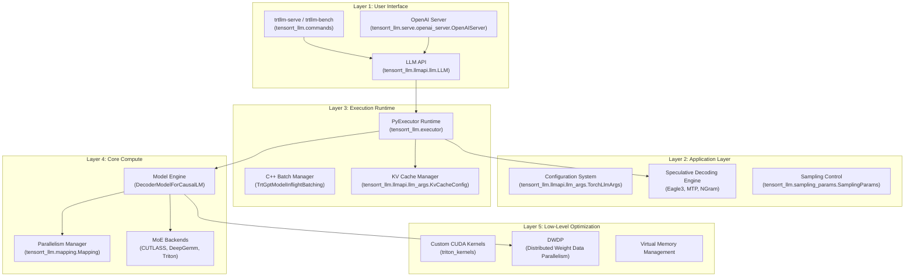
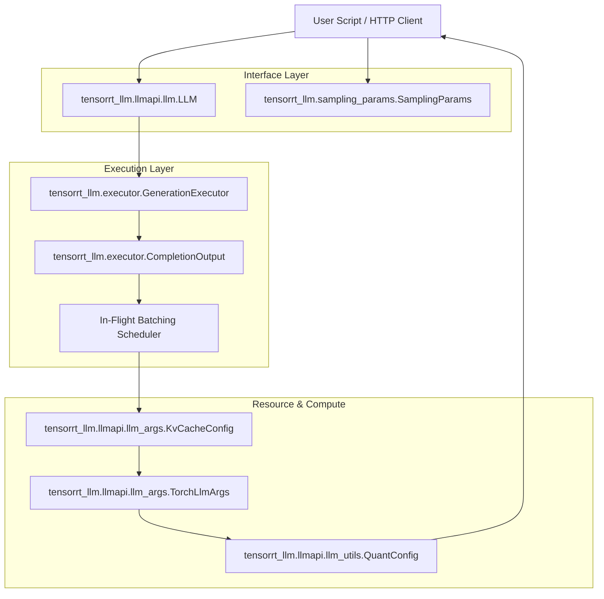

<!-- source: DeepWiki mcp.deepwiki.com · repo NVIDIA/TensorRT-LLM · page 1 Overview · fetched 2026-10-26 -->

# Overview

Relevant source files

The following files were used as context for generating this wiki page:

- [README.md](README.md)
- [docker/Dockerfile.user](docker/Dockerfile.user)
- [docker/develop.md](docker/develop.md)
- [docker/release.md](docker/release.md)
- [docs/requirements.txt](docs/requirements.txt)
- [docs/source/_static/custom.css](docs/source/_static/custom.css)
- [docs/source/_static/switcher.json](docs/source/_static/switcher.json)
- [docs/source/commands/trtllm-serve/run-benchmark-with-trtllm-serve.md](docs/source/commands/trtllm-serve/run-benchmark-with-trtllm-serve.md)
- [docs/source/conf.py](docs/source/conf.py)
- [docs/source/deployment-guide/deployment-guide-for-deepseek-r1-on-trtllm.md](docs/source/deployment-guide/deployment-guide-for-deepseek-r1-on-trtllm.md)
- [docs/source/deployment-guide/deployment-guide-for-glm-5-on-trtllm.md](docs/source/deployment-guide/deployment-guide-for-glm-5-on-trtllm.md)
- [docs/source/deployment-guide/deployment-guide-for-gpt-oss-on-trtllm.md](docs/source/deployment-guide/deployment-guide-for-gpt-oss-on-trtllm.md)
- [docs/source/deployment-guide/deployment-guide-for-llama3.3-70b-on-trtllm.md](docs/source/deployment-guide/deployment-guide-for-llama3.3-70b-on-trtllm.md)
- [docs/source/deployment-guide/deployment-guide-for-llama4-scout-on-trtllm.md](docs/source/deployment-guide/deployment-guide-for-llama4-scout-on-trtllm.md)
- [docs/source/helper.py](docs/source/helper.py)
- [docs/source/index.rst](docs/source/index.rst)
- [docs/source/installation/containers.md](docs/source/installation/containers.md)
- [docs/source/quick-start-guide.md](docs/source/quick-start-guide.md)
- [examples/constraints.txt](examples/constraints.txt)
- [examples/llm-api/llm_mgmn_llm_distributed.sh](examples/llm-api/llm_mgmn_llm_distributed.sh)
- [examples/llm-api/llm_mgmn_trtllm_bench.sh](examples/llm-api/llm_mgmn_trtllm_bench.sh)
- [examples/llm-api/llm_mgmn_trtllm_serve.sh](examples/llm-api/llm_mgmn_trtllm_serve.sh)
- [scripts/cuda_driver_stub.py](scripts/cuda_driver_stub.py)
- [tensorrt_llm/llmapi/__init__.py](tensorrt_llm/llmapi/__init__.py)
- [tensorrt_llm/version.py](tensorrt_llm/version.py)
- [tests/unittest/api_stability/references_committed/llm.yaml](tests/unittest/api_stability/references_committed/llm.yaml)

## Purpose and Scope

This page provides a comprehensive introduction to TensorRT-LLM, NVIDIA's advanced open-source library designed to accelerate and optimize inference for Large Language Models (LLMs) and Visual Generation models on NVIDIA GPUs. It covers the purpose, system architecture, core components, execution flow, and key features of the codebase.

Detailed technical explanations are included with references to the code entities and implementation files. While this page serves as a leaf overview, it summarizes the major subsystems and links to related documentation scattered across the codebase.

**Sources:** [README.md:1-16](), [tensorrt_llm/version.py:1-15]()

---

## What is TensorRT-LLM?

TensorRT-LLM (version `1.3.0rc25`) is a modular inference acceleration framework that optimizes large-scale neural models, particularly LLMs and visual generation models [tensorrt_llm/version.py:15-15](). It targets NVIDIA GPUs and incorporates optimized kernels, a efficient runtime, and a pythonic framework that enables customization and extension [README.md:3-7]().

Key qualities:
- **High-level LLM API:** A unified Python interface (`LLM` class) simplifies model loading, configuration, token generation, and multi-GPU distributed inference [tensorrt_llm/llmapi/llm.py:16-67](), [tensorrt_llm/llmapi/__init__.py:36-41]().
- **In-Flight Batching and Scheduling:** Dynamically manages and merges generation requests for efficient GPU utilization, supporting complex scheduling strategies like overlap scheduler [tensorrt_llm/llmapi/llm_args.py:58-67](), [tensorrt_llm/llmapi/__init__.py:68-70]().
- **Advanced Quantization Support:** Supports emerging formats including NVIDIA FP8 (Hopper, Blackwell) and NVFP4 (Blackwell), with methods like AWQ and SmoothQuant [tensorrt_llm/llmapi/llm_utils.py:30-30](), [tensorrt_llm/llmapi/__init__.py:62-64]().
- **Speculative Decoding Algorithms:** Implements multiple techniques including EAGLE 3, Multi-Token Prediction (MTP), and NGram (Prompt Lookup) decoding to accelerate generation [tensorrt_llm/llmapi/llm_args.py:43-57](), [tensorrt_llm/llmapi/__init__.py:55-59]().
- **Disaggregated Serving:** Separates context prefill and token generation phases across different GPUs, optimized for high-performance setups like NVL72 [tensorrt_llm/llmapi/__init__.py:3-3](), [tensorrt_llm/llmapi/__init__.py:44-46](), [README.md:76-77]().
- **Visual Generation:** Provides a unified inference stack for diffusion models such as FLUX, Wan, and LTX2, supporting image and video synthesis [README.md:93-93](), [tensorrt_llm/llmapi/__init__.py:99-99]().

**Sources:** [README.md:1-93](), [tensorrt_llm/version.py:15-15](), [tensorrt_llm/llmapi/llm.py:16-67](), [tensorrt_llm/llmapi/__init__.py:1-100]()

---

## System Architecture Layers

TensorRT-LLM is architected as a layered system from high-level user APIs through runtime components down to GPU kernels and devices.

### Architecture Layer Diagram

**Sources:** [tensorrt_llm/llmapi/llm.py:40-67](), [tensorrt_llm/llmapi/__init__.py:9-29](), [README.md:37-38](), [docs/source/quick-start-guide.md:13-20]()

---

## Core Subsystems

The codebase is organized into logical subsystems that handle specific aspects of the inference pipeline:

| Subsystem | Purpose | Key Components |
| :--- | :--- | :--- |
| **LLM API** | High-level entry point for LLM inference | `LLM`, `AsyncLLM`, `TorchLlmArgs`, `SamplingParams` [tensorrt_llm/llmapi/llm.py:16-67](), [tensorrt_llm/llmapi/__init__.py:37-43]() |
| **Serving** | OpenAI-compatible API and disaggregated serving | `OpenAIServer`, `trtllm-serve`, `DisaggregatedParams` [tensorrt_llm/llmapi/__init__.py:44-46](), [docs/source/quick-start-guide.md:13-20]() |
| **Quantization** | Low-precision optimization (FP8, NVFP4, INT4/8) | `QuantConfig`, `QuantAlgo`, `CalibConfig` [tensorrt_llm/llmapi/__init__.py:62-64](), [tensorrt_llm/llmapi/llm_utils.py:30-30]() |
| **Distributed** | Multi-GPU communication and parallelism | `MpiCommSession`, `AttentionDpConfig`, `moe_expert_parallel_size` [tensorrt_llm/llmapi/__init__.py:66-66](), [tensorrt_llm/llmapi/__init__.py:84-84](), [tests/unittest/api_stability/references_committed/llm.yaml:43-45]() |
| **Speculative Decoding** | Performance acceleration via draft-verify | `Eagle3DecodingConfig`, `MTPDecodingConfig`, `NGramDecodingConfig` [tensorrt_llm/llmapi/__init__.py:55-59](), [tensorrt_llm/llmapi/__init__.py:72-72]() |

**Sources:** [tensorrt_llm/llmapi/llm.py:16-67](), [tensorrt_llm/llmapi/__init__.py:1-100](), [tests/unittest/api_stability/references_committed/llm.yaml:1-142]()

---

## LLM Request Flow

This diagram bridges the user-level API down to the internal entities handling token generation:

- **LLM Entry:** Users initialize the `LLM` class, which manages the lifecycle of the model and executor [tensorrt_llm/llmapi/llm.py:70-121](), [tests/unittest/api_stability/references_committed/llm.yaml:2-97]().
- **Scheduler:** The in-flight batcher dynamically manages the mix of context (prefill) and generation (decode) phases [tensorrt_llm/llmapi/__init__.py:60-61](), [tensorrt_llm/llmapi/__init__.py:68-70]().
- **KV Cache Manager:** Manages GPU memory for paged attention, supporting features like `BlockReuseConfig` [tensorrt_llm/llmapi/__init__.py:47-48](), [tensorrt_llm/llmapi/__init__.py:50-50]().
- **Sampler:** Handles token selection based on `SamplingParams`, supporting greedy, beam search, and random sampling [tensorrt_llm/llmapi/__init__.py:42-43](), [tests/unittest/api_stability/references_committed/llm.yaml:104-107]().

**Sources:** [tensorrt_llm/llmapi/llm.py:70-121](), [tensorrt_llm/llmapi/__init__.py:1-100](), [tests/unittest/api_stability/references_committed/llm.yaml:1-142]()

---

## Key Optimization Features

TensorRT-LLM integrates multiple advanced techniques to maximize throughput and reduce latency:

| Category | Features |
| :--- | :--- |
| **Parallelism** | Tensor (TP), Pipeline (PP), Expert (EP), and Context Parallelism (CP); Distributed Weight Data Parallelism (DWDP) [tests/unittest/api_stability/references_committed/llm.yaml:21-45](), [README.md:37-38]() |
| **Quantization** | FP8, NVFP4 (Blackwell), INT4/8, AWQ, SmoothQuant, Block-scale quantization [tensorrt_llm/llmapi/__init__.py:62-64](), [docs/source/deployment-guide/deployment-guide-for-gpt-oss-on-trtllm.md:26-29]() |
| **Decoding** | Speculative Decoding (EAGLE 3, MTP, NGram), Guided Decoding (xgrammar, llguidance), Beam Search [tensorrt_llm/llmapi/__init__.py:55-59](), [tests/unittest/api_stability/references_committed/llm.yaml:57-63]() |
| **Memory** | Paged KV Cache, KV Cache Reuse, KV Cache Transfer (NIXL/UCX), Disaggregated Cache [tensorrt_llm/llmapi/__init__.py:47-50](), [tensorrt_llm/llmapi/__init__.py:71-71]() |
| **Visual Gen** | Diffusion Transformers (FLUX, Wan, LTX2), Video generation pipelines [README.md:93-93](), [docs/source/quick-start-guide.md:105-114]() |

**Sources:** [README.md:37-93](), [tensorrt_llm/llmapi/__init__.py:1-100](), [tests/unittest/api_stability/references_committed/llm.yaml:1-142]()

---

## External Dependencies

The framework relies on a specific software stack for optimal performance:

| Dependency | Version | Role |
| :--- | :--- | :--- |
| **Python** | 3.10 / 3.12 | Primary language [README.md:9-10]() |
| **CUDA** | 13.2.1 | GPU acceleration [README.md:11-11]() |
| **PyTorch** | 2.12.0 | Model definition and runtime [README.md:12-12]() |
| **TensorRT-LLM** | 1.3.0rc25 | Current release [tensorrt_llm/version.py:15-15](), [examples/constraints.txt:1-1]() |

**Sources:** [README.md:9-13](), [tensorrt_llm/version.py:15-15](), [examples/constraints.txt:1-1]()

---

# Summary

TensorRT-LLM is a comprehensive framework offering highly optimized inference for large-scale language and visual models. Its layered architecture organizes functionality from user-facing APIs through a flexible runtime and advanced GPU kernels. Key innovations include advanced quantization (NVFP4/FP8), speculative decoding (EAGLE 3, MTP), disaggregated serving, and native support for the latest model architectures including DeepSeek-V3/V4/R1, Llama 3.3/4, and FLUX.

**Sources:** [README.md:3-5](), [tensorrt_llm/llmapi/llm.py:16-67](), [tensorrt_llm/llmapi/__init__.py:1-100]()

---

