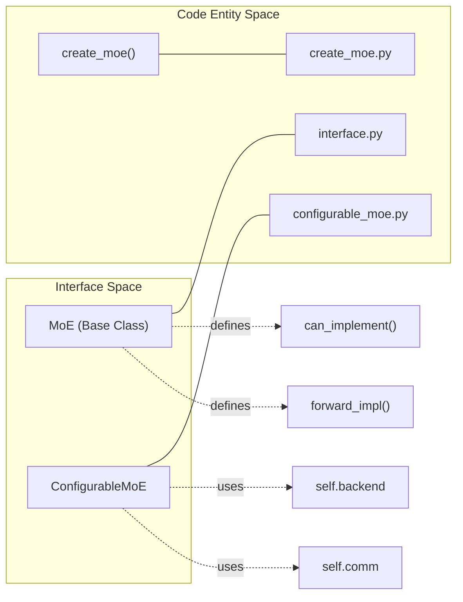
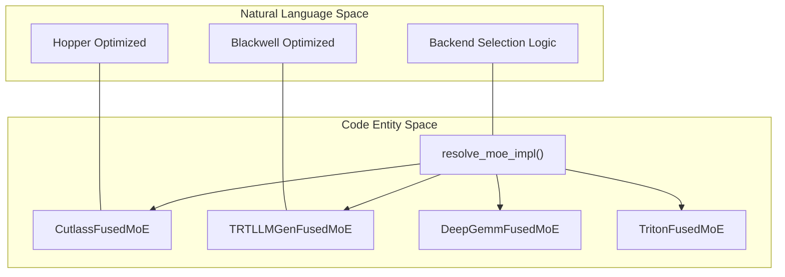

<!-- source: DeepWiki mcp.deepwiki.com · repo NVIDIA/TensorRT-LLM · page 10 Mixture of Experts (MoE) Architecture · fetched 2026-10-26 -->

# Mixture of Experts (MoE) Architecture

Relevant source files

The following files were used as context for generating this wiki page:

- [cpp/tensorrt_llm/kernels/customMoeRoutingKernels.cu](cpp/tensorrt_llm/kernels/customMoeRoutingKernels.cu)
- [cpp/tensorrt_llm/kernels/customMoeRoutingKernels.h](cpp/tensorrt_llm/kernels/customMoeRoutingKernels.h)
- [cpp/tensorrt_llm/kernels/moeTopKFuncs.cuh](cpp/tensorrt_llm/kernels/moeTopKFuncs.cuh)
- [cpp/tensorrt_llm/thop/customMoeRoutingOp.cpp](cpp/tensorrt_llm/thop/customMoeRoutingOp.cpp)
- [tensorrt_llm/_torch/models/modeling_glm.py](tensorrt_llm/_torch/models/modeling_glm.py)
- [tensorrt_llm/_torch/models/modeling_hunyuan_moe.py](tensorrt_llm/_torch/models/modeling_hunyuan_moe.py)
- [tensorrt_llm/_torch/modules/fused_moe/MOE_DEVELOPER_GUIDE.md](tensorrt_llm/_torch/modules/fused_moe/MOE_DEVELOPER_GUIDE.md)
- [tensorrt_llm/_torch/modules/fused_moe/__init__.py](tensorrt_llm/_torch/modules/fused_moe/__init__.py)
- [tensorrt_llm/_torch/modules/fused_moe/communication/deep_ep.py](tensorrt_llm/_torch/modules/fused_moe/communication/deep_ep.py)
- [tensorrt_llm/_torch/modules/fused_moe/communication/deep_ep_low_latency.py](tensorrt_llm/_torch/modules/fused_moe/communication/deep_ep_low_latency.py)
- [tensorrt_llm/_torch/modules/fused_moe/configurable_moe.py](tensorrt_llm/_torch/modules/fused_moe/configurable_moe.py)
- [tensorrt_llm/_torch/modules/fused_moe/create_moe.py](tensorrt_llm/_torch/modules/fused_moe/create_moe.py)
- [tensorrt_llm/_torch/modules/fused_moe/fused_moe_cute_dsl.py](tensorrt_llm/_torch/modules/fused_moe/fused_moe_cute_dsl.py)
- [tensorrt_llm/_torch/modules/fused_moe/fused_moe_cute_dsl_b12x.py](tensorrt_llm/_torch/modules/fused_moe/fused_moe_cute_dsl_b12x.py)
- [tensorrt_llm/_torch/modules/fused_moe/fused_moe_cutlass.py](tensorrt_llm/_torch/modules/fused_moe/fused_moe_cutlass.py)
- [tensorrt_llm/_torch/modules/fused_moe/fused_moe_deepgemm.py](tensorrt_llm/_torch/modules/fused_moe/fused_moe_deepgemm.py)
- [tensorrt_llm/_torch/modules/fused_moe/fused_moe_densegemm.py](tensorrt_llm/_torch/modules/fused_moe/fused_moe_densegemm.py)
- [tensorrt_llm/_torch/modules/fused_moe/fused_moe_triton.py](tensorrt_llm/_torch/modules/fused_moe/fused_moe_triton.py)
- [tensorrt_llm/_torch/modules/fused_moe/fused_moe_trtllm_gen.py](tensorrt_llm/_torch/modules/fused_moe/fused_moe_trtllm_gen.py)
- [tensorrt_llm/_torch/modules/fused_moe/impl_base.py](tensorrt_llm/_torch/modules/fused_moe/impl_base.py)
- [tensorrt_llm/_torch/modules/fused_moe/impl_blocks.py](tensorrt_llm/_torch/modules/fused_moe/impl_blocks.py)
- [tensorrt_llm/_torch/modules/fused_moe/impl_contract.py](tensorrt_llm/_torch/modules/fused_moe/impl_contract.py)
- [tensorrt_llm/_torch/modules/fused_moe/impl_identity.py](tensorrt_llm/_torch/modules/fused_moe/impl_identity.py)
- [tensorrt_llm/_torch/modules/fused_moe/interface.py](tensorrt_llm/_torch/modules/fused_moe/interface.py)
- [tensorrt_llm/_torch/modules/fused_moe/mega_moe/mega_moe_cute_dsl.py](tensorrt_llm/_torch/modules/fused_moe/mega_moe/mega_moe_cute_dsl.py)
- [tensorrt_llm/_torch/modules/fused_moe/mega_moe/mega_moe_deepgemm.py](tensorrt_llm/_torch/modules/fused_moe/mega_moe/mega_moe_deepgemm.py)
- [tensorrt_llm/_torch/modules/fused_moe/moe_scheduler.py](tensorrt_llm/_torch/modules/fused_moe/moe_scheduler.py)
- [tensorrt_llm/_torch/modules/fused_moe/quantization.py](tensorrt_llm/_torch/modules/fused_moe/quantization.py)
- [tensorrt_llm/_torch/modules/fused_moe/routing.py](tensorrt_llm/_torch/modules/fused_moe/routing.py)
- [tensorrt_llm/_torch/modules/fused_moe/weight_owner.py](tensorrt_llm/_torch/modules/fused_moe/weight_owner.py)
- [tests/microbenchmarks/bench_moe/utils.py](tests/microbenchmarks/bench_moe/utils.py)
- [tests/unittest/_torch/modules/moe/moe_test_utils.py](tests/unittest/_torch/modules/moe/moe_test_utils.py)
- [tests/unittest/_torch/modules/moe/quantize_utils.py](tests/unittest/_torch/modules/moe/quantize_utils.py)
- [tests/unittest/_torch/modules/moe/test_moe_backend.py](tests/unittest/_torch/modules/moe/test_moe_backend.py)
- [tests/unittest/_torch/modules/moe/test_moe_module.py](tests/unittest/_torch/modules/moe/test_moe_module.py)
- [tests/unittest/_torch/modules/test_fused_moe.py](tests/unittest/_torch/modules/test_fused_moe.py)
- [tests/unittest/_torch/modules/test_moe_routing.py](tests/unittest/_torch/modules/test_moe_routing.py)
- [tests/unittest/_torch/thop/parallel_hw_agnostic/test_noaux_tc.py](tests/unittest/_torch/thop/parallel_hw_agnostic/test_noaux_tc.py)

## Purpose and Scope

The MoE architecture in TensorRT-LLM provides efficient Mixture of Experts inference with support for multiple hardware backends, distributed communication strategies, quantization methods, and expert load balancing. This system is designed to scale from single-GPU inference to large-scale Expert Parallel (EP) deployments.

For details on specific sub-topics, see:
- **[MoE Interface and Backend Implementations](#10.1)** — Abstract base class, `ConfigurableMoE`, and backend selection logic.
- **[MoE Backend Variants](#10.2)** — CUTLASS, TRTLLM, DeepGemm, CuteDSL, Triton, and WideEP implementations.
- **[MoE Communication Strategies](#10.3)** — AllToAll methods, DeepEP, NVLink variants, and selection logic.
- **[MoE Quantization Methods](#10.4)** — `FusedMoEMethodBase` and support for FP8, NVFP4, and block-scaling.
- **[Expert Parallel Load Balancing](#10.5)** — `MoeLoadBalancer`, dynamic expert assignment, and Wide EP patterns.

---

## Core Architecture Overview

The MoE system is built around a modular architecture that separates concerns into distinct layers: backends for computation, communication strategies for distributed execution, quantization methods for weight and activation compression, and routing methods for token-to-expert assignment.

**High-Level MoE System Architecture**

```mermaid
graph TB
    subgraph "User Interface"
        CreateMoE["create_moe()"]
        ConfigurableMoE["ConfigurableMoE"]
    end
    
    subgraph "Backend Layer"
        CutlassFusedMoE["CutlassFusedMoE"]
        TRTLLMGenFusedMoE["TRTLLMGenFusedMoE"]
        CuteDslFusedMoE["CuteDslFusedMoE"]
        DeepGemmFusedMoE["DeepGemmFusedMoE"]
        WideEPMoE["WideEPMoE"]
        TritonFusedMoE["TritonFusedMoE"]
        VanillaMoE["VanillaMoE"]
        MegaMoE["MegaMoEDeepGemm"]
        MarlinFusedMoE["MarlinFusedMoE"]
    end
    
    subgraph "Communication Layer"
        AllGatherReduceScatter["AllGatherReduceScatter"]
        NVLinkOneSided["NVLinkOneSided"]
        NVLinkTwoSided["NVLinkTwoSided"]
        DeepEP["DeepEP"]
        DeepEPLowLatency["DeepEPLowLatency"]
    end
    
    subgraph "Quantization Layer"
        UnquantizedMethod["UnquantizedFusedMoEMethod"]
        FP8QDQMethod["FP8QDQFusedMoEMethod"]
        FP8BlockScalesMethod["DeepSeekFP8BlockScalesFusedMoEMethod"]
        NVFP4Method["NVFP4CutlassFusedMoEMethod"]
        MXFP8Method["MXFP8CutlassFusedMoEMethod"]
    end
    
    subgraph "Routing Layer"
        DefaultRouting["DefaultMoeRoutingMethod"]
        RenormalizeRouting["RenormalizeMoeRoutingMethod"]
        DeepSeekV3Routing["DeepSeekV3MoeRoutingMethod"]
    end
    
    subgraph "Load Balancing"
        MoeLoadBalancer["MoeLoadBalancer"]
    end
    
    CreateMoE --> ConfigurableMoE
    CreateMoE --> CutlassFusedMoE
    CreateMoE --> TRTLLMGenFusedMoE
    CreateMoE --> WideEPMoE
    
    ConfigurableMoE --> CutlassFusedMoE
    ConfigurableMoE --> TRTLLMGenFusedMoE
    
    CutlassFusedMoE --> AllGatherReduceScatter
    CutlassFusedMoE --> NVLinkOneSided
    TRTLLMGenFusedMoE --> NVLinkOneSided
    WideEPMoE --> NVLinkTwoSided
    WideEPMoE --> DeepEP
    WideEPMoE --> DeepEPLowLatency
    
    CutlassFusedMoE --> UnquantizedMethod
    CutlassFusedMoE --> FP8QDQMethod
    CutlassFusedMoE --> NVFP4Method
    TRTLLMGenFusedMoE --> FP8BlockScalesMethod
    TRTLLMGenFusedMoE --> NVFP4Method
    
    CutlassFusedMoE --> DefaultRouting
    CutlassFusedMoE --> RenormalizeRouting
    TRTLLMGenFusedMoE --> DeepSeekV3Routing
    
    ConfigurableMoE -.-> MoeLoadBalancer
    CutlassFusedMoE -.-> MoeLoadBalancer
    TRTLLMGenFusedMoE -.-> MoeLoadBalancer
```

Sources: [tensorrt_llm/_torch/modules/fused_moe/interface.py:27-29](), [tensorrt_llm/_torch/modules/fused_moe/configurable_moe.py:78-129](), [tensorrt_llm/_torch/modules/fused_moe/create_moe.py:11-27]()

---

## MoE Base Interface and Configurable MoE 

The `MoE` base class defines the common interface for all implementations, including weight management and capability checks via `can_implement` [tensorrt_llm/_torch/modules/fused_moe/interface.py:194-225](). The `ConfigurableMoE` class acts as a composition-based wrapper that orchestrates the execution flow by plugging in backends, communication strategies, and load balancers [tensorrt_llm/_torch/modules/fused_moe/configurable_moe.py:78-129](). It uses `MoESchedulerKind` to determine if communication is handled externally or fused within the kernel [tensorrt_llm/_torch/modules/fused_moe/interface.py:94-116]().

**MoE Class Association Map**

Sources: [tensorrt_llm/_torch/modules/fused_moe/interface.py:194-225](), [tensorrt_llm/_torch/modules/fused_moe/configurable_moe.py:78-164](), [tensorrt_llm/_torch/modules/fused_moe/create_moe.py:39-67]()

For details, see [MoE Interface and Backend Implementations](#10.1).

---

## MoE Backend Variants 

TensorRT-LLM provides multiple MoE backends optimized for specific hardware generations and quantization formats.

| Backend | SM Support | Key Features |
| :--- | :--- | :--- |
| `CutlassFusedMoE` | SM >= 80 | Widest quantization support (FP8, NVFP4, W4A8, MXFP4, MXFP8) [tensorrt_llm/_torch/modules/fused_moe/fused_moe_cutlass.py:104-163](). |
| `TRTLLMGenFusedMoE` | SM 100/103 | Blackwell-optimized; supports NVFP4, MXFP4 and FP8 block scales [tensorrt_llm/_torch/modules/fused_moe/fused_moe_trtllm_gen.py:106-113](). |
| `DeepGemmFusedMoE` | SM 90 | Uses DeepGemm kernels for FP8 block scaling [tensorrt_llm/_torch/modules/fused_moe/fused_moe_deepgemm.py:43-81](). |
| `CuteDslFusedMoE` | SM 100/103 | Uses CuteDSL custom ops for block-scaled GEMM on Blackwell [tensorrt_llm/_torch/modules/fused_moe/create_moe.py:12-13](). |
| `TritonFusedMoE` | SM 90 | Hopper-specific Triton implementation for SwiGLU MoE [tensorrt_llm/_torch/modules/fused_moe/fused_moe_triton.py:18-50](). |
| `MegaMoEDeepGemm` | SM 100 | Blackwell-optimized fused dispatch+GEMM kernel [tensorrt_llm/_torch/modules/fused_moe/create_moe.py:22](). |
| `MarlinFusedMoE` | SM 90 | Hopper-specific NVFP4 W4A16 backend [tensorrt_llm/_torch/modules/fused_moe/create_moe.py:17](). |

**Backend Dispatch Association**

Sources: [tensorrt_llm/_torch/modules/fused_moe/create_moe.py:24-26](), [tensorrt_llm/_torch/modules/fused_moe/fused_moe_cutlass.py:104-163](), [tensorrt_llm/_torch/modules/fused_moe/fused_moe_trtllm_gen.py:106-113](), [tensorrt_llm/_torch/modules/fused_moe/fused_moe_deepgemm.py:43-81]().

For details, see [MoE Backend Variants](#10.2).

---

## MoE Communication Strategies 

Communication strategies manage how tokens are dispatched to experts across different GPUs. This includes standard NCCL operations and high-performance `AllToAll` variants.

- **NVLink Methods**: Leverages `MnnvlMemory` for fast intranode/internode transfers [tensorrt_llm/_torch/modules/moe/test_moe_module.py:72]().
- **DeepEP**: Specialized communication library for MoE, supporting low-latency modes and CUDA graphs [tensorrt_llm/_torch/modules/moe/test_moe_module.py:86]().
- **Selection**: `ConfigurableMoE` automatically selects the best method based on hardware via `CommunicationFactory` [tensorrt_llm/_torch/modules/fused_moe/configurable_moe.py:56]().

Sources: [tensorrt_llm/_torch/modules/fused_moe/interface.py:94-116](), [tensorrt_llm/_torch/modules/fused_moe/configurable_moe.py:56](), [tensorrt_llm/_torch/modules/moe/test_moe_module.py:86]().

For details, see [MoE Communication Strategies](#10.3).

---

## MoE Quantization Methods 

MoE quantization is handled by specific method classes that manage weight loading and scale computation.

**Supported Quantization Types:**
- **FP8**: Support for per-tensor QDQ and block-scaled variants like `DeepSeekFP8BlockScalesFusedMoEMethod` [tensorrt_llm/_torch/modules/fused_moe/quantization.py:69-72]().
- **NVFP4**: Blackwell-specific 4-bit floating point quantization supported by `NVFP4TRTLLMGenFusedMoEMethod` [tensorrt_llm/_torch/modules/fused_moe/fused_moe_trtllm_gen.py:43-47]().
- **MXFP4**: Microscaling formats (W4A16, W4A8) supported by `TRTLLMGenFusedMoE` and `CutlassFusedMoE` [tensorrt_llm/_torch/modules/fused_moe/fused_moe_trtllm_gen.py:106-113]().
- **MXFP8**: Microscaling format (W8A8) with UE8M0 1x32 block scales [tensorrt_llm/_torch/modules/fused_moe/quantization.py:122-132]().
- **INT8**: 8-bit weight-only quantization per channel [tensorrt_llm/_torch/modules/fused_moe/quantization.py:97-99]().

Sources: [tensorrt_llm/_torch/modules/fused_moe/quantization.py:62-132](), [tensorrt_llm/_torch/modules/fused_moe/fused_moe_cutlass.py:104-163](), [tensorrt_llm/_torch/modules/fused_moe/fused_moe_trtllm_gen.py:106-113]().

For details, see [MoE Quantization Methods](#10.4).

---

## Expert Parallel Load Balancing 

The `MoeLoadBalancer` provides dynamic expert assignment to mitigate load imbalance in Expert Parallel (EP) scenarios.

- **Initialization**: Managed via `get_moe_load_balancer()` during layer creation [tensorrt_llm/_torch/modules/fused_moe/create_moe.py:131]().
- **Dynamic Expert Assignment**: `MoeLoadBalancer` tracks expert load and reassigns experts to slots to balance computation [tensorrt_llm/_torch/modules/moe/test_moe_module.py:88-91]().
- **Attribute Syncing**: `ConfigurableMoE` mirrors EPLB-derived attributes like `num_slots` and `layer_load_balancer` to the backend [tensorrt_llm/_torch/modules/fused_moe/configurable_moe.py:63-75]().

Sources: [tensorrt_llm/_torch/modules/fused_moe/create_moe.py:131](), [tensorrt_llm/_torch/modules/fused_moe/configurable_moe.py:63-75](), [tensorrt_llm/_torch/modules/moe/test_moe_module.py:88-91]().

For details, see [Expert Parallel Load Balancing](#10.5).

---

