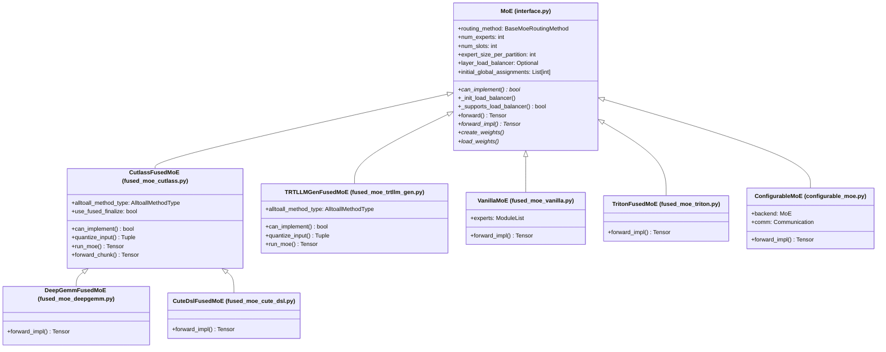
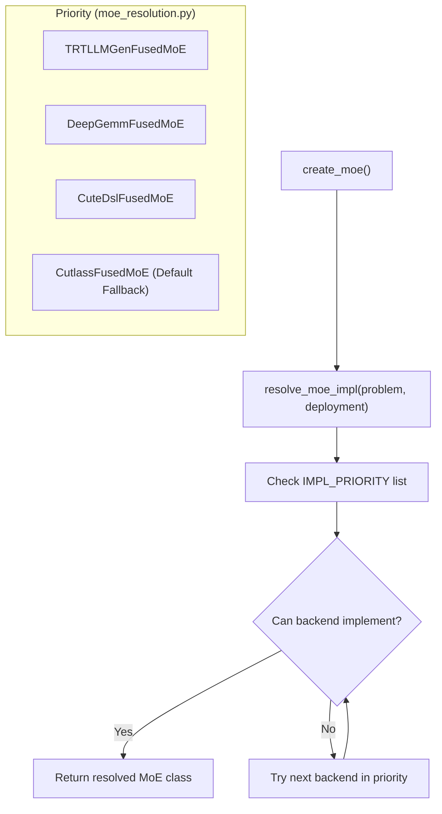

<!-- source: DeepWiki mcp.deepwiki.com · repo NVIDIA/TensorRT-LLM · page 10.1 MoE Interface and Backend Implementations · fetched 2026-10-26 -->

# MoE Interface and Backend Implementations

Relevant source files

The following files were used as context for generating this wiki page:

- [cpp/tensorrt_llm/kernels/customMoeRoutingKernels.cu](cpp/tensorrt_llm/kernels/customMoeRoutingKernels.cu)
- [cpp/tensorrt_llm/kernels/customMoeRoutingKernels.h](cpp/tensorrt_llm/kernels/customMoeRoutingKernels.h)
- [cpp/tensorrt_llm/kernels/moeTopKFuncs.cuh](cpp/tensorrt_llm/kernels/moeTopKFuncs.cuh)
- [cpp/tensorrt_llm/thop/customMoeRoutingOp.cpp](cpp/tensorrt_llm/thop/customMoeRoutingOp.cpp)
- [tensorrt_llm/_torch/models/modeling_glm.py](tensorrt_llm/_torch/models/modeling_glm.py)
- [tensorrt_llm/_torch/models/modeling_hunyuan_moe.py](tensorrt_llm/_torch/models/modeling_hunyuan_moe.py)
- [tensorrt_llm/_torch/modules/fused_moe/MOE_DEVELOPER_GUIDE.md](tensorrt_llm/_torch/modules/fused_moe/MOE_DEVELOPER_GUIDE.md)
- [tensorrt_llm/_torch/modules/fused_moe/__init__.py](tensorrt_llm/_torch/modules/fused_moe/__init__.py)
- [tensorrt_llm/_torch/modules/fused_moe/communication/deep_ep.py](tensorrt_llm/_torch/modules/fused_moe/communication/deep_ep.py)
- [tensorrt_llm/_torch/modules/fused_moe/communication/deep_ep_low_latency.py](tensorrt_llm/_torch/modules/fused_moe/communication/deep_ep_low_latency.py)
- [tensorrt_llm/_torch/modules/fused_moe/configurable_moe.py](tensorrt_llm/_torch/modules/fused_moe/configurable_moe.py)
- [tensorrt_llm/_torch/modules/fused_moe/create_moe.py](tensorrt_llm/_torch/modules/fused_moe/create_moe.py)
- [tensorrt_llm/_torch/modules/fused_moe/fused_moe_cute_dsl.py](tensorrt_llm/_torch/modules/fused_moe/fused_moe_cute_dsl.py)
- [tensorrt_llm/_torch/modules/fused_moe/fused_moe_cute_dsl_b12x.py](tensorrt_llm/_torch/modules/fused_moe/fused_moe_cute_dsl_b12x.py)
- [tensorrt_llm/_torch/modules/fused_moe/fused_moe_cutlass.py](tensorrt_llm/_torch/modules/fused_moe/fused_moe_cutlass.py)
- [tensorrt_llm/_torch/modules/fused_moe/fused_moe_deepgemm.py](tensorrt_llm/_torch/modules/fused_moe/fused_moe_deepgemm.py)
- [tensorrt_llm/_torch/modules/fused_moe/fused_moe_densegemm.py](tensorrt_llm/_torch/modules/fused_moe/fused_moe_densegemm.py)
- [tensorrt_llm/_torch/modules/fused_moe/fused_moe_triton.py](tensorrt_llm/_torch/modules/fused_moe/fused_moe_triton.py)
- [tensorrt_llm/_torch/modules/fused_moe/fused_moe_trtllm_gen.py](tensorrt_llm/_torch/modules/fused_moe/fused_moe_trtllm_gen.py)
- [tensorrt_llm/_torch/modules/fused_moe/impl_base.py](tensorrt_llm/_torch/modules/fused_moe/impl_base.py)
- [tensorrt_llm/_torch/modules/fused_moe/impl_blocks.py](tensorrt_llm/_torch/modules/fused_moe/impl_blocks.py)
- [tensorrt_llm/_torch/modules/fused_moe/impl_contract.py](tensorrt_llm/_torch/modules/fused_moe/impl_contract.py)
- [tensorrt_llm/_torch/modules/fused_moe/impl_identity.py](tensorrt_llm/_torch/modules/fused_moe/impl_identity.py)
- [tensorrt_llm/_torch/modules/fused_moe/interface.py](tensorrt_llm/_torch/modules/fused_moe/interface.py)
- [tensorrt_llm/_torch/modules/fused_moe/mega_moe/mega_moe_cute_dsl.py](tensorrt_llm/_torch/modules/fused_moe/mega_moe/mega_moe_cute_dsl.py)
- [tensorrt_llm/_torch/modules/fused_moe/mega_moe/mega_moe_deepgemm.py](tensorrt_llm/_torch/modules/fused_moe/mega_moe/mega_moe_deepgemm.py)
- [tensorrt_llm/_torch/modules/fused_moe/moe_scheduler.py](tensorrt_llm/_torch/modules/fused_moe/moe_scheduler.py)
- [tensorrt_llm/_torch/modules/fused_moe/quantization.py](tensorrt_llm/_torch/modules/fused_moe/quantization.py)
- [tensorrt_llm/_torch/modules/fused_moe/routing.py](tensorrt_llm/_torch/modules/fused_moe/routing.py)
- [tensorrt_llm/_torch/modules/fused_moe/weight_owner.py](tensorrt_llm/_torch/modules/fused_moe/weight_owner.py)
- [tests/microbenchmarks/bench_moe/utils.py](tests/microbenchmarks/bench_moe/utils.py)
- [tests/unittest/_torch/modules/moe/moe_test_utils.py](tests/unittest/_torch/modules/moe/moe_test_utils.py)
- [tests/unittest/_torch/modules/moe/quantize_utils.py](tests/unittest/_torch/modules/moe/quantize_utils.py)
- [tests/unittest/_torch/modules/moe/test_moe_backend.py](tests/unittest/_torch/modules/moe/test_moe_backend.py)
- [tests/unittest/_torch/modules/moe/test_moe_module.py](tests/unittest/_torch/modules/moe/test_moe_module.py)
- [tests/unittest/_torch/modules/test_fused_moe.py](tests/unittest/_torch/modules/test_fused_moe.py)
- [tests/unittest/_torch/modules/test_moe_routing.py](tests/unittest/_torch/modules/test_moe_routing.py)
- [tests/unittest/_torch/thop/parallel_hw_agnostic/test_noaux_tc.py](tests/unittest/_torch/thop/parallel_hw_agnostic/test_noaux_tc.py)

This page documents the Mixture of Experts (MoE) interface and its various backend implementations in TensorRT-LLM. It covers the base `MoE` class, concrete implementations (Cutlass, TRTLLMGen, DeepGemm, Triton, etc.), quantization methods, and the factory pattern for creating MoE instances.

For MoE communication strategies, see page 10.3. For MoE-specific quantization details, see page 10.4. For expert parallel load balancing (EPLB), see page 10.5.

## MoE Base Interface

The `MoE` class in [tensorrt_llm/_torch/modules/fused_moe/interface.py:194-211]() serves as the abstract base class for all MoE implementations. It defines the common interface and handles shared functionality including:

- **Expert assignment and parallelism**: Manages expert parallelism (EP), tensor parallelism (TP), and expert slot allocation [tensorrt_llm/_torch/modules/fused_moe/interface.py:251-340](). It supports non-divisible EP configurations through `_compute_ep_partition` [tensorrt_llm/_torch/modules/fused_moe/interface.py:58-82]().
- **Load balancing**: Optional integration with expert parallel load balancer (EPLB) [tensorrt_llm/_torch/modules/fused_moe/interface.py:342-439]().
- **Weight management**: Common weight loading patterns via `MoEWeightOwnerMixin` [tensorrt_llm/_torch/modules/fused_moe/interface.py:194]().
- **Communication setup**: AllReduce configuration for non-DP (data parallel) modes.

### Core Attributes

The `MoE` base class initializes the following key attributes [tensorrt_llm/_torch/modules/fused_moe/interface.py:251-340]():

| Attribute | Type | Description |
|-----------|------|-------------|
| `routing_method` | `BaseMoeRoutingMethod` | Strategy for selecting experts per token |
| `num_experts` | `int` | Total number of experts in the model |
| `num_slots` | `int` | Number of weight slots (≥ num_experts for EPLB) |
| `expert_size_per_partition` | `int` | Number of experts/slots per EP rank |
| `ep_size` / `ep_rank` | `int` | Expert parallel world size and rank |
| `tp_size` / `tp_rank` | `int` | Tensor parallel world size and rank |
| `layer_load_balancer` | `Optional[LayerLoadBalancer]` | EPLB instance if enabled |
| `initial_global_assignments` | `List[int]` | Initial expert-to-slot mapping |

### Load Balancer Integration

The base class provides methods for EPLB integration:

- `_init_load_balancer()`: Initializes load balancer and expert assignments [tensorrt_llm/_torch/modules/fused_moe/interface.py:342-439]().
- `_supports_load_balancer()`: Abstract method; subclasses override to indicate EPLB compatibility.

### Class Hierarchy

The diagram below illustrates the inheritance structure of the MoE subsystem, showing how specialized backends extend the base interface.

**MoE Class Inheritance Structure**

Title: "MoE Class Inheritance Structure"

Sources: [tensorrt_llm/_torch/modules/fused_moe/interface.py:194-211](), [tensorrt_llm/_torch/modules/fused_moe/fused_moe_cutlass.py:63-93](), [tensorrt_llm/_torch/modules/fused_moe/fused_moe_trtllm_gen.py:63-103](), [tensorrt_llm/_torch/modules/fused_moe/configurable_moe.py:78-129]()

### Weight Loading Modes

The `MoEWeightLoadingMode` enum [tensorrt_llm/_torch/modules/fused_moe/interface.py:85-92]() defines how expert weights are loaded:

| Value | Description |
|-------|-------------|
| `VANILLA` | Gate (`w1`) and up (`w3`) projections stored separately per expert |
| `FUSED_GATE_UP_PROJ` | Gate and up projections stored as a single fused tensor |
| `W4A8_CUSTOM` | Custom W4A8 weights from mixed-precision quantization tools |

Sources: [tensorrt_llm/_torch/modules/fused_moe/interface.py:85-92]()

### Backend Capability Check

Each concrete backend must implement the `can_implement()` classmethod [tensorrt_llm/_torch/modules/fused_moe/interface.py:234-242]() to declare what configurations it supports. The signature takes a `MoEProblem` and a `MoEDeployment`. It returns a `MoEEligibility` object.

The shared helper `_reject(reason, detail)` [tensorrt_llm/_torch/modules/fused_moe/interface.py:44-46]() is used by all MoE backend implementations to provide consistent rejection reasons.

Sources: [tensorrt_llm/_torch/modules/fused_moe/interface.py:44-46](), [tensorrt_llm/_torch/modules/fused_moe/interface.py:234-242](), [tensorrt_llm/_torch/modules/fused_moe/moe_resolution.py:145-200]()

### MoE Scheduler Kinds

The `MoESchedulerKind` enum [tensorrt_llm/_torch/modules/fused_moe/interface.py:94-116]() defines how communication is orchestrated:

| Value | Description |
|-------|-------------|
| `EXTERNAL_COMM` | Communication lives outside the MoE kernel; orchestrated by the host (Cutlass, TRTLLMGen). |
| `FUSED_COMM` | Communication is fused into the backend's kernel (e.g., DeepGEMM MegaMoE). |

Sources: [tensorrt_llm/_torch/modules/fused_moe/interface.py:94-116]()

## Backend Implementations

TensorRT-LLM provides multiple MoE backend implementations optimized for different hardware and use cases.

### CutlassFusedMoE

The `CutlassFusedMoE` class [tensorrt_llm/_torch/modules/fused_moe/fused_moe_cutlass.py:63-93]() is a core backend using CUTLASS kernels. It supports:

- **Hardware**: SM80+ (Ampere and newer).
- **Quantization**: FP8 QDQ (SM89+), FP8 block scales (SM90), NVFP4 (SM100+), W4A8 AWQ (SM89/90), INT8 weight-only (SM80+), and MXFP8 (SM100+) [tensorrt_llm/_torch/modules/fused_moe/fused_moe_cutlass.py:104-163]().
- **Features**: Supports routed-expert MoE LoRA [tensorrt_llm/_torch/modules/fused_moe/fused_moe_cutlass.py:93]().

Sources: [tensorrt_llm/_torch/modules/fused_moe/fused_moe_cutlass.py:63-163]()

### TRTLLMGenFusedMoE

The `TRTLLMGenFusedMoE` class [tensorrt_llm/_torch/modules/fused_moe/fused_moe_trtllm_gen.py:63-103]() is optimized for Blackwell (SM100/SM103):

- **Hardware**: SM100 or SM103 only [tensorrt_llm/_torch/modules/fused_moe/fused_moe_trtllm_gen.py:144-148]().
- **Quantization**: NVFP4, FP8 Block Scales, W4A16 MXFP4, and W4A8 MXFP4 variants [tensorrt_llm/_torch/modules/fused_moe/fused_moe_trtllm_gen.py:106-113]().
- **Activation**: BF16 path served by FlashInfer kernels [tensorrt_llm/_torch/modules/fused_moe/fused_moe_trtllm_gen.py:136-138]().

Sources: [tensorrt_llm/_torch/modules/fused_moe/fused_moe_trtllm_gen.py:63-167]()

### DeepGemmFusedMoE

The `DeepGemmFusedMoE` class [tensorrt_llm/_torch/modules/fused_moe/fused_moe_deepgemm.py:31]() integrates with the DeepGEMM library. It features specialized Triton kernels for masked index copying and group quantization to FP8 [tensorrt_llm/_torch/modules/fused_moe/fused_moe_deepgemm.py:84-149](). It is primarily used for DeepSeek-style models with block-scaled quantization.

Sources: [tensorrt_llm/_torch/modules/fused_moe/fused_moe_deepgemm.py:31-149]()

### TritonFusedMoE

The `TritonFusedMoE` implementation [tensorrt_llm/_torch/modules/fused_moe/fused_moe_triton.py:44]() provides SM90-optimized kernels. It includes logic to shift and clear the routing bitmatrix to remap global routing info to a local EP worker view [tensorrt_llm/_torch/modules/fused_moe/fused_moe_triton.py:89-158]().

Sources: [tensorrt_llm/_torch/modules/fused_moe/fused_moe_triton.py:44-158]()

### Backend Selection Logic

The factory function `resolve_moe_impl` in `moe_resolution.py` determines which implementation to use based on the `MoEProblem` (quantization, shapes) and `MoEDeployment` (hardware, parallelism).

**MoE Backend Class Selection Logic**

Title: "MoE Backend Class Selection Logic"

Sources: [tensorrt_llm/_torch/modules/fused_moe/moe_resolution.py:145-200](), [tensorrt_llm/_torch/modules/fused_moe/create_moe.py:39-67]()

## ConfigurableMoE Wrapper

The `ConfigurableMoE` class [tensorrt_llm/_torch/modules/fused_moe/configurable_moe.py:78-129]() is a composition-based wrapper that orchestrates:

- **Backend**: Pluggable computation (resolved via `moe_resolution`) [tensorrt_llm/_torch/modules/fused_moe/configurable_moe.py:120-126]().
- **Communication**: Distributed strategy (auto-selected based on hardware) [tensorrt_llm/_torch/modules/fused_moe/configurable_moe.py:127-128]().
- **EPLB**: Syncs load balancer attributes defined in `_BACKEND_SYNC_ATTRS` to the inner backend [tensorrt_llm/_torch/modules/fused_moe/configurable_moe.py:63-75]().

Sources: [tensorrt_llm/_torch/modules/fused_moe/configurable_moe.py:57-129]()

## Custom Op Integration

MoE layers are integrated into `torch.compile` via `trtllm::moe_custom_op` [tensorrt_llm/_torch/modules/fused_moe/interface.py:132-143]().

- **Registry**: MoE layers register themselves in a global `moe_layers` dict [tensorrt_llm/_torch/modules/fused_moe/interface.py:122-125]().
- **Dispatch**: The custom op uses `layer_idx` to retrieve the layer instance and call its `forward_impl` [tensorrt_llm/_torch/modules/fused_moe/interface.py:144-161]().
- **Fake Tensor**: A `register_fake` implementation ensures shape and dtype propagation during graph capture [tensorrt_llm/_torch/modules/fused_moe/interface.py:164-191]().

Sources: [tensorrt_llm/_torch/modules/fused_moe/interface.py:122-191]()

## Backend Capabilities Matrix

| Backend | SM Support | Quantization Strengths | Comm Style |
|---------|------------|------------------------|------------|
| `CutlassFusedMoE` | 80, 89, 90, 100+ | Broad coverage, LoRA support | External |
| `TRTLLMGenFusedMoE`| 100, 103 | NVFP4, Blackwell Min-latency | External |
| `DeepGemmFusedMoE` | 100+ | FP8 Block Scales, DeepSeek | External |
| `MegaMoEDeepGemm`  | 100+ | Blackwell FP8/FP4 | Fused |
| `TritonFusedMoE`   | 90 | SM90 specific, Renormalize | External |

Sources: [tensorrt_llm/_torch/modules/fused_moe/fused_moe_cutlass.py:104-163](), [tensorrt_llm/_torch/modules/fused_moe/fused_moe_trtllm_gen.py:106-113](), [tensorrt_llm/_torch/modules/fused_moe/interface.py:94-116]()

---

