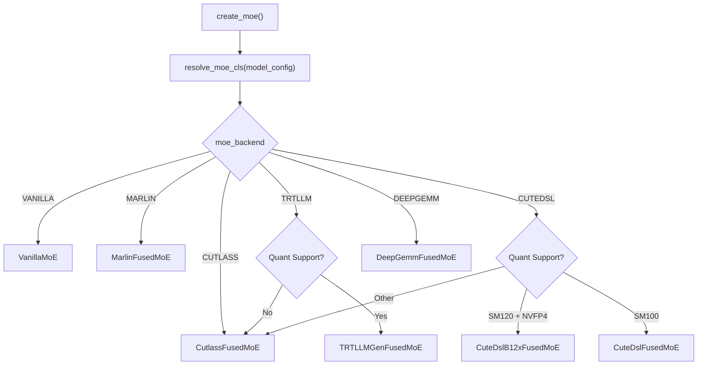

<!-- source: DeepWiki mcp.deepwiki.com · repo NVIDIA/TensorRT-LLM · page 10.2 MoE Backend Variants · fetched 2026-10-26 -->

# MoE Backend Variants

Relevant source files

The following files were used as context for generating this wiki page:

- [cpp/micro_benchmarks/CMakeLists.txt](cpp/micro_benchmarks/CMakeLists.txt)
- [cpp/micro_benchmarks/mixtureOfExpertsBackendBenchmarkFixture.h](cpp/micro_benchmarks/mixtureOfExpertsBackendBenchmarkFixture.h)
- [cpp/micro_benchmarks/mixtureOfExpertsBackendBenchmarkLauncher.cu](cpp/micro_benchmarks/mixtureOfExpertsBackendBenchmarkLauncher.cu)
- [cpp/tensorrt_llm/cutlass_extensions/include/cutlass_extensions/epilogue/fusion/sm90_visitor_scatter.hpp](cpp/tensorrt_llm/cutlass_extensions/include/cutlass_extensions/epilogue/fusion/sm90_visitor_scatter.hpp)
- [cpp/tensorrt_llm/cutlass_extensions/include/cutlass_extensions/gemm_configs.h](cpp/tensorrt_llm/cutlass_extensions/include/cutlass_extensions/gemm_configs.h)
- [cpp/tensorrt_llm/kernels/cutlass_kernels/cutlass_heuristic.cpp](cpp/tensorrt_llm/kernels/cutlass_kernels/cutlass_heuristic.cpp)
- [cpp/tensorrt_llm/kernels/cutlass_kernels/include/moe_gemm_kernels.h](cpp/tensorrt_llm/kernels/cutlass_kernels/include/moe_gemm_kernels.h)
- [cpp/tensorrt_llm/kernels/cutlass_kernels/include/moe_kernels.h](cpp/tensorrt_llm/kernels/cutlass_kernels/include/moe_kernels.h)
- [cpp/tensorrt_llm/kernels/cutlass_kernels/include/moe_util_kernels.h](cpp/tensorrt_llm/kernels/cutlass_kernels/include/moe_util_kernels.h)
- [cpp/tensorrt_llm/kernels/cutlass_kernels/moe_gemm/launchers/moe_gemm_tma_ws_launcher.h](cpp/tensorrt_llm/kernels/cutlass_kernels/moe_gemm/launchers/moe_gemm_tma_ws_launcher.h)
- [cpp/tensorrt_llm/kernels/cutlass_kernels/moe_gemm/launchers/moe_gemm_tma_ws_launcher.inl](cpp/tensorrt_llm/kernels/cutlass_kernels/moe_gemm/launchers/moe_gemm_tma_ws_launcher.inl)
- [cpp/tensorrt_llm/kernels/cutlass_kernels/moe_gemm/launchers/moe_gemm_tma_ws_mixed_input_launcher.h](cpp/tensorrt_llm/kernels/cutlass_kernels/moe_gemm/launchers/moe_gemm_tma_ws_mixed_input_launcher.h)
- [cpp/tensorrt_llm/kernels/cutlass_kernels/moe_gemm/launchers/moe_gemm_tma_ws_mixed_input_launcher.inl](cpp/tensorrt_llm/kernels/cutlass_kernels/moe_gemm/launchers/moe_gemm_tma_ws_mixed_input_launcher.inl)
- [cpp/tensorrt_llm/kernels/cutlass_kernels/moe_gemm/moe_gemm_template_dispatch.h](cpp/tensorrt_llm/kernels/cutlass_kernels/moe_gemm/moe_gemm_template_dispatch.h)
- [cpp/tensorrt_llm/kernels/cutlass_kernels/moe_gemm/moe_gemm_template_dispatch_tma_ws.h](cpp/tensorrt_llm/kernels/cutlass_kernels/moe_gemm/moe_gemm_template_dispatch_tma_ws.h)
- [cpp/tensorrt_llm/kernels/cutlass_kernels/moe_gemm/moe_gemm_template_dispatch_tma_ws_mixed_dtype.h](cpp/tensorrt_llm/kernels/cutlass_kernels/moe_gemm/moe_gemm_template_dispatch_tma_ws_mixed_dtype.h)
- [cpp/tensorrt_llm/kernels/cutlass_kernels/moe_gemm/moe_gemm_tma_warp_specialized_input.cu](cpp/tensorrt_llm/kernels/cutlass_kernels/moe_gemm/moe_gemm_tma_warp_specialized_input.cu)
- [cpp/tensorrt_llm/kernels/cutlass_kernels/moe_gemm/moe_kernels.cu](cpp/tensorrt_llm/kernels/cutlass_kernels/moe_gemm/moe_kernels.cu)
- [cpp/tensorrt_llm/kernels/cutlass_kernels/python/generate_kernels.py](cpp/tensorrt_llm/kernels/cutlass_kernels/python/generate_kernels.py)
- [cpp/tensorrt_llm/kernels/internal_cutlass_kernels/aarch64-linux-gnu/tensorrt_llm_internal_cutlass_kernels_static.tar.xz](cpp/tensorrt_llm/kernels/internal_cutlass_kernels/aarch64-linux-gnu/tensorrt_llm_internal_cutlass_kernels_static.tar.xz)
- [cpp/tensorrt_llm/kernels/internal_cutlass_kernels/aarch64-linux-gnu/version.txt](cpp/tensorrt_llm/kernels/internal_cutlass_kernels/aarch64-linux-gnu/version.txt)
- [cpp/tensorrt_llm/kernels/internal_cutlass_kernels/include/moe_kernels.h](cpp/tensorrt_llm/kernels/internal_cutlass_kernels/include/moe_kernels.h)
- [cpp/tensorrt_llm/kernels/internal_cutlass_kernels/x86_64-linux-gnu/tensorrt_llm_internal_cutlass_kernels_static.tar.xz](cpp/tensorrt_llm/kernels/internal_cutlass_kernels/x86_64-linux-gnu/tensorrt_llm_internal_cutlass_kernels_static.tar.xz)
- [cpp/tensorrt_llm/kernels/internal_cutlass_kernels/x86_64-linux-gnu/version.txt](cpp/tensorrt_llm/kernels/internal_cutlass_kernels/x86_64-linux-gnu/version.txt)
- [cpp/tensorrt_llm/kernels/trtllmGenKernels/blockScaleMoe/DevKernel.h](cpp/tensorrt_llm/kernels/trtllmGenKernels/blockScaleMoe/DevKernel.h)
- [cpp/tensorrt_llm/kernels/trtllmGenKernels/blockScaleMoe/runner.cu](cpp/tensorrt_llm/kernels/trtllmGenKernels/blockScaleMoe/runner.cu)
- [cpp/tensorrt_llm/kernels/trtllmGenKernels/blockScaleMoe/runner.h](cpp/tensorrt_llm/kernels/trtllmGenKernels/blockScaleMoe/runner.h)
- [cpp/tensorrt_llm/thop/fp4BlockScaleMoe.cpp](cpp/tensorrt_llm/thop/fp4BlockScaleMoe.cpp)
- [cpp/tensorrt_llm/thop/fp8BlockScaleMoe.cpp](cpp/tensorrt_llm/thop/fp8BlockScaleMoe.cpp)
- [cpp/tensorrt_llm/thop/fp8PerTensorScaleMoe.cpp](cpp/tensorrt_llm/thop/fp8PerTensorScaleMoe.cpp)
- [cpp/tensorrt_llm/thop/moeOp.cpp](cpp/tensorrt_llm/thop/moeOp.cpp)
- [cpp/tensorrt_llm/thop/moeUtilOp.cpp](cpp/tensorrt_llm/thop/moeUtilOp.cpp)
- [cpp/tensorrt_llm/thop/mxFp4BlockScaleMoe.cpp](cpp/tensorrt_llm/thop/mxFp4BlockScaleMoe.cpp)
- [cpp/tests/unit_tests/kernels/mixtureOfExpertsTest.cu](cpp/tests/unit_tests/kernels/mixtureOfExpertsTest.cu)
- [cpp/tests/unit_tests/kernels/routing/routingDeepSeekTest.cpp](cpp/tests/unit_tests/kernels/routing/routingDeepSeekTest.cpp)
- [cpp/tests/unit_tests/kernels/routing/routingLlama4Test.cpp](cpp/tests/unit_tests/kernels/routing/routingLlama4Test.cpp)
- [cpp/tests/unit_tests/kernels/routing/routingTest.cpp](cpp/tests/unit_tests/kernels/routing/routingTest.cpp)
- [cpp/tests/unit_tests/kernels/routing/routingTest.h](cpp/tests/unit_tests/kernels/routing/routingTest.h)
- [tensorrt_llm/_torch/custom_ops/cute_dsl_custom_ops.py](tensorrt_llm/_torch/custom_ops/cute_dsl_custom_ops.py)
- [tensorrt_llm/_torch/cute_dsl_kernels/blackwell/blockscaled_contiguous_gather_grouped_gemm_act_fusion.py](tensorrt_llm/_torch/cute_dsl_kernels/blackwell/blockscaled_contiguous_gather_grouped_gemm_act_fusion.py)
- [tensorrt_llm/_torch/cute_dsl_kernels/blackwell/blockscaled_contiguous_grouped_gemm.py](tensorrt_llm/_torch/cute_dsl_kernels/blackwell/blockscaled_contiguous_grouped_gemm.py)
- [tensorrt_llm/_torch/cute_dsl_kernels/blackwell/blockscaled_contiguous_grouped_gemm_finalize_fusion.py](tensorrt_llm/_torch/cute_dsl_kernels/blackwell/blockscaled_contiguous_grouped_gemm_finalize_fusion.py)
- [tensorrt_llm/_torch/cute_dsl_kernels/blackwell/blockscaled_contiguous_grouped_gemm_swiglu_fusion.py](tensorrt_llm/_torch/cute_dsl_kernels/blackwell/blockscaled_contiguous_grouped_gemm_swiglu_fusion.py)
- [tensorrt_llm/_torch/cute_dsl_kernels/blackwell/dense_blockscaled_gemm_persistent.py](tensorrt_llm/_torch/cute_dsl_kernels/blackwell/dense_blockscaled_gemm_persistent.py)
- [tensorrt_llm/_torch/cute_dsl_kernels/blackwell/moe_as_dense_gemm/__init__.py](tensorrt_llm/_torch/cute_dsl_kernels/blackwell/moe_as_dense_gemm/__init__.py)
- [tensorrt_llm/_torch/cute_dsl_kernels/blackwell/moe_as_dense_gemm/fc1.py](tensorrt_llm/_torch/cute_dsl_kernels/blackwell/moe_as_dense_gemm/fc1.py)
- [tensorrt_llm/_torch/cute_dsl_kernels/blackwell/moe_as_dense_gemm/fc2.py](tensorrt_llm/_torch/cute_dsl_kernels/blackwell/moe_as_dense_gemm/fc2.py)
- [tensorrt_llm/_torch/cute_dsl_kernels/blackwell/utils.py](tensorrt_llm/_torch/cute_dsl_kernels/blackwell/utils.py)
- [tensorrt_llm/_torch/modules/fused_moe/communication/deep_ep.py](tensorrt_llm/_torch/modules/fused_moe/communication/deep_ep.py)
- [tensorrt_llm/_torch/modules/fused_moe/communication/deep_ep_low_latency.py](tensorrt_llm/_torch/modules/fused_moe/communication/deep_ep_low_latency.py)
- [tensorrt_llm/_torch/modules/fused_moe/configurable_moe.py](tensorrt_llm/_torch/modules/fused_moe/configurable_moe.py)
- [tensorrt_llm/_torch/modules/fused_moe/create_moe.py](tensorrt_llm/_torch/modules/fused_moe/create_moe.py)
- [tensorrt_llm/_torch/modules/fused_moe/fused_moe_cute_dsl.py](tensorrt_llm/_torch/modules/fused_moe/fused_moe_cute_dsl.py)
- [tensorrt_llm/_torch/modules/fused_moe/fused_moe_cutlass.py](tensorrt_llm/_torch/modules/fused_moe/fused_moe_cutlass.py)
- [tensorrt_llm/_torch/modules/fused_moe/fused_moe_deepgemm.py](tensorrt_llm/_torch/modules/fused_moe/fused_moe_deepgemm.py)
- [tensorrt_llm/_torch/modules/fused_moe/fused_moe_triton.py](tensorrt_llm/_torch/modules/fused_moe/fused_moe_triton.py)
- [tensorrt_llm/_torch/modules/fused_moe/fused_moe_trtllm_gen.py](tensorrt_llm/_torch/modules/fused_moe/fused_moe_trtllm_gen.py)
- [tensorrt_llm/_torch/modules/fused_moe/interface.py](tensorrt_llm/_torch/modules/fused_moe/interface.py)
- [tensorrt_llm/_torch/modules/fused_moe/moe_scheduler.py](tensorrt_llm/_torch/modules/fused_moe/moe_scheduler.py)
- [tensorrt_llm/_torch/modules/fused_moe/quantization.py](tensorrt_llm/_torch/modules/fused_moe/quantization.py)
- [tests/microbenchmarks/bench_moe/utils.py](tests/microbenchmarks/bench_moe/utils.py)
- [tests/scripts/cute_dsl_kernels/moe_as_dense_gemm/run_moe_as_dense_gemm_fc2.py](tests/scripts/cute_dsl_kernels/moe_as_dense_gemm/run_moe_as_dense_gemm_fc2.py)
- [tests/scripts/cute_dsl_kernels/run_blockscaled_contiguous_gather_grouped_gemm_act_fusion.py](tests/scripts/cute_dsl_kernels/run_blockscaled_contiguous_gather_grouped_gemm_act_fusion.py)
- [tests/scripts/cute_dsl_kernels/run_blockscaled_contiguous_grouped_gemm.py](tests/scripts/cute_dsl_kernels/run_blockscaled_contiguous_grouped_gemm.py)
- [tests/scripts/cute_dsl_kernels/run_blockscaled_contiguous_grouped_gemm_finalize_fusion.py](tests/scripts/cute_dsl_kernels/run_blockscaled_contiguous_grouped_gemm_finalize_fusion.py)
- [tests/scripts/cute_dsl_kernels/run_blockscaled_contiguous_grouped_gemm_swiglu_fusion.py](tests/scripts/cute_dsl_kernels/run_blockscaled_contiguous_grouped_gemm_swiglu_fusion.py)
- [tests/scripts/cute_dsl_kernels/run_dense_blockscaled_gemm_persistent.py](tests/scripts/cute_dsl_kernels/run_dense_blockscaled_gemm_persistent.py)
- [tests/scripts/cute_dsl_kernels/testing.py](tests/scripts/cute_dsl_kernels/testing.py)
- [tests/unittest/_torch/modules/fused_moe/test_deepgemm_fused_expand_quant.py](tests/unittest/_torch/modules/fused_moe/test_deepgemm_fused_expand_quant.py)
- [tests/unittest/_torch/modules/moe/moe_test_utils.py](tests/unittest/_torch/modules/moe/moe_test_utils.py)
- [tests/unittest/_torch/modules/moe/quantize_utils.py](tests/unittest/_torch/modules/moe/quantize_utils.py)
- [tests/unittest/_torch/modules/moe/test_moe_backend.py](tests/unittest/_torch/modules/moe/test_moe_backend.py)
- [tests/unittest/_torch/modules/moe/test_moe_module.py](tests/unittest/_torch/modules/moe/test_moe_module.py)
- [tests/unittest/_torch/modules/test_fused_moe.py](tests/unittest/_torch/modules/test_fused_moe.py)
- [tests/unittest/_torch/thop/parallel/test_cute_dsl_moe.py](tests/unittest/_torch/thop/parallel/test_cute_dsl_moe.py)
- [tests/unittest/_torch/thop/parallel/test_fp4_linear.py](tests/unittest/_torch/thop/parallel/test_fp4_linear.py)

## Purpose and Scope

This page documents the different MoE (Mixture of Experts) backend implementations available in TensorRT-LLM. Each backend variant provides specialized computation kernels optimized for different hardware architectures (Ampere, Hopper, Blackwell), quantization schemes (FP8, NVFP4, MXFP4), and performance characteristics.

For the abstract MoE interface and backend selection mechanisms, see [10.1 MoE Interface and Backend Implementations](). For communication strategies used by these backends, see [10.3 MoE Communication Strategies](). For quantization method details, see [10.4 MoE Quantization Methods]().

## Backend Architecture Overview

MoE backends in TensorRT-LLM implement the core computation pattern: routing → dispatch → GEMM1 → activation → GEMM2 → combine. Each backend provides optimized kernels for different hardware and quantization combinations.

**Backend Hierarchy Diagram**

```mermaid
graph TB
    subgraph "Interface Layer"
        MoE["MoE (interface.py)"]
        Config["ConfigurableMoE (configurable_moe.py)"]
    end
    
    subgraph "Production Backends"
        Cutlass["CutlassFusedMoE (fused_moe_cutlass.py)"]
        TRTLLMGen["TRTLLMGenFusedMoE (fused_moe_trtllm_gen.py)"]
        CuteDsl["CuteDslFusedMoE (fused_moe_cute_dsl.py)"]
        CuteDslB12x["CuteDslB12xFusedMoE (fused_moe_cute_dsl_b12x.py)"]
        DeepGemm["DeepGemmFusedMoE (fused_moe_deepgemm.py)"]
        DenseGemm["DenseGEMMFusedMoE (fused_moe_densegemm.py)"]
        MegaMoE_DG["MegaMoEDeepGemm (mega_moe.py)"]
        MegaMoE_CD["MegaMoECuteDsl (mega_moe.py)"]
        Marlin["MarlinFusedMoE (fused_moe_marlin.py)"]
    end
    
    subgraph "Reference & Research"
        Triton["TritonFusedMoE (fused_moe_triton.py)"]
        Vanilla["VanillaMoE (fused_moe_vanilla.py)"]
    end
    
    MoE --> Cutlass
    MoE --> TRTLLMGen
    MoE --> CuteDsl
    MoE --> DeepGemm
    MoE --> DenseGemm
    MoE --> MegaMoE_DG
    MoE --> MegaMoE_CD
    MoE --> Triton
    MoE --> Vanilla
    MoE --> Marlin
    
    Config -- "Composition" --> Cutlass
    Config -- "Composition" --> TRTLLMGen
    Config -- "Composition" --> CuteDsl
    Config -- "Composition" --> DeepGemm
```

Sources: [tensorrt_llm/_torch/modules/fused_moe/interface.py:194-220](), [tensorrt_llm/_torch/modules/fused_moe/configurable_moe.py:78-129](), [tensorrt_llm/_torch/modules/fused_moe/create_moe.py:11-27]()

## Backend Variants

### CutlassFusedMoE

**Primary general-purpose backend** using NVIDIA CUTLASS library for GEMM operations. Supports the widest range of hardware and quantization modes.

**Key Characteristics:**
- **Hardware Support**: SM >= 80 (Ampere, Ada, Hopper, Blackwell) [tensorrt_llm/_torch/modules/fused_moe/fused_moe_cutlass.py:104-163]().
- **Quantization Support**: Unquantized (FP16/BF16), FP8 QDQ, FP8_BLOCK_SCALES, NVFP4, W4A8_AWQ, W8A16, W4A16_MXFP4, W4A8_MXFP4_FP8, W4A8_MXFP4_MXFP8, and MXFP8 [tensorrt_llm/_torch/modules/fused_moe/fused_moe_cutlass.py:104-163]().
- **LoRA Support**: Supports routed-expert MoE LoRA via `capabilities = MoEStaticCapability(supports_moe_lora=True)` [tensorrt_llm/_torch/modules/fused_moe/fused_moe_cutlass.py:93-93](). Multi-chunk execution is currently unsupported for this mode [tensorrt_llm/_torch/modules/fused_moe/fused_moe_cutlass.py:49-60]().

**Capability Matrix:**

| Quantization | SM Constraint | Activation Dtypes |
|-------------|---------------|-------------------|
| Unquantized | SM >= 80 | float16, bfloat16 |
| FP8 QDQ | SM >= 89 | float16, bfloat16, float32 |
| FP8_BLOCK_SCALES | SM in {90, 120} | bfloat16 |
| NVFP4 | SM in {100, 103, 120, 121} | float16, bfloat16, float8_e4m3fn |
| W4A8_AWQ | SM in {89, 90} | float16, bfloat16 |
| W8A16 | SM >= 80 | float16, bfloat16 |
| W4A16_MXFP4 | SM == 90 | float16, bfloat16 |
| W4A8_MXFP4_FP8 | SM in {100, 103} | float16, bfloat16, float32 |
| W4A8_MXFP4_MXFP8 | SM in {100, 103, 120, 121} | float16, bfloat16 |
| MXFP8 | SM in {100, 103} | float16, bfloat16 |

Sources: [tensorrt_llm/_torch/modules/fused_moe/fused_moe_cutlass.py:104-163]()

### TRTLLMGenFusedMoE

**Blackwell-optimized backend** for SM100/SM103. It is designed for minimum latency by fusing routing and GEMM operations where possible.

**Key Characteristics:**
- **Hardware Support**: SM in {100, 103} ONLY (Blackwell) [tensorrt_llm/_torch/modules/fused_moe/fused_moe_trtllm_gen.py:143-148]().
- **Quantization Support**: FP8_BLOCK_SCALES, NVFP4, W4A8_NVFP4_FP8, W4A16_MXFP4, W4A8_MXFP4_FP8, W4A8_MXFP4_MXFP8 [tensorrt_llm/_torch/modules/fused_moe/fused_moe_trtllm_gen.py:106-113]().
- **FlashInfer Integration**: Unquantized BF16 path requires FlashInfer fused MoE support [tensorrt_llm/_torch/modules/fused_moe/fused_moe_trtllm_gen.py:136-138]().

**Routing Integration:**
- Supports advanced routing via `DeepSeekV3MoeRoutingMethod`, `DeepSeekV4MoeRoutingMethod`, and `MiniMaxM2/M3` methods [tensorrt_llm/_torch/modules/fused_moe/fused_moe_trtllm_gen.py:49-51]().
- Utilizes `RoutingParams` to pass top-k, bias, and group routing information to the kernels [tensorrt_llm/_torch/modules/fused_moe/fused_moe_trtllm_gen.py:54-61]().

Sources: [tensorrt_llm/_torch/modules/fused_moe/fused_moe_trtllm_gen.py:63-161]()

### CuteDslFusedMoE & CuteDslB12x

**CuteDSL backends** use specialized CuTe-based kernels for Blackwell architectures.

**Key Characteristics:**
- **CuteDslFusedMoE**: Primary backend for SM100/SM103 supporting `FP8_BLOCK_SCALES` and `NVFP4` [tensorrt_llm/_torch/modules/fused_moe/create_moe.py:131-145]().
- **CuteDslB12xFusedMoE**: Hybrid backend for SM120/SM121 that combines CUTLASS prefill with FlashInfer NVFP4 decode [tensorrt_llm/_torch/modules/fused_moe/create_moe.py:13-13]().
- **Tuning Buckets**: Uses `GroupedGemmInputsHelper` to generate tuning buckets based on the maximum possible number of tokens [tensorrt_llm/_torch/custom_ops/cute_dsl_custom_ops.py:89-93]().

Sources: [tensorrt_llm/_torch/modules/fused_moe/create_moe.py:13-145](), [tensorrt_llm/_torch/custom_ops/cute_dsl_custom_ops.py:43-110]()

### DeepGemmFusedMoE

**DeepGemm backend** provides specialized kernels for DeepSeek-style FP8 block-scale quantization.

**Key Characteristics:**
- **Implementation**: Uses specialized Triton kernels for group quantization (`_masked_index_copy_group_quant_fp8`) and fused expansion [tensorrt_llm/_torch/modules/fused_moe/fused_moe_deepgemm.py:83-150]().
- **Workspace Management**: Clamps `moe_max_num_tokens` to OOM-safe defaults for DeepGemm (default 18688) [tensorrt_llm/_torch/modules/fused_moe/fused_moe_deepgemm.py:40-81]().
- **Quantization Alignment**: Aligns with `FusedMoEQuantScalesDeepSeekFP8BlockScales` for per-expert block scales [tensorrt_llm/_torch/modules/fused_moe/quantization.py:69-71]().

Sources: [tensorrt_llm/_torch/modules/fused_moe/fused_moe_deepgemm.py:40-150](), [tensorrt_llm/_torch/modules/fused_moe/quantization.py:69-71]()

### TritonFusedMoE

**Triton-based backend** used for research and reference implementations, specifically optimized for Hopper (SM90) [tests/unittest/_torch/modules/test_fused_moe.py:98-99]().

Sources: [tests/unittest/_torch/modules/test_fused_moe.py:97-106]()

### MarlinFusedMoE

**Marlin backend** provides optimized kernels for 4-bit weight-only quantization (GPTQ-style) for MoE layers [tensorrt_llm/_torch/modules/fused_moe/create_moe.py:17-17]().

Sources: [tensorrt_llm/_torch/modules/fused_moe/create_moe.py:17-17]()

## Backend Selection and Factory

The `create_moe.py` utility acts as a factory, selecting the most appropriate class based on the hardware (SM version) and requested quantization.

**Backend Selection Flow**

Sources: [tensorrt_llm/_torch/modules/fused_moe/create_moe.py:39-161]()

## ConfigurableMoE Wrapper

`ConfigurableMoE` is the primary entry point for MoE layers in the PyTorch-based executor. It uses composition to wrap a specific backend and a communication strategy.

**Key Features:**
- **Dynamic Sync**: Synchronizes attributes like `layer_idx`, `num_slots`, and `layer_load_balancer` between the wrapper and the inner backend via `_BACKEND_SYNC_ATTRS` [tensorrt_llm/_torch/modules/fused_moe/configurable_moe.py:63-75]().
- **Scheduler Integration**: Orchestrates the execution flow using `MoEScheduler`, supporting both `EXTERNAL_COMM` and `FUSED_COMM` modes [tensorrt_llm/_torch/modules/fused_moe/interface.py:94-112]().
- **DWDP Integration**: Integrates with the global DWDP manager for distributed weight data parallelism [tensorrt_llm/_torch/modules/fused_moe/configurable_moe.py:45-47]().

Sources: [tensorrt_llm/_torch/modules/fused_moe/configurable_moe.py:78-129](), [tensorrt_llm/_torch/modules/fused_moe/interface.py:94-112]()

---

