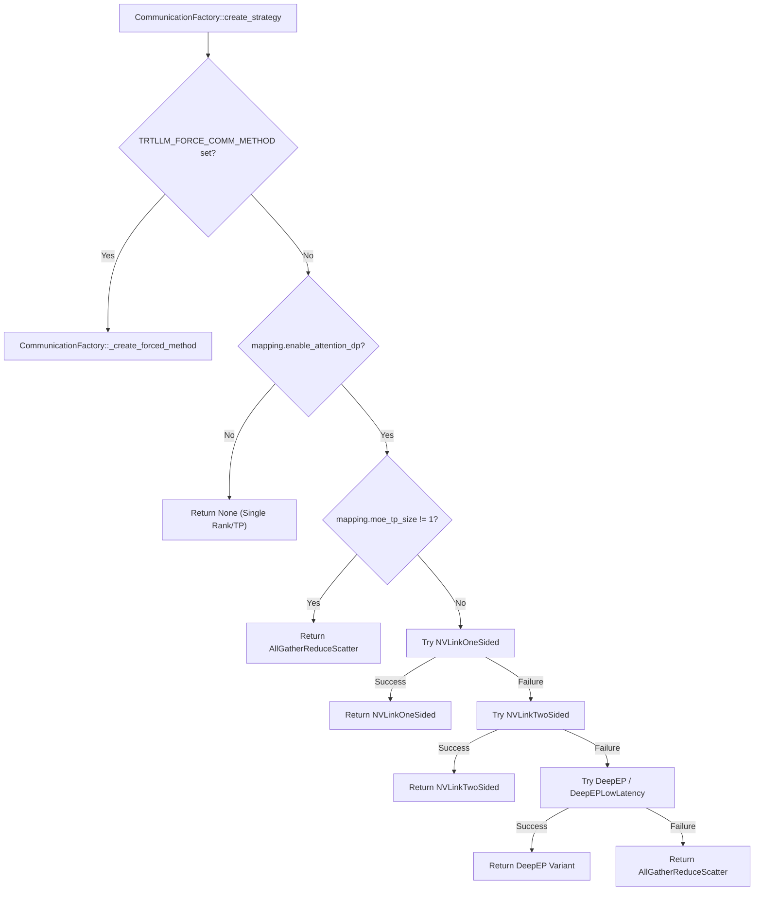
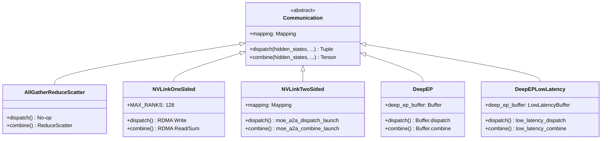
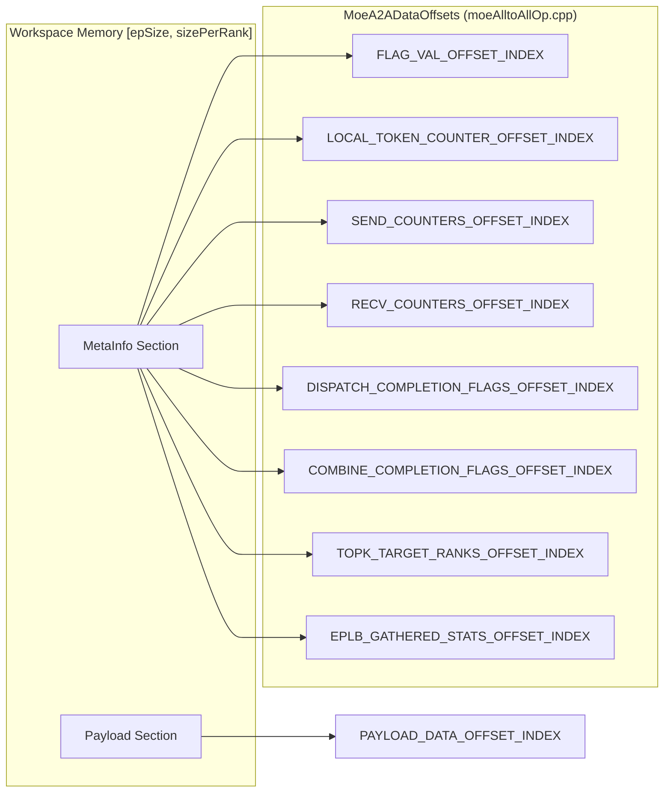

<!-- source: DeepWiki mcp.deepwiki.com · repo NVIDIA/TensorRT-LLM · page 10.3 MoE Communication Strategies · fetched 2026-10-26 -->

# MoE Communication Strategies

Relevant source files

The following files were used as context for generating this wiki page:

- [cpp/tensorrt_llm/kernels/communicationKernels/moeAlltoAllCftManager.h](cpp/tensorrt_llm/kernels/communicationKernels/moeAlltoAllCftManager.h)
- [cpp/tensorrt_llm/kernels/communicationKernels/moeAlltoAllCftSupport.h](cpp/tensorrt_llm/kernels/communicationKernels/moeAlltoAllCftSupport.h)
- [cpp/tensorrt_llm/kernels/communicationKernels/moeAlltoAllKernels.cu](cpp/tensorrt_llm/kernels/communicationKernels/moeAlltoAllKernels.cu)
- [cpp/tensorrt_llm/kernels/communicationKernels/moeAlltoAllKernels.h](cpp/tensorrt_llm/kernels/communicationKernels/moeAlltoAllKernels.h)
- [cpp/tensorrt_llm/kernels/cudaAsyncOps.cuh](cpp/tensorrt_llm/kernels/cudaAsyncOps.cuh)
- [cpp/tensorrt_llm/kernels/fusedMoeCommKernels.cu](cpp/tensorrt_llm/kernels/fusedMoeCommKernels.cu)
- [cpp/tensorrt_llm/kernels/fusedMoeCommKernels.h](cpp/tensorrt_llm/kernels/fusedMoeCommKernels.h)
- [cpp/tensorrt_llm/kernels/ll128Proto.cuh](cpp/tensorrt_llm/kernels/ll128Proto.cuh)
- [cpp/tensorrt_llm/kernels/moeCommKernelsCommon.h](cpp/tensorrt_llm/kernels/moeCommKernelsCommon.h)
- [cpp/tensorrt_llm/kernels/moeLoadBalance/moeLoadBalanceCommon.h](cpp/tensorrt_llm/kernels/moeLoadBalance/moeLoadBalanceCommon.h)
- [cpp/tensorrt_llm/kernels/moeLoadBalance/moeLoadBalanceKernels.cu](cpp/tensorrt_llm/kernels/moeLoadBalance/moeLoadBalanceKernels.cu)
- [cpp/tensorrt_llm/kernels/moeLoadBalance/moeLoadBalanceKernels.h](cpp/tensorrt_llm/kernels/moeLoadBalance/moeLoadBalanceKernels.h)
- [cpp/tensorrt_llm/kernels/moePrepareKernels.cu](cpp/tensorrt_llm/kernels/moePrepareKernels.cu)
- [cpp/tensorrt_llm/kernels/moePrepareKernels.h](cpp/tensorrt_llm/kernels/moePrepareKernels.h)
- [cpp/tensorrt_llm/thop/moeAlltoAllMeta.h](cpp/tensorrt_llm/thop/moeAlltoAllMeta.h)
- [cpp/tensorrt_llm/thop/moeAlltoAllOp.cpp](cpp/tensorrt_llm/thop/moeAlltoAllOp.cpp)
- [cpp/tensorrt_llm/thop/moeCommOp.cpp](cpp/tensorrt_llm/thop/moeCommOp.cpp)
- [cpp/tensorrt_llm/thop/moeLoadBalanceOp.cpp](cpp/tensorrt_llm/thop/moeLoadBalanceOp.cpp)
- [cpp/tests/unit_tests/kernels/fusedMoeCommKernelTest.cpp](cpp/tests/unit_tests/kernels/fusedMoeCommKernelTest.cpp)
- [tensorrt_llm/_mnnvl_utils.py](tensorrt_llm/_mnnvl_utils.py)
- [tensorrt_llm/_torch/alltoall_watchdog.py](tensorrt_llm/_torch/alltoall_watchdog.py)
- [tensorrt_llm/_torch/distributed/moe_alltoall.py](tensorrt_llm/_torch/distributed/moe_alltoall.py)
- [tensorrt_llm/_torch/modules/fused_moe/communication/communication_factory.py](tensorrt_llm/_torch/modules/fused_moe/communication/communication_factory.py)
- [tensorrt_llm/_torch/modules/fused_moe/communication/nvlink_one_sided.py](tensorrt_llm/_torch/modules/fused_moe/communication/nvlink_one_sided.py)
- [tensorrt_llm/_torch/modules/fused_moe/wide_ep_ft.py](tensorrt_llm/_torch/modules/fused_moe/wide_ep_ft.py)
- [tests/unittest/_torch/modules/moe/test_moe_a2a_cft.py](tests/unittest/_torch/modules/moe/test_moe_a2a_cft.py)
- [tests/unittest/_torch/modules/moe/test_moe_comm.py](tests/unittest/_torch/modules/moe/test_moe_comm.py)
- [tests/unittest/_torch/modules/test_alltoall_watchdog.py](tests/unittest/_torch/modules/test_alltoall_watchdog.py)
- [tests/unittest/_torch/multi_gpu/test_moe_a2a.py](tests/unittest/_torch/multi_gpu/test_moe_a2a.py)

This page documents the communication strategies used in Mixture of Experts (MoE) layers to distribute token-to-expert assignments across multiple GPUs. These strategies enable efficient expert parallelism (EP) by optimizing data movement between ranks during MoE computation.

For information about MoE backend implementations and kernels, see [MoE Backend Variants](10.2). For expert parallel load balancing, see [Expert Parallel Load Balancing](10.5).

## Overview and Motivation

MoE layers require specialized communication patterns when using expert parallelism (EP). Each rank holds a subset of experts, but tokens may need to be routed to experts on different ranks. The communication strategy determines how tokens and intermediate results are exchanged between ranks.

Two fundamental approaches exist:

1.  **AllGather + ReduceScatter**: Traditional approach that gathers all tokens to all ranks, then reduces results.
2.  **AllToAll**: More efficient approach that exchanges tokens directly between ranks based on expert assignments.

The choice between these methods and their specific implementations depends on hardware capabilities (e.g., NVLink, NVSHMEM), model configuration, and workload characteristics (e.g., token count).

Sources: [tensorrt_llm/_torch/modules/fused_moe/communication/communication_factory.py:17-21](), [tensorrt_llm/_torch/modules/fused_moe/communication/communication_factory.py:71-78]()

## Communication Strategy Selection

The `CommunicationFactory` is responsible for selecting the best communication method based on a defined priority order. The selection logic is driven by hardware support, configuration settings, and workload characteristics.

### Selection Logic
The factory attempts to create strategies in the following priority order:
1.  **Forced Method**: If `TRTLLM_FORCE_COMM_METHOD` is specified via environment variable or model selection [tensorrt_llm/_torch/modules/fused_moe/communication/communication_factory.py:149-163]().
2.  **NVLinkOneSided**: Highest priority for throughput on NVLink-connected systems [tensorrt_llm/_torch/modules/fused_moe/communication/communication_factory.py:99-99]().
3.  **NVLinkTwoSided**: High priority for latency, using MNNVL symmetric memory [tensorrt_llm/_torch/modules/fused_moe/communication/communication_factory.py:100-100]().
4.  **NcclEP**: If the NCCL-EP plugin is available for low-latency communication [tensorrt_llm/_torch/modules/fused_moe/communication/communication_factory.py:101-101]().
5.  **DeepEP / DeepEPLowLatency**: DeepSeek's optimized EP library, selected if enabled via `TRTLLM_CAN_USE_DEEP_EP` [tensorrt_llm/_torch/modules/fused_moe/communication/communication_factory.py:102-103]().
6.  **AllGather + ReduceScatter**: Fallback that always works via standard NCCL, used if `moe_tp_size != 1` or other methods fail [tensorrt_llm/_torch/modules/fused_moe/communication/communication_factory.py:145-146]().

Title: Communication Strategy Selection Flow

Sources: [tensorrt_llm/_torch/modules/fused_moe/communication/communication_factory.py:81-167]()

## Communication Strategy Classes

### Base Communication Interface
All strategies inherit from the `Communication` abstract base class, which defines the core dispatch/combine lifecycle.

Title: MoE Communication Class Hierarchy

Sources: [tensorrt_llm/_torch/modules/fused_moe/communication/base.py:33-35](), [tensorrt_llm/_torch/modules/fused_moe/communication/deep_ep_low_latency.py:37-72]()

### NVLink Strategies and MNNVL
The NVLink-based strategies leverage **Multi-Node NVLink (MNNVL)** utilities to manage symmetric memory regions across GPUs.

*   **MnnvlMemory**: Manages CUDA memory allocation handles. It distinguishes between `CU_MEM_HANDLE_TYPE_FABRIC` for Grace-Hopper (aarch64) and `CU_MEM_HANDLE_TYPE_POSIX_FILE_DESCRIPTOR` for x86_64 systems to allow direct peer access via `cuMemAddressReserve` [tensorrt_llm/_mnnvl_utils.py:144-167]().
*   **NVLinkOneSided**: Utilizes symmetric memory to enable peer-to-peer access. The dispatch kernel puts data into peer ranks' symmetric memory, while the combine kernel gets and reduces data into local buffers [tensorrt_llm/_torch/modules/fused_moe/communication/nvlink_one_sided.py:139-149]().
*   **NVLinkTwoSided**: Uses a unified virtual memory workspace and completion flags for synchronization.

Sources: [tensorrt_llm/_mnnvl_utils.py:54-186](), [tensorrt_llm/_torch/modules/fused_moe/communication/nvlink_one_sided.py:139-149]()

### DeepEP Strategies
DeepEP is optimized for DeepSeek-style MoE models and requires the DeepEP library to be installed.

*   **DeepEPLowLatency**: Specifically optimized for small token counts. It uses NVSHMEM and requires specific hidden sizes. Supported hidden sizes include `{2048, 2560, 3584, 4096, 5120, 6144, 7168}` [tensorrt_llm/_torch/modules/fused_moe/communication/deep_ep_low_latency.py:42-42]().
*   **Platform Support**: DeepEPLowLatency rejects SM120/121 (Blackwell RTX) due to potential NVSHMEM-LL deadlocks in the absence of NVSwitch [tensorrt_llm/_torch/modules/fused_moe/communication/deep_ep_low_latency.py:126-127]().
*   **Post-Quantization**: DeepEP supports post-quant dispatch for `nvfp4` [tensorrt_llm/_torch/modules/fused_moe/communication/deep_ep.py:150-156](). DeepEPLowLatency also supports `fp8_qdq` and `w4afp8` by viewing types as `torch.bfloat16` and halving the hidden dimension for the dispatch kernel [tensorrt_llm/_torch/modules/fused_moe/communication/deep_ep_low_latency.py:137-158]().

Sources: [tensorrt_llm/_torch/modules/fused_moe/communication/deep_ep.py:37-156](), [tensorrt_llm/_torch/modules/fused_moe/communication/deep_ep_low_latency.py:37-170]()

## MoE AllToAll Kernels

The C++ implementation of the AllToAll pattern consists of primary phases implemented in `moeAlltoAllKernels.cu`.

### 1. Dispatch Phase
Routes tokens from the local rank to target expert ranks.
*   **Logic**: Each block or warp processes a token, determines the target rank from `token_selected_experts`, and writes the payload to the remote rank's receive buffer in the unified workspace.
*   **Data Structure**: `DispatchKernelPointers` packs source pointers, receive buffers, and `completion_flags` [cpp/tensorrt_llm/kernels/communicationKernels/moeAlltoAllKernels.h:71-125]().
*   **Timeout**: Completion flags use a wait budget defined by `moeA2AGetTimeoutCycles`, which defaults to 300s (longer for warmup) [cpp/tensorrt_llm/kernels/communicationKernels/moeAlltoAllKernels.cu:76-120]().

Sources: [cpp/tensorrt_llm/kernels/communicationKernels/moeAlltoAllKernels.h:71-125](), [cpp/tensorrt_llm/kernels/communicationKernels/moeAlltoAllKernels.cu:76-120]()

### 2. Combine Phase
Aggregates processed expert outputs back to the original token ranks.
*   **Logic**: Waits for completion flags, then reads from receive buffers and sums results.
*   **Data Structure**: `CombineKernelPointers` manages the output buffer and remote receive buffers [cpp/tensorrt_llm/kernels/communicationKernels/moeAlltoAllKernels.h:128-146]().

Sources: [cpp/tensorrt_llm/kernels/communicationKernels/moeAlltoAllKernels.h:128-146]()

## Workspace Management

AllToAll operations require a significant contiguous workspace shared across ranks. The `calculateOffsets` function defines the layout of this workspace, ensuring `CACHELINE_ALIGNMENT` (128 bytes) between sections.

Title: MoeAllToAll Workspace Layout and Offsets

| Offset Index | Data Description |
| :--- | :--- |
| `FLAG_VAL_OFFSET_INDEX` | Synchronization flag value [cpp/tensorrt_llm/thop/moeAlltoAllOp.cpp:101-101]() |
| `LOCAL_TOKEN_COUNTER_OFFSET_INDEX` | Atomic counter for local completion [cpp/tensorrt_llm/thop/moeAlltoAllOp.cpp:105-105]() |
| `SEND_COUNTERS_OFFSET_INDEX` | Tokens sent to each rank [cpp/tensorrt_llm/thop/moeAlltoAllOp.cpp:109-109]() |
| `RECV_COUNTERS_OFFSET_INDEX` | Tokens received from each rank [cpp/tensorrt_llm/thop/moeAlltoAllOp.cpp:114-114]() |
| `DISPATCH_COMPLETION_FLAGS_OFFSET_INDEX` | Flags signaling dispatch completion per rank [cpp/tensorrt_llm/thop/moeAlltoAllOp.cpp:119-119]() |
| `TOPK_TARGET_RANKS_OFFSET_INDEX` | Cached routing info (target ranks) [cpp/tensorrt_llm/thop/moeAlltoAllOp.cpp:129-129]() |
| `EPLB_GATHERED_STATS_OFFSET_INDEX` | Statistics for load balancing across ranks [cpp/tensorrt_llm/thop/moeAlltoAllOp.cpp:141-141]() |

Sources: [cpp/tensorrt_llm/thop/moeAlltoAllOp.cpp:91-179]()

## Counted Fabric Transfers (CFT)

For Grace-Blackwell (GB200) and other advanced NVLink systems, TensorRT-LLM supports **Counted Fabric Transfers (CFT)**. CFT uses Logical Endpoints (LE) and hardware-incremented byte counters to eliminate the need for explicit completion flag writes by the GPU kernels.

*   **`CftMnnvlMemory`**: Extends `MnnvlMemory` to support Logical Endpoints [tensorrt_llm/_mnnvl_utils.py:328-333]().
*   **Alignment**: CFT counted writes require payloads to be 16-byte aligned [tensorrt_llm/_torch/modules/fused_moe/communication/nvlink_one_sided.py:57-57]().
*   **Thresholds**: CFT is typically enabled for small to medium batch sizes (default max batch 128) [tensorrt_llm/_torch/modules/fused_moe/communication/nvlink_one_sided.py:50-55]().
*   **Counters**: Uses `kCftCounterStride` (256B) to avoid L2 port contention during concurrent updates [cpp/tensorrt_llm/kernels/communicationKernels/moeAlltoAllKernels.h:41-42]().

Sources: [tensorrt_llm/_mnnvl_utils.py:328-333](), [tensorrt_llm/_torch/modules/fused_moe/communication/nvlink_one_sided.py:50-97](), [cpp/tensorrt_llm/kernels/communicationKernels/moeAlltoAllKernels.h:41-42]()

## Reliability and Active Rank Masking

To handle potential hangs in distributed communication, TensorRT-LLM implements active rank masking and a watchdog mechanism.

*   **`active_rank_mask`**: A bitmask passed to kernels to skip inactive peers. Word 0 covers ranks 0..63; word 1 covers ranks 64..127 [cpp/tensorrt_llm/kernels/communicationKernels/moeAlltoAllKernels.h:32-34]().
*   **`resolveActiveRankMask`**: Resolves a Python rank-mask tensor into a fixed-width uint64 array. It ensures the local rank's bit is set to avoid running on a "dead" rank [cpp/tensorrt_llm/thop/moeAlltoAllOp.cpp:66-88]().
*   **Watchdog**: The `AlltoAllWatchdog` monitors collective progress and can trigger timeouts if ranks fail to respond [tensorrt_llm/_torch/modules/fused_moe/communication/nvlink_one_sided.py:33-41]().

Sources: [cpp/tensorrt_llm/kernels/communicationKernels/moeAlltoAllKernels.h:32-125](), [cpp/tensorrt_llm/thop/moeAlltoAllOp.cpp:66-88](), [tensorrt_llm/_torch/modules/fused_moe/communication/nvlink_one_sided.py:33-41]()

---

