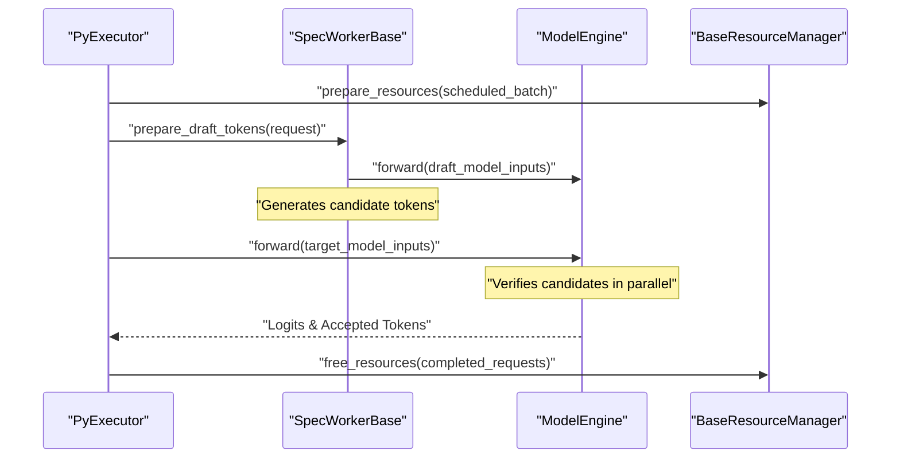

<!-- source: DeepWiki mcp.deepwiki.com · repo NVIDIA/TensorRT-LLM · page 11 Speculative Decoding · fetched 2026-10-26 -->

# Speculative Decoding

<details>
<summary>Relevant source files</summary>

The following files were used as context for generating this wiki page:

- [tensorrt_llm/_torch/models/modeling_speculative.py](tensorrt_llm/_torch/models/modeling_speculative.py)
- [tensorrt_llm/_torch/speculative/__init__.py](tensorrt_llm/_torch/speculative/__init__.py)
- [tensorrt_llm/_torch/speculative/drafter.py](tensorrt_llm/_torch/speculative/drafter.py)
- [tensorrt_llm/_torch/speculative/eagle3.py](tensorrt_llm/_torch/speculative/eagle3.py)
- [tensorrt_llm/_torch/speculative/interface.py](tensorrt_llm/_torch/speculative/interface.py)
- [tensorrt_llm/_torch/speculative/model_drafter.py](tensorrt_llm/_torch/speculative/model_drafter.py)
- [tensorrt_llm/_torch/speculative/mtp.py](tensorrt_llm/_torch/speculative/mtp.py)
- [tensorrt_llm/_torch/speculative/ngram.py](tensorrt_llm/_torch/speculative/ngram.py)
- [tensorrt_llm/_torch/speculative/utils.py](tensorrt_llm/_torch/speculative/utils.py)
- [tests/unittest/_torch/speculative/test_eagle3.py](tests/unittest/_torch/speculative/test_eagle3.py)

</details>


Speculative decoding is an optimization technique that accelerates LLM text generation by predicting multiple tokens at once using a "draft" model or strategy, then verifying these predictions with the target model. This document describes the speculative decoding infrastructure in TensorRT-LLM's PyTorch backend, including configuration, execution modes, resource management, and integration with the execution pipeline.

For information about the core execution system that orchestrates speculative decoding, see [PyExecutor Runtime System](#7). For model architecture details, see [Model Architecture and Components](#8).

Detailed documentation for individual strategies is in the child pages:

| Child Page | Key Code Entities Covered |
|---|---|
| [Speculative Decoding Overview and Configuration](#11.1) | `SpeculativeConfig`, `SpecMetadata`, `SpeculativeDecodingMode`, `get_spec_worker`, `prepare_attn_metadata_for_draft_replay` |
| [EAGLE3 Architecture](#11.2) | `Eagle3ResourceManager`, `Eagle3SpecMetadata`, `EagleDecodingConfig`, `SpecTreeManager`, `Eagle3OneModelWorker`, `Eagle3Attention`, `Eagle3DecoderLayer` |
| [MTP and Other Speculative Strategies](#11.3) | `MTPSampler`, `MTPSpecMetadata`, `MTPDecodingConfig`, `NGramDrafter`, `SADraftEnhancer`, `PARDWorker`, `SuffixAutomatonManager`, `DraftTargetOneModelWorker` |

---

## Overview and Motivation

Speculative decoding improves generation throughput by amortizing the cost of autoregressive decoding. Instead of generating one token per forward pass, the system:

1. Generates `N` candidate "draft" tokens quickly (using a smaller model, specialized layers, or look-up tables).
2. Verifies all `N` tokens in a single forward pass of the target model.
3. Accepts the longest prefix of correct tokens based on the target model's output.
4. Discards rejected tokens and continues from the last accepted position.

This yields speedups when the acceptance rate is sufficiently high, as multiple tokens can be accepted per iteration. The speedup is highest when draft tokens are cheap to produce and have good acceptance rates.

**Sources:** [tensorrt_llm/_torch/speculative/interface.py:53-90](), [tensorrt_llm/_torch/speculative/mtp.py:120-148]()

---

## Speculative Decoding Modes

TensorRT-LLM supports multiple speculative decoding strategies, defined by the `SpeculativeDecodingMode` enum [tensorrt_llm/_torch/speculative/interface.py:21-21]().

**Speculative Decoding Mode Classification:**

```mermaid
graph TB
    subgraph "One-Model Modes (use_one_engine())"
        [MTP]
        [MTP_EAGLE_ONE_MODEL]
        [EAGLE3_ONE_MODEL]
        [PARD]
        [SA]
        [DRAFT_TARGET_ONE_MODEL]
    end

    subgraph "Two-Model Modes"
        [EAGLE3]
        [MTP_EAGLE]
        [DRAFT_TARGET]
    end

    subgraph "Drafter-Based Modes"
        [NGRAM]
        [USER_PROVIDED]
    end

    subgraph "Utility/Meta Modes"
        [SAVE_HIDDEN_STATES]
        [AUTO]
        [NONE]
    end

    [MTP] --> OneEngine["OneEngine Architecture"]
    [MTP_EAGLE_ONE_MODEL] --> OneEngine
    [EAGLE3_ONE_MODEL] --> OneEngine
    [PARD] --> OneEngine
    [SA] --> OneEngine
    [DRAFT_TARGET_ONE_MODEL] --> OneEngine

    OneEngine --> SpecDec["Speculative Decoding"]
    [EAGLE3] --> SpecDec
    [MTP_EAGLE] --> SpecDec
    [DRAFT_TARGET] --> SpecDec
    [NGRAM] --> SpecDec
    [USER_PROVIDED] --> SpecDec
```

**Mode Characteristics:**

| Mode | Draft Source | One Engine | Description |
|------|--------------|------------|-------------|
| `MTP` | Multi-Token Prediction layers | Yes | Integrated hidden state management for next-N prediction. [tensorrt_llm/_torch/speculative/mtp.py:120-137]() |
| `EAGLE3_ONE_MODEL` | Integrated draft decoder layers | Yes | Uses specialized `Eagle3Attention` and `Eagle3DecoderLayer`. [tensorrt_llm/_torch/models/modeling_speculative.py:71-120]() |
| `NGRAM` | Historical token n-gram pool | No (drafter) | Managed via `NGramDrafter` and `NGramPoolManager`. [tensorrt_llm/_torch/speculative/ngram.py:161-163]() |
| `EAGLE3` | Separate EAGLE3 draft engine | No | Orchestrated via `Eagle3OneModelWorker` or `ModelDrafter`. [tensorrt_llm/_torch/speculative/eagle3.py:31-36]() |
| `DRAFT_TARGET` | Separate draft model engine | No | Classic two-model speculative decoding using `ModelDrafter`. [tensorrt_llm/_torch/speculative/draft_target.py:22-23]() |
| `SA` | Suffix Automaton manager | Yes | Managed by `SADraftEnhancer` or specialized workers. [tensorrt_llm/_torch/speculative/sa_worker.py:35-35]() |

**Sources:** [tensorrt_llm/_torch/speculative/interface.py:110-124](), [tensorrt_llm/_torch/speculative/utils.py:21-39](), [tensorrt_llm/_torch/speculative/ngram.py:14-49]()

---

## Configuration

Speculative decoding is configured through various decoding config classes. The system uses utility factory functions to initialize the runtime state based on these configurations.

### Configuration Classes

The configuration classes define parameters like draft length and scheduling strategies.

**Key Configuration Types:**

| Config Class | Speculative Mode | Key Parameters |
|--------------|------------------|----------------|
| `EagleDecodingConfig` | `EAGLE3`, `EAGLE3_ONE_MODEL` | `eagle_choices`, `use_dynamic_tree`, `max_draft_len` [tensorrt_llm/_torch/speculative/eagle3.py:96-106]() |
| `MTPDecodingConfig` | `MTP` | `max_draft_len`, `use_relaxed_acceptance_for_thinking` [tensorrt_llm/_torch/speculative/mtp.py:43-46]() |
| `NGramDecodingConfig` | `NGRAM` | `max_matching_ngram_size`, `is_public_pool` [tensorrt_llm/_torch/speculative/ngram.py:53-57]() |

**Sources:** [tensorrt_llm/_torch/speculative/mtp.py:36-46](), [tensorrt_llm/_torch/speculative/eagle3.py:38-63](), [tensorrt_llm/_torch/speculative/utils.py:14-16]()

---

## Architecture Overview

### High-Level Flow

The speculative decoding loop involves a `SpecWorkerBase` [tensorrt_llm/_torch/speculative/interface.py:12]() that orchestrates draft generation and a `SpecSampler` [tensorrt_llm/_torch/speculative/spec_sampler_base.py:38]() that handles verification. For one-model modes, these are often integrated into the primary `ModelEngine` forward pass.

**Speculative decoding logic association:**



**Sources:** [tensorrt_llm/_torch/speculative/eagle3.py:108-119](), [tensorrt_llm/_torch/speculative/mtp.py:73-81](), [tensorrt_llm/_torch/speculative/interface.py:127-166]()

---

## Metadata and Resource Management

### SpecMetadata

`SpecMetadata` carries per-iteration state used by the model engine and sampler. Specialized subclasses exist for different strategies like `Eagle3SpecMetadata` [tensorrt_llm/_torch/speculative/eagle3.py:26]() and `MTPSpecMetadata` [tensorrt_llm/_torch/speculative/mtp.py:120]().

**SpecMetadata Association Diagram:**

```mermaid
graph LR
    subgraph "Code Entity Space"
        [ModelEngine]
        [SpecMetadata]
        [BaseResourceManager]
        [LlmRequest]
    end

    subgraph "Natural Language Space"
        [Forward Pass Execution]
        [Iteration State Tracking]
        [Speculative Buffer Management]
        [Inference Request]
    end

    [ModelEngine] --- [Forward Pass Execution]
    [SpecMetadata] --- [Iteration State Tracking]
    [BaseResourceManager] --- [Speculative Buffer Management]
    [LlmRequest] --- [Inference Request]

    [LlmRequest] -->|uses| [SpecMetadata]
    [SpecMetadata] -->|passed to| [ModelEngine]
    [BaseResourceManager] -->|manages buffers for| [SpecMetadata]
```

**Key Resource Managers:**
- `Eagle3ResourceManager`: Manages hidden state buffers for EAGLE3 draft layers [tensorrt_llm/_torch/speculative/eagle3.py:31-73]().
- `MTPHiddenStatesManager`: Manages past hidden states and tokens for Multi-Token Prediction [tensorrt_llm/_torch/speculative/mtp.py:34-71]().
- `NGramPoolManager`: Maintains pattern-match pairs for NGram drafting [tensorrt_llm/_torch/speculative/ngram.py:14-60]().

**Sources:** [tensorrt_llm/_torch/speculative/eagle3.py:31-107](), [tensorrt_llm/_torch/speculative/mtp.py:34-81](), [tensorrt_llm/_torch/speculative/utils.py:19-39]()

---

## Verification and Acceptance

Verification is the process of comparing draft tokens against the target model's probability distribution.

**Verification Logic Association:**

```mermaid
graph TD
    subgraph "Verification Logic"
        [SpecSampler]
        [MTPSampler]
        [rejection_sampling_one_model]
    end

    subgraph "Data Entities"
        [SampleStateTensorsSpec]
        [LlmRequest]
        [AttentionMetadata]
    end

    [SpecSampler] --> [SampleStateTensorsSpec]
    [MTPSampler] -->|updates| [LlmRequest]
    [rejection_sampling_one_model] -->|modifies| [AttentionMetadata]
```

**Acceptance Rules:**
- **Greedy Acceptance**: Standard behavior for deterministic drafting, often implemented in `greedy_search_sampling_batch` [tensorrt_llm/_torch/speculative/interface.py:51]().
- **Rejection Sampling**: FlashInfer-based rejection sampling is used for probabilistic verification [tensorrt_llm/_torch/speculative/interface.py:53-89]().
- **Relaxed Acceptance**: MTP and EAGLE3 support `use_relaxed_acceptance_for_thinking` which uses a relaxed delta pool to modulate acceptance thresholds [tensorrt_llm/_torch/speculative/mtp.py:46-71](), [tensorrt_llm/_torch/speculative/eagle3.py:84-89]().
- **KV Cache Handling**: During verification, the system must correctly manage draft slots. `prepare_attn_metadata_for_draft_replay` handles swapping the target manager for the draft manager during CUDA graph replays [tensorrt_llm/_torch/speculative/interface.py:127-166]().
- **Separate KV Caches**: For one-engine modes, `should_use_separate_draft_kv_cache` determines if draft and target models share a KV cache pool [tensorrt_llm/_torch/speculative/interface.py:110-125]().

**Sources:** [tensorrt_llm/_torch/speculative/mtp.py:46-81](), [tensorrt_llm/_torch/speculative/interface.py:53-166](), [tensorrt_llm/_torch/speculative/eagle3.py:84-90]()

---

## Implementation Reference

### Core Speculative Components

| Component | Class/Entity | File Path |
|-----------|--------------|-----------|
| **Worker Base** | `SpecWorkerBase` | [tensorrt_llm/_torch/speculative/interface.py:12]() |
| **Metadata Base** | `SpecMetadata` | [tensorrt_llm/_torch/speculative/interface.py:120]() |
| **Sampler Base** | `SpecSampler` | [tensorrt_llm/_torch/speculative/spec_sampler_base.py:38]() |
| **Resource Manager Base** | `BaseResourceManager` | [tensorrt_llm/_torch/pyexecutor/resource_manager.py:35]() |
| **Drafter Base** | `Drafter` | [tensorrt_llm/_torch/speculative/drafter.py:12]() |
| **Model Drafter** | `ModelDrafter` | [tensorrt_llm/_torch/speculative/model_drafter.py:52]() |

**Sources:** [tensorrt_llm/_torch/speculative/interface.py:12-120](), [tensorrt_llm/_torch/speculative/spec_sampler_base.py:38-38](), [tensorrt_llm/_torch/pyexecutor/resource_manager.py:35-36](), [tensorrt_llm/_torch/speculative/drafter.py:12](), [tensorrt_llm/_torch/speculative/model_drafter.py:52]()

---

