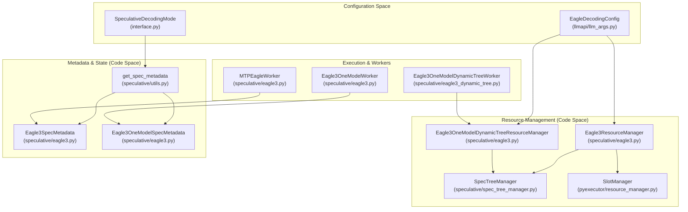
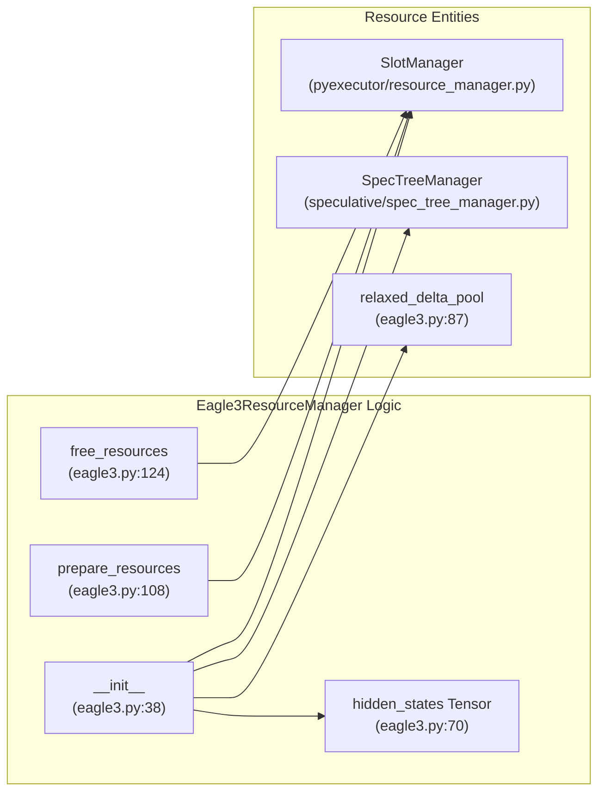

<!-- source: DeepWiki mcp.deepwiki.com · repo NVIDIA/TensorRT-LLM · page 11.2 EAGLE3 Architecture · fetched 2026-10-26 -->

# EAGLE3 Architecture

Relevant source files

The following files were used as context for generating this wiki page:

- [examples/auto_deploy/nano_v3.yaml](examples/auto_deploy/nano_v3.yaml)
- [examples/auto_deploy/super_v3.yaml](examples/auto_deploy/super_v3.yaml)
- [tensorrt_llm/_torch/auto_deploy/custom_ops/normalization/l2norm.py](tensorrt_llm/_torch/auto_deploy/custom_ops/normalization/l2norm.py)
- [tensorrt_llm/_torch/auto_deploy/custom_ops/normalization/triton_rms_norm.py](tensorrt_llm/_torch/auto_deploy/custom_ops/normalization/triton_rms_norm.py)
- [tensorrt_llm/_torch/auto_deploy/custom_ops/quantization/torch_quant.py](tensorrt_llm/_torch/auto_deploy/custom_ops/quantization/torch_quant.py)
- [tensorrt_llm/_torch/auto_deploy/custom_ops/rope/flashinfer_rope.py](tensorrt_llm/_torch/auto_deploy/custom_ops/rope/flashinfer_rope.py)
- [tensorrt_llm/_torch/auto_deploy/models/custom/mla_rope_utils.py](tensorrt_llm/_torch/auto_deploy/models/custom/mla_rope_utils.py)
- [tensorrt_llm/_torch/auto_deploy/models/custom/modeling_deepseek.py](tensorrt_llm/_torch/auto_deploy/models/custom/modeling_deepseek.py)
- [tensorrt_llm/_torch/auto_deploy/models/custom/modeling_eagle.py](tensorrt_llm/_torch/auto_deploy/models/custom/modeling_eagle.py)
- [tensorrt_llm/_torch/auto_deploy/models/custom/modeling_gemma3n.py](tensorrt_llm/_torch/auto_deploy/models/custom/modeling_gemma3n.py)
- [tensorrt_llm/_torch/auto_deploy/models/custom/modeling_glm4_moe_lite.py](tensorrt_llm/_torch/auto_deploy/models/custom/modeling_glm4_moe_lite.py)
- [tensorrt_llm/_torch/auto_deploy/models/custom/modeling_mistral3.py](tensorrt_llm/_torch/auto_deploy/models/custom/modeling_mistral3.py)
- [tensorrt_llm/_torch/auto_deploy/models/custom/modeling_nemotron_h.py](tensorrt_llm/_torch/auto_deploy/models/custom/modeling_nemotron_h.py)
- [tensorrt_llm/_torch/auto_deploy/models/eagle.py](tensorrt_llm/_torch/auto_deploy/models/eagle.py)
- [tensorrt_llm/_torch/auto_deploy/transform/library/fuse_mamba_a_log.py](tensorrt_llm/_torch/auto_deploy/transform/library/fuse_mamba_a_log.py)
- [tensorrt_llm/_torch/auto_deploy/transform/library/hidden_states.py](tensorrt_llm/_torch/auto_deploy/transform/library/hidden_states.py)
- [tensorrt_llm/_torch/auto_deploy/utils/_graph.py](tensorrt_llm/_torch/auto_deploy/utils/_graph.py)
- [tensorrt_llm/_torch/models/modeling_speculative.py](tensorrt_llm/_torch/models/modeling_speculative.py)
- [tensorrt_llm/_torch/speculative/__init__.py](tensorrt_llm/_torch/speculative/__init__.py)
- [tensorrt_llm/_torch/speculative/drafter.py](tensorrt_llm/_torch/speculative/drafter.py)
- [tensorrt_llm/_torch/speculative/eagle3.py](tensorrt_llm/_torch/speculative/eagle3.py)
- [tensorrt_llm/_torch/speculative/interface.py](tensorrt_llm/_torch/speculative/interface.py)
- [tensorrt_llm/_torch/speculative/model_drafter.py](tensorrt_llm/_torch/speculative/model_drafter.py)
- [tensorrt_llm/_torch/speculative/mtp.py](tensorrt_llm/_torch/speculative/mtp.py)
- [tensorrt_llm/_torch/speculative/ngram.py](tensorrt_llm/_torch/speculative/ngram.py)
- [tensorrt_llm/_torch/speculative/utils.py](tensorrt_llm/_torch/speculative/utils.py)
- [tensorrt_llm/quantization/utils/fp8_matrix_weight_dequant.py](tensorrt_llm/quantization/utils/fp8_matrix_weight_dequant.py)
- [tests/integration/defs/examples/test_ad_speculative_decoding.py](tests/integration/defs/examples/test_ad_speculative_decoding.py)
- [tests/unittest/_torch/speculative/test_eagle3.py](tests/unittest/_torch/speculative/test_eagle3.py)
- [tests/unittest/auto_deploy/_utils_test/_model_test_utils.py](tests/unittest/auto_deploy/_utils_test/_model_test_utils.py)
- [tests/unittest/auto_deploy/singlegpu/custom_ops/test_resource_handlers.py](tests/unittest/auto_deploy/singlegpu/custom_ops/test_resource_handlers.py)
- [tests/unittest/auto_deploy/singlegpu/models/test_eagle.py](tests/unittest/auto_deploy/singlegpu/models/test_eagle.py)
- [tests/unittest/auto_deploy/singlegpu/models/test_mla_rope_utils.py](tests/unittest/auto_deploy/singlegpu/models/test_mla_rope_utils.py)
- [tests/unittest/auto_deploy/singlegpu/shim/test_cached_sequence_interface.py](tests/unittest/auto_deploy/singlegpu/shim/test_cached_sequence_interface.py)
- [tests/unittest/auto_deploy/singlegpu/shim/test_llm_config.py](tests/unittest/auto_deploy/singlegpu/shim/test_llm_config.py)
- [tests/unittest/auto_deploy/singlegpu/smoke/test_ad_speculative_decoding.py](tests/unittest/auto_deploy/singlegpu/smoke/test_ad_speculative_decoding.py)
- [tests/unittest/auto_deploy/singlegpu/transformations/library/test_kv_cache.py](tests/unittest/auto_deploy/singlegpu/transformations/library/test_kv_cache.py)

## Purpose and Scope

This document describes the EAGLE3 speculative decoding architecture in TensorRT-LLM. EAGLE3 is an advanced speculative decoding technique that accelerates LLM inference by utilizing a lightweight draft model to predict multiple tokens ahead, which the target model then verifies in parallel.

For general speculative decoding concepts, see [11.1 Speculative Decoding Overview and Configuration](). For the MTP (Multi-Token Prediction) approach, see [11.3 MTP and Other Speculative Strategies](). For overall execution flow, see [7 PyExecutor Runtime System]().

This page covers:
- EAGLE3-specific resource management (`Eagle3ResourceManager`, `Eagle3OneModelDynamicTreeResourceManager`) and metadata structures (`Eagle3SpecMetadata`, `Eagle3OneModelSpecMetadata`).
- Two operational modes: two-model (EAGLE3) and one-model (EAGLE3_ONE_MODEL).
- Dynamic tree construction and verification using specialized CUDA kernels and Triton implementations.
- Hidden state capture and retrieval mechanisms via specialized attention layers (`Eagle3Attention`, `Eagle3MLAttention`).

---

## EAGLE3 Overview

EAGLE3 accelerates inference by maintaining a draft model that generates speculative tokens based on hidden states captured from the target model. The target model then verifies multiple tokens in parallel, accepting correct predictions and rejecting incorrect ones.

**Key characteristics:**
- **Hidden state reuse**: Captures hidden states from specific layers of the target model to provide context to the draft model [tensorrt_llm/_torch/speculative/eagle3.py:33-35]().
- **Tree-based speculation**: Supports both static (via `eagle_choices`) and dynamic speculation trees managed by `SpecTreeManager` [tensorrt_llm/_torch/speculative/eagle3.py:96-106]().
- **Unified Model Architecture**: Provides specialized attention modules (`Eagle3Attention`, `Eagle3MLAttention`) to handle concatenated inputs (embeddings + hidden states) for the draft model [tensorrt_llm/_torch/models/modeling_speculative.py:71-173]().
- **Resource pooling**: Uses slot-based allocation for hidden state buffers via `SlotManager` to track request-specific data across iterations [tensorrt_llm/_torch/speculative/eagle3.py:55-56]().
- **Triton/CUDA Optimizations**: Leverages high-performance kernels for fused sampling, score accumulation, and tree repackaging.

**Sources:** [tensorrt_llm/_torch/speculative/eagle3.py:31-106](), [tensorrt_llm/_torch/models/modeling_speculative.py:71-173]()

---

## Architecture Components

### Component Relationships

The following diagram bridges the natural language concepts of speculative decoding to the specific code entities used in the EAGLE3 implementation.

"Natural Language Space" to "Code Entity Space" Mapping:

**Sources:** [tensorrt_llm/_torch/speculative/eagle3.py:31-106](), [tensorrt_llm/_torch/speculative/eagle3.py:157-166](), [tensorrt_llm/_torch/speculative/utils.py:25-32]()

---

## Two Operational Modes

EAGLE3 supports two distinct modes controlled by the `SpeculativeDecodingMode` enum:

### Two-Model Mode (EAGLE3)

| Aspect | Description |
|--------|-------------|
| **Model engines** | Separate engines for target and draft models. |
| **Hidden state source** | Target model outputs hidden states to `Eagle3ResourceManager` [tensorrt_llm/_torch/speculative/eagle3.py:33-35](). |
| **Drafter** | Managed by a dedicated worker that coordinates between the two engines [tensorrt_llm/_torch/speculative/utils.py:26-27](). |

### One-Model Mode (EAGLE3_ONE_MODEL)

| Aspect | Description |
|--------|-------------|
| **Model engines** | Single unified engine using specialized workers like `Eagle3OneModelWorker` [tensorrt_llm/_torch/speculative/eagle3.py:26](). |
| **KV cache** | Shared cache with optional separate draft KV cache [tensorrt_llm/_torch/speculative/interface.py:111-126](). |
| **Resource Management** | Uses `Eagle3OneModelDynamicTreeResourceManager` for lightweight tracking [tensorrt_llm/_torch/speculative/eagle3.py:157-162](). |

In `EagleDecodingConfig`, users can explicitly configure tree behavior and top-K sampling for dynamic trees [tensorrt_llm/_torch/speculative/eagle3.py:96-106]().

**Sources:** [tensorrt_llm/_torch/speculative/interface.py:111-126](), [tensorrt_llm/_torch/speculative/eagle3.py:31-35](), [tensorrt_llm/_torch/speculative/eagle3.py:157-176](), [tensorrt_llm/_torch/speculative/utils.py:25-32]()

---

## Eagle3ResourceManager

`Eagle3ResourceManager` manages the persistent hidden states required for the draft model's input across multiple decoding steps [tensorrt_llm/_torch/speculative/eagle3.py:31-35]().

### Hidden State Buffer Management

**Key attributes:**

| Attribute | Type | Purpose |
|-----------|------|---------|
| `hidden_states` | `torch.Tensor` | Large pre-allocated pool of hidden state buffers [tensorrt_llm/_torch/speculative/eagle3.py:70-73](). |
| `slot_manager` | `SlotManager` | Manages mapping between `request_id` and physical memory slots [tensorrt_llm/_torch/speculative/eagle3.py:56](). |
| `is_first_draft` | `bool` | Flag indicating if the next draft forward is the initial one for a step [tensorrt_llm/_torch/speculative/eagle3.py:93](). |
| `spec_tree_manager` | `SpecTreeManager` | Manages dynamic or static tree generation paths [tensorrt_llm/_torch/speculative/eagle3.py:99-106](). |
| `relaxed_delta_pool`| `torch.Tensor` | Tracks "thinking phase" delta for relaxed acceptance [tensorrt_llm/_torch/speculative/eagle3.py:87-89](). |

**Sources:** [tensorrt_llm/_torch/speculative/eagle3.py:31-106](), [tensorrt_llm/_torch/speculative/eagle3.py:157-176](), [tensorrt_llm/_torch/pyexecutor/resource_manager.py:10]()

---

## Metadata and Workers

### Eagle3SpecMetadata
`Eagle3SpecMetadata` encapsulates all metadata required for the attention kernels and sampling logic during EAGLE3 execution. It holds references to the `Eagle3ResourceManager` and tracks `eagle_choices` for tree-based verification [tensorrt_llm/_torch/speculative/eagle3.py:5]().

### Eagle3OneModelWorker
In one-model mode, `Eagle3OneModelWorker` coordinates the forward pass for both target and draft phases. It manages the `Eagle3OneModelSpecMetadata` and interacts with the shared model engine to perform verification and speculation in the same process. It specifically handles the data flow where the target model's hidden states are fed into the draft layers [tensorrt_llm/_torch/speculative/eagle3.py:26]().

**Sources:** [tensorrt_llm/_torch/speculative/eagle3.py:26](), [tensorrt_llm/_torch/speculative/utils.py:25-27]()

---

## Specialized Attention Layers

EAGLE3 uses specialized attention layers in the draft model to handle the concatenation of base embeddings and captured target hidden states.

| Class | Description | Input Handling |
|-------|-------------|----------------|
| `Eagle3Attention` | Attention layer for Llama-based EAGLE3 draft models [tensorrt_llm/_torch/models/modeling_speculative.py:71-78](). | Overrides `qkv_proj` to accept `2 * hidden_size` input for the first layer [tensorrt_llm/_torch/models/modeling_speculative.py:101-120](). |
| `Eagle3MLAttention` | MLA (Multi-head Latent Attention) for DeepSeek-style EAGLE3 draft models [tensorrt_llm/_torch/models/modeling_speculative.py:123-137](). | Overrides `kv_a_proj_with_mqa` to accept `2 * hidden_size` for the first layer [tensorrt_llm/_torch/models/modeling_speculative.py:170-173](). |

**Sources:** [tensorrt_llm/_torch/models/modeling_speculative.py:71-173]()

---

## Dynamic Tree Operations

EAGLE3 introduces a dynamic tree mechanism where the draft model's tree structure is built on-the-fly based on token scores.

### Tree Construction and Verification
The system leverages specialized workers and metadata to manage tree-based speculation:
- **Tree Management**: `SpecTreeManager` tracks the topology, parent-child relationships, and attention masks for speculative trees [tensorrt_llm/_torch/speculative/eagle3.py:99-106]().
- **Dynamic Worker**: `Eagle3OneModelDynamicTreeWorker` implements the specific logic for constructing and verifying dynamic trees in a single-engine setup [tensorrt_llm/_torch/speculative/eagle3_dynamic_tree.py:28]().

### Verification and KV Relocation
Specialized logic handles the relocation of KV cache entries when multiple tokens are accepted in a tree branch. For example, `MTPEagleDynamicTreeWorker._relocate_kv_eagerly` uses the `update_kv_cache_draft_token_location_2d` operation to efficiently move accepted draft tokens into the primary KV cache sequence [tests/unittest/_torch/speculative/test_eagle3.py:145-177]().

**Sources:** [tensorrt_llm/_torch/speculative/eagle3.py:99-106](), [tensorrt_llm/_torch/speculative/eagle3_dynamic_tree.py:28](), [tests/unittest/_torch/speculative/test_eagle3.py:145-177]()

---

## Special Considerations

### KV Cache Management
EAGLE3 requires careful coordination between draft and target KV caches, especially in one-model mode.
- **Separate Draft Cache**: Optional separate draft KV cache can be used to avoid interference with the target model's cache [tensorrt_llm/_torch/speculative/interface.py:111-126]().
- **Metadata Swapping**: `prepare_attn_metadata_for_draft_replay` swaps attention metadata to use the draft KV cache manager during draft replay [tensorrt_llm/_torch/speculative/interface.py:128-158]().

### Sampling and Rejection
- **One-Model Sampler**: EAGLE3 uses `sampling_batch_spec_dec_one_model_for_rejection` for CUDA-graph compatible sampling [tensorrt_llm/_torch/speculative/interface.py:48-50]().
- **Rejection Sampling**: The `rejection_sampling_one_model` function provides a path for verifying draft tokens against target probabilities using `flashinfer.sampling.chain_speculative_sampling` [tensorrt_llm/_torch/speculative/interface.py:54-90]().

### Input Modification
EAGLE3 modifies prompts for speculative drafting by dropping the first token when processing draft inputs to align with the hidden state capture logic [tensorrt_llm/_torch/speculative/model_drafter.py:38-43]().

**Sources:** [tensorrt_llm/_torch/speculative/interface.py:54-158](), [tensorrt_llm/_torch/speculative/model_drafter.py:30-49]()

---

