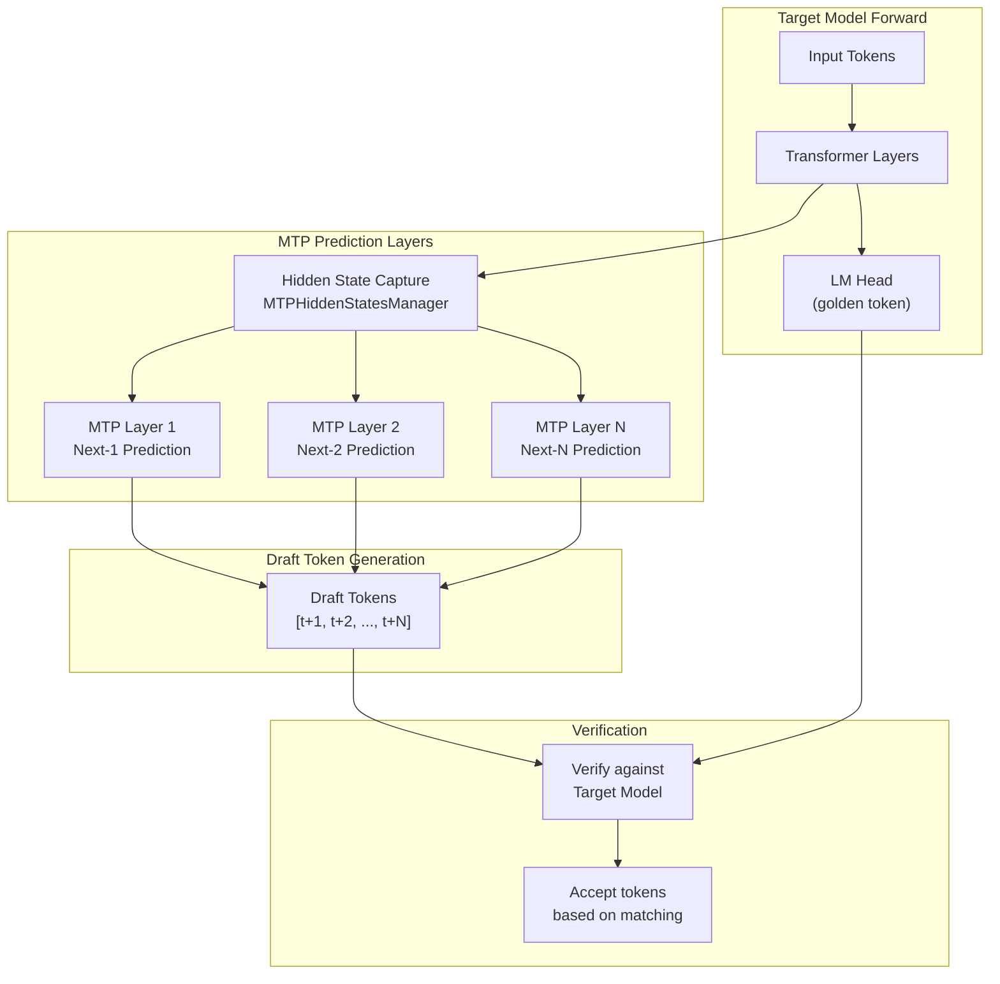
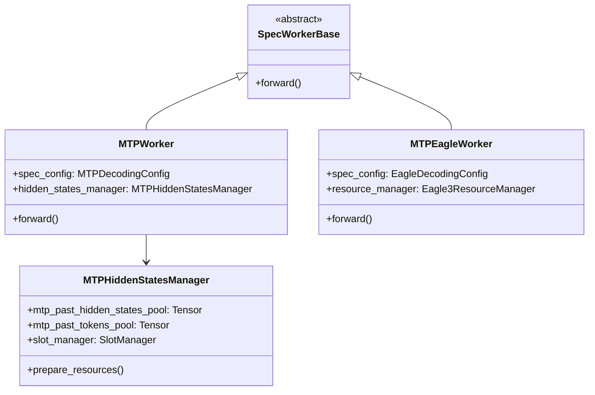
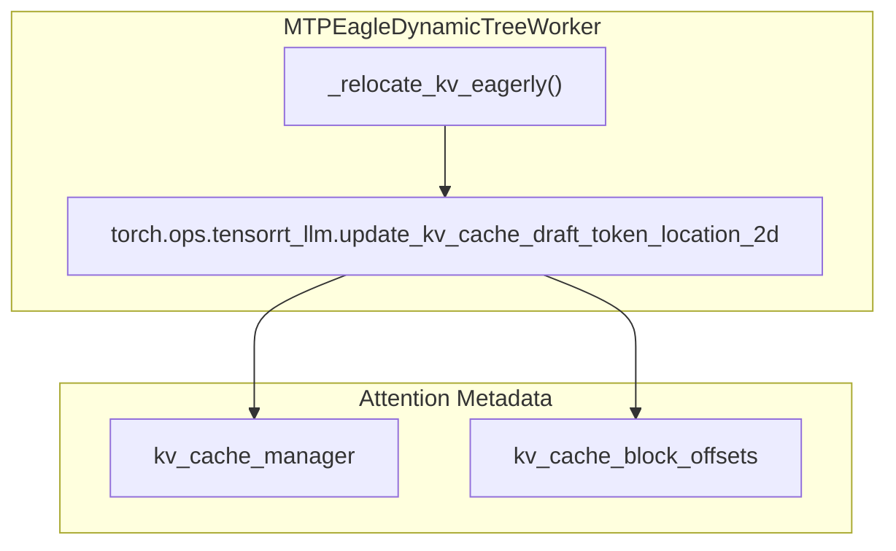
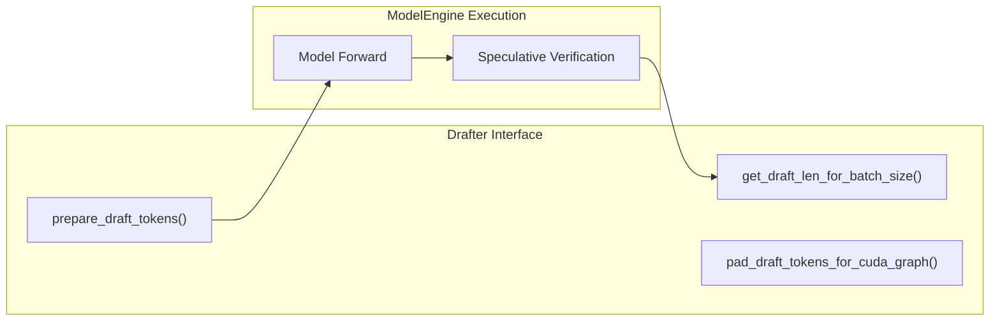

<!-- source: DeepWiki mcp.deepwiki.com · repo NVIDIA/TensorRT-LLM · page 11.3 MTP and Other Speculative Strategies · fetched 2026-10-26 -->

# MTP and Other Speculative Strategies

Relevant source files

The following files were used as context for generating this wiki page:

- [tensorrt_llm/_torch/models/modeling_speculative.py](tensorrt_llm/_torch/models/modeling_speculative.py)
- [tensorrt_llm/_torch/speculative/__init__.py](tensorrt_llm/_torch/speculative/__init__.py)
- [tensorrt_llm/_torch/speculative/drafter.py](tensorrt_llm/_torch/speculative/drafter.py)
- [tensorrt_llm/_torch/speculative/eagle3.py](tensorrt_llm/_torch/speculative/eagle3.py)
- [tensorrt_llm/_torch/speculative/interface.py](tensorrt_llm/_torch/speculative/interface.py)
- [tensorrt_llm/_torch/speculative/model_drafter.py](tensorrt_llm/_torch/speculative/model_drafter.py)
- [tensorrt_llm/_torch/speculative/mtp.py](tensorrt_llm/_torch/speculative/mtp.py)
- [tensorrt_llm/_torch/speculative/ngram.py](tensorrt_llm/_torch/speculative/ngram.py)
- [tensorrt_llm/_torch/speculative/utils.py](tensorrt_llm/_torch/speculative/utils.py)
- [tests/unittest/_torch/speculative/test_eagle3.py](tests/unittest/_torch/speculative/test_eagle3.py)

## Purpose and Scope

This page documents Multi-Token Prediction (MTP) and other non-EAGLE3 speculative decoding strategies in TensorRT-LLM. It covers the architecture, implementation, and usage of MTP, NGram, SA (Suffix Automaton), PARD, Lookahead, and Medusa methods. For EAGLE3-specific documentation, see [EAGLE3 Architecture](#11.2). For general speculative decoding configuration, see [Speculative Decoding Overview and Configuration](#11.1).

---

## Speculative Decoding Taxonomy

TensorRT-LLM supports multiple speculative decoding modes, each with distinct characteristics and use cases. The `SpeculativeDecodingMode` enum defines all available strategies.

**Speculative Decoding Mode Taxonomy**

```mermaid
graph TB
    Root["SpeculativeDecodingMode"]
    
    Root --> OneModel["One-Model Strategies"]
    Root --> TwoModel["Two-Model Strategies"]
    Root --> Other["Other Strategies"]
    
    OneModel --> MTP["MTP<br/>Multi-Token Prediction"]
    OneModel --> MTPEagleOne["MTP_EAGLE_ONE_MODEL<br/>MTP + EAGLE fusion"]
    OneModel --> Eagle3One["EAGLE3_ONE_MODEL<br/>EAGLE3 single engine"]
    OneModel --> DraftTargetOne["DRAFT_TARGET_ONE_MODEL<br/>External drafter"]
    OneModel --> SA["SA<br/>Suffix Automaton"]
    
    TwoModel --> MTPEagle["MTP_EAGLE<br/>MTP + separate draft"]
    TwoModel --> Eagle3Two["EAGLE3<br/>Separate draft model"]
    TwoModel --> DraftTarget["DRAFT_TARGET<br/>Two-model external"]
    
    Other --> NGram["NGRAM<br/>Statistical patterns"]
    Other --> PARD["PARD<br/>Parallel drafting"]
    Other --> UserProvided["USER_PROVIDED<br/>Custom drafter"]
    Other --> SaveHidden["SAVE_HIDDEN_STATES<br/>Hidden state capture"]
```

**Sources:** [tensorrt_llm/_torch/speculative/interface.py:21-48](), [tensorrt_llm/_torch/speculative/utils.py:20-40]()

---

## MTP (Multi-Token Prediction)

### Architecture Overview

MTP uses specialized next-n prediction layers embedded within the target model to generate multiple draft tokens in parallel. Unlike two-model approaches, MTP operates within a single model engine, reducing memory overhead and communication costs. This is prominently used in models like DeepSeek-V3 and DeepSeek-V4.

**MTP Execution and Verification Flow**

**MTP Execution Flow:**
1. **Context Phase**: Target model processes input and captures hidden states via `MTPHiddenStatesManager` [tensorrt_llm/_torch/speculative/mtp.py:73-82]().
2. **Draft Generation**: MTP layers predict next-n tokens using captured hidden states. The number of next tokens is defined by `num_draft_slots` [tensorrt_llm/_torch/speculative/mtp.py:43-43]().
3. **Verification**: Target model verifies draft tokens in parallel.
4. **Acceptance**: Matching tokens are accepted; non-matching tokens trigger re-generation.

**Sources:** [tensorrt_llm/_torch/speculative/mtp.py:34-118](), [tensorrt_llm/_torch/speculative/mtp.py:120-231]()

### Key Components

#### MTPWorker and MTPEagleWorker

The `MTPWorker` orchestrates MTP-based speculation. For models that combine MTP with EAGLE-style tree structures (like MTP-Eagle), `MTPEagleWorker` is used.

**MTP Class Hierarchy and Resource Management**

**Key Logic:**
- `MTPHiddenStatesManager.prepare_resources()`: Allocates slots in the hidden state pool for new requests [tensorrt_llm/_torch/speculative/mtp.py:73-82]().
- `MTPSpecMetadata.prepare()`: Sets up metadata pointers and indices for batch execution [tensorrt_llm/_torch/speculative/mtp.py:179-231]().
- `MTPSpecMetadata.all_rank_num_seqs`: Property used for attention DP in MTP Eagle workers. For `is_mtp_eagle_one_model`, it also sets `subseq_all_rank_num_tokens` [tensorrt_llm/_torch/speculative/mtp.py:170-178]().
- **Relaxed Acceptance**: MTP supports `use_relaxed_acceptance_for_thinking`, which utilizes a `mtp_relaxed_delta_pool` to manage acceptance thresholds during reasoning tasks [tensorrt_llm/_torch/speculative/mtp.py:65-71]().
- **Checkpoint Weight Management**: Specialized functions like `filter_mtp_checkpoint_weights` and `select_mtp_checkpoint_weights` handle the separation of target backbone weights and MTP-head weights during model loading [tensorrt_llm/_torch/speculative/utils.py:111-130]().
- **MTP Weight Mapping**: `remap_preprocessed_mtp_weights_for_draft_model` handles re-homing keys from `model.layers.{N+h}` to `mtp_layers.{h}` for draft-only loading [tensorrt_llm/_torch/speculative/utils.py:132-163]().

**Sources:** [tensorrt_llm/_torch/speculative/mtp.py:34-231](), [tensorrt_llm/_torch/speculative/utils.py:111-163]()

---

## NGram Speculative Decoding

NGram speculation uses statistical patterns to predict likely token sequences without requiring a draft model. It matches the current suffix of the generated sequence against a pool of historical patterns.

### NGramPoolManager

The `NGramPoolManager` maintains pattern-match pairs in `tensorrt_llm/_torch/speculative/ngram.py`.

**Storage Strategy:**
- **Public Pool**: A common pool shared across all requests [tensorrt_llm/_torch/speculative/ngram.py:57-57]().
- **Private Pool**: Individual pools per request ID, cleared upon request completion [tensorrt_llm/_torch/speculative/ngram.py:77-82]().

**Algorithm:**
1. `get_draft_tokens()`: Searches the pool for the longest matching pattern (up to `max_matching_ngram_size`) [tensorrt_llm/_torch/speculative/ngram.py:84-141]().
2. `update_resources()`: Updates the pool with new tokens generated in the current step [tensorrt_llm/_torch/speculative/ngram.py:71-82]().

**Sources:** [tensorrt_llm/_torch/speculative/ngram.py:14-160](), [tensorrt_llm/_torch/speculative/ngram.py:161-177]()

---

## Suffix Automaton (SA) and PARD

### Suffix Automaton (SA)
SA-based speculation uses a `SuffixAutomatonManager` to store and retrieve token sequences. It can be used as a standalone drafter or as an enhancer for other methods like MTP.

- **SADraftEnhancer**: Refines draft tokens generated by other workers using SA lookups [tensorrt_llm/_torch/speculative/sa_enhancer.py:13-13]().
- **MTPHiddenStatesManager.sa_manager**: Optional integration of SA within the MTP resource lifecycle [tensorrt_llm/_torch/speculative/mtp.py:51-52]().

### PARD (Parallel Drafting)
PARD is a parallel speculative decoding strategy that utilizes dedicated metadata (`PARDSpecMetadata`) and worker logic (`PARDWorker`) to manage draft generation [tensorrt_llm/_torch/speculative/utils.py:34-34]().

**Sources:** [tensorrt_llm/_torch/speculative/mtp.py:51-52](), [tensorrt_llm/_torch/speculative/utils.py:28-39]()

---

## Lookahead and Medusa Strategies

TensorRT-LLM supports Lookahead and Medusa through specific configuration classes in the LLM API and specialized runtime logic.

- **Lookahead**: Uses a window-based approach to predict and verify multiple future tokens.
- **Medusa**: Uses multiple "Medusa heads" to predict multiple subsequent tokens simultaneously, similar to MTP but typically with a tree-based verification structure.

**Sources:** [tensorrt_llm/_torch/speculative/utils.py:17-38](), [tensorrt_llm/_torch/speculative/interface.py:21-48]()

---

## Dynamic Tree Speculation

For high-performance tree-based speculation (like Eagle3 and MTP-Eagle), TensorRT-LLM implements dynamic tree construction and verification.

### MTPEagleDynamicTreeWorker
The `MTPEagleDynamicTreeWorker` manages tree-based speculation for MTP models. It uses specialized kernels to relocate KV cache entries based on accepted tokens in the tree topology.

**Dynamic Tree KV Relocation**

**Key Features:**
- **Dynamic Tree Metadata**: The `MTPEagleDynamicTreeWorker` tracks accepted draft indices and relocates KV cache eagerly to maintain consistency between draft and target models [tests/unittest/_torch/speculative/test_eagle3.py:145-187]().
- **Full Attention Windows**: For dynamic tree relocation, the system uses full attention windows to ensure all valid tokens in the sequence are accessible during the tree forward pass [tests/unittest/_torch/speculative/test_eagle3.py:143-187]().
- **Tree Mask Preparation**: `TrtllmAttentionMetadata` forces the preparation of tree masks for each step when `is_spec_dec_dynamic_tree` is enabled [tests/unittest/_torch/speculative/test_eagle3.py:117-142]().

**Sources:** [tests/unittest/_torch/speculative/test_eagle3.py:117-187](), [tensorrt_llm/_torch/speculative/mtp_dynamic_tree.py:31-32]()

---

## Integration with PyExecutor

All speculative strategies are unified under the `Drafter` and `SpecWorkerBase` interfaces within the PyExecutor runtime.

**Drafting Lifecycle in PyExecutor**

**Key Utilities:**
- `get_spec_metadata()`: Factory function to instantiate the correct metadata class (e.g., `MTPSpecMetadata`, `Eagle3SpecMetadata`) based on `SpeculativeDecodingMode` [tensorrt_llm/_torch/speculative/utils.py:20-40]().
- `get_draft_model_prompt()`: Modifies prompts for speculative algorithms like EAGLE3 or MTP-Eagle that need to update tokens before drafting. For EAGLE3/MTP-Eagle, it throws away the first token and adds a fake golden token [tensorrt_llm/_torch/speculative/model_drafter.py:30-49]().
- `ModelDrafter`: A model-based drafter that uses a separate `ModelEngine` to generate draft tokens [tensorrt_llm/_torch/speculative/model_drafter.py:52-112]().
- `Drafter.pad_draft_tokens_for_cuda_graph()`: Ensures draft tokens are padded to the static maximum to maintain fixed tensor shapes for CUDA graph compatibility [tensorrt_llm/_torch/speculative/drafter.py:75-105]().
- **Rejection Sampling**: One-model rejection sampling is implemented via `rejection_sampling_one_model`, which leverages `flashinfer.sampling.chain_speculative_sampling` for efficient token verification [tensorrt_llm/_torch/speculative/interface.py:53-89]().
- **Separate Draft KV Cache**: The system can allocate a separate KV cache for draft models in one-engine speculative decoding to optimize memory usage, controlled by `should_use_separate_draft_kv_cache` [tensorrt_llm/_torch/speculative/interface.py:111-126]().
- **Metadata Preparation**: `prepare_attn_metadata_for_draft_replay` swaps cache-layout-dependent buffers and block IDs to prepare for draft forward passes or CUDA graph replays [tensorrt_llm/_torch/speculative/interface.py:128-166]().

**Sources:** [tensorrt_llm/_torch/speculative/utils.py:20-40](), [tensorrt_llm/_torch/speculative/model_drafter.py:30-112](), [tensorrt_llm/_torch/speculative/drafter.py:75-105](), [tensorrt_llm/_torch/speculative/interface.py:53-166]()

---

## Comparison Table

| Strategy | Mode | Code Entity | Purpose |
| :--- | :--- | :--- | :--- |
| **MTP** | One-Model | `MTPWorker` [tensorrt_llm/_torch/speculative/mtp.py:30]() | Parallel next-n prediction layers |
| **NGram** | Other | `NGramDrafter` [tensorrt_llm/_torch/speculative/ngram.py:161]() | Statistical suffix matching |
| **EAGLE3** | One/Two Model | `Eagle3OneModelWorker` [tensorrt_llm/_torch/speculative/eagle3.py:26]() | Tree-based draft model prediction |
| **Draft-Target** | Two-Model | `ModelDrafter` [tensorrt_llm/_torch/speculative/model_drafter.py:52]() | External draft model engine |
| **PARD** | Other | `PARDWorker` [tensorrt_llm/_torch/speculative/utils.py:34]() | Parallel drafting worker |
| **SA** | One-Model | `SAWorker` [tensorrt_llm/_torch/speculative/sa_worker.py:35]() | Suffix Automaton retrieval |

**Sources:** [tensorrt_llm/_torch/speculative/interface.py:21-48](), [tensorrt_llm/_torch/speculative/utils.py:21-35](), [tensorrt_llm/_torch/speculative/model_drafter.py:52-53]()

---

