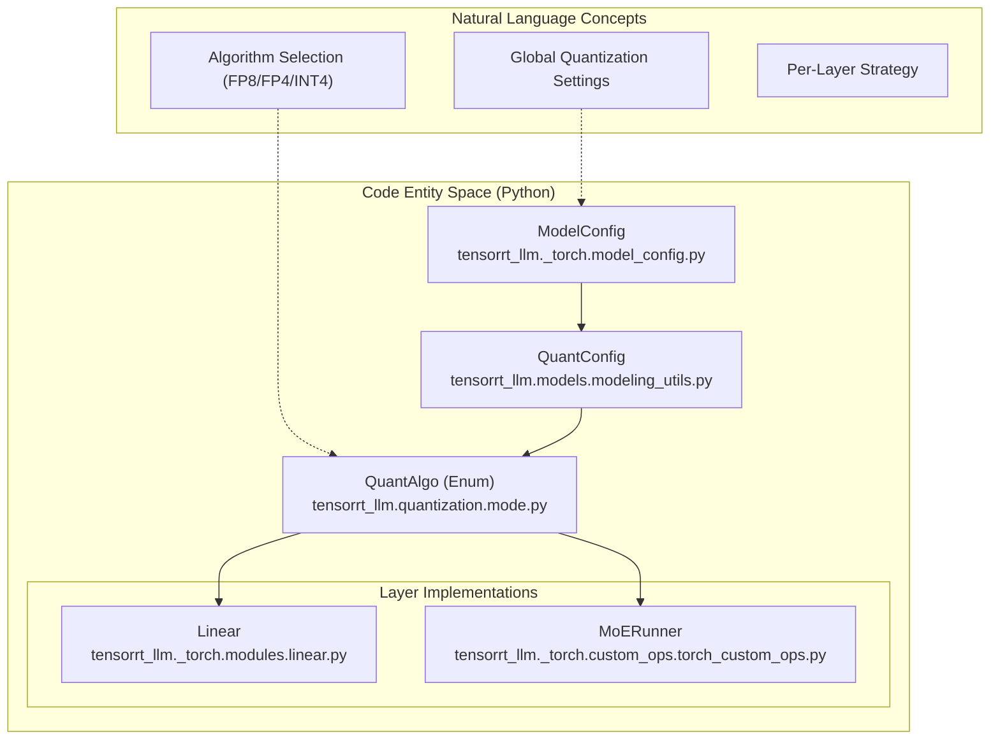
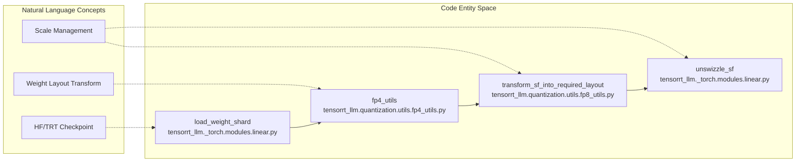

<!-- source: DeepWiki mcp.deepwiki.com · repo NVIDIA/TensorRT-LLM · page 12 Quantization System · fetched 2026-10-26 -->

# Quantization System

Relevant source files

The following files were used as context for generating this wiki page:

- [cpp/tensorrt_llm/kernels/CMakeLists.txt](cpp/tensorrt_llm/kernels/CMakeLists.txt)
- [cpp/tensorrt_llm/kernels/cutlass_kernels/fp8_blockscale_gemm/ada_blockwise_gemm/sm89_fp8_gemm_1d1d.cuh](cpp/tensorrt_llm/kernels/cutlass_kernels/fp8_blockscale_gemm/ada_blockwise_gemm/sm89_fp8_gemm_1d1d.cuh)
- [cpp/tensorrt_llm/kernels/cutlass_kernels/fp8_blockscale_gemm/ada_blockwise_gemm/sm89_utils.cuh](cpp/tensorrt_llm/kernels/cutlass_kernels/fp8_blockscale_gemm/ada_blockwise_gemm/sm89_utils.cuh)
- [cpp/tensorrt_llm/kernels/cutlass_kernels/fp8_blockscale_gemm/fp8_blockscale_gemm.cu](cpp/tensorrt_llm/kernels/cutlass_kernels/fp8_blockscale_gemm/fp8_blockscale_gemm.cu)
- [cpp/tensorrt_llm/kernels/cutlass_kernels/fp8_blockscale_gemm/fp8_blockscale_gemm.h](cpp/tensorrt_llm/kernels/cutlass_kernels/fp8_blockscale_gemm/fp8_blockscale_gemm.h)
- [cpp/tensorrt_llm/kernels/cutlass_kernels/fp8_blockscale_gemm/fp8_blockscale_gemm_kernel.cuh](cpp/tensorrt_llm/kernels/cutlass_kernels/fp8_blockscale_gemm/fp8_blockscale_gemm_kernel.cuh)
- [cpp/tensorrt_llm/kernels/cutlass_kernels/fp8_blockscale_gemm/fp8_blockscale_quant_packed.cu](cpp/tensorrt_llm/kernels/cutlass_kernels/fp8_blockscale_gemm/fp8_blockscale_quant_packed.cu)
- [cpp/tensorrt_llm/kernels/cutlass_kernels/fp8_blockscale_gemm/fp8_blockscale_quant_packed.h](cpp/tensorrt_llm/kernels/cutlass_kernels/fp8_blockscale_gemm/fp8_blockscale_quant_packed.h)
- [cpp/tensorrt_llm/kernels/cutlass_kernels/fp8_blockscale_gemm/sm120_blockwise_gemm/sm120_fp8_gemm_1d1d.cuh](cpp/tensorrt_llm/kernels/cutlass_kernels/fp8_blockscale_gemm/sm120_blockwise_gemm/sm120_fp8_gemm_1d1d.cuh)
- [cpp/tensorrt_llm/kernels/cutlass_kernels/fp8_blockscale_gemm/sm120_blockwise_gemm/sm120_fp8_moe_gemm_1d1d.cuh](cpp/tensorrt_llm/kernels/cutlass_kernels/fp8_blockscale_gemm/sm120_blockwise_gemm/sm120_fp8_moe_gemm_1d1d.cuh)
- [cpp/tensorrt_llm/kernels/cutlass_kernels/fp8_blockscale_gemm/sm120_blockwise_gemm/sm120_utils.cuh](cpp/tensorrt_llm/kernels/cutlass_kernels/fp8_blockscale_gemm/sm120_blockwise_gemm/sm120_utils.cuh)
- [cpp/tensorrt_llm/kernels/userbuffers/CMakeLists.txt](cpp/tensorrt_llm/kernels/userbuffers/CMakeLists.txt)
- [cpp/tensorrt_llm/thop/CMakeLists.txt](cpp/tensorrt_llm/thop/CMakeLists.txt)
- [cpp/tensorrt_llm/thop/fp8BlockScalingGemm.cpp](cpp/tensorrt_llm/thop/fp8BlockScalingGemm.cpp)
- [cpp/tensorrt_llm/thop/fp8Quantize.cpp](cpp/tensorrt_llm/thop/fp8Quantize.cpp)
- [tensorrt_llm/_torch/autotuner.py](tensorrt_llm/_torch/autotuner.py)
- [tensorrt_llm/_torch/custom_ops/cpp_custom_ops.py](tensorrt_llm/_torch/custom_ops/cpp_custom_ops.py)
- [tensorrt_llm/_torch/custom_ops/torch_custom_ops.py](tensorrt_llm/_torch/custom_ops/torch_custom_ops.py)
- [tensorrt_llm/_torch/custom_ops/trtllm_gen_custom_ops.py](tensorrt_llm/_torch/custom_ops/trtllm_gen_custom_ops.py)
- [tensorrt_llm/_torch/cute_dsl_kernels/blackwell/dense_blockscaled_gemm_act_fusion.py](tensorrt_llm/_torch/cute_dsl_kernels/blackwell/dense_blockscaled_gemm_act_fusion.py)
- [tensorrt_llm/_torch/model_config.py](tensorrt_llm/_torch/model_config.py)
- [tensorrt_llm/_torch/modules/gated_mlp.py](tensorrt_llm/_torch/modules/gated_mlp.py)
- [tensorrt_llm/_torch/modules/linear.py](tensorrt_llm/_torch/modules/linear.py)
- [tensorrt_llm/_torch/modules/mlp.py](tensorrt_llm/_torch/modules/mlp.py)
- [tensorrt_llm/_torch/peft/lora/layer.py](tensorrt_llm/_torch/peft/lora/layer.py)
- [tensorrt_llm/_torch/utils.py](tensorrt_llm/_torch/utils.py)
- [tensorrt_llm/llmapi/llm_utils.py](tensorrt_llm/llmapi/llm_utils.py)
- [tensorrt_llm/models/modeling_utils.py](tensorrt_llm/models/modeling_utils.py)
- [tensorrt_llm/quantization/utils/fp8_utils.py](tensorrt_llm/quantization/utils/fp8_utils.py)
- [tests/unittest/_torch/misc/test_autotuner.py](tests/unittest/_torch/misc/test_autotuner.py)
- [tests/unittest/_torch/thop/parallel/test_dense_gemm_act_fusion.py](tests/unittest/_torch/thop/parallel/test_dense_gemm_act_fusion.py)
- [tests/unittest/_torch/thop/parallel/test_fp8_block_scale_gemm.py](tests/unittest/_torch/thop/parallel/test_fp8_block_scale_gemm.py)
- [tests/unittest/_torch/thop/parallel/test_fp8_quantize.py](tests/unittest/_torch/thop/parallel/test_fp8_quantize.py)

The Quantization System in TensorRT-LLM provides a comprehensive infrastructure for reducing model memory footprint and accelerating inference through lower-precision representations of weights and activations. This system supports a wide range of precisions from standard INT8/INT4 to advanced FP8 and NVFP4 formats, optimized for different NVIDIA GPU architectures including Hopper (SM90) and Blackwell (SM100/SM120).

## Overview and Purpose

The quantization system is designed to be pluggable and extensible, using a strategy pattern to apply different quantization methods to model layers. It handles the complexity of weight transformations, scale management, and hardware-specific kernel selection across both standard linear layers and Mixture of Experts (MoE) architectures.

- **Quantization Configuration**: Hierarchical management of quantization settings from global to per-layer granularity via `QuantConfig` [tensorrt_llm/models/modeling_utils.py:126-170]().
- **Linear Layer Methods**: Specialized implementations for FP8, NVFP4, and Weight-Only quantization integrated into the `Linear` module [tensorrt_llm/_torch/modules/linear.py:114-129]().
- **MoE Quantization**: Advanced support for MoE quantization, including fused kernels for FP8 and NVFP4 formats. The system uses a `MoERunner` [tensorrt_llm/_torch/custom_ops/torch_custom_ops.py:67-111]() to manage C++ `FusedMoeRunner` [tensorrt_llm/_torch/custom_ops/torch_custom_ops.py:140-145]() instances.
- **Weight Management**: Automated weight sharding, transformation, and scale calculation during model loading via utilities such as `fp4_utils` [tensorrt_llm/_torch/custom_ops/torch_custom_ops.py:26-26]() and `fp8_utils` [tensorrt_llm/quantization/utils/fp8_utils.py:1-7]().
- **Activation Fusion**: Optimized paths that combine activation functions with quantization, such as fused `RMSNorm` with NVFP4 output [tensorrt_llm/_torch/custom_ops/cpp_custom_ops.py:52-58]().
- **Autotuning**: Integration with the `AutoTuner` [tensorrt_llm/_torch/autotuner.py:44-46]() to select optimal quantization kernels based on runtime shapes and hardware [tensorrt_llm/_torch/custom_ops/trtllm_gen_custom_ops.py:138-141]().

For details on specific settings, see [Quantization Configuration](#12.1).
For implementation details of linear layers, see [Linear Layer Quantization Methods](#12.2).
For weight transformation workflows, see [Weight Quantization and Scale Management](#12.3).

---

## Quantization Architecture and Code Entities

The system bridges high-level model definitions with low-level CUDA kernels through abstractions that map quantization algorithms to specific layer implementations.

### Configuration and Strategy Selection

The following diagram illustrates how the system associates configuration names with the code entities that execute the quantization logic.

**Natural Language to Code Entity Space: Configuration**

**Sources:**
- [tensorrt_llm/_torch/model_config.py:45-51]() (`ModelConfig` and `QuantConfig` integration)
- [tensorrt_llm/models/modeling_utils.py:126-170]() (`QuantConfig` definition)
- [tensorrt_llm/quantization/mode.py:48-48]() (`QuantAlgo` enum)
- [tensorrt_llm/_torch/custom_ops/torch_custom_ops.py:90-111]() (`MoERunner` initialization)

---

## Quantization Methods and Dispatch

The system handles both standard dense linear layers and specialized Mixture of Experts (MoE) layers. For Blackwell architectures, specialized NVFP4 backends are selected based on hardware capabilities and model attributes.

### Quantization Method Dispatch

Layers are substituted or kernels are dispatched based on the `QuantAlgo` and hardware capabilities.

| Quantization Type | QuantAlgo Enum | Implementation Entity |
| :--- | :--- | :--- |
| **NVFP4 (Blackwell)** | `NVFP4` | `CuteDSLNVFP4BlackwellRunner` [tensorrt_llm/_torch/custom_ops/torch_custom_ops.py:53-55]() |
| **NVFP4 (Marlin)** | `W4A16_NVFP4` | `marlin_nvfp4_gemm` [tensorrt_llm/_torch/modules/linear.py:122-129]() |
| **Weight-Only INT8** | `W8A16` | `MoERunner(use_int8_woq_per_channel=True)` [tensorrt_llm/_torch/custom_ops/torch_custom_ops.py:104-104]() |
| **W4 Group Scaling** | `W4A16` | `MoERunner(use_w4_group_scaling=True)` [tensorrt_llm/_torch/custom_ops/torch_custom_ops.py:103-103]() |
| **MXFP8 Scaling** | `W4A8_MXFP4_MXFP8` | `MoERunner(use_mxfp8_act_scaling=True)` [tensorrt_llm/_torch/custom_ops/torch_custom_ops.py:105-105]() |

**Sources:**
- [tensorrt_llm/_torch/custom_ops/torch_custom_ops.py:134-146]() (`MoERunner` configuration flags)
- [tensorrt_llm/_torch/modules/linear.py:122-129]() (`_uses_marlin_nvfp4_backend` logic)
- [tensorrt_llm/_torch/custom_ops/cpp_custom_ops.py:46-58]() (NVFP4 allreduce fusion op handling)

---

## Weight Loading and Transformation

The quantization system manages the lifecycle of weights from checkpoint loading to GPU memory allocation, including scaling factor (SF) management and layout transformations required for hardware acceleration.

**Natural Language to Code Entity Space: Weight Management**

**Sources:**
- [tensorrt_llm/_torch/modules/linear.py:132-139]() (`load_weight_shard` logic)
- [tensorrt_llm/_torch/modules/linear.py:27-29]() (`transform_sf_into_required_layout` import)
- [tensorrt_llm/_torch/modules/linear.py:33-35]() (`unswizzle_sf` import)

---

## Child Pages

For more detailed technical documentation, please refer to the following sub-pages:

- **[Quantization Configuration](#12.1)**: Detailed explanation of `QuantConfig`, `QuantAlgo` enums, and how quantization settings flow through the model configuration [tensorrt_llm/models/modeling_utils.py:126-170]().
- **[Linear Layer Quantization Methods](#12.2)**: Document FP8, NVFP4, INT4/8 quantization methods for linear layers, block-scale GEMM kernels, and specialized backends like `MoERunner` [tensorrt_llm/_torch/custom_ops/torch_custom_ops.py:67-111]() and `CuteDSLNVFP4BlackwellRunner` [tensorrt_llm/_torch/custom_ops/torch_custom_ops.py:53-55]().
- **[Weight Quantization and Scale Management](#12.3)**: Explain weight transformations, scale handling, `fp8_utils`, `fp4_utils`, and integration with scaling factor management for Blackwell and Hopper architectures [tensorrt_llm/_torch/utils.py:187-202]().

---

