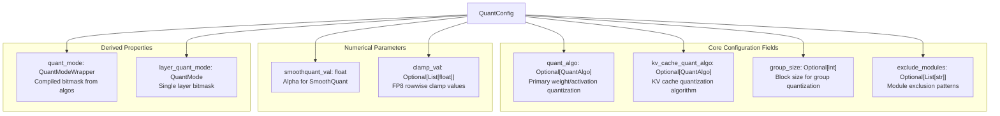
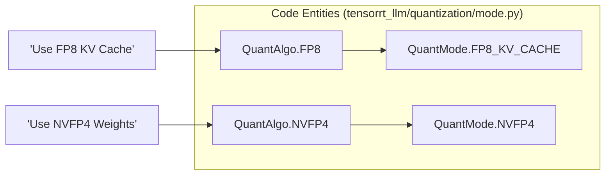
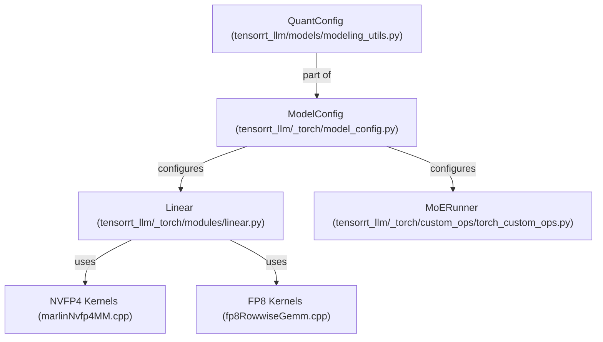
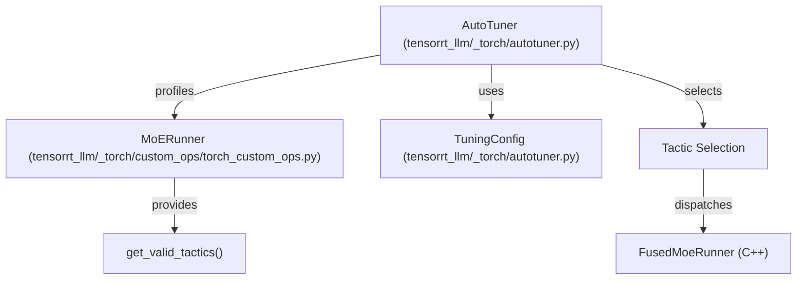

<!-- source: DeepWiki mcp.deepwiki.com · repo NVIDIA/TensorRT-LLM · page 12.1 Quantization Configuration · fetched 2026-10-26 -->

# Quantization Configuration

Relevant source files

The following files were used as context for generating this wiki page:

- [cpp/tensorrt_llm/kernels/CMakeLists.txt](cpp/tensorrt_llm/kernels/CMakeLists.txt)
- [cpp/tensorrt_llm/kernels/userbuffers/CMakeLists.txt](cpp/tensorrt_llm/kernels/userbuffers/CMakeLists.txt)
- [cpp/tensorrt_llm/thop/CMakeLists.txt](cpp/tensorrt_llm/thop/CMakeLists.txt)
- [docs/source/commands/trtllm-bench.rst](docs/source/commands/trtllm-bench.rst)
- [docs/source/developer-guide/perf-benchmarking.md](docs/source/developer-guide/perf-benchmarking.md)
- [docs/source/developer-guide/perf-overview.md](docs/source/developer-guide/perf-overview.md)
- [docs/source/examples/kvcacheconfig.md](docs/source/examples/kvcacheconfig.md)
- [docs/source/examples/kvcacheretentionconfig.md](docs/source/examples/kvcacheretentionconfig.md)
- [docs/source/features/auto_deploy/advanced/expert_configurations.md](docs/source/features/auto_deploy/advanced/expert_configurations.md)
- [docs/source/features/auto_deploy/support_matrix.md](docs/source/features/auto_deploy/support_matrix.md)
- [docs/source/features/long-sequence.md](docs/source/features/long-sequence.md)
- [docs/source/features/quantization.md](docs/source/features/quantization.md)
- [docs/source/legacy/performance/perf-benchmarking.md](docs/source/legacy/performance/perf-benchmarking.md)
- [docs/source/overview.md](docs/source/overview.md)
- [docs/source/supported-hardware.md](docs/source/supported-hardware.md)
- [tensorrt_llm/_torch/autotuner.py](tensorrt_llm/_torch/autotuner.py)
- [tensorrt_llm/_torch/custom_ops/cpp_custom_ops.py](tensorrt_llm/_torch/custom_ops/cpp_custom_ops.py)
- [tensorrt_llm/_torch/custom_ops/torch_custom_ops.py](tensorrt_llm/_torch/custom_ops/torch_custom_ops.py)
- [tensorrt_llm/_torch/custom_ops/trtllm_gen_custom_ops.py](tensorrt_llm/_torch/custom_ops/trtllm_gen_custom_ops.py)
- [tensorrt_llm/_torch/model_config.py](tensorrt_llm/_torch/model_config.py)
- [tensorrt_llm/_torch/modules/gated_mlp.py](tensorrt_llm/_torch/modules/gated_mlp.py)
- [tensorrt_llm/_torch/modules/linear.py](tensorrt_llm/_torch/modules/linear.py)
- [tensorrt_llm/_torch/modules/mlp.py](tensorrt_llm/_torch/modules/mlp.py)
- [tensorrt_llm/_torch/peft/lora/layer.py](tensorrt_llm/_torch/peft/lora/layer.py)
- [tensorrt_llm/_torch/utils.py](tensorrt_llm/_torch/utils.py)
- [tensorrt_llm/commands/bench.py](tensorrt_llm/commands/bench.py)
- [tensorrt_llm/llmapi/llm_utils.py](tensorrt_llm/llmapi/llm_utils.py)
- [tensorrt_llm/models/modeling_utils.py](tensorrt_llm/models/modeling_utils.py)
- [tensorrt_llm/serve/scripts/time_breakdown/images/perf_metrics_timepoints.png](tensorrt_llm/serve/scripts/time_breakdown/images/perf_metrics_timepoints.png)
- [tests/unittest/_torch/misc/test_autotuner.py](tests/unittest/_torch/misc/test_autotuner.py)
- [tests/unittest/_torch/thop/parallel/test_dense_gemm_act_fusion.py](tests/unittest/_torch/thop/parallel/test_dense_gemm_act_fusion.py)

This document explains the quantization configuration system in TensorRT-LLM. It covers the `QuantConfig` class structure, the `QuantAlgo` and `QuantMode` systems, and how quantization settings flow through the model configuration to specialized runtime kernels, with a focus on Mixture of Experts (MoE), Blackwell-specific implementations, and autotuning integration.

## QuantConfig Class

The `QuantConfig` class is the central configuration object that controls quantization behavior throughout TensorRT-LLM models. It is a serializable class that forms part of the `PretrainedConfig`. [tensorrt_llm/models/modeling_utils.py:126-127]()

### QuantConfig Structure

**Diagram: QuantConfig Class Fields and Relationships**

**Sources:** [tensorrt_llm/models/modeling_utils.py:126-170](), [tensorrt_llm/models/modeling_utils.py:171-186]()

### Field Descriptions

| Field | Type | Description |
|-------|------|-------------|
| `quant_algo` | `Optional[QuantAlgo]` | Primary quantization algorithm for weights and activations. [tensorrt_llm/models/modeling_utils.py:129-132]() |
| `kv_cache_quant_algo` | `Optional[QuantAlgo]` | Separate quantization algorithm for KV cache (e.g., FP8, INT8, or NVFP4). [tensorrt_llm/models/modeling_utils.py:133-134]() |
| `group_size` | `Optional[int]` | Block size for group-wise quantization (default: 128). [tensorrt_llm/models/modeling_utils.py:135-136]() |
| `exclude_modules` | `Optional[List[str]]` | Module name patterns that are skipped in quantization. [tensorrt_llm/models/modeling_utils.py:153-155]() |
| `smoothquant_val` | `float` | Smoothing parameter alpha used in SmoothQuant (default: 0.5). [tensorrt_llm/models/modeling_utils.py:137-139]() |
| `mamba_ssm_cache_dtype` | `Optional[str]` | Data type for Mamba SSM state cache. [tensorrt_llm/models/modeling_utils.py:156-157]() |
| `mamba_ssm_stochastic_rounding` | `bool` | Enable stochastic rounding for Mamba SSM state updates. [tensorrt_llm/models/modeling_utils.py:158-162]() |

**Sources:** [tensorrt_llm/models/modeling_utils.py:126-169]()

## QuantAlgo and QuantMode

TensorRT-LLM uses two primary representations for quantization state: `QuantAlgo` (a high-level algorithm name) and `QuantMode` (a low-level bitmask).

### QuantAlgo Enum
`QuantAlgo` is an enum used in configuration files and user-facing APIs to specify the desired quantization strategy. [tensorrt_llm/quantization/mode.py:26-50]()

| Category | Key Algos |
|----------|-----------|
| **Weight-Only** | `W8A16`, `W4A16`, `W4A16_AWQ`, `W4A16_GPTQ` |
| **SmoothQuant** | `W8A8_SQ_PER_CHANNEL`, `W8A8_SQ_PER_TENSOR_PLUGIN` |
| **FP8** | `FP8`, `FP8_PER_CHANNEL_PER_TOKEN`, `FP8_BLOCK_SCALES` |
| **NVFP4** | `NVFP4`, `W4A16_NVFP4`, `W4A8_NVFP4_FP8`, `NVFP4_AWQ`, `NVFP4_ARC` |
| **Mixed Precision MoE** | `W4A8_MXFP4_FP8`, `W4A8_MXFP4_MXFP8` |

**Sources:** [tensorrt_llm/quantization/mode.py:26-50](), [tensorrt_llm/models/modeling_utils.py:47-48]()

### QuantMode Bitmask
`QuantMode` is an `IntFlag` used internally by C++ and Python layers to efficiently check for specific quantization features. It is often wrapped by `QuantModeWrapper` for extended logic. [tensorrt_llm/models/modeling_utils.py:170-178]()

**Diagram: Natural Language to Code Entity Space (Quantization Flags)**

**Sources:** [tensorrt_llm/quantization/mode.py:26-50](), [tensorrt_llm/models/modeling_utils.py:170-186]()

## Quantization Flow in Model Configuration

Quantization settings flow from high-level arguments down to specific layers. In the PyTorch-based execution path, quantization parameters are applied during layer initialization.

### ModelConfig Integration
The `ModelConfig` class manages the lifecycle of quantization settings, including loading them from `hf_quant_config.json` or `quant_cfg.json` via `update_quant_config_from_compressed_tensors`. [tensorrt_llm/_torch/model_config.py:45-46](), [tensorrt_llm/_torch/model_config.py:157-159]()

### Linear Layer Integration
The `Linear` module in `tensorrt_llm._torch.modules.linear` is the primary consumer of `QuantConfig`. It uses the configuration to determine:
1.  **Quantization Mode**: Checks `quant_config.quant_mode` to enable FP8, NVFP4, or Weight-Only paths. [tensorrt_llm/_torch/modules/linear.py:115](), [tensorrt_llm/_torch/modules/linear.py:32]()
2.  **Kernel Selection**: Based on the quantization mode and hardware (SM version), it selects between standard GEMM, `marlin_nvfp4_gemm`, or Blackwell-specific fused kernels. [tensorrt_llm/_torch/modules/linear.py:122-129]()

**Diagram: Configuration Data Flow**

**Sources:** [tensorrt_llm/_torch/model_config.py:157-159](), [tensorrt_llm/_torch/modules/linear.py:110-118](), [tensorrt_llm/_torch/custom_ops/torch_custom_ops.py:134-145]()

## MoE and Specialized Quantization

### NVFP4 and Blackwell Support
TensorRT-LLM provides specialized support for NVFP4 on Blackwell (SM100). Key implementation details include:
*   **Activation Fusion**: The `RMSNorm` module can fuse norm output with NVFP4 quantization using static scales. [tensorrt_llm/_torch/custom_ops/cpp_custom_ops.py:52-58]()
*   **Scale Factor (SF) Management**: NVFP4 requires block-scale factors. The system handles swizzling these factors for optimal Blackwell memory access using `unswizzle_sf`. [tensorrt_llm/_torch/utils.py:203-205](), [tensorrt_llm/_torch/modules/linear.py:35]()
*   **Marlin NVFP4**: For Ada/Hopper (SM89-99), the system uses `marlin_nvfp4_gemm`. [tensorrt_llm/_torch/modules/linear.py:122-129]()

### MoE Quantization Parameters
The `MoERunner` handles complex quantization states for expert layers, including:
*   **Block-Scale MoE**: Support for DeepSeek-style FP8 block scaling. [tensorrt_llm/_torch/custom_ops/torch_custom_ops.py:124]()
*   **MXFP8 Scaling**: Support for micro-scaling formats in MoE activation and weights. [tensorrt_llm/_torch/custom_ops/torch_custom_ops.py:127-130]()
*   **W4 Group Scaling**: Support for 4-bit weight-only quantization with group scaling. [tensorrt_llm/_torch/custom_ops/torch_custom_ops.py:125]()

**Sources:** [tensorrt_llm/_torch/utils.py:203-205](), [tensorrt_llm/_torch/custom_ops/torch_custom_ops.py:90-146](), [tensorrt_llm/_torch/custom_ops/cpp_custom_ops.py:52-58]()

## Autotuning and Quantization

The `AutoTuner` system interacts with quantization settings to select the optimal kernel for a given bit-width and hardware.

### Tunable Runners
Specialized runners like `MoERunner` implement the `TunableRunner` interface to provide profiling-based tactic selection. They use `TuningConfig` to define dynamic dimensions (like token counts) for profiling. [tensorrt_llm/_torch/custom_ops/torch_custom_ops.py:82-88]()

### Profiling with Quantization
The autotuner manages `OptimizationProfile` instances that include quantization-specific constraints. The `MoERunner` identifies itself via `unique_id`, which includes all quantization flags (e.g., `use_mxfp8_act_scaling`, `use_deepseek_fp8_block_scale`) to ensure tactics are not shared between different quantization schemes. [tensorrt_llm/_torch/custom_ops/torch_custom_ops.py:152-171]()

**Diagram: Code Entity Space - Autotuning Quantized Kernels**

**Sources:** [tensorrt_llm/_torch/custom_ops/torch_custom_ops.py:67-171](), [tensorrt_llm/_torch/custom_ops/torch_custom_ops.py:148-150](), [tensorrt_llm/_torch/autotuner.py:78-139]()

---

