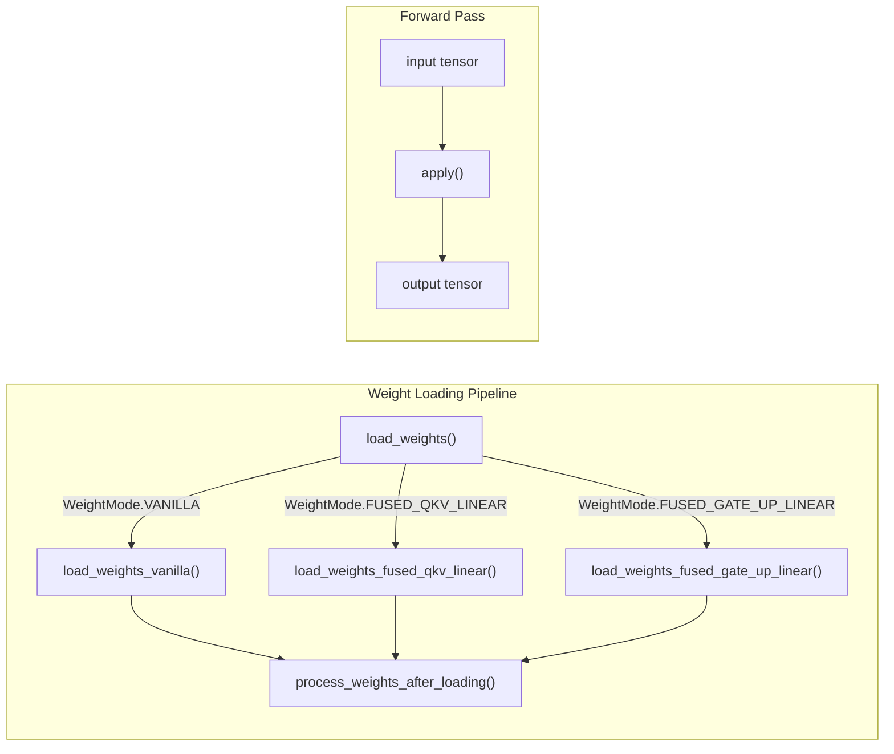
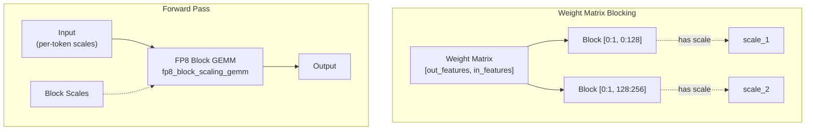
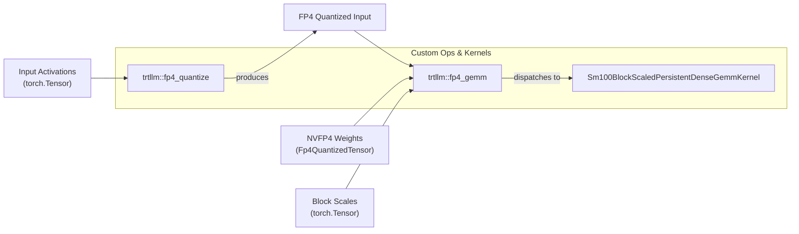

<!-- source: DeepWiki mcp.deepwiki.com · repo NVIDIA/TensorRT-LLM · page 12.2 Linear Layer Quantization Methods · fetched 2026-10-26 -->

# Linear Layer Quantization Methods

<details>
<summary>Relevant source files</summary>

The following files were used as context for generating this wiki page:

- [cpp/tensorrt_llm/kernels/cutlass_kernels/fp8_blockscale_gemm/ada_blockwise_gemm/sm89_fp8_gemm_1d1d.cuh](cpp/tensorrt_llm/kernels/cutlass_kernels/fp8_blockscale_gemm/ada_blockwise_gemm/sm89_fp8_gemm_1d1d.cuh)
- [cpp/tensorrt_llm/kernels/cutlass_kernels/fp8_blockscale_gemm/ada_blockwise_gemm/sm89_utils.cuh](cpp/tensorrt_llm/kernels/cutlass_kernels/fp8_blockscale_gemm/ada_blockwise_gemm/sm89_utils.cuh)
- [cpp/tensorrt_llm/kernels/cutlass_kernels/fp8_blockscale_gemm/fp8_blockscale_gemm.cu](cpp/tensorrt_llm/kernels/cutlass_kernels/fp8_blockscale_gemm/fp8_blockscale_gemm.cu)
- [cpp/tensorrt_llm/kernels/cutlass_kernels/fp8_blockscale_gemm/fp8_blockscale_gemm.h](cpp/tensorrt_llm/kernels/cutlass_kernels/fp8_blockscale_gemm/fp8_blockscale_gemm.h)
- [cpp/tensorrt_llm/kernels/cutlass_kernels/fp8_blockscale_gemm/fp8_blockscale_gemm_kernel.cuh](cpp/tensorrt_llm/kernels/cutlass_kernels/fp8_blockscale_gemm/fp8_blockscale_gemm_kernel.cuh)
- [cpp/tensorrt_llm/kernels/cutlass_kernels/fp8_blockscale_gemm/fp8_blockscale_quant_packed.cu](cpp/tensorrt_llm/kernels/cutlass_kernels/fp8_blockscale_gemm/fp8_blockscale_quant_packed.cu)
- [cpp/tensorrt_llm/kernels/cutlass_kernels/fp8_blockscale_gemm/fp8_blockscale_quant_packed.h](cpp/tensorrt_llm/kernels/cutlass_kernels/fp8_blockscale_gemm/fp8_blockscale_quant_packed.h)
- [cpp/tensorrt_llm/kernels/cutlass_kernels/fp8_blockscale_gemm/sm120_blockwise_gemm/sm120_fp8_gemm_1d1d.cuh](cpp/tensorrt_llm/kernels/cutlass_kernels/fp8_blockscale_gemm/sm120_blockwise_gemm/sm120_fp8_gemm_1d1d.cuh)
- [cpp/tensorrt_llm/kernels/cutlass_kernels/fp8_blockscale_gemm/sm120_blockwise_gemm/sm120_fp8_moe_gemm_1d1d.cuh](cpp/tensorrt_llm/kernels/cutlass_kernels/fp8_blockscale_gemm/sm120_blockwise_gemm/sm120_fp8_moe_gemm_1d1d.cuh)
- [cpp/tensorrt_llm/kernels/cutlass_kernels/fp8_blockscale_gemm/sm120_blockwise_gemm/sm120_utils.cuh](cpp/tensorrt_llm/kernels/cutlass_kernels/fp8_blockscale_gemm/sm120_blockwise_gemm/sm120_utils.cuh)
- [cpp/tensorrt_llm/thop/fp8BlockScalingGemm.cpp](cpp/tensorrt_llm/thop/fp8BlockScalingGemm.cpp)
- [cpp/tensorrt_llm/thop/fp8Quantize.cpp](cpp/tensorrt_llm/thop/fp8Quantize.cpp)
- [tensorrt_llm/_torch/custom_ops/cute_dsl_custom_ops.py](tensorrt_llm/_torch/custom_ops/cute_dsl_custom_ops.py)
- [tensorrt_llm/_torch/cute_dsl_kernels/blackwell/blockscaled_contiguous_gather_grouped_gemm_act_fusion.py](tensorrt_llm/_torch/cute_dsl_kernels/blackwell/blockscaled_contiguous_gather_grouped_gemm_act_fusion.py)
- [tensorrt_llm/_torch/cute_dsl_kernels/blackwell/blockscaled_contiguous_grouped_gemm.py](tensorrt_llm/_torch/cute_dsl_kernels/blackwell/blockscaled_contiguous_grouped_gemm.py)
- [tensorrt_llm/_torch/cute_dsl_kernels/blackwell/blockscaled_contiguous_grouped_gemm_finalize_fusion.py](tensorrt_llm/_torch/cute_dsl_kernels/blackwell/blockscaled_contiguous_grouped_gemm_finalize_fusion.py)
- [tensorrt_llm/_torch/cute_dsl_kernels/blackwell/blockscaled_contiguous_grouped_gemm_swiglu_fusion.py](tensorrt_llm/_torch/cute_dsl_kernels/blackwell/blockscaled_contiguous_grouped_gemm_swiglu_fusion.py)
- [tensorrt_llm/_torch/cute_dsl_kernels/blackwell/dense_blockscaled_gemm_act_fusion.py](tensorrt_llm/_torch/cute_dsl_kernels/blackwell/dense_blockscaled_gemm_act_fusion.py)
- [tensorrt_llm/_torch/cute_dsl_kernels/blackwell/dense_blockscaled_gemm_persistent.py](tensorrt_llm/_torch/cute_dsl_kernels/blackwell/dense_blockscaled_gemm_persistent.py)
- [tensorrt_llm/_torch/cute_dsl_kernels/blackwell/moe_as_dense_gemm/__init__.py](tensorrt_llm/_torch/cute_dsl_kernels/blackwell/moe_as_dense_gemm/__init__.py)
- [tensorrt_llm/_torch/cute_dsl_kernels/blackwell/moe_as_dense_gemm/fc1.py](tensorrt_llm/_torch/cute_dsl_kernels/blackwell/moe_as_dense_gemm/fc1.py)
- [tensorrt_llm/_torch/cute_dsl_kernels/blackwell/moe_as_dense_gemm/fc2.py](tensorrt_llm/_torch/cute_dsl_kernels/blackwell/moe_as_dense_gemm/fc2.py)
- [tensorrt_llm/_torch/cute_dsl_kernels/blackwell/utils.py](tensorrt_llm/_torch/cute_dsl_kernels/blackwell/utils.py)
- [tensorrt_llm/quantization/utils/fp8_utils.py](tensorrt_llm/quantization/utils/fp8_utils.py)
- [tests/scripts/cute_dsl_kernels/moe_as_dense_gemm/run_moe_as_dense_gemm_fc2.py](tests/scripts/cute_dsl_kernels/moe_as_dense_gemm/run_moe_as_dense_gemm_fc2.py)
- [tests/scripts/cute_dsl_kernels/run_blockscaled_contiguous_gather_grouped_gemm_act_fusion.py](tests/scripts/cute_dsl_kernels/run_blockscaled_contiguous_gather_grouped_gemm_act_fusion.py)
- [tests/scripts/cute_dsl_kernels/run_blockscaled_contiguous_grouped_gemm.py](tests/scripts/cute_dsl_kernels/run_blockscaled_contiguous_grouped_gemm.py)
- [tests/scripts/cute_dsl_kernels/run_blockscaled_contiguous_grouped_gemm_finalize_fusion.py](tests/scripts/cute_dsl_kernels/run_blockscaled_contiguous_grouped_gemm_finalize_fusion.py)
- [tests/scripts/cute_dsl_kernels/run_blockscaled_contiguous_grouped_gemm_swiglu_fusion.py](tests/scripts/cute_dsl_kernels/run_blockscaled_contiguous_grouped_gemm_swiglu_fusion.py)
- [tests/scripts/cute_dsl_kernels/run_dense_blockscaled_gemm_persistent.py](tests/scripts/cute_dsl_kernels/run_dense_blockscaled_gemm_persistent.py)
- [tests/scripts/cute_dsl_kernels/testing.py](tests/scripts/cute_dsl_kernels/testing.py)
- [tests/unittest/_torch/thop/parallel/test_cute_dsl_moe.py](tests/unittest/_torch/thop/parallel/test_cute_dsl_moe.py)
- [tests/unittest/_torch/thop/parallel/test_fp4_linear.py](tests/unittest/_torch/thop/parallel/test_fp4_linear.py)
- [tests/unittest/_torch/thop/parallel/test_fp8_block_scale_gemm.py](tests/unittest/_torch/thop/parallel/test_fp8_block_scale_gemm.py)
- [tests/unittest/_torch/thop/parallel/test_fp8_quantize.py](tests/unittest/_torch/thop/parallel/test_fp8_quantize.py)

</details>


## Purpose and Scope

This page documents the quantization methods implemented for Linear layers in TensorRT-LLM's PyTorch backend (`tensorrt_llm._torch`). These methods define how linear layer weights are quantized, stored, and executed during inference to reduce memory footprint and accelerate computation using specialized hardware features like FP8 and NVFP4 (NVIDIA 4-bit Floating Point) Tensor Cores.

## Architecture Overview

The quantization system uses a **strategy pattern** where different quantization algorithms are encapsulated in `LinearMethod` implementations. The `Linear` class delegates quantization-specific operations (weight creation, loading, and forward pass execution) to its assigned method [tensorrt_llm/_torch/modules/linear.py:330-340]().

Title: Linear Method Delegation Architecture
```mermaid
graph TB
    ["Linear Layer<br/>(tensorrt_llm/_torch/modules/linear.py)"] -->|"delegates to"| LinearMethodBase["LinearMethodBase<br/>(abstract base)"]
    
    LinearMethodBase -->|"implements"| Unquant["UnquantizedLinearMethod<br/>(no quantization)"]
    LinearMethodBase -->|"implements"| FP8QDQ["FP8QDQLinearMethod<br/>(per-tensor FP8)"]
    LinearMethodBase -->|"implements"| FP8Block["FP8BlockScalesLinearMethod<br/>(block-wise FP8)"]
    LinearMethodBase -->|"implements"| FP4Gemm["FP4GemmLinearMethod<br/>(FP4 quantization)"]
    LinearMethodBase -->|"implements"| NvFP4["NvFP4LinearMethod<br/>(NVIDIA MXFP4)"]
    LinearMethodBase -->|"implements"| W4A8["W4A8NvFP4FP8LinearMethod<br/>(mixed precision)"]
    
    Unquant -->|"F.linear"| PyTorch["PyTorch GEMM"]
    FP8QDQ -->|"fp8_gemm"| CustomOp1["FP8 Custom Ops"]
    FP8Block -->|"fp8_rowwise_gemm"| CustomOp2["FP8 Rowwise Ops"]
    FP4Gemm -->|"nvfp4_gemm"| CustomOp3["FP4 GEMM Runners"]
    NvFP4 -->|"nvfp4_gemm"| CustomOp3
```
**Sources:** [tensorrt_llm/_torch/modules/linear.py:330-443]()

## LinearMethodBase Interface

All quantization methods inherit from `LinearMethodBase` and must implement these key methods to handle the lifecycle of quantized weights [tensorrt_llm/_torch/modules/linear.py:330-443]():

| Method | Purpose |
|--------|---------|
| `create_weights` | Initialize weight tensors and quantization parameters (scales). |
| `apply` | Execute the linear transformation (forward pass) using specialized kernels. |
| `load_weights_vanilla` | Load weights for single linear layers. |
| `load_weights_fused_qkv_linear` | Load and concatenate weights for fused QKV projections. |
| `load_weights_fused_gate_up_linear` | Load and concatenate weights for fused gate/up projections. |
| `process_weights_after_loading` | Post-process weights (e.g., swizzling scales for hardware). |

Title: Linear Method Weight Pipeline

**Sources:** [tensorrt_llm/_torch/modules/linear.py:330-443]()

## FP8 Quantization Methods

### FP8QDQLinearMethod
Implements per-tensor FP8 quantization. It quantizes input activations using `inv_input_scale` and performs GEMM with pre-quantized FP8 weights [tensorrt_llm/_torch/modules/linear.py:528-730]().

**Quantization Flow:**
1.  **Input Quantization**: Input (BF16/FP16) is cast to FP8 E4M3 using `per_token_quant_and_transform` [tensorrt_llm/_torch/modules/linear.py:27-29]().
2.  **GEMM**: Uses `torch.ops.trtllm.fp8_gemm` which takes FP8 inputs and produces a high-precision output scaled by `weight_scale` [tensorrt_llm/_torch/modules/linear.py:680-700]().

**Sources:** [tensorrt_llm/_torch/modules/linear.py:528-730](), [tensorrt_llm/_torch/modules/linear.py:27-29]()

### FP8BlockScalesLinearMethod
Extends FP8 by using block-wise scaling (typically 1x128 blocks). This improves accuracy by allowing finer-grained scale factors across the weight matrix [tensorrt_llm/_torch/modules/linear.py:731-875](). The kernel logic is implemented in CUTLASS and exposed via `fp8_block_scaling_gemm` [cpp/tensorrt_llm/thop/fp8BlockScalingGemm.cpp:85-116]().

Title: FP8 Block Scaling Logic

**Sources:** [tensorrt_llm/_torch/modules/linear.py:731-875](), [cpp/tensorrt_llm/kernels/cutlass_kernels/fp8_blockscale_gemm/fp8_blockscale_gemm_kernel.cuh:183-185](), [cpp/tensorrt_llm/thop/fp8BlockScalingGemm.cpp:85-116]()

## NVFP4 (MXFP4) and Blackwell Optimization

These methods implement 4-bit floating-point quantization, targeting NVIDIA Blackwell (SM100/SM120) architectures [tensorrt_llm/_torch/modules/linear.py:1087-1293]().

### NvFP4LinearMethod (MXFP4)
Targets the Microscaling (MX) format. Weights are packed into 4-bit elements with shared exponents (E8M0) per tile. The system uses `Fp4QuantizedTensor` to encapsulate these specialized tensors [tensorrt_llm/_torch/utils.py:187-198]().

**Hardware Swizzling:** 
For NVFP4, scales must be swizzled to match the hardware's expected memory access pattern for Tensor Cores. The `swizzle_sf` utility handles the conversion from hardware-specific interleaved layouts using `torch.ops.trtllm.block_scale_interleave` [tensorrt_llm/_torch/utils.py:210-225]().

Title: Blackwell NVFP4 Data Flow and Code Entities

**Sources:** [tensorrt_llm/_torch/modules/linear.py:1087-1293](), [tensorrt_llm/_torch/utils.py:187-198](), [tests/unittest/_torch/thop/parallel/test_fp4_linear.py:49-51](), [tensorrt_llm/_torch/utils.py:210-225](), [tensorrt_llm/_torch/cute_dsl_kernels/blackwell/dense_blockscaled_gemm_persistent.py:97-128]()

## Fused Normalization and Quantization

To eliminate memory bandwidth bottlenecks, TensorRT-LLM implements fused kernels that perform `add` + `RMSNorm` + `Quantization` in a single pass.

- **Fused Activation Quantization**: In `MLP` and `GatedMLP`, activation functions (like SiLU or GeLU) are fused with NVFP4 quantization to avoid intermediate high-precision stores.
- **Size Gating**: For Blackwell, the system selects between optimized kernels based on hardware capabilities and input dimensions [tensorrt_llm/_torch/modules/rms_norm.py:30-37]().
- **DSA Integration**: For Dense Sparse Attention (DSA), the `Fp4QuantizedTensor` can carry an `unquantized_hidden_states` view to avoid redundant dequantization for indexer modules [tensorrt_llm/_torch/utils.py:187-198]().
- **Custom Ops**: Fused operations like `trtllm::fused_add_rms_norm_quant_nvfp4` are registered as custom ops to allow Torch compilation and autotuning [tensorrt_llm/_torch/custom_ops/cpp_custom_ops.py:46-51]().

**Sources:** [tensorrt_llm/_torch/utils.py:187-198](), [tensorrt_llm/_torch/custom_ops/cpp_custom_ops.py:14-58](), [tensorrt_llm/_torch/modules/rms_norm.py:30-37]()

## MoE Quantization Integration

The Mixture of Experts (MoE) system integrates with linear quantization through the `MoERunner` class and specialized CuTe DSL kernels [tensorrt_llm/_torch/custom_ops/torch_custom_ops.py:67-147]().

- **MoERunner**: A Python wrapper around the C++ `FusedMoeRunner`. It handles the execution of MoE GEMMs with various quantization formats including FP8 block scaling and MXFP8 activation scaling [tensorrt_llm/_torch/custom_ops/torch_custom_ops.py:102-110]().
- **MoE Sort and Permute**: The `trtllm.moe_sort` and `trtllm.moe_permute` operations are used to organize tokens by expert and prepare them for grouped GEMMs [tests/unittest/_torch/thop/parallel/test_cute_dsl_moe.py:81-89]().
- **Tuning**: MoE runners are registered as `TunableRunner` instances, using `GroupedGemmInputsHelper` to generate tuning buckets based on token counts and expert load [tensorrt_llm/_torch/custom_ops/cute_dsl_custom_ops.py:43-89]().

**Sources:** [tensorrt_llm/_torch/custom_ops/torch_custom_ops.py:67-180](), [tests/unittest/_torch/thop/parallel/test_cute_dsl_moe.py:65-155](), [tensorrt_llm/_torch/custom_ops/cute_dsl_custom_ops.py:43-89]()

## CUTLASS and CuTe DSL Kernel Implementation

The backend implements optimized FP8 and NVFP4 GEMMs via template kernels in `cpp/tensorrt_llm/kernels/cutlass_kernels` and Python-based `CuTe DSL` kernels for Blackwell.

- **Blackwell Persistent GEMM**: `Sm100BlockScaledPersistentDenseGemmKernel` implements batched matrix multiplication with persistent tile scheduling, warp specialization, and support for MXF8/MXF4/NVF4 data types [tensorrt_llm/_torch/cute_dsl_kernels/blackwell/dense_blockscaled_gemm_persistent.py:97-128]().
- **Fused Finalize**: The `Sm100BlockScaledContiguousGroupedGemmFinalizeFusionKernel` provides a high-performance persistent blockscaled grouped GEMM that fuses MoE finalize logic (router scaling and type conversion) into the GEMM epilogue [tensorrt_llm/_torch/cute_dsl_kernels/blackwell/blockscaled_contiguous_grouped_gemm_finalize_fusion.py:51-99]().
- **TMA and TCGEN05**: These kernels utilize Tensor Memory Access (TMA) for efficient memory operations and Blackwell's `tcgen05.mma` instructions for matrix multiplication [tensorrt_llm/_torch/cute_dsl_kernels/blackwell/blockscaled_contiguous_grouped_gemm.py:77-89]().
- **FP8 Scale Utilities**: The `per_token_cast_to_fp8_e8m0` and `resmooth_to_fp8_e8m0` functions handle the generation and normalization of FP8 scale factors [tensorrt_llm/quantization/utils/fp8_utils.py:34-51]().

**Sources:** [tensorrt_llm/_torch/cute_dsl_kernels/blackwell/dense_blockscaled_gemm_persistent.py:97-128](), [tensorrt_llm/_torch/cute_dsl_kernels/blackwell/blockscaled_contiguous_grouped_gemm_finalize_fusion.py:51-99](), [tensorrt_llm/_torch/cute_dsl_kernels/blackwell/blockscaled_contiguous_grouped_gemm.py:77-89](), [tensorrt_llm/quantization/utils/fp8_utils.py:34-150]()

## Summary of Quantization Schemes

| Method | Weight Format | Activation Format | Scale Granularity | Target Hardware |
| :--- | :--- | :--- | :--- | :--- |
| **FP8 QDQ** | FP8 E4M3 | FP8 E4M3 | Per-tensor | SM89, SM90+ |
| **FP8 Block** | FP8 E4M3 | FP8 E4M3 | 1x128 Block | SM89, SM100 |
| **FP4 Gemm** | FP4 E2M1 | FP16/BF16 | 1x16 Block | SM100 (Blackwell) |
| **NVFP4** | MXFP4 | MXFP4 | 1x32 Tile (MX) | SM100/SM120 |

**Sources:** [tensorrt_llm/_torch/modules/linear.py:1087-1293](), [tensorrt_llm/_torch/utils.py:187-198](), [tensorrt_llm/_torch/cute_dsl_kernels/blackwell/dense_blockscaled_gemm_persistent.py:97-128]()

---

