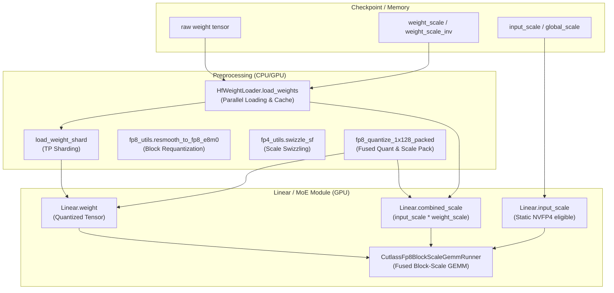
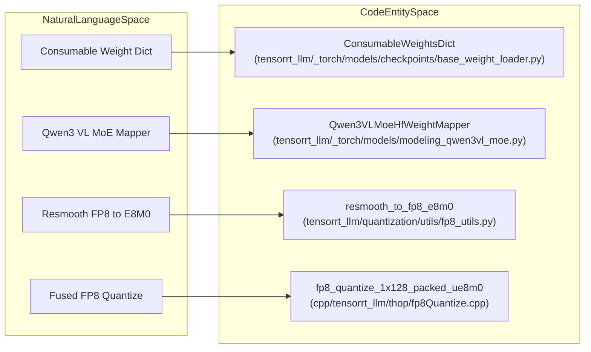
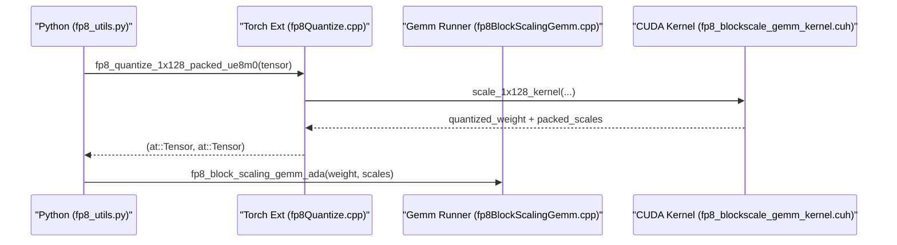

<!-- source: DeepWiki mcp.deepwiki.com · repo NVIDIA/TensorRT-LLM · page 12.3 Weight Quantization and Scale Management · fetched 2026-10-26 -->

# Weight Quantization and Scale Management

Relevant source files

The following files were used as context for generating this wiki page:

- [cpp/tensorrt_llm/kernels/cutlass_kernels/fp8_blockscale_gemm/ada_blockwise_gemm/sm89_fp8_gemm_1d1d.cuh](cpp/tensorrt_llm/kernels/cutlass_kernels/fp8_blockscale_gemm/ada_blockwise_gemm/sm89_fp8_gemm_1d1d.cuh)
- [cpp/tensorrt_llm/kernels/cutlass_kernels/fp8_blockscale_gemm/ada_blockwise_gemm/sm89_utils.cuh](cpp/tensorrt_llm/kernels/cutlass_kernels/fp8_blockscale_gemm/ada_blockwise_gemm/sm89_utils.cuh)
- [cpp/tensorrt_llm/kernels/cutlass_kernels/fp8_blockscale_gemm/fp8_blockscale_gemm.cu](cpp/tensorrt_llm/kernels/cutlass_kernels/fp8_blockscale_gemm/fp8_blockscale_gemm.cu)
- [cpp/tensorrt_llm/kernels/cutlass_kernels/fp8_blockscale_gemm/fp8_blockscale_gemm.h](cpp/tensorrt_llm/kernels/cutlass_kernels/fp8_blockscale_gemm/fp8_blockscale_gemm.h)
- [cpp/tensorrt_llm/kernels/cutlass_kernels/fp8_blockscale_gemm/fp8_blockscale_gemm_kernel.cuh](cpp/tensorrt_llm/kernels/cutlass_kernels/fp8_blockscale_gemm/fp8_blockscale_gemm_kernel.cuh)
- [cpp/tensorrt_llm/kernels/cutlass_kernels/fp8_blockscale_gemm/fp8_blockscale_quant_packed.cu](cpp/tensorrt_llm/kernels/cutlass_kernels/fp8_blockscale_gemm/fp8_blockscale_quant_packed.cu)
- [cpp/tensorrt_llm/kernels/cutlass_kernels/fp8_blockscale_gemm/fp8_blockscale_quant_packed.h](cpp/tensorrt_llm/kernels/cutlass_kernels/fp8_blockscale_gemm/fp8_blockscale_quant_packed.h)
- [cpp/tensorrt_llm/kernels/cutlass_kernels/fp8_blockscale_gemm/sm120_blockwise_gemm/sm120_fp8_gemm_1d1d.cuh](cpp/tensorrt_llm/kernels/cutlass_kernels/fp8_blockscale_gemm/sm120_blockwise_gemm/sm120_fp8_gemm_1d1d.cuh)
- [cpp/tensorrt_llm/kernels/cutlass_kernels/fp8_blockscale_gemm/sm120_blockwise_gemm/sm120_fp8_moe_gemm_1d1d.cuh](cpp/tensorrt_llm/kernels/cutlass_kernels/fp8_blockscale_gemm/sm120_blockwise_gemm/sm120_fp8_moe_gemm_1d1d.cuh)
- [cpp/tensorrt_llm/kernels/cutlass_kernels/fp8_blockscale_gemm/sm120_blockwise_gemm/sm120_utils.cuh](cpp/tensorrt_llm/kernels/cutlass_kernels/fp8_blockscale_gemm/sm120_blockwise_gemm/sm120_utils.cuh)
- [cpp/tensorrt_llm/thop/fp8BlockScalingGemm.cpp](cpp/tensorrt_llm/thop/fp8BlockScalingGemm.cpp)
- [cpp/tensorrt_llm/thop/fp8Quantize.cpp](cpp/tensorrt_llm/thop/fp8Quantize.cpp)
- [examples/models/core/mistral_large_3/README.md](examples/models/core/mistral_large_3/README.md)
- [tensorrt_llm/_torch/cute_dsl_kernels/blackwell/dense_blockscaled_gemm_act_fusion.py](tensorrt_llm/_torch/cute_dsl_kernels/blackwell/dense_blockscaled_gemm_act_fusion.py)
- [tensorrt_llm/_torch/mmap_utils.py](tensorrt_llm/_torch/mmap_utils.py)
- [tensorrt_llm/_torch/models/checkpoints/base_weight_loader.py](tensorrt_llm/_torch/models/checkpoints/base_weight_loader.py)
- [tensorrt_llm/_torch/models/checkpoints/base_weight_mapper.py](tensorrt_llm/_torch/models/checkpoints/base_weight_mapper.py)
- [tensorrt_llm/_torch/models/checkpoints/hf/afmoe_weight_mapper.py](tensorrt_llm/_torch/models/checkpoints/hf/afmoe_weight_mapper.py)
- [tensorrt_llm/_torch/models/checkpoints/hf/exaone_moe_weight_mapper.py](tensorrt_llm/_torch/models/checkpoints/hf/exaone_moe_weight_mapper.py)
- [tensorrt_llm/_torch/models/checkpoints/hf/qwen2_moe_weight_mapper.py](tensorrt_llm/_torch/models/checkpoints/hf/qwen2_moe_weight_mapper.py)
- [tensorrt_llm/_torch/models/checkpoints/hf/qwen3_moe_weight_mapper.py](tensorrt_llm/_torch/models/checkpoints/hf/qwen3_moe_weight_mapper.py)
- [tensorrt_llm/_torch/models/checkpoints/hf/qwen3vl_moe_weight_mapper.py](tensorrt_llm/_torch/models/checkpoints/hf/qwen3vl_moe_weight_mapper.py)
- [tensorrt_llm/_torch/models/checkpoints/hf/weight_loader.py](tensorrt_llm/_torch/models/checkpoints/hf/weight_loader.py)
- [tensorrt_llm/_torch/models/checkpoints/hf/weight_mapper.py](tensorrt_llm/_torch/models/checkpoints/hf/weight_mapper.py)
- [tensorrt_llm/_torch/models/checkpoints/mistral/checkpoint_loader.py](tensorrt_llm/_torch/models/checkpoints/mistral/checkpoint_loader.py)
- [tensorrt_llm/_torch/models/checkpoints/mistral/config_loader.py](tensorrt_llm/_torch/models/checkpoints/mistral/config_loader.py)
- [tensorrt_llm/_torch/models/checkpoints/mistral/weight_mapper.py](tensorrt_llm/_torch/models/checkpoints/mistral/weight_mapper.py)
- [tensorrt_llm/_torch/models/modeling_mistral_large3.py](tensorrt_llm/_torch/models/modeling_mistral_large3.py)
- [tensorrt_llm/_torch/models/modeling_qwen3vl_moe.py](tensorrt_llm/_torch/models/modeling_qwen3vl_moe.py)
- [tensorrt_llm/quantization/utils/fp8_utils.py](tensorrt_llm/quantization/utils/fp8_utils.py)
- [tests/unittest/_torch/models/checkpoints/hf/test_weight_loader.py](tests/unittest/_torch/models/checkpoints/hf/test_weight_loader.py)
- [tests/unittest/_torch/test_mmap_utils.py](tests/unittest/_torch/test_mmap_utils.py)
- [tests/unittest/_torch/thop/parallel/test_fp8_block_scale_gemm.py](tests/unittest/_torch/thop/parallel/test_fp8_block_scale_gemm.py)
- [tests/unittest/_torch/thop/parallel/test_fp8_quantize.py](tests/unittest/_torch/thop/parallel/test_fp8_quantize.py)

## Purpose and Scope

This page explains how quantized weights are preprocessed, stored as static scale tensors, and managed during inference in TensorRT-LLM. It focuses on the runtime weight representation—how raw model checkpoint tensors are transformed into GPU-resident quantized weights with associated scale factors ready for GEMM kernels. This includes specialized handling for FP8, NVFP4, and block-scale quantization used in modern architectures like DeepSeek-V3/V4, Qwen3, and Mistral Large 3.

For the higher-level quantization configuration, see **12.1 Quantization Configuration**. For how the `Linear` module's forward pass applies these scales, see **12.2 Linear Layer Quantization Methods**.

---

## System Overview

The weight quantization pipeline spans checkpoint loading, layout transformation (preprocessing), and runtime scale application. In the PyTorch-based path, this is handled by specialized loaders and weight mappers. For advanced FP8 block-scaling, the system uses specialized CUDA kernels to perform fused quantization and scale packing.

**Weight Quantization Pipeline**

Sources: [tensorrt_llm/_torch/models/checkpoints/hf/weight_loader.py:80-173](), [tensorrt_llm/quantization/utils/fp8_utils.py:98-150](), [cpp/tensorrt_llm/thop/fp8Quantize.cpp:153-190]()

---

## Weight Loading and Checkpoint Management

### Parallel Weight Loading and Sharding
The loading process manages the high-performance transition from model checkpoints to sharded GPU memory.
- **HfWeightLoader**: The primary loader for SafeTensors/PyTorch files. It implements a `ConsumableWeightsDict` to reduce peak memory usage by deleting tensors immediately after they are copied to the model [tensorrt_llm/_torch/models/checkpoints/hf/weight_loader.py:64-83](), [tensorrt_llm/_torch/models/checkpoints/base_weight_loader.py:12-24]().
- **Weight Cache**: An optional LRU cache for raw weights, enabled via `TRTLLM_HF_WEIGHT_CACHE`. It includes integrity checks (sampled sums) to detect and prevent in-place mutation of cached tensors [tensorrt_llm/_torch/models/checkpoints/hf/weight_loader.py:86-173]().
- **ConsumableWeightsDict**: A thread-safe wrapper that allows marking keys as consumed to free memory during model loading [tensorrt_llm/_torch/models/checkpoints/base_weight_loader.py:12-24](). It uses `bisect_left` for efficient prefix-based key lookups [tensorrt_llm/_torch/models/checkpoints/base_weight_loader.py:124-142]().

### Weight Mappers and Callbacks
During loading, weights undergo mapping and transformation via subclasses of `BaseWeightMapper` [tensorrt_llm/_torch/models/checkpoints/base_weight_mapper.py:11-32]():
- **HfWeightMapper**: Handles standard mappings like fusing `q_proj`, `k_proj`, and `v_proj` into `qkv_proj` [tensorrt_llm/_torch/models/checkpoints/hf/weight_mapper.py:27-40]().
- **KV Duplication**: The `_duplicate_kv_weights` callback ensures K/V projections are duplicated to match Tensor Parallel (TP) size, allowing for correct slicing across GPU ranks [tensorrt_llm/_torch/models/checkpoints/hf/weight_mapper.py:89-117]().
- **Model-Specific Mappers**: Specialized mappers exist for architectures like Qwen3-VL-MoE, which must handle both vision encoder and language model weights [tensorrt_llm/_torch/models/modeling_qwen3vl_moe.py:68-78]().

Sources: [tensorrt_llm/_torch/models/checkpoints/hf/weight_loader.py:80-173](), [tensorrt_llm/_torch/models/checkpoints/base_weight_loader.py:12-174](), [tensorrt_llm/_torch/models/checkpoints/hf/weight_mapper.py:27-117](), [tensorrt_llm/_torch/models/checkpoints/base_weight_mapper.py:11-169]()

---

## Scale Management and Quantization Primitives

### FP8 and Block Scaling
TensorRT-LLM uses block-wise scaling to maintain accuracy in large-scale models, particularly for architectures like DeepSeek-V3/V4.
- **Resmoothing**: `resmooth_to_fp8_e8m0` requantizes FP8 weights into the E8M0 scale format using block-wise amax (typically 128x128 blocks). It includes a workaround for Triton grid limits on Blackwell hardware [tensorrt_llm/quantization/utils/fp8_utils.py:98-150]().
- **Fused Quantization and Packing**: `fp8_quantize_1x128_packed_ue8m0` performs a fused 1x128 FP8 quantization and UE8M0 scale packing. This returns a packed scale tensor in the MN-major, TMA-aligned layout required by DeepGemm kernels [cpp/tensorrt_llm/thop/fp8Quantize.cpp:153-190]().
- **Scale Layout Transformation**: `check_sf_layout` ensures that scale factors (SF) meet alignment and stride requirements for TMA (Tensor Memory Accelerator) operations [tensorrt_llm/quantization/utils/fp8_utils.py:196-222]().

### FP8 Quantization Kernels
The `scale_1x128_kernel` implements block-wise quantization by finding the maximum element in a warp and scaling elements to the `float8_e4m3fn` range [cpp/tensorrt_llm/kernels/cutlass_kernels/fp8_blockscale_gemm/fp8_blockscale_gemm_kernel.cuh:183-215](). It supports `UE8M0` scaling, where the scale factor is rounded to the next power of two [cpp/tensorrt_llm/kernels/cutlass_kernels/fp8_blockscale_gemm/fp8_blockscale_gemm_kernel.cuh:28-30]().

Sources: [tensorrt_llm/quantization/utils/fp8_utils.py:98-222](), [cpp/tensorrt_llm/thop/fp8Quantize.cpp:153-190](), [cpp/tensorrt_llm/kernels/cutlass_kernels/fp8_blockscale_gemm/fp8_blockscale_gemm_kernel.cuh:183-215]()

---

## Runtime GEMM and MoE Scale Application

### CutlassFp8BlockScaleGemmRunner
The `CutlassFp8BlockScaleGemmRunner` interface manages the execution of block-scaled GEMM and MoE operations.
- **Ada and Blackwell Support**: Specialized GEMM runners handle the differences between SM89 (Ada) and SM100 (Blackwell) architectures, including scale pointer handling [cpp/tensorrt_llm/thop/fp8BlockScalingGemm.cpp:85-155]().
- **Batched Quantization**: `fp8_batched_quantize_1x128_permute102` provides a batched version of the quantization kernel, often used for attention projections, returning both the quantized values and the block scales [cpp/tensorrt_llm/thop/fp8Quantize.cpp:89-144]().

### Scale Fingerprinting and Integrity
To prevent silent corruption when weights are shared in the cache, the system uses `_tensor_sig` to create a cheap integrity fingerprint (shape, dtype, and a sampled sum) [tensorrt_llm/_torch/models/checkpoints/hf/weight_loader.py:131-149]().

Sources: [cpp/tensorrt_llm/thop/fp8BlockScalingGemm.cpp:85-155](), [cpp/tensorrt_llm/thop/fp8Quantize.cpp:32-155](), [tensorrt_llm/_torch/models/checkpoints/hf/weight_loader.py:131-149]()

---

## Association of Code Entities

The following diagrams bridge natural language concepts to the specific code entities implementing them.

**Weight Transformation and Loading Workflow**

Sources: [tensorrt_llm/_torch/models/checkpoints/base_weight_loader.py:12](), [tensorrt_llm/_torch/models/modeling_qwen3vl_moe.py:72](), [tensorrt_llm/quantization/utils/fp8_utils.py:98](), [cpp/tensorrt_llm/thop/fp8Quantize.cpp:153]()

**FP8 Block-Scale Kernel Implementation**

Sources: [tensorrt_llm/quantization/utils/fp8_utils.py:153-194](), [cpp/tensorrt_llm/thop/fp8Quantize.cpp:153-190](), [cpp/tensorrt_llm/thop/fp8BlockScalingGemm.cpp:85-116](), [cpp/tensorrt_llm/kernels/cutlass_kernels/fp8_blockscale_gemm/fp8_blockscale_gemm_kernel.cuh:183-215]()

---

## Summary of Key Entities

| Code Entity | File | Role |
|---|---|---|
| `HfWeightLoader` | `tensorrt_llm/_torch/models/checkpoints/hf/weight_loader.py` | Primary loader with LRU caching and integrity verification for checkpoint tensors [tensorrt_llm/_torch/models/checkpoints/hf/weight_loader.py:80](). |
| `ConsumableWeightsDict` | `tensorrt_llm/_torch/models/checkpoints/base_weight_loader.py` | Wrapper that allows incremental memory release by deleting tensors as they are consumed [tensorrt_llm/_torch/models/checkpoints/base_weight_loader.py:12](). |
| `BaseWeightMapper` | `tensorrt_llm/_torch/models/checkpoints/base_weight_mapper.py` | Abstract base class for defining how checkpoint weights map to model parameters [tensorrt_llm/_torch/models/checkpoints/base_weight_mapper.py:11](). |
| `resmooth_to_fp8_e8m0` | `tensorrt_llm/quantization/utils/fp8_utils.py` | Triton-based kernel for in-place weight requantization to block-scaled FP8 [tensorrt_llm/quantization/utils/fp8_utils.py:98](). |
| `scale_1x128_kernel` | `cpp/tensorrt_llm/kernels/cutlass_kernels/fp8_blockscale_gemm/fp8_blockscale_gemm_kernel.cuh` | CUDA kernel for block-wise FP8 quantization with warp-level reduction [cpp/tensorrt_llm/kernels/cutlass_kernels/fp8_blockscale_gemm/fp8_blockscale_gemm_kernel.cuh:183](). |
| `fp8_block_scaling_gemm_ada` | `cpp/tensorrt_llm/thop/fp8BlockScalingGemm.cpp` | Torch binding for executing block-scaled GEMM on Ada-generation GPUs [cpp/tensorrt_llm/thop/fp8BlockScalingGemm.cpp:85](). |

Sources: [tensorrt_llm/_torch/models/checkpoints/hf/weight_loader.py:80](), [tensorrt_llm/_torch/models/checkpoints/base_weight_loader.py:12](), [tensorrt_llm/_torch/models/checkpoints/base_weight_mapper.py:11](), [tensorrt_llm/quantization/utils/fp8_utils.py:98](), [cpp/tensorrt_llm/kernels/cutlass_kernels/fp8_blockscale_gemm/fp8_blockscale_gemm_kernel.cuh:183](), [cpp/tensorrt_llm/thop/fp8BlockScalingGemm.cpp:85]()

---

