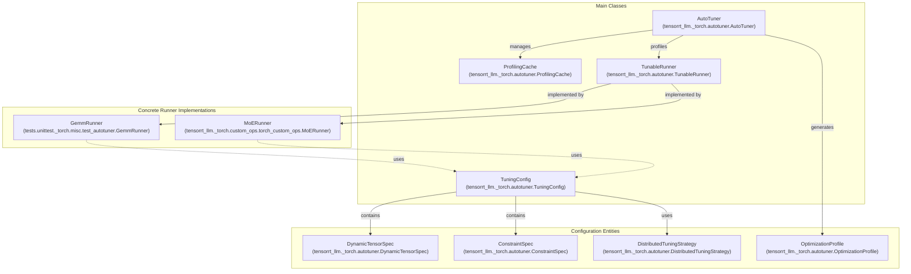
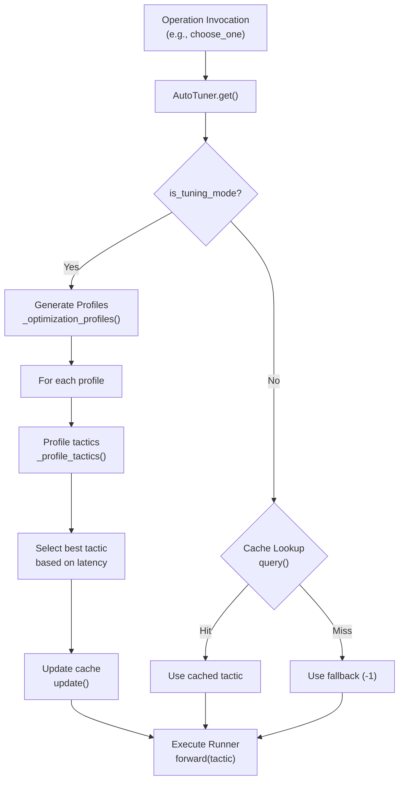
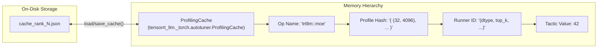

<!-- source: DeepWiki mcp.deepwiki.com · repo NVIDIA/TensorRT-LLM · page 13.1 AutoTuner Architecture · fetched 2026-10-26 -->

# AutoTuner Architecture

<details>
<summary>Relevant source files</summary>

The following files were used as context for generating this wiki page:

- [cpp/tensorrt_llm/kernels/CMakeLists.txt](cpp/tensorrt_llm/kernels/CMakeLists.txt)
- [cpp/tensorrt_llm/kernels/userbuffers/CMakeLists.txt](cpp/tensorrt_llm/kernels/userbuffers/CMakeLists.txt)
- [cpp/tensorrt_llm/thop/CMakeLists.txt](cpp/tensorrt_llm/thop/CMakeLists.txt)
- [examples/layer_wise_benchmarks/README.md](examples/layer_wise_benchmarks/README.md)
- [examples/layer_wise_benchmarks/mpi_launch.sh](examples/layer_wise_benchmarks/mpi_launch.sh)
- [examples/layer_wise_benchmarks/parse.py](examples/layer_wise_benchmarks/parse.py)
- [examples/layer_wise_benchmarks/run.py](examples/layer_wise_benchmarks/run.py)
- [examples/layer_wise_benchmarks/run.sh](examples/layer_wise_benchmarks/run.sh)
- [examples/layer_wise_benchmarks/slurm_init_containers.sh](examples/layer_wise_benchmarks/slurm_init_containers.sh)
- [examples/layer_wise_benchmarks/slurm_launch.sh](examples/layer_wise_benchmarks/slurm_launch.sh)
- [examples/layer_wise_benchmarks/slurm_query_container_name.sh](examples/layer_wise_benchmarks/slurm_query_container_name.sh)
- [tensorrt_llm/_torch/autotuner.py](tensorrt_llm/_torch/autotuner.py)
- [tensorrt_llm/_torch/custom_ops/cpp_custom_ops.py](tensorrt_llm/_torch/custom_ops/cpp_custom_ops.py)
- [tensorrt_llm/_torch/custom_ops/torch_custom_ops.py](tensorrt_llm/_torch/custom_ops/torch_custom_ops.py)
- [tensorrt_llm/_torch/custom_ops/trtllm_gen_custom_ops.py](tensorrt_llm/_torch/custom_ops/trtllm_gen_custom_ops.py)
- [tensorrt_llm/_torch/model_config.py](tensorrt_llm/_torch/model_config.py)
- [tensorrt_llm/_torch/modules/gated_mlp.py](tensorrt_llm/_torch/modules/gated_mlp.py)
- [tensorrt_llm/_torch/modules/linear.py](tensorrt_llm/_torch/modules/linear.py)
- [tensorrt_llm/_torch/modules/mlp.py](tensorrt_llm/_torch/modules/mlp.py)
- [tensorrt_llm/_torch/peft/lora/layer.py](tensorrt_llm/_torch/peft/lora/layer.py)
- [tensorrt_llm/_torch/utils.py](tensorrt_llm/_torch/utils.py)
- [tensorrt_llm/llmapi/llm_utils.py](tensorrt_llm/llmapi/llm_utils.py)
- [tensorrt_llm/models/modeling_utils.py](tensorrt_llm/models/modeling_utils.py)
- [tensorrt_llm/tools/layer_wise_benchmarks/__init__.py](tensorrt_llm/tools/layer_wise_benchmarks/__init__.py)
- [tensorrt_llm/tools/layer_wise_benchmarks/mark_utils.py](tensorrt_llm/tools/layer_wise_benchmarks/mark_utils.py)
- [tensorrt_llm/tools/layer_wise_benchmarks/runner.py](tensorrt_llm/tools/layer_wise_benchmarks/runner.py)
- [tests/unittest/_torch/misc/test_autotuner.py](tests/unittest/_torch/misc/test_autotuner.py)
- [tests/unittest/_torch/thop/parallel/test_dense_gemm_act_fusion.py](tests/unittest/_torch/thop/parallel/test_dense_gemm_act_fusion.py)
- [tests/unittest/tools/test_layer_wise_benchmarks.py](tests/unittest/tools/test_layer_wise_benchmarks.py)

</details>


## Purpose and Scope

The AutoTuner provides automatic kernel selection through runtime profiling to optimize performance across different input shapes and hardware configurations. When a CUDA operation has multiple implementation tactics (e.g., different CUTLASS kernels, algorithmic variants, or DeepGEMM backends), the AutoTuner profiles each tactic with representative inputs and caches the best choice for reuse during inference.

This document covers the AutoTuner's architecture, profiling workflow, caching mechanism, and integration patterns. It specifically details the Python-based tuning infrastructure and its connection to C++ kernel runners and the global timer profiling mechanism.

**Sources**: [tensorrt_llm/_torch/autotuner.py:1-140]()

---

## Core Components

The AutoTuner architecture consists of several key classes that work together to profile and select optimal kernel tactics:

### Natural Language to Code Entity Mapping: Core Classes
Title: AutoTuner Core Entity Relationship

**Sources**: [tensorrt_llm/_torch/autotuner.py:32-177](), [tensorrt_llm/_torch/autotuner.py:407-420](), [tests/unittest/_torch/misc/test_autotuner.py:121-135](), [tensorrt_llm/_torch/custom_ops/torch_custom_ops.py:67-171]()

**AutoTuner Singleton** [tensorrt_llm/_torch/autotuner.py:407-419]()

The `AutoTuner` class is a singleton accessed via `AutoTuner.get()`. It maintains:
- `profiling_cache`: Stores best tactics per operation and shape.
- `mapping`: Distributed topology information (rank, TP/PP size).
- `is_tuning_mode`: Flag to enable/disable profiling.
- `statistics`: Tracks cache hits/misses and profiling attempts via `AutoTunerStatistics`.

Key methods:
- `choose_one(op_name, runners, tuning_config, inputs, **kwargs)`: Selects best runner and tactic [tensorrt_llm/_torch/autotuner.py:421-526]().
- `_optimization_profiles(tuning_config, inputs)`: Generates shape profiles to test based on `DynamicTensorSpec` [tensorrt_llm/_torch/autotuner.py:738-826]().
- `_profile_tactics(runner, profile, inputs, **kwargs)`: Measures tactic performance [tensorrt_llm/_torch/autotuner.py:828-1004]().

**TunableRunner Abstract Base** [tensorrt_llm/_torch/autotuner.py:190-205]()

Operations needing auto-tuning implement `TunableRunner`:

| Method | Purpose | Return Type |
|--------|---------|-------------|
| `get_valid_tactics(inputs, profile, **kwargs)` | Returns available tactics for given shape | `List[Any]` |
| `forward(inputs, tactic=-1, **kwargs)` | Executes operation with specified tactic | `Any` |

Tactics can be any serializable type (typically `int`), with `-1` representing a fallback implementation.

**Sources**: [tensorrt_llm/_torch/autotuner.py:190-254](), [tensorrt_llm/_torch/autotuner.py:407-526]()

---

## Kernel Profiling Workflow

The AutoTuner follows a multi-stage process to select optimal kernels:

Title: AutoTuner Execution Flow


**Profile Generation** [tensorrt_llm/_torch/autotuner.py:738-826]()

`_optimization_profiles()` creates test configurations from `DynamicTensorSpec`:

```python
# Example configuration for a GEMM operation
tuning_config = TuningConfig(
    dynamic_tensor_specs=(DynamicTensorSpec(
        input_idx=0,
        dim_idx=0,
        gen_tuning_buckets=get_power_of_2_num_tokens_buckets,
        map_to_tuning_buckets=next_positive_power_of_2), ),
)
```
[tests/unittest/_torch/misc/test_autotuner.py:143-147](), [tensorrt_llm/_torch/autotuner.py:78-135]()

**Tactic Profiling** [tensorrt_llm/_torch/autotuner.py:828-1004]()

For each profile:
1. Call `runner.get_valid_tactics()` to get candidate tactics.
2. Prepare inputs with correct shapes via `_prepare_profiling_inputs()`.
3. Warm up each tactic.
4. Profile with CUDA events or the **Global Timer Kernel**.
5. Record best latency per tactic.
6. Handle distributed coordination based on `DistributedTuningStrategy` [tensorrt_llm/_torch/autotuner.py:854-924]().

### Global Timer Kernel
For high-precision profiling, the AutoTuner uses `record_global_timer` [tensorrt_llm/_torch/autotuner.py:24](), which invokes the C++ binding to read the GPU `%globaltimer` register. This provides nanosecond-level timestamps for kernel execution. Additionally, `delay_kernel` [tensorrt_llm/_torch/autotuner.py:23]() is used in unit tests to simulate kernel latency for validating tuner selection logic [tests/unittest/_torch/misc/test_autotuner.py:87]().

**Sources**: [tensorrt_llm/_torch/autotuner.py:23-24](), [tensorrt_llm/_torch/autotuner.py:828-1004](), [tests/unittest/_torch/misc/test_autotuner.py:84-101]()

---

## Dynamic Shape Handling

The AutoTuner handles dynamic input shapes through bucketing and constraint specifications:

**DynamicTensorSpec** [tensorrt_llm/_torch/autotuner.py:48-61]()

Specifies how to vary tensor dimensions during tuning.
- `gen_tuning_buckets`: Function or tuple generating values to profile (e.g., powers of 2).
- `map_to_tuning_buckets`: Maps runtime value to nearest bucket for cache lookup (e.g., `next_positive_power_of_2`).

**ConstraintSpec** [tensorrt_llm/_torch/autotuner.py:64-74]()

Enforces shape relationships between tensors. This is critical for ops where secondary tensor shapes depend on primary inputs (e.g., weights depending on input hidden dimensions).

**OptimizationProfile** [tensorrt_llm/_torch/autotuner.py:164-181]()

Represents a shape configuration with `DynamicDim` (min/opt/max) or `StaticDim` (fixed value). The hash key for the cache uses only `opt` values via `get_opt_shapes()` [tensorrt_llm/_torch/autotuner.py:172-179]().

**Sources**: [tensorrt_llm/_torch/autotuner.py:48-181]()

---

## Profiling Cache System

The `ProfilingCache` persists profiling results to disk for reuse across runs.

Title: ProfilingCache Persistence Structure


**ProfilingCache** [tensorrt_llm/_torch/autotuner.py:344-404]()

Key methods:
- `query(op_name, profile_hash, runner_id)`: Retrieves cached tactic.
- `update(op_name, profile_hash, runner_id, tactic)`: Stores new result.
- `save_cache(path, rank)`: Writes to disk using `json.dump`.

**File Locking** [tensorrt_llm/_torch/autotuner.py:370-384]()

Uses `fcntl.flock()` to prevent race conditions when multiple processes access the same cache file during distributed execution.

**Sources**: [tensorrt_llm/_torch/autotuner.py:344-404]()

---

## trtllm_gen_custom_ops and MoE Profiling

The `trtllm_gen_custom_ops.py` file provides utilities to bridge model-level routing and kernel-level profiling, specifically for Mixture of Experts (MoE).

### Dummy Input Preparation
During profiling, the AutoTuner needs to simulate expert distributions. The `prepare_dummy_topk_and_hook` function [tensorrt_llm/_torch/custom_ops/trtllm_gen_custom_ops.py:83-136]() creates dummy routing logits and top-k tensors.

It uses an `inputs_pre_hook` [tensorrt_llm/_torch/custom_ops/trtllm_gen_custom_ops.py:120-132]() to dynamically adjust dummy tensor shapes whenever the AutoTuner changes the token count (m-dimension) during profiling. This ensures that the expert routing kernel doesn't need to be called repeatedly, while still providing valid expert indices to the MoE GEMM kernels.

### MoE Distribution Control
The module defines environment variables like `TRTLLM_GEN_MOE_AUTOTUNE_DUMMY_DISTRIBUTION` [tensorrt_llm/_torch/custom_ops/trtllm_gen_custom_ops.py:32-33]() to control the dummy top-k distribution:
- **balanced**: Mimics load-balanced Attention DP + MoE EP [tensorrt_llm/_torch/custom_ops/trtllm_gen_custom_ops.py:66]().
- **random**: Standard random expert selection [tensorrt_llm/_torch/custom_ops/trtllm_gen_custom_ops.py:67]().

### C++ Kernel Integration
The MoE system uses a specialized `FusedMoeRunner` in C++ which is exposed to Python via `torch.classes.trtllm.FusedMoeRunner` [tensorrt_llm/_torch/custom_ops/torch_custom_ops.py:141-145](). The Python `MoERunner` maintains a `runner_dict` to avoid the overhead of re-creating runners during the forward pass [tensorrt_llm/_torch/custom_ops/torch_custom_ops.py:68-69]().

The AutoTuner selects tactics based on the `gemm_idx` provided to `get_valid_tactics` [tensorrt_llm/_torch/custom_ops/torch_custom_ops.py:148-150]().

**Sources**: [tensorrt_llm/_torch/custom_ops/trtllm_gen_custom_ops.py:32-136](), [tensorrt_llm/_torch/custom_ops/torch_custom_ops.py:67-171](), [cpp/tensorrt_llm/thop/CMakeLists.txt:99-101]()

---

## Distributed Tuning Strategies

The `DistributedTuningStrategy` [tensorrt_llm/_torch/autotuner.py:32-44]() defines how ranks coordinate:

| Strategy | Behavior | Use Case |
|----------|----------|----------|
| `INDEPENDENT` | Each rank profiles separately | Default for non-communication ops. |
| `BROADCAST` | Rank 0 profiles, broadcasts to others | Ops with identical work per rank. |
| `MERGE` | All ranks profile, consensus via merge | Communication-heavy ops requiring global sync. |
| `PARALLEL` | Ranks profile disjoint tactic subsets | Large tactic spaces where profiling all on one rank is slow. |

**Sources**: [tensorrt_llm/_torch/autotuner.py:32-44]()

---

## Usage Patterns

### Context Manager API
The `autotune()` context manager [tensorrt_llm/_torch/autotuner.py:256-296]() enables profiling:

```python
from tensorrt_llm._torch.autotuner import autotune

with autotune(tune_mode=True, cache_path="my_cache.json"):
    # Operations called here will trigger profiling if not cached
    output = model(input_tensor)
```

### Statistics and Debugging
The `AutoTunerStatistics` [tensorrt_llm/_torch/autotuner.py:298-342]() class tracks:
- `cache_misses`: Count of tactics not found in cache.
- `tuned_op_time_cost`: Latency spent on profiling per operation.
- `failed_profiling_count`: Number of profiling attempts that crashed.

**Sources**: [tensorrt_llm/_torch/autotuner.py:256-342]()

---

