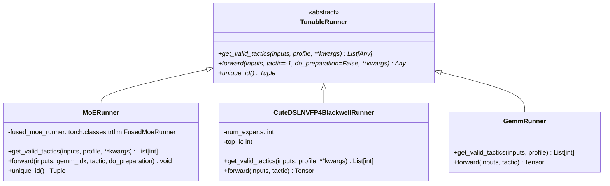
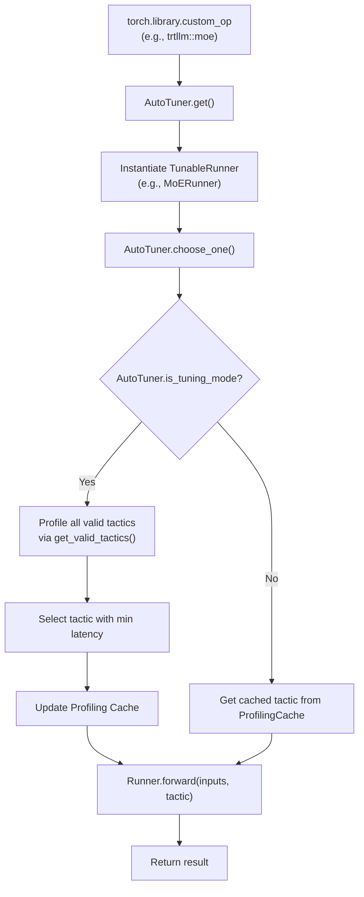
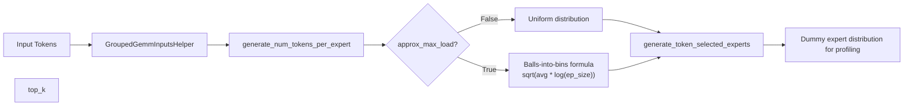

<!-- source: DeepWiki mcp.deepwiki.com · repo NVIDIA/TensorRT-LLM · page 13.2 Custom Op Integration and Tunable Runners · fetched 2026-10-26 -->

# Custom Op Integration and Tunable Runners

Relevant source files

The following files were used as context for generating this wiki page:

- [cpp/tensorrt_llm/kernels/CMakeLists.txt](cpp/tensorrt_llm/kernels/CMakeLists.txt)
- [cpp/tensorrt_llm/kernels/IndexerTopK.h](cpp/tensorrt_llm/kernels/IndexerTopK.h)
- [cpp/tensorrt_llm/kernels/heuristicTopKDecode.cu](cpp/tensorrt_llm/kernels/heuristicTopKDecode.cu)
- [cpp/tensorrt_llm/kernels/heuristicTopKDecode.h](cpp/tensorrt_llm/kernels/heuristicTopKDecode.h)
- [cpp/tensorrt_llm/kernels/heuristic_topk.cuh](cpp/tensorrt_llm/kernels/heuristic_topk.cuh)
- [cpp/tensorrt_llm/kernels/indexerTopK.cu](cpp/tensorrt_llm/kernels/indexerTopK.cu)
- [cpp/tensorrt_llm/kernels/userbuffers/CMakeLists.txt](cpp/tensorrt_llm/kernels/userbuffers/CMakeLists.txt)
- [cpp/tensorrt_llm/thop/CMakeLists.txt](cpp/tensorrt_llm/thop/CMakeLists.txt)
- [cpp/tensorrt_llm/thop/IndexerTopKOp.cpp](cpp/tensorrt_llm/thop/IndexerTopKOp.cpp)
- [tensorrt_llm/_torch/autotuner.py](tensorrt_llm/_torch/autotuner.py)
- [tensorrt_llm/_torch/custom_ops/cpp_custom_ops.py](tensorrt_llm/_torch/custom_ops/cpp_custom_ops.py)
- [tensorrt_llm/_torch/custom_ops/cute_dsl_custom_ops.py](tensorrt_llm/_torch/custom_ops/cute_dsl_custom_ops.py)
- [tensorrt_llm/_torch/custom_ops/torch_custom_ops.py](tensorrt_llm/_torch/custom_ops/torch_custom_ops.py)
- [tensorrt_llm/_torch/custom_ops/trtllm_gen_custom_ops.py](tensorrt_llm/_torch/custom_ops/trtllm_gen_custom_ops.py)
- [tensorrt_llm/_torch/cute_dsl_kernels/blackwell/blockscaled_contiguous_gather_grouped_gemm_act_fusion.py](tensorrt_llm/_torch/cute_dsl_kernels/blackwell/blockscaled_contiguous_gather_grouped_gemm_act_fusion.py)
- [tensorrt_llm/_torch/cute_dsl_kernels/blackwell/blockscaled_contiguous_grouped_gemm.py](tensorrt_llm/_torch/cute_dsl_kernels/blackwell/blockscaled_contiguous_grouped_gemm.py)
- [tensorrt_llm/_torch/cute_dsl_kernels/blackwell/blockscaled_contiguous_grouped_gemm_finalize_fusion.py](tensorrt_llm/_torch/cute_dsl_kernels/blackwell/blockscaled_contiguous_grouped_gemm_finalize_fusion.py)
- [tensorrt_llm/_torch/cute_dsl_kernels/blackwell/blockscaled_contiguous_grouped_gemm_swiglu_fusion.py](tensorrt_llm/_torch/cute_dsl_kernels/blackwell/blockscaled_contiguous_grouped_gemm_swiglu_fusion.py)
- [tensorrt_llm/_torch/cute_dsl_kernels/blackwell/dense_blockscaled_gemm_persistent.py](tensorrt_llm/_torch/cute_dsl_kernels/blackwell/dense_blockscaled_gemm_persistent.py)
- [tensorrt_llm/_torch/cute_dsl_kernels/blackwell/moe_as_dense_gemm/__init__.py](tensorrt_llm/_torch/cute_dsl_kernels/blackwell/moe_as_dense_gemm/__init__.py)
- [tensorrt_llm/_torch/cute_dsl_kernels/blackwell/moe_as_dense_gemm/fc1.py](tensorrt_llm/_torch/cute_dsl_kernels/blackwell/moe_as_dense_gemm/fc1.py)
- [tensorrt_llm/_torch/cute_dsl_kernels/blackwell/moe_as_dense_gemm/fc2.py](tensorrt_llm/_torch/cute_dsl_kernels/blackwell/moe_as_dense_gemm/fc2.py)
- [tensorrt_llm/_torch/cute_dsl_kernels/blackwell/top_k/block_scan.py](tensorrt_llm/_torch/cute_dsl_kernels/blackwell/top_k/block_scan.py)
- [tensorrt_llm/_torch/cute_dsl_kernels/blackwell/top_k/filtered_top_k_decode_varlen.py](tensorrt_llm/_torch/cute_dsl_kernels/blackwell/top_k/filtered_top_k_decode_varlen.py)
- [tensorrt_llm/_torch/cute_dsl_kernels/blackwell/top_k/filtered_top_k_prefill_varlen.py](tensorrt_llm/_torch/cute_dsl_kernels/blackwell/top_k/filtered_top_k_prefill_varlen.py)
- [tensorrt_llm/_torch/cute_dsl_kernels/blackwell/top_k/filtered_top_k_varlen_util.py](tensorrt_llm/_torch/cute_dsl_kernels/blackwell/top_k/filtered_top_k_varlen_util.py)
- [tensorrt_llm/_torch/cute_dsl_kernels/blackwell/top_k/single_pass_multi_cta_radix_topk.py](tensorrt_llm/_torch/cute_dsl_kernels/blackwell/top_k/single_pass_multi_cta_radix_topk.py)
- [tensorrt_llm/_torch/cute_dsl_kernels/blackwell/top_k/single_pass_multi_cta_radix_topk_cluster.py](tensorrt_llm/_torch/cute_dsl_kernels/blackwell/top_k/single_pass_multi_cta_radix_topk_cluster.py)
- [tensorrt_llm/_torch/cute_dsl_kernels/blackwell/utils.py](tensorrt_llm/_torch/cute_dsl_kernels/blackwell/utils.py)
- [tensorrt_llm/_torch/model_config.py](tensorrt_llm/_torch/model_config.py)
- [tensorrt_llm/_torch/modules/gated_mlp.py](tensorrt_llm/_torch/modules/gated_mlp.py)
- [tensorrt_llm/_torch/modules/linear.py](tensorrt_llm/_torch/modules/linear.py)
- [tensorrt_llm/_torch/modules/mlp.py](tensorrt_llm/_torch/modules/mlp.py)
- [tensorrt_llm/_torch/peft/lora/layer.py](tensorrt_llm/_torch/peft/lora/layer.py)
- [tensorrt_llm/_torch/utils.py](tensorrt_llm/_torch/utils.py)
- [tensorrt_llm/llmapi/llm_utils.py](tensorrt_llm/llmapi/llm_utils.py)
- [tensorrt_llm/models/modeling_utils.py](tensorrt_llm/models/modeling_utils.py)
- [tests/scripts/cute_dsl_kernels/moe_as_dense_gemm/run_moe_as_dense_gemm_fc2.py](tests/scripts/cute_dsl_kernels/moe_as_dense_gemm/run_moe_as_dense_gemm_fc2.py)
- [tests/scripts/cute_dsl_kernels/run_blockscaled_contiguous_gather_grouped_gemm_act_fusion.py](tests/scripts/cute_dsl_kernels/run_blockscaled_contiguous_gather_grouped_gemm_act_fusion.py)
- [tests/scripts/cute_dsl_kernels/run_blockscaled_contiguous_grouped_gemm.py](tests/scripts/cute_dsl_kernels/run_blockscaled_contiguous_grouped_gemm.py)
- [tests/scripts/cute_dsl_kernels/run_blockscaled_contiguous_grouped_gemm_finalize_fusion.py](tests/scripts/cute_dsl_kernels/run_blockscaled_contiguous_grouped_gemm_finalize_fusion.py)
- [tests/scripts/cute_dsl_kernels/run_blockscaled_contiguous_grouped_gemm_swiglu_fusion.py](tests/scripts/cute_dsl_kernels/run_blockscaled_contiguous_grouped_gemm_swiglu_fusion.py)
- [tests/scripts/cute_dsl_kernels/run_dense_blockscaled_gemm_persistent.py](tests/scripts/cute_dsl_kernels/run_dense_blockscaled_gemm_persistent.py)
- [tests/scripts/cute_dsl_kernels/testing.py](tests/scripts/cute_dsl_kernels/testing.py)
- [tests/unittest/_torch/misc/test_autotuner.py](tests/unittest/_torch/misc/test_autotuner.py)
- [tests/unittest/_torch/thop/parallel/test_cute_dsl_moe.py](tests/unittest/_torch/thop/parallel/test_cute_dsl_moe.py)
- [tests/unittest/_torch/thop/parallel/test_dense_gemm_act_fusion.py](tests/unittest/_torch/thop/parallel/test_dense_gemm_act_fusion.py)
- [tests/unittest/_torch/thop/parallel/test_fp4_linear.py](tests/unittest/_torch/thop/parallel/test_fp4_linear.py)
- [tests/unittest/_torch/thop/parallel/test_indexer_topk.py](tests/unittest/_torch/thop/parallel/test_indexer_topk.py)

## Overview

This document describes the integration pattern for custom CUDA operations with TensorRT-LLM's autotuning system. The **TunableRunner** interface allows kernel implementations to expose multiple tactics (algorithm variants) that can be profiled and automatically selected based on runtime input shapes and hardware characteristics.

This system bridges PyTorch custom operators with kernel-level optimization strategies, enabling automatic kernel selection across different hardware generations, quantization schemes, and input dimensions. The autotuner profiles available tactics during a warmup phase and caches the best choices for inference.

For information about the overall autotuning architecture and profiling cache, see [AutoTuner Architecture](13.1).

**Sources**: [tensorrt_llm/_torch/autotuner.py:186-255](), [tensorrt_llm/_torch/custom_ops/cpp_custom_ops.py:14-174]()

---

## TunableRunner Interface

The `TunableRunner` abstract base class defines the contract that all tunable kernel implementations must follow. It provides three key responsibilities: tactic enumeration, kernel execution, and unique identification for caching.

### Class Hierarchy and Code Entities

The following diagram maps the high-level interface to concrete implementations found in the codebase, including the specialized Blackwell and MoE runners.

Title: TunableRunner Class Hierarchy and Code Entities

**Sources**: [tensorrt_llm/_torch/autotuner.py:190-255](), [tensorrt_llm/_torch/custom_ops/cute_dsl_custom_ops.py:16-19](), [tensorrt_llm/_torch/custom_ops/torch_custom_ops.py:67-145]()

### Key Methods

**`get_valid_tactics(inputs, profile, **kwargs) -> List[Any]`**

Returns a list of valid tactics for the given input tensors and optimization profile. In the autotuning loop, this is called to identify the search space for a specific operator configuration. For the `MoERunner`, this queries the underlying `FusedMoeRunner` C++ class for the number of tactics available for a specific GEMM index [tensorrt_llm/_torch/custom_ops/torch_custom_ops.py:148-150]().

**Sources**: [tensorrt_llm/_torch/autotuner.py:193-211](), [tensorrt_llm/_torch/custom_ops/torch_custom_ops.py:148-150]()

**`forward(inputs, tactic=-1, do_preparation=False, **kwargs) -> Any`**

Executes the kernel with the specified tactic. The `do_preparation` flag enables one-time setup operations (excluded from profiling measurements) before tactic evaluation begins. For `MoERunner`, this involves unpacking expert weights and biases before calling the `fused_moe_runner` [tensorrt_llm/_torch/custom_ops/torch_custom_ops.py:173-185]().

**Sources**: [tensorrt_llm/_torch/autotuner.py:217-243](), [tensorrt_llm/_torch/custom_ops/torch_custom_ops.py:173-185]()

**`unique_id() -> Tuple`**

Returns a tuple identifying the runner configuration for cache key generation. This typically includes kernel parameters like data types, shapes, and architectural constraints. `MoERunner` includes parameters like `top_k`, `tp_size`, `ep_size`, and quantization flags [tensorrt_llm/_torch/custom_ops/torch_custom_ops.py:152-171]().

**Sources**: [tensorrt_llm/_torch/autotuner.py:245-254](), [tensorrt_llm/_torch/custom_ops/torch_custom_ops.py:152-171]()

---

## Custom Op Integration Pattern

The integration pattern connects PyTorch custom operators with the autotuning system. Each custom op follows a standard pattern: runner instantiation, tuner invocation, and tactic selection.

Title: Custom Op Tuning Data Flow and Tactic Selection

**Sources**: [tensorrt_llm/_torch/autotuner.py:542-656](), [tensorrt_llm/_torch/custom_ops/torch_custom_ops.py:173-200]()

### TuningConfig and Dynamic Tensors

Each custom op defines a `TuningConfig` that controls how the autotuner generates optimization profiles for different input shapes.

*   **DynamicTensorSpec**: Defines which input dimensions are dynamic and how to generate tuning buckets. For MoE, this often uses `get_last_power_of_2_num_tokens_buckets` [tensorrt_llm/_torch/custom_ops/torch_custom_ops.py:83-85]().
*   **map_to_tuning_buckets**: A function to map runtime dimensions to tuning buckets. This allows the system to use a single cached tactic for a range of input sizes [tensorrt_llm/_torch/autotuner.py:56-61]().

**Sources**: [tensorrt_llm/_torch/autotuner.py:77-135](), [tensorrt_llm/_torch/custom_ops/torch_custom_ops.py:82-88]()

---

## Specialized Custom Ops

### MoE and Blackwell Optimization
The system provides specialized runners for Mixture of Experts (MoE) and Blackwell architecture (SM100). For Blackwell, specialized runners using `CuteDSL` (CUTLASS DSL) are provided for FP4 block-scaled GEMMs.

The `GroupedGemmInputsHelper` assists in preparing inputs for these grouped kernels, including generating tuning buckets and inferring token counts from padded shapes [tensorrt_llm/_torch/custom_ops/cute_dsl_custom_ops.py:43-52](). It includes logic for calculating `max_num_tiles` and mapping input shapes to tuning buckets using power-of-2 logic [tensorrt_llm/_torch/custom_ops/cute_dsl_custom_ops.py:70-97]().

For Blackwell (SM100), `blockscaled_contiguous_grouped_gemm_finalize_fusion.py` implements high-performance persistent GEMMs utilizing TMA and `tcgen05.mma` instructions [tensorrt_llm/_torch/cute_dsl_kernels/blackwell/blockscaled_contiguous_grouped_gemm_finalize_fusion.py:51-98]().

| Class Name | Feature | Hardware |
|------------|---------|----------|
| `MoERunner` | Fused MoE GEMMs | SM80+ |
| `CuteDSLNVFP4BlackwellRunner` | FP4 block-scaled GEMM | SM100+ |

**Sources**: [tensorrt_llm/_torch/custom_ops/cute_dsl_custom_ops.py:43-159](), [tensorrt_llm/_torch/custom_ops/torch_custom_ops.py:67-145](), [tensorrt_llm/_torch/cute_dsl_kernels/blackwell/blockscaled_contiguous_grouped_gemm_finalize_fusion.py:1-140]()

### C++ Custom Ops
TensorRT-LLM registers a wide variety of C++ backed ops via `torch.library`. These include:
- **Communication Ops**: `allreduce`, `allgather`, `mnnvl_fusion_allreduce`, `moe_allreduce`, and `minimax_allreduce_rms` [tensorrt_llm/_torch/custom_ops/cpp_custom_ops.py:16-138]().
- **Quantized GEMMs**: `cublas_scaled_mm`, `cutlass_scaled_mm`, `cuda_scaled_mm` [tensorrt_llm/_torch/custom_ops/cpp_custom_ops.py:155-174]().
- **DeepSeek V3/V4 Ops**: `deepseek_v4_q_norm` [tensorrt_llm/_torch/custom_ops/cpp_custom_ops.py:139-141](), and specialized kernels like `dsv3FusedAGemmOp.cpp`, `deepseekV4BlockTableOp.cpp`, and `dsv3RouterGemmOp.cpp` [cpp/tensorrt_llm/thop/CMakeLists.txt:71-120]().

The C++ implementations are organized in `cpp/tensorrt_llm/thop/` and include kernels for `attentionOp.cpp`, `moeOp.cpp`, `allreduceOp.cpp`, and specialized quantization kernels [cpp/tensorrt_llm/thop/CMakeLists.txt:40-137]().

**Sources**: [tensorrt_llm/_torch/custom_ops/cpp_custom_ops.py:16-186](), [cpp/tensorrt_llm/thop/CMakeLists.txt:40-137]()

### FlashInfer Custom Ops
FlashInfer integration provides optimized kernels for sampling and attention. The `flashinfer_utils.py` file exposes these via `torch.library` bindings, including `flashinfer_top_k_top_p_sampling` and `flashinfer_min_p_sampling`. These are used by the `Sampler` to accelerate token generation [tensorrt_llm/_torch/flashinfer_utils.py:1-27]().

**Sources**: [tensorrt_llm/_torch/flashinfer_utils.py:1-27]()

---

## MoE Autotuning Dummy Distribution

For MoE operations, the autotuner needs to simulate expert distributions to profile kernels accurately. This is controlled via the `GroupedGemmInputsHelper` which prepares inputs for tuning [tensorrt_llm/_torch/custom_ops/cute_dsl_custom_ops.py:43-52]().

The `generate_num_tokens_per_expert` function simulates load balancing across experts using either an approximate max load strategy (based on the balls-into-bins problem) or a uniform distribution [tensorrt_llm/_torch/custom_ops/cute_dsl_custom_ops.py:110-137]().

Title: MoE Dummy Distribution Logic

**Sources**: [tensorrt_llm/_torch/custom_ops/cute_dsl_custom_ops.py:110-166]()

---

## Advanced Autotuning Features

### Distributed Tuning Strategy
The system supports multiple strategies for multi-GPU environments via the `DistributedTuningStrategy` enum:
- `BROADCAST`: Rank 0 tunes and shares results.
- `INDEPENDENT`: Every rank profiles separately.
- `MERGE`: All ranks participate and reach a merged consensus.
- `PARALLEL`: Ranks profile different subsets of tactics to speed up tuning [tensorrt_llm/_torch/autotuner.py:32-44]().

**Sources**: [tensorrt_llm/_torch/autotuner.py:32-44]()

### MNNVL and Multi-Device Communication
The `mnnvl_fusion_allreduce` op supports advanced NVLink-based collective communication with fusion options for `RESIDUAL_RMS_NORM` and quantization to `FP8` or `NVFP4` [tensorrt_llm/_torch/custom_ops/cpp_custom_ops.py:122-159](). The `MHC` (Multi-Head Hyper-Connection) module also utilizes specialized kernels like `mhcOp.cpp` for advanced residual stream mixing [cpp/tensorrt_llm/thop/CMakeLists.txt:139-140]().

**Sources**: [tensorrt_llm/_torch/custom_ops/cpp_custom_ops.py:122-159](), [cpp/tensorrt_llm/thop/CMakeLists.txt:139-140]()

---

