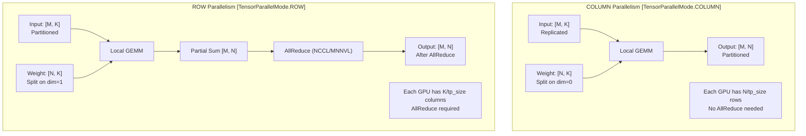
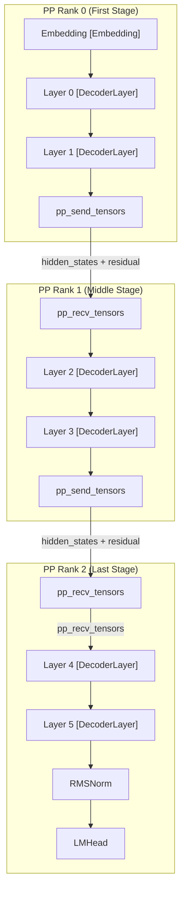
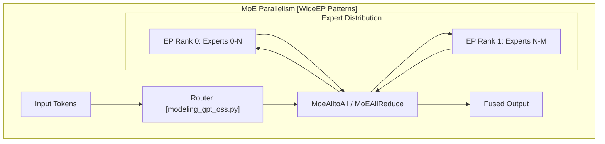
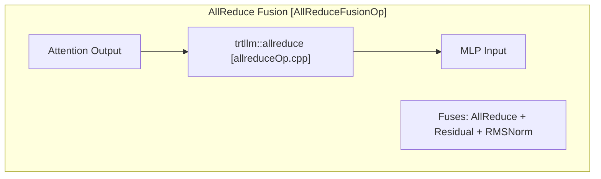
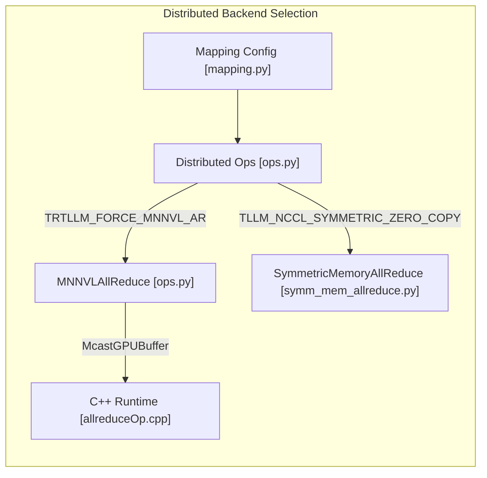

<!-- source: DeepWiki mcp.deepwiki.com · repo NVIDIA/TensorRT-LLM · page 14 Distributed Execution Patterns · fetched 2026-10-26 -->

# Distributed Execution Patterns

Relevant source files

The following files were used as context for generating this wiki page:

- [cpp/include/tensorrt_llm/runtime/worldConfig.h](cpp/include/tensorrt_llm/runtime/worldConfig.h)
- [cpp/tensorrt_llm/common/lamportUtils.cuh](cpp/tensorrt_llm/common/lamportUtils.cuh)
- [cpp/tensorrt_llm/kernels/communicationKernels/customLowPrecisionAllReduceKernels.cu](cpp/tensorrt_llm/kernels/communicationKernels/customLowPrecisionAllReduceKernels.cu)
- [cpp/tensorrt_llm/kernels/communicationKernels/customLowPrecisionAllReduceKernels.h](cpp/tensorrt_llm/kernels/communicationKernels/customLowPrecisionAllReduceKernels.h)
- [cpp/tensorrt_llm/kernels/communicationKernels/mnnvlAllreduceKernels.cu](cpp/tensorrt_llm/kernels/communicationKernels/mnnvlAllreduceKernels.cu)
- [cpp/tensorrt_llm/kernels/communicationKernels/mnnvlAllreduceKernels.h](cpp/tensorrt_llm/kernels/communicationKernels/mnnvlAllreduceKernels.h)
- [cpp/tensorrt_llm/kernels/customAllReduceKernels.h](cpp/tensorrt_llm/kernels/customAllReduceKernels.h)
- [cpp/tensorrt_llm/runtime/worldConfig.cpp](cpp/tensorrt_llm/runtime/worldConfig.cpp)
- [cpp/tensorrt_llm/thop/allreduceOp.cpp](cpp/tensorrt_llm/thop/allreduceOp.cpp)
- [cpp/tensorrt_llm/thop/ncclCommunicatorOp.cpp](cpp/tensorrt_llm/thop/ncclCommunicatorOp.cpp)
- [cpp/tensorrt_llm/thop/ncclCommunicatorOp.h](cpp/tensorrt_llm/thop/ncclCommunicatorOp.h)
- [cpp/tensorrt_llm/thop/thUtils.h](cpp/tensorrt_llm/thop/thUtils.h)
- [cpp/tests/unit_tests/runtime/worldConfigTest.cpp](cpp/tests/unit_tests/runtime/worldConfigTest.cpp)
- [tensorrt_llm/_torch/compilation/backend.py](tensorrt_llm/_torch/compilation/backend.py)
- [tensorrt_llm/_torch/compilation/patterns/ar_residual_norm.py](tensorrt_llm/_torch/compilation/patterns/ar_residual_norm.py)
- [tensorrt_llm/_torch/compilation/piecewise_optimizer.py](tensorrt_llm/_torch/compilation/piecewise_optimizer.py)
- [tensorrt_llm/_torch/compilation/utils.py](tensorrt_llm/_torch/compilation/utils.py)
- [tensorrt_llm/_torch/device_mesh.py](tensorrt_llm/_torch/device_mesh.py)
- [tensorrt_llm/_torch/distributed/__init__.py](tensorrt_llm/_torch/distributed/__init__.py)
- [tensorrt_llm/_torch/distributed/communicator.py](tensorrt_llm/_torch/distributed/communicator.py)
- [tensorrt_llm/_torch/distributed/ops.py](tensorrt_llm/_torch/distributed/ops.py)
- [tensorrt_llm/_torch/pyexecutor/executor_request_queue.py](tensorrt_llm/_torch/pyexecutor/executor_request_queue.py)
- [tensorrt_llm/functional.py](tensorrt_llm/functional.py)
- [tensorrt_llm/mapping.py](tensorrt_llm/mapping.py)
- [tests/unittest/_torch/distributed/test_safe_mpi_comm.py](tests/unittest/_torch/distributed/test_safe_mpi_comm.py)
- [tests/unittest/_torch/executor/test_executor_request_queue.py](tests/unittest/_torch/executor/test_executor_request_queue.py)
- [tests/unittest/_torch/multi_gpu/test_allreduce.py](tests/unittest/_torch/multi_gpu/test_allreduce.py)
- [tests/unittest/_torch/multi_gpu/test_mnnvl_allreduce.py](tests/unittest/_torch/multi_gpu/test_mnnvl_allreduce.py)
- [tests/unittest/_torch/multi_gpu/test_user_buffers.py](tests/unittest/_torch/multi_gpu/test_user_buffers.py)
- [tests/unittest/_torch/multi_gpu_modeling/test_deepseek.py](tests/unittest/_torch/multi_gpu_modeling/test_deepseek.py)

This document describes the parallelism strategies used in TensorRT-LLM to distribute model execution across multiple GPUs. It covers tensor parallelism, pipeline parallelism, expert parallelism, context parallelism, and attention data parallelism. For information about the communication primitives used to implement these patterns, see the [Communication Operations and Backends](#14.5) child page.

## Overview of Parallelism Strategies

TensorRT-LLM supports six primary parallelism strategies that can be combined to scale LLM inference:

| Strategy | Abbreviation | What is Distributed | Primary Use Case |
|----------|--------------|---------------------|------------------|
| Tensor Parallelism | TP | Individual layer weights split across GPUs | Scale large models beyond single GPU memory |
| Pipeline Parallelism | PP | Different layers on different GPUs | Reduce per-GPU memory for very deep models |
| Expert Parallelism | EP | MoE experts distributed across GPUs | Scale MoE models with many experts |
| Context Parallelism | CP | Sequence dimension split across GPUs | Handle extremely long sequences |
| Attention Data Parallelism | ADP | Batch replicated, attention heads partitioned | Specialized optimization for attention |
| Distributed Weight Data Parallelism | DWDP | MoE expert weights offloaded to peer GPUs | P2P weight prefetch on GB200 NVL72 |

The `Mapping` class configures which parallelism strategies are active via `tp_size`, `pp_size`, `moe_ep_size`, `cp_size`, `enable_attention_dp`, and `dwdp_size` parameters.

**Sources:** [tensorrt_llm/mapping.py:36-62](), [tensorrt_llm/mapping.py:177-182]()

## Tensor Parallelism (TP)

Tensor parallelism splits individual weight matrices across multiple GPUs. For details, see [Tensor Parallelism](#14.1).

### TensorParallelMode: COLUMN and ROW

TensorRT-LLM implements two modes: `COLUMN` and `ROW`, defined in the `TensorParallelMode` enum [tensorrt_llm/_torch/modules/linear.py:87-90]().

Title: Tensor Parallel Data Flow

**Sources:** [tensorrt_llm/_torch/modules/linear.py:87-101](), [tensorrt_llm/_torch/modules/linear.py:168-182]()

## Pipeline Parallelism (PP)

Pipeline parallelism splits the model into stages, with each stage assigned to different PP ranks. For details, see [Pipeline Parallelism](#14.2).

Title: Pipeline Parallel Execution Flow

**Sources:** [tensorrt_llm/_torch/distributed/communicator.py:102-147](), [tensorrt_llm/_torch/compilation/utils.py:116-120]()

## Expert Parallelism (EP)

Expert parallelism distributes MoE experts across GPUs. For details, see [Expert Parallelism](#14.3).

The system supports specialized communication strategies for MoE. The `MoERunner` class facilitates distributed execution [tensorrt_llm/_torch/custom_ops/torch_custom_ops.py:67-88](), while communication patterns are managed via `MoEAllReduceParams` [tensorrt_llm/functional.py:174]() and `MoeAlltoAll` kernels [cpp/tensorrt_llm/thop/allreduceOp.cpp:31]().

Title: Expert Parallel Communication Pattern

**Sources:** [tensorrt_llm/_torch/custom_ops/torch_custom_ops.py:67-171](), [tensorrt_llm/functional.py:174](), [tensorrt_llm/_torch/distributed/ops.py:21](), [cpp/tensorrt_llm/thop/allreduceOp.cpp:31]()

## Context Parallelism (CP)

Context parallelism splits the sequence dimension across GPUs to handle long contexts. For details, see [Context Parallelism and Attention DP](#14.4).

Supported implementations include `Helix`, `Ulysses`, and `Ring` CP [tensorrt_llm/mapping.py:25-33](). Helix CP specifically utilizes `HelixCpMnnvlMemory` for efficient sequence partitioning across nodes [tensorrt_llm/_torch/distributed/ops.py:10]().

**Sources:** [tensorrt_llm/mapping.py:25-33](), [tensorrt_llm/_torch/distributed/ops.py:10]()

## Attention Data Parallelism (ADP)

Attention Data Parallelism replicates the batch dimension while partitioning attention heads. For details, see [Context Parallelism and Attention DP](#14.4).

When `enable_attention_dp` is active [tensorrt_llm/mapping.py:59](), the system partitions attention computation across ranks. This is often used in large MoE models like DeepSeek-V3 to balance the load when `tp_size > 1` [tests/unittest/_torch/multi_gpu_modeling/test_deepseek.py:53-54]().

**Sources:** [tensorrt_llm/mapping.py:59](), [tests/unittest/_torch/multi_gpu_modeling/test_deepseek.py:53-54]()

## Communication Operations and Backends

TensorRT-LLM abstracts communication backends, supporting NCCL, MNNVL (Multi-Node NVLink), and Symmetric Memory. For details, see [Communication Operations and Backends](#14.5).

### AllReduce Fusion

Fusion optimizations reduce communication overhead by combining AllReduce with subsequent operations. The `AllReduceFusionOp` [tensorrt_llm/functional.py:121]() enum specifies patterns such as `RESIDUAL_RMS_NORM_QUANT_FP8` [tensorrt_llm/functional.py:126](). These are handled by `CustomAllReduceHelper` and the `allreduceOp.cpp` thop wrapper [tensorrt_llm/_torch/distributed/ops.py:11-12](), [cpp/tensorrt_llm/thop/allreduceOp.cpp:28]().

Title: AllReduce Fusion Pattern

**Sources:** [cpp/tensorrt_llm/thop/allreduceOp.cpp:74-80](), [tensorrt_llm/functional.py:121-132](), [tensorrt_llm/_torch/distributed/ops.py:20-21]()

### MNNVL and Symmetric Memory

High-performance communication for Blackwell systems utilizes `MNNVL` [tensorrt_llm/_torch/distributed/ops.py:116](). The runtime manages these via `McastGPUBuffer` [tensorrt_llm/_torch/distributed/ops.py:144]() and Lamport-style synchronization buffers [tensorrt_llm/_torch/distributed/ops.py:93-151](). Symmetric memory optimizations are controlled via `TLLM_NCCL_SYMMETRIC_ZERO_COPY` [tensorrt_llm/_torch/distributed/ops.py:30-31]().

Title: Code Entity Bridge: Communication Backends

**Sources:** [tensorrt_llm/_torch/distributed/ops.py:10-18](), [tensorrt_llm/_torch/distributed/ops.py:93-151](), [cpp/tensorrt_llm/thop/allreduceOp.cpp:22-34](), [tensorrt_llm/_torch/distributed/communicator.py:19-28]()

## Distributed Weight Data Parallelism (DWDP)

DWDP is a specialized parallelism strategy primarily for MoE models on high-bandwidth systems like GB200 NVL72. It offloads expert weights to peer GPUs, using P2P NVLink transfers to eliminate heavy collective synchronization during expert execution. For details, see [DWDP: Distributed Weight Data Parallelism](#14.6).

The system coordinates the layout via `dwdp_size` and `dwdp_rank` in `MappingBase` [tensorrt_llm/mapping.py:61-71](). This strategy allows decoupling the MoE EP layout from the physical weight distribution to support non-uniform expert partitioning, particularly when `dwdp_size > 1` [tensorrt_llm/mapping.py:95-103]().

**Sources:** [tensorrt_llm/mapping.py:61-71](), [tensorrt_llm/mapping.py:95-103]()

---

