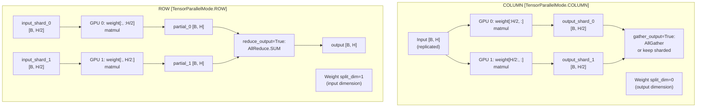
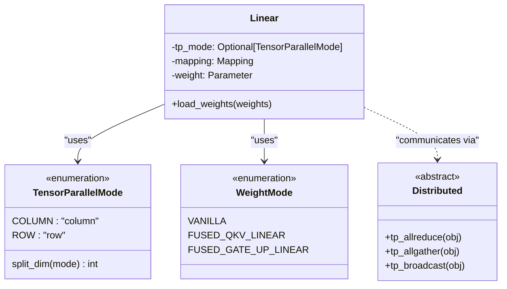
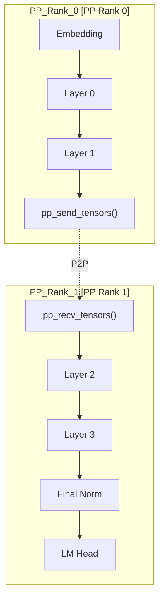
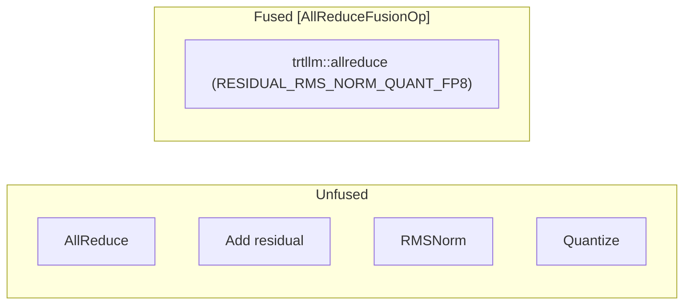

<!-- source: DeepWiki mcp.deepwiki.com · repo NVIDIA/TensorRT-LLM · page 14.1 Tensor Parallelism · fetched 2026-10-26 -->

# Tensor Parallelism

Relevant source files

The following files were used as context for generating this wiki page:

- [cpp/include/tensorrt_llm/runtime/worldConfig.h](cpp/include/tensorrt_llm/runtime/worldConfig.h)
- [cpp/tensorrt_llm/common/lamportUtils.cuh](cpp/tensorrt_llm/common/lamportUtils.cuh)
- [cpp/tensorrt_llm/kernels/communicationKernels/customLowPrecisionAllReduceKernels.cu](cpp/tensorrt_llm/kernels/communicationKernels/customLowPrecisionAllReduceKernels.cu)
- [cpp/tensorrt_llm/kernels/communicationKernels/customLowPrecisionAllReduceKernels.h](cpp/tensorrt_llm/kernels/communicationKernels/customLowPrecisionAllReduceKernels.h)
- [cpp/tensorrt_llm/kernels/communicationKernels/mnnvlAllreduceKernels.cu](cpp/tensorrt_llm/kernels/communicationKernels/mnnvlAllreduceKernels.cu)
- [cpp/tensorrt_llm/kernels/communicationKernels/mnnvlAllreduceKernels.h](cpp/tensorrt_llm/kernels/communicationKernels/mnnvlAllreduceKernels.h)
- [cpp/tensorrt_llm/kernels/customAllReduceKernels.h](cpp/tensorrt_llm/kernels/customAllReduceKernels.h)
- [cpp/tensorrt_llm/runtime/worldConfig.cpp](cpp/tensorrt_llm/runtime/worldConfig.cpp)
- [cpp/tensorrt_llm/thop/allreduceOp.cpp](cpp/tensorrt_llm/thop/allreduceOp.cpp)
- [cpp/tensorrt_llm/thop/ncclCommunicatorOp.cpp](cpp/tensorrt_llm/thop/ncclCommunicatorOp.cpp)
- [cpp/tensorrt_llm/thop/ncclCommunicatorOp.h](cpp/tensorrt_llm/thop/ncclCommunicatorOp.h)
- [cpp/tensorrt_llm/thop/thUtils.h](cpp/tensorrt_llm/thop/thUtils.h)
- [cpp/tests/unit_tests/runtime/worldConfigTest.cpp](cpp/tests/unit_tests/runtime/worldConfigTest.cpp)
- [tensorrt_llm/_torch/compilation/backend.py](tensorrt_llm/_torch/compilation/backend.py)
- [tensorrt_llm/_torch/compilation/patterns/ar_residual_norm.py](tensorrt_llm/_torch/compilation/patterns/ar_residual_norm.py)
- [tensorrt_llm/_torch/compilation/piecewise_optimizer.py](tensorrt_llm/_torch/compilation/piecewise_optimizer.py)
- [tensorrt_llm/_torch/compilation/utils.py](tensorrt_llm/_torch/compilation/utils.py)
- [tensorrt_llm/_torch/device_mesh.py](tensorrt_llm/_torch/device_mesh.py)
- [tensorrt_llm/_torch/distributed/__init__.py](tensorrt_llm/_torch/distributed/__init__.py)
- [tensorrt_llm/_torch/distributed/communicator.py](tensorrt_llm/_torch/distributed/communicator.py)
- [tensorrt_llm/_torch/distributed/ops.py](tensorrt_llm/_torch/distributed/ops.py)
- [tensorrt_llm/_torch/pyexecutor/executor_request_queue.py](tensorrt_llm/_torch/pyexecutor/executor_request_queue.py)
- [tensorrt_llm/functional.py](tensorrt_llm/functional.py)
- [tensorrt_llm/mapping.py](tensorrt_llm/mapping.py)
- [tests/unittest/_torch/distributed/test_safe_mpi_comm.py](tests/unittest/_torch/distributed/test_safe_mpi_comm.py)
- [tests/unittest/_torch/executor/test_executor_request_queue.py](tests/unittest/_torch/executor/test_executor_request_queue.py)
- [tests/unittest/_torch/multi_gpu/test_allreduce.py](tests/unittest/_torch/multi_gpu/test_allreduce.py)
- [tests/unittest/_torch/multi_gpu/test_mnnvl_allreduce.py](tests/unittest/_torch/multi_gpu/test_mnnvl_allreduce.py)
- [tests/unittest/_torch/multi_gpu/test_user_buffers.py](tests/unittest/_torch/multi_gpu/test_user_buffers.py)
- [tests/unittest/_torch/multi_gpu_modeling/test_deepseek.py](tests/unittest/_torch/multi_gpu_modeling/test_deepseek.py)

This page documents the tensor parallelism and pipeline parallelism strategies used to distribute model execution across multiple GPUs in TensorRT-LLM. For expert parallelism specific to MoE models, see [Expert Parallelism](14.3). For context parallelism that splits the sequence dimension, see [Context Parallelism](14.4).

## Overview

TensorRT-LLM supports two primary model parallelism strategies to scale LLM inference:

- **Tensor Parallelism (TP)**: Splits individual weight matrices across GPUs. This reduces memory footprint per GPU and parallelizes matrix multiplications within a single layer.
- **Pipeline Parallelism (PP)**: Distributes consecutive layers across GPUs in pipeline stages. This allows models that exceed the memory of a single GPU (or TP group) to be executed sequentially across stages.

Configuration is managed via the `Mapping` class and applied during model initialization. The `Mapping` class contains the logic for calculating group sizes and ranks [tensorrt_llm/mapping.py:43-182]().

**Key Components:**
- `TensorParallelMode` enum: Defines `COLUMN` and `ROW` sharding modes [tensorrt_llm/_torch/modules/linear.py:87-99]().
- `Mapping` class: Specifies `tp_size`, `pp_size`, `tp_rank`, `pp_rank` [tensorrt_llm/mapping.py:36-62]().
- `AllReduceFusionOp`: High-level communication primitives for result synchronization and fusion [tensorrt_llm/functional.py:121-132]().
- `Distributed` abstract class: Provides a unified interface for TP/PP/CP communication operations [tensorrt_llm/_torch/distributed/communicator.py:76-234]().

Sources: [tensorrt_llm/_torch/modules/linear.py:87-99](), [tensorrt_llm/mapping.py:36-182](), [tensorrt_llm/_torch/distributed/communicator.py:76-234](), [tensorrt_llm/functional.py:121-132]()

## Tensor Parallelism

### Splitting Strategies

Tensor parallelism partitions weight matrices across GPUs for parallel computation. TensorRT-LLM implements two complementary modes via the `TensorParallelMode` enum [tensorrt_llm/_torch/modules/linear.py:87-99]():

**Diagram: TensorParallelMode.COLUMN vs TensorParallelMode.ROW**

**COLUMN Mode** (split output dimension):
- Weight split: `split_dim = 0` [tensorrt_llm/_torch/modules/linear.py:93-93]().
- Input is replicated across all TP ranks.
- Each rank computes a shard of the output.
- Typically used by: `qkv_proj`, `gate_up_proj`.

**ROW Mode** (split input dimension):
- Weight split: `split_dim = 1` [tensorrt_llm/_torch/modules/linear.py:93-93]().
- Input is already sharded from a preceding COLUMN layer.
- Each rank computes a partial sum.
- Typically used by: `o_proj`, `down_proj`.

Sources: [tensorrt_llm/_torch/modules/linear.py:87-101]()

### Linear Layer Implementation

The `Linear` class in `tensorrt_llm._torch.modules.linear` implements tensor parallelism through configurable modes and communication patterns.

**Diagram: Distributed Linear and Communication Entities**

Key logic in `Linear`:
- **Weight Sharding**: During weight loading, `Linear` extracts the relevant slice for the current rank using `load_weight_shard` [tensorrt_llm/_torch/modules/linear.py:120-182](). It calculates `slice_width` and `slice_start` based on `tensor_parallel_size` and `tensor_parallel_rank` [tensorrt_llm/_torch/modules/linear.py:177-178]().
- **Weight Modes**: Supports `VANILLA`, `FUSED_QKV_LINEAR`, and `FUSED_GATE_UP_LINEAR` modes via `WeightMode` enum [tensorrt_llm/_torch/modules/linear.py:38-53]().
- **AllGather**: The `allgather` operation is exposed via `tensorrt_llm._torch.distributed.ops` and utilized by `Distributed` implementations [tensorrt_llm/_torch/distributed/communicator.py:157-160]().

Sources: [tensorrt_llm/_torch/modules/linear.py:38-182](), [tensorrt_llm/_torch/distributed/communicator.py:157-160]()

## Pipeline Parallelism

### Layer Distribution Strategy

Pipeline parallelism distributes consecutive layers across GPUs. Each GPU (or TP group) acts as a "stage" in the pipeline.

**Diagram: Pipeline Parallelism Stage Distribution**

Layer assignment is determined by the `Mapping` configuration. The `Mapping` class tracks `pp_size`, `pp_rank`, and `pp_partition` [tensorrt_llm/mapping.py:43-182](). Communication between stages is handled by point-to-point primitives, often utilizing `safe_broadcast` or MPI-based transfers for large objects to avoid pickle overhead [tensorrt_llm/_torch/distributed/communicator.py:240-255]().

Sources: [tensorrt_llm/mapping.py:43-182](), [tensorrt_llm/_torch/distributed/communicator.py:240-255]()

## AllReduce Communication Patterns

To minimize communication overhead, TensorRT-LLM supports multiple strategies and fusion patterns.

### AllReduce Strategies
The `AllReduceStrategy` enum defines the available communication backends [tensorrt_llm/functional.py:108-119]():
- **NCCL**: Standard NCCL-based communication [tensorrt_llm/functional.py:109-109]().
- **NCCL_SYMMETRIC**: Optimized zero-copy NCCL using window buffers [tensorrt_llm/_torch/distributed/ops.py:30-31]().
- **Symmetric Memory (SYMM_MEM)**: Optimized for NVLink using `SymmetricMemoryAllReduce` [tensorrt_llm/_torch/distributed/symm_mem_allreduce.py:13-14]().
- **MNNVL**: Multi-Node NVLink specialized communication using `McastGPUBuffer` and `MNNVLAllReduce` workspaces [tensorrt_llm/_torch/distributed/ops.py:93-151]().
- **User Buffers (UB)**: High-performance communication using user-managed buffers via `CustomAllReduceHelper` [tensorrt_llm/_torch/distributed/ops.py:68-74]().

### AllReduce Fusion
TensorRT-LLM supports fusing `AllReduce` with subsequent operations to reduce kernel launch overhead and memory traffic. These operations are implemented as specialized CUDA kernels.

The `AllReduceFusionOp` enum defines these patterns [tensorrt_llm/functional.py:121-132]():

- **RESIDUAL_RMS_NORM**: Fuses AllReduce, residual addition, and RMSNorm [tensorrt_llm/functional.py:123-123]().
- **RESIDUAL_RMS_NORM_QUANT_FP8/NVFP4**: Adds quantization to the fusion, allowing the AllReduce result to be converted directly to low-precision formats like FP8 or NVFP4 [tensorrt_llm/functional.py:126-129](). The `AllReduceParams` class tracks these fusion settings [tensorrt_llm/functional.py:134-173]().

The C++ implementation of these fused operations is located in `cpp/tensorrt_llm/thop/allreduceOp.cpp` [cpp/tensorrt_llm/thop/allreduceOp.cpp:74-81]().

Sources: [tensorrt_llm/_torch/distributed/ops.py:93-151](), [tensorrt_llm/functional.py:108-132](), [tensorrt_llm/functional.py:134-173](), [cpp/tensorrt_llm/thop/allreduceOp.cpp:74-81]()

### Workspace Management
For custom AllReduce kernels, workspaces must be allocated. `get_allreduce_workspace` handles this using the `CustomAllReduceHelper` [tensorrt_llm/_torch/distributed/ops.py:61-74](). 

MNNVL workspaces are specifically managed to support scaling for different buffer sizes, utilizing `McastGPUBuffer` for shared memory access across ranks [tensorrt_llm/_torch/distributed/ops.py:93-151](). For low-precision operations, `allocate_low_presicion_allreduce_workspace` initializes dedicated buffers [tensorrt_llm/_torch/distributed/ops.py:77-91]().

Sources: [tensorrt_llm/_torch/distributed/ops.py:61-151]()

## Distributed Compilation and Piecewise Graphs

When using `torch.compile`, TensorRT-LLM utilizes a `Backend` that applies custom passes for distributed fusions [tensorrt_llm/_torch/compilation/backend.py:43-82](). 

### Piecewise CUDA Graph
To handle dynamic shapes in a distributed environment, the `piecewise_optimizer` splits the graph into segments at specific boundary operations like `attn_custom_op_inplace` [tensorrt_llm/_torch/compilation/piecewise_optimizer.py:23-34](). Each segment is wrapped in a `PiecewiseRunner` which can capture separate CUDA graphs for different token counts [tensorrt_llm/_torch/compilation/piecewise_optimizer.py:144-181]().

- **Multi-Stream Execution**: The optimizer can schedule segments across multiple CUDA streams using `multi_stream_schedule` [tensorrt_llm/_torch/compilation/piecewise_optimizer.py:103-106]().
- **Graph Pool Management**: To avoid memory fragmentation during capture, a `graph_pool_handle` is shared across runners [tensorrt_llm/_torch/compilation/piecewise_optimizer.py:122-136]().

Sources: [tensorrt_llm/_torch/compilation/backend.py:43-82](), [tensorrt_llm/_torch/compilation/piecewise_optimizer.py:23-181]()

---

