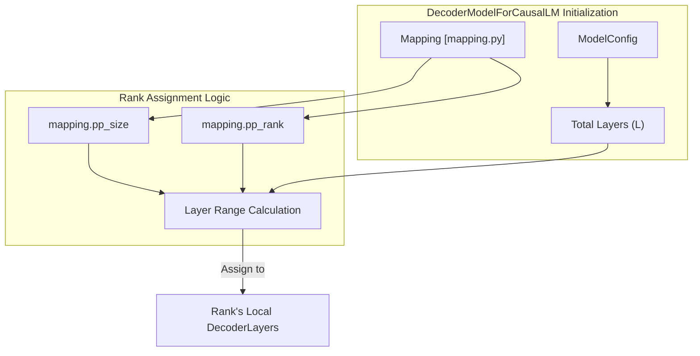
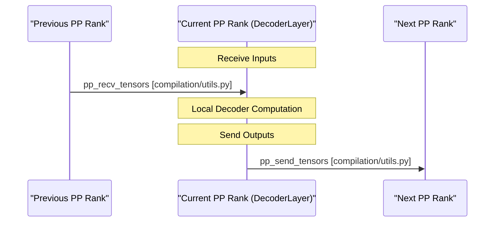
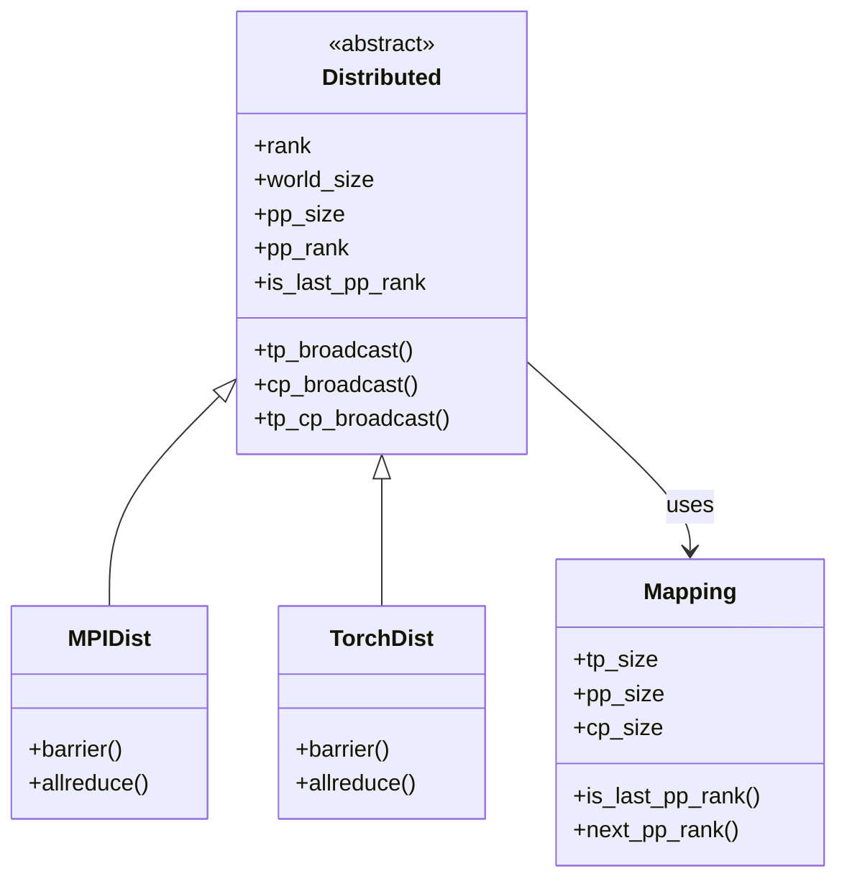

<!-- source: DeepWiki mcp.deepwiki.com · repo NVIDIA/TensorRT-LLM · page 14.2 Pipeline Parallelism · fetched 2026-10-26 -->

# Pipeline Parallelism

Relevant source files

The following files were used as context for generating this wiki page:

- [cpp/include/tensorrt_llm/runtime/worldConfig.h](cpp/include/tensorrt_llm/runtime/worldConfig.h)
- [cpp/tensorrt_llm/common/lamportUtils.cuh](cpp/tensorrt_llm/common/lamportUtils.cuh)
- [cpp/tensorrt_llm/kernels/communicationKernels/customLowPrecisionAllReduceKernels.cu](cpp/tensorrt_llm/kernels/communicationKernels/customLowPrecisionAllReduceKernels.cu)
- [cpp/tensorrt_llm/kernels/communicationKernels/customLowPrecisionAllReduceKernels.h](cpp/tensorrt_llm/kernels/communicationKernels/customLowPrecisionAllReduceKernels.h)
- [cpp/tensorrt_llm/kernels/communicationKernels/mnnvlAllreduceKernels.cu](cpp/tensorrt_llm/kernels/communicationKernels/mnnvlAllreduceKernels.cu)
- [cpp/tensorrt_llm/kernels/communicationKernels/mnnvlAllreduceKernels.h](cpp/tensorrt_llm/kernels/communicationKernels/mnnvlAllreduceKernels.h)
- [cpp/tensorrt_llm/kernels/customAllReduceKernels.h](cpp/tensorrt_llm/kernels/customAllReduceKernels.h)
- [cpp/tensorrt_llm/runtime/worldConfig.cpp](cpp/tensorrt_llm/runtime/worldConfig.cpp)
- [cpp/tensorrt_llm/thop/allreduceOp.cpp](cpp/tensorrt_llm/thop/allreduceOp.cpp)
- [cpp/tensorrt_llm/thop/ncclCommunicatorOp.cpp](cpp/tensorrt_llm/thop/ncclCommunicatorOp.cpp)
- [cpp/tensorrt_llm/thop/ncclCommunicatorOp.h](cpp/tensorrt_llm/thop/ncclCommunicatorOp.h)
- [cpp/tensorrt_llm/thop/thUtils.h](cpp/tensorrt_llm/thop/thUtils.h)
- [cpp/tests/unit_tests/runtime/worldConfigTest.cpp](cpp/tests/unit_tests/runtime/worldConfigTest.cpp)
- [tensorrt_llm/_torch/compilation/backend.py](tensorrt_llm/_torch/compilation/backend.py)
- [tensorrt_llm/_torch/compilation/patterns/ar_residual_norm.py](tensorrt_llm/_torch/compilation/patterns/ar_residual_norm.py)
- [tensorrt_llm/_torch/compilation/piecewise_optimizer.py](tensorrt_llm/_torch/compilation/piecewise_optimizer.py)
- [tensorrt_llm/_torch/compilation/utils.py](tensorrt_llm/_torch/compilation/utils.py)
- [tensorrt_llm/_torch/device_mesh.py](tensorrt_llm/_torch/device_mesh.py)
- [tensorrt_llm/_torch/distributed/__init__.py](tensorrt_llm/_torch/distributed/__init__.py)
- [tensorrt_llm/_torch/distributed/communicator.py](tensorrt_llm/_torch/distributed/communicator.py)
- [tensorrt_llm/_torch/distributed/ops.py](tensorrt_llm/_torch/distributed/ops.py)
- [tensorrt_llm/_torch/pyexecutor/executor_request_queue.py](tensorrt_llm/_torch/pyexecutor/executor_request_queue.py)
- [tensorrt_llm/functional.py](tensorrt_llm/functional.py)
- [tensorrt_llm/mapping.py](tensorrt_llm/mapping.py)
- [tests/unittest/_torch/distributed/test_safe_mpi_comm.py](tests/unittest/_torch/distributed/test_safe_mpi_comm.py)
- [tests/unittest/_torch/executor/test_executor_request_queue.py](tests/unittest/_torch/executor/test_executor_request_queue.py)
- [tests/unittest/_torch/multi_gpu/test_allreduce.py](tests/unittest/_torch/multi_gpu/test_allreduce.py)
- [tests/unittest/_torch/multi_gpu/test_mnnvl_allreduce.py](tests/unittest/_torch/multi_gpu/test_mnnvl_allreduce.py)
- [tests/unittest/_torch/multi_gpu/test_user_buffers.py](tests/unittest/_torch/multi_gpu/test_user_buffers.py)
- [tests/unittest/_torch/multi_gpu_modeling/test_deepseek.py](tests/unittest/_torch/multi_gpu_modeling/test_deepseek.py)

This document describes the Pipeline Parallelism (PP) implementation in TensorRT-LLM's PyTorch-based executor (`PyExecutor`) and the C++ runtime. Pipeline Parallelism distributes model layers across multiple GPUs to enable the execution of models that exceed the memory capacity of a single device. For information about Tensor Parallelism, see [14.1](). For Expert Parallelism in MoE models, see [14.3]().

## Overview

Pipeline Parallelism partitions the model's layers across multiple GPUs arranged in a linear pipeline. Each GPU (PP rank) owns a subset of consecutive layers. During inference, activations flow forward through the pipeline stages, and each stage processes its assigned layers before passing outputs to the next stage.

**Key characteristics:**
- **Memory Distribution:** Distributes the weight memory burden by splitting model layers across devices.
- **P2P Communication:** Employs point-to-point communication (`send`/`recv`) between adjacent PP ranks.
- **Coordination:** The `Mapping` abstraction provides properties to identify the rank's position in the pipeline, such as `is_last_pp_rank`, `is_first_pp_rank`, `next_pp_rank`, and `prev_pp_rank` [tensorrt_llm/mapping.py:130-147]().
- **Distributed Communicator:** The `Distributed` class in `communicator.py` provides the interface for PP-specific properties like `has_pp`, `pp_size`, and `pp_rank` [tensorrt_llm/_torch/distributed/communicator.py:102-128]().

Sources: [tensorrt_llm/mapping.py:130-147](), [tensorrt_llm/_torch/distributed/communicator.py:102-128]()

## Layer Distribution and Initialization

In `DecoderModelForCausalLM`, the model is initialized such that each rank only holds the layers assigned to its pipeline stage.

### PP Initialization in DecoderModel

The `DecoderModel` and its subclasses (like `LlamaForCausalLM` or `DeepSeekV3ForCausalLM`) use the `Mapping` object to determine layer ranges. During model construction, the `DecoderModel` iterates through the total number of layers and assigns a subset to the current rank based on `mapping.pp_size` and `mapping.pp_rank`.

**Figure 1: Pipeline Layer Distribution Logic**

The `MappingBase` class validates that the product of parallel dimensions equals the total world size: `tp_size * pp_size * cp_size == world_size` [tensorrt_llm/mapping.py:152-155](). This ensures consistent distribution of the model across the available hardware resources.

Sources: [tensorrt_llm/mapping.py:41-157](), [tensorrt_llm/_torch/distributed/communicator.py:102-147]()

## Communication Protocol

### Point-to-Point (P2P) Execution

Pipeline Parallelism utilizes point-to-point communication. In the PyTorch path, specialized ops are registered to handle tensor transfers between pipeline stages.

**Figure 2: Pipeline Data Flow in Forward Pass**

The `torch.ops.trtllm.pp_recv_tensors` and `torch.ops.trtllm.pp_send_tensors` operations are integrated into the compilation backend to facilitate these transfers [tensorrt_llm/_torch/compilation/utils.py:116-121](). These operations are treated as inplace-aware by the `PiecewiseRunner` and other optimization passes [tensorrt_llm/_torch/compilation/utils.py:116-121]().

Sources: [tensorrt_llm/_torch/compilation/utils.py:116-121](), [tensorrt_llm/_torch/distributed/communicator.py:76-157]()

## Interaction with Other Parallelism Strategies

Pipeline parallelism often intersects with Tensor Parallelism (TP) and Context Parallelism (CP). The `Distributed` class provides helper methods like `tp_cp_broadcast` and `tp_cp_allgather` to handle communication across these combined dimensions [tensorrt_llm/_torch/distributed/communicator.py:198-237]().

### Communication Group Coordination
The `Distributed` interface defines how objects are shared across different parallelism groups:
- `tp_broadcast`: Broadcast within the Tensor Parallel group [tensorrt_llm/_torch/distributed/communicator.py:191-192]().
- `cp_broadcast`: Broadcast within the Context Parallel group [tensorrt_llm/_torch/distributed/communicator.py:195-196]().
- `tp_cp_broadcast`: A composite operation that broadcasts across TP then CP groups [tensorrt_llm/_torch/distributed/communicator.py:198-208]().

**Figure 3: Distributed Communicator Entity Space**

### AllReduce and Pipeline Parallelism
While PP handles inter-stage communication, `AllReduce` operations (TP/CP) occur within each stage. The `get_allreduce_workspace` function manages memory for these operations, keyed by `mapping.pp_rank` to ensure that each pipeline stage has isolated workspace buffers [tensorrt_llm/_torch/distributed/ops.py:61-74](). This isolation is critical for preventing memory corruption during overlapping execution across the pipeline.

Sources: [tensorrt_llm/_torch/distributed/communicator.py:76-253](), [tensorrt_llm/mapping.py:41-157](), [tensorrt_llm/_torch/distributed/ops.py:61-74]()

---

