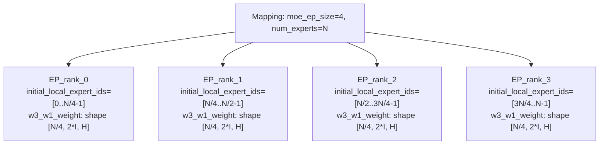
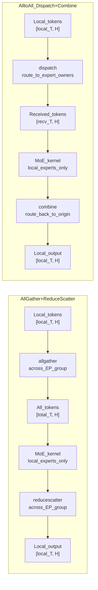
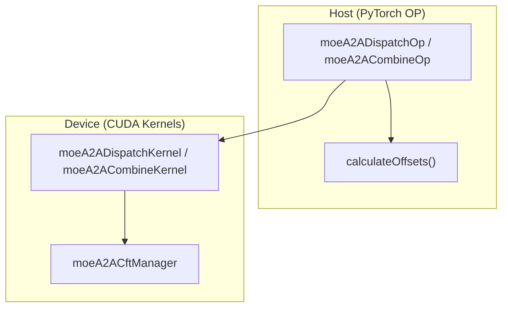

<!-- source: DeepWiki mcp.deepwiki.com · repo NVIDIA/TensorRT-LLM · page 14.3 Expert Parallelism · fetched 2026-10-26 -->

# Expert Parallelism

<details>
<summary>Relevant source files</summary>

The following files were used as context for generating this wiki page:

- [cpp/tensorrt_llm/kernels/communicationKernels/moeAlltoAllCftManager.h](cpp/tensorrt_llm/kernels/communicationKernels/moeAlltoAllCftManager.h)
- [cpp/tensorrt_llm/kernels/communicationKernels/moeAlltoAllCftSupport.h](cpp/tensorrt_llm/kernels/communicationKernels/moeAlltoAllCftSupport.h)
- [cpp/tensorrt_llm/kernels/communicationKernels/moeAlltoAllKernels.cu](cpp/tensorrt_llm/kernels/communicationKernels/moeAlltoAllKernels.cu)
- [cpp/tensorrt_llm/kernels/communicationKernels/moeAlltoAllKernels.h](cpp/tensorrt_llm/kernels/communicationKernels/moeAlltoAllKernels.h)
- [cpp/tensorrt_llm/kernels/customMoeRoutingKernels.cu](cpp/tensorrt_llm/kernels/customMoeRoutingKernels.cu)
- [cpp/tensorrt_llm/kernels/customMoeRoutingKernels.h](cpp/tensorrt_llm/kernels/customMoeRoutingKernels.h)
- [cpp/tensorrt_llm/kernels/moeTopKFuncs.cuh](cpp/tensorrt_llm/kernels/moeTopKFuncs.cuh)
- [cpp/tensorrt_llm/thop/customMoeRoutingOp.cpp](cpp/tensorrt_llm/thop/customMoeRoutingOp.cpp)
- [cpp/tensorrt_llm/thop/moeAlltoAllMeta.h](cpp/tensorrt_llm/thop/moeAlltoAllMeta.h)
- [cpp/tensorrt_llm/thop/moeAlltoAllOp.cpp](cpp/tensorrt_llm/thop/moeAlltoAllOp.cpp)
- [tensorrt_llm/_torch/alltoall_watchdog.py](tensorrt_llm/_torch/alltoall_watchdog.py)
- [tensorrt_llm/_torch/distributed/moe_alltoall.py](tensorrt_llm/_torch/distributed/moe_alltoall.py)
- [tensorrt_llm/_torch/models/modeling_glm.py](tensorrt_llm/_torch/models/modeling_glm.py)
- [tensorrt_llm/_torch/models/modeling_hunyuan_moe.py](tensorrt_llm/_torch/models/modeling_hunyuan_moe.py)
- [tensorrt_llm/_torch/modules/fused_moe/MOE_DEVELOPER_GUIDE.md](tensorrt_llm/_torch/modules/fused_moe/MOE_DEVELOPER_GUIDE.md)
- [tensorrt_llm/_torch/modules/fused_moe/__init__.py](tensorrt_llm/_torch/modules/fused_moe/__init__.py)
- [tensorrt_llm/_torch/modules/fused_moe/communication/communication_factory.py](tensorrt_llm/_torch/modules/fused_moe/communication/communication_factory.py)
- [tensorrt_llm/_torch/modules/fused_moe/communication/nvlink_one_sided.py](tensorrt_llm/_torch/modules/fused_moe/communication/nvlink_one_sided.py)
- [tensorrt_llm/_torch/modules/fused_moe/fused_moe_cute_dsl_b12x.py](tensorrt_llm/_torch/modules/fused_moe/fused_moe_cute_dsl_b12x.py)
- [tensorrt_llm/_torch/modules/fused_moe/fused_moe_densegemm.py](tensorrt_llm/_torch/modules/fused_moe/fused_moe_densegemm.py)
- [tensorrt_llm/_torch/modules/fused_moe/impl_base.py](tensorrt_llm/_torch/modules/fused_moe/impl_base.py)
- [tensorrt_llm/_torch/modules/fused_moe/impl_blocks.py](tensorrt_llm/_torch/modules/fused_moe/impl_blocks.py)
- [tensorrt_llm/_torch/modules/fused_moe/impl_contract.py](tensorrt_llm/_torch/modules/fused_moe/impl_contract.py)
- [tensorrt_llm/_torch/modules/fused_moe/impl_identity.py](tensorrt_llm/_torch/modules/fused_moe/impl_identity.py)
- [tensorrt_llm/_torch/modules/fused_moe/mega_moe/mega_moe_cute_dsl.py](tensorrt_llm/_torch/modules/fused_moe/mega_moe/mega_moe_cute_dsl.py)
- [tensorrt_llm/_torch/modules/fused_moe/mega_moe/mega_moe_deepgemm.py](tensorrt_llm/_torch/modules/fused_moe/mega_moe/mega_moe_deepgemm.py)
- [tensorrt_llm/_torch/modules/fused_moe/routing.py](tensorrt_llm/_torch/modules/fused_moe/routing.py)
- [tensorrt_llm/_torch/modules/fused_moe/weight_owner.py](tensorrt_llm/_torch/modules/fused_moe/weight_owner.py)
- [tensorrt_llm/_torch/modules/fused_moe/wide_ep_ft.py](tensorrt_llm/_torch/modules/fused_moe/wide_ep_ft.py)
- [tests/unittest/_torch/modules/moe/test_moe_a2a_cft.py](tests/unittest/_torch/modules/moe/test_moe_a2a_cft.py)
- [tests/unittest/_torch/modules/moe/test_moe_comm.py](tests/unittest/_torch/modules/moe/test_moe_comm.py)
- [tests/unittest/_torch/modules/test_alltoall_watchdog.py](tests/unittest/_torch/modules/test_alltoall_watchdog.py)
- [tests/unittest/_torch/modules/test_moe_routing.py](tests/unittest/_torch/modules/test_moe_routing.py)
- [tests/unittest/_torch/multi_gpu/test_moe_a2a.py](tests/unittest/_torch/multi_gpu/test_moe_a2a.py)
- [tests/unittest/_torch/thop/parallel_hw_agnostic/test_noaux_tc.py](tests/unittest/_torch/thop/parallel_hw_agnostic/test_noaux_tc.py)

</details>


## Purpose and Scope

This page covers expert parallelism (EP) in TensorRT-LLM: how MoE expert weights are distributed across GPU ranks, how EP is configured through the `Mapping` class, communication strategies (All-to-All vs. All-Gather/Reduce-Scatter), and the integration with various MoE backends.

**Related Topics:**
- For runtime load balancing across experts (EPLB), see the [Expert Parallel Load Balancing](10.5) documentation.
- For MoE backend compute implementations, see [MoE Interface and Backend Implementations](10.1).
- For communication primitives (`AllReduce`, `allgather`, `reducescatter`), see [Communication Operations and Backends](14.5).
- For attention data parallelism that enables Wide-EP, see [Context Parallelism and Attention DP](14.4).

---

## What is Expert Parallelism?

Expert parallelism (EP) is a distributed parallelism strategy for Mixture of Experts (MoE) models where different GPU ranks own different subsets of expert weights. Unlike tensor parallelism (TP) which shards individual weight matrices, EP partitions the entire set of experts across ranks.

**When to use EP:**
- Large number of experts (e.g., DeepSeek models with 100+ experts).
- Expert weights don't fit on a single GPU memory.
- Need to scale MoE models across many GPUs without the overhead of deep TP sharding.
- Want to scale expert capacity independently of token throughput.

**Key trade-off:** EP requires communication (Dispatch/Combine or AllGather/ReduceScatter) to route tokens to their assigned experts, but allows distributing a large number of experts across many GPUs without replicating weights.

Sources: [tensorrt_llm/_torch/modules/fused_moe/interface.py:214-225](), [tensorrt_llm/_torch/modules/fused_moe/communication/communication_factory.py:16-21]()

---

## Core Concepts

### Experts vs. Slots

| Term | Meaning |
|------|---------|
| **Expert** | Model-level concept; router assigns tokens to expert indices `[0, num_experts)`. |
| **Slot** | Physical weight slot on a GPU. Normally `num_slots = num_experts`. With redundant experts (EPLB), `num_slots ≥ num_experts`; some experts may have multiple replicas across ranks. |

Weight tensor shapes are determined by `num_slots`, not `num_experts`. The separation is managed by `MoE._init_load_balancer()` and `MoE.num_slots`.

Sources: [tensorrt_llm/_torch/modules/fused_moe/interface.py:257-270](), [tensorrt_llm/_torch/modules/fused_moe/communication/nvlink_one_sided.py:106-110]()

### EP and MoE-TP

Two independent parallelism dimensions exist within MoE layers:

| Dimension | Parameter | Meaning |
|-----------|-----------|---------|
| Expert Parallelism | `moe_ep_size` | Different GPU ranks own different expert subsets. |
| MoE Tensor Parallelism | `moe_tp_size` | Within each EP rank, expert weight matrices are further sharded (TP over the hidden/intermediate dims). |

These are separate from the attention `tp_size` and `pp_size`.

Sources: [tensorrt_llm/_torch/modules/fused_moe/interface.py:228-243]()

---

## Configuration via `Mapping`

EP parameters are read from the `Mapping` object in `MoE.__init__()`:

| `Mapping` Attribute | Role in EP |
|--------------------|-----------|
| `moe_ep_size` | Total number of EP ranks. |
| `moe_ep_rank` | This rank's index in the EP group. |
| `moe_tp_size` | TP fanout within each MoE expert. |
| `moe_tp_rank` | This rank's position within MoE-TP group. |
| `enable_attention_dp` | Required `True` for AllToAll-based EP (Wide-EP). |

Sources: [tensorrt_llm/_torch/modules/fused_moe/interface.py:228-243]()

---

## Expert Weight Distribution Per Rank

Each EP rank holds a contiguous slice of slots. The slice is computed once at initialization in `MoE._init_expert_parallel_group()` using `_compute_ep_partition`:

```python
# Logic from interface.py
expert_size, slot_start, slot_end = _compute_ep_partition(self.num_slots, self.ep_size, self.ep_rank)
```

Weight tensor shapes are created based on `expert_size_per_partition`. For example, in `UnquantizedFusedMoEMethod.create_weights()`:

| Tensor | Shape |
|--------|-------|
| `w3_w1_weight` (up + gate projection) | `[expert_size_per_partition, 2 * intermediate_size // moe_tp_size, hidden_size]` |
| `w2_weight` (down projection) | `[expert_size_per_partition, hidden_size, intermediate_size // moe_tp_size]` |

Sources: [tensorrt_llm/_torch/modules/fused_moe/interface.py:58-83](), [tensorrt_llm/_torch/modules/fused_moe/interface.py:245-255](), [tensorrt_llm/_torch/modules/fused_moe/quantization.py:630-642]()

**Expert weight sharding diagram (EP=4, no redundancy):**



Sources: [tensorrt_llm/_torch/modules/fused_moe/interface.py:245-255](), [tensorrt_llm/_torch/modules/fused_moe/quantization.py:630-642]()

---

## Communication Patterns

EP requires communication because each token may be routed to an expert owned by a different rank. The `CommunicationFactory` selects the best method based on hardware and config [tensorrt_llm/_torch/modules/fused_moe/communication/communication_factory.py:70-80]().

### AllGather + ReduceScatter (Standard EP)

Used as a fallback or when MoE TP is enabled (`moe_tp_size != 1`) [tensorrt_llm/_torch/modules/fused_moe/communication/communication_factory.py:145-146]().

1. Each rank has its local tokens `x` with shape `[local_tokens, hidden_size]`.
2. **AllGather** across the EP group → `[all_tokens, hidden_size]`.
3. Every rank runs the MoE kernel but only processes tokens assigned to its local experts.
4. **ReduceScatter** sums partial outputs and distributes them back to token-owning ranks.

Sources: [tensorrt_llm/_torch/modules/fused_moe/communication/allgather_reducescatter.py:16-30]()

### AlltoAll Dispatch + Combine (Wide EP)

Wide-EP leverages high-performance All-to-All kernels to move tokens directly to expert owners.

1. **Dispatch**: Send tokens to the EP rank owning the target expert.
2. **MoE Kernel**: Execute on received tokens.
3. **Combine**: Route results back to the originating rank.

**AllGather vs. AlltoAll communication flow:**



Sources: [tensorrt_llm/_torch/modules/fused_moe/communication/communication_factory.py:98-105](), [tensorrt_llm/_torch/modules/fused_moe/communication/base.py:16-25]()

---

## Communication Strategies

The system supports multiple specialized communication backends:

| Strategy | Implementation | Hardware Requirements |
| :--- | :--- | :--- |
| **NVLink One-Sided** | `NVLinkOneSided` | NVLink, MNNVL/Symmetric Memory [tensorrt_llm/_torch/modules/fused_moe/communication/nvlink_one_sided.py:140-149]() |
| **NVLink Two-Sided** | `NVLinkTwoSided` | NVLink, optimized for latency [tensorrt_llm/_torch/modules/fused_moe/communication/nvlink_two_sided.py:20-25]() |
| **DeepEP** | `DeepEP` | DeepEP library, intranode/internode [tensorrt_llm/_torch/modules/fused_moe/communication/deep_ep.py:20-30]() |
| **NCCL EP** | `NcclEP` | NCCL EP library, low-latency [tensorrt_llm/_torch/modules/fused_moe/communication/nccl_ep.py:20-25]() |

### Counted Fabric Transfers (CFT)
For `NVLinkOneSided`, the system can use **CFT Counted Writes** (`fabric.try_put.counted`) via Logical Endpoints (LE) to improve synchronization efficiency at small/medium batch sizes [tensorrt_llm/_torch/modules/fused_moe/communication/nvlink_one_sided.py:50-56](), [cpp/tensorrt_llm/kernels/communicationKernels/moeAlltoAllKernels.h:102-106]().

Sources: [tensorrt_llm/_torch/modules/fused_moe/communication/nvlink_one_sided.py:140-150](), [cpp/tensorrt_llm/kernels/communicationKernels/moeAlltoAllKernels.cu:74-85]()

---

## Routing and Load Balancing

Expert parallelism performance is highly dependent on how tokens are routed. TensorRT-LLM supports various routing methods and "Perfect Router" simulations for testing.

### Routing Methods
- `DefaultMoeRoutingMethod`: Standard top-k softmax routing [tensorrt_llm/_torch/modules/fused_moe/routing.py:17-25]().
- `DeepSeekV3MoeRoutingMethod`: Specialized group-based routing for DeepSeek-V3 [tensorrt_llm/_torch/modules/fused_moe/routing.py:54-60]().

### Perfect Router
To test communication efficiency without router noise, `get_cached_perfect_router_logits` synthesizes logits that ensure a perfectly balanced token distribution across all EP ranks [tensorrt_llm/_torch/modules/fused_moe/routing.py:176-185]().

Sources: [tensorrt_llm/_torch/modules/fused_moe/routing.py:30-49](), [tests/unittest/_torch/modules/test_moe_routing.py:27-40]()

---

## Implementation Details: C++ Kernels

The core of the All-to-All communication resides in CUDA kernels located in `cpp/tensorrt_llm/kernels/communicationKernels/`.

### Dispatch and Combine Kernels
- **Dispatch Kernel**: Pushes local tokens to remote peer symmetric memory buffers [cpp/tensorrt_llm/kernels/communicationKernels/moeAlltoAllKernels.h:71-76]().
- **Combine Kernel**: Pulls expert results from remote peer buffers and reduces them locally [cpp/tensorrt_llm/kernels/communicationKernels/moeAlltoAllKernels.h:128-132]().

### Data Flow and Memory Management
The `MoeA2ADataOffsets` structure manages the layout of auxiliary data (counters, flags, indices) in the workspace [cpp/tensorrt_llm/thop/moeAlltoAllOp.cpp:91-105]().



Sources: [cpp/tensorrt_llm/thop/moeAlltoAllOp.cpp:91-143](), [cpp/tensorrt_llm/kernels/communicationKernels/moeAlltoAllKernels.cu:69-75]()

---

## MoE Backends and EP Capabilities

The MoE system uses a factory pattern to select backends based on `ModelConfig.moe_backend`.

| `moe_backend` String | Class | Key Characteristics |
| :--- | :--- | :--- |
| `CUTLASS` | `CutlassFusedMoE` | High-throughput Hopper/Blackwell kernels [tensorrt_llm/_torch/modules/fused_moe/fused_moe_cutlass.py:6-10](). |
| `TRTLLM` | `TRTLLMGenFusedMoE` | Min-latency Blackwell kernels for FP8/FP4 [tensorrt_llm/_torch/modules/fused_moe/fused_moe_trtllm_gen.py:9-10](). |
| `DENSEGEMM` | `DenseGEMMFusedMoE` | Blackwell CuTe DSL kernels for NVFP4 [tensorrt_llm/_torch/modules/fused_moe/fused_moe_densegemm.py:104-110](). |
| `DEEPGEMM` | `DeepGemmFusedMoE` | Triton-based FP8 kernels for DeepSeek [tensorrt_llm/_torch/modules/fused_moe/mega_moe/mega_moe_deepgemm.py:22](). |

### Wide-EP Integration
`WideEPMoE` orchestrates execution when large EP groups are used, ensuring that attention data parallelism (Attention DP) is correctly configured [tensorrt_llm/_torch/modules/fused_moe/communication/communication_factory.py:139-141]().

Sources: [tensorrt_llm/_torch/modules/fused_moe/interface.py:214-230](), [tensorrt_llm/_torch/modules/fused_moe/fused_moe_densegemm.py:135-150]()

---

